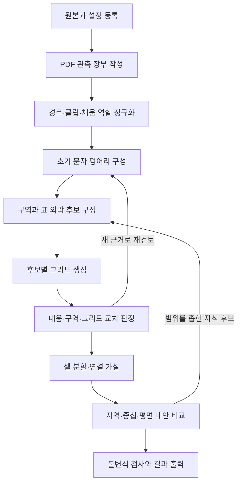

# PDF 표 추론 시스템: 세 관점에 기반한 설계와 구현 계획

- 문서 버전: 0.1
- 작성일: 2026-10-17
- 상태: 사고실험을 바탕으로 한 구현 제안
- 대상 입력: 문자와 벡터 그리기 명령을 포함한 PDF
- 우선순위: 정확성, 근거 추적, 판정 보류, 재현성, 처리 속도의 순서

## 1. 목적과 현재 위치

PDF의 **문자 덩어리**, **사각구역과 경계**, **그리드**를 순서대로 구성하고 서로 대조하여 표의 외곽, 셀, 행·열 범위, 포함 관계를 추론한다.

현재까지 작성한 스크립트는 몇 개의 샘플을 설명하는 실험 구현이다. 이 문서는 이를 일반적인 엔진으로 발전시키기 위한 설계이며, 엔진이 이미 완성되었거나 기존 연구보다 정확하다는 주장을 포함하지 않는다.

문서에서 사용하는 근거의 상태는 다음과 같다.

| 구분 | 의미 | 예 |
|---|---|---|
| 관측 | PDF에서 직접 읽은 객체·속성 | 문자 위치, 채움 사각형, 클리핑 경로 |
| 유도 | 명시한 변환 규칙으로 계산한 결과 | 선분 결합, 문자 덩어리, 점선의 반복 구간 |
| 가설 | 관측·유도를 설명하는 구조 후보 | 표 외곽, 셀 병합, 부모 표와 자식 표 |
| 사용자 확인 | 사용자가 제공한 작성 배경 또는 표 여부 | 첫 샘플의 ‘보도시점’ 영역은 표라는 확인 |
| 보류 | 현재 정보로 결정하지 못한 관계 | 하나의 격자와 지역 표 계층 중 어느 해석이 적합한가 |

관측, 유도, 가설을 같은 객체로 덮어쓰지 않는다.

## 2. 범위와 요구사항

### 2.1 입력과 출력

입력에서 말하는 ‘Tag’는 구조 태그인 `/Table`, `/TR`, `/TD`가 아니라 `m`, `l`, `re`, `S`, `f`, `d`, `W`, `W*` 등의 **콘텐츠 스트림 연산자와 그래픽 속성**이다. 구조 태그가 없어도 동작해야 한다.

초기 엔진은 수평·수직 배치의 텍스트 기반 PDF를 우선 지원한다. 이미지 객체는 위치와 크기를 가진 내용 덩어리로 취급한다. 이미지 내부 문자 인식은 초기 범위에 넣지 않는다. 회전·곡선·임의 경로를 지원하지 못한 경우에는 해당 영역을 명시적으로 보류한다.

출력에는 다음을 포함한다.

1. 페이지와 객체의 좌표 및 원본 명령 참조.
2. 보정 전후의 문자 덩어리.
3. 클리핑 구역, 경계 후보, 표 후보.
4. 표별 그리드와 셀의 행·열 범위.
5. 셀별 내용 소속과 부모·자식 후보 관계.
6. 채택한 규칙, 충돌, 대안, 미결정 이유.

### 2.2 필수 요구사항

| ID | 요구사항 |
|---|---|
| REQ-01 | 판단은 PDF의 네이티브 문자·벡터 정보로 수행한다. 래스터 렌더링은 검토용이다. |
| REQ-02 | 모든 유도 객체에서 원본 객체와 적용 규칙을 역추적할 수 있어야 한다. |
| REQ-03 | 필터는 원본을 삭제하지 않고 분석용 분류·제외 표시를 생성해야 한다. |
| REQ-04 | 세 관점을 단계적으로 실행하되 이전 결과를 다시 검토할 수 있어야 한다. |
| REQ-05 | 실선, 점선, 채움 띠, 무경계 구간을 구분해야 한다. |
| REQ-06 | 하나의 셀 안에 여러 문자 덩어리와 이미지가 들어갈 수 있어야 한다. |
| REQ-07 | 그리드는 표 후보와 해석 가설에 종속되어야 한다. |
| REQ-08 | 중첩, 경계 공유, 병합 후보를 표현하고 경쟁하는 해석을 보존해야 한다. |
| REQ-09 | 증거 부족·지원하지 않는 입력·모순을 ‘표 없음’으로 처리하지 않아야 한다. |
| REQ-10 | 파일 해시·설정·규칙 버전이 같으면 결과와 객체 ID가 재현되어야 한다. |

## 3. 2016년 논문과의 관계

기준 문헌은 Shigarov, Mikhailov, Altaev의 *Configurable Table Structure Recognition in Untagged PDF Documents*이다.[1]

논문은 전처리, 문자 덩어리 복원, 셀 복원의 세 단계를 제시한다. 문자 결합에는 거리·투영·글꼴·출력 순서·경계 조건을 사용한다. 사각형은 변으로 분해하고 선분을 결합한다. 비어 있지 않은 한 셀과 한 문자 덩어리가 대응한다고 가정한다. 행·열은 여백 분석 또는 연결된 문자 덩어리 분석으로 구성한다. 이 두 방법은 설정에서 선택한다. 당시 프로토타입은 표 영역의 수동 선택을 전제로 설명된다.[1, §2–§5]

이 문서의 제안은 다음과 같이 구분한다.

| 요소 | 논문에서 참고한 원리 | 본 설계의 선택 |
|---|---|---|
| 내용 | 문자 배치와 경계에 따른 결합 | 경계를 사용하지 않은 초기 덩어리를 보존하고 별도 보정본 생성 |
| 구역 | 사각형과 선을 경계 정보로 해석 | 클리핑 구역, 채움 띠, 도형 경계의 역할을 분리 |
| 그리드 | 문자 덩어리로 행·열 구성 | 구역 기반과 문자 기반의 축 후보를 함께 만들고 비교 |
| 셀 | 문자 덩어리와 셀의 대응 | 여러 덩어리·이미지·빈 영역을 허용 |
| 계층 | 본문에 구체적인 재귀 복원 절차가 제시되지 않음 | 지역 그리드와 포함 가설을 별도 모델로 제안 |

이후 절차·자료형·규칙은 본 프로젝트를 위한 제안이다. 논문의 정확한 재현을 목표로 하는 구현과 구분하여 검증한다.

## 4. 유지해야 할 개념 구분

### 4.1 사각형의 네 가지 역할

| 객체 | 의미 | 사용할 수 있는 증거 | 단독으로 확정할 수 없는 것 |
|---|---|---|---|
| 클리핑 구역 | 그리기가 보일 수 있는 범위를 제한 | 내용 배치·반복 분할·포함 관계의 흔적 | 실제 테두리, 논리적 셀 |
| 채움 사각형 | 색칠된 면 | 배경, 강조, 가느다란 경계 띠 후보 | 모든 변이 셀 경계라는 판단 |
| 그려진 사각 경로 | 스트로크 등으로 칠해진 경로 | 가시 경계 후보 | 표 여부, 작성 당시의 셀 객체 |
| 추론 사각구역 | 여러 증거에서 얻은 영역 | 표 외곽·셀 후보 | 원본 PDF에 동일 객체가 있었다는 주장 |

사각형이라는 형태만으로 제거하지 않는다. 특히 가느다란 검은 채움 사각형은 경계선일 수 있다.

### 4.2 경계의 부재와 병합

**칠해진 선이 없다는 사실은 두 칸 사이에 논리적 셀 경계가 없다는 뜻이 아니다.** 무테두리 표에는 서로 다른 셀 사이에도 선이 없다.

따라서 ‘선 없음’을 관측한 뒤에는 최소한 다음 두 가설을 비교한다.

- 한 셀이 두 기본 칸을 차지한다.
- 서로 다른 두 셀이 테두리 없이 배치되어 있다.

문자 배치, 클리핑 분할, 이웃 셀의 반복, 지역 그리드의 일관성을 추가로 사용한다. 결정할 근거가 없으면 병합 관계를 보류한다.

### 4.3 가상 그리드와 실제 경계

가상 축이 문자 덩어리를 통과할 수 있다. 병합 셀은 여러 기본 칸에 걸치기 때문이다. 그러므로 가상 축과 문자의 교차는 진단 정보다.

반면, 셀 구분선으로 채택한 실제 경계가 하나의 내용 덩어리를 가로지르면 내용 결합, 경계의 역할 또는 셀 가설을 재검토한다. 밑줄이나 취소선까지 무조건 셀 구분선으로 취급해서는 안 된다.

## 5. 좌표와 PDF 해석 계층

### 5.1 좌표 규약

- 내부 기준 좌표는 페이지 회전을 정규화한 좌상단 원점, 오른쪽과 아래쪽이 양수인 포인트 좌표로 한다.
- 원본 좌표, 변환 행렬, 페이지 상자, 회전, 원본 단위 정보도 보존한다.
- 계산 중 원본 값을 0.001pt 등으로 강제 반올림하지 않는다. 직렬화 표시 정밀도와 계산 허용오차를 분리한다.
- 축 정규화는 고정된 기준 좌표에 수행하고 원본과 보정량을 기록한다. 순차적인 근접 결합으로 좌표가 계속 이동하는 현상을 방지한다.

한 좌표가 허용오차 안의 여러 축에 대응하면 스냅을 보류한다. 가까운 이중선이나 좁은 열을 하나로 합치지 않도록 지역 축 간격과 허용오차를 함께 검사한다. 길이 오차와 면적 오차는 단위가 다르므로 각각의 판정 기준을 정의한다.

### 5.2 PDF 백엔드의 책임

PDF 연산자의 정확한 실행 의미는 검증된 PDF 해석 백엔드가 담당하도록 한다. 현재의 샘플 전용 경로 파서를 그대로 엔진의 PDF 해석기로 승격하지 않는다.

백엔드 어댑터는 다음을 제공해야 한다.

1. 문자 코드와 가능한 Unicode 값, 글꼴 정보, 배치·진행 방향, 출력 순서.
2. 스트로크·채움·클리핑 경로와 적용된 변환·스타일.
3. 그래픽 상태와 경로 상태를 PDF 규칙에 맞게 해석한 결과.
4. Form XObject 재사용을 구분할 호출 경로와 변환 정보.
5. 실제 페인팅 여부 및 가시성을 판단할 수 있는 정보 또는 그 판단이 불완전하다는 표시.

원본 명령 참조는 단순한 페이지 내 정수 하나보다 다음과 같은 경로를 권장한다.

```text
document_hash / page / content_stream / form_invocation_path / operator_index
```

클리핑 경로는 현재 적용 중인 클리핑 영역과 구별하여 저장한다. 직사각형이 아닌 클립은 경계상자로만 대체하지 말고, 근사 여부와 원래 경로를 남긴다.

### 5.3 가시성 정책

흰색 문자는 색 배경 위에서 보일 수 있다. 색상만으로 제외하지 않는다. 렌더링 모드·클립·투명도·덮임을 충분히 해석하지 못하면 `visibility=unknown`으로 둔다.

공백이나 비페인팅 문자도 원본 장부에는 남긴다. 문자열 복원과 기하 클러스터링에서 사용할지 별도로 결정한다. Unicode 해석 실패는 문자 객체의 위치 손실로 이어지지 않아야 한다.

## 6. 데이터 모델

### 6.1 핵심 객체

| 객체 | 주요 필드 | 관계 |
|---|---|---|
| `SourceObject` | ID, 원본 명령 참조, 원본·정규 좌표, 스타일, 가시성 | 관측 장부 |
| `Glyph` | SourceObject ID, bbox, baseline, font, text, order | 문자 덩어리의 구성 요소 |
| `ContentBlock` | 구성 Glyph/Image ID, bbox, 생성 방식, revision | 보정 전후를 모두 보존 |
| `ClipRegion` | 경로, bbox, 적용 범위, rectangular 여부 | 셀과 자동 동일시하지 않음 |
| `BoundaryCandidate` | 경로/중심선, 폭, 연속성, 원본 지지 구간 | 가시 또는 복원된 경계 후보 |
| `RegionCandidate` | 외곽, 내용·구역 소속, 생성 규칙 | 표 후보의 입력 |
| `GridHypothesis` | 범위, 정렬된 X/Y 축, 축별 근거, revision | 기본 칸을 정의 |
| `Tile` | grid ID, 행·열 인덱스, bbox | 특정 그리드에 종속 |
| `CellHypothesis` | Tile 집합, 행·열 범위, 내용 ID, side evidence | 구조 가설 |
| `TableHypothesis` | 후보 외곽, grid ID, cell ID, 포함 관계 | 대안별로 분리 |
| `DecisionRecord` | 규칙·설정 버전, 입력, 출력, 이유, 충돌 | 판단 이력 |

셀 번호는 내부적으로 0부터 시작하고, 사용자 표시에서는 1부터 시작한다. 내부 행·열 범위는 `[start, end)`로 통일한다. `rowspan = row_end - row_start`이다.

### 6.2 증거와 판단 기록 예시

```typescript
type PaintPresence = "present" | "absent" | "unknown";
type SeparatorRole = "separator" | "passage" | "undecided";
type ResultStatus =
  | "accepted" | "ambiguous" | "rejected"
  | "unsupported" | "incomplete";

interface SharedEdgeDecision {
  tileIds: [string, string];
  paintPresence: PaintPresence;
  separatorRole: SeparatorRole;
  rawPaintCoverage: number | null;
  regularizedCoverage: number | null;
  evidenceIds: string[];
  conflictIds: string[];
  ruleId: string;
  ruleVersion: string;
}
```

`paintPresence=absent`에서 `separatorRole=passage`로 자동 전이하지 않는다. `passage`는 해당 가설에서 칸을 연결할 추가 근거가 있을 때 부여한다.

## 7. 세 관점의 구성

### 7.1 관점 T: 내용 덩어리

첫 번째 결과는 경계와 클립에 의존하지 않는 문자 덩어리 `T0`이다.

1. 문자별 배치와 방향을 정규화한다.
2. 기준선과 글자 크기를 이용해 같은 줄 후보를 만든다.
3. 글자 간격과 투영 관계로 줄 조각을 만든다.
4. 줄 간격·정렬·크기 관계로 여러 줄을 묶는다.
5. 작은 위첨자·아래첨자는 별도의 규칙으로 처리한다.

출력 순서와 글꼴 일치는 선택적인 추가 증거로 남긴다. PDF 생성기가 순서를 보존한다고 무조건 가정하지 않는다. 문자 결합 규칙의 켜기·끄기를 비교할 수 있어야 한다.

후속 단계가 경계와의 충돌을 발견하면 `T1`, `T2` 등의 보정본을 만든다. 원래 덩어리, 분할 이유, 구성 문자 ID를 유지한다.

문자 덩어리는 셀과 다르다. 한 셀 안에 여러 문단·목록·그림 설명이 있을 수 있다.

### 7.2 관점 S: 사각구역과 경계

서로 다른 종류를 분리하여 구성한다.

- 클리핑 구역: 중복, 인접, 포함, 겹침 관계를 계산한다.
- 스트로크: 변환과 선폭을 적용하고 수평·수직 구간을 얻는다.
- 가느다란 채움 띠: 폭·길이·색·연결 관계를 평가해 경계 후보로 만든다.
- 넓은 채움: 배경·강조 영역 후보로 남긴다.
- 고립 선분: 밑줄·장식일 가능성을 별도 표시한다.

종류별 배제는 분석 범위에만 적용한다. 원본 객체는 삭제하지 않는다. 폭이 가늘다는 조건 하나만으로 선 또는 장식을 확정하지 않는다.

클리핑 구역들이 겹침 없이 하나의 사각형을 채우고, 내용 배치와도 맞으면 외곽 후보의 근거가 된다. 이 조건을 충족하지 않는다고 표가 아니라고 결론내리지는 않는다.

한 행 또는 한 열이라는 이유만으로 후보를 제거하지 않는다. ‘보도시점’ 같은 한 행의 무테두리 표와 제목 띠의 구별에는 다른 관점의 증거가 필요하다.

### 7.3 관점 G: 그리드

표 후보마다 여러 축 생성 방법을 실행한다.

| 생성 방법 | 축의 근거 | 주요 주의점 |
|---|---|---|
| 구역 기반 | 반복되는 클리핑 구역의 변 | 모든 클립이 셀에 대응하지 않음 |
| 경계 기반 | 경계 후보의 위치와 교차 | 짧은 선·배경·장식의 혼입 |
| 내용 기반 | 정렬, 행 간격, 여백, 투영 | 병합·빈 셀·복수 문단의 영향 |

서로 다른 생성 방법의 축을 처음부터 하나로 합치지 않는다. 후보별 근거와 충돌을 비교하고 필요한 경우 통합 가설을 추가한다.

페이지 전체 축 투영은 비교·진단용 가설로 보존한다. 다른 표에서 나온 축을 현재 표에 적용한 경우 축의 출처를 기록한다. 지역 그리드가 항상 정답이라고 가정하지 않는다.

## 8. 기하와 셀 조합 규칙

### 8.1 기본 칸과 사각 셀

그리드 `g`의 축을 다음과 같이 둔다.

```text
X = [x0, x1, ..., xn],  x0 < x1 < ... < xn
Y = [y0, y1, ..., ym],  y0 < y1 < ... < ym
tile(g, r, c) = [xc, yr, x(c+1), y(r+1)]
```

셀 후보는 동일한 그리드에 속한 Tile의 집합이다. 사각 셀로 채택하려면 다음을 확인한다.

1. Tile이 변을 따라 연결되어 있다.
2. 집합이 행·열 인덱스의 연속된 직사각형을 이룬다.
3. 겹침이나 구멍이 없다.
4. 모든 Tile 면적의 합이 외접 사각형 면적과 일치한다.
5. 외곽과 내부 공유 변의 해석이 해당 가설의 경계 증거와 모순되지 않는다.

L자 영역을 외접 사각형 하나로 바꾸어 빈 부분까지 셀로 채우지 않는다. 초기 엔진에서는 비사각 셀을 보류한다.

### 8.2 공유 변의 두 종류의 질문

한 공유 변마다 다음을 각각 묻는다.

1. 이 위치에 실제 페인트가 있는가?
2. 이 위치가 셀 구분선인가?

둘은 다른 질문이다. 장식 선에는 페인트가 있지만 셀 구분선이 아닐 수 있고, 무테두리 표의 구분선에는 페인트가 없을 수 있다.

셀 연결에는 두 번째 질문의 답을 사용한다. 첫 번째 질문은 그 판단의 증거다. 미결정 공유 변이 남아 있으면 연결·분리 대안을 유지한다.

### 8.3 경계 지지율

후보 변의 길이를 `L`, 같은 위치에서 실제 페인트가 지지하는 구간의 합집합을 `U`라고 한다.

```text
raw_coverage = length(U) / L
```

겹치는 원본 선분은 길이를 중복 합산하지 않는다. 점선 복원 후 지지율은 별도의 `regularized_coverage`에 저장한다. 경계가 없는 경우 두 값을 1로 만들어서는 안 된다.

선폭 때문에 중심선 끝이 교차점에 못 미치는 경우에는 폭을 고려해 연결할 수 있다. 그 보정과 점선의 빈틈을 채우는 작업은 다른 규칙으로 기록한다.

### 8.4 점선 복원

같은 직선 위의 조각들에 대해 길이·간격·스타일의 반복성을 검사한다. 단순히 가깝다는 이유로 긴 빈 구간을 잇지 않는다.

- 최소 반복 수와 길이·간격의 분산 조건을 둔다.
- 끝의 잘린 조각은 내부 반복과 구분하여 평가한다.
- 원본 조각, 실제 빈틈, 복원 구간을 모두 남긴다.
- 복원 구간이 문자나 다른 구조를 잘못 가로지르면 충돌을 기록한다.

점선으로 둘러싸인 영역은 원본 선들만으로 위상적으로 닫힌 영역이라고 표현하지 않는다. `closure_kind`는 `painted_continuous`, `periodic_regularized`, `inferred_borderless`로 구분한다.

### 8.5 색과 최소 칸의 합성

색은 최소 칸의 소속과 조합을 확인하는 표시 수단으로 사용한다. 실제 식별자는 `(grid_id, revision, row, column)`이다.

병합 후보는 구성 Tile ID 집합을 보존한다. 색이 같아졌다는 이유로 구성 정보를 잃지 않는다. 다른 그리드에서 얻은 칸은 좌표 변환 또는 공통 세분화 없이 직접 합성하지 않는다.

Operad는 장기적인 정식화 후보로 남긴다. 초기 구현은 타입을 가진 사각 분할과 합성으로 충분하다. Operad로 명명하려면 허용 합성, 항등원, 결합법칙, 그리드 변환의 의미를 추가로 정의·검증해야 한다. 현재 사고실험이 이 수학적 구조를 증명한 것은 아니다.

## 9. 세 관점의 교차 판정

### 9.1 규칙 명세

각 규칙은 `입력 / 전제 / 결과 / 불충분 시 처리 / 근거`를 갖는다.

| ID | 전제와 검사 | 결과 또는 보류 |
|---|---|---|
| R-T01 | 문자 간격·기준선·투영이 일관됨 | 초기 내용 결합 후보 생성 |
| R-T02 | 결합 덩어리 내부를 채택된 셀 구분선이 가로지름 | 원문자에서 재분할하거나 경계 역할을 재검토 |
| R-S01 | 클립 분할이 사각영역을 채우고 내용 소속이 일관됨 | 표 외곽 후보의 지지 증거 추가 |
| R-S02 | 가느다란 채움 띠가 다른 경계와 구조적으로 연결됨 | 경계 후보 추가; 원래 채움 객체 보존 |
| R-S03 | 짧은 선분이 반복 패턴을 만족함 | 복원 경계 추가; 원본 지지율과 분리 |
| R-G01 | 같은 지역의 구역·경계·내용에서 축이 반복됨 | 지역 그리드 후보 생성 |
| R-G02 | 외부 영역의 축이 내용과 새 교차를 만듦 | 전역·지역 대안을 비교; 자동 오류 판정 금지 |
| R-C01 | 공유 변의 구조적 역할이 `separator` | 해당 변을 넘어 셀을 합치지 않음 |
| R-C02 | 공유 변이 `passage`이며 합성 결과가 사각형 | 연결 셀 후보 생성 |
| R-C03 | 페인트만 없고 구조적 역할은 미결정 | 병합·분리 대안 보존 |
| R-H01 | 구역이 한 부모 셀 안에서 자체 행·열 구조를 형성함 | 내부 표 가설 생성 |
| R-H02 | 내부 구역이 부모 외곽의 일부를 공유함 | 공유 경계 참조 허용; 완전한 여백을 요구하지 않음 |

R-T02는 모든 그림 선을 대상으로 하지 않는다. 밑줄·취소선·장식의 가능성을 먼저 평가해야 한다.

### 9.2 채택 기준

숫자 하나를 임의로 만들어 ‘정확도’라고 표시하지 않는다. 다음을 별도로 보고한다.

- 관측의 완전성과 가시성 해석 범위.
- 사용한 근거 종류와 독립성.
- 충족한 구조 제약.
- 해결되지 않은 충돌과 경쟁 가설.
- 사람이 확인한 항목과 아직 확인하지 않은 항목.

같은 클립에서 파생한 구역과 축의 일치는 독립적인 두 증거가 아니다. 근거 장부에 파생 관계를 기록하여 중복 지지를 방지한다.

### 9.3 최소 불변식

하나의 채택 가설 안에서 다음을 지킨다.

1. 내용 객체는 누락 없이 소속되거나, 명시적으로 미할당·지원 불가 상태로 남는다.
2. 한 내용 객체가 겹치지 않는 여러 말단 셀에 중복 배정되지 않는다.
3. 부모 셀에는 자식 표 참조를 둘 수 있으나, 자식 내용을 부모의 직접 내용으로 중복 집계하지 않는다.
4. 사각 분할 가설에서는 Tile들이 중복 없이 가설의 대상 영역을 덮는다.
5. 표시용 가상 축은 원본 경계의 증거로 환류되지 않는다.
6. 결과를 보정해도 원본 객체와 보정 전 결과는 그대로 조회할 수 있다.

## 10. 중첩 표와 경쟁 해석

### 10.1 두 가설을 함께 표현

한 영역이 ‘표 안의 표’처럼 보이면 다음을 생성할 수 있다.

- `H_flat`: 하나의 격자와 병합 셀로 전체 영역을 설명한다.
- `H_nested`: 부모 셀과 그 안의 지역 표·그리드로 설명한다.

계층 가설은 분석상의 구조이며 작성 프로그램의 내부 객체를 복원했다는 뜻이 아니다. 엑셀에서 작성했다는 배경만으로 지역 분석의 유용성이 사라지거나 중첩 객체의 존재가 확정되는 것은 아니다.

### 10.2 재귀 분석의 전제

자식 표 후보는 다음을 검사한다.

1. 하나의 부모 셀에 포함되는가? 공유 경계는 있는가?
2. 자체적인 행·열 관계와 내용 분할을 갖는가?
3. 자식 축을 부모 전체에 적용했을 때 추가 설명이 필요한가?
4. 부모·자식 해석이 내용 중복 없이 함께 성립하는가?
5. 더 단순한 평면 해석도 동일한 증거를 설명하는가?

부모·자식 판정은 그림의 상대적인 크기나 선폭 하나로 확정하지 않는다. 경계 공유만으로 두 표를 하나로 합치지도 않는다.

### 10.3 종료와 보류

- 같은 관측·범위·규칙으로 만든 동일 후보는 재생성하지 않는다.
- 부모 참조에 순환이 없어야 한다.
- 부모와 동일한 범위를 같은 내용으로 재귀 분석하는 무의미한 반복을 차단한다.
- 재귀 깊이·후보 수·반복 수 제한에 닿으면 `incomplete`와 탐색 제한 이유를 출력한다.
- 자식이 부모 전체를 차지하는 경우에는 추가적인 범위 축소가 없으므로 별도 설명 이득이 없는 계층 추가를 허용하지 않는다.

초기 버전의 계층 해석은 사람이 검토할 수 있는 가설로 제공한다. 하나의 샘플에서 성립한 포함 구조를 모든 PDF에 일반화하지 않는다.

## 11. 단계별 파이프라인과 상태머신

한 번에 모든 방법을 섞기보다 다음 순서로 실행한다. 서로 다른 후보 방법도 각 단계에서 정해진 순서로 실행한다.



### 11.1 실행 상태

```text
REGISTERED
→ OBSERVED
→ NORMALIZED
→ CONTENT_READY
→ REGIONS_READY
→ GRIDS_READY
→ RECONCILED
→ VALIDATED
→ EXPORTED
```

실행 상태는 어느 처리가 끝났는지를 뜻한다. 가설의 `accepted`, `ambiguous`, `rejected`와 구별한다. 파이프라인이 끝나도 결과가 모호할 수 있다.

PDF 해석기의 그래픽 상태와 위 처리 상태머신도 별개의 계층이다. 표마다 다른 후보가 공존하므로 페이지 전체에 하나의 ‘표/비표’ 상태만 두지 않는다.

| 전이 | 다음 상태로 이동하기 위한 조건 | 충족하지 못한 경우 |
|---|---|---|
| REGISTERED → OBSERVED | 입력 해시·페이지 정보·백엔드 진단이 기록됨 | 읽기 실패 또는 미지원 범위를 표시 |
| OBSERVED → NORMALIZED | 좌표 변환과 객체 역할의 원본 참조가 유지됨 | 해당 객체의 정규화를 보류 |
| CONTENT_READY → REGIONS_READY | 내용 소속 또는 미할당 상태를 기록함 | 내용 누락을 해결하거나 불완전 상태 유지 |
| GRIDS_READY → RECONCILED | 축 근거, 공유 변, 내용 관계를 평가함 | 충돌과 대안을 가진 모호한 결과 유지 |
| RECONCILED → VALIDATED | 불변식 검사 결과와 탐색 제한을 모두 기록함 | 검사 실패 결과를 성공으로 내보내지 않음 |
| VALIDATED → EXPORTED | 결과·진단·규칙 버전의 직렬화가 가능함 | 출력 실패를 기록하고 재시도 가능하게 유지 |

`VALIDATED`는 정확한 정답임을 뜻하지 않는다. 내부 일관성과 진단 기록을 검사했다는 실행 상태다.

### 11.2 재검토 조건

후속 단계가 다음을 발견했을 때만 관련 후보를 새 revision으로 재검토한다.

- 내용 덩어리가 채택된 셀 구분선을 통과함.
- 하나의 내용 객체가 둘 이상의 말단 셀에 배정됨.
- 셀 연결 결과가 L자 또는 구멍이 있는 영역임.
- 외부 축의 유입 또는 클립의 중첩으로 소속이 모호함.
- 점선·채움 띠의 경계 해석이 다른 증거와 충돌함.

동일 상태의 반복은 해시로 검출한다. 수렴하지 않으면 마지막 결과를 성공으로 강제 확정하지 않는다.

### 11.3 의사코드

```text
infer(document, config):
    run = register(document_hash, config_hash, versions)
    observed = backend.extract(document)
    evidence = normalize_without_deleting(observed)
    raw_blocks = cluster_glyphs(evidence.glyphs, config.content)
    regions = build_regions(evidence, raw_blocks)

    hypotheses = []
    for region in stable_order(regions):
        grids = propose_grids_sequentially(region, evidence, raw_blocks)
        for grid in grids:
            edges = evaluate_shared_edges(grid, evidence, raw_blocks)
            candidates = build_cell_alternatives(grid, edges)
            hypotheses.extend(reconcile(candidates, evidence, raw_blocks))

    hypotheses = explore_scoped_and_flat_alternatives(hypotheses)
    report = validate_invariants_and_record_limits(hypotheses)
    return export(evidence, raw_blocks, hypotheses, report, run)
```

후보를 상한 개수로 제한할 경우, 제외된 후보 수와 이유를 반드시 기록한다.

## 12. 구현 모듈

다음 구성을 초기안으로 제안한다.

```text
pdf_table_inference/
  backend/          # PDF 해석기 어댑터
  evidence/         # 관측 장부와 원본 명령 참조
  geometry/         # 변환, 포함, 교차, 축 정규화, 구간 합집합
  content/          # 문자 덩어리와 보정 revision
  regions/          # 클립·채움·경계 및 외곽 후보
  grids/            # 구역·경계·내용 기반 축 후보
  cells/            # 공유 변 판정, 사각 분할과 합성
  hierarchy/        # 지역 범위와 평면·중첩 대안
  rules/            # 버전이 있는 규칙과 설정
  validation/       # 불변식·정답 대조·회귀 검증
  export/           # JSON 및 검토용 오버레이
```

백엔드의 특정 라이브러리 자료형을 기하·규칙 계층 전체에 전파하지 않는다. 백엔드를 교체해도 동일한 관측 장부 계약을 만족하도록 한다.

## 13. 설정 정책

설정은 문서군별로 버전 관리한다. 샘플에서 쓴 수치를 논문의 기본값이나 보편적 상수로 기록하지 않는다.

| 설정군 | 항목 | 원칙 |
|---|---|---|
| 좌표 | 축 스냅·교차 허용오차 | 선폭·배율·지역 축 간격을 함께 검토 |
| 내용 | 기준선·문자·줄 간격 | 글자 크기에 대한 상대값과 상한을 분리 |
| 스타일 | 글꼴·출력 순서 조건 | 켜기·끄기와 근거 영향 비교 가능 |
| 점선 | 반복 수·길이·간격 분산 | 조각 길이와 복원 간격을 기록 |
| 경계 | 실제·복원 지지율 | 두 지지율을 혼동하지 않음 |
| 탐색 | 후보·반복·재귀 한도 | 제한 도달을 품질 상태로 출력 |

기존 실험의 0.3pt 축 보정, 특정 선폭에서의 0.9pt 끝점 결합, 98% 복원 지지율, 1% 미만 페인트 지지 판정은 **해당 샘플의 실험 설정**이다. 일반 엔진에서는 특히 ‘1% 미만’에서 병합으로 직행하는 처리를 제거하고 구조적 역할을 별도로 판정해야 한다.

문자열 ‘구분’, ‘보도시점’, 특정 기관명이나 금액을 구조 판정의 특수 분기로 사용하지 않는다.

## 14. 기존 구현의 활용과 한계

기존 파일은 이 문서와 같은 디렉터리의 `pdf-filter-experiment/` 아래에 있다.

| 기존 파일 | 재사용할 아이디어 | 일반 엔진으로 옮길 때의 작업 |
|---|---|---|
| `text_clusters.py` | 기하 기반 초기 문자 덩어리, 문자 ID 보존 | 가시성 정책·방향·출력 순서 옵션 개선 |
| `outer_candidates.py` | 클립 분할과 내용 소속으로 외곽 후보 구성 | 겹치는 클립·비사각 클립·무클립 입력 확장 |
| `grid_overlay.py` | 지역·전역 축 비교와 축 출처 추적 | 다른 축 생성 방법 추가 및 자동 평가 |
| `page3_structure.py` | 공유 변에 따른 셀 연결과 문자 보정 | 고정된 페이지·개수 가정 제거 |
| `page5_structure.py` | 반복 점선 분석, 원본·복원 지지율 구분 | 선 없음과 병합의 직접 연결 수정 |
| `neo_structure.py` | 채움 띠 보존, 경계 공유, 지역 계층 | 선폭 의존 계층 가설을 대안 비교로 확장 |

현재 스크립트의 고정 개수 `assert`는 샘플 회귀 검사다. 일반 입력의 판정 규칙으로 사용하지 않는다. 단일 단계가 실패했다고 전체 페이지의 표가 없다고 반환하지 않는다.

현재 구현에는 임의 깊이의 중첩 표 추론, 완전한 PDF 가시성 해석, 경쟁 가설의 일반 탐색, 형식화된 Operad 구현이 없다.

## 15. 샘플 장부와 회귀 기준

수치는 기존 JSON 산출물에서 확인한 **현재 실험의 재현 기준**이다. 독립적으로 검증된 셀 정답 전체를 의미하지 않는다.

| 샘플 | 관측·실험 결과 | 다음 구현에서 검증할 것 |
|---|---|---|
| 원래 샘플 1쪽 ‘보도시점’ | 사용자가 표로 작성된 영역이라고 확인. 지역 투영 1×4, 전역 투영 1×6 | 경계 없는 표 후보 유지, 외부 축의 출처 추적. 1×4를 작성 당시 셀 수로 확정하지 않음 |
| 원래 샘플 3쪽 | 클립 구역 13개, 그리드 3×6, 연속 페인트 경계로 설명되는 구획 7개. 초기 문자 묶음 3개가 경계를 통과 | 경계 기반 보정에서 문자 소속과 원본 보존 |
| 원래 샘플 5쪽 | 선 객체 5,184개, 좌표 중복 제거 후 3,914개, 반복 구간 12개. 위 6×3→18셀, 아래 5×4→19셀이라는 가설 | 점선 빈틈과 경계 자체의 부재 구분. 아래 ‘구분’의 두 행 점유 가설을 분리 가설과 비교 |
| 새 견적서 1쪽 | 바깥 20×8→106셀, 공급자 영역 5×5→17셀이라는 계층 해석. 비공백 문자 267개를 한 번씩 배정 | 사용자 확인상 엑셀 작성. 평면 격자와 지역 계층을 함께 유지하고 작성 당시 중첩 객체로 단정하지 않음 |

5쪽에서 398개 문자는 검출한 표 내부에 배정된 수이며 페이지 전체의 비공백 문자 수는 446개였다. 서로 다른 집계 범위를 섞지 않는다.

견적서의 안쪽 축을 전역 투영하면 바깥 문자 30개와 교차했다. 이는 그리드 범위에 대한 진단이며, 교차 수만으로 평면 가설이 틀렸다고 판정하지 않는다.

### 15.1 입력 식별

| 입력 | SHA-256 |
|---|---|
| `E:/tmp/content_operators-002.pdf` | `d4c1fe7a8a3c025b2be3648ba6e2ad1123eff3dde008983edadcef7e8f7b6656` |
| `C:/Users/edward/Downloads/NEO_20290911.pdf` | `12a573c62884c48a03f67993db5048f485e88bef499f2381b459b994062ecfab` |

### 15.2 실험 근거 파일

- `pdf-filter-experiment/output/outer-candidate-results.json`
- `pdf-filter-experiment/output/grid-overlay-results.json`
- `pdf-filter-experiment/output/page3/structure-results.json`
- `pdf-filter-experiment/output/page5/structure-results.json`
- `pdf-filter-experiment/output/neo/structure-results.json`

이 파일들의 기존 표현보다 본 문서의 불확실성 구분을 우선한다. 특히 견적서의 과거 산출물에 있는 중첩 ‘ground truth’ 취지의 문구는, 이후 엑셀 작성이라는 사용자 설명을 반영해 구조 가설로 정정하여 읽어야 한다.

## 16. 검증 계획

### 16.1 정답 데이터의 구분

- 사람이 PDF 화면에서 합의한 외곽·내용·셀 범위는 시각 구조 정답으로 관리한다.
- 작성 파일이 있을 때 확인한 셀·병합 객체는 작성 구조 정답으로 별도 관리한다.
- 원본 파일이 없으면 작성 구조를 임의로 정답화하지 않는다.
- 현재 실험이 만든 JSON을 그대로 정답 라벨로 사용해 정확도를 보고하지 않는다.

### 16.2 기능별 반례

| 분야 | 반드시 포함할 사례 |
|---|---|
| 내용 | 한 셀 여러 문단, 같은 줄의 다른 셀, 위·아래첨자, 세로 글자, 해석 불가 문자 |
| 경계 | 실선, 점선, 짧은 틈, 이중선, 채움 띠, 배경색, 밑줄·취소선 |
| 셀 | 빈 셀, 완전 무테두리, 부분 테두리, 행·열 병합, 병합과 빈 칸의 혼동 |
| 그리드 | 인접 표의 다른 열 폭, 외부 축 유입, 크기가 작은 지역 표 |
| 계층 | 경계 공유, 여백이 있는 내부 표, 한 셀의 두 지역 표, 평면으로도 설명되는 구조 |
| PDF | 반복 Form, 변환, 페이지 회전, 비사각 클립, 숨겨진 문자, 흰색 문자와 색 배경 |

### 16.3 의미 있는 변형 검사

동일한 시각 구조를 보존하는 변형에서 추론이 유지되는지 확인한다.

1. 하나의 직선을 여러 조각으로 나누되 같은 자리에 같은 페인트를 만든다.
2. 같은 글자를 서로 다른 길이의 텍스트 명령 조각으로 출력한다.
3. 페이지 안에서 내용과 경계를 함께 평행 이동한다.
4. 같은 페인트를 중복 출력한 경우를 추가하되 합성·투명도 영향이 없는 조건으로 제한한다.
5. 표 밖의 독립 장식을 추가해 기존 표 구조가 불필요하게 바뀌는지 확인한다.

출력 순서를 바꾸는 검사는 그래픽 상태·클리핑·겹침 결과가 유지되는 독립 객체에만 적용한다. 임의 명령 재배열은 동등한 PDF를 보장하지 않는다.

### 16.4 평가 항목

- 표 검출: 외곽 위치와 과검출·미검출.
- 셀 구조: 셀의 위치, 행·열 범위, 인접 관계, 빈 셀과 병합.
- 내용 소속: 누락·중복·다른 셀 배정.
- 계층: 부모·자식 관계와 경계 공유.
- 보류 품질: 보류 비율, 보류된 사례의 종류, 확정 결과의 오류율.
- 재현성: 동일 입력·설정·규칙에서 산출물의 일치.

보류된 사례를 제외한 정확도만 제시하지 않는다. 전체 처리 수, 확정 수, 보류 수를 함께 보고한다.

### 16.5 세 관점의 기여 확인

같은 평가 집합에서 다음을 비교한다.

```text
T만 / S만 / G만
T+S / T+G / S+G
T+S+G
T+S+G + 지역 범위 비교
```

G가 T나 S에서 유도되었으면 독립 입력처럼 집계하지 않는다. 어떤 그리드 생성기를 켰는지까지 기록하여 실제 추가 정보와 중복 계산을 구분한다.

## 17. 구현 단계와 완료 기준

| 단계 | 산출물 | 완료 기준 |
|---|---|---|
| M0 관측 계약 | 원본 장부, 좌표·ID, 가시성 상태 | 경계·클립·채움의 종류가 보존되고 미지원 영역이 표시됨 |
| M1 세 관점 분리 | 초기 내용, 구역, 그리드 후보 | 원본을 수정하지 않고 각 결과를 독립 조회 가능 |
| M2 셀 추론 | 공유 변 판정과 분할·연결 대안 | 무테두리를 병합으로 자동 확정하지 않으며 내용 소속 검사가 통과 |
| M3 범위와 계층 | 평면·지역·포함 가설 | 경계 공유 사례와 모호한 포함 사례를 구분해 출력 |
| M4 회귀·반례 | 고정 샘플과 별도 평가 집합 | 샘플 재현과 일반화 평가를 분리해 보고 |
| M5 검토 도구 | 원본·내용·클립·경계·그리드 오버레이 | 가상선·실제선·복원선을 구분하고 판정 이유를 조회 가능 |

각 단계에서는 실패 원인과 보류 상태까지 완성한다. 다음 단계로 이동하기 위해 모든 후보를 강제로 확정하지 않는다.

## 18. 남은 설계 판단

1. 클리핑 구역이 충분하지 않은 PDF에서 어떤 축 생성기를 우선할 것인가?
2. 무테두리 영역의 병합·분리 대안을 줄일 추가 기하 증거는 무엇인가?
3. 여러 문단이 있는 셀과 여러 셀의 문자 결합을 어떤 규칙으로 구분할 것인가?
4. 평면·중첩 해석이 모두 성립하면 어떤 출력 형식으로 사용자에게 제시할 것인가?
5. 출력 순서를 신뢰할 수 없는 생성기에서 어떤 대체 증거를 사용할 것인가?
6. 장식과 표 구분선의 역할이 모호할 때 어디까지 보류할 것인가?

이 항목들은 사용자의 승인을 기다리는 질문이 아니라 구현·실험으로 검증할 과제다. 초기 기본 동작은 근거와 대안을 남기고 보류하는 것이다.

## 19. 참고자료

1. Alexey Shigarov, Andrey Mikhailov, Andrey Altaev. **Configurable Table Structure Recognition in Untagged PDF Documents.** ACM DocEng 2016, pp. 119–122. [DOI](https://doi.org/10.1145/2960811.2967152), [저자 공개 본문](https://www.researchgate.net/publication/307174717_Configurable_Table_Structure_Recognition_in_Untagged_PDF_Documents). 이 문서의 직접적인 문헌 비교 대상이다.
2. [TabbyDOC 연구 프로젝트](https://td.icc.ru/). 관련 논문과 구현 목록을 확인하는 출발점이다. 후속 논문·제품의 기능을 2016년 논문의 기능으로 소급하지 않는다.
3. 본 대화의 사고실험과 §15에 적은 로컬 JSON 산출물. 실험 관측, 구조 가설, 사용자 확인을 구분하여 인용한다.

본 문서는 설계와 구현 계획만 작성한다. 새로운 PDF 엔진 구현 또는 성능 검증을 완료한 산출물이 아니다.
