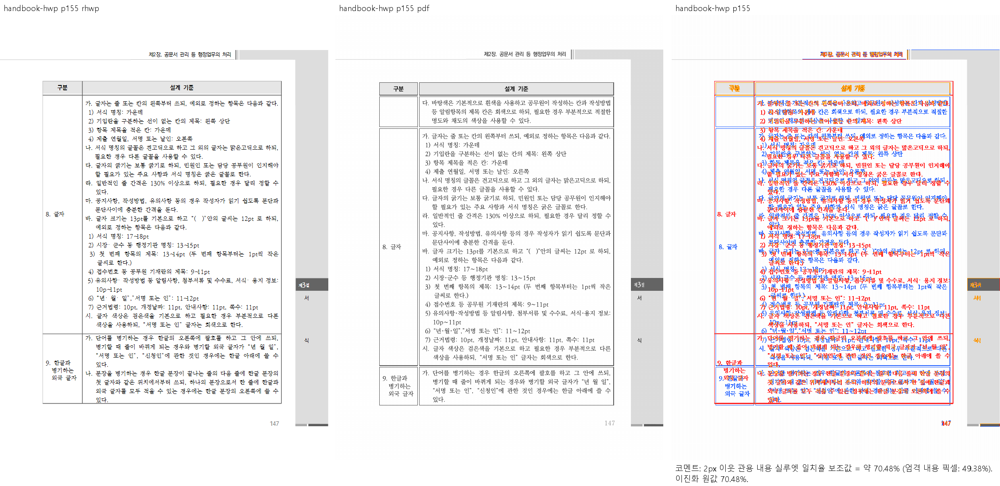
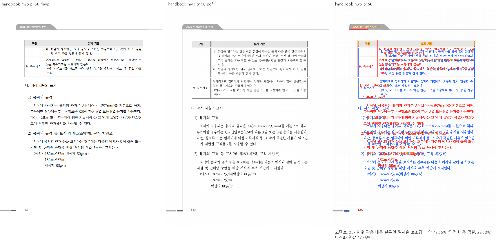

# PR #7611 리뷰 — 큰 표·저장 컷과 편람 쪽 배치

## 최종 판정

**메인터너 보정 후 수용 가능.** 원 기여와 누적 메인터너 보정을 포함한 통합 후보의 판정이다.
최종 통합은 아래에 기록한 남은 검증 조건을 완료한 뒤 진행한다.

저장 표 프레임·조각의 내용 컷과 물리 예약·실제 배치를 누적 보정했다. 남은 회귀 실패는 진단 점유 보정·관계형 검사·승인된 이관으로 처리했으며 전체 회귀에서 실패0을 확인했다.

## 현재 검증 근거 — 2026-10-11

| 항목 | 확인한 상태 |
| --- | --- |
| 검토 branch | `review/planet6897-20261008` |
| 통합 PR | [#7832](https://github.com/edwardkim/rhwp/pull/7832) → `devel`; 원 기여와 메인터너 보정 함께 제출 |
| rebase 후 통합 code head | `9b4817473b2a3515ea27eefef9d20731258433e4` |
| 최신 upstream base | `920dc29284e8a6e624861bfccf68903e19ae309b` |
| 전체 회귀 | 검증 source `7dd9572b7fecbc602c9e5ab47c4a6c9d6422b4bd`: 10,215PASS·실패0·skip45 |
| lint·정책 | fmt·Native/WASM/all-target Clippy·workspace build·base 고정 manifest/unit-tier PASS |
| Studio | 1,834PASS·실패0·skip2, TypeScript 검사 PASS |
| optimized fresh WASM | code source `03a987f4a`: 빌드exit0, `pkg/`·Studio `public/` JS/WASM SHA-256 일치 |
| 시각 선행 조건 | table-text·stored-vpos·hwp-multi·해외투자3입력의 Native/fresh WASM 전쪽 TSV 모두90% 이상. table-text·stored-vpos 변경 영역 확대 판독 완료 |
| 승인된 이관 | #7813 giant-cell, #7830 sample2 HWP, #7831 가정폭력 조사. 각 출력 문제는 후속 이슈에서 해결 |
| rebase 후 재검사 | 오늘할일만 충돌했고 양쪽 기록을 보존했다. 사용자 지시에 따라 통과한 전체 회귀·lint·Studio를 반복하지 않음 |

전체 결과·시각 점수·source와 로그는 [남은 회귀 보정 기록](../../plans/planet6897_20261008_remaining_regressions.md#현재-시각-검증-상태-정정--2026-10-11)에 연결한다.
위 시각 결과는 해당 입력과 기록한 renderer source의 증거이며, 원 PR 전체 영향 목록의 전수 통과를 주장하지 않는다.

## #7768 재확인과 통합 조건

#7768 원본 전1쪽의 Native/fresh WASM 최저92.73966%, 누락0을 확인했다.
양 경로 raster bytes와 review/overlay의 canonical gate `passed`를 확인하고 캡션·표·
체크박스3개·후행 용지 규격 줄을 확대 판독했다. [공개 시각 증적](../assets/issue7768/README.md)을
통합 PR의 `Closes #7768` 근거로 연결한다.

- 최신 upstream의 확장 프로그램 #7703·기존 오늘할일을 보존해 rebase했다. 충돌은 오늘할일 한 파일뿐이며 Rust/test/Cargo tree는 rebase 전과 같다.
- 사용자 지시에 따라 rebase 후 추가 로컬 테스트를 하지 않는다. 별도 로컬 Native Skia3종은 미실행으로 기록하고 통합 PR의 Native Skia CI 결과를 확인한다.
- 남은 통합 조건은 제출 head의 GitHub CI·CodeQL·Native Skia 및 mergeability 확인이다. 원격 CI 완료·merge를 미리 보고하지 않는다.

<details>
<summary>이전 검토 이력 — 당시 판정과 단계별 실행 기록</summary>

초기 검토에서 확인한 결함·증거 부족과 단계별 재검증 기록이다. 당시 보류 판단은 아래 이력의 source와 실행 범위에 한정하며, 현재 판정은 문서 상단을 따른다.

## 접수·적용 범위

| 항목 | 값 |
| --- | --- |
| 원 PR·작성자·base | [#7611](https://github.com/edwardkim/rhwp/pull/7611) / planet6897 / devel |
| 원 head | `700c0557df154e17255c8bde76881839f0033767` |
| 최초 적용 commit | `b14a0e4daf79ac36799e65aed71226a28826cea1` |
| 이 PR의 적용 뒤 head | `d7c6dae108d6acf72c2c2321e243d93bd116ab50`; 기능 commit 13개, 원 저자·cherry-pick -x 보존 |
| 누적 검증 source head | `90e2c6fd2c614ba0ea7667355c4ed2f3617f6563` |
| 최신 base 정렬 뒤 code head | `ae786f75b2cee72bd5576f6473bd51d9a8216f7c`; 제품/검증 입력 tree 동일 확인 |
| 검토 branch·reviewer | `review/planet6897-20261008` / jangster77; 원 PR reviewer assign 선행 |
| 원 PR 참고 상태 | draft=False, MERGEABLE / CLEAN; 작성 시점 snapshot이며 merge 직전 판정을 대신하지 않음 |
| 경로 | collaborator 외부 PR의 주 작업공간 누적 cherry-pick 9.1.1; intake/template/local_validation/visual_fixture_evidence 및 대형 PR 보조 절차 |

관련 이슈와 해결 표현은 원 PR 본문의 범위를 유지한다. 이번 보류 기록에 새로운 closes 표현을 추가하지 않는다. 원 PR 제공 before/after와 corpus 수치는 참고이며 통합 head의 독립 실행과 구별한다.

## 구현 주장·소비 경로·검증 판정

`typeset/table/continuation/fragment.rs:72`가 저장 컷·걸침 칸 밴드로 `straddle_row_relief`를 만들고, cut/whole-row fit 높이에 반영한다. 방출의 `fragment/emit.rs` 두 `PartialTable` 경로 → `pagination.rs:643` → `layout.rs:11413` → `layout/table_partial.rs`의 relief 소비를 확인했다. 미주 scratch remap도 같은 필드를 전달하도록 충돌을 보정했다. 이 연결의 존재와 실제 컷·예약 높이·빈 물리 밴드·종료 계약의 충족은 구별한다.

**실행으로 확인한 미충족:** 공개 편람 HWP는 383쪽으로 맞지만 Native/fresh WASM 전쪽에서 각각 50쪽이 90% 미만이며 156쪽 최저 47.54585%다. 기준 156쪽의 `나. 문장을 병기하는 경우…`가 rhwp 155쪽에 소속되고, 156쪽은 `다. …`부터 시작한다. 표 첫 조각의 높이가 줄어 뒤 본문이 위로 당겨진다. 2020·2024 독립 PDF 모두 이 문단을 156쪽에 두므로 단순 PDF 연도 차이·글꼴 예외로 해소되지 않는다. 통합 후보의 관측이며 개별 PR이 최초 원인이라는 base 대비 회귀 증명은 아직 하지 않았다.

**미검증:** HWPX 전쪽과 나머지 대형 문서의 전쪽 시각 비교, 원래 높이만 fit하는 예산·여러 rowspan 종료·빈 밴드/후속 캡션·각주 경계, 기존 baseline 증가의 독립 근거. 48개 입력의 쪽수 조회는 아래 공통 결과에 분리한다. 쪽수가 같거나 unit 컷이 단조라는 이유로 배치·누락/중복 검증을 충족 처리하지 않는다.


## 공통 통합 검증과 증거 보존

### 최신 커밋의 전체 회귀와 base 판정

메인터너 소스 보정은 `e469c4486e5e5d7b6de5a6e4a74d938e89dab188`에 커밋했다. source 6개만 포함하고 신규 회귀·baseline·golden은 추가하거나 변경하지 않았다. 이 후보의 검증 base는 `f0e7228f6dd2ea1437724e53ad640c40c56d204b`다. 같은 SHA의 Windows review worktree에서 suite를 준비하고 Native CLI를 새로 빌드했다(exit 0, 385.42초). 편람 HWP/HWPX는 각각 383쪽이었다. 실행 바이너리 SHA-256은 `f86430b46e17e65439efd83a00c7bdb7b7b8728c7738c2e3dc9d97597696e73a`다.

전체 `cargo nextest run --locked --cargo-profile release-test --target-dir C:\Users\admin\rhwp\target\pr-review --tests --build-jobs 8 --test-threads 10 --no-fail-fast`는 끝까지 실행했다. 컴파일 23분, 실행 summary 1487.094초, **10,224 PASS / 28 FAIL / 46 skipped**, nextest exit 100이었다. 사용자 중지나 컴파일 실패가 아닌 assertion 실패다. 로그는 ignored `output/pr-review/planet6897-20261008/committed-e469c4486-full-regression.log`, source·명령·바이너리 hash와 종료값은 `committed-e469c4486-regression.json`, 28개 실패 함수·원본 후보·실패 본문은 `committed-e469c4486-failure-inventory.json`에 보존한다. 시험지 제외 범위는 유지하며 제거한 검사를 PASS 수에 포함하지 않았다. 같은 고정 base의 integration manifest와 source unit 정책 비교도 통과했다. 이 결과는 세 Clippy·최종 fresh WASM·최신 base 통합 검증의 대용이 아니다.

검증 중 최신 `upstream/devel`은 #7644 보정이 포함된 `74f9b71b15a2db18b17c37ceab6cf2b3c20c03c3`로 전진했다. 실제 시험 merge tree `cfd8126c5440fbdf5405ce991c4c47f57653a903`에는 `float_placement.rs`와 오늘할일 문서 충돌이 있어 clean 제출 tree로 판정하지 않았다. 현재 main 검토 branch의 후보는 유지하고, 종료한 review worktree에서 최신 base Native를 별도로 빌드해 실패 문서의 피델리티를 판정하고 있다. 정책·시험 병합 기록은 `committed-e469c4486-policy-check.json`, base 빌드 provenance는 `upstream-74f9b71b1-failure-triage/build.json`에 있다.

사용자는 실패 원본을 **최신 upstream/devel 기준으로 비교하여 90% 미만인 문서만 기존 #7445로 이관하고, 그 외 실패는 현재 브랜치에서 개선**하도록 지시했다. 새 이슈는 만들지 않는다. 기준 PDF 부족·미실행을 90% 미만으로 간주하지 않으며, 이관 전 실제 base SHA·원본/PDF hash·측정 쪽·지표·직접 판독과 실패 함수를 연결한다. 정상 검사·원본·독립 PDF와 기존 실패 로그를 보존하고 이관을 제품 결함 해결이나 PASS로 보고하지 않는다.

2026-10-09에 실제 base Native/fresh WASM을 재출력한 뒤 `6bf61e574`로 hwpspec 실패3함수·해당 off-canvas 입력·oracle1행만 이관했다. 선택6쪽 모두 미달이고 최저29.76551%이며 두 backend 값은 동일하다. 이어 `2fc24fb10`으로 KTX 목차49.63836%의 실패2함수, 전6쪽 최저89.52230%인 정상 생성 nested-split의 실패1함수, 전1쪽89.44020%인 overlay-top의 세로 advance assertion 하나만 이관했다. 다른 kind와 Center/Bottom·가로/포함 관계·다른 원장은 유지했다. [정확한 입력·PDF·복원 범위와 대표 PNG](../assets/issue7445/README.md), [첫 이관 댓글](https://github.com/edwardkim/rhwp/issues/7445#issuecomment-6063165946), [추가 이관 댓글](https://github.com/edwardkim/rhwp/issues/7445#issuecomment-6063592661)에 기록했고 게시 본문은 API로 한국어·BOM·치환 여부를 확인했다. 원문은 이동하거나 삭제하지 않았다.

90% 이상인 #6800 전1쪽95.92922%, aift 실패 대상4쪽94.68150%, #6844 실패 대상4쪽93.64421%는 두 backend 모두 확인했고 제외하지 않았다. `055bfaa23392e94560dab5266f482a9e162d6a77`에서 명시적 오른쪽 정지가 현재 셀 프레임을 넘을 때 셀의 실제 우단을 소비하게 하되, 프레임 안의 선언 정지는 보존했다. 생산자 `find_next_tab_stop`의 단 기준 결과를 문자 위치·폭 측정과 교차-run 측정/배치가 함께 소비한다. #6800의 raw TabDef2는85040HU/RIGHT/fill3이고 실제 셀의 폭은 문서 선언 폭보다 좁다. 기존 탭 hit-test는 하이픈 끝과 탭 앞 공백 끝을 혼동해 tab-start 논리 주소에 tab-end 캐럿을 요구하므로, 공개 문자 경계 중점 양쪽의 논리 주소·캐럿 관계를 검사하게 수정했다. 전체/시각 완료를 주장하지 않으며 이 source의 focused regression·Native 재빌드가 진행 중이다(`candidate-055bfaa23-focused-build.json`, 빌드 잡8·테스트 스레드10). 이 source 검증 뒤 추가 test-only 이관 head에도 필요한 검사를 이어 적용한다.

교육과정415쪽 입력의 base 선택7쪽도 모두 미달(최저22.02606%)로 확인했다. `ddc7b1971`에서 실제 실패3함수와 해당 oracle1행만 이관했고 [등록 댓글](https://github.com/edwardkim/rhwp/issues/7445#issuecomment-6063814441)의 게시 본문을 API로 확인했다. 어구 금지 문서는 base Native/fresh WASM 전21쪽 모두 비교했고 두 경로 최저93.33917%·90% 미만/누락0쪽이므로 이관하지 않는다. 쪽수/원본 컷 라벨·지도 소속의 실패2함수는 현재 브랜치에서 개선해야 한다. `native-map-full/`, `wasm-map-full/`의 TSV와 source/package provenance 및 별도17–21쪽 compare/overlay/review를 보존한다. 직접 판독 완료와 통합 head의 무회귀는 별도로 확인한다.

보정 source `055bfaa23`의 focused3검사는 **#6800/#6844 2PASS / aift SVG snapshot1FAIL**, nextest exit100이었다. 같은 source Native와 fresh WASM 실제 재출력은 #6800 전1쪽95.80905%, #6844 대상4쪽93.64421%, aift 대상4쪽94.49416%로 두 경로 값이 동일했다. Native3개 review와 aift Native standalone overlay/fresh WASM review를 직접 열어 글줄·목차 순서·끝 탭 경계를 대조했다. 기존 글꼴 획/농도 차이는 남고 전 aift/전체 #6844 통과는 주장하지 않는다. `candidate-055bfaa23-focused-build.json`, `native-diagnostic.json`, `wasm-build.json`, `wasm-focused.json` 및 실제 PNG를 보존한다.

aift의 기존 golden과 실제 SVG를 글꼴 CSS를 제외하고 대조했을 때668개 노드 수·문자 내용·문자 좌표는 같고 탭 리더24개의 끝 좌표만 달랐다. [원 #147](https://github.com/edwardkim/rhwp/issues/147)의 독립 기대값은「기업 소개 및 본 과제 관련 기술력 소개」주석이 목차에 보이지 않는 것이다. `24f6d926b`로 전체 SVG hash 검사1개를 같은 원본의 주석 부재·목차 내용/순서·중복 보존 의미 검사1개로 옮겼다. golden은 재생성/삭제하지 않았다. 원 결함의 parser/renderer 0×0 master-page 가드를 되돌리는 음성 대조와 보정 후 정상 검사 실행은 아직 남아 있다. 원 #277의 보정 merge `410d0e6bac7158388a8a6181cc17ba9018188087`에서 두 guard의 원인을 확인했다.

나머지 corpus 실패 입력도 근거를 확보한 뒤 같은 기준으로 분리한다. latest base 충돌 해소·최종 source 회귀·Clippy·fresh WASM/시각 게이트와 7개 개별 review의 최종 판정은 아직 남아 있다. 검토 브랜치는 `review/planet6897-20261008`이며 위 이관/보정 commit은 로컬에만 있다. 통합 PR 생성·push·merge는 수행하지 않았다.

### 메인터너 보정 조사 — 원본 셀 좌표의 쪽 프레임

시스템에 등록한 원래 KoPub 6개 face와 원본 입력을 사용해 152~156쪽을 추가 조사했다. 두 독립 한컴 PDF의 156쪽은 `나. 문장을 병기하는 경우…`로 시작하고, 원본 section 4 / paragraph 47의 표 오른쪽 셀에도 해당 문단 앞에 양수 `vpos → 0`이 있다. 그 전후 다른 문단은 직전 저장 줄 높이·간격만큼 같은 셀 좌표를 전진한다. 각 문단이 독립적으로 0부터 시작하는 입력과 이 연속 좌표 원본을 구별했다. 원시 행 상자들의 전체 합은 저장 object의 첫 조각 높이보다 크다.

수정 전 ordinary-row scanner는 선언 행 높이가 예산에 들어가면 `CellUnit` 컷을 생략했고, 컷 경로에서도 셀 좌표가 본문 높이의 절반보다 작으면 실제 쪽 되감김을 relaxed reset으로 흡수했다. 원본 줄의 쪽 소속을 유지한다는 계약에 따라, 변경되지 않은 plain-text 셀의 저장 프레임 경계를 unit 생산·ordinary-row 수용 판단·컷의 같은 결과로 전달하는 보정 후보를 작성했다. 표 ID·쪽 번호·임의 픽셀값으로 분기하지 않는다. 편집·reflow·합성 줄·문단별 로컬 0·걸침 칸은 이 새 저장 원본 증거의 대용으로 사용하지 않는다.

저장 프레임 보정은 로컬 commit `e70954bb8`에 분리했다. Native Clippy와 진단 빌드를 통과했고 383쪽을 유지하며 155쪽 끝 컷이 `[3,8]`에서 `[3,4]`로, 156쪽 시작 컷도 `[3,4]`로 바뀌었다. 이는 목표 문단의 쪽 소속에 대한 중간 관측이다. 첫 후보의 152~156쪽 실제 비교·overlay·review를 산출해 직접 판독했으나 최저 45.29312%로 시각 gate는 여전히 미충족이다. 표 외곽·뒤 본문·빈 물리 띠·누락/중복의 확인과 대조군, 최종 source의 Native/fresh WASM 전쪽 및 필수 회귀·lint는 아직 완료 판정하지 않는다. 아래 PASS 표는 명시된 수정 전 source의 기록이며 보정 후보에 승계하지 않는다. 새 rendering 회귀는 전체 적용 범위의 시각 선행 gate를 통과한 뒤에만 추가한다.

추가로 간격 있는 셀의 geometry를 추적했다. 이 원본은 `cell_spacing=255HU`이고, 실제 셀 너비 `6454 + 32942HU`와 표 선언 너비 `40161HU`의 차이는 내부 한 띠·외부 두 띠의 합 `3 × 255HU`다. 독립 PDF 155쪽의 좌·우 셀 괘선도 간격을 두고 각각 그려지지만 Native는 폭 잔여를 마지막 열에 넣고 다음 셀 시작까지의 간격을 앞 셀 폭에 포함했으며 인접 괘선을 합쳤다. PDF path의 실제 변환 행렬과 SVG를 96dpi 좌표로 대조한 원본 수치는 ignored `candidate-native-boundary/pdf-p155-lines-96.json`에 보존했다. 기존 기술 문서의 “외곽 간격 없음” 설명은 이 저장본·정상 PDF와 충돌하므로 구현 증명으로 사용하지 않는다.

간격 보정 후보에서는 원본 셀 상자의 폭·높이와 빈 간격 띠를 분리한다. `Table::outer_cell_spacing_hu` 결과를 `HeightMeasurer`의 전체 높이 → fragment budget의 가용 높이 → fragment emit의 실제 예약에 전달하고, 같은 원본 행·컷 높이로 normal/nested/partial의 셀 원점과 상자를 구성한다. 간격 있는 괘선은 최종 셀 bbox를 소비하고, 간격 0의 기존 공유 엣지 경로와 구별한다. 이 후보의 실제 출력·대조군·필수 검증은 진행 중이며, 전체 외곽 fallback·cellzone·반복 헤더·걸침 칸·nested cut 이후 덮어쓰기까지 확인하기 전에는 충족으로 바꾸지 않는다.

추가 후보는 모두 미채택 상태로 보존한다. 후보 3은 384쪽·156쪽 63.97231%, 후보 4는 383쪽이지만 155쪽의 오른쪽 내용이 다음 행에 겹쳤다. 후보 5는 Native Clippy·진단 빌드 PASS 후 155·156쪽의 직접 판독에서 그 겹침은 없어졌으나 각각 74.07245%·69.69247%로 gate FAIL이고, 전체 쪽수는 380으로 줄었다. 383쪽이었던 후보 4도 구역별로는 이전 source와 달랐다. 각 후보의 정확한 dirty source patch·파일별 SHA-256·실행 binary SHA-256·전쪽 page items·최종 exit·compare/overlay/review는 ignored `candidate-*-runtime-provenance.json`, `candidate-*-source.patch`, `candidate-*-all-page-items.json`, `candidate-native-reviews/`에 구별 보존한다.

후보 5의 호출 경로 대조에서 두 원인을 확인했다. 첫 표의 source host `vpos=30321HU`와 본문 원점·바깥 위 여백·셀 간격은 독립 PDF의 첫 셀 위치를 설명하지만, 이전 flow cursor는 표를 약 32px 위에 놓았다. 저장 원점 조회를 block 준비·첫 조각 예산·partial paint에서 공유하도록 보정했다. 또 `scan/runner.rs`의 빠른 경로는 `start_row_height_override`가 있다는 이유로 내용 검사 없이 행 전체를 소비했다. 실제로 구역 11의 큰 행이 6개 조각에서 2개로 줄었으며 남은 내용과 잔여 물리 높이를 혼동한 경로였다. 후보 6은 유닛의 실제 소진 여부를 확인한 뒤에만 그 빠른 경로를 사용하고, 예약한 최종 행 높이를 이월에 반영하며, 입증된 첫 object frame 안에서 스캔하도록 수정 중이다. 아직 출력·회귀 통과를 주장하지 않는다.

후보 6의 Native Clippy·진단 빌드는 PASS이고 큰 행의 6개 조각이 복원됐다. 155·156쪽 compare/overlay/review를 직접 판독했으며 일치율은 81.63049%·77.80430%로 개선됐지만 전체 384쪽·gate FAIL이다. 그리기의 `single_cell_page_fragment_bottom`은 이름과 달리 일반 다행 표의 하단 접기에도 사용되는데, source-owned row frame의 예산은 같은 경계를 예약하지 않았다. 따라서 실제 수용한 높이와 배치 뒤 접힌 높이가 달라 이월 물리 공간도 어긋났다. 독립 PDF 152~156·316~318쪽 괘선의 실제 CTM 좌표는 `independent-pdf-cell-edges-selected-pages-96.json`에 보존했다. 후보 7은 해당 저장 원본 경로에서 paint의 기존 쪽 경계를 먼저 예산에 반영하며, 행 컷과 rowspan block 컷의 인덱스 공간도 구별한다. 아직 Native/fresh WASM 전쪽 gate·필수 회귀의 충족으로 보고하지 않는다.

후보 7은 Native Clippy·진단 빌드 PASS 후 155쪽 97.81975%·156쪽 90.35099%로 **선택한 두 쪽의 Native gate만 PASS**다. 같은 두 review PNG를 직접 열어 표 외곽·행 사이 간격·이월 문단과 표 뒤 본문을 대조했다. 글자 색·일부 AA와 머리말 모양은 남아 있다. 전체 쪽수는 386이며 기준 PDF 383과 다르다. 구역 7은 원 누적 source보다 1쪽, 구역 11·12는 각각 추가로 1쪽 늘었으므로 전체 쪽수·전쪽 gate의 미충족은 유지한다. 이 중간 원점·공간 보정은 로컬 checkpoint로만 보존하고, 추가 쪽의 원인·대조군·fresh WASM 및 최종 필수 검증을 계속한다. source/push/PR 생성·merge 승인으로 승격하지 않는다.

후보 8은 걸침 셀의 선언/내용 높이를 행 core 합뿐 아니라 내부 셀 간격을 포함한 물리 높이와 비교하도록 측정·배치·저장 높이 축소의 소비 지점을 함께 수정했다. 4행 span의 내부 3띠가 배치에서 다시 더해지던 약 10.2px 증가를 제거해 220쪽 끝 행 14, 221쪽 시작 행 14를 한컴과 맞췄다. 원본 Center/Bottom 정렬 프레임의 기존 적용 조건도 다중 owner에 유지해 Top 정렬의 선언 높이를 무조건 이월 최소 높이로 쓰지 않는다. Native Clippy·진단 빌드 PASS, 전체 385쪽, 155·156쪽은 97.81975%·90.35099%를 유지했다. 220~224쪽 재출력에서 220쪽은 90% 이상이나 221쪽 85.21024%, 222쪽 56.80893%, 223쪽 63.97008%, 224쪽 23.36573%로 gate FAIL이다. 221쪽 review를 직접 열어 첫 표의 행·외곽은 맞고 뒤 정책연구 윤리 점검 표가 다음 쪽으로 넘어간 실제 배치 차이를 확인했다. 런타임 source/binary 해시는 ignored `candidate-8-runtime-provenance.json`, patch·쪽 목록·실행 로그·PNG는 같은 증적 폴더에 보존했다. 새 회귀/fixture/golden은 추가하지 않았고 전쪽 Native/fresh WASM·최종 회귀는 미완료다.

후보 9는 저장 문단 사이의 연속성·새 프레임 원점을 resolved 앞/뒤 간격까지 포함해 판별한다. 다음 프레임의 첫 줄이 그 문단 앞 간격에서 시작하면 양수 vpos도 원점이며, host 줄의 앞 간격을 뺀 표 원점을 첫 조각 예약과 paint에 함께 전달한다. 원본 표 239의 새 프레임 첫 줄은 200HU다. 0만 인정하던 선언 이월 guard 대신 같은 원본 text-frame query가 스캐너 진입도 판단한다. Native Clippy·진단 빌드 PASS, 전체 384쪽이며 221쪽 표 239의 첫 컷 `[1,10,1]`, 222쪽 `[1,10,1]`→`[1,44,1]`, 223쪽 종결로 돌아왔다. 155·156쪽 재출력 및 직접 판독은 97.81975%·90.35099%를 유지했다. source/binary와 명령은 ignored `candidate-9-runtime-provenance.json`, `candidate-9-build.json`, `candidate-native-9-result.json`에 고정했다. 구역 12의 371쪽 행 8 이월 때문에 여전히 +1쪽이며 이 경계와 전쪽·fresh WASM 검증은 계속한다. 쪽 목록을 실제 시각 통과로 바꾸어 보고하지 않는다.

후보 10은 부록 371쪽 행 8의 실제 호출 경로를 대조했다. 기존 저장 쪽 컷의 비이월 빈 밴드 경로는 `end_row_height_override=rest`로 실제 상자를 그리면서, 수용 검사는 그보다 큰 선언 높이로 Center/Bottom 정렬 끝을 계산했다. 같은 경로의 실제 수용 상자를 정렬 검사에도 전달하며, 명시적인 원본 text-frame 경계가 있는 행과 일반 이월 밴드는 본래 공간 계약을 보존한다. Native Clippy·진단 빌드 PASS 후 전체 383쪽으로 돌아왔고 155→156쪽 컷 `[3,4]`와 표 239의 쪽 소속을 유지했다. 독립 PDF 371쪽의 두 단 괘선 CTM 좌표는 ignored `independent-pdf-table-boundaries-landscape-96.json`, 보정 전·후 9의 실제 셀 상자는 `landscape-371-before-cell-frames.json` 및 `landscape-371-candidate9-cell-frames.json`에 있다. 이 후보의 직접 시각 검증·대조군·전쪽 Native/fresh WASM·최종 필수 lint/회귀는 진행 중이며, 쪽수 관측만으로 승인하지 않는다.

후보 10의 추가 Native 검증은 220~224·369~372쪽을 실제 재출력했다. 223쪽 76.8772%·369쪽 84.79807%로 gate FAIL이며, 두 쪽의 위치 차이를 직접 판독했다. 223쪽은 표 종결 뒤 문단이 13.33px 아래로 밀리고, 369쪽은 중첩 표만 가진 문단의 앞 간격 9.33px이 누락됐다. 앞선 383쪽 관측과 선택 155·156쪽 PASS를 전쪽 통과로 승격하지 않는다.

후보 11은 `table_partial.rs`의 객체 전용 문단 경로가 건너뛰던 `cell_paragraph_spacing_before`를 측정과 동일하게 소비하고, 저장 원점이 이미 포함한 간격은 중복 적용하지 않는다. Native Clippy·진단 빌드 PASS, 전체 383쪽 및 155·156쪽 97.81975%·90.35099%를 유지했다. 369쪽은 99.37787%로 개선됐으며 같은 review PNG에서 중첩 표 외곽과 뒤쪽 회색 행을 직접 확인했다. 223쪽은 76.8772%로 미충족이다. `emit.rs`의 종결 흐름 보정만으로는 `layout.rs::layout_partial_table_item`이 별도로 더하는 뒤 간격이 바뀌지 않았음을 실제 render tree로 확인했다. 저장 후속 줄 상자의 간격을 계산하는 공통 결과를 두 소비 지점에 연결하는 후보 12를 검증한다. 해당 결과·source patch·binary SHA·명령은 ignored `candidate-11-runtime-provenance.json`, `candidate-11-source.patch`, `candidate-native-11-boundaries-result.json`과 대응 compare/overlay/review에 보존한다. 전쪽 Native/fresh WASM과 새 source의 필수 회귀는 아직 미검증이다.

후보 12는 원본 후속 문단의 저장 줄 상자를 독립적인 종결 흐름 기준으로 사용한다. `table_layout.rs::native_text_frame_terminal_successor_gap`이 프레임·dirty 상태·문단 줄 정보·세로 기준을 검증하고, `emit.rs`의 두 종결 예약과 `layout.rs::layout_partial_table_item`의 실제 뒤 흐름이 같은 결과를 소비한다. 첫 조각의 원점 수용 여부를 종결 조건의 대용으로 쓰지 않는다. 223쪽 표의 실제 끝과 다음 빈 줄 원점은 483.1px, 주석 줄 원점은 492.5px이며 원본 vpos 25180HU·25880HU와 독립 PDF에 대응한다. 저장 좌표보다 이미 큰 상자는 clamp하지 않고 이 경로를 수용하지 않는다. Native Clippy·진단 빌드 PASS, 전체 383쪽이며 새 재출력의 155·156·223·369쪽은 각각 97.81975%·90.35099%·99.70281%·99.37787%다. 네 review PNG를 직접 열어 표 종결·후속 본문·중첩 표 외곽을 확인했다. 선택 Native 경계의 PASS이며 전쪽 Native/fresh WASM·대조군·필수 회귀의 통과로 승격하지 않는다. 실행은 ignored `candidate-12-runtime-provenance.json`, `candidate-12-source.patch`, `candidate-12-build.json`, `candidate-native-12-result.json`, `candidate-native-12-boundaries-result.json`에 보존한다. 새 rendering 회귀 test/fixture/golden은 아직 추가하지 않았다.

### 수정 전 누적 source의 공통 검증

9개 원 PR을 #7591 → #7611 → #7617 → #7618 → #7619 → #7622 → #7624 → #7628 → #7629 순서로 기능 commit 63개 누적 cherry-pick(-x)했다. 원 저자와 출처를 보존했으며 contributor branch는 rewrite/push하지 않았다. 사용자 지시의 conflict·CI 보정 범위에서 `ba34731730dfa116eaa1b151ee95f4e71b094315` 충돌을 처리했다. #7591의 공통 endnote scratch helper를 보존하고 #7611의 `straddle_row_relief`를 실제 remap 경로에 clone했다. 당시 보정 SHA는 `4e3a97bdbee90c13740adb1ca09b805266887a21`이며 최신 base 재정렬 mapping은 ignored `cherry-pick-state.json` 및 `base-alignment-verification.json`에 있다.

검증 source는 `90e2c6fd2c614ba0ea7667355c4ed2f3617f6563`, 당시 base는 `b3c3047db575d146dff9d39098e6de98c4630b3e`다. 검증 도중 #7651의 CI·문서만 변경된 devel `60efc4b7b380b2a183c20c3ee0ab24a60bc2d832`로 정렬했다. 당시 code head `ae786f75b2cee72bd5576f6473bd51d9a8216f7c`와 source/Cargo/lock/toolchain·시각 실행 도구·입력/기준 PDF tree가 동일함을 Git object로 검사하여 고비용 Rust/WASM/시각 검증을 재사용했다. 새로운 base로 manifest·unit-tier 정책 비교를 다시 통과했다. 이후 조판 보정에는 이 결과를 승계하지 않는다. 원 PR의 CI와 통합 후보의 로컬 검증은 별개이며 원 PR CI 성공으로 새 후보 CI를 합성하지 않는다.

### 실행 결과

공유 `CARGO_TARGET_DIR`와 모든 Cargo `--target-dir`에 기본 clone의 절대 `target/pr-review`를 사용했다. Cargo는 순차 실행하고 전체 nextest는 사용자 지정 10 threads, build jobs 2였다. 기본 증분 정책을 유지하고 cache를 삭제·초기화하지 않았다.

| 검사 | 실제 결과 |
| --- | --- |
| fmt, Native Clippy, wasm32 lib Clippy, workspace build, workspace/all-targets Clippy | 모두 exit 0; 세 Clippy에 `-D warnings` |
| integration manifest prepare/check와 source unit tiers | pinned base 비교 PASS; generated suite는 stage하지 않음 |
| 집중 nextest | 47 PASS, 0 FAIL |
| 전체 nextest | 10,540 PASS, 50 skipped, 37 slow; summary 1851.098s, exit 0 |
| fresh WASM | root `wasm-pack-locked.ps1 --target web --out-dir pkg --mode no-install --no-opt` PASS; Rust 1.93.1/wasm-bindgen 0.2.125 |
| Native Skia lib | test result: ok. 3927 passed; 0 failed; 13 ignored; 0 measured; 0 filtered out; finished in 138.67s; test result: ok. 15 passed; 0 failed; 0 ignored; 0 measured; 0 filtered out; finished in 0.02s; test result: ok. 165 passed; 0 failed; 0 ignored; 0 measured; 0 filtered out; finished in 0.03s; test result: ok. 2 passed; 0 failed; 0 ignored; 0 measured; 0 filtered out; finished in 0.00s |
| Native Skia missing picture placeholder | Summary [   0.975s] 2 tests run: 2 passed, 212 skipped |
| Native Skia direct PDF | Summary [   0.396s] 4 tests run: 4 passed, 214 skipped |

전체 회귀 재현 명령:

```powershell
$env:CARGO_TARGET_DIR='<기본 clone의 절대 경로>/target/pr-review'
cargo nextest run --locked --cargo-profile release-test --target-dir $env:CARGO_TARGET_DIR --tests --test-threads 10 --no-fail-fast
```

Native Skia lib는 `cargo test --locked --profile release-test --target-dir $env:CARGO_TARGET_DIR --features native-skia --lib -- --test-threads 10`; placeholder/direct PDF는 `node scripts/run-rust-test.mjs <case> -- --cargo-profile release-test --target-dir $env:CARGO_TARGET_DIR --features native-skia --test-threads 10 --no-fail-fast`. Windows Native로 실행했고 macOS/Linux 렌더링 검증은 미실행이다.

### 글꼴과 시각 결과

사용자 지정 교차 호스트에서 실제 legacy KoPub TTF 6개를 읽기 전용으로 확보했고 전송 전후 SHA-256·내부 face 이름을 대조했다. Windows all-users Fonts/HKLM 등록과 새 비상승 GDI 열거에서 돋움·바탕 Light/Medium/Bold 6개를 확인했다. 글꼴 파일은 공개 저장소에 커밋하지 않았다. KoPub World와 동일 face로 간주하지 않았으며 서명/비밀 환경·SSH 정보는 공개 기록에서 제외했다.

| 공개 대조군 | 쪽수 | Native 최저 | fresh WASM 최저 |
| --- | --- | --- | --- |
| float-push | 1 | 99.89324% | 99.89324% |
| column-top | 4 | 99.09774% | 99.09774% |
| masked-vpos | 1 | 99.16989% | 99.16989% |
| square-overlap | 1 | 99.73718% | 99.73718% |
| square-narrow | 1 | 99.65201% | 99.65201% |
| square-paragraph | 1 | 100.0% | 100.0% |
| quotes-retry | 7 | 94.23341% | 94.23341% |
| 편람 HWP 전체 | 383 | **47.54585% / 50쪽 미달** | **47.54585% / 50쪽 미달** |

표의 작은 대조군은 해당 입력 전쪽 점수다. 대표 compare·독립 overlay·review를 열어 표 외곽과 뒤 문단 순서·줄바꿈을 직접 확인했다. 7개 대조군의 Native/WASM 실제 raster bytes도 전쪽 동일했다. AA·색/괘선 굵기와 일부 글자 모양은 다르다. 실루엣 보조값만 생성한 작은 대조군 manifest는 `not_evaluated`이므로 이를 자동 승인 gate라고 기록하지 않는다.

편람은 HWP/PDF 383쪽 전쪽을 Native와 fresh WASM 각각 래스터했다. WASM p154의 Chrome 임시 profile 정리 EPERM은 host 오류였고 같은 해시의 SVG·WASM을 유지하여 p154–383을 정상 exit 0으로 다시 raster했다. p1–153은 원 완료 raster와 해시로 구별 보존했다. `--png-pair` 전383쪽 비교도 `re_review_required`로 exit 1이며 host 실패가 시각 실패의 근거가 아니다. Native p156의 full-font 재출력도 47.58269%로 같은 geometry 차이를 보였고, 전체 기본 system-font 출력 47.54585%와 별도 capture로 구별한다.

입력 [편람 HWP](<../../../samples/2025 행정업무운영 편람(최종).hwp>) SHA-256 `40d6d05eac4d55bdc4b0c62c42d93af104d5123b447581246f36fd15de7bd46f`, [독립 KoPub 2024 PDF](<../../../pdf/2025 행정업무운영 편람(최종)-hwp-kopub-2024.pdf>) SHA-256 `3cdf329004cffad0ebacd122586e5e1702aff36b3015cbcb401d038857019593`.






48개 공개 pagination 입력의 Native 쪽수는 42개가 기존 지정 PDF와 같고 6개가 달랐다. issue1891 73/70, issue1937 51/50, issue5877 32/31, task1718 47/48, task2287 416/415, issue2430 39/40 (Native/PDF). 마지막 것은 옛 비KoPub 40쪽 기준과 새 KoPub 39쪽 기준의 환경 차이다. 새 PDF와의 39쪽 일치도 전쪽 시각 PASS가 아니다. 쪽수 조회는 `debug/rhwp-q-page-items.exe --page 0 --json`의 계산이며 3631쪽 전부의 Native/WASM Visual Sweep이 아니다. base 비교를 실행하지 않아 나머지 차이도 새 회귀로 확정하지 않는다.

비공개 corpus는 지정 로컬 기준 위치에서 43개 문서 식별자를 조사하여 42개 원본을 찾았지만 대응 PDF는 0개였다. 파일명·개인 경로·원본은 공개하지 않고 그 범위는 미검증이다. 원 PR의 before/after·저자 TSV와 실제 이 통합 head의 검증을 혼동하지 않는다. 편집 후 저장본의 Print 출력과 원래 저장본은 별도 계약이며 한 경로의 결과로 다른 경로를 면제하지 않는다.

### 보존·재현·제출 조건

실행 명령·exit·검증 base/head·입력/PDF/WASM/binary 해시·전체 TSV·진단 JSON은 ignored `output/pr-review/planet6897-20261008/`의 `validation-current.json`, `post-lint-validation.json`, `fresh-wasm-package-hashes.json`, 각 `silhouette_manifest.json`, `wasm-handbook-raster-recovery.json`, `pagination-native-page-counts.json`에 보존했다. score-only capture의 해시와 실제 PNG 조립의 원본 해시를 재확인하고 canonical compare/overlay/review 함수로 아래 대표 PNG를 만들었다. helper 스크립트는 사용자 Downloads에 보존한다. 원 PR의 커밋된 HWP/HWPX·Print PDF·증적은 그대로 보존했다. 새 rendering 회귀 test/fixture/golden이나 ratchet 완화는 추가하지 않았다.

추가 제출 전 해당 경계의 독립 원본·Print PDF를 공급하여 본문/개체 소속과 geometry를 개선하고, 새 source head에서 영향 경계·필수 검증·Native/fresh WASM gate를 갱신해야 한다. 기준은 [시각 fixture 절차](../../manual/pr_review/visual_fixture_evidence.md)와 [Visual Sweep](../../manual/verification/visual_sweep_guide.md)의 **"이 상태에서는 새 PR을 만들지 않고 이미 열린 PR은 승인·통합하지 않는다"**다. 현재는 시각 미충족 및 증거 부족 때문에 통합 PR 생성·원 PR 승인/close·merge를 수행하지 않았다. 공통 머지 보류는 9개 PR 각각이 편람 결함을 새로 만들었다는 뜻이 아니다. 코드가 없는 문서 전용 기록 PR으로 통합 검토 기록을 따로 보내지 않는다.

머지 후 comment 계획은 gate 통과 시점의 최종 통합 PR·merge SHA·CI URL·같은 대표 이미지의 merge-SHA raw URL·남은 차이를 각 원 PR에 한국어로 남기고 통합 PR 링크와 함께 종료하는 것이다. 현재 머지되지 않았으므로 merge SHA·issue 종료·duration refresh를 완료로 기록하지 않는다. contributor branch와 공용 cache는 보존한다.

| 대표 PNG | SHA-256 |
| --- | --- |
| `native_float-push_p001_review.png` | `b8f2b6cdc3ec0f5df7df44b0f59a1d850096cb07a0ae55116acc79852cd3571c` |
| `native_column-top_p002_review.png` | `2daa52c2bbba6a1937723918f1c65704117656919f3dfb9d85aa9de7c0dcc220` |
| `native_masked-vpos_p001_review.png` | `5cabed1c92e15588a85447c8414628b50b4706db917c3f592b9ba7bf52c79c34` |
| `native_square-overlap_p001_review.png` | `bc8cfdc99977e621c433c2f32c5c2a287022e71b9a02f6c05a9d62a83ecfda42` |
| `native_square-narrow_p001_review.png` | `500fff50dc7b436e0be18498440bb22bdf0f8eff907137c6b1e1a8da74884610` |
| `native_square-paragraph_p001_review.png` | `86fc5409917664ab4011a9c3cfb8123b93bf856df0f17748fe463418023a8a10` |
| `native_quotes-retry_p003_review.png` | `04227b11a2dfdead39335d2618177fd85a81e3340b7dd35831cf4b3e6f00f453` |
| `native_handbook_p155_review.png` | `b320fe187b37a1260d1fe05a5209d8c9b805bb0300e8067baa3a3e5bce7c73ce` |
| `native_handbook_p156_review.png` | `298d909e91f348e73fd2cbf2c7b97a3ffef027977dc14b069001706358747607` |
| `native_handbook_p377_review.png` | `bfacb279d2f729c2eb571d6d9b03bceefa0549443309ba9853617c3b38ff6aa0` |
| `native_handbook_p378_review.png` | `12745cdfb9396127df57a9ab45939b881e07462eb7b8e78774aceb98a9793fb7` |
| `native_handbook_p156_overlay.png` | `c4f9717bfcf4fecea307e7a0ce995931dfd36407b332bae808130e37356eae87` |
| `wasm_float-push_p001_review.png` | `b8f2b6cdc3ec0f5df7df44b0f59a1d850096cb07a0ae55116acc79852cd3571c` |
| `wasm_column-top_p002_review.png` | `2daa52c2bbba6a1937723918f1c65704117656919f3dfb9d85aa9de7c0dcc220` |
| `wasm_masked-vpos_p001_review.png` | `5cabed1c92e15588a85447c8414628b50b4706db917c3f592b9ba7bf52c79c34` |
| `wasm_square-overlap_p001_review.png` | `bc8cfdc99977e621c433c2f32c5c2a287022e71b9a02f6c05a9d62a83ecfda42` |
| `wasm_square-narrow_p001_review.png` | `500fff50dc7b436e0be18498440bb22bdf0f8eff907137c6b1e1a8da74884610` |
| `wasm_square-paragraph_p001_review.png` | `86fc5409917664ab4011a9c3cfb8123b93bf856df0f17748fe463418023a8a10` |
| `wasm_quotes-retry_p003_review.png` | `04227b11a2dfdead39335d2618177fd85a81e3340b7dd35831cf4b3e6f00f453` |
| `wasm_handbook_p155_review.png` | `b320fe187b37a1260d1fe05a5209d8c9b805bb0300e8067baa3a3e5bce7c73ce` |
| `wasm_handbook_p156_review.png` | `298d909e91f348e73fd2cbf2c7b97a3ffef027977dc14b069001706358747607` |
| `wasm_handbook_p377_review.png` | `bfacb279d2f729c2eb571d6d9b03bceefa0549443309ba9853617c3b38ff6aa0` |
| `wasm_handbook_p378_review.png` | `12745cdfb9396127df57a9ab45939b881e07462eb7b8e78774aceb98a9793fb7` |
| `wasm_handbook_p156_overlay.png` | `c4f9717bfcf4fecea307e7a0ce995931dfd36407b332bae808130e37356eae87` |

초기 따옴표 캡처의 30초 Navigation timeout은 거대한 full-font SVG를 로드하는 host 오류였다. 같은 source에서 120초 raster timeout으로 Native/fresh WASM 각각 7쪽을 재실행하여 모두 exit 0, 최저 94.23341%를 확인했다. 원 실패 로그를 삭제하거나 렌더링 회귀로 분류하지 않았으며 `quotes-timeout-retry-results.json`에 구별한다.

### 공개 대조군 입력·기준 해시

| 입력 | 커밋된 경로 | SHA-256 |
| --- | --- | --- |
| float-push / hwp | [samples/float_push_spacing_before/float_push_spacing_before.hwp](<../../../samples/float_push_spacing_before/float_push_spacing_before.hwp>) | `f4404432d153d5cd2de073f90a1f35ba366e885da702331e5b7d39755064bafd` |
| float-push / pdf | [pdf/float_push_spacing_before/float_push_spacing_before-2020.pdf](<../../../pdf/float_push_spacing_before/float_push_spacing_before-2020.pdf>) | `8243af2cac393e00c2830241cf64116d2bff3166d093b7216e86cd4df69d4709` |
| column-top / hwp | [samples/float_push_spacing_before/float_push_spacing_before_column_top.hwp](<../../../samples/float_push_spacing_before/float_push_spacing_before_column_top.hwp>) | `c2d0d80f5a7fdf66e06fc0d473cb754260ee442414b6d56b97bf845a07987dad` |
| column-top / pdf | [pdf/float_push_spacing_before/float_push_spacing_before_column_top-2020.pdf](<../../../pdf/float_push_spacing_before/float_push_spacing_before_column_top-2020.pdf>) | `4695f998ebc4ce3ca5e7897ee085fc1f0fcc55d3d3c03b2863d89b1997f306f1` |
| masked-vpos / hwp | [samples/masked_stale_vpos/masked_stale_vpos.hwpx](<../../../samples/masked_stale_vpos/masked_stale_vpos.hwpx>) | `4b18c3ff777d8c2acd04d8049470026f5308e188a3f895fe4a9da6af218ac4ca` |
| masked-vpos / pdf | [pdf/masked_stale_vpos/masked_stale_vpos-2020.pdf](<../../../pdf/masked_stale_vpos/masked_stale_vpos-2020.pdf>) | `98f6781dc7e681c2b6b4887f950ea275acfe101f7fba68279ca6d2bf5e777a05` |
| square-overlap / hwp | [samples/page_anchored_square/page_anchored_square_reflow_allow_overlap.hwpx](<../../../samples/page_anchored_square/page_anchored_square_reflow_allow_overlap.hwpx>) | `fe8d2341e919f23978750d936129bb987a0e488f1392f5459578144144018791` |
| square-overlap / pdf | [pdf/page_anchored_square/page_anchored_square_reflow_allow_overlap-2020.pdf](<../../../pdf/page_anchored_square/page_anchored_square_reflow_allow_overlap-2020.pdf>) | `1967b0396b0fb69875ea4b2e21ac7b68030265646cbdb34cfc1b8db2655b9149` |
| square-narrow / hwp | [samples/page_anchored_square/page_anchored_square_reflow_narrow.hwpx](<../../../samples/page_anchored_square/page_anchored_square_reflow_narrow.hwpx>) | `2454813ec3a22323bc5a7e4a20fcea3670478e62a88b6318a13ff15aedbb3923` |
| square-narrow / pdf | [pdf/page_anchored_square/page_anchored_square_reflow_narrow-2020.pdf](<../../../pdf/page_anchored_square/page_anchored_square_reflow_narrow-2020.pdf>) | `5f99b5d6f1a31e06ad7d9d4c271fb7d907ebe11f13f909881fb046b3c504d2c5` |
| square-paragraph / hwp | [samples/para_square_lane/para_square_lane_reflow.hwpx](<../../../samples/para_square_lane/para_square_lane_reflow.hwpx>) | `ec69ea339b29243b5769c73f3df29b1a23f68c8c9f9b1bc180cd3cfa1bac1900` |
| square-paragraph / pdf | [pdf/para_square_lane/para_square_lane_reflow-2020.pdf](<../../../pdf/para_square_lane/para_square_lane_reflow-2020.pdf>) | `89f93b32457a0774e733ecc9f3eef578ab9269f73481cb0726a72959be504666` |
| quotes-retry / hwp | [samples/basic/treatise sample.hwp](<../../../samples/basic/treatise sample.hwp>) | `1aec0ca0a958d24199591b96916a2535d04f1c654f60dda1027ecbaf4839f828` |
| quotes-retry / pdf | [pdf/basic/treatise sample-2022.pdf](<../../../pdf/basic/treatise sample-2022.pdf>) | `2b5bfa4900f0f82adf880d68130f18c1d4055d600b0767f6c13e749139430e94` |

### 후속 전쪽·경계 확인

후보 12를 커밋한 `6ae28a8ea77f8a7d4426634a8dd89331893f2dd3`의 Native 전쪽 산출은 383쪽 누락 없이 완료했지만 22쪽이 90% 미만이며 최저는 307쪽 48.38365%다. 기존 후보의 50쪽 미달에서 줄어든 결과이고 전체 gate는 여전히 FAIL이다. 전체 목록·TSV·실행 결과는 ignored `source-6ae28-native-full-summary.json`, `candidate-native-12-full-scores-result.json` 및 `candidate-native-scores/handbook-native-candidate-12-full-scores/`에 보존한다. 선택 네 쪽 통과를 전쪽 통과로 보고하지 않는다.

같은 source의 fresh WASM 빌드는 성공했으며 root `pkg/`와 Studio `public/`의 WASM SHA-256은 `ec6cc7290742b57fe5e30047e08af7be4f8d5814535ed41a56c6441903af5bf8`이다. Windows wrapper에 자동 동기화가 없어 초기 확인 스크립트의 동기화 assertion이 실패했고, 빌드 성공본을 정확히 복사한 뒤 두 경로의 바이트 일치를 확인했다. 브라우저 WASM의 383쪽 raw SVG·tree를 실제 산출했다. 155·156·223쪽 tree는 Native와 동일하며 369쪽의 네 차이는 header 문단의 `usize::MAX`가 32/64bit에서 다르게 직렬화된 값뿐이고 좌표·내용은 동일하다. 이 raw 비교는 전쪽 WASM 래스터·시각 gate 통과가 아니다. `source-6ae28-fresh-wasm.json`, `source-6ae28-fresh-wasm-raw.json`, 두 tree 대조 JSON에 성공과 초기 확인 실패를 구별해 기록했다. 이 source의 Native·WASM lib Clippy 두 단계는 별도 review worktree에서 PASS했으며 workspace/all-targets·새 전체 회귀는 아직 미완료다.

후보 13은 저장 다음 줄이 완전한 Square 표 상자를 닫는 경우를 기존 공통 프레임에 연결했다. Native Clippy·진단 빌드 PASS, 383쪽을 유지했으며 48~51쪽은 각각 99.87052%·99.91768%·99.86297%·99.60882%다. 47쪽은 86.71117%로 FAIL이며 실제 PNG와 tree에서 뒤 빈 줄·두 번째 표의 세로 위치 차이를 확인했다. 후보 14는 완전한 표의 실제 배치 후에도 같은 후속 줄 원점을 소비하고, 글 앞/뒤 중첩 표를 같은 문단의 겹침 개체로 분류해 적층 가산을 제거했다. Native Clippy·진단 빌드 PASS, 383쪽 및 155·156쪽 97.81975%·90.35099%를 유지했다. 경계 비교의 47쪽 91.7358%·85쪽 98.8317%는 직접 판독했지만 47쪽 두 번째 표에는 앞 간격 9.33px의 위치 차이가 남는다. 86쪽 67.68623%·87쪽 83.50097%로 경계 전체 gate는 FAIL이다. 단계별 source/binary 해시·patch·명령·결과는 ignored `candidate-{13,14}-runtime-provenance.json`, 대응 build/result JSON·compare/overlay/review에 보존한다. 진단용 로그 코드는 최종 source에서 제거했다. 새 회귀/fixture/golden·통합 PR 제출·승인은 계속 보류하며 이후 후보의 결과를 이 기록에 소급하지 않는다.

후보 15는 직인 표의 문단 원점·부호 있는 오프셋·바깥여백을 `nested_overlay_outer_frame`으로 공유했다. 저장 첫 줄의 앞 간격은 `nested_overlay_stored_line_lead`로 측정/정렬에서 한 번 차감하며, 실제 중첩 표 배치도 같은 프레임의 시작점을 소비한다. Native Clippy·진단 빌드 PASS, 383쪽 및 155·156쪽 값을 유지했다. 47·85·86·87쪽은 각각 91.7358%·99.19562%·96.48817%·98.3841%이며 86·87쪽 PNG를 직접 판독했다. 본문·하단 정보 위치는 복원됐지만 기관장 표제의 작은 세로 차이와 47쪽 앞 간격 차이는 남아 있다. 경계 통과를 전쪽 완료로 승격하지 않는다. 해시/patch/build/visual 결과는 ignored `candidate-15-runtime-provenance.json` 및 대응 파일에 보존한다.

후보 16의 진단은 분할 표의 첫 호스트가 실제 글줄을 그리는 경로만 앞 간격을 소유하도록 측정된 커서와 paint의 판별을 공유한다. 또한 저장 표 프레임의 초과 허용으로 온전한 행을 소비하기 전에 실제 내용·정렬 끝이 행 예산에 들어가는지 확인한다. `SourceFrameQuery::resolve → row_complete_cut_content_height/row_aligned_content_bottom → row cut → layout_partial_table`을 대조했다. Native Clippy·진단 빌드 PASS, 383쪽을 유지했으며 306쪽 마지막 행의 내용 컷 `[1,1,4]`가 307쪽의 시작 컷으로 이어진다. 실제 시각 비교는 진행 중이며 이 구조 확인만으로 통과 판정하지 않는다.

135쪽의 다음 진단은 원 HWP5 저장본의 1×1 TAC 표를 대상으로 한다. 독립 한컴 PDF는 표 상자가 약 465px이고 본문이 상단에서 시작하지만 후보 12는 약 740px 상자를 가운데 정렬한다. 원본의 마지막 줄 끝 `34626 HU`와 실효 안 여백 `282 HU`가 개체 높이 `34908 HU`를 정확히 닫고, 호스트 줄 높이 `35188 HU`는 바깥여백 `280 HU`를 추가한 값이다. 그림이 소유한 두 번째 저장 줄은 `5600 HU`에서 시작해 `21126 HU` 그림을 담으며 앞 장식의 저장 줄과 물리적으로 겹친다. 각 줄 높이를 적층 합산하는 측정은 이 띠를 중복한다. 새 공통 프레임 후보는 단조·미편집 저장 줄, 실제 UTF-16 컨트롤 소유, 모든 개체의 프레임 내 포함, 마지막 줄과 개체 프레임의 일치로 유효성을 확인한다. `stored_inline_content_frame → HeightMeasurer content/required height → resolve_row_heights → 셀 정렬/저장 원점`에서 같은 결과를 소비하며, 편집·재조판·쪽 리셋·불완전 분할 프레임은 제외한다. 아직 빌드·시각·반례 검증 전이므로 미검증이며 새 회귀/fixture/golden을 추가하지 않았다.

후보 16의 Native 경계 비교는 47·85·86·87·306·307쪽 모두 gate PASS이며 각각 99.9051%·99.19562%·96.48817%·98.3841%·93.1853%·98.64204%다. 47·306·307쪽 PNG를 직접 판독했다. 47쪽 앞 간격의 중복은 제거됐고 307쪽에는 앞 쪽에서 누락되던 답변 세 줄이 표시된다. 306쪽 마지막 질문 상자의 시작 위치에는 작은 차이가 남아 있어 완전 일치를 주장하지 않는다. 기존 #5057 Native 13쪽·#6123 14쪽·#5593 1쪽을 실제 진단 runtime으로 확인했고, 이 count 진단은 기존 정식 검사·직접 시각 반례 검증을 대체하지 않는다. 결과는 ignored `candidate-native-16-boundaries-result.json`, `candidate-16-counter-pages.json` 및 대응 페이지별 overlay/review에 보존한다. 전쪽 Native/fresh WASM gate는 아직 미검증이다.

후보 17는 Native Clippy·진단 빌드 PASS, 383쪽을 유지했고 135쪽 표 높이를 독립 저장 프레임과 같은 465.4px로 복원했다. 직접 PNG에서 표 외곽·첫 문단·그림 뒤 문단은 기준 위치로 돌아왔지만 그림만 약 6.67px 위·왼쪽에 남았다. 실제 tree의 저장 소유 두 번째 줄과 TAC 그림 폴백 배치를 추적하니, 폴백이 문단 앞 간격을 뺀 원점을 다시 사용하고 줄의 가로 원점을 소비하지 않았다. 135쪽은 88.32656%로 여전히 FAIL이며 126쪽 71.56523%·130쪽 89.69246%도 그대로다. 이 결과는 ignored `candidate-17-runtime-provenance.json`, `candidate-native-17-result.json`과 대응 PNG/tree에 보존했다. 다음 후보는 같은 완전한 셀 프레임의 실제 줄 원점과 UTF-16 개체 소유를 글줄·그림이 함께 소비하도록 연결하며, 세로 사다리 적용을 가로 들여쓰기 규칙과 분리한다. 그림은 이미 방출한 소유 줄의 상자를 소비하고, 같은 줄의 앞 그림 폭만 추가한다. 아직 다음 후보의 실제 검증 전이다.

130쪽 원본 그림은 선 종류 1·검정·34 HU 테두리가 선언돼 있고 한컴 PDF에서도 바깥 개체 프레임의 선이 보이지만, 후보 17 tree에는 해당 테두리가 없다. TAC 직접 ImageNode 방출 세 경로와 본문 폴백 경로가 기존 `render_picture_border`를 거치지 않았음을 확인했다. 후보 18은 Native Clippy·진단 빌드 PASS이며 인라인·부동 그림이 같은 `make_picture_border_node`와 바깥 프레임/변환을 소비하도록 연결했다. crop/안쪽 여백은 bitmap 내부에만 적용하며 선을 그리기 위해 그림·본문 높이를 변경하지 않는다. 실제 비교는 진행 중이고 회전/대조군·최종 Native Skia/fresh WASM은 아직 미검증이다.

과거 source 90·후보 12의 전쪽 SVG 383개씩은 NTFS 무손실 압축으로 모두 보존했다. 삭제·이동 없이 약 2GB를 확보했고 두 묶음의 첫/중간/마지막 파일 SHA-256이 압축 전후 동일함을 확인했다. 기존 압축 archive와 삭제 거부 기록도 그대로 유지한다. ignored `historical-svg-ntfs-compression.json`에 명령 결과·파일 수·논리/저장 byte 수·대표 해시를 기록했으며 source/증적 내용을 바꾸지 않았다.

후보 18의 실제 비교에서 130쪽은 94.00168%로 PASS이고 PNG에서 그림 바깥 테두리가 독립 PDF와 같은 프레임에 복원됨을 확인했다. 작은 bitmap 명암 차이는 남으며 완전 일치를 주장하지 않는다. 126쪽 71.56523%·135쪽 88.32656%는 그대로 FAIL이다. 이후 후보 19는 완전한 셀 프레임에서 각 글줄의 저장 세로 원점을 명시적으로 전달하고, TAC 그림 폴백이 이미 방출한 소유 TextLine의 상자를 사용하도록 연결했다. Native Clippy·진단 빌드는 PASS했고 실제 비교는 진행 중이다. 이 경로는 문단 들여쓰기를 없애는 기존 `physical_frame_rows`와 분리했으며 같은 줄의 여러 그림은 UTF-16 소유와 앞 그림의 실제 점유 폭을 유지한다. 편집·재조판·불완전 프레임은 기존 경로를 유지한다.

126쪽에서는 원본 `2.991`의 저장 줄 끝 `2040 + 24430 + 880 = 27350 HU`가 바로 다음 빈 줄을 닫지만, TAC 표 앞 직인 표를 가시 컨트롤로 분류해 표 소유 줄 사영/후행 간격을 버린다. 후보 20은 공통 `nested_table_is_overlay`로 흐름 중립 표를 판별하며 실제 저장 다음 줄과 완전히 닫히는 경우에만 기존 `tac_next_line_full_spacing`을 소비한다. 그림·도형의 기존 흐름 참여 대조군은 유지하고 근거 없는 간격 전량 적용을 하지 않는다. `composer::tac_next_line_full_spacing → typeset/controls/stored_tac의 소유 줄 예약 → layout_table_item의 같은 소유 줄 후행 간격`을 대조했으며 이 후보는 아직 빌드·실행 전이다.

후속 실제 호출 경로 대조에서 위의 후보 20 생산 경로를 구체화했다. `stored_tac::prepare`의 단일 저장 개체 단축은 `controls=[Table]`만 수용하므로 직인과 본문 표가 함께 있는 `2.991`에는 적용되지 않는다. 이 사례의 일반 TAC 수용은 `typeset::format_table → controls::reconcile_tac_height → tac_reconcile::measure/effective_cap/capped_bottom`이며 물리 쪽나눔 예산에는 기존 후행 간격 절반 계약을 유지한다. 다음 저장 줄의 실제 원점에는 독립적으로 인증한 전량 간격을 `layout_table_item → tac_next_line_full_spacing`에서 소비한다. 분할 수용 높이와 다음 줄 원점은 서로 다른 계약으로 기록하고, 이름이 같은 helper가 있다는 이유로 이 입력이 저장 단축을 탔다고 주장하지 않는다. 실제 출력으로 원점·테두리·다음 내용과 대조군을 확인할 때까지 후보 20은 미검증이다.

후보 19의 실제 Native 비교에서 135쪽은 99.49018%, 130쪽은 94.00168%로 PASS했다. 135쪽 review PNG를 직접 판독하여 그림과 저장 소유 줄의 원점, 표 외곽, 뒤 문단의 위치가 복원됐음을 확인했다. 후보 20은 Native Clippy·진단 빌드를 통과하고 383쪽을 유지했지만, 126쪽은 71.56523%로 개선되지 않았다. 따라서 해당 보정을 성공으로 기록하지 않는다. 원본 parser 진단에서 직인 표 `2.991`·`2.994`의 `flow_with_text`는 false이며, 이 속성은 흐름 참여가 아니라 쪽 영역 제한이다. [한컴 표 위치 도움말](https://help.hancom.com/hoffice130/ko-KR/Hwp/table/tableattribute/table%28position%29.htm)과 저장소 사양 정오표 31절은 글 앞·뒤 배치 역할과 이 제한을 구분한다. 후보 21은 공통 overlay 역할 판정에서 이 잘못된 전제만 제거하고, 완전한 저장 셀 프레임은 절대 크기 단위일 때만 수용하며, 같은 줄 그림들의 가로 점유 합산을 부호 있는 정수의 덧셈 없이 수행한다. 후보 21의 최종 시각·회귀 판정은 실행 결과를 기다린다. 후보 19·20의 source/binary 해시·patch·383쪽 소속·페이지별 PNG·명령·결과는 ignored `candidate-{19,20}-runtime-provenance.json`, `candidate-native-{19,20}-result.json` 및 대응 visual 폴더에 보존한다.

후보 21의 Native fmt·Clippy·진단 빌드가 모두 PASS했고 실제 쪽수는 383쪽이다. 126·130·135쪽은 각각 99.97565%·94.00168%·99.49018%로 gate PASS다. 126쪽 review PNG를 직접 판독하여 두 TAC 표의 외곽과 직인, 표 뒤 빈 줄과 제목의 소속·간격이 독립 PDF 위치로 복원됐음을 확인했다. 작은 획·명암 차이는 남는다. 이 결과는 선택 세 쪽의 Native 검증이며, 최신 source의 전쪽 Native/fresh WASM gate와 기존 회귀 검사는 아직 완료하지 않았다. 명령·결과·source/binary 해시·patch·전체 쪽 소속 및 직접 판독한 PNG는 ignored `candidate-21-build.json`, `candidate-21-runtime-provenance.json`, `candidate-native-21-result.json`과 `candidate-native-reviews/handbook-native-candidate-21-content-frame/`에 보존한다. 이후 원 미달 페이지와 분할 경계의 최신 source 재출력을 계속한다.

최신 후보 21 SVG에서 140·373·375쪽의 선행 비교를 따로 산출했고 각각 68.34052%·79.00432%·74.48182%로 FAIL이다. 이 비교는 같은 입력과 독립 PDF의 변경 없는 기준 PNG를 재사용하고 Native만 최신 source로 재출력한 진단이며 전쪽 판정이 아니다. 375쪽의 실제 source trace는 `prev_pi=32 → pi=41`에서 지연 기준 `19280 HU`를 만들며, 원본 `36332 HU`의 본문을 약 257.07px 위로 옮긴다. 같은 쪽 왼쪽 단의 측정 점유는 97.2px, 독립 저장 점유는 554.82667px다. 원본 `12.18 → 12.19..31 → 12.32 → 12.33..40 → 12.41`은 빈 줄의 높이·후행 간격으로 닫히는 실제 저장 사다리다. 글 앞 표의 흐름 중립을 빈 호스트와 뒤 빈 줄의 공간 부재로 대신한 두 분기를 확인했다. `candidate-21-p375-vpos-debug.txt`, 최신 tree 및 `handbook-native-candidate-21-early-remaining/early-current-source-panels.json`에 source·SVG·기준 PNG 해시와 실제 관측값을 보존한다.

후보 22는 유효한 저장 줄의 독립적인 다음 줄 닫힘으로 `stored_overlay_host_flow_line`을 만들고, 같은 연속 사다리의 `stored_overlay_guide_owns_flow`를 조회한다. 실제 호출 대조에서 빈 호스트의 점유는 기존 `decoration_host::stored_decoration_host_line_advance_hu → ParagraphFragment → commit_decoration_host_text`가 이미 원본 줄로 예약함을 확인했다. 따라서 잠정적인 formatter·context 중복 계산을 제거했다. `section::entry`에서 증명된 뒤 빈 줄을 흐름에 보존하고, `place_fitted_paragraph → stored_overlay_guide_advance → apply_full_paragraph_flow`는 수용한 빈 줄의 전체 구성 높이를 소비한다. fit의 후행 간격 제외를 누적 흐름의 공간 부재로 대신하지 않는다. 이 조회는 한 개의 유효한 빈 저장 줄을 요구하므로 줄 수 0의 분기와 그림 재조판 분기에는 적용하지 않으며, 정상 분할의 줄별 수용은 기존 `line_advance` 결과를 유지한다. 실제 배치는 같은 원본 호스트 줄로 단 원점을 세우고, 흐름 중립 Shape 항목 때문에 그 원점을 삭제하지 않는다. 원본 HWP5·미편집 경로만 적용하며 합성·dirty 줄, 단/쪽 재시작, 불연속 사다리, 글자취급·자리차지 표는 기존 경로를 사용한다. 이 후보는 구현 중이며 빌드·시각·반례 검증 전이다. 진행 중인 기존 회귀는 별도 worktree의 커밋 `1a84aa4760e2a83a899aaa4724a041e0d738bfc0`에 고정했으며 후보 22의 결과로 재사용하지 않는다.

커밋 `1a84aa4760e2a83a899aaa4724a041e0d738bfc0`의 기존 경계 회귀는 Windows 별도 review worktree에서 공유 절대 `target/pr-review`, `--locked --cargo-profile release-test --test-threads 10 --no-fail-fast`로 10개 suite 중 27개를 선택해 전부 PASS했다. nextest summary는 27 PASS / 2233 선택 제외이며 전체 회귀 통과로 보고하지 않는다. 빌드 포함 1676.12초, 실제 검사 0.923초다. fmt·Native Clippy·진단 빌드와 같이 source 해시를 기록했고, 이 검사는 뒤 후보 22의 결과가 아니다. 같은 커밋의 Native 선택 27쪽은 누락 없이 산출했지만 140·154·241·262·277·287·289·290·373·375쪽이 90% 미만이다. 최저 140쪽 68.34052%로 FAIL이며 나머지 17쪽의 PASS는 이 보류를 해소하지 않는다. ignored `source-1a84aa-focused.json`, `source-1a84aa-runtime-mapping.json`, `candidate-native-21-remaining-boundaries-result.json` 및 대응 전쪽 소속·PNG·tree·overlay에 보존한다.

후보 22의 Windows Native fmt·Clippy·진단 빌드는 PASS했고 실제 쪽수 383쪽을 유지했다. 126·374·375·376쪽은 각각 99.97565%·99.41021%·92.50825%·97.77218%로 선택 범위 gate PASS다. 최신 374~376쪽 review PNG를 직접 판독하여 375쪽의 직인이 발신명의 줄로 돌아오고 서식 밖 비고가 표 아래에 표시됨을 확인했다. 인접 쪽의 표 외곽·내용 소속도 유지된다. 명암·일부 작은 선 위치 차이는 남는다. 양쪽 단의 사용 높이는 저장 끝보다 각각 14.9333px 짧으며, 기존 두 가시 본문 문단의 다단 fit 계약이 후행 간격을 제외하는 경로는 이번 빈 안내 줄 보정에서 바꾸지 않았다. 선택 네 쪽 통과를 전쪽 Native/fresh WASM 통과로 보고하지 않는다. source/binary 해시·patch·빌드·383쪽 소속·명령·PNG/tree/overlay는 ignored `candidate-22-build.json`, `candidate-22-runtime-provenance.json`, `candidate-native-22-result.json` 및 `candidate-native-reviews/handbook-native-candidate-22-overlay-guides/`에 보존한다.

140쪽은 원본 셀 문단의 네 공백과 문단 여백 뒤에 TAC Group이 이어진다. 독립 Print PDF의 두 bitmap은 동일한 가로 원점 127.422pt(96dpi에서 169.896px)를 사용한다. 후보 21 tree의 글줄 원점 143.8px과 앞 공백 폭 24.6px은 이 위치를 설명하지만 Group은 셀 왼쪽 117.1px에 그려진다. 실제 호출 대조는 `paragraph_layout의 run_tacs → set_inline_shape_position → table_partial의 TAC Shape → layout_cell_shape`이며, 분할 표의 마지막 소비가 등록 위치를 무시하고 순차 셀 원점을 사용한다. 후보 23은 온전한 셀과 동일한 cell context로 등록 위치를 소비하며 등록 없는 폴백만 기존 배치를 유지한다. 그룹 crop의 bitmap 원점과 보이는 clip 상자는 구분하고 세로 crop 차이를 임의 오프셋으로 보정하지 않는다. 이 후보는 빌드·시각 확인 전이며, 표 마지막의 남은 물리 높이 차이는 별도 미해결로 유지한다.

후속 폰트 바이트 대조에서 기존 KoPub 6 face의 시스템 등록과 SVG 공급을 구별해야 함을 확인했다. Windows Fonts의 `KoPub Dotum Bold.ttf` 등은 원본 SHA와 이름 테이블이 검증된 설치본이지만, SVG 파일 조회는 한글 face 이름에서 이 영문 배포 파일명을 만들지 못한다. 실제 후보 21의 `KoPub돋움체 Bold`·`Medium` data URI는 Noto Sans KR ExtraLight를 담고 있었다. 따라서 시스템 등록 확인을 최신 SVG의 정확한 폰트 공급 증거로 사용한 기존 판단을 바로잡는다. 후보 24는 원 name table의 한글/영문 기존 KoPub face 6종을 실제 배포 파일명에 연결하고, 명시적 Bold face의 weight 선언에도 같은 파일을 공급한다. 다른 OS에서도 동일 조회를 사용하며 KoPub World를 이 face의 별칭으로 넣지 않는다. glyph·advance·문서 스타일을 바꾸지 않고 원본 font bytes로 재출력하여 내장 이름/해시와 시각 결과를 검증한다. 앞의 Noto 공급 캡처는 그대로 보존하되 정확한 KoPub 출력 통과로 승격하지 않는다. 후보 24는 아직 빌드·실제 검증 전이다.

후보 23은 Windows Native fmt·Clippy·진단 빌드를 모두 통과하고 383쪽을 유지했다. 140쪽 Group 원점이 117.1px에서 글줄의 예약 위치 168.4px로 바뀌었고 선택 비교는 97.39256%로 PASS다. 최신 review PNG에서 앞 공백 뒤 이미지 배치와 뒤 본문 순서를 직접 확인했다. 표 하단의 물리 공간 차이는 그대로이며, 이 성공을 표 높이 완전 일치로 보고하지 않는다. 154쪽 87.53696%·373쪽 79.00432%는 그대로 FAIL, 375쪽은 92.50825%를 유지한다. 후보 23의 source/binary 해시·patch·빌드·383쪽 소속·명령·PNG/tree/overlay는 ignored `candidate-23-build.json`, `candidate-23-runtime-provenance.json`, `candidate-native-23-result.json` 및 `candidate-native-reviews/handbook-native-candidate-23-partial-inline-shape/`에 보존한다. 이 비교의 KoPub돋움체 data URI는 아직 대체 font를 포함하므로 정확한 KoPub byte 공급 후보 24로 다시 출력한다.

후보 24의 Windows Native fmt·Clippy·진단 빌드는 PASS했고 383쪽을 유지했다. 선택 10쪽 SVG의 KoPub 선언 45개를 직접 디코딩해 각각 요청 family/weight의 PostScript name과 legacy 원본 SHA-256이 일치함을 확인했다. 기존 KoPub 6종이 모두 실제로 공급됐으며 World·Noto byte로 대체되지 않는다. 이 검증은 글꼴 byte 공급의 성공이고, 진행 중인 10쪽 시각 비교와 최종 fresh WASM/전쪽 gate를 대신하지 않는다. ignored `candidate-24-embedded-kopub-bytes.json`, `candidate-24-build.json`, `candidate-24-runtime-provenance.json`에 공급 원본과 실행 source를 연결했다.

262쪽의 원본 사다리는 첫 제목의 vpos 300 HU가 앞 간격 600/2 HU와 같고, 다음 줄까지의 간격 `3366−300−1270−696=1100 HU`는 제목 뒤 간격 1800/2 HU와 다음 문단 앞 간격 400/2 HU의 합이다. 독립 PDF의 제목 baseline 165.76px은 기존 Native와 맞지만 다음 문단 baseline 205.92px부터 Native가 약 4px 위로 이동한다. 공통 `stored_first_margin_is_page_relative`는 다음 앞 간격만 대조해 이 유효한 사다리를 거절하고 첫 제목의 300 HU를 쪽 원점으로 차감한다. 후보 25는 두 문단 사이의 저장 간격에 이전 문단 뒤 간격도 포함한다. `typeset::section::vpos_snap_current_height → record_vpos_page_origin`과 `layout::build_single_column → vpos_page_base_init`가 같은 판정을 소비하며, 실제 다음 글줄·그림 원점과 쪽 소속으로 검증한다. 기존 개체 제목/overlay 제외와 저장 출처 조건은 유지하고 PDF의 픽셀 차이를 고정 상수로 더하지 않는다. 구현 전 독립 사다리/Print 근거이며 이 후보는 빌드·실제 비교 전이다.

커밋 `688fb3e03bfbc585bbbb0494b59d5edc623fa00a`와 source/binary 해시가 일치하는 후보 24의 Native 선택 10쪽 비교는 누락 없이 완료했다. 140·277·375쪽은 각각 97.38618%·99.93632%·92.51634%로 PASS다. 277·375쪽 최신 PNG를 직접 판독하여 큰 숫자의 실제 KoPub 윤곽과 표 밖 비고·직인 위치를 확인했다. 277쪽 연속 그림자의 중간 패스 부재에 따른 작은 가장자리 차이는 남으며 완전 일치를 주장하지 않는다. 154·241·262·287·289·290·373쪽은 각각 87.5229%·75.3933%·77.04581%·86.92829%·69.09145%·79.27553%·79.00377%로 FAIL이다. 새 폰트 공급으로 다른 배치 결함을 면제하지 않는다. 241·289·290쪽도 직접 판독하여 이어받기 뒤의 표/본문 위치 차이와 289쪽 제목 글상자의 줄바꿈 차이를 확인했다. 해시 고정은 ignored `source-688fb3-runtime-mapping.json`, 실제 명령/결과는 `candidate-native-24-result.json`, 최신 시각 증적은 `candidate-native-reviews/handbook-native-candidate-24-legacy-font-supply/`에 보존한다.

154쪽의 이어받기 시작 컷 30은 원본 셀 문단 14의 첫 줄이다. 앞 문단 마지막 줄의 vpos 42028 HU에서 새 문단의 0 HU로 되감기며, 기존 `cell_units`가 이 독립 저장 프레임 경계의 `page_frame_reset_before`를 생산한다. 끝까지 소유한 나머지 내용은 다섯 줄로, 마지막 후행 전진을 제외한 정렬 높이 7000 HU(93.3333px)다. 실제 셀 높이 107.9px에서 안 여백 141 HU씩을 빼고 이 내용을 가운데 맞춘 첫 baseline은 독립 PDF 203.04px과 맞지만, 현재 split 판정의 Top 강제로 약 5.4px 위에 그려진다. 후보 26은 Native 미편집 저장 프레임에서 이 경계로 시작하고 끝까지 내용을 소비하는 유한한 이어받기 상자에 원래 세로 정렬을 유지한다. 컷 소유 유닛/물리 예약 높이는 변경하지 않고 `cell_units → cell_unit_opens_stored_page_frame → cut_frame_owns_alignment → 구성 창/내용 높이 → text_y_start → 실제 글줄`을 대조한다. 중간 글줄 컷·미소유 후속 내용·재조판/편집 경로는 이 새 저장 경계 조건으로 수용하지 않는다. 원본 사다리와 Print 출력에 근거한 구현 후보이며 실제 빌드·관련 이어받기/대조군 검증 전이다.

후보 25의 Windows Native fmt·Clippy·진단 빌드는 PASS, 실제 쪽수는 383쪽이다. 261·262·263쪽은 각각 99.56224%·99.34646%·99.38329%로 PASS했고 최신 262쪽 PNG를 직접 판독하여 첫 제목을 유지하면서 다음 문단·두 그림·뒤 본문의 원점이 복원됨을 확인했다. bitmap 명암과 작은 획 차이는 남는다. 241·287·289·290쪽은 후보 24와 같은 FAIL 값으로 개선되지 않았다. 선택 범위 전체 gate는 FAIL이며 Native/fresh WASM 전쪽 완료를 주장하지 않는다. ignored `candidate-25-build.json`, `candidate-25-runtime-provenance.json`, `candidate-native-25-result.json` 및 `candidate-native-reviews/handbook-native-candidate-25-source-paragraph-margin/`에 source/명령/383쪽 소속/최신 PNG·tree·overlay를 연결했다.

후보 26의 Windows Native fmt·Clippy·진단 빌드와 이후 fmt check는 모두 PASS했고 쪽수 383쪽을 유지했다. 선택 140·153·154·155·156·241·369·373쪽은 각각 97.38618%·95.74603%·90.08363%·99.29825%·99.09504%·75.3933%·99.34319%·99.5902%다. 154·373쪽 최신 PNG를 직접 판독해 이어받은 첫 셀의 정렬과 뒤 행·다음 내용 소속을 확인했다. 154쪽은 90%를 근소하게 넘으며 온전한 다음 행의 원본 저장 되감김 위치에 Print와 약 8.48px의 내부 밴드 차이가 남는다. 첫 네 줄과 뒤 열두 줄의 baseline 차이가 반대 방향 약 4.24px로 나타남을 확인했으므로 완전 일치로 보고하지 않는다. 241쪽은 그대로 FAIL이며 선택 전체 gate도 FAIL이다. ignored `candidate-26-build.json`, `candidate-26-runtime-provenance.json`, `candidate-native-26-result.json` 및 `candidate-native-reviews/handbook-native-candidate-26-closed-continuation-frame/`에 정확한 source/383쪽 소속/명령/결과/최신 PNG·tree·overlay를 보존했다.

후보 27의 원본 `7.405` 블록 컷 `[1,3,3,4,2,0,0]`은 앞쪽에서 5·6행의 모든 유닛과 걸침 셀의 내용을 이미 소비했으며 7행의 두 본문 셀만 남긴다. 종전 paint는 높이 0인 두 행에도 셀 간격 255 HU씩을 넣었고, 측정 행 재사용 조건은 소비가 끝난 걸침 셀의 선언 부족분까지 남은 행에 다시 반영했다. `row_block_cut_uses_measured_height → RowBlockQuery::fragment_height → 수용/누적 예약`과 `layout_partial_table_resolved → 같은 컷 판정 → 양수 물리 행 목록/좌표`를 대조해 이미 소비한 내용과 예약된 빈 밴드를 구별했다. 양수 높이 override를 가진 실제 빈 밴드는 계속 보존한다. Native fmt·Clippy·진단 빌드 PASS, 쪽수 383쪽과 양쪽 컷 소속을 유지했다. 선택 140·154·240·241·242·306·307·369·373쪽은 각각 97.38618%·90.08363%·95.80279%·98.56607%·98.80264%·93.18027%·98.64256%·99.34319%·99.5902%로 모두 PASS다. 최신 241쪽 PNG를 직접 판독해 첫 표의 잔여 행, 표 외곽, 뒤 제목·표의 위치 복원을 확인했다. 작은 획·표선 차이는 남는다. ignored `candidate-27-runtime-provenance.json`, `candidate-27-build.json`, `candidate-native-27-result.json`, `candidate-native-reviews/handbook-native-candidate-27-retained-block-rows/`에 source·실제 명령·소속·PNG/tree/overlay를 연결했다. 이 선택 통과는 전쪽 Native/fresh WASM과 기존 정식 회귀 검증을 대체하지 않는다.

원본 HWP를 보존한 채 한컴 2024 13.0.0.3901로 별도 HWPX 저장과 Print PDF 대조 사본을 만들었다. HWPX 사본의 289쪽 제목은 원본과 같은 두 줄 사다리와 도형 현재 높이 4066 HU를 유지하므로 재저장만으로 캐시 갱신을 주장하지 않는다. Print 사본은 383쪽이며 SHA-256 `929ceb0a0eb05f1c6dfb27673f4688935b6b3ab1bd2c9e5b521efb7bf76ca7c1`이다. 기존 기준 PDF와 전쪽의 디코딩된 page content stream 383개가 바이트 단위로 동일하고, 154·241·287·289·290쪽의 텍스트·폰트·좌표 operand도 동일함을 확인했다. 154·289쪽 Print PNG를 직접 확인했으며 289쪽 제목은 여전히 한 줄이다. 기준 PDF를 교체하지 않고 캐시와 실제 인쇄의 다른 계약을 조사한다. ignored `hancom-cache-probe-job.json`, `hancom-cache-probe-pdf-job.json`, `hancom-cache-probe-heading-geometry.json`, `independent-print-control-comparison.json`, `independent-print-control-all-page-content.json`과 Downloads의 대조 사본에 출처·원본/산출 해시·인쇄 경로를 보존했다.

287쪽의 앞 표 `10.22`는 원본 호스트 3900 HU에 선언 높이 19883 HU와 아래 여백 566 HU를 더한 24349 HU를 다음 표의 저장 원점으로 잇는다. typeset의 확정된 `ParagraphFloatPlacement::occupied_bottom`은 이를 예약했지만 partial paint의 host-margin 회수는 앞 표의 괘선 끝만 비교하여 그 여백도 지웠다. 후보 28은 앞에서 수용한 `NextLine` 배치의 끝을 회수의 하한으로 공유한다. `record_paragraph_float_placement → preceding_float_flow_bottom_px → layout_partial_table_item/동일 cursor probe → layout_partial_table_resolved → prev_table_end/host-margin 회수`를 대조했다. 배제용 float는 이 흐름 하한에 포함하지 않고, 재귀 셀 내부는 외부 문단의 배치를 상속하지 않는다. 문서 ID나 픽셀 차이를 조건으로 쓰지 않는다.

후보 28의 Windows Native fmt·Clippy·진단 빌드는 PASS, 쪽수 383쪽을 유지했다. 선택 140·154·241·287·288·289·290·306·307·369·373쪽은 각각 97.38618%·90.08363%·98.56607%·99.03593%·98.86094%·69.09145%·79.27553%·99.63554%·98.64256%·99.34319%·99.5902%다. 최신 287쪽 review PNG를 직접 판독해 앞 표의 아래 여백과 뒤 표·본문 원점이 복원됨을 확인했다. 작은 획·선 차이와 제목 둥근 모서리 차이는 남는다. 289·290쪽은 계속 FAIL이며 선택 전체 gate도 FAIL이다. ignored `candidate-28-runtime-provenance.json`, `candidate-28-build.json`, `candidate-native-28-result.json`, `candidate-native-reviews/handbook-native-candidate-28-accepted-predecessor-flow/`에 정확한 source·명령·소속·PNG/tree/overlay를 보존했다. 같은 공개 Native API로 세 쪽을 한 번 로드하여 내보낸 SVG/tree 6개는 일반 CLI의 바이트와 모두 동일함을 확인했고, 실행 시간 단축의 근거로만 기록한다(`native-batch-equivalence-28-provenance.json`, `native-batch-equivalence-28-comparison.json`). 최종 Native/fresh WASM·정식 회귀 통과를 주장하지 않는다.

### 문서 검사 범위

### 최신 base 리베이스와 미채택 실험 보존

2026-10-08 `review/planet6897-20261008`를 최신 `upstream/devel` `c7f357efbca7c967380c242b1b0e0c94b42043bb` 위로 리베이스했다. #7619는 merge SHA `ea896d6a01e38e7be0f0c495e4d888be1d8378e0`로 이미 통합됐으므로 중복 기능·테스트·증적 커밋 5개를 제외했다. 병합된 #7619 리뷰는 base와 동일하게 유지하고, 오늘할일의 병합 완료·후속 처리 기록도 보존했다. #7591의 새 코드 보완과 증적을 추가한 head는 `587eeff76`이다. 이전 source에서 실행한 회귀·시각 결과는 실행 이력이며 새 통합 head의 PASS가 아니다.

미커밋 실험 30·31과 리뷰는 stash `0929be02a7456048a37b7aeac42fa968b81cc63f`, 리베이스 전 커밋은 로컬 `backup/planet6897-before-rebase-760e86891`에 보존했다. 리뷰 기록만 작업공간에 복원했으며, 실패한 실험의 Rust 변경 3개 파일은 새 코드 후보에 적용하지 않았다. 후보 31도 fmt·Native Clippy·진단 빌드는 PASS였으나 선택 287·289·290·291쪽은 각각 99.03623%·96.22652%·37.79228%·99.48993%였고 290쪽 이어받기 누락 회귀가 남았다. `source_frame=None`·추가 allowance 0에서도 가용 높이 491.8px보다 큰 550.2px를 온전한 표로 수용한 실행 증거가 있으므로, 원인을 파생 출처 태그 하나로 해결했다고 판정하지 않는다. source와 실패 출력은 ignored `candidate-31-source.patch`, `candidate-31-runtime-provenance.json`, `candidate-31-table-drift.stderr.txt`, `candidate-native-reviews/handbook-native-candidate-31-inline-textbox-derived-frame/`에 보존했다.

### 사용자 지정 시험지 회귀 처리

후보 30의 Native fmt·Clippy·진단 빌드는 PASS였고 383쪽을 유지했다. 최신 일반 CLI와 공개 API 배치의 287쪽 SVG/tree도 바이트 동일했다. 그러나 첫 표가 Print의 191.0213px에 대응하는 Native 191.1px로 복원되고 289쪽이 96.48754%로 개선되는 동시에, 290쪽에서 앞 표의 이어받기 내용이 사라지고 뒤 표가 크게 내려가는 회귀를 발견했다. 290쪽은 21.23396%로 악화했고 통과로 보고하지 않는다. 진단 `candidate-30-table-drift.stderr.txt`에서 다음 표의 새 파생 좌표를 원본 저장 좌표로 인정해 `source_frame=Some(...)`와 초과 수용 allowance를 발행하고, 실제 가용 높이 490.9px보다 큰 550.2px를 한 번에 수용했음을 확인했다. 정규화로 바꾼 줄·후속 좌표는 원본 저장 캐시가 아니므로 후보 31은 기존 구현 속성 태그로 파생 출처를 표시하여 원본 물리 프레임 수용 증거로 재사용하지 않게 한다. 원본 IR·기준 PDF와 실패 증거는 보존하며 조건을 문서 ID로 좁히거나 기존 검사를 삭제해 이 제품 회귀를 숨기지 않는다. `candidate-30-runtime-provenance.json`, `candidate-30-source.patch`, `candidate-native-reviews/handbook-native-candidate-30-inline-textbox-frame/`에 재현 source와 실제 출력이 있다. 후보 31은 아직 빌드·실제 검증 전이다.

곡률 후보 29의 Windows Native fmt·Clippy·진단 빌드는 PASS다. 최신 Native 공개 API로 선택 15쪽을 한 번 로드하여 SVG/tree를 내보낸 실행은 38.22초였으며, 같은 후보의 일반 CLI 287쪽 SVG/tree와 바이트가 동일함을 확인했다. 캐시 공유와 최신 head 검증은 구별한다. 실제 쪽수는 383쪽, 140·154·241·277·287·288·289·290·306·307·369·373·374·375·376쪽은 각각 97.38618%·90.08363%·98.56607%·99.99757%·99.03623%·98.86094%·69.09049%·79.27553%·99.63554%·98.64256%·99.34319%·99.5902%·99.41549%·92.51634%·97.68355%다. 최신 287쪽 PNG를 직접 판독해 제목 반원 모서리와 두 표의 원점·본문 소속을 확인했다. 289·290쪽 배치 결함은 그대로이고 전체 선택 gate도 FAIL이다. 후보 29 source는 `760e86891`의 정확한 file SHA와 일치하며 `candidate-29-runtime-provenance.json`, `source-candidate-29-committed-mapping.json`, `candidate-native-29-result.json`, `candidate-native-reviews/handbook-native-candidate-29-rounded-rectangle-batched/`에 실제 명령·배치/CLI byte 대조·최신 PNG·원본 TSV/overlay를 연결했다. 추가된 helper는 ignored 진단 도구이며 정식 새 회귀·fixture를 추가하지 않았다.

2026-10-08 사용자는 다른 곳에서 시험지 작업을 진행 중이며, 최초의 실패 시 제거 지시를 **실패 여부와 관계없이 시험지 관련 회귀 테스트를 모두 제거하고 별도 작업에서 다시 추가**하는 지시로 변경했다. 첨부된 테스트·입력 목록과 현재 head의 실제 소스·공유 입력 helper를 대조해 시험지 검사 304개(통합 테스트 271개·source unit 33개)를 제거했다. 시험지 전용 integration source 60개를 삭제하고, 혼합 파일의 다른 검사는 유지한다. 전체 코퍼스 검사에서는 공통 `tests/support/deferred_exam_scope.rs`를 통해 시험지 입력을 수집·baseline 대조 대상에서 제외한다. 원본 HWP/HWPX·PDF·기존 TSV/golden 값은 보존하며 허용치를 높이지 않는다. 시험지 영역은 미검증으로 유지하고 제거한 검사를 통과 건수에 포함하지 않는다. 편람 등 다른 문서의 제품 회귀나 시각 게이트를 이 지시로 면제하지 않는다.

제거 전 head `ae822cb2affe620d0568ab871fef92edb8e219c3`의 #7591 새 검사 4개·#1375 검사 2개는 Windows `cargo nextest run --locked --cargo-profile release-test --target-dir C:\Users\admin\rhwp\target\pr-review --test regression_suite_001 --test regression_suite_026 --test regression_suite_007 --test-threads 10`과 해당 이름 필터로 **6 PASS / 639 skipped**, exit 0이었다. 빌드 19분 14초·실행 26.835초이며 `rebase-new7591-focused-nextest.log`에 보존한다. 이 PASS는 삭제 후 source 검증이 아니며, 최신 지시에 따라 이 검사들도 제거했다. 동일 head의 fmt·최신 base 고정 manifest·unit-tier 검사는 PASS다. 제거 source와 이름·입력·폐기한 helper 목록은 ignored `exam-test-removal-plan-first-pass.json`, `exam-test-removal-plan-unicode-pass.json`, `exam-unused-support-removal-first-pass.json` 및 `exam-removal-source.patch`에 보존한다. 삭제 전 상태는 `backup/planet6897-before-exam-test-removal`의 `cebe6facd`이며 별도 작업에서 복원할 출처다. 삭제 후 검증은 Windows review worktree의 후보 source SHA-256 `6e2e9aba95ad41dbffd8a5effb4759f7fff4670aabbbb14244db92f68027a19f`와 base `c7f357efbca7c967380c242b1b0e0c94b42043bb`에 고정했다. 공유 절대 `C:\Users\admin\rhwp\target\pr-review`에서 `cargo fmt --all -- --check`, Native Clippy, `-p rhwp --lib --target wasm32-unknown-unknown` Clippy, `cargo build --locked --workspace`, `cargo clippy --locked --workspace --all-targets -- -D warnings`, manifest 및 source unit tiers의 `--check --base-ref`를 순차 실행해 모두 exit 0으로 PASS했다. Rust lint에는 `--locked --target-dir`와 `-D warnings`를 사용했다. 파생 suite는 포맷 뒤 `--prepare`로 갱신했으며 커밋하지 않는다. manifest는 1437 source / 6154 static test attrs / 28 suites + 20 exceptions로 통과했다. 검증 로그와 exit code는 ignored `exam-removal-*.log`·`exam-removal-*.exit.txt`, 파일 해시와 기본 clone/review worktree의 byte 일치는 `exam-removal-source-provenance.json`에 보존한다.

`minimumNextestCases`는 사용자 지정 범위 철회에 따라 제거한 통합 검사 271개만큼 `6559 → 6288`로 조정했다. 이는 렌더링 baseline·golden·래칫 허용치 변경이 아니다. AST 감사는 304개 제거·예상 밖 제거 0개·새 검사 0개이고, cfg(test) 밖의 제품 token은 변경되지 않았다. 기존 `issue2424_block_table_context_owns_step_lifecycle`의 초기값에 앞선 보정의 상태 필드 `source_text_first_frame_height: None` 누락을 보완하여 전체 타깃의 컴파일을 복구했다. `exam-removed-test-audit.json`, `exam-removal-production-token-check.json`에 대조 결과를 남긴다. 삭제 후 전체 nextest는 아직 실행하지 않았으며, 이전 head의 전체 PASS를 최신 후보에 재사용하지 않는다.

289쪽 첫 표의 Print 경로 좌표를 직접 추출하여 원점을 191.0213px로 확인했다. 기존 Native tree의 213.3px와 차이는 제목 글상자 `4066−2400=1666 HU`(22.2133px)와 같다. 앞서 인접 제목의 간격을 섞어 차이를 13.9px로 해석한 진단은 이 경로 좌표 증거로 바로잡는다. `independent-qna-wide-paths.json`에 원본 PDF의 path/clip 좌표를 보존했다. 원본 제목은 폭·최소 높이 10100×2400 HU, 보호되지 않은 가로 인라인 글상자이며, 내용의 저장 두 줄과 안 여백이 현재 높이 4066 HU를 정확히 닫는다. 실제 legacy KoPub으로 측정한 전체 문자열 폭은 안쪽 가용 폭보다 작고 명시적 개행·연결 글상자 정보는 없다. 원본 HWPX의 이 글상자 줄 캐시 하나만 제거한 별도 대조군을 한컴으로 HWP 저장한 경우에도 외부 호스트 캐시는 그대로이고 내부 캐시는 비어 있었다. 이 대조군은 원본 인쇄 일치의 증거로 사용하지 않는다(`hancom-textbox-no-cache-input.json`, `hancom-textbox-no-cache-job.json`, `hancom-no-cache-low-source.txt`).

후보 30은 현재 줄 구성이 폭 안에 들어가는 content-grown 글상자의 내용을 한 줄로 투영하고, 최소 프레임 높이와 새 내용/안 여백의 큰 값으로 표시 높이를 계산한다. 동일한 파생 도형을 기존 composer에 넘겨 호스트 줄 높이·기준선을 발행하고, 그 높이 차이를 같은 저장 프레임의 후속 문단 좌표에도 전달한다. 원본 IR·저장 캐시는 변경하지 않고 `compute_render_normalized → section_render_paragraphs/composed → typeset/실제 도형 paint`가 이 결과를 함께 소비한다. 크기 보호·명시적 개행·연결/불명 추가 데이터·회전/가로 축소·편집 경로·높이를 독립적으로 소유하는 빈 종료 줄은 수용하지 않는다. 다음 저장 되감김·명시적 쪽/단 나눔에서는 좌표 전파를 종료한다. 문서 ID·특정 문자열·픽셀 차이를 구현 조건으로 쓰지 않는다. 구현 후보이며 아직 빌드·시각 통과 전이고 290쪽 종료 여백 문제의 해결을 주장하지 않는다.

287·289쪽 제목의 모서리는 원본 `round_rate=50`인데 일반 사각형 paint가 짧은 변에 50%를 적용한 뒤 다시 2로 나누어 반지름을 1/4로 만들었다. [한컴 공식 개체 속성 도움말](https://help.hancom.com/hoffice130/ko-KR/Hwp/insert/objectattribute/objectattribute%28line%29.htm)은 0% 직각·20% 둥근 모양·50% 반원을 정의한다. 후보 29는 이 백분율을 짧은 변에 한 번 적용하여 50%에서 반지름이 짧은 변의 절반이 되도록 한다. 사각형 원점·높이·흐름은 변경하지 않고 공유 RectangleNode가 모든 backend에 같은 반지름을 전달한다. 일반 곡률값과 직각 대조군을 포함해 실제 출력으로 검증하며, 아직 빌드·시각 통과 전이다. 이는 289쪽의 줄바꿈과 290쪽 후속 간격을 해결했다는 주장이 아니다.

새 review 9개는 canonical `check_document_metadata.validate_file`로 각각 PASS, review·오늘할일 10문서는 `check_markdown_links.py --changed-from HEAD <10개 경로>`로 상대 링크 PASS다. UTF-8 without BOM과 LF를 확인했다. 첫 staged 공백 검사는 제가 만든 CRLF 때문에 실패하여 새 Markdown 10개만 LF로 고치고 다시 PASS를 확인했다.

전체 `check_document_metadata.py`는 파일 인자를 받지 않고 canonical 문서 614개를 검사하여 기존 4개 문서의 필수 필드 16개 누락으로 FAIL했다. `benchmark_vs_alternatives.md`, issue-4964 README, issue-5511 README와 CLI surface inventory는 최신 base와 동일함을 확인했고 이번 변경에서 수정하지 않았다. 새 기록의 PASS와 저장소 전체의 기존 FAIL을 구별하며 전역 메타데이터 통과로 보고하지 않는다. 실제 Git merge tree와 기록 commit tree의 대조 결과는 ignored `review-submission-tree.json`에 보존한다.

### 원 PR의 CI 취소 보정

#7622의 [Adapter run 37637724623](https://github.com/edwardkim/rhwp/actions/runs/37637724623)과 #7617의 [Adapter run 37637759547](https://github.com/edwardkim/rhwp/actions/runs/37637759547)은 attempt 1에서 preflight가 취소됐다. #7622의 head object 오류는 checkout 취소 뒤 발생했으며, source 결함으로 단정하지 않았다. 같은 head의 해당 job만 재실행한 attempt 2는 두 workflow 모두 SUCCESS다. #7622 Adapter worker는 실제 SUCCESS, #7617 worker는 policy SKIPPED로 구별한다. 재조회한 9개 원 PR은 모두 MERGEABLE/CLEAN, 실패·취소·진행 중 check 없음이다. 통합 후보의 새 GitHub CI는 미실행이며 시각 gate 실패를 원 PR CI 성공으로 면제하지 않는다.

### 대체 PR 병합 이후 최신 base 정렬

2026-10-08 base를 `f0e7228f6dd2ea1437724e53ad640c40c56d204b`로 갱신하고 `review/planet6897-20261008`를 재정렬했다. 정렬 뒤 head는 `5734e80c11bf6c313e79066419f67d48bbeb77c6`이며 정렬 전 시험지 제거 커밋 `171103c1b7777df790a1345757c8f305421b0831`은 `backup/planet6897-before-rebase-171103`에 보존한다. 대체 #7667로 이미 병합된 #7618 기능·시험·증적 커밋 4개는 patch 동등성을 확인해 자동 제외됐다. 오늘할일 충돌은 최신 base의 #7667·#7630 기록 전체 뒤에 누적 검토 이력을 추가해 해결했다. `table_layout.rs`의 보정 충돌은 base의 일반 `tac_nested_stored_anchor_fits` 계약을 유지하면서 기존 `stored_inline_content_frame`의 측정·배치 소비를 결합했다. 병합된 #7619·#7667·#7630 review는 base와 byte-identical이며, 시험지 전용 source 60개의 삭제·공통 코퍼스 제외를 보존했다. 첨부 목록과 source의 재대조는 0개 추가 제거 후보로 끝났다. ignored `rebase-f0e722-audit.json`, `rebase-f0e722-cherry-audit.txt`, `exam-post-rebase-f0e-audit.json`에 증거를 보존한다. 새 base의 실제 출력·회귀는 미검증이며 이전 PASS를 승격하지 않는다.

보존한 실패 후보 31의 Native helper로 동일 입력 SHA-256 `40d6d05eac4d55bdc4b0c62c42d93af104d5123b447581246f36fd15de7bd46f`를 `RHWP_DIAG_SCAN=1`로 다시 실행하여 289·290쪽을 산출했다(exit 0, 26.98초). sec 10/pi 28/r 4의 `CUT_TRY`는 budget 448.2px, consumed 448.2px, fully=true, end_cut=[1,1,13]이었다. 이 로그는 source-tail 확장 뒤에 출력되므로 일반 컷이 이미 완전 소비였다는 근거로 해석하지 않는다. 확장 전후 및 최종 예약·배치의 값을 추가로 대조해야 한다. `candidate-31-scan-runtime/runtime.json`·`stderr.txt`와 두 SVG/tree에 실제 명령·입력·실행 binary 해시를 보존한다. 이는 구 후보의 원인 진단이며 정렬 뒤 최신 head의 통과 증거가 아니다.

### 최신 base의 source-tail 예산 보정과 후속 진단

head `79ff4d035e5be151644e600006e354c40632db48` 위 미커밋 후보 32에서 확장 전 `CUT_BASE`와 확장 후 `CUT_TAIL`을 분리해 실행했다. 편람 sec 10/pi 28/r 4는 조각 가용 높이 491.787px 중 앞 행 71.773px와 padding 30.227px를 이미 예약하여 실제 내용 예산이 389.787px였다. 일반 컷은 386.853px·미완료·end_cut=[1,1,10]으로 맞게 나눴다. source-tail만 61.360px를 추가한 448.213px·완료·end_cut=[1,1,13]을 **조각 전체 예산**에 비교해 잘못 수용했다. 후보 33은 source-tail의 fit에 같은 행 내용 예산과 `row_cut_mixed_nested_reserve`를 사용한다. 실행에서 `owns=false`로 확장을 거부하고 일반 컷을 보존하여 290쪽 상단의 응답 세 줄이 다시 출력됐다. 일반 컷이 먼저 내용을 전부 소비했다는 앞선 가설은 기각한다.

후보 33·34의 Native 289·290쪽은 각각 94.4191%·80.6917%이며 총 383쪽을 유지했다. 후보 34의 fmt·Native Clippy·Native CLI build는 모두 exit 0이다. 공개 API 배치와 같은 최신 CLI의 289쪽 SVG/render-tree는 byte-identical이다. 독립 Print PDF도 `pdfinfo`에서 383쪽이다. 두 review PNG를 직접 확인했지만 289쪽 도식의 가로 원점과 290쪽 뒤 표의 위쪽 치우침이 남았으므로 gate는 `re_review_required`다. 후보 34의 재조판 종료 여백·재귀 인라인 원점 보정은 이 입력의 출력을 바꾸지 못했다. 해당 보정을 원인 해결로 판정하지 않는다.

후보 34는 스타일/DPI 재해소 시 정규화 section cache를 무효화한다. 공개 API 진단에서 같은 편람의 96→144→96 DPI 변경을 실행해 289·290쪽의 render-tree와 전체 쪽수를 비교했다. 재사용 144 DPI=새 문서 144 DPI, 최초 96 DPI=복귀 96 DPI로 두 대조가 PASS(exit 0)했다. 이는 cache lifecycle 대조이며 144 DPI의 독립 Print 시각 검증은 아니다. 실행 중 sec 10/pi 28에서 14.7px `LAYOUT_OVERFLOW` 경고도 있어 남은 차이로 보존한다. source/library/CLI 해시는 `candidate-34-built-artifacts.json`과 `candidate-34-runtime-provenance.json`, 출력과 명령은 `candidate-native-34-result.json`, `candidate34-dpi-lifecycle.rs`·`candidate34-dpi-runtime.log`·해당 render-tree에 고정한다. 모두 ignored `output/pr-review/planet6897-20261008/` 아래 진단 증거이며 신규 정식 회귀 검사는 추가하지 않았다. 새 후보의 fresh WASM·전체 회귀·전체 383쪽 sweep은 아직 미실행이고 PR 제출·merge 보류를 유지한다.

후보 35는 추가 로그만 넣어 fmt·Native Clippy·CLI build를 통과했고, 동일 두 쪽의 SVG/tree 4개가 후보 34와 byte-identical이다. `candidate-35-placement-runtime/runtime.json`과 `stderr.txt`에서 조판의 pi 28 끝 조각은 occupied=124.453px·terminal_spacing=7.547px이고 다음 pi 29는 current=132.000px로 정상 전진했다. 반면 paint는 pi 28 y_after=271.9px를 다음 표 시작점으로 사용하여 여백을 잃었다. 표 호스트의 tag는 2147876864이며 파생 저장 줄이다. 가로 진단은 pi 28/cp 2/ctrl 2가 TAC·table_only=true·empty_runs=true·alignment=Justify·recursive=false이고, prepared_x=155.600px에 비해 area_x=128.933px·painted_x=130.800px였다. 따라서 재귀 분기로 한정한 후보 34의 가로 수정은 이 경로에 적용되지 않았다. 후보 36은 파생 호스트의 모든 조각에 확정 float placement를 생성하고, 마지막 바깥여백을 그 occupied_bottom에 한 번 포함한다. 일반 중첩 표에도 이미 준비한 인라인 x/y를 명시적으로 전달한다.

후보 36의 fmt·Native Clippy·CLI build와 Native 289·290쪽 sweep은 exit 0이다. 내용 실루엣 일치율은 289쪽 98.68291%·290쪽 99.40216%, 최저 98.68291%로 해당 Native gate가 통과했다. 페이지 수는 383이며 최신 CLI와 공개 API 배치의 289쪽 SVG/tree도 byte-identical이다. 두 review PNG를 직접 열어 Q14 이어받기 세 줄·Q15/Q16 표의 순서와 원점, 도식의 가로 위치를 확인했다. 로그에서 pi 29/30 표 상단은 279.4px/474.0px, 도식 painted_x=157.46667px이다. `candidate-36-built-artifacts.json`·`candidate-36-runtime-provenance.json`·`candidate-native-36-result.json`과 `candidate-native-reviews/handbook-native-candidate-36-propagated-fragment-flow-and-inline-origin/`에 명령·해시·SVG/tree·review/overlay PNG·manifest를 보존한다. 단, 명시적 인라인 원점을 전달하며 기존 중첩 표의 세로 바깥여백 3.52px 계산을 우회한 부분이 있어 후보 37은 같은 `compute_table_y_position` 결과를 재사용하도록 보완한다.

후보 37의 fmt·Native Clippy·CLI build와 15개 문제·경계 쪽(140,154,241,277,287,288,289,290,306,307,369,373,374,375,376) Native sweep은 모두 exit 0이다. 최저 내용 실루엣 일치율은 90.08363%(154쪽), 미달·측정 불가·누락 쪽은 0개이며 `pr_review_gate=passed`다. 289쪽은 99.48996%, 290쪽은 99.40216%이고 전체 페이지 수는 383이다. 287쪽의 공개 API 배치와 최신 일반 CLI SVG/tree는 byte-identical이다. 289·290쪽과 374쪽 review PNG를 직접 열어 도식 위치·이어받기 내용·뒤 표 배치와 두 단의 표/글줄 경계를 확인했다. 374쪽의 글꼴 획·농도 차이는 남으며 내용 실루엣 점수를 완전한 색상·글꼴 일치로 보고하지 않는다. source/build 해시·명령·원본/기준 PDF·15쪽 PNG·gate는 `candidate-37-built-artifacts.json`, `candidate-37-runtime-provenance.json`, `candidate-native-37-result.json`, `candidate-native-reviews/handbook-native-candidate-37-fragment-flow-inline-outer-spacing/manifest.json`에 고정했다. 이 결과는 해당 Native 15쪽의 범위이며 fresh WASM·전체 383쪽 sweep·최신 전체 회귀·다른 원 PR의 검증은 완료되지 않았다. 신규 렌더링 회귀를 아직 추가하지 않고, PR 제출·merge 보류를 유지한다.

전체 Native TSV의 전쪽 대조에서 최저 내용 실루엣은 154쪽 90.08363%이며, 383쪽 모두 비교됐고 90% 미만은 0쪽이다. 앞선 374쪽 표기는 엄격 픽셀 지표 순위를 내용 실루엣 최저 쪽으로 잘못 읽은 기록이어서 바로잡았다. 154쪽 review PNG도 직접 열어 표 외곽·문단 순서와 남은 글꼴 획·농도 차이를 확인했다. 이 TSV는 source 1a1625ebdbbaf9369f142991fed0b4086f5db4d6의 출력이며, 후속 #7617 보완과 순서 재정렬 뒤 head의 완료 증거로 사용하지 않는다. 파일은 ignored `output/pr-review/planet6897-20261008/final-native-scores/handbook-hwp-native-1a1625-full/silhouette.tsv`와 해당 silhouette_manifest.json에 보존한다.

### 원 contributor 순서 정렬 후 Native 전쪽 확인

원 #7617 보완 `053e59317c82cf847922388dbe521e587005029d`를 메인터너 보정보다 먼저 배치한 뒤 source head `59e1756d59b8d261b7d525772f991fe92e7edf9a`에서 Native CLI와 fresh WASM을 다시 빌드했다. 원 보완은 정렬 뒤 `6230b09b6486e07cf3775580e9d9ff8f796f890d`, 마지막 호환 보정은 `59e1756d59b8d261b7d525772f991fe92e7edf9a`다. 재정렬 전후 전체 Git tree가 동일하다는 기록은 ignored 증적 루트의 `contributor-before-maintainer-rebase-audit.json`, 빌드 결과·source hash·Native 바이너리·WASM hash는 `latest-ordered-59e175-build.json`에 고정한다.

같은 편람 HWP·한컴 Print PDF의 최신 Native 전쪽 재출력은 383쪽 모두 비교됐고, 최저는 154쪽 90.08363%, 90% 미만·누락은 0쪽이다. TSV와 SVG/render tree/PNG 출처는 ignored `output/pr-review/planet6897-20261008/native-full-59e1756d59-fast-tsv/`의 `silhouette.tsv`·`latest-source-provenance.json`에 남겼다. 기준 PDF raster만 해시 일치를 확인해 재사용했으며, Native SVG·render tree·PNG는 이 head에서 새로 생성했다.

그 최신 PNG로 같은 증적 루트의 `representative-native-59e175-v2/`에 compare·standalone overlay·review를 만들고 154·241·289·290·374·376쪽을 직접 열었다. 표 외곽과 뒤 표의 순서, 289쪽 도식의 원점, 290쪽으로 이어진 응답 세 줄, 마지막 두 단의 표·서식 경계를 대조했다. 글꼴 획·농도, 화살표 모양 및 일부 괘선·기호 차이는 남는다. `representative-provenance.json`은 사용 PNG 해시와 직접 판독 범위를 기록한다. 이는 해당 HWP의 Native 범위이며, fresh WASM·HWPX 전쪽 결과나 다른 원 PR의 검증 완료를 대신하지 않는다. 전체 회귀는 같은 head에서 `nextest --test-threads 10`으로 시작했으나 사용자 요청으로 컴파일 중 중지했다. exit 1은 이 사용자 중지의 종료값이며 테스트 실패나 PASS로 기록하지 않는다. 다음 실행은 Cargo 빌드 잡 8개·테스트 병렬 10개를 사용한다.


## 2026-10-09: 최신 base의 실패 분류와 보정 진행

현재 통합 branch는 `review/planet6897-20261008`, 고정 base는 `74f9b71b15a2db18b17c37ceab6cf2b3c20c03c3`입니다. 사용자 지시는 **동일 원문·독립 PDF를 base에서 비교한 문서 최저값이 엄격히90% 미만일 때만 기존 #7445로 이관**,90% 이상이면 이 branch에서 개선하는 것입니다. 정확히90%와 미측정은 이관 대상이 아닙니다. 기존 시험지 제외 지시는 보존합니다.

| 실제 base 비교 | 이번 조치 |
| --- | --- |
| 중국어 가정통신문 전2쪽 Native/fresh WASM 최저79.32995% | 본문 넘침 원장 한 경로만 #7445 이관. 원문·다른 원장·한국어 입력·baseline 보존 |
| pic-in-head/pic-in-table 각각 새Print 전22쪽 Native 최저49.86890%, fresh WASM2/10/19쪽에서도 미달 | 겹침 원장 두 경로만 #7445 이관. 실패한 목차2쪽은98.09696%라는 구분도 기록. 원문·다른 검사 보존 |
| 어구 금지 원문 전21쪽 Native/fresh WASM 최저93.33917% | 두 실패를 유지하고 현재 branch에서 물리 프레임·이어받기 보정 |
| 지방공기업 개혁 원문 새Print 전13쪽 Native 최저93.73641% | 겹침 증가를 현재 branch에서 보정. base fresh WASM 전13쪽 검증은 아직 미실행 |

이관 근거와 재현 범위·해시·대표 PNG·복원 조건은 [#7445 증적](../assets/issue7445/README.md)에 연결합니다. [중국어 이관 댓글](https://github.com/edwardkim/rhwp/issues/7445#issuecomment-6065683093), [pic 두 입력 재판정 댓글](https://github.com/edwardkim/rhwp/issues/7445#issuecomment-6065865468)의 한국어·BOM·치환 여부를 API로 확인했습니다. pic의 실제 출력과 기존PDF의 내용 차이를 다른 원문으로 단정했던 설명은 철회했습니다. 동일 원문의 새Print에서도 차이가 재현되어 이관에는 새PDF를 사용합니다. 이관을 결함 해결 또는 전체 회귀 통과로 세지 않습니다.

보정 `c981cb56b7f412c9bcbf7732e7f1ddab7556259f`는 선언 행의 잔여에서 **실제 배치한 조각만** 차감합니다. 미래 내용 높이를 이미 소비한 물리 상자로 취급해 지도·캡션을 위로 당기던 계산을 제거했습니다. 이 정확한 후보의 어구 금지1/17/18/19/20/21쪽 Native 최저는96.41265%이며1/17/20쪽 review를 직접 확인했습니다. 첫쪽 표 하단이 짧은 차이는 남고, 이 후보의 fresh WASM 및 전21쪽 재검증은 미검증입니다. source별 결과를 최종 source의 통과로 승격하지 않습니다.

보정 `44ace221e`는 `탭+공백`의 논리 끝 탭을 측정·cross-run 감지·기존 런 탐색·replay 끝점에서 같은 helper로 판정합니다. 가시 글자의 끝은 보존하고 뒤 공백/탭만 확정된 다음 블록 경계에 맞춥니다. 실제 겹침을 bbox 축소로 숨기지 않습니다. 보정 `d3f2f60a9f20db7f44f0bab0031aacb527855008`는 원문 `common.height + outer margins`가 본문을 닫는 프레임에 single-cell 조각의 별도100HU inset을 중복 적용하던 경계를 교정합니다. 저장 구조 witness → fragment budget의 `rowbreak_fragment_frame_bottom` → partial paint의 동일 helper/하단과 HWP/HWPX 원점 선택을 연결했습니다. 문서ID·행 번호·임의 공차 분기는 추가하지 않았습니다.

`13ce645d02f57961a76db66d44a3ae3dbbcef852`의 집중40검사는 공용 `target/pr-review`, build jobs8/test threads10으로 실행 중입니다. 여기에는 뒤의 `d3f2f60a9`가 포함되지 않으므로 완료돼도 최종 후보 검증을 대신하지 않습니다. 후속 검증은 실제 최종 source를 새로 빌드해 진행합니다. 최신 전체 회귀·세 Clippy/workspace build·최종 fresh WASM/시각 증적은 아직 끝나지 않았고 최종 판정은 **머지 보류**입니다. 새로운 통합 PR·push·merge는 아직 수행하지 않았습니다.

ignored 증적은 `output/pr-review/planet6897-20261008/`의 `child6712-transfer.json`, `picture-transfer.json`, `candidate-c981cb56b-map-trace.json`, `candidate-c981cb56b-map-sweep.json`, `candidate-13ce645d0-focused-v2.json`과 각 실제 로그에 보존합니다. source SHA·빌드/입력/PDF 해시·선택/전쪽 범위를 구분합니다.


위 실행 중 표기의 후속 결과: `13ce645d0`의 집중40검사는 **39 PASS / 1 FAIL / 1232 skipped, nextest exit100**입니다. 남은 실패는 `original_cut_labels_keep_their_pdf_pages_and_cell_owners`의 첫 물리 프레임입니다. 뒤의 `d3f2f60a9` 보정을 이 결과에 포함하지 않습니다.

그동안 upstream/devel은 `5168e3256ad58eda425d84fdd4d67e9b47bb74b1`로 전진했습니다. 기존 비교 base74와의 Rust 제품 변경은 `commands/formatting.rs`의 `apply_char_format_native`/`set_char_shape_id_native` 편집 경로뿐이며, 원문 read/export에 쓰는 renderer/parser/model·queries와 이번5개 입력은 그대로입니다. 따라서 기존 **원문 렌더링** 분류를 유지한다는 source 동등성 추론을 기록하며,74의 실행 파일을5168의 새 빌드라고 표시하지 않습니다. 편집 저장본 검증에는 새 base가 필요합니다.

최신 base를 충돌 없이 통합한 source는 `e7a3577e1c74e058e7e1f06a7e930b41f34a3281`입니다. 기존 기여자→메인터너 순서와 upstream의 #7464/#7468 review byte 일치를 확인했습니다. 이 head에서40개 집중검사를 build jobs8/test threads10으로 다시 시작했으며 fmt/manifest prepare가 통과하고 컴파일 중입니다. 아직 PASS를 주장하지 않습니다. 실제 전진 범위·입력 보존·원 source보다 앞선 보정 부재는 ignored `latest-base-5168-routing-audit.json`에 남깁니다. 이 실행과 현재 code head의 필수 전체 검증을 완료한 뒤에만 다음 통합 단계로 진행합니다.

위 실행의 확정 결과는 `e7a3577e1` 집중 **40 PASS / 1251 skipped, exit0**입니다. 그러나 같은 head의 어구 금지 전21쪽 Native 비교는5쪽51.58707%·8쪽58.88626%로 FAIL입니다. 이전 선택6쪽의 통과로 전쪽 성공을 주장하지 않습니다. 지방공기업 개혁 전13쪽 Native는 최저93.84001%입니다. 필수 lint 중 fmt·Native/WASM Clippy·workspace build는 통과했지만 all-target Clippy는 이관한 교육과정 검사 뒤에 남은 doc comment의 빈 줄 때문에 실패했습니다. 이 주석은 일반 주석으로 교정했습니다. 이들 결과는 뒤의 보정 head를 검증한 결과가 아닙니다.

어구 금지5·8쪽은 base와 시작/끝 내용 컷 및 쪽 소속이 같으나, 소비된 rowspan 내용과 그 셀이 덮는 남은 물리 행 밴드를 함께 버려 뒤 본문이 각각 약23.2px·7.5px 위로 이동했습니다. 보정 `bf900438d9ab6c9ff2692440bd0acabc17650261`은 `row_block_cut_uses_measured_height`가 이미 소비한 spanning cell의 내용은 재배치하지 않으면서 **현재 행의 측정 높이**를 보존하도록 복원합니다. 생산자 `typeset/table/scan.rs`와 소비자 `layout/table_partial.rs`가 같은 판정을 사용합니다. 부분 소비된 셀은 기존 cut 높이 경로를 유지합니다. 전체 spanning cell 높이를 각 행에 다시 합산하는 수정이 아닙니다.

주석 교정을 포함한 검증 head `2f47e9649d197b12fbb32441044487825c1def60`를 공용 target에서 새로 빌드하고 전21쪽을 재비교 중입니다. base가90% 이상인 이 문서는 #7445 이관 대상이 아닙니다. 최종 Native/fresh WASM·회귀·lint 및 개별 PR 판정은 아직 미완료이며 **머지 보류**를 유지합니다. 실제 명령·로그·source/binary 해시는 ignored `candidate-2f47e9649-map-check.json`에 기록합니다.

이 head의 Native 새 빌드와 전21쪽 비교가 종료 코드0으로 완료됐습니다. 최저93.33917%,90% 미만·누락0쪽이며5쪽95.86278%·8쪽95.61665%입니다. `candidate-2f47e9649-map-panels/review/`의1/5/8/17/20쪽을 직접 열어5·8쪽의 부족했던 물리 행 밴드, 그 뒤 본문·다음 표의 원점 및 지도/캡션 소속을 확인했습니다. 작은 글꼴 획·농도, 이어받기 경계의 추가 가로 괘선과 bitmap 가장자리 차이는 남습니다.17쪽 지도·캡션은 base보다 약2.8px 아래이며 완전한 좌표 일치로 보고하지 않습니다. Native 전쪽90% 조건 충족과 직접 판독을 fresh WASM 또는 전체 회귀 완료로 승격하지 않습니다.

같은 바이너리의 독립 진단에서 지방공기업 개혁은 textOverlap2건으로 base의2건과 같아졌고, 편람 HWP/HWPX는 각각383쪽을 유지했습니다. 시장구조조사의 offCanvas도 이전 실패1건에서0건으로 줄었습니다. 이들은 CLI 진단이며 해당 corpus partition의 정식 회귀 PASS를 대신하지 않습니다. 현재 head의 integration manifest·source-side unit-tier 정책은 고정 base5168에 대해 모두 통과했습니다. 명령·입력/바이너리 해시는 `candidate-2f47e9649-probes.json`, 정책 로그는 `candidate-2f47e9649-{manifest,unit-tiers}-precheck.log`에 있습니다. 같은 head의 fresh WASM을 별도 package로 빌드 중이며 이후 정식 회귀와 Rust lint를 확인합니다.


### 최신 source f971 — 소비된 span과 저장 행의 물리 높이

`f9714465180585f3ed6eb56d9b3df4e17793f4c6`에서 이미 소비한 병합 셀의 전체 측정 제약과 남은 자기 행의 저장 상자를 분리했다. 원본 편람 section7/paragraph405의 남은 자기 셀은 높이6766HU이며 마지막 저장 줄 끝6200HU와 유효 위·아래 여백283HU씩이 그 상자를 정확히 닫는다. 뒤 빈 문단의 저장 vpos14818HU도 반복 머리행·남은 두 행·셀 간격의 합으로 독립적으로 확인했다. 구현에는 이 문서 식별자나 수치를 넣지 않았다. 온전한 자기 셀의 저장 줄 끝·유효 여백이 가장 높은 선언 상자를 실제로 닫고 앞 조각에서 rowspan 내용이 전부 소비된 경우만 저장 물리 높이를 재사용한다. 편집·재조판·dirty 저장 정보·개체·일부 소비·의도적 빈 밴드는 기존 측정/내용 컷 경로를 유지한다.

생산자 `layout/table_layout.rs::row_block_cut_physical_height`의 공통 결과를 수용 높이 `typeset/table/scan.rs::fragment_height`와 실제 배치 `layout/table_partial.rs`가 소비한다. HWP/HWPX의 적용 경로를 함께 두었지만 호출 경로·반례의 최종 회귀 충족은 아직 판정하지 않았다. Native 빌드 잡8, 고정 공유 target에서 release-test CLI 빌드가 exit0(592.38초), fmt check가 exit0이었다. source/binary/hash/명령은 ignored `candidate-f97144651-map-check.json`에 있다.

동일 원본·Print PDF의 Native 영향241쪽은 2f47의84.41953%에서 **98.56607%**로 개선됐다. 새 compare·overlay·review를 직접 열어 첫 표의 이어받은 행 높이, 뒤 제목과 두 번째 표 위치를 확인했다. 글꼴 획/농도 차이는 남는다. 어구 금지 원본은 Native **전21쪽 최저93.33917%, 미달/누락0쪽**이며 새1/5/8/17/20쪽 panel을 모두 직접 판독했다. 5/8쪽의 큰 밀림은 제거했고,17쪽 지도·캡션의 약2.8px 차이 및 이어받은 표 외곽선 차이는 남는 차이로 보존한다. `candidate-f97144651-native-book241/`, `candidate-f97144651-book241-panels/`, `candidate-f97144651-native-map/`, `candidate-f97144651-map-panels/`에 source와 raster hash를 연결했다. 이는 Native 일부 진전이며 최종 fresh WASM·편람 전쪽·전체 회귀·세 Clippy 통과로 보고하지 않는다.

2026-10-09 원격 fetch 뒤 `upstream/devel`은 계속 `5168e3256ad58eda425d84fdd4d67e9b47bb74b1`이다. 실제 실행 base74의 원본 read/export 소스와5168의 동등성 추론은 새5168 실행과 구별한다. base 편람241쪽에서 영문 파일명 공급은 잘못된 Noto face로 임베딩됐으므로 기존72.72455%를 이관 근거로 사용하지 않는다. 검증된 원래 KoPub 바이트의 한글 파일명 사본을 공급하고 실제 임베딩 face별 SHA를 확인한 새 base Native241쪽은72.23273%였다. 표 높이·뒤 표·줄바꿈의 차이를 직접 판독했으나 단일 페이지 진단일 뿐이며, 이 결과로 새로운 실패 검사를 이관하지 않았다. `base-handbook-korean-font-aliases.json`, `native-handbook241-correct-fonts/execution.json`, `base-handbook241-correct-fonts-panels/`를 보존한다. 사용자 기준은 계속 **base에서 엄격히90% 미만인 실패 사례만 기존#7445 이관,90% 이상은 현재 branch 개선, 미측정/실행 실패는 이관하지 않음**이다.

대형 fresh WASM SVG의231MB 중복 base64 글꼴 때문에 Chrome 로딩이 실패한 것은 피델리티 미달과 구별했다. 임베딩 원본 SVG를 보존하고 동일 글꼴 바이트를 SHA 고정 local file URI로 전달하는 진단 wrapper를 준비했다. 과거 reform 원본126049370bytes를140832bytes의 전달 사본으로 캡처했을 때 원 PNG와 **전 픽셀 동일**했고 exit0/3.59초였다. 이는 렌더링·폰트 정책·글리프·좌표·관용 거리 변경이 아닌 전달 방식 대조이며, `exact-font-transport-control/record.json`에 원본/사본/글꼴/raster hash와 범위를 기록했다. 과거 대조군 결과를 최신 source WASM 검증으로 보고하지 않는다.

### 묶음 검증과 #7611 보완 순서 정렬 완료

제품 source `bc254b8a5038e8a1d5bdd815219fbecb04a58812`를 공유 target에서 Native 한 번(jobs8,369.78초 exit0), fresh WASM 한 번 빌드해 묶음 검증했다. 결재 원본5개 전7쪽은 두 backend 모두 각 문서 최저99.61781/99.91520/99.70523/99.73514/99.99166%다. 편람 HWPX는 두 backend 모두 실제383쪽이며 이전 미달 경계16쪽을 비교했다. Native/fresh WASM 모두135/154/155/156/223/287/375쪽7개가90% 미만(최저66.67882%)이고, 나머지9쪽은90% 이상이다. 선택16쪽을 전체383쪽 통과로 기록하지 않는다. pipeline의 finished는 실행 종료이며 Visual gate 통과를 뜻하지 않는다. 최종 전체 회귀·lint·편집 저장본 Print는 아직 미검증이다.

Native140쪽의 새 compare/review를 직접 읽어 내용 소유·빈 줄·마지막 외곽선이 독립 Print와 맞는 것을 확인했다.135쪽의 전체 표 중복 높이는 개선됐지만 그림 위 원점과 마지막 외곽선 차이가 남는다.154/155쪽은 내용 소속은 맞지만 셀 안 문단 원점과 마지막 행 상자 차이가 있고,156쪽은 표 마지막 하단·뒤 제목 원점 차이가 남는다.223쪽은 이전 항목을 새 쪽에 함께 가져오며 그만큼 표 뒤 본문도 밀린다.375쪽은 별도 본문 메모와 직인이 양식 안 잘못된 곳에 남는다. 점수·쪽수만으로 이 차이를 면제하지 않는다. 정확한 TSV·실행 해시·대표 PNG는 ignored `candidate-bc254b8a5-{native-check,wasm-check,handbook-boundaries,batch-check}.json`, `candidate-bc254b8a5-handbook-remaining-panels/` 및 `candidate-bc254b8a5-wasm-handbook-hwpx-boundaries/`에 보존한다. fresh WASM의 점수 확인과 Native PNG 직접 판독을 구분한다.

원 PR #7611의 최신 확인 head는 `31f5628b68ef4a03700e9b0739959e14b380ff2c`다. 추가 source `561d1d95b888c1970fedf42c2b5ad9453b72b846`와 대표 PNG `31f5628b6`을 기존 #7611 끝의 바로 뒤·#7617 및 메인터너 보정 앞에 두도록, 최신 upstream/devel `79abd9e49675f4286eaed38197f7e837afb744e7` 위에서 순서 지정 rebase를 한 번 완료했다. 원저자 이름·메일·작성 시각·기존118개 커밋의 제목과 상대 순서를 모두 대조해 보존했고 충돌은0건이다. rebase 후 제품 head는 `1d0a0e76e715f703f53a2b007d7e82f55356e4a8`이며 기존 결과를 이 head의 검증으로 승격하지 않는다.

| 순서 | 반영 SHA와 범위 |
| --- | --- |
| 기존 #7611 끝 뒤 | `3e9f023439dd5db7d17667323331f779cd90e701`: 원저자561d의 source 부분. 이어받기 시작의 앞 프레임 꼬리 spacer를 컷·예약·그리기가 같은 시작점에서 소비하도록 연결한다. |
| 다음 원저자 자산 | `7007c8e58fa42718fdd4eef8b66639b2271063f2`: 원저자31f의 대표 PNG12개. 통합 head의 새 증적이라고 표시하지 않는다. |
| #7617 원저자 보완 | `eec18767dbc42a99eb9dd122e702b7dd02af2e4b`부터 재적용. |
| 원본053e593의 대응 | `08cabcbd5ccbb786286061cbed1f968c85cf47d9`: 원저자 측정 확정→배치 소비 보완. |
| 그 뒤 메인터너 보정 | `574304e6236a5b675cfcbf9b14e8c9e8fad1b781`부터 기존 보정을 순서대로 재적용. |

새 렌더링 검사는 원본·독립 Print의 Native/fresh WASM90% 선행 조건을 먼저 충족해야 한다.561d의 새 spacer 검사와 baseline9행 삭제, `53eebaec891fd35524ce7063c0ecbdea3e776353`의 절대 픽셀 위치 검사는 source 적용과 분리해 보류했다. 기존 원장은 그대로 두고 영향 원본의 전쪽 비교·관계 기반 검사·수정 전 FAIL/후 PASS를 확인한 뒤 검사 포함 여부를 판정한다.31f의 대표 PNG는 원저자 head의 증거로만 보존하고 실행 중간 JSON은 ignored `pr7611-author-31f5628-sweep-summary.json`에 둔다. 이 보류를 소스 보완 누락이나 회귀 통과로 보고하지 않는다.

rebase 전후 Rust source 차이는 위 source 보완의2파일뿐이며 기존 text-overlap baseline은 바이트 변경이 없다. `git diff --check upstream/devel...HEAD`도 통과했다. 정확한 순서·118개 커밋 메타데이터 대조·제외 범위는 ignored `pr7611-before-ordered-rebase.tsv`, `pr7611-ordered-additions.json`, `pr7611-ordered-rebase-result.json`에 보존했다. 공유 target은 보존하고, 남은 원인을 분석·수정한 묶음에 대해 새 head Native/fresh WASM 및 필수 검증을 수행한다.

### 실행 종료 뒤 최신 base 재정렬 — 2026-10-09

사용자 지시에 따라 제품 후보 `7c9f55a69`의 Native·fresh WASM 실행을 먼저 종료하고, 그 실제 실패·성공 범위를 [#7617 후보 실행 결과](pr_7617_review.md#후보-7c9f55a69의-실행-결과와-실제-배치-경로-누락)에 기록한 `b7d676498`을 백업했다. 이후 `git fetch upstream devel`과 `git rebase --onto upstream/devel 79abd9e49675f4286eaed38197f7e837afb744e7`를 완료했다. 새 base는 `21ed64071f81f35f37618717693bd30f727392c9`, rebase 직후 head는 `f51968b3b78467566d61f65890c6638379a08a69`다.

충돌0건이며132개 커밋 각각의 원저자·메일·작성 시각·전체 메시지·상대 순서를 대조해 보존했다. 모든 contributor commit이 첫 메인터너 보정 앞에 있고 기존053 보완의 상대 순서도 유지된다. 기존7개 리뷰 기록은 rebase 전과 바이트가 같고, 최신 base의 #7697 기록과 오늘할일은 보존했다. 오늘할일의 기존 로컬 항목과 새 base 항목은 모두 원래 순서대로 남는다. clean tree, 새 base ancestor, 공백 검사와 실제 merge tree가 HEAD tree와 같음도 확인했다. 정확한132개 전후 SHA mapping과 검사는 ignored `batch4-latest-base-rebase.json`에 있다. 백업 `backup/planet6897-before-sync-b7d676498`과 공유 target은 유지한다.

이번 upstream 변경에는 수식·crop·화살촉·CanvasKit 글꼴 소비 source와 [출력 백엔드 소비 경로 검증](../../manual/verification/renderer_backend_verification.md)이 포함됐다. 이전 Native/fresh WASM 결과는 이전 source의 증거로 보존하며 새 head의 시각 통과로 승격하지 않는다. 새 source·필수 게이트·최신 base 정책 검사와 해당 실제 backend 검증은 아직 미완료다. 다음 보완은 이미 실행으로 확인한154쪽 partial-table paint의 공통 밴드 원점 소비 누락이며, 전체 회귀 전에 영향 원본을 다시 출력해 확인한다.

### 전체 쪽 비교에서 검출한242쪽 이월 오류 — 2026-10-10

제품 source `0a8ac9f82e3123637b5f3741feb9f5d56dd735b7`의 기존 문제16쪽은 Native/fresh WASM 모두90% 이상이지만, 원본 HWPX 전체383쪽 비교에서는 **242쪽43.99893%로 보류**다. Native와 fresh WASM 각각383쪽을 빠짐없이 비교했고 미달은242쪽 하나다. HWP Native 전체383쪽도 **242쪽44.16228%**이며 다른 쪽의 미달·누락은 없다. HWP fresh WASM은 실행 중이므로 완료로 기록하지 않는다. 결과는 ignored `candidate-0a8ac9f82-native-handbook-{hwp,hwpx}-full-recovered.json`과 `candidate-0a8ac9f82-wasm-handbook-hwpx-full/provenance.json` 및 각 전체 TSV에 보존했다. 영향 쪽 통과를 문서 전수 통과로 승격하지 않았다.

242쪽 Native/fresh WASM과 같은 원문 Print를 직접 열었다. 이전 후보 `f97144651`의 같은242쪽은98.37935%지만, 새 출력에서는 원래241쪽에 있어야 할 `정책연구 과제 공개` 행들이242쪽으로 넘어와 뒤 본문을 밀어낸다. 같은 내용의 전역 중복 검출을 주장하지 않는다. 이전 `7c9f55a69`의 두 쪽 직접 비교에서도242쪽43.99893%를 재현했다. `3483c17f4`의 실제242쪽 render tree에는 현재와 같은 host408/13행 표의173.7px 상자와 같은 글줄 원점이 있어 최근 partial 원점 보완·홀짝 상속·최신 base보다 앞서 존재한다. 해당 Source의 Chrome 환경 변수 누락으로 실패한 래스터 시도는 시각 측정으로 인정하지 않고 구조 출력만 사용한다. source 차이가 있는 구간을 더 좁히며, 특정 문서·행 ID 예외나 baseline 완화로 해결하지 않는다.

전쪽 실행 중의 Chrome timeout과 Windows 진행 기록 파일의 원자적 교체 실패는 위 배치 결함과 분리했다. 원래 실패 로그·JSON을 보존하고 실제 소유 프로세스 종료를 확인한 뒤 누락 쪽만 캡처했다. HWPX137쪽, HWP247쪽 및 기록 실패로 제출되지 않은372~383쪽을 복구했고, 원래 성공한 PNG는 덮어쓰지 않았다. 브라우저 재사용은 같은 canonical SVG/font 준비·완료 조건으로6쪽의 PNG 픽셀·바이트 동일성을 먼저 확인한 로컬 orchestration이며 source·조판·점수 계산은 바꾸지 않았다. 복구 후 원문 전체383쪽을 canonical PNG-pair로 다시 집계했고 시각 exit1을 성공으로 바꾸지 않았다.

쪽 나눔 영향 원장의48개 입력·기준 PDF도 현재 파일로 재확인했다. 누락0개, 기준 PDF 총3,631쪽이며 입력/PDF hash·쪽수는 `batch5-pagination-reference-inventory.json`에 고정했다. 이 기록은 현재 자료의 확보 증거로서 원문 대응·글꼴·Native/fresh WASM 시각 검증의 완료 증거와 구별한다. 실제242쪽 이월 원인 확인과 보완, 새 source의 영향 재검증·정식 회귀·최종 lint·각 PR 검토가 남아 있다. 새 회귀·baseline 추가와 원격 push·통합 PR은 계속 보류한다.

### 지정 시험지 원본 보존과 남은 회귀 참조 제거 — 2026-10-10

사용자가 열거한 59개 HWP/HWPX/HML 경로는 원래 위치에 보존한다. 파일 삭제·이름 변경이 아니라 시험지를 사용하는 회귀 코드와 실행 대상 목록만 정리했다. 남아 있던 시험지 전용 검사 36개(전용 Rust source 6개 포함), 혼합 검사의 시험지 파라미터 3건, 글자모양 코퍼스의 시험지 추출 68행과 대응 JSONL 68행, 여섯 기준 원장의 시험지 230행을 제거했다. 일반 문서 행·기준값은 byte-identical로 유지했고, 일반 문서의 혼합 검사는 남겼다.

공통 시험지 제외 조건에 `21_언어_기출_편집가능본`을 추가하고, 빠져 있던 CFB 직렬화 전수 검사와 envelope 표본 선택에도 같은 조건을 적용했다. 실제 공유 Rust 조건을 실행해 사용자 경로 59개와 Windows 절대 경로 59개가 제외되고 일반 문서 대조군 3개가 유지됨을 확인했다. 이름·helper 연결에 따른 남은 전용 Rust 검사 후보는 0개다. 원본 HML과 fuzz seed도 보존하며 정식 전체 회귀에서는 fuzz target을 실행하지 않는다.

도구 계약 검사는 시험지 이름의 checked-in placeholder를 순회하는 대신 일반 이름의 임시 placeholder 트리를 사용한다. 원래 mini_repo 파일을 삭제·변경하지 않았고 Python 계약 검사 45개가 통과했다. 상세 감사·제거된 검사 이름·원본 hash·비시험지 행 보존 증거는 ignored `output/pr-review/planet6897-20261008/batch19-exam-final-audit.json`에 있다. 이번 변경 뒤 Rust lint·정책 검사·전체 nextest는 아직 완료되지 않았으며 앞선 AA07 결과를 재사용한 통과로 표시하지 않는다. 이 정리는 사용자 지정 시험지 범위에 대한 지시이고, 다른 문서의 실패를 #7445로 넘길 때 필요한 고정 base 비교를 대체하지 않는다.

### 209쪽 base 대조와 셀 그림 가로 정렬 회귀 — 2026-10-10

고정 base `21ed64071f81f35f37618717693bd30f727392c9`와 렌더링 source `aa07ccc9e526f7d08d89da2201c417b47f0bf56d`의 같은 입력·독립 Print PDF·글꼴·compat 조건으로 여섯 원본/대조군 전체 209쪽 Native TSV를 직접 짝지었다. 누락·추가 쪽은 없다. `caption1853`의 기존 미달 21쪽과 `pr-1674`의 기존 미달 5쪽이 90% 이상으로 개선됐고 두 정상 대조군은 전쪽 통과다. 이것을 다른 입력이나 fresh WASM의 통과로 승격하지 않는다. `sample1-repro.hwp` 5쪽은 base99.24118% → 현재88.33602%로 새 미달이다. 이미 낮은 문서라도 현재 수정으로 생긴 회귀는 #7445로 넘기지 않고 구현을 보정한다. `scattered`41쪽의 기존 미달에서도 추가 차이가 있어 별도 원인 대조가 남았다. 전쪽 수치와 입력/PDF/TSV hash는 ignored `batch20-native-base-head-fidelity-delta/`에 있다.

같은 5쪽을 Print와 직접 읽고 base/head render tree를 대조했다. 부모 셀·그림 크기·세로 좌표는 같고 가운데 정렬된 TAC 그림의 가로 원점만102.7→91.4px로 이동했다. 기존 `3fb6118749` 보완은 TextLine bbox의 왼쪽을 정렬된 콘텐츠 원점으로 간주했다. 실제 생산 위치 `paragraph_layout.rs`의 bbox는 여백을 반영한 가용 줄 상자다. 이 상자 → `table_layout.rs`의 해당 owner 줄 점유 너비(`tac_line_widths`) → 정렬 여유와 앞 그림 점유 → 실제 `layout_picture` 원점 순서로 소비하도록 보정했다. source 문서 ID·수치 예외나 좌표 clamp로 맞추지 않는다. 보정 후 Native/fresh WASM 시각 확인 및 정식 관계 검사 추가는 아직 미완료다.

시험지 정리 commit `479356f2f`에서 fmt·Native/WASM Clippy·workspace build는 통과했으나 all-targets Clippy는 유지한 일반 문서의 단일 원소 `for` 반복문 때문에 exit101이다. 해당 반복문만 직접 바인딩으로 바꾸고 기존 End/End-1 내용 보존 assertion은 유지했다. 이 실패로 전체 nextest는 시작되지 않았으며 PASS로 기록하지 않는다. 표 마지막 여백 진단에도 기존 `RHWP_DIAG_SCAN` 아래 실제 후보/후속 문단 상태 로그를 보강했다. p5의 기존 미세 괘선 차이를 해결했다고 주장하지 않으며 재빌드 이후 실제 선택·적용 경로를 확인한다.

`faaac1609`의 fmt·Native/WASM Clippy·workspace build는 통과했다. all-targets Clippy는 `envelope_integrity_contract.rs`의 함수 안 `include!`가 함수 정의를 expression 위치로 확장해 exit101이었다. 같은 제외 helper를 모듈 범위로 옮기며 표본 선택·시험지 제외 조건과 일반 문서 assertion은 유지한다. 제품 Rust source·입력·기준 PDF는 이 정정으로 바뀌지 않는다. 실패한 integration lint부터 검증을 이어가고 새 head의 런타임 source 동등성을 기록한다. Native/fresh WASM 경계 판독과 전체 nextest는 여전히 미완료다.

사용자 요청에 따라 완료·정지된 7개 실행 디렉터리의 중간 SVG 2,402개(85.21GiB)를 제거했다. 원본 샘플·PDF·PNG·TSV·로그·글꼴·빌드 캐시는 보존했고 나머지 5,455개 파일의 삭제 전후 SHA-256 일치를 확인했다. SVG를 그대로 보존 중이라고 주장하지 않으며 필요하면 기록된 실행 파일·입력으로 재생성한다. ignored `batch20-intermediate-svg-cleanup.json`에 정확한 제거 목록·source·바이트 수·보존 hash를 남긴다. AA07 전체 WASM은 caption1853의 52쪽만 완료한 뒤 디스크 여유 조건으로 중단됐고 나머지 다섯 입력은 미실행이다(`batch20-aa07-wasm-terminal-state.json`). 이전 실행의 stale `running` 표기를 완료 증거로 취급하지 않는다.

### 셀 그림 정렬의 독립 출력 확인과 관계 검사 — 2026-10-10

`9dedca104096a8d276c609a2d9259848f60fefe5`에서 fmt·세 Clippy·workspace build·base21 고정 manifest/unit-tier 검사가 모두 exit0이었다. Native release-test CLI 빌드는745.97초, fresh WASM은326.94초로 완료됐다. 같은 원본·Print PDF의 문제5쪽에서 Native/fresh WASM 모두 **99.24118%**로 회복했다. 두 review와 같은 좌표의 하드웨어 그림2배 확대를 직접 읽고 가운데 정렬 복원, 다이어그램 내용·소속·전후 제목 보존을 확인했다. 기존 bitmap 보간/선명도와 dashed 테두리 색 차이는 남으며 픽셀 완전 일치 또는 원문 전46쪽의 통과를 주장하지 않는다. source/binary/package/input/PDF/TSV/review hash와 명령은 ignored `candidate-9dedca104-validation-boundary-regression/` 및 `batch21-cell-picture-direct-read/`에 고정한다.

시각 선행 조건이 확인된5쪽 범위에 `issue_4514_cell_picture_owner_alignment.rs`를 추가한다. 원문 가운데 정렬 속성 → 같은 셀의 owner TextLine과 그림 중심·가로 포함·개체 수 관계를 검사하며 절대 위치를 golden으로 고정하지 않는다. CLI bbox의 한 자리 소수 직렬화 정밀도만 상대 오차에 전파한다. 테스트 전용 `RHWP_4514_RENDER_BIN`으로 동일 정식 검사를 수정 전 frozen CLI에 실행할 수 있다. 현재는 진단 관계식의 수정 전 FAIL/수정 후 PASS만 확인했으며 정식 Rust 검사·전체 nextest는 아직 미완료다(`batch21-cell-picture-relation-draft-evidence.json`). 이전 orchestrator는 이 검사 추가 전 전체 nextest가 시작되지 않도록 경계 판독 대기 상태에서 종료했다. 이후 최신 test head를 검증하며, 테스트/문서만 바뀐 경우 기존 제품 source의 Native/WASM 결과와 구분해 연결한다.

`scattered`41쪽의 `(GB-R)`은 삭제가 아니라42쪽 이월이었다. 독립 Print에도42쪽에 있고 원문 해당 문단의 저장 vpos가0으로 재시작한다. 이 줄을 새 누락 회귀라고 단정했던 설명을 철회한다. base/head의 표 owner·시작57/끝103행·컷과 측정/컷용 행 높이는 같지만 조각 요구/점유 높이에는9.78667px 차이가 남아 추가 분류가 필요하다. 소유 변경을 잘못된 base 위치로 되돌리지 않고 기존 낮은 출력과 현재 변경을 구분한다(`batch20-scattered-boundary-diagnosis/classification.json`).

원래48개 쪽 나눔 영향 입력 중 이미 #7445로 이관된3쪽 입력1개를 별도로 보존하고, 활성47개 전3,628쪽의 Native/fresh WASM 비교를 준비했다. 각 문서를 비교한 뒤 generated SVG만 제거하고 PNG/TSV/log/JSON/font payloads를 보존하도록 대기 중이다. 준비 스크립트 존재를 실행 완료로 세지 않으며 전체 TSV·각 PR 판정·원격 통합은 아직 미완료다.

관계 검사 추가 head `1ea61ce6b`의 fmt·Native/WASM Clippy·workspace build는 통과했으나 all-targets Clippy는 root crate에 없는 `tempfile` 참조로 exit101이었다. 새 dependency를 추가하지 않고 표준 라이브러리로 원자적으로 만든 고유 임시 디렉터리와 한 JSON 파일만 정리하는 guard로 교체한다. 정식 긍정/부정 대조와 전체 회귀는 이 실패 이전에 시작되지 않았으며 아직 PASS가 아니다. 제품 source가 그대로인 `9dedca104`의 활성47개 전쪽 시각 비교는 첫 Native 원문부터 실제 실행 중이다. 진행 중 출력을 최종 gate 통과로 표시하지 않는다.

### 실패 회귀의 기존 #7445 기록 대조 — 2026-10-10

사용자 지시에 따라 고정 base `21ed64071f81f35f37618717693bd30f727392c9`에서 이미90% 미만인 원본의 부적합 회귀는 **동일 원본·동일 증상의 기존 #7445 이관 기록 → 실제 실패 함수/assertion과 base 등록 근거 대조 → 해당 검사 제거**로 처리한다. 원본 샘플·Print PDF와 다른 정상 검사·파서/직렬화 계약을 보존한다. base90% 이상인 범위에서 잘못된 절대 px 기대값을 확인하면 독립 Print와 Native/fresh WASM의90% 선행 조건을 충족한 뒤 소유·순서·포함·겹침 관계로 교정한다. 정확한 검사와 현재 변경의 실제 출력 회귀는 구현을 고치며, 미측정을 미달로 처리하지 않는다.

GitHub의 #7445 본문과 댓글103개를 조회했다. #1853 HWPX는 [기존 전체 피델리티 이관](https://github.com/edwardkim/rhwp/issues/7445#issuecomment-5967189734)이 있으나 현재 #7552의 해당 source는 고정 base에 없으며8쪽·13쪽·37쪽 검사 범위와 기존 이관을 분리한다. [pr-1674 이관](https://github.com/edwardkim/rhwp/issues/7445#issuecomment-5966892308)은 `samples/pr-1674.hwp`에 한정되고 미검증 HWPX는 보존하도록 명시했다. 현재 대조한 `samples/hwpx/pr-1674.hwpx`의 검사 제거 근거로 이 기록을 사용하지 않는다. 파일명만으로 형식·원문·증상을 동일시하지 않는다. 6개 관련 source와 동일 입력/PDF hash·base 존재·페이지 수치를 대조한 ignored `batch22-regression-migration-eligibility.json` 및 `batch22-issue7445-existing-records.json`에 연결하며, 이 감사만으로 제거한 검사나 변경한 원본은0개다. 최신 회귀에서 실제 실패가 확인되면 해당 함수/assertion을 이 근거와 연결해 판정한다.

표준 라이브러리 guard로 정정한 test head `268467601ffaa86055b466f4d08f83b0d5c3e0aa`에서 prepare·fmt·세 Clippy·workspace build·base 고정 manifest/unit-tier 검사는 모두 exit0이다. 첫 nextest는 `--jobs`가 test-thread alias인 버전에서 `--test-threads`와 중복되어 exit2였으며 검사 실행 전 명령 오류다. `--build-jobs 8 --test-threads 10`으로 정정한 실행은 정식 긍정 대조 컴파일 중이며 이후 같은 검사의 frozen 수정 전 CLI 부정 대조와 전체 회귀를 순차 진행한다. 명령·lint 상속 근거·원본 source hash·결과는 ignored `candidate-268467601-formal-regression-resume/`에 보존한다. 제품 source가 동일한 `9dedca104`의47개 전쪽 Native/fresh WASM 실행은 별도 진행 중이다. 최종 회귀·전체 시각 gate·개별 PR 판정은 아직 미완료다.

### 정식 관계 검사와 첫 Native 전쪽 비교 결과 — 2026-10-10

`268467601`의 정식 `centered_cell_picture_preserves_its_owner_line_alignment`는 현재 실행 파일에서 **1PASS/208skipped, exit0**이었다. 같은 검사에만 frozen AA07 실행 파일을 주입한 부정 대조는 **0PASS/1FAIL/208skipped, exit100**이며 `centered diagram must share the owner line center`의 정규화 중심 오차0.018491365로 실패했다. 원인 assertion에 도달한 결함 검출이며 컴파일·환경 실패가 아니다. 두 실행의 함수·입력·assertion은 같고 CLI runtime만 다르다. 수정 전 부정 대조를 현재 head의 실패로 보고하지 않는다. 해당 driver는 전체 nextest 단계로 넘어갔으며 `candidate-268467601-formal-regression-resume/full-regression.log`에 실제 명령·결과를 이어 기록한다. 전체 대상 컴파일 단계로서 전체 회귀 PASS는 아직 아니다.

제품 source `9dedca104`의 첫 편람 **HWP** 원본은 독립 KoPub Print와 Native 전383쪽이 일치하며 최저 **90.42728%, 미달0쪽**이다. 전체 페이지 TSV와 source/input/PDF/hash는 `candidate-9dedca104-pagination-whole/01-native/doc-01-native/` 및 driver 원장에 보존했다. 대표1·168·283·284·375·380·381·383쪽 review를 직접 읽고284쪽 Q7을 동일 좌표2배로 확대했다. Q5/283쪽과 Q7/284쪽의 제목 띠·제목줄·괘선·뒤 본문이 Print보다 위에 있는 차이와375쪽 서식 괘선의 작은 차이가 남는다. Q7의 본문 순서와3줄은 보존됐지만 세로 차이가 해소된 것은 아니다. 고정 base의 같은 영역 비교 전에는 현재 변경의 회귀인지 단정하지 않는다. `batch22-handbook-native-direct-read/provenance.json`과 확대 PNG에 직접 판독을 연결하며90% 수치 통과만으로 시각 완료·승인을 선언하지 않는다. 해당 입력의 fresh WASM은 진행 중이고 HWPX 및 나머지46개 입력은 별도 미완료 범위다.

### 현재 보정 문서의 회귀 유지와 관계형 교정 — 2026-10-10

최신 사용자 지시: **“현재 너가 수정중인 문서는 #7445 이슈에 등재되어 있어도 이관하면 안되고 관계형으로 회귀테스트를 변경해야함.”** 현재7개 PR 누적 보정에서 작업 중인 원본에는 위의 기존 이관 대조 규칙보다 이 지시를 우선한다. 새 #7445 이관·검사 제거로 현재 검증을 통과시키지 않고 원본·회귀 범위를 유지한다. 잘못된 절대 위치 기대값을 독립 Print의 소유·내용 순서·보존·포함·겹침 관계로 바꾸고, 관계 검사가 드러내는 배치 결함은 현재 구현에서 수정한다. 과거에 완료된 별도 이관을 이번 지시만으로 자동 복원하거나 지정 시험지 제외 지시를 뒤집지 않는다. 시각90%와 실제 확대 판독·최신 head 실행은 여전히 완료·승인 조건이며 검사 교정만으로 통과를 선언하지 않는다.

`tests/issue_4514_overlay_table_flow.rs`의 ECR-004 위치 판정 `앞 조각 y>700px && 이어받기 y<100px`를 제거하고 **ECR-003 뒤에 있는 앞 조각 → 바로 다음 쪽 첫 표인 ECR-004 이어받기 → 뒤 ECR-005**의 소유 순서로 교정했다. 독립 한컴 Print의9쪽 ECR-003/004와10쪽 ECR-004/005를 직접 읽어 이 순서를 확인했다. source 문단119·139·158은 fixture의 내용 소유자를 선택하며 절대 픽셀 영역을 선택하지 않는다. 두 조각·바로 다음 쪽 이어받기·ECR 구간 연속3쪽·전체46쪽·전쪽 무겹침과 진단 일치 검사는 보존하고 production source·원본·Print PDF를 바꾸지 않았다. 이 교정은 실제 표 조각이 누락된 경우를 통과시키지 않는다.

현재 전체 nextest는 고정 worktree의 `268467601`에서 진행하므로 위 최신 검사 변경의 실행 결과로 보고하지 않는다. 실행 중 Cargo와47개 전쪽 시각 작업을 재시작하지 않고 실제 실패·다른 절대 px 후보를 모아 분석한 뒤 교정한 검사와 필요한 구현 보정을 함께 검증한다. 현재 Native의 미달 페이지와 편람 제목의 세로 차이는 미해결이며 개별 PR 머지 보류를 유지한다.

`tests/cases/issue_6929_float_table_para_offset.rs`의 머리 표·제목 절대 y 검사를 **본문 단 원점 → 원본 표 vertOffset → 제목 저장 줄 위치 → 표 아래끝과 제목의 무겹침**으로 교정했다. 원문에서 표 오프셋433HU와 선언 높이12616HU의 합은 제목 저장 위치13049HU다. 실제 원본 제어문자를 소유 metadata로 찾으며 보이는 host 제목의 반례·세 검사·샘플은 보존했다. 독립 Print에 대응하는 저장 관계를 사용하고 현재 y를 기대값으로 복사하지 않는다. `batch24-source-flow-diagnosis/6929-source-para0.stdout`에 근거를 남겼다. fmt·공백 확인만 완료했으며 이 변경의 Rust 실행·최신 전쪽 Native/fresh WASM은 미완료다.

고정 `268467601`의 전체 nextest는 **10,238개 실행 /10,221 PASS /17 FAIL /45 skipped**, 2450.542초, exit100으로 끝났다. 같은 이름의 정식 그림 정렬 부정 대조 FAIL과 현재 전체 검사17FAIL을 구분한다. 원본·기준값을 삭제하거나 완화하지 않고 `batch25-full-regression-failures-snapshot.json`의 실제 stderr를 원인별로 묶어 보정한다. `issue5792` 동물이용 취급시설 HWPX는 base21ed의6쪽/표9의22+20행 분할이 현재9ded에서5쪽/통째42행 배치로 바뀌었고, 같은 표가 용지 밖으로 넘친다. 기본 렌더 트리와 page plan의 대응은 `batch25-regression-source-diagnosis/`에 보존한다. 쪽수·행 보존 계약은 정확하므로 관계형 변경을 이유로 면제하지 않고 구현에서 수정한다. `issue7333`18쪽은 표274와 후속 줄275~277의 위치·간격 변화가 함께 있으므로 단순히816.8px를810.4px로 바꾸지 않는다. 현재 보정 중인 이 문서들도 #7445로 새 이관하지 않는다.

### 전체 실패의 일괄 보정 초안과 독립 Print 판독 — 2026-10-10

17FAIL은 여섯 원인 범위로 나눴다. 단위 계약1, 동물이용 취급시설6, rowbreak6, 가맹사업2, 사용자 매뉴얼1, near-top1이며 같은 원본의 여러 sentinel을 별개 이관 건수로 세지 않는다. `batch26-regression-owner-diagnosis/`에 같은 base/current의 page plan·저장 control·실제 호출 진단을 보존했다. 원본·baseline·정확한 검사를 삭제하거나 완화하지 않는다.

보정 초안의 실제 경로는 다음과 같다. `whole_fit.rs`의 저장 개체 프레임 수용에서 동일 원점 + 실측 행 점유 끝을 검사하고, 수용되지 않는 표는 기존 컷 스캐너로 보낸다. `HeightCursor`의 빈 줄 소비는 실제 수용한 줄 상자 끝과 확정 원점이 증언한 간격을 요구한다. `place_fitted_paragraph`에서 빈 일반 글줄도 fit의 점유 끝을 보존하고 `section/vpos.rs`가 그 결과를 소비하며 paint의 실제 줄 끝과 대조한다. `vpos_corrected_end_y`의 앞 간격 되감김 허용은 표 host spacing이나 단 맨 위 억제 간격을 본문 간격으로 오인하지 않는다. `fragment/budget.rs`의 물리 텍스트 프레임은 일반 본문 하단을 사용하고100HU inset은 기존 Native 단일 셀 쪽 조각, 바깥 여백은 본문을 닫는 선언 상자 계약에서만 예약한다. 현재 선언·예약·배치의 일반 경계를 보정 중이며 새 실행의 충족 판정은 아직 하지 않는다.

`issue6718`의 용지1122.5·본문1009.2px 고정을 실제 Page/Body의 포함 관계로 바꾸고143쪽 계약과 기존 공차를 보존했다. `issue7333`은 같은 일곱 쪽·후속 문단의 소유 단 원점 + 원본 저장 vpos를 검사한다. 원본 투영과 독립 Print 측정값 차이는최대0.074px다(`manual-source-successor-projections.json`). 현재810.4px를 새 기대값으로 복사하지 않았으므로 배치 오류를 면제하지 않는다. 관계형 검사의 Rust 실행과 최신 Native/fresh WASM 시각 검증은 미완료다.

독립 Print rowbreak14쪽·가맹사업72쪽·near-top1쪽·사용자 매뉴얼18쪽을 직접 읽었다(`batch27-print-boundary-read/`). rowbreak는 첫 조각에 진단 방법 그림이 남고, near-top은 두 본문 줄이 분리되며, 매뉴얼은 스크린샷 뒤 확인 절이 독립 간격으로 이어진다. 가맹사업은 현재 조각 컷을 더 대조해야 한다. 사용자에게는 실제 보정 전 frozen9ded의 selected review PNG를 `batch28-failed-document-review/`에서 산출해 표시한다. 이는 실패를 판단할 자료이며 이번 미빌드 수정의 개선 결과가 아니다. 진행 중 편람 WASM은 종료 후 경계 정지하고 보정된 source에서 활성47개·전3,628쪽의 두 backend 검증을 계속한다.

### 보정본 경계 출력 재검증 — 2026-10-10

`272754bcbc365759a77d9f513ee16d8321528878`에서 Native를 빌드잡8개로 한 번 빌드했다(exit0,797.89초). 실행 파일 SHA-256은 `87ca104f5f461c0473f27d21722dbd8a7609319748129594a0a4eeb8847ba95d`이며 `candidate-272754bcb-native-diagnostic-build/`에 보존했다. 같은 원본·독립 Print의 실패 쪽 여섯 review PNG를 `batch31-corrected-boundary-review/`에서 새로 생성하고 모두 직접 읽었다. 동물이용 취급시설2쪽은99.56%와 전체6쪽으로 복원되고 하단 표가 용지 안에서 분할된다. 매뉴얼18쪽은99.75%이며 스크린샷·뒤 확인 본문의 세로 차이가 해소됐다. near-top1쪽은92.33%이며 두 줄의 겹침이 사라졌다. 이 세 쪽의 Native selected gate만 통과했고 전체 원본/fresh WASM·관계형 Rust 검사·최종 lint/회귀는 아직 완료되지 않았다.

rowbreak14쪽은 여전히59.31517%, 전체19/Print18쪽이다. `batch32-corrected-pagination-diagnosis/rowbreak-budget.stderr`에서 원점 뒤 예산525.0px가 행 예산519.92px로 재차 줄어드는 소비 경로를 확인했다. 실제 차감은 일반 하단 inset이 아니라 `prepare.rs`의 `source_text_first_frame_height`가 HWPX에도 Native 선언 높이38994HU를 컷 상한으로 전달하는 별도 경로다. 저장 원점과 행의 마지막 전진 간격은 같은 물리 상자가 아니다. 이 Native 계약을 Native profile에 한정하고 HWPX의 선언 첫 상자는 기존 `saved_single_cell_opening_frame_cut` 인증 경로로 예약하도록 추가 보정했다. 이는 `272754bcb` 출력 뒤 수정이며 아직 새 실행에서 검증하지 않았다. 기존 rowbreak 쪽수·소유 검사와 원본은 유지한다.

가맹사업 보고서는 두 독립 한컴 Print PDF 모두142쪽인데 기존 두 회귀의143쪽 기대값은 release 실측만 근거로 적혀 있었다. 같은 원본의 고정 base는143쪽, 보정본은144쪽이다. `batch30-franchise-boundary/`의 원문 문자열 대조에서 base도 문단518부터 Print보다 한 쪽 늦고, 현재는 문단654부터 두 쪽 늦다. 이 문자열 대조는 소유 진단이며 시각 통과 증거가 아니다. 새71·72쪽 review에서도 서로 다른 내용이 같은 쪽에 놓인 차이가 확인됐다. 현재 보정 문서이므로 #7445로 이관하거나 검사·샘플을 삭제하지 않는다. 원래143쪽 고정을 현재144쪽으로 복사하지 않고 원본 출력과 각주·표 조각의 소유를 개선한 뒤 독립 근거의 관계 검사로 교정한다. 전체 페이지142/144 불일치 및 이 문서의 미달은 PR 보류 사유로 유지한다.

### 각주 이어받기의 본문 소유 분리 — 2026-10-10

`a52ba6fbe` Native 빌드가 exit0/731.64초로 끝났고 rowbreak의 전체 page plan은18쪽으로 복원됐다. 같은14쪽의 새 review PNG(`batch34-native-frame-review/rowbreak/review/review_014.png`)는94.80%이며 진단 방법 그림이 이 쪽에 남는 것을 직접 판독했다. 같은 쪽 Native selected gate만 통과했고 전체 시각 gate·fresh WASM·회귀 통과로 확대하지 않는다.

가맹사업 첫 추가 쪽을 원본 CFB 레코드와 한컴47·48쪽으로 대조했다(`batch35-franchise-first-page-drift/`). 문단512의 각주43은 LIST_HEADER의 문단 개수가3이고, 첫 문단10줄 뒤 표·그림 문단이 vpos0에서 재시작하며 뒤 빈 줄은19729HU로 이어진다. 따라서 파서가 문단을 잘못 흡수한 사례가 아니다. Print48쪽에도 본문516의 배달앱 그림과 각주43의 카카오 그림이 각각 있어 원본·기준 입력 대응을 확인했다. Print47쪽의 본문514 marker는 그대로 남고 각주44~46의 본문은43의 suffix 뒤인48쪽에 있다.

실제 오류 경로는 `register_body_footnote`의 `current_page_reset_fragments`다. prefix를 현재 쪽에 등록한 직후 `force_new_page()`로 suffix를 등록하면서 아직 현재 쪽에 들어가는 본문513·514까지 새 쪽으로 넘긴다. 각주 suffix의 소유와 본문 페이지 전환을 같은 상태로 취급한 오류다. 이를 다음 물리 쪽의 각주 큐로 분리했다. source fragment와 높이의 같은 결과를 큐에 보존하고, 실제 `push_new_page`가 본문·개체의 새 프레임을 준비한 뒤 lane에 예약한다. 그 뒤 번호도 같은 큐를 따라 순서를 보존하며, 구역 끝에는 미소비 suffix를 별도 각주 쪽으로 보존한다. 새 일반 source 가정·픽셀 상수·문서 ID 분기는 추가하지 않았다. 이 수정의 런타임 검증과 관계형 검사 교정은 아직 미완료이며 뒤쪽 표650의 추가 컷 차이도 따로 남는다.

고정 `a52ba6fbe`의 `RHWP_DIAG_FN` 실행에서 prefix152.6px를 등록한 직후 새 쪽의 suffix275.1px와 뒤 각주12/12/36px를 등록하는 실제 경로를 확인했다(`before-body-note.stderr`; 진단의 page 카운터는 열린 page 개수+1이다). 원본 HWP30입력의 저장 각주 reset 후보는3개였으며 정책연구 문단421·1865와 가맹사업 문단512다(`source-note-reset-audit.json`). 이는 source 후보 조사이며 composer 대응·runtime routing·HWPX 검증이나 세 입력의 시각 통과 증거는 아니다. 정상 대조군과 suffix 뒤 새 번호·구역 끝을 포함한 최신 실행은 미검증으로 남긴다.

### 각주 보정 재출력과 저장 빈 줄·개체 소비의 추가 보정 — 2026-10-10

`d970fb1b3` Native 빌드가 exit0/706.45초로 완료됐다. 실행 파일 SHA-256은 `6b4935487bcbaaa59d56ceb85efe8aa2f426016b76a3d2ab2f7adcc81a14bf75`다. `batch37-body-note-boundaries/`의 새47·48·70·71·72쪽 review를 모두 직접 판독했다. 전체143쪽/Print142쪽이며47쪽은96.86%로 본문514와 각주42·43 prefix 소유가 복원됐지만,48쪽69.19%에서 각주43의 카카오 그림이 빠지고,70쪽29.91%·71쪽33.88%·72쪽7.11%의 표·후속 본문 소유 차이가 남는다. 각주 큐 변경을 전체 해결로 판정하지 않는다.

누락 그림의 실제 경로는 `build_footnote_area → layout_footnote_area → layout_composed_paragraph_in_frame`이다. 선택 줄과 높이는 유지되지만 마지막 호출에서 원본 문단과 BinData를 모두 `None`으로 보내 TAC 표·그림의 출력 분기가 실행되지 않았다. 각주 렌더에도 같은 원본 문단·문서 BinData를 전달한다. 독립 Print48쪽의 그림과 저장19457HU 글줄을 근거로 하며 빈 공간을 감추거나 임의 좌표로 그림을 붙이지 않는다. 번호 없는 suffix와 일반 번호 줄 모두 공통 출력 경로를 사용한다. 아직 이 추가 보정의 런타임·시각 검증 전이다.

표650은 원본 셀의 빈 줄15200HU 뒤에 본문 줄이0HU로 재시작하고, 다음 frame의63417HU 빈 줄 뒤에도0HU로 재시작한다. `batch38-franchise-source-notes/`의 원본67~70 각주 레코드와 Print69~71쪽에서 두 표 쪽 뒤의71쪽에 각주가 모이는 것을 확인했다. `batch39-franchise-cut-routing/routing.stderr`는 기존 각주197.3px를 예약한 상태에서 일반40px safety band까지 차감해 첫 컷이 `[6,9]`가 되고, 다음 조각에 앞 frame의 잔여 글줄이 섞여 중첩 표 말미가 한 쪽 늦어지는 실행을 보인다.

`stored_text_paragraphs_share_vpos_frame`과 `stored_plain_text_paragraph_frame_reset`의 control-free 원본 줄 판정에서 빈 문자열 자체를 제외 근거로 사용하지 않도록 수정했다. 저장 줄의 전진·원점 reset, dirty·합성 제외, 원본 행 상자가 선언 object frame보다 길다는 기존 인증은 유지한다. 그 인증으로 얻은 동일 첫 원점·선언 frame 상한을 cut과 paint에 전달하고, 첫 frame 예산은 실제 기존 각주 경계를 소비한다. 새 각주는 기존 물리 fit 큐를 그대로 따른다. 현재 cut·좌표를 기대값으로 복사하지 않았으며 이 추가 보정의 정상 대조군·전쪽 Native/fresh WASM·관계형 회귀·lint는 아직 미완료다.

별도 frozen `9dedca104` 편람은 Native383쪽과 WASM383쪽 TSV가 모두 완료됐고 각 최저90.42728%/미달0쪽이었다. 이후 source 변경 감지 assertion으로 driver가 종료됐음을 실제 stderr와 사라진 process handle로 확인했다(`batch38-franchise-source-notes/old-whole-terminal-observation.json`). 원 provenance를 덮어쓰지 않고 종료 관측을 별도로 보존했다. 제목의 직접 판독 차이는 미해결이고 이 오래된 head 결과를 새 head 통과로 쓰지 않는다. 나머지46입력과 활성47입력 전체3,628쪽·두 backend 범위는 그대로 남아 있다.

### 중첩 셀 각주의 원본 소유 경로 보존 — 2026-10-10

`4232ba8b3` Native 빌드는 exit0/608.53초로 끝났다. 가맹사업의 원본 표650에는 바깥 셀의 각주67·68과 안쪽 표 셀의69·70이 실제 control level3·5에 존재하고 독립 Print71쪽에도 네 번호의 본문이 모두 있다. `d970fb1b3`의 실행 진단은 `TABLE_FOOTNOTE_QUEUE pi=650 ... notes=2`이며 현재 수집기는 최상위 셀 control만 방문한다. 같은70쪽 render tree에는68만 있고71·72쪽에는 각주 영역 자체가 없다. `batch42-nested-footnote-audit/provenance.json`에 원본 해시·실행 진단·선택 render tree를 연결했다. 이는 표 높이 문제와 구별되는 실제 내용 누락이며 기존 차이라는 이유로 면제하거나 #7445로 이관하지 않는다.

`table_cell_footnotes`가 원본 셀·문단·control 순서대로 내부 표를 재귀 방문해 각주와 소유 경로를 함께 반환하도록 보정했다. Typeset format의 측정, fragment 큐와 비큐 등록, legacy Paginator의 측정·등록이 이 동일한 결과를 소비한다. 최상위 셀은 기존 `TableCell` source를 유지하고 내부 셀은 `NestedTableCell`에 경로를 보존하며, 출력은 동일 원문을 그 경로로 조회한다. 증분 pagination의 최상위 문단 offset 변경도 내부 경로를 보존한다. 각주 원본을 새 문서·가짜 최상위 control로 복사하지 않는다.

HWPX 큐의 컷 전 marker 검사에는 부모 컷에서 paint가 사용하는 `mixed_nested_split_from_cut`, `nested_table_split_from_cut_units`, `nested_row_range_from_cut_units`의 자식 컷을 재사용해 내부 각주 줄까지 소유를 확인한다. 원자 인라인 개체는 동일 composed 줄과 cell-unit 순서로 수용 여부를 확인하며 픽셀 구역이나 marker 번호로 선택하지 않는다. 단일 깊이 경로는 기존 marker 검사를 그대로 사용한다. 실제 한컴 출력과 수정 전 누락은 확인했지만 이 추가 source의 컴파일·Native/fresh WASM·편집/증분 경계·관계형 회귀는 아직 미검증이다. 시각 선행 조건이 충족되기 전 새 fixture/golden이나143쪽 검사 기대값을 변경하지 않는다.

`5b04c55e5`의 fmt·Native Clippy와 Native 빌드는 exit0으로 끝났다(빌드504.38초, jobs8). `4232ba8b3`의 새48쪽 review를 직접 읽어 각주43의 그림이 Print와 같은 쪽·영역에 복원됐고99.19%임을 확인했다. 이는 이전 head의 선택 Native 결과이며 중첩 각주·전체 쪽수와 fresh WASM 통과 증거를 대신하지 않는다.

`batch45-source-frame-routing/`의 고정4232 진단에서 표650 첫 컷은 `[6,8]`/193.68px, 그 뒤 컷은 `[6,11]`/58.69px인데 두 번째 조각에873.08px를 예약해 여분 쪽을 만든다. 다음 실제 저장 프레임은857.32px로 독립 원본 빈 끝줄과 패딩에 대응한다. 준비 경로가 legacy 원점의 존재를 이유로 `native_text_frame_first_fragment_saved_top` 조회를 생략해 `source_frame=None`과 실제 기존 각주 경계 미설정을 만드는 소비 경로를 확인했다. 인증한 원본 text frame을 먼저 조회하고 그 원점을 fit과 paint에 같이 전달하도록 보정했다. helper의 원본·dirty·소유·줄 상자 조건을 유지하며 문서 번호나 임의 픽셀 상한을 추가하지 않는다. 이 추가 보정은 새 head 빌드·시각/관계형 회귀 전이고, 원본·Print142쪽·143쪽 기존 검사와47개 전쪽 검증 범위는 보존한다.

`92d35f3af`의 Native Clippy와 Native 빌드 exit0/451.36초를 확인했지만 가맹사업 전체 page plan은 여전히143쪽과 같은 첫 컷이었다. 조회 복원만으로 원본 프레임 인증이 된다고 추정했던 범위를 수정한다. 원본649는 글자·control 없이 `vpos=29976, lh=500, spacing=500`의 실제 저장 빈 줄이고 다음 표 host650은 `vpos=30976`이다. helper가 `!para_has_visible_text(previous)`로 이 선행 줄을 거절하는 추가 소비 경계를 확인했다. 양의 원본 줄 상자를 가진 control-free 선행 문단은 가시 글자 유무와 별개로 원점을 인증할 수 있도록 보정하고 dirty·합성 줄 제외 및 저장 원점/바닥 조건은 유지했다. 새 source의 런타임·시각·관계형 검사 전이며143쪽 기대값을142로 바꾸지 않았다. 추가 원본 진단은 `batch48-frozen-next-owner-diagnosis/franchise-original-host650.txt`에 보존했다.

## 2026-10-11 원 PR 전체 영향 목록 재감사

API로 원 #7611 head `31f5628b68ef4a03700e9b0739959e14b380ff2c`가 그대로임을 확인하고, 그 commit의 `sweep_summary_devel_f0e7228f6_vs_head.json` 실제50문서를 기존48입력 원장과 대조했다. 이전 원장에만 있던 정상 대조2개는 보존하고, 빠진 다음4개도 검증 범위에 복원했다. 기여자의 점수를 통합 head 통과로 사용하지 않는다.

| 누락했던 원본 | repository 기준 PDF | PDF 전체 쪽수 |
| --- | --- | ---: |
| `samples/76076_regulatory_analysis.hwp` | `samples/issue1891/76076_regulatory_analysis-2024.pdf` | 82 |
| `samples/issue6313/microbe_bank_cell_picture.hwpx` | `pdf/microbe_bank_cell_picture-2020.pdf` | 5 |
| `samples/task1765/merged_cell_trailing_ls.hwp` | `samples/task1765/merged_cell_trailing_ls-2024.pdf` | 4 |
| `samples/task1765/merged_cell_trailing_ls.hwpx` | 같은 기존 기준 PDF; 원문 대응은 별도로 확인 | 4 |

ignored `batch201-impact-scope-audit/`에 기여 commit의 원 JSON bytes/SHA, 수정 전 원장, 입력/PDF SHA와 실제 PDF 쪽수를 보존했다. summary의 `pages`는 비교한 쪽 수여서 실제 쪽 번호 목록으로 해석하지 않는다. 추가95쪽 전체를 비교하며, 기준 PDF의 원문 대응·확대 판독도 미검증으로 남긴다. 원장은 총52입력/3,726쪽이며 이미 #7445로 이관한3쪽1입력을 계속 별도 보존하면 활성 **51입력/3,723쪽**이다. 기존 활성47/3,628의 수치를 새로운 전체 범위로 재사용하지 않는다. 현재 수정 문서를 이관하거나 샘플을 삭제하지 않았으며 전체 Native/fresh WASM·175글꼴 영향·최종 회귀·개별 검토와 PR/CI/merge는 여전히 미완료다.

</details>
