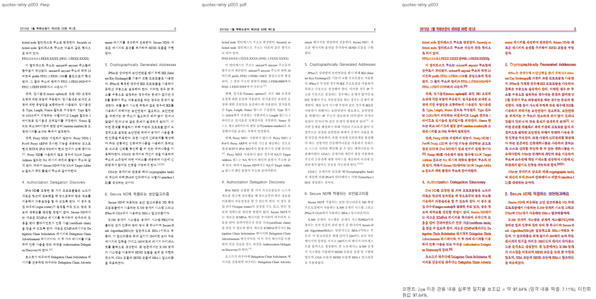
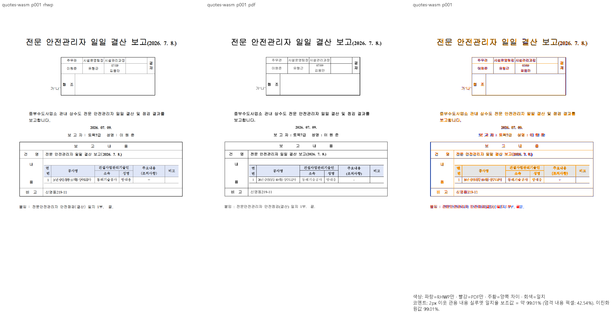

# PR #7622 리뷰 — 굽은 따옴표의 영문 글꼴 슬롯

## 최종 판정

**메인터너 보정 후 수용 가능.** 원 기여와 누적 메인터너 보정을 포함한 통합 후보의 판정이다.
최종 통합은 아래에 기록한 남은 검증 조건을 완료한 뒤 진행한다.

문자 언어 슬롯별 측정 style과 실제 run paint의 소비를 맞추는 보정을 누적 적용했다. 자산관리규정의 별도 #7445 작업과 중복되는 추가 보정은 이 통합 범위에서 제외했다.

## 현재 검증 근거 — 2026-10-11

| 항목 | 확인한 상태 |
| --- | --- |
| 검토 branch | `review/planet6897-20261008` |
| 통합 PR | [#7832](https://github.com/edwardkim/rhwp/pull/7832) → `devel`; 원 기여와 메인터너 보정 함께 제출 |
| rebase 후 통합 code head | `9b4817473b2a3515ea27eefef9d20731258433e4` |
| 최신 upstream base | `920dc29284e8a6e624861bfccf68903e19ae309b` |
| 전체 회귀 | 검증 source `7dd9572b7fecbc602c9e5ab47c4a6c9d6422b4bd`: 10,215PASS·실패0·skip45 |
| lint·정책 | fmt·Native/WASM/all-target Clippy·workspace build·base 고정 manifest/unit-tier PASS |
| Studio | 1,834PASS·실패0·skip2, TypeScript 검사 PASS |
| optimized fresh WASM | code source `03a987f4a`: 빌드exit0, `pkg/`·Studio `public/` JS/WASM SHA-256 일치 |
| 시각 선행 조건 | table-text·stored-vpos·hwp-multi·해외투자3입력의 Native/fresh WASM 전쪽 TSV 모두90% 이상. table-text·stored-vpos 변경 영역 확대 판독 완료 |
| 승인된 이관 | #7813 giant-cell, #7830 sample2 HWP, #7831 가정폭력 조사. 각 출력 문제는 후속 이슈에서 해결 |
| rebase 후 재검사 | 오늘할일만 충돌했고 양쪽 기록을 보존했다. 사용자 지시에 따라 통과한 전체 회귀·lint·Studio를 반복하지 않음 |

전체 결과·시각 점수·source와 로그는 [남은 회귀 보정 기록](../../plans/planet6897_20261008_remaining_regressions.md#현재-시각-검증-상태-정정--2026-10-11)에 연결한다.
위 시각 결과는 해당 입력과 기록한 renderer source의 증거이며, 원 PR 전체 영향 목록의 전수 통과를 주장하지 않는다.

## #7768 재확인과 통합 조건

#7768 원본 전1쪽의 Native/fresh WASM 최저92.73966%, 누락0을 확인했다.
양 경로 raster bytes와 review/overlay의 canonical gate `passed`를 확인하고 캡션·표·
체크박스3개·후행 용지 규격 줄을 확대 판독했다. [공개 시각 증적](../assets/issue7768/README.md)을
통합 PR의 `Closes #7768` 근거로 연결한다.

- 최신 upstream의 확장 프로그램 #7703·기존 오늘할일을 보존해 rebase했다. 충돌은 오늘할일 한 파일뿐이며 Rust/test/Cargo tree는 rebase 전과 같다.
- 사용자 지시에 따라 rebase 후 추가 로컬 테스트를 하지 않는다. 별도 로컬 Native Skia3종은 미실행으로 기록하고 통합 PR의 Native Skia CI 결과를 확인한다.
- 남은 통합 조건은 제출 head의 GitHub CI·CodeQL·Native Skia 및 mergeability 확인이다. 원격 CI 완료·merge를 미리 보고하지 않는다.

이전 검토 이력 — 당시 판정과 단계별 실행 기록

초기 검토에서 확인한 결함·증거 부족과 단계별 재검증 기록이다. 당시 보류 판단은 아래 이력의 source와 실행 범위에 한정하며, 현재 판정은 문서 상단을 따른다.

## 접수·적용 범위

| 항목 | 값 |
| --- | --- |
| 원 PR·작성자·base | [#7622](https://github.com/edwardkim/rhwp/pull/7622) / planet6897 / devel |
| 원 head | `cca0d1b671d62b9111774f53c6948d85c0fb5d4d` |
| 최초 적용 commit | `9229d63b3868bc2b44a839e240c7ee2e5c3a25af` |
| 이 PR의 적용 뒤 head | `f6b95026683f1762231cc0b2db94c906c195d3a2`; 기능 commit 3개, 원 저자·cherry-pick -x 보존 |
| 누적 검증 source head | `90e2c6fd2c614ba0ea7667355c4ed2f3617f6563` |
| 최신 base 정렬 뒤 code head | `ae786f75b2cee72bd5576f6473bd51d9a8216f7c`; 제품/검증 입력 tree 동일 확인 |
| 검토 branch·reviewer | `review/planet6897-20261008` / jangster77; 원 PR reviewer assign 선행 |
| 원 PR 참고 상태 | draft=False, MERGEABLE / CLEAN; 작성 시점 snapshot이며 merge 직전 판정을 대신하지 않음 |
| 경로 | collaborator 외부 PR의 주 작업공간 누적 cherry-pick 9.1.1; intake/template/local_validation/visual_fixture_evidence 및 대형 PR 보조 절차 |

관련 이슈와 해결 표현은 원 PR 본문의 범위를 유지한다. 이번 보류 기록에 새로운 closes 표현을 추가하지 않는다. 원 PR 제공 before/after와 corpus 수치는 참고이며 통합 head의 독립 실행과 구별한다.

## 구현 주장·소비 경로·검증 판정

`style_resolver.rs:824`의 `detect_lang_category`는 U+2018/2019/201C/201D만 영문 슬롯으로 분류한다. 독립 공개 논문 PDF p3의 ‘/’ face는 TimesNewRomanPSMT, p4의 U+2024는 Haansoft Batang임을 PDFium으로 조회하여 punctuation 블록 전체를 바꾸지 않는 근거와 대조했다. 동일 원본 7쪽 Native/fresh WASM 최저 94.23341%, 대표 p3의 2단·줄바꿈과 인용부호를 직접 비교했다. 글꼴 굵기·AA 및 인용 참조 모양 차이는 남는다.

**실행한 진단의 제한:** legacy 인라인 표 경로 `layout/paragraph_layout.rs:3616`은 `cs_changed`에 언어 변경을 포함하지 않고 누적 run을 첫 문자의 `first_lang`으로 칠한다. 공개 TAC 입력에서 한글과 ‘/’를 섞고 모든 영문 face를 Times New Roman으로 지정한 합성 진단에서 따옴표 SVG는 GulimChe 체인이었다. 이는 현재 소비 경로의 미해결 결과이며 새로 발생한 회귀나 정상 한컴 저장본과의 차이로 승격하지 않는다. 진단 입력의 저장 LineSeg를 실제 생성본의 증거로 사용하지 않는다.

**미검증:** 이 소비 경로의 독립 편집 Print PDF·수정 전 FAIL/수정 후 PASS, 원 PR의 전체 175문서 영향 범위·쪽수 차이. 새 회귀 fixture/golden을 추가하거나 기존 기준값을 통과 목적으로 완화하지 않았다.

공통 빌드·회귀·글꼴 등록·383쪽 시각 결과와 입력/기준 해시·증적 보존·merge 후 댓글 계획은 [#7611 공통 통합 검증](pr_7611_review.md#공통-통합-검증과-증거-보존)에 연결한다. 이 PR의 조건부 수용이 아니라 미충족·미검증 해소 후 재검토 계획이다.

## 한컴 저장본·Print로 확인한 legacy 인라인 소비 오류 — 2026-10-10

앞선 수동 LineSeg 진단을 그대로 정상 저장본 증거로 사용하지 않았다. 같은 공개 원본의 명시적 진단 derivative를 Windows 한컴에서 열고, 실제 본문 선택에 인용부호가 포함된464문자를 확인한 뒤 Latin face를 Arial→Times New Roman으로 두 번 바꾸고 매번 parameter readback을 확인하여 HWPX로 저장했다. [공식 Automation action 목록](https://raw.githubusercontent.com/hancom-io/devcenter-archive/main/hwp-automation/ActionObject.pdf)의 `SelectAll`과 HAction 경로를 사용했다. 초기 선택 호출 실패와 PowerShell5의 UTF-8 regex 해석 실패는 수정 전 제품 FAIL로 세지 않으며 별도 실행 실패로 보존한다. `quotes-native-save-v3.json`에 실제 edit/readback·입력 hash를 기록했다.

저장 제품은 hancom-office-2020이며 대응 Print는 명시적 engine2020, 한컴11.0.0.9136, `pdf_print_method:0`, `hancom2020_pdf_driver_one_up`으로 산출했다. PDF signature/EOF·byte 수·다운로드 hash를 확인했고 전체1쪽이다(`quotes-native-print-v3.json`). 실제 source의 `가‘나’` host는 Latin face Times New Roman과 새 저장 LineSeg를 가지며 독립 PDF의 두 인용부호는 TimesNewRomanPSMT다(`quotes-native-source-print-check.json`). 원래 공개 입력의 개선·일치나 source 생성 출처의 동일성을 이 derivative의 결과로 바꾸어 주장하지 않는다.

source `711f7f92ee63279754d80e1be9529ae24905f5ad`의 실제 새 Native와 fresh WASM에서 이1쪽은 각각98.93360%지만, Native SVG의 두 부호는 굴림체/GulimChe 체인으로 나왔다. 이미 확보한 Print와 실제 family를 대조해 legacy TAC run의 측정/paint 슬롯 불일치를 실행으로 확인했다. 사용한 WASM 조판 generation은2022이며 Print service engine2020과 구별한다. 잘못 지정한 compat2020은 exporter가 거부했고 output 없는 orchestration 오류로 보존·교정했다. source/입력/PDF/package hash·전체1쪽 TSV·원시 WASM 출력은 `quotes-native-v3-before-711f7f92e/` 및 `quotes-wasm-v3-compat2022-before-711f7f92e/`에 있다. 90% 점수만으로 잘못된 family를 면제하지 않는다.

남은 보완은 언어 슬롯으로 측정한 문자들이 같은 char-shape ID라는 이유로 첫 문자의 family로 함께 paint되지 않게 하는 것이다. 같은 face·장평·자간을 공유하는 슬롯은 기존 run을 유지하며 실제 글꼴/메트릭이 달라지는 경계를 분리해야 한다. 정상 저장본의 before/after·정식 의미 검사·최신 원본 대조와 필수 검증이 아직 미완료이므로 머지 보류를 유지한다.

### 실제 측정 style과 run 소유의 보완 후보

legacy TAC 텍스트 경로에서 `ParagraphMetricScope::style`이 문자별로 생산한 family/크기/장평/자간과 현재 누적 run 첫 문자의 같은 생산 결과를 비교한다. 값이 달라지면 기존 flush와 마지막 run paint가 같은 시작 문자·style을 소유하도록 run을 끊는다. Unicode category만 다른 경우나 char-shape ID만 같은 경우를 글꼴 동일성으로 대신하지 않는다. `with_stored_tabs`의 소비 위치별 tab extension 변화는 font/메트릭 차이와 구별하며, 기존 char-shape·supplemental metric scope·저장 줄 바꿈·제어문자·실제 빈 run의 경계는 유지한다.

실제 연결은 문자 폭의 `metric_scope.style(styles, cs_id, lang, ch_idx)` → 축적 run 경계의 같은 style 비교 → 중간 flush/마지막 flush의 `metric_scope.style(..., first_lang, line_run_start)` → TextRun backend 소비다. 첫 문자의 속성을 모든 뒤 문자에 적용하던 가정을 제거하고 특정 인용부호·입력 ID 예외를 추가하지 않는다. 같은 글꼴/크기/장평/자간을 공유하는 다른 슬롯은 기존 run을 유지한다. 후보 작성 시점에는 새 Native/fresh WASM·직접 판독·정식 before FAIL/after PASS·원본 대조·회귀/lint가 미검증이었다. 후속 실제 실행 결과는 다음 절에 구별한다. 원래 source의 전쪽 및 실제 backend 검증 없이 이 후보를 승인·통합하지 않는다.

### 2026-10-10 실제 저장 대조군의 보완 실행

제품 source `5538efd3832ab2137e86de5302b4dee7caf392b7`, 고정 base
`21ed64071f81f35f37618717693bd30f727392c9`의 새 Native·fresh WASM을 실행했다.
Native 빌드366.8초, WASM 빌드59.19초이며 모두 exit0이다. Native 실행 파일 SHA-256은
`27b18b1744264305f21617d90e63b0d9e1e2882bcb62a3bcf4c022c281323063`이다.
같은 실제 한컴 저장 대조군·대응 2020 1-up Print 전1쪽에서 두 경로 모두99.01152%다.
저장 글자모양의 Latin face, 독립 Print의 TimesNewRomanPSMT와 실제 두 인용부호의
Times New Roman paint 요청이 일치했다. 앞서711의 실제 Native/fresh WASM은 둘 다 굴림체였고,
같은 독립 기대값 검사에서 before 두 실행 exit1 / after 두 실행 exit0을 확인했다.

입력과 독립 PDF는 [대조군 생성·해시 기록](../../../samples/issue7622/README.md)에 연결하고
커밋 `bea45e807be47d460899a6c62f55e200a0fcd423`에 포함했다.
대표 [Native review](../assets/issue7622_inline_table_font_slots/curly-quote-native-review.png)·
[overlay](../assets/issue7622_inline_table_font_slots/curly-quote-native-overlay.png),
[fresh WASM review](../assets/issue7622_inline_table_font_slots/curly-quote-wasm-review.png)·
[overlay](../assets/issue7622_inline_table_font_slots/curly-quote-wasm-overlay.png)를 직접 읽었다.
표 외곽·뒤 본문·인용부호를 확인했으며 작은 획 농도·AA·괘선 두께 차이는 남는다.
이 대조군은 공개 원본의 한컴 편집 derivative이며 원 contributor 원본 전체의 일치 증거로 바꾸어 보고하지 않는다.

정식 `issue_7622_inline_table_font_slots`의2개 검사는 실제 최종 render tree에서 Latin face와
한글 face, 순서·각 문자1개 보존을 확인한다. 소스의 같은 char-shape ID와 정상 저장 LineSeg를
확인하며 절대 출력 좌표·SVG hash를 기대값으로 쓰지 않는다. source 보강 후 파생 suite를 다시
준비한 실행에서2 PASS/208 skipped, 실행0.086초, build45.32초, exit0이었다.
suite를 재준비하기 전0건 실행 exit4는 orchestration 오류이며 통과·제품 회귀로 집계하지 않는다.
현재 정확한 Rust harness의 수정 전 실행은 미검증이다. 위 실제 SVG producer/paint 요청의
before/after 실행과 정식 Rust harness 실행을 구별한다.

같은 대조군의 수정 전후 layout-anomaly는 off-canvas·overflow·text-overlap 모두0이다.
새 sample의 쪽수1/1 행만 추가했으며 기존 baseline을 완화하지 않았다. 이번 branch의 추가·교체
HWP/HWPX11개를 같은 frozen Native의3개 보안 CLI로 실제 검사하여33건 모두 clean이었다.
이 진단은 정식 보안 suite나 다섯 코퍼스 래칫을 대신하지 않는다. `bea45e807` 전체 nextest는
build-jobs8/test-threads10으로 시작했으며, 최종 요약·세 Clippy·다른 원본과 소비 backend는
아직 미검증이다. 전체 통합 후보와 이 원 PR의 머지 보류는 유지한다.

실행 로그·TSV·원시 출력·package/source hash·인용부호 before/after는 ignored
`output/pr-review/planet6897-20261008/`의 `candidate-5538efd38-{native,wasm}-check.json`,
`quotes-native-v3-after-5538efd38/`, `quotes-wasm-v3-compat2022-after-5538efd38/`,
`quotes-native-slot-runtime-control.json`, `quotes-formal-strengthened-result.json`,
`new-sample-detectors-5538efd38.json`, `bea45e807-full-regression.json`에 보존했다.

## 2026-10-11 전체 영향 자료 확보 감사

기여자 원 TSV의175문서/1,566영향쪽을 실제 읽고 각 원본과 repository 기준 PDF의 존재·SHA 및 PDF 전체 쪽수를 확인했다. 입력 누락0, PDF 누락0, PDF 읽기 실패0이며 대응 PDF 쪽수 합은6,078쪽이다. ignored `batch208-font-impact-inventory/provenance.json`에 전 입력을 기록했다. 이 감사는 현재 base/head의 시각·원문 대응 검증이나 이전 낮은 점수의 #7445 이관 근거가 아니다.

자산관리규정 `samples/issue6031/3249937_asset_management_rules.hwpx`도 이 목록에 있다. 기준 `pdf/3249937_asset_management_rules-2020.pdf`는 전체60쪽이고 기여자의 영향쪽은37/38/39다. b886 frozen Native의37쪽을 실제 재출력하여99.35586%를 측정했다. 다음38쪽 브라우저 raster는 `ENOSPC`로 실패했으므로39쪽·전체60쪽·fresh WASM과 직접 판독은 미검증이다. 원본·Print·검사를 삭제하거나 이 문서를 이관하지 않는다. 실패한 실행은 `batch209-asset-boundary-diagnosis/`에 보존했다.

### 자산관리규정의 저장 원점 진단과 보완 후보

리베이스 뒤 검증 source `717783327367995f5d49c43a7d965ae3f83c50d0`의
release-test Native 빌드는 exit0/562.03초다. 같은 원본·독립 Print를 다시 실행한
`batch225-asset-current-diagnosis/`의37/38/39쪽은 각각99.35586/96.26262/67.28760%다.
38·39쪽 review를 직접 읽었으며39쪽은 첫 제목 뒤 본문이 위로 이동했다.
점수 미달을 글꼴 차이로 면제하거나 #7445로 이관하지 않는다.

`batch227-asset-origin-audit/origin-evidence.json`은 원 HWPX의 pi538 첫 줄
`vertpos=500`, 앞 간격500HU와 pi539의 앞 간격0을 확인한다. 두 문단 경계는
`3492 − 500 − 1300 − 1692 = 0HU`로 정상 저장 사다리다. 첫 두 줄의 저장 거리는
39.89333px, 독립 Print의 기준선 거리는39.79651px지만 실제 SVG는33.22667px다.
차이는 첫 문단 앞 간격500HU=6.66667px와 정확히 같다.

원인 연결은 `stored_first_margin_is_page_relative`의 `next_before > 0.5` 조건 →
측정 `section/vpos.rs::vpos_snap_current_height`의 page base500HU →
배치 `layout.rs::build_single_column`의 같은 page base →
`HeightCursor`/`vpos_corrected_end_y`의 후속 저장 좌표 차감이다. 다음 문단의 앞 간격이
0이어도 경계 등식은 원점을 입증하므로 그 불필요한 양수 조건만 제거한다.
원본 ID·새 임계값·좌표 clamp를 추가하지 않고 두 소비 경로가 같은 helper를 유지한다.
원 XML의 같은 등식 후보는9·39쪽이며, control/profile 조건의 실제 적용과 전체60쪽·
fresh WASM·정상 대조군은 새 런타임에서 확인해야 한다. 현재 보완은 미검증이다.
이 단계에서는 실물 회귀 기대값·baseline·새 테스트를 추가하거나 변경하지 않았다.

동시에717의 가맹사업 Native 선택13쪽은 최저92.20721%를 확인했으며 작은따옴표 영향23쪽은
98.09390%다. 전142쪽 Native와 fresh WASM은 별도 실행 중이다.
기본 환경 정상7문서·317쪽의 page plan과 모든 RenderTree는 b886과 동일했다
(`batch226-current-normal-control/`). 이 동일성을 독립 Print 시각 통과로 바꾸어 보고하지 않는다.

### 원점 보완 Native의 실제 결과와 남은 검증

보완 source `488c5dec0aaac4058c217c6f01986921f3be3a82`는 release-test Native 빌드
exit0/18분51초이며 `batch233-asset-origin-native-build/`에 실제 명령과 실행 파일 SHA를
기록했다. `batch234-asset-origin-selected/`의9/37/38/39쪽은 각각
98.48709/99.35586/96.26262/96.69418%다. 같은39쪽은67.28760→96.69418%이며
새 review를 직접 읽어 첫 제목 뒤의 전체 본문이 위로 이동하던 차이가 해소됐음을 확인했다.
일부 글자 간격·획 차이는 남으며 전60쪽 Native/fresh WASM과 확대 판독은 미완료다.
전60쪽 Native는 `batch235-asset-origin-full-native/`, 필수 lint와 새 WASM package는
`batch236-asset-origin-validation-wasm/`, 전60쪽 WASM은 `batch237-asset-origin-full-wasm/`에서 이어간다.

### 전60쪽에서 검출한 분할·병합 폭 차이의 보완 후보

`batch235-asset-origin-full-native/provenance.json`의 전60쪽 실제 TSV는14쪽49.78994%,
51쪽53.49225%로 실패했다. 나머지58쪽은90% 이상이지만 전체 통과가 아니며,
이 현재 보정 문서를 #7445로 이관하거나 기존 검사·baseline을 완화하지 않는다.
39쪽은 새 원점의 첫 기준선 간격39.89333px가 저장39.89333px/독립 Print39.79651px와
대응함을 같은 배율 before/Print/after에서 확인했다(`batch241-asset-expanded-origin/`).

14쪽의 입력 pi196에는 저장 LineSeg가 없으며, 독립 Print는 그 문단의 앞2줄을13쪽,
뒤3줄을14쪽에 배치한다. Native는 앞3줄/뒤2줄이다. `batch242-asset-boundaries/`의
실행 진단으로13쪽 첫 이어받기 pi182 뒤 pi183의 실제 배치 전진118.7px와 흐름 전진93.3px가
갈라짐을 확인했다. 배치는 첫 PartialParagraph의 저장 시작 줄을 page base로 쓰지만
측정은 그 원점 없이 pi184에서 lazy base1900HU를 역산하여 이미 trim한25.3px를 기준에
흡수했다. 그 뒤 pi196의 세 번째 줄 상자는 본문 하단을 약5.6px 넘었다.
수용한 단 첫 이어받기 조각의 실제 저장 시작 줄을 측정에서도 같은 단 원점으로 확정한다.
단단·비편집·저장 HWP/HWPX·본문 조각에만 적용하며 합성/개체/다단의 원점을 추정하지 않는다.
`place_split_paragraph`의 수용 컷 → state page base → `section/vpos`/`HeightCursor`의
다음 저장 앵커 복원 → fit/실제 PartialParagraph 소유를 새 런타임에서 대조한다.

51쪽은 원본22행27열/159셀, 선언 폭72824HU다. 각 물리 행에 걸치는 세로 병합 셀까지
포함한 폭 합은72536~72806HU지만, 종전 `declared_row_col_x`는 시작 행의 단일행 셀만
모아 완결 행을 찾지 못했다. 서로 다른 행의 병합 폭 제약을 한 전역 그리드에 누적한 결과
Native 표 폭은1180.1px로 선언970.99px를 넘었다. 각 물리 행을 덮는 셀을 모으되 기존
열의 빈틈/겹침/끝점 검사를 유지하여 선언 구획을 소비한다. 새 clamp·문서ID·허용치를
추가하지 않고 기존1% 이내 선언 폭 정책을 유지한다. `build_row_col_x`는 일반 표·부분 표·
셀 내 표 배치와 테두리에 공통으로 사용된다. 높이 측정의 `paragraph_frame_owner_widths`는
원본 셀 폭을 소비하므로 기존 소폭 정규화 후 실제 줄 구성·높이/배치 일치도 검증한다.
독립 Print의 표 좌우 경계60.42~787.92pt와 각 내부 세로선을 기록했다.

두 보완은 원인 분석 뒤 묶어 수정한 후보이며 아직 새 runtime 결과가 없다.
필수 lint236의 실제 Cargo writer가 종료된 뒤 새 head에서 영향쪽/정상 대조군과 전60쪽
Native/fresh WASM을 재출력한다. 전쪽90%·확대 판독 전에는 새 실물 회귀를 추가하지 않는다.
선행 빌드 종료 순간의 대기 race로 제품 실행 전 중단된229/230/231의 실패 기록은
성공으로 덮어쓰지 않았다. 성공 종료를 재조회하는 대기로 바꾸어233/234/235를 새로 실행했다.

정상7문서·317쪽은 보완 전717과 보완 후488의 모든 RenderTree가 byte 동일하다
(`batch238-current-normal-control/`). `aaaaaa.hwp`47쪽의 dump-page `usedHeight`만
752.97333→783.09333px, `usedDiff`는−41.85333→−11.73333px로 변했다.
전체 쪽수50과 해당 쪽의 항목 소속·실제 render tree는 그대로다. 측정 메타데이터의 변화를
실제 독립 Print 시각 통과나 모든 경로의 회귀 통과로 바꾸어 주장하지 않는다.

### 시험지 입력을 명시한 M-sec 봉투의 제외

추가 감사에서 `exam_kor.hwp`를 CLI source로 명시한 cached 보안 봉투
`uni-zw-hangul-pua-typesetting`1건이 활성 catalog에 남아 있었다.
사용자가 요청한 시험지 회귀 제외에 따라 이 봉투와 catalog 행·재생성 함수만 제거했다.
원본 `samples/exam_kor.hwp`의 Git blob/실제 파일 SHA 불변을 확인했다.
다른215개 계약과 기존 탐지 규칙·하한·허용치를 보존하고 기술 통계만193/22/215,
unicode43건으로 맞췄다. 새 generator의 catalog/matrix bytes와 전체 봉투 JSON 값이
현행과 같고 기존 도구 계약22개가 PASS다(`batch240-exam-envelope-exclusion-audit/`).
이 검사와 일반 합성 유니코드 계약을 실물 시험지 렌더링 검증으로 사용하지 않는다.

### 2026-10-11 사용자 범위 정정 — #7445 별도 작업과 중복 제외

사용자는 자산관리규정이 [#7445](https://github.com/edwardkim/rhwp/issues/7445#issuecomment-5868575524)의
별도 브랜치에서 진행 중이며 아직 PR하지 않아 이번 검토에서 처리하면 중복이라고 확정했다.
위 자산관리규정 보완·후보 기록은 진단 이력이며 현재 통합 PR의 해결 범위가 아니다.
이번 검토에서 추가한488의 저장 원점 조건 변경과3a9의 이어받기 원점/병합 폭 보완을 제외한다.
그 추가 원점 때문에 발생한 rowbreak9쪽 회귀를 고치려던 미커밋 후보도 제외했다.
원래7개 PR에 속한 기존 조판·글꼴 변경은 보존한다. 생산 Rust/dependency source를 검증한
717783327367995f5d49c43a7d965ae3f83c50d0과 동일하게 복원하여 새 빌드를 반복하지 않는다.

조사한 동일 원본의 실제2020 Print60쪽은 원본 불변·PrintMethod0·실제11.0.0.9136을 확인했고,
3a9 Native 전60쪽 최저94.49441%/미달0이었다. 이 결과와 정상 Print·대표 PNG는
`Downloads/planet-asset-7445-deferred-20261011/` 및 ignored batch257/260/261/262/264에
보존했으며 이번 PR용 PDF를 교체하거나 시각 통과로 포함하지 않는다.
별도 #7445 기록도 정상2020 Print와 전쪽 Native/fresh WASM·관계형 회귀 결과를 보고한다.
그 브랜치의 결과를 이 브랜치 완료로 재사용하지 않고, 병합 상태와 실제 변경 SHA를 따로 확인한다.
글꼴 영향175 입력 원장은 유지하고 이 문서의 기존 결함을 이미 진행 중인 #7445와 구별한다.
새 PR에서 발생한 회귀를 #7445 등록 사실만으로 면제하지 않는다.

