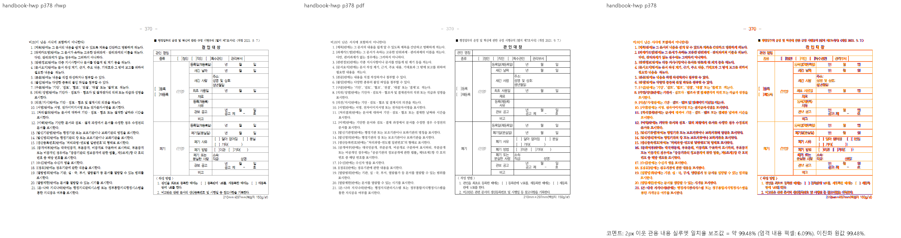

# PR #7624 리뷰 — KoPub useFontSpace 공백 폭

## 최종 판정

**메인터너 보정 후 수용 가능.** 원 기여와 누적 메인터너 보정을 포함한 통합 후보의 판정이다.
최종 통합은 아래에 기록한 남은 검증 조건을 완료한 뒤 진행한다.

실제 KoPub legacy face의 독립 메트릭을 근거로 공백 폭 해석을 보정했다. 가정폭력 조사 문서의39→37쪽·마지막 조각 문제는 사용자 지시에 따라 #7831의 후속 해결 범위로 분리했다.

## 현재 검증 근거 — 2026-10-11

| 항목 | 확인한 상태 |
| --- | --- |
| 검토 branch | `review/planet6897-20261008` |
| 통합 PR | [#7832](https://github.com/edwardkim/rhwp/pull/7832) → `devel`; 원 기여와 메인터너 보정 함께 제출 |
| rebase 후 통합 code head | `9b4817473b2a3515ea27eefef9d20731258433e4` |
| 최신 upstream base | `920dc29284e8a6e624861bfccf68903e19ae309b` |
| 전체 회귀 | 검증 source `7dd9572b7fecbc602c9e5ab47c4a6c9d6422b4bd`: 10,215PASS·실패0·skip45 |
| lint·정책 | fmt·Native/WASM/all-target Clippy·workspace build·base 고정 manifest/unit-tier PASS |
| Studio | 1,834PASS·실패0·skip2, TypeScript 검사 PASS |
| optimized fresh WASM | code source `03a987f4a`: 빌드exit0, `pkg/`·Studio `public/` JS/WASM SHA-256 일치 |
| 시각 선행 조건 | table-text·stored-vpos·hwp-multi·해외투자3입력의 Native/fresh WASM 전쪽 TSV 모두90% 이상. table-text·stored-vpos 변경 영역 확대 판독 완료 |
| 승인된 이관 | #7813 giant-cell, #7830 sample2 HWP, #7831 가정폭력 조사. 각 출력 문제는 후속 이슈에서 해결 |
| rebase 후 재검사 | 오늘할일만 충돌했고 양쪽 기록을 보존했다. 사용자 지시에 따라 통과한 전체 회귀·lint·Studio를 반복하지 않음 |

전체 결과·시각 점수·source와 로그는 [남은 회귀 보정 기록](../../plans/planet6897_20261008_remaining_regressions.md#현재-시각-검증-상태-정정--2026-10-11)에 연결한다.
위 시각 결과는 해당 입력과 기록한 renderer source의 증거이며, 원 PR 전체 영향 목록의 전수 통과를 주장하지 않는다.

## #7768 재확인과 통합 조건

#7768 원본 전1쪽의 Native/fresh WASM 최저92.73966%, 누락0을 확인했다.
양 경로 raster bytes와 review/overlay의 canonical gate `passed`를 확인하고 캡션·표·
체크박스3개·후행 용지 규격 줄을 확대 판독했다. [공개 시각 증적](../assets/issue7768/README.md)을
통합 PR의 `Closes #7768` 근거로 연결한다.

- 최신 upstream의 확장 프로그램 #7703·기존 오늘할일을 보존해 rebase했다. 충돌은 오늘할일 한 파일뿐이며 Rust/test/Cargo tree는 rebase 전과 같다.
- 사용자 지시에 따라 rebase 후 추가 로컬 테스트를 하지 않는다. 별도 로컬 Native Skia3종은 미실행으로 기록하고 통합 PR의 Native Skia CI 결과를 확인한다.
- 남은 통합 조건은 제출 head의 GitHub CI·CodeQL·Native Skia 및 mergeability 확인이다. 원격 CI 완료·merge를 미리 보고하지 않는다.

이전 검토 이력 — 당시 판정과 단계별 실행 기록

초기 검토에서 확인한 결함·증거 부족과 단계별 재검증 기록이다. 당시 보류 판단은 아래 이력의 source와 실행 범위에 한정하며, 현재 판정은 문서 상단을 따른다.

## 접수·적용 범위

| 항목 | 값 |
| --- | --- |
| 원 PR·작성자·base | [#7624](https://github.com/edwardkim/rhwp/pull/7624) / planet6897 / devel |
| 원 head | `b09251980913178c48f3b2c02b2c62cd8637f6c1` |
| 최초 적용 commit | `fb9a257b99be272f23e3e9b8f8e1cc4acab6cdc9` |
| 이 PR의 적용 뒤 head | `2fa4a4d702836922d92add2fc7d7a5caf27a8a56`; 기능 commit 3개, 원 저자·cherry-pick -x 보존 |
| 누적 검증 source head | `90e2c6fd2c614ba0ea7667355c4ed2f3617f6563` |
| 최신 base 정렬 뒤 code head | `ae786f75b2cee72bd5576f6473bd51d9a8216f7c`; 제품/검증 입력 tree 동일 확인 |
| 검토 branch·reviewer | `review/planet6897-20261008` / jangster77; 원 PR reviewer assign 선행 |
| 원 PR 참고 상태 | draft=False, MERGEABLE / CLEAN; 작성 시점 snapshot이며 merge 직전 판정을 대신하지 않음 |
| 경로 | collaborator 외부 PR의 주 작업공간 누적 cherry-pick 9.1.1; intake/template/local_validation/visual_fixture_evidence 및 대형 PR 보조 절차 |

관련 이슈와 해결 표현은 원 PR 본문의 범위를 유지한다. 이번 보류 기록에 새로운 closes 표현을 추가하지 않는다. 원 PR 제공 before/after와 corpus 수치는 참고이며 통합 head의 독립 실행과 구별한다.

## 구현 주장·소비 경로·검증 판정

`style_resolver.rs:637`의 `declared_space_advance_em` → 영문 슬롯 `use_font_space` 해소 → `layout::kopub_declared_space_em`과 폭 측정 소비를 대조했다. 설치한 실제 legacy TTF hmtx에서 돋움 공백 0.290em, 바탕 0.312em을 독립 조회했고 6 face × ASCII 95자 = 570개 폭이 기존 전용 표와 모두 일치했다. KoPub World를 같은 face로 등록하거나 이름을 바꾸지 않았다.

편람 HWP 377/378쪽은 Native/fresh WASM 94.00029%/99.47783%. 양식 괘선·시작점과 줄바꿈을 직접 비교했고 377쪽 일부 입력 칸·문자 여백 차이는 보존한다. 전체 편람에서 50쪽 gate 실패가 있어 부분 점수를 전체 일치로 보고하지 않는다.

domestic violence의 기존 40쪽 PDF는 Hwp 2018/비KoPub face, 새 커밋된 KoPub Print PDF는 Hwp 2020/39쪽이다. 현재 Native 39쪽은 새 기준의 쪽수와 일치하지만, 출처·글꼴 환경이 다른 PDF를 임의 baseline 교체로 취급하지 않고 구별한다. **미검증:** 이 문서 전쪽 시각 비교와 HWPX 전쪽, 변경 폭이 영향을 주는 모든 pagination/paint 소비 경계.

공통 빌드·회귀·글꼴 등록·383쪽 시각 결과와 입력/기준 해시·증적 보존·merge 후 댓글 계획은 [#7611 공통 통합 검증](pr_7611_review.md#공통-통합-검증과-증거-보존)에 연결한다. 이 PR의 조건부 수용이 아니라 미충족·미검증 해소 후 재검토 계획이다.

