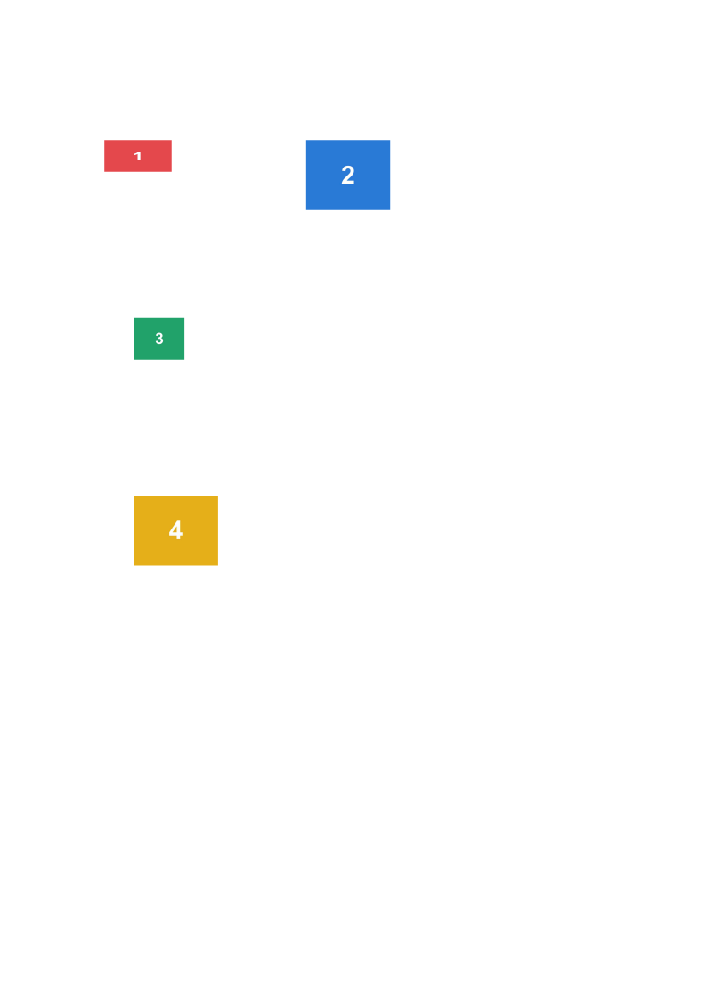
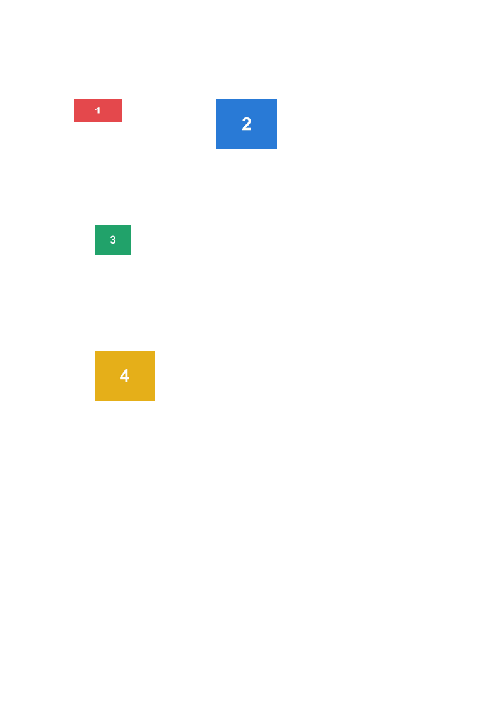
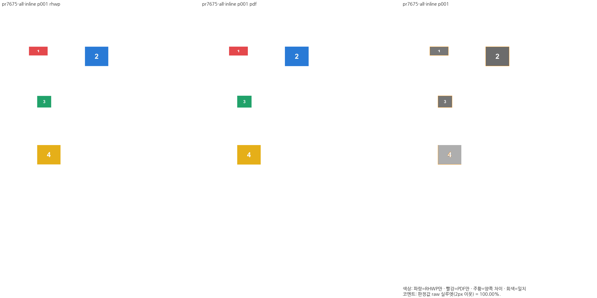
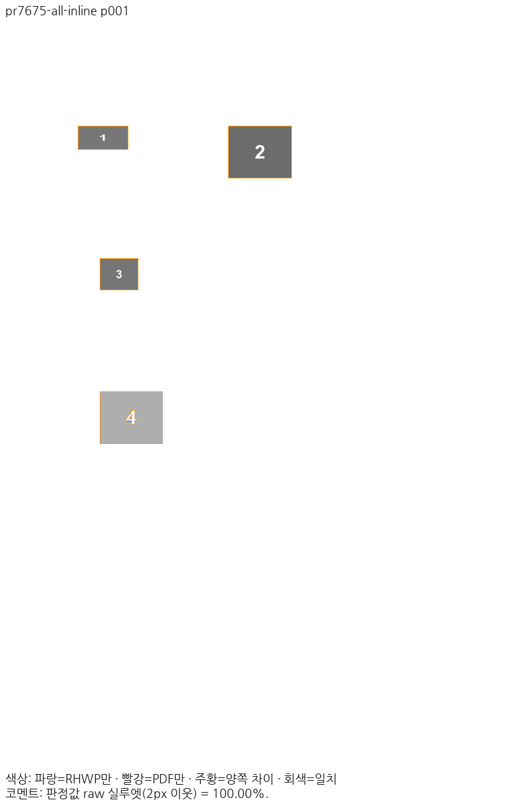

# PR #7675 리뷰 — 인라인 그림의 들여쓰기와 줄 소속

## 최종 판정

**메인터너 보정 후 수용 가능 — 정확한 통합 코드와 독립 Print에 대한 로컬 검증을 완료했다.** 원 contributor head를 보정 없이 승인하거나 원격 병합을 완료했다는 뜻은 아니다. 통합 PR의 정확한 최종 head CI와 병합 상태는 후속 기록으로 확인한다.

## 접수 정보

| 항목 | 확인 내용 |
| --- | --- |
| 원 PR·작성자 | [#7675](https://github.com/edwardkim/rhwp/pull/7675) / jeong-sik / Draft |
| 원 head | `fb6e03c2dbd3f1c0d2d17702479d18b2e3ced51c` |
| 대상·고정 base | `devel` / `d7b927d073489b8c5ea95655224b04096c939534` |
| 검토 브랜치 | `review/integration-20261114-jeong-sik-audit` |
| 메인터너 제품 보정 | `a156bfa7dd86d2568bd7cfc4a97687ac457505b6` (원 시각 producer `6f8d22ac95147b16d9828fee7976df2de192699f`) |
| 최종 검증 코드·base | `728b368e35ccde71d21d5c98d3c2ba791af3ce30` / `dd7f453898776c262c00e862e10f47d22a4d6ceb` |
| 사전 reviewer | 기존 `edwardkim` 유지, `jangster77` 추가·API 확인 |
| 관련 이슈 | 원 PR의 명시적 닫기 대상 없음 |

원 작성자의 과거 병합 기여가 있어 첫 기여자 경로는 비해당이다. 원 커밋은 출처를 보존해 누적 체리픽했으며 현재 devel의 저장소·조판 API와 의도별로 충돌을 해소했다. 원 fork 브랜치에는 push하지 않았다.

## 변경과 메인터너 댓글 반영

그림만 있는 셀에도 줄별 들여쓰기·가용 폭을 적용하며 같은 줄의 두 그림과 너비 부족으로 넘어가는 다음 그림의 소속을 보존한다.

현행 저장소·필드·비흐름 앵커 및 유효 폭 API에 원 PR의 줄 구성을 결합했다. 외부 예약 프레임과 내부 표시 창을 분리하고, JPEG 인쇄 샘플링도 내부 표시 창을 사용해 작은 그림 안 번호가 잘리지 않게 했다.

[메인터너 댓글](https://github.com/edwardkim/rhwp/pull/7675#issuecomment-6068541361)의 동일 60×50mm 프레임 대조군 HWP/HWPX도 원본 바이트로 확보했다. 작은 두 번째 그림의 약 20×9.4mm 내부 표시와 두 전체 프레임의 예약·개별 배치·번호를 확인한다. 당시 본문 부동 그림 문제를 이 PR이 새로 만든 회귀로 단정하지 않는다.

## 독립 기준과 시각 검증

원 PR의 WebHwp `10.80.0.2862` 캔버스는 과거 화면 비교 자료이며 최종 수용 PDF가 아니다. 이번 기준은 **동일 입력을 한컴 2020 Desktop `11.0.0.9136`에서 Print한 PDF**다. MCP engine `2020`, Print method `0`, `hancom2020_pdf_driver_one_up`, `hwp-managed-direct-dll-host`의 실제 영수증과 해시를 [입력·PDF 원장](../assets/jeong_sik_integration_20261114/input-reference-pairs.json)에 보존했다. 저장 제품 연도와 출력 제품을 혼동하지 않는다.

Native Skia 및 fresh WASM Canvas 직접 PNG, `compat=2022`, 96 DPI, 색상 경계 보정 전 2px raw로 같은 한컴 Print와 대조했다. 일반 설치 글꼴 환경이며 최소 글꼴 Visual Sweep이 아니다. Mac WASM은 locked wrapper `--target web --out-dir pkg --no-opt`의 로컬 대체 빌드다. Docker 최적화 통과로 표시하지 않는다.

| 범위 | 쪽수 | Native 최저 | fresh WASM 최저 |
| --- | ---: | ---: | ---: |
| 이 PR의 공개 원본 12종 | 각 1쪽 | 100.00000% | 100.00000% |
| 메인터너 본문 대조군 HWP/HWPX | 각 1쪽 | 100% | 100% |

대표 입력 `pr7675-all-inline`의 고정 devel Native는 1.94372%, 보정 후 Native/fresh WASM은 각각 100%다. 이 점수는 입력별 결과이며 회사 미공개 원본 전체의 정상화를 주장하지 않는다. 전 31종·별도 대조군 2종의 제출용 TSV와 실제 producer·원본/PDF 해시는 같은 [증적 디렉터리](../assets/jeong_sik_integration_20261114/)에 기록한다.

### 주장에 대응하는 실제 출력

[fresh WASM TSV](../assets/jeong_sik_integration_20261114/cases/pr7675-all-inline/wasm/silhouette.tsv) · [review](../assets/jeong_sik_integration_20261114/cases/pr7675-all-inline/wasm/review-001.png) · [overlay](../assets/jeong_sik_integration_20261114/cases/pr7675-all-inline/wasm/overlay-001.png)

## 회귀와 기존 기능 보존

관계형 [picture_cell_flow_frame](../../../tests/cases/picture_cell_flow_frame.rs)은 원본 그림 수·소유, 줄 소속, 전체 프레임의 비겹침, 내부 표시 비율, 반복 HWP 저장과 실제 인쇄 JPEG 프레임을 검사한다. 알려진 효과 16조합은 파일 형식의 크기·투명도 꼬리와 효과 바이트 보존을 별도로 확인한다. 최소 글꼴 환경에서 새 7건과 전체 nextest 13,477건이 실제 PASS다(FAIL 0, skip 45, test 538.576초). 전체 회귀의 원 실행 head·추가 테스트 해시는 [실행 기록](../assets/jeong_sik_integration_20261114/full-nextest-result.json)에 보존한다. supervisor의 리베이스·빌드 대기는 test 시간에 합산하지 않는다. 초기 인자 오류·0 tests·불일치 합성 IR 실행은 최종 PASS나 제품의 수정 전 FAIL 근거가 아니다.

리베이스로 추가된 #8922는 PDF import CMap 변경이며 HWP/HWPX 읽기·조판·paint 10파일 해시와 13개 패치가 유지됐다. [재사용 감사](../assets/jeong_sik_integration_20261114/rebase-reuse-audit.json)에 따라 원 producer의 전쪽 결과를 보존하며 새 head 재출력으로 표시하지 않는다. 최신 head에서 해당 CMap 10건과 그림 관계 검사 7건을 다시 통과했다. Native Skia lib 4,034 PASS/12 ignore, PNG 2·PDF 36 계약, fmt·Native/WASM/all-target Clippy·workspace build·새 base 지정 manifest/unit-tier도 통과했다.

정본 보호 Native/fresh WASM 각각 18문서·1,771쪽, 합계 3,542행의 공식 두 자리 표시값 하락은 0건이다. 필수 편람 HWPX Native 383쪽 gate도 통과했다. 중첩 표는 기존 `nested-original-approved-font-environment.json`을 그대로 사용해 8쪽 Native/WASM 모두 99.59%로 보호값 99.49%/99.50%를 유지했다. 기준 PDF·보호 TSV·허용치는 변경하지 않았다. [보호 결과](../assets/jeong_sik_integration_20261114/protected/completion.json) · [전행 비교](../assets/jeong_sik_integration_20261114/protected/comparison.tsv).

최신 코드의 fresh WASM을 다시 빌드해 root pkg·Studio public·실제 초기화 응답의 JS/WASM을 확인했다. Vite의 WASM URL 변환과 source map 외 JS 본문 변경도 없었다. 대표 5입력의 Canvas2D·CanvasKit software 화면/인쇄 20건, Native SVG browser 화면/인쇄 10건, Native Skia 화면 5건을 통과했다. 두 본문 대조군은 밝기를 17로 편집한 뒤 HWP/HWPX 각 3회 반복 저장·재열기에서 편집값·개체 수·전체 프레임 비겹침을 보존했다. [실제 결과](../assets/jeong_sik_integration_20261114/actual/results.json) · [완료](../assets/jeong_sik_integration_20261114/actual/completion.json) · [전체 검증](../assets/jeong_sik_integration_20261114/README.md).

공통 조판 원칙은 충족한다. 원본 기하·논리 점유·내부 표시를 구분하고 측정·배치·paint가 같은 프레임 계약을 소비한다. 문서명·쪽수·점수에 따른 예외, baseline 완화, 오류를 숨기는 fallback 우회는 추가하지 않았다. 원 PR의 plain cell 사례만으로 모든 부분 분할 행을 증명했다고 하지 않으며, 기존 분할·저장 경로는 전체 회귀와 보호 문서에서 별도로 확인했다.

## 통합 code head CI와 병합 전 조건

[통합 PR #9061](https://github.com/edwardkim/rhwp/pull/9061)의 정확한 code head `f1d210ac0d177173b9fd5806fff358aab24732d2`에서 [CI](https://github.com/edwardkim/rhwp/actions/runs/43485406390)·CodeQL·Adapter·Proptest·Render Diff·최종 정책 감사가 모두 성공했다. `MERGEABLE / CLEAN`을 API로 확인했다. [실제 실행 원장](../assets/jeong_sik_integration_20261114/code-ci.json)을 보존한다. 이번 trailing은 review·오늘할일·CI 증적만 추가하며 source·test·fixture·workflow·baseline은 바꾸지 않는다. 새 trailing head의 필수 검사와 merge 직전 상태를 다시 확인한다.

## Merge 후 contributor PR comment 계획

이 원 PR의 공개 12종 결과와 대응 입력 `pr7675-all-inline` 1쪽을 사용한다. 같은 쪽의 Native/fresh WASM raw·한컴 Print PNG·review·overlay **8개를 실제 Markdown 이미지로 표시**하고 원 PR의 주장·메인터너 댓글·기여/보정 범위와 연결한다. 공개31종 최저99.97213%와 별도 본문 대조군2종100%는 구분해 적는다.

원 PR의 WebHwp 캔버스·PDF 대신 **동일 입력의 한컴 2020 Desktop 11.0.0.9136 Print**를 사용했음을 분명히 알린다. 정확한 통합 merge SHA의 asset이 devel에 존재하고 HTTP PNG 응답·해시가 원본과 같음을 확인한 뒤 [Visual Sweep 댓글 절차](../../manual/verification/visual_sweep_guide.md#github-merge-comment)에 따라 존댓말로 게시한다. code/trailing CI와 통합 PR·merge SHA·개별 리뷰를 연결하고, 중복 병합을 피하려고 원 PR을 close한다. 기여자 fork 브랜치를 삭제하거나 별도 이슈를 임의로 닫지 않는다.
