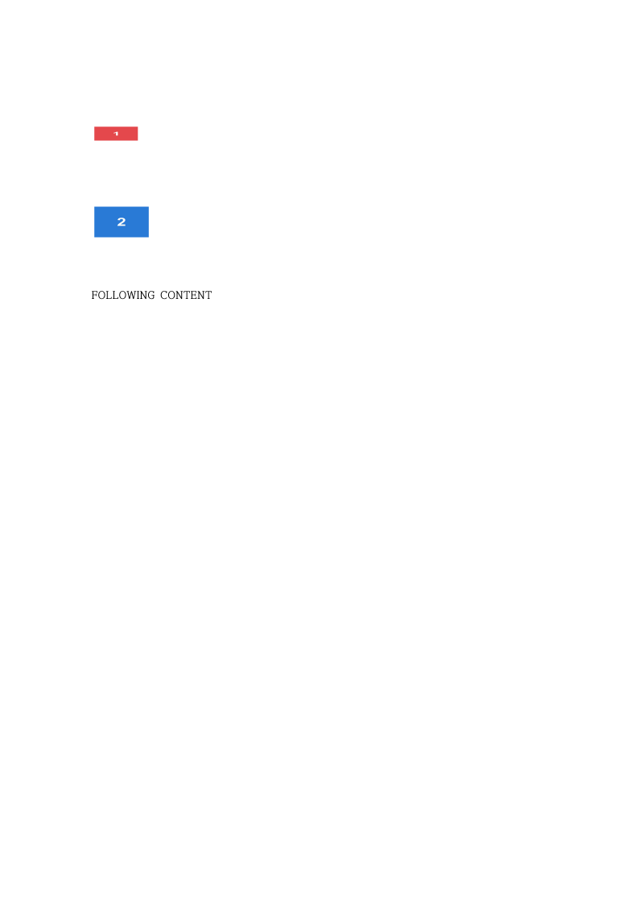
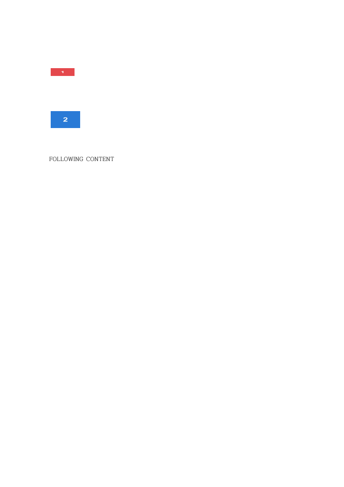
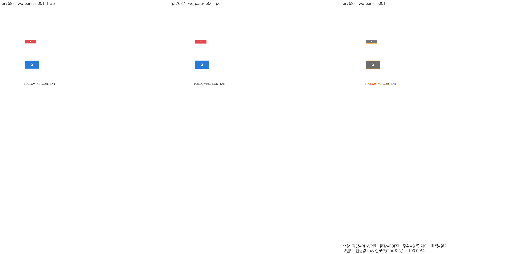
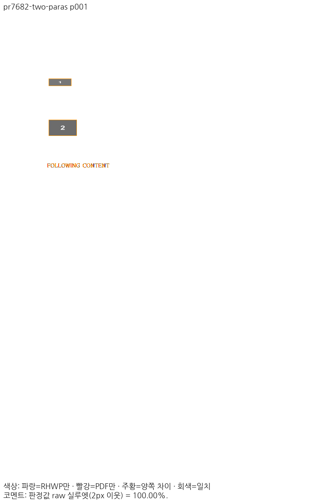

# PR #7682 리뷰 — 여러 그림 문단의 advance와 소유

## 최종 판정

**머지 보류 — 메인터너 보정 후 공개 사례의 Native/fresh WASM 시각 검증은 통과했으며 전체 회귀·보호 WASM·실제 소비 경로 검증을 진행 중이다.** 원 head를 보정 없이 승인한 판정이나 원격 병합 완료 기록이 아니다.

## 접수 정보

| 항목 | 확인 내용 |
| --- | --- |
| 원 PR·작성자 | [#7682](https://github.com/edwardkim/rhwp/pull/7682) / jeong-sik / Draft |
| 원 head | `9f2556c092a76fc66eaa123480ffaeedaeaed22c` |
| 대상·고정 base | `devel` / `d7b927d073489b8c5ea95655224b04096c939534` |
| 검토 브랜치 | `review/integration-20261114-jeong-sik-audit` |
| 메인터너 제품 보정 | `6f8d22ac95147b16d9828fee7976df2de192699f` |
| 사전 reviewer | 기존 `edwardkim` 유지, `jangster77` 추가·API 확인 |
| 관련 이슈 | 원 PR의 명시적 닫기 대상 없음 |

원 작성자의 과거 병합 기여가 있어 첫 기여자 경로는 비해당이다. 원 커밋은 출처를 보존해 누적 체리픽했으며 현재 devel의 저장소·조판 API와 의도별로 충돌을 해소했다. 원 fork 브랜치에는 push하지 않았다.

## 변경과 메인터너 댓글 반영

그림 셀의 여러 문단에 대해 문단별 advance·마지막 줄간격·문단 간격과 (문단, control) 소유를 공유 결과에서 소비한다.

현행 셀 측정과 paint가 같은 문단 프레임을 소비하도록 연결했다. 저장 그림·분할 조각의 기존 소유 경로와 구분하고, 공통 그림 paint의 내부 기하를 유지했다. 별도 본문 대조군은 저장 종료 줄이 두 전체 프레임을 예약한 경우만 개별 원점을 발행한다.

[메인터너 댓글](https://github.com/edwardkim/rhwp/pull/7682#issuecomment-6068546922)의 동일 60×50mm 프레임 대조군 HWP/HWPX도 원본 바이트로 확보했다. 작은 두 번째 그림의 약 20×9.4mm 내부 표시와 두 전체 프레임의 예약·개별 배치·번호를 확인한다. 당시 본문 부동 그림 문제를 이 PR이 새로 만든 회귀로 단정하지 않는다.

## 독립 기준과 시각 검증

원 PR의 WebHwp `10.80.0.2862` 캔버스는 과거 화면 비교 자료이며 최종 수용 PDF가 아니다. 이번 기준은 **동일 입력을 한컴 2020 Desktop `11.0.0.9136`에서 Print한 PDF**다. MCP engine `2020`, Print method `0`, `hancom2020_pdf_driver_one_up`, `hwp-managed-direct-dll-host`의 실제 영수증과 해시를 [입력·PDF 원장](../assets/jeong_sik_integration_20261114/input-reference-pairs.json)에 보존했다. 저장 제품 연도와 출력 제품을 혼동하지 않는다.

Native Skia 및 fresh WASM Canvas 직접 PNG, `compat=2022`, 96 DPI, 색상 경계 보정 전 2px raw로 같은 한컴 Print와 대조했다. 일반 설치 글꼴 환경이며 최소 글꼴 Visual Sweep이 아니다. Mac WASM은 locked wrapper `--target web --out-dir pkg --no-opt`의 로컬 대체 빌드다. Docker 최적화 통과로 표시하지 않는다.

| 범위 | 쪽수 | Native 최저 | fresh WASM 최저 |
| --- | ---: | ---: | ---: |
| 이 PR의 공개 원본 10종 | 각 1쪽 | 100.00000% | 100.00000% |
| 메인터너 본문 대조군 HWP/HWPX | 각 1쪽 | 100% | 100% |

대표 입력 `pr7682-two-paras`의 고정 devel Native는 9.53881%, 보정 후 Native/fresh WASM은 각각 100%다. 이 점수는 입력별 결과이며 회사 미공개 원본 전체의 정상화를 주장하지 않는다. 전 31종·별도 대조군 2종의 제출용 TSV와 실제 producer·원본/PDF 해시는 같은 [증적 디렉터리](../assets/jeong_sik_integration_20261114/)에 기록한다.

### 주장에 대응하는 실제 출력

[fresh WASM TSV](../assets/jeong_sik_integration_20261114/cases/pr7682-two-paras/wasm/silhouette.tsv) · [review](../assets/jeong_sik_integration_20261114/cases/pr7682-two-paras/wasm/review-001.png) · [overlay](../assets/jeong_sik_integration_20261114/cases/pr7682-two-paras/wasm/overlay-001.png)

## 회귀와 기존 기능 보존

관계형 [picture_cell_flow_frame](../../../tests/cases/picture_cell_flow_frame.rs)은 원본 그림 수·소유, 줄 소속, 전체 프레임의 비겹침, 내부 표시 비율, 반복 HWP 저장과 실제 인쇄 JPEG 프레임을 검사한다. 알려진 효과 16조합은 파일 형식의 크기·투명도 꼬리와 효과 바이트 보존을 별도로 확인한다. 최소 글꼴 환경에서 새 7건과 전체 nextest 13,477건이 실제 PASS다(FAIL 0, skip 45, test 538.576초). Native Skia·lint/build 검증은 진행 중이다. 초기 인자 오류·0 tests·불일치 합성 IR 실행을 최종 PASS나 제품의 수정 전 FAIL로 사용하지 않는다.

정본 보호 Native 18문서·1,771쪽은 하락 0건이며 필수 편람 HWPX 383쪽 gate도 통과했다. 중첩 표는 기존 `nested-original-approved-font-environment.json`을 그대로 사용해 8쪽 99.59%로 보호값 99.49%를 유지했다. 보호 WASM 18문서·1,771쪽의 최종 결과와 실제 Studio·저장·재열기 결과를 확인한 뒤 최종 판정과 실행 원장을 갱신한다. 기준 PDF·보호 TSV·허용치는 변경하지 않았다.
