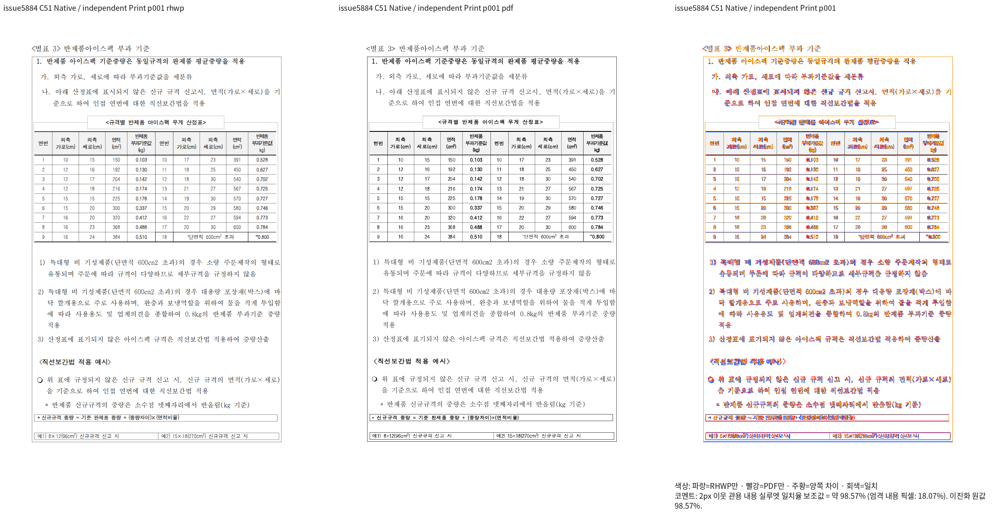
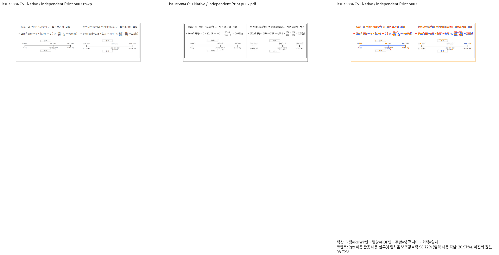

# PR #7701 체리픽·메인터너 보정 검토 계획

## 2026-10-15 최종 통합 검토 연결

최종 적용 범위와 판정은 [개별 review](pr_7701_review.md)와 [통합 review](planet6897_followup_20261015_review.md)를 따른다. 검증 code SHA는 `39a634e547621c32ae6f9ba8c1694d35c827078b`다. 최초 전체 실행·사용자 승인한 집중 재검증 합산, 전21문서181쪽 TSV와 최종 로컬 게이트를 구분해 기록했다. 아래 단계별 “현재”·미완료·C20 기록은 각 작성 당시의 이력이며 최종 상태를 대신하지 않는다. 원격 통합 PR의 CI·merge는 실제 확인 전 완료로 표시하지 않는다.

## 변경 전 C20 통합 검증 — 2026-10-13

변경 전 C20 검증 source HEAD는 `e2a525d36f2923918185f62610869e7c3068b9d0`, 검증 base는
`552f5228d2dbfd6046c838f14241704f1bcb8a05`다. 오늘 `upstream/devel` fetch와 rebase가 모두 성공했으며
SHA 변경·충돌은 없었다. 아래 과거 단계의 SHA·관측값은 당시 기록으로 유지한다.

이 C20 source에서 Rust 전체 회귀 **10,241건 통과·45건 제외**, Studio **1,836건 통과·실패 0건**,
Native Skia library/workspace **4,046건 통과·12건 ignored**를 확인했다.
Studio typecheck/build, Native·WASM·workspace all-target Clippy와 두 정책의 base 비교,
최적화 fresh WASM 및 Native 빌드도 exit 0이다. 모든 Cargo 빌드는 공용
`/home/tsjang/rhwp/target/pr-review`를 사용했다. 실행 명령·시간·SHA·exit code는
ignored `output/pr-review/planet6897-followup-20261011/c20-validation-sequence-results.json`,
상세 lint 결과는 `c20-lint-results.json`에 보존한다.

9개 PR의 전체 Native/fresh WASM 시각 검증은 **진행 중**이다. 이 테스트 통과를
시각 수용·PR 승인으로 판정하지 않는다. 문서별 실제 Print 세대, 전체 TSV, 대표 review와
직접 확대 판독을 대조한 뒤 이 PR의 적용 범위를 최종 판정한다. 현재 head의 결과는
`c20-native-whole-corpus-results.json`과 `c20-wasm-whole-corpus-results.json`에 기록한다.
완료되지 않은 결과 파일의 부재·일부 레코드는 통과가 아니다. 원격 통합 PR·CI·merge와
후속 처리는 아직 진행하지 않았다.

### C21 Canvas 점 페인트 보정 후보

현재 소스에는 C20 이후의 Canvas 가운뎃점 보정이 있다. 일반/효과 페인트가
SVG·Skia와 같은 전진 상자 중앙 및 점 기하 상수를 소비한다. 근거·실제 호출
차이는 [#7815 구현 검토](pr_7815_review_impl.md)의 최신 문장부호 항목을 따른다.
C20 Native 주요24문서·325쪽은 완료했지만 미달 문서가 남았다. C20 전체 WASM과
뒤 추가 corpus는 새 소스와 섞이지 않도록 중단됐다. C20 완료 증거는 그대로 보존한다.

보정 후보의 prepare·fmt·Native/WASM/all-target Clippy·workspace build와
고정 base 대비 manifest/unit-tier **8단계 preflight는 모두exit0**다.
새 code commit의 정식 회귀·fresh WASM 실제 재생·관련 전쪽 시각 검증은 아직
필요하며, 이전 C20 결과를 보정 후보의 최종 통과로 옮겨 적지 않는다.
원격 PR·CI·merge와 후속 처리는 미실행이다. 상세 후보와 명령은 ignored
`c21-canvas-dot-source-candidate.json`, `c21-canvas-lint-preflight-results.json`,
`c21-c20-source-supersession.json`에 보존한다.

## 상태와 검토 범위

검토 진행 중이며 수용·승인 판정은 아직 하지 않았다. 범위는 **이어받기 조각의 바깥 위 여백**다.

- branch: `review/planet6897-followup-20261011`
- 초기 검토 base(과거 단계): `bfa28a77a2714482f647ee6a7b9aa7f7876d8404`
- 원 PR head: `80879e9350b0cc8232d7c37cee62bdf192baeae4`
- 기본 경로: `collaborator_external_pr` 9.1.1, 주 작업공간 체리픽 통합
- 보조 경로: intake, local validation, visual fixture, multi PR, rework

| 원 고유 commit | 적용 commit |
| --- | --- |
| `1f43a042232a9d22d70195609932c240eed3beca` | `6077a02496a5470dc4d7627ccec7f9f472179e8e` |
| `80879e9350b0cc8232d7c37cee62bdf192baeae4` | `f22cdb0359cd0c0c400e1b0348c7f8c63f53be0c` |

원 fork history를 보존하고 중복 선행 commit·merge commit은 다시 적용하지 않았다.

## 구현 주장과 확인할 경로

row-boundary continuation → 요구/예약 높이 → 표 조각 top과 후속 본문을 대조한다. 기존 관계형 종료 검사는 유지했다. 새 incoming `rowbreak_continuation_reopens_outer_top`의 415쪽 assertion은 기존 #7445/#7743 이관 범위를 다시 등록한 것이었으며, 아래 동일 입력 base/current 근거로 신규 등록을 철회했다. 기존 정상 회귀와 공유 IR/소유 계약 검사는 유지한다.

## 독립 기대값과 검증 계획

행 경계와 행 내부 컷, 첫/끝 조각, 여러 rowspan 종료, 마지막 내용 이후 뒤 문단·불필요한 빈 쪽을 확인한다. 1342000의 415쪽 기준과 실제 영향을 함께 확인한다.

최종 통합 source의 해당 lint·회귀·Native/fresh WASM 전쪽 TSV·대표 review 확대 판독이
완료되기 전에는 통과로 판정하지 않는다. 기여자 PNG·기여자 CI는 최종 통합 head의 증적을
대신하지 않는다. raw TSV·중간 JSON·로그는 ignored
`output/pr-review/planet6897-followup-20261011/`에 보존한다.

입력/Print SHA, 실제 source SHA·명령·관측값과 `충족 / 미충족 / 미검증 / 비해당`
판정은 실행 결과로 이 기록을 보완한다. 필요한 오늘할일은 최종 검토 묶음과 함께 통합 PR에
포함하며 별도 기록 PR을 만들지 않는다.

## 415쪽 기대값 실패의 구역별 진단

통합 전체 회귀의 `continuation_outer_top_matches_hangul_page_counts`는 원본
`1342000_edu_curriculum_map.hwp`에서 418≠정본 415로 실패했다. 정확한 쪽수 기대값을
유지한다. 실제 source `ab5112`의 전체 `dump-pages`·쪽별 본문과 독립 Print 415쪽의
본문을 대조해 추가 쪽을 구역1(65↔64), 구역5(49↔48), 구역16(8↔7)로 좁혔다.
구역 시작 제목의 독립 본문 대응은 `1342000-print-native-page-alignment.json`이며,
5글자 집합의 이웃 쪽 유사도는 진단 보조값일 뿐 쪽 소속의 검증으로 사용하지 않는다.

같은 구역의 첫쪽을 서로 대응해 직접 PNG로 비교했다. Native25/Print25는 99.355%,
Native121/Print120은 88.71813%, Native271/Print269는 96.3668%다. 쪽수가 서로 다른
문서에서 선택한 대응 페이지의 점수는 전체 90% 게이트나 415쪽 일치의 증거가 아니다.
구역5 첫쪽에서는 위 요약 표의 내용·괘선 범위가 독립 Print와 다르고, 다음 본문 표의
일부 세로 괘선도 달랐다. 마지막 행 이월의 실제 컷과 소비 높이 원인은 계속 추적한다.
기대값·회귀 허용치·baseline은 바꾸지 않았고, 조판 수용 판정도 아직 하지 않았다.

자료는 ignored output의 `1342000-extra-page-localization.json`,
`1342000-section-opening-diagnostic-results.json`과 구역별 `review/review_001.png`다.
추가한 1342000용 유효 Unicode 글꼴 subset은 사용 cmap·glyph ID·outline·hmtx를 원본
프로그램과 대조한 비공개 검증 산출물이며 저장소에 포함하지 않는다.

## 고정 upstream base 재검증과 신규 검사 재등록 철회

`bfa28a77a2714482f647ee6a7b9aa7f7876d8404`의 실제 Native CLI를 별도로 빌드·동결한 뒤
동일 입력·독립 Print·글꼴로 `c9323fd56` production과 비교했다. 양쪽 모두 418≠415이며,
선택한 같은 물리121·124·271쪽의 내용·소유 순서, 표와 TextLine 좌표는 동일했다.
TextRun의 가로 원점/폭 차이만 작게 남았고 세로 원점/높이는 동일했다. 전415쪽 또는 fresh WASM
교육과정 검증으로 보고하지 않는다. 124쪽에서 Print의 표 내용·세로 괘선 차이가 양쪽에 보인다.

18쪽 rowbreak 반례는 Native/fresh WASM 전쪽 최저55.00512%, 미달4·6·7·8·15·16쪽이다.
7쪽 저장 frame 대조군은 두 backend 최저96.93933%지만 7쪽 체크박스 모양 차이가 남았다.
따라서 신규 mixed 함수와 절대 px 검사 두 함수를 활성 suite에서 철회했다. 정확한415쪽 기대값을
418쪽으로 바꾸거나 `ignore` 처리하지 않는다. #7743/#7741의 실제 결함은 해결되지 않았다.

원 검사·동일124쪽 대표 PNG·상세 범위는
[보존 기록](../assets/issue7445/rowbreak_continuation_20261012/README.md)에 있다.
기존 원문/PDF는 공유 계약 검사 사용 때문에 사용자 지시에 따라 유지한다.
파생 manifest 재준비 결과1456sources/6177test attributes이며 검사 함수가2개 줄었다.
`c9323fd56` 전체 회귀는10243건 중10242PASS/1FAIL(교육과정 쪽수),45SKIP였고,
철회 후 실행은 이 이전 결과와 구분해 이어서 기록한다.

## 원 head 추가 보정 접수 — 2026-10-13

최신 원 head는 `8a3e192d81fbdf925a825c09c50dd77809dae9be`다. 기존9PR/18고유 커밋에
새 원 고유 커밋1개를 추가해9PR/19고유 커밋으로 검토한다. 고정 upstream base는
`552f5228d2dbfd6046c838f14241704f1bcb8a05`, 적용 전 C15는
`1c7fb035f9b4f382e855f76af84a3745619e68ce`이며 필수 lint 묶음은 전부exit0이다.
새 보정은 이어받는 rowspan 시작 행의 요구 높이를 남은 내용과 물리 꼬리의 공통 결과로
예약하여 앞 조각이 그린 띠를 다시 세지 않는다. 실제 호출은
`RowScanQuery::whole_row_height → required_height/straddle_continuation_demand → consumed → fragment emit`이다.

원 신규 검사는 수정 전 동결 C15에서 compile0/test101로 같은30쪽 내용 경계를 재현했다.
시각 선행 조건 미충족의1342000 원 검사는 기존[#7743](https://github.com/edwardkim/rhwp/issues/7743)에
연결하고 활성 suite에 재등록하지 않는다. 원문 두 개와 이전 원문은
[보존 기록](../assets/issue7445/rowbreak_continuation_20261012/README.md)에 함께 남겼다.
현재 보정 후 경계·회귀·Native/fresh WASM 검증은 아직 완료 전이며 수용 판정은 유지 보류한다.
C15 동결 출력은 추가 보정 전 대조군이고 이후 source head의 통과 증거로 재사용하지 않는다.

## 원 head 추가 보정 접수 — 저장 0→0 경계

2026-10-13 최신 원 head는 `fd2001f801d45f191e90c99b41c14c5f7a6828dc`다.
추가 코드 `0012228b0eb9548836c96bc3dde06a1ae4691d80`을
`789febd75`로 충돌 없이 적용했다. 검토 이력은9개 원 PR·20개 고유 source commit이며,
기여자가 이미 닫은 #7669의 이력과 기존 보정도 유지한다. 문서·PNG 추가와 이미 반영된
devel merge는 코드로 중복 체리픽하지 않았다.

`stored_zero_restart_is_confirmed`를 호출하는 분할 후보와 재시작 높이 소비 위치에 같은
profile 인자를 전달한다. 실제 인자는 `hwp5_stored_pagination_layout()`이며
`native_hwp5_layout || hwp5_origin_hwpx`다. 순수 HWPX는 제외되지만 HWP5 출처 마커를
보존한 HWPX는 적용되므로 이 경로도 확인해야 한다.

실제 원본1342000의 구역1·문단3·두 번째 표(47×8) 셀35/38에서 저장vpos `0,0,1300`,
높이1000·줄간격300을 확인했다. raw HWP 레코드도 파서 dump와 대조했으며 뒤 줄의
tag는 `0x60000`이다. 독립415쪽 Print의52쪽에는 첫 서울 조례 제목,53쪽에는 뒤 `제10조`
본문이 있다. 같은 원본의 다른 세 셀에서도 동일 저장 사다리가 관측되어 추가 경계로 선정했다.
본문 검색만으로 새 구현의 배치·소유나 전쪽90%를 충족으로 판정하지 않는다.

원본 저장값·비트·독립 Print 본문과 실제 적용/비적용 경로는 ignored
`c21-pr7701-original-zero-ladder-observations.json`, `c21-pr7701-original-zero-ladder-raw-tags.json`,
`c21-pr7701-independent-print-p052-p053-text.json`, `c21-pr7701-incoming-review-plan.json`에 있다.
새 통합 head의 경계·쪽 소속·누락/중복·후속 내용, Native/fresh WASM 전쪽 TSV 및 직접 판독은
아직 필요하다. 기존 #7743 이관과415쪽 신규 검사 철회는 유지하며 수용 판정은 보류한다.

## C22 통합 head 경계 실행 — 2026-10-13

실제 source `c9f0f521cbd2bdc9391e3e5931068a3315e372b5`에서 고정
`target/pr-review`로 Native를 빌드하고, 같은 원본·독립 Print·compat2022·full font·96dpi의
49–53·62–63쪽을 산출했다. 7쪽 모두 산출됐으나 50·51·53·62·63쪽은 각각
55.33040·51.81060·67.39812·47.27359·44.11633%로 미달이다. 49·52쪽은
91.93033·92.20262%다. 전체 쪽수도 Native417/Print415로 불일치하여
`re_review_required`이며, 종료1을 실행 실패나 통과로 바꾸지 않는다.

전체 `dump-pages` 실행exit0에서 구역1은64쪽으로 독립 Print64쪽과 맞고,
구역5는49/48, 구역16은8/7로 각각1쪽이 남는다. 과거ab5112의418쪽보다1쪽 줄었으나, 새0→0 수정 전 동결C20(e2a525d)도 실제
재출력에서417쪽이었다. 쪽수 감소를001222의 효과로 귀속하지 않는다.
전체 개선 완료가 아니다. 원본 입력 SHA는
`623b00d56beffc45d27c5bf23911bdc49d3a541ded8aecbb323d0716a2bc9f4e`,
독립 PDF SHA는 `bc16ee92640644307fd1ce92ab8ffe663088210caa7740bef620daaa0187e197`다.

실제 raster로 만든50·53쪽 compare/overlay/review를 직접 열었다. 50쪽은 표 상단
내용의 시작과 행 높이가 다르고,53쪽은 앞쪽 행 경계·후속 본문 위치가 다르다.
쪽 소속의 부분 개선과 기하 배치의 일치를 구분한다. Native 경계 실패 뒤 중단된
자동 orchestration은 원 결과를 보존하고 같은 head의 fresh WASM 진단 빌드만 이어갔다.
큰 전쪽 검증과 회귀 기대값 변경은 이 경계의 차이 확인 뒤 진행한다.

원 명령·TSV·manifest는 ignored `c22-native-pr7701-zero-boundary.log`와
`c22-native-pr7701-zero-boundary/pr7701-zero-boundary/`에, 실제 구역별 수는
`c22-pr7701-section-page-localization.json`에 있다. 대표 직접 판독 이미지는 같은
경계 폴더의 `direct-review/review_050.png`와 `review_053.png`다.
Native/fresh WASM 전쪽·직접 확대 판독·관련 반례를 통과하기 전에는 수용하지 않는다.

### 새 0→0 수정 전후 직접 비교와 별도 실제 회귀

동결 C20 `e2a525d36f2923918185f62610869e7c3068b9d0`의 같은 원본·Print·글꼴로
50·52·53쪽을 새로 산출했다. 이 동결 source는001222 전의 대조군이며 upstream base가 아니다.
50쪽은55.33040%로 현재와 PNG까지 동일하고,52쪽은91.68712→92.20262%,
53쪽은55.41235→67.39812%다. 두 source 모두417/415쪽이다.53쪽의 부분 개선을
전쪽90% 통과나 쪽수 감소로 보고하지 않는다.

최신 원 PR 본문은 외곽 위 여백 변경 `1f43a0422` 때문에148·149쪽 행27이 분할되어
기존94.9·94.2%에서83.3·75.5%로 하락했다고 작성자가 명시한다. 현재 통합 source의
실제 Native148·149쪽도83.07534·75.81202%이며, dump-pages에서148쪽 `17..28`,
끝컷 `[1,1,1,2,2,1]`과149쪽 `27..40`, 같은 시작컷을 확인했다.148쪽 review를
직접 열어 마지막「사이버 중독」내용의 앞/뒤 조각 소유와 표 하단 차이를 확인했다.
이는 기존 피델리티 이슈 등록만으로 이관·승인할 수 있는 범위가 아니다.

같은 source의 `RHWP_TABLE_DRIFT=1 RHWP_DIAG_SCAN=1 dump-pages ... --compat 2022 --json`
진단은exit0이다. 구역5 문단11에서 이어받기17행의 host_before1.9, header57.1,
행 가용580.4와 끝 행 부분 컷의 소비565.3/limit37.3이 기록된다. 계산값을 기대값으로
재사용하지 않으며, 독립 Print의 완전한27행을 수용하도록 요구/예약/paint 경로를 검토한다.
수정 전 동결 비교는 `c22-pr7701-before-current-zero-boundary-comparison.json`,
별도 회귀는 `c22-native-pr7701-row27-regression.log`와 같은 경계 폴더의
`direct-review/review_148.png`·`review_149.png`, 예약 진단은
`c22-pr7701-section5-budget.log`에 보존했다. 기대값·baseline은 변경하지 않았다.

### 같은 C22 fresh WASM 경계 완료

고정 `target/pr-review`·root wrapper의 optimized fresh web 빌드는18분40초 후exit0이다.
원본 source는c9f0f521이며 `pkg`와Studio public의JS/WASM SHA-256 일치를 확인했다.
같은 원본·Print·compat2022·96dpi·Native의 실제 full font CSS를 공급한49–53·62–63쪽
fresh WASM TSV가7쪽 누락 없이 완료됐다. 두 backend의7개 지표는 모두 같으며
전체417/415쪽 불일치와50·51·53·62·63쪽 미달도 동일하다. 완료된 음성 검증의exit1을
통과로 취급하지 않는다. 전415쪽 범위는 아직 통과하지 못했다.

첫 진단 시도는 CSS fallback 목록의 모든 대체 face를 필수 공급 face로 잘못 검사해
raster 전에 중단됐다. 실제 우선 face의 full program과 기존 순서의 fallback 목록을
보존하도록 ignored 진단 wrapper를 수정하고 새r2 경로에 재실행했다. source·출력 좌표·
metric·90% 기준은 변경하지 않았다. 첫 실패 경로도 남겼다. primary face/cmap 검사,
Native CSS 원본과hash, 실제 WASM raw SVG와render tree, wrapper SHA는r2 기록에 있다.

최종 경계 로그는 `c22-wasm-pr7701-zero-boundary-r2.log`, TSV/manifest는
`c22-wasm-pr7701-zero-boundary-r2/pr7701-zero-boundary/`, Native/WASM 비교는
`c22-native-wasm-zero-boundary-comparison.json`이다. 대표 fresh WASM 직접 판독 이미지는
같은 경계의 `direct-review/review_052.png`·`review_053.png`다.

### 소비 높이와 실제 앞 조각의 경계 추적

현재147쪽 NativeRenderTree에서 문단11·표0의상자는y77.5/h620.5이며,
걸침셀(8,1)의상자는y134.5/h563.2다. 앞 조각의실제 상자와 scanner가소비한
565.8을동일한값으로취급하지 않는다. 같은Print147쪽raster의긴괘선마지막은
716번째행이고,Native표상자/셀상자의끝은약698이다. raster 줄번호는진단관측값이며
회귀기대px핀을만들지않았다.

생산·소비경로는 `FragmentStart`의 `straddle_page_band_relief` → `RowScanQuery`의
요구/수용과 `emit_fragment`의 `partial_height`/`straddle_page_bands_after_fragment`
→ `PageItem::PartialTable` → `layout_partial_table`이다. 실제paint는MeasuredTable을
바탕으로행높이를 다시 구성하며,온전한 plain행은 `whole_fragment_row_uses_measured_height`
분기에서cut높이재계산을건너뛴다. 새 `straddle_row_relief`는 전달되지만같은helper를
썼다는사실만으로이후의행상자/쪽끝밴드가공유됐다고판정하지않는다.

자료는 `c22-native-pr7701-physical-ledger/`, `c22-pr7701-section5-budget.log`,
독립 `c22-independent-print-p147.png`이다. Native앞쪽상자의차이와정본앞쪽빈밴드를
확인하고,소비공간과내용컷을분리한공통물리결과를검토한다. 원인이정확히확정되기전에는
장식상자만늘리거나배치값을clamp하여수용한것으로보고하지않는다.

### C24 저장 첫 줄 점유 보정 후보 — Native 선행 검증

2026-10-13 검증 후보는 `b78eb69604067ae7cff7600e48af03ad982e0592` 위의
미커밋 Rust 변경이다. HEAD만으로 후보 코드를 식별하지 않는다.
`c24-cell-leading-native-candidate/provenance.json`에 네 소스 파일 SHA-256과
패치 SHA-256, 실제 실행 파일 SHA-256을 고정했다. 아직 최종 승인 대상이 아니다.

원본 구역5 문단11의 셀 `(11,8)`은 첫 줄 원점200HU와 다음 문단 원점1700HU,
줄높이1000HU 및 위·아래 패딩141HU를 저장한다. 독립 저장 끝점은2982HU인데,
기존 측정은첫 원점200HU를 제외한2782HU였다. 기존 컷은 그 선행 공간을 이미
소비하고 있어 측정과 컷이 다른 공간을 예약했다. 후보는 기존 bounded stored lead를
측정과 컷에서 공통 helper로 소비한다. 배치 원점·정렬에서 별도로 소비하는 lead는
다시 더하지 않는다. 저장 줄이 없는 재조판은 기존 문단 앞 간격 계약을 유지한다.

Native Clippy와 Native/Skia CLI 빌드는 exit0이다. 같은 원본·독립 Print·compat2022·
96dpi·full font 공급으로147–149쪽을 재출력했다.

| 페이지 | 이전 C22 Native | C24 Native | 직접 판독 |
| --- | ---: | ---: | --- |
| 147 | 별도 앞 조각 진단 | 94.82317% | 행11의 저장 선행 점유는 반영됐으나 쪽 끝 표 외곽이 Print보다 짧다. |
| 148 | 83.07534% | 88.71359% | 전체 행 경계로 이어지지만 첫 본문 행 이후의 높이 차이가 남는다. 90% 미달이다. |
| 149 | 75.81202% | 96.75070% | Print의 마지막 ‘재해·재난의 원인’ 행이 해당 쪽에 없다. 높은 점수로 소속 차이를 면제하지 않는다. |

후보의 전 문서 쪽수는 여전히417/415다. `dump-pages`는148쪽에서17–28행을
내용 컷 없이 소비하고,149쪽은28–40행,150쪽은40행부터 소비한다.
원본40행 셀 `(40,8)`의 저장 줄 원점200→0은 실제 원본의 이어받기 경계이며,
단순히 문서 전체에서 텍스트가 존재한다는 검사로 해당 쪽의 보존을 대신하지 않는다.
앞 조각의 빈 물리 공간, 일반 수용 예산의 pagination tolerance, 다음 조각의
걸침 셀 잔여 높이와 실제 paint 상자를 계속 대조한다. 허용치·기대값은 변경하지 않았다.

Native 대조군은 그림 셀4쪽 최저99.85950%, 그림 띠2쪽92.75255%,
중첩 표 정상 입력 두 문서 각각8쪽96.81300%, K-water27쪽94.12523%로,
각 문서의 전체 쪽수도 일치한다. K-water의27개 Native PNG와 TSV는 C22와 모두 같다.
이 결과는 Native 선행 증거이며 fresh WASM 및 직접 판독을 자동 대체하지 않는다.

증거는 ignored `output/pr-review/planet6897-followup-20261011/` 아래
`c24-native-leading-summary.json`, `c24-original-cell-line-probe.log`,
`c24-pr7701-dump-pages.json`, `c24-pr7701-budget-diagnostic.log`에 있다.
실제 원본 줄·스타일을 읽은 sidecar probe는 진단이며 정식 회귀 검사로 등록하지 않았다.
대표 이미지는 `c24-native-pr7701-leading-147-149/pr7701-leading-147-149/`
아래 `direct-review/review/review_147.png`, `review_148.png`, `review_149.png`다.

후속 fresh WASM 빌드는 root wrapper, 공용 `/home/tsjang/rhwp/target/pr-review`,
`CARGO_BUILD_JOBS=6`으로17분46초 후 exit0을 확인했다.
`c24-live-build-jobs6-audit.json`은 실제 Cargo 프로세스 환경을 확인한 기록이다.
동결 package와 루트 `pkg`·Studio public의 JS/WASM SHA-256도 일치한다.

fresh WASM은 교육과정 경계3쪽과 Native 대조군49쪽을 모두 산출했다. 교육과정3쪽과
대조군49쪽의 페이지별 지표·PNG는 Native와 동일하다. 이는 해당 후보의 측정 경로
일치 증거이며 전415쪽 승인 또는 직접 판독 완료를 뜻하지 않는다.

K-water의 첫 진단 시도는 서로 다른 페이지의 Native 폰트 CSS를 하나로 합치려다
descriptor 충돌 검사에서 중단됐다. 각 페이지에 해당 Native SVG의 실제 full-font CSS만
그대로 적용하는 r2 adapter로27쪽 전체를 재실행했다. 모델·좌표·폰트 프로그램·90% 기준은
변경하지 않았다. 최초 실패 로그와 원 adapter를 보존했다. 최종 결과는
`c24-wasm-k-water-middle-dot-control-r2.log` 및 같은 r2 경로의 TSV/manifest에 있다.
전체 paired 완료 기록은 `c24-wasm-leading-diagnostic-results.json`,
`c24-wasm-leading-diagnostic-completion.json`이다.

최종 source의 전체 회귀·WASM/workspace/Skia lint·전체 시각 검증은 아직 남아 있다.
148쪽 미달, 쪽수와149쪽 내용 소속 문제 때문에 PR 생성·승인·통합은 계속 보류한다.

### C25 쪽 끝 빈 밴드의 물리 공간 보정 — Native 선행 검증

원본 저장 셀의 선언 높이는 앞 조각이 차지한 빈 공간도 포함한다.
`rowbreak_fragment_frame_bottom` → fragment budget의 실제 본문·각주 경계 →
`page_end_band` → 이어받기 행 높이 감산 → `PageItem::PartialTable`의 소비 경로를
대조했다. 일반 여러 행 표에 단일 셀용100HU 안쪽 경계를 적용하던 가정과
이미 예약한 아래 바깥여백을 다시 차감하던 처리를 바로잡았다. 내용 컷·허용치·
회귀 기대값은 이 단계에서 변경하지 않았다.

동결 Native 후보와 같은 원본·Print로147–149쪽을 산출했다.
148쪽은88.71359%에서97.47476%로 개선됐으며147쪽94.82317%,149쪽96.75070%는
이전과 같다. 전체 출력은416쪽으로 줄었지만 Print415쪽과 불일치한다.
직접 판독에서도147쪽 끝 외곽과149쪽 마지막 ‘재해·재난의 원인’ 행의 쪽 소속 차이가
남는다. 이 단계는 PR 승인 근거가 아니다.

대조군49쪽은 모두90% 이상이며 쪽수도 일치한다. 그림 셀4쪽의 최저값은99.27611%,
그림 띠2쪽92.75255%, 정상 중첩 입력 두 문서 각각8쪽96.81300%,
K-water27쪽94.12523%다. 기존 반례17544911의3쪽과1376496의5쪽은
이전과 지표·PNG가 동일하며 기존 미달은 해결하지 않았다.

Native Clippy·빌드는 각각exit0, jobs6·공용target을 사용했다.
`emit.rs` 영문 주석 번역 전후의 비주석 줄은 동일하다. 번역 때문에 소스 해시가 달라진
경우의 캡처 재개 기록과 동결 바이너리 provenance를 분리해 보존했다.
증거는 ignored output의 `c25-native-page-band-summary.json`,
`c25-emit-korean-comments-audit.json`, `c25-pr7701-budget-diagnostic.log` 및
`c25-native-pr7701-leading-147-149/pr7701-leading-147-149/direct-review/review/`다.
최종 fresh WASM·전체 회귀·lint 및 전쪽 검증은 보정 완료 뒤 수행한다.

### C26 병합 행의 저장 쪽 경계에서 끝 간격을 공통 소비

`stored_page_reset_cut_trailing_trim`의 병합 셀 주변 행 일괄 제외를 제거했다.
기존 주석과 달리 `row_block_content_height`와 `cell_cut_visible_height`도
`native_saved_reset_cut_trailing_trim`을 소비하고, per-row paint는 같은
`row_cut_content_height`와 수용한 끝 행 높이를 사용한다. 중첩 표의 국소 되감김,
편집·재조판 및 저장 정보 유효성 제외는 유지했다. 문서별 수치 분기는 추가하지 않았다.

원본40행 셀의 원점200→0HU, 줄높이1000HU, 줄간격300HU와 패딩141HU×2를
직접 읽었다. 첫 프레임의 내용16px와 패딩3.76px는 C25의 내용 예산16.827px 안에
들어간다. 실제 출력에서149쪽의 ‘재해·재난의 원인’과 첫 줄,150쪽의 남은 ‘기’를
확인했으며40행 제목은150쪽에 중복 출력되지 않는다.149쪽99.33573%,
150쪽93.20865%이고147쪽94.82317%,148쪽97.47476%다.

Native 대조군49쪽은 C25와 PNG가 모두 동일하다. 기존 반례17544911은3쪽 모두
동일하며1376496은4쪽42.88337%→43.82035%,3·5쪽은 동일하다.
Native Clippy·빌드는 jobs6·공용target에서 각각exit0이다.
증거는 `c26-native-stored-reset-summary.json`, `c26-original-row40-output-ownership.json`,
원본147–150쪽 `direct-review/review/`와 `c26-page-band-native-candidate/provenance.json`이다.

전체는 여전히416/415쪽이다. 원본 구역5의 중학교 표(문단11)가146–156쪽으로
이어지지만 Print의 고등학교 표는156쪽에서 시작한다. 마지막 구간166–168쪽은
72.05152%,64.35064%,23.43152%로 미달한다. 쪽수·후반부 소속 차이와147쪽 물리
상자 차이는 계속 보정해야 한다. 정식 회귀 추가·기대값 변경·PR 승인은 하지 않았다.

### C27 앞 조각의 실제 상자에 병합 셀의 빈 밴드를 공유

일반 행 스캔의 실제 수용 증분을 `accepted_end_row_box`로 보존했다. 다음 행의
이월은 앞 행 결과를 유지하고, 여러 행을 함께 소비한 블록은 단일 행 상자로
해석하지 않는다. 각주·종료 공간 재스캔에서도 새 수용 결과를 함께 전달한다.
저장 병합 셀이 행 경계를 넘을 때 이 높이와 물리 밴드를 끝 행 상자,
`partial_height`의 흐름 예약, 이어받기 장부에서 공유한다. 외곽선만 늘리지 않았다.

Native Clippy·빌드는 jobs6·공용target에서 exit0이다. 원본147쪽은
94.82317%→98.96291%,148쪽은97.47476%→99.41482%로 개선됐고,
직접 review PNG에서 마지막 행 외곽과 정렬을 Print와 대조했다.
149쪽99.33573%,150쪽93.20865%는 유지된다.151–155쪽은
77.17974%,76.62914%,72.52629%,74.79756%,73.88796%로 미달하며,
전체416/415쪽 차이가 남는다. 정식 회귀·PR 승인 상태로 승격하지 않았다.

진단 후보는 `c27-page-band-native-candidate/provenance.json`과 소스 스냅샷으로
고정했다. 대조군 산출은 같은 동결 바이너리·커밋 소스·입력 SHA를 검사하며
완료한 문서를 보존해 이어간다. 다음 코드 보정의 출력과 구별한다. 증거는
`c27-native-page-band-diagnostic-results.json`, 원본147–155쪽 TSV 및
같은 경로의 `direct-review/review/`다.

추가 쪽수 원인 조사에서66행의 마지막 문단 원점200HU에는 쪽·단 시작 플래그와
명시적 문단 쪽나눔이 없다. Print151쪽에는 그 문단까지 포함되지만 현재 컷은
저장 원점 감소만으로 다음 프레임을 강제한다.
`c27-original-positive-reset-tags-probe.log`, `c27-print-p151-153.txt`에
원본 메타데이터와 독립 출력의 차이를 보존했다. 양수 원점 재시작과 실제 물리
경계 판정을 다음 단계에서 보정한다.

### C28 양수 문단 원점의 프레임 인증 — 동기화 전 진단

양수 원점 감소만으로 문단 재시작을 강제 컷에 승격하던 경로를 수정했다.
원본 쪽·단 시작 플래그와 기존 선언 프레임 인증을 사용하며, 영점·문단 내부
되감김의 기존 경로는 유지했다. 실제 유닛의 강제 컷과 저장 프레임 신호가
서로 다른 판정을 소비하는 경로도 대조했다. Native Clippy·빌드는 exit0이다.

147–168쪽22개 Native TSV를 산출했다.147–149쪽은 C27과 동일하고,
150쪽93.20865%→93.36442%,151쪽77.17974%→77.58243%로 소폭 개선됐다.
151–168쪽은 여전히 미달이며 전체416/415쪽이다. 추가 쪽수 해결로 보고하지 않는다.
66행의 첫 컷 내용 높이는53.333→57.333px로 바뀌었지만 내용 예산70.773px에서
전체 내용이 수용되지 않아 용량 컷이 유지됐다. 별도의 높이 소비 차이를 계속
추적해야 한다. 원본 메타데이터 변경이나 회귀 기대값 완화는 하지 않았다.

증거는 `c28-positive-paragraph-origin-plan.json`, 동결 후보 provenance,
`c28-pr7701-budget-diagnostic.log` 및 원본22쪽 TSV/직접 review 경로다.
이 진단은552f5228d 기준의 동기화 전 후보이며 최종 head 검증으로 재사용하지 않는다.
전체 대조군·fresh WASM·최종 회귀·lint는 아직 완료되지 않았다.

최신 fetch에서 upstream/devel은22317614b로13커밋 전진했다. PR7877/7704의
표 분할·줄 원점·예약 높이 보정이 같은 생산·소비 경로에 들어왔다. 현재 보정
소스를 보존하고 최신 base 위로 rebase한 다음 실제 공통 결과와 중복 예약 여부를
확인한다. `c28-upstream-base-audit.json`에 전후 base/head를 고정했다.

### C29 최신 devel 리베이스와 중복 물리 예약 조정

기준을552f5228d에서22317614b로 올리고64개 로컬 커밋을 재적용했다.
원래 커밋의 raw author·작성 시각·메시지를 전부 대조해 보존을 확인했다.
리베이스 전 head dff44e489는 별도 백업 브랜치에 남겼으며 원 기여자 원격은 변경하지 않았다.
충돌별 보정과 전후 대응은 ignored output의 `c29-conflict-resolution-ledger.md`,
`c29-rebase-commit-map.json`, `c29-rebase-range-diff.txt`에 기록했다.

새 upstream의 원본 프레임 빈 띠(`source_frame_band`)는 이미 `consumed`에 예약돼 있다.
현재 보정의 실제 수용 행 상자(`accepted_end_row_box`)와 함께 보존하고,
아직 예약하지 않은 쪽 끝 띠만 끝 행 상자·흐름 높이에 한 번 더한다.
그 후 upstream의 `accepted_straddle_fragment_units`가 동일 상자에서 유닛을 선택하며,
이어받기 장부는 기존 원본 띠와 새 띠의 합을 받는다. 닫힌 원본 첫 프레임의
상한은 일반 행 예산과 물리 높이 예산에 함께 적용한다. 문단 아래 간격은
새 upstream의 공통 경로에서 한 번만 제외하며 합성 줄 인증 조건은 유지했다.
문서 writeback의 원본 프레임 보존과 생성 호스트 줄 provenance도 함께 유지했다.

리베이스 뒤 `emit.rs` 영문 주석을 한국어로 다시 정리했다. 번역 직전과 직후
주석 외 바이트의 동일성을 확인했으며 포맷 변경은 별도 diff로 확인했다.
리베이스 전 출력과 테스트는 최종 결과로 재사용하지 않는다.
새 base/head의 Native 경계 출력부터 재검증하며 전체 fresh WASM·회귀·lint·PR은
아직 완료되지 않았다. 새 회귀 검사나 baseline 완화는 추가하지 않았다.

C29 첫 Native Clippy는E0057로 실패했다. upstream이 `is_stored_frame_rewind`에
추가한 현재 문단·원본 줄 색인을 C28의 새 호출 한 곳에 전달하지 못한 리베이스
보정 오류였다. 현재 문단 첫 줄을 비교하는 호출에 `(pi, 0)`을 전달했다.
첫 실패 로그와 결과 JSON을 보존하고 C29r2에서 수정 head를 다시 검증한다.
새 base22317614b 대비 integration manifest와 source unit-tier 정책 검사는 각각exit0이다.

### C30 원본 56행의 저장 어절 경계 진단

독립 Print 151쪽은 56행 8열의 두 문단을 각각 한 줄로 출력한다. 원본의 두 번째 문단은
마지막 어절 `시연하기`를 `시연하` / `기`로 저장했다. 동일 스타일·번호 마커·가용 폭의
프레임은 해당 문단 전체를 한 줄로 수용한다. C30 후보는 실제 글줄을 두 줄로 출력했으나,
HeightMeasurer의 `stored_extent`가 원본 마지막 줄 끝을 다시 읽어 행을 57.0933px로
유지했다. 독립 Print 행 높이는 43.4976px이고 원본 선언 높이는 43.5333px이다.
C30의 전체 416쪽과 Print 415쪽 차이는 그대로다. 글줄 개선만으로 완료로 판정하지 않았다.

- 원본 SHA: `623b00d56beffc45d27c5bf23911bdc49d3a541ded8aecbb323d0716a2bc9f4e`
- 독립 Print SHA: `bc16ee92640644307fd1ce92ab8ffe663088210caa7740bef620daaa0187e197`
- 부모 code head: `e63316ad94466edc5779bb0e678832f9a05d28d9`
- 증적: ignored `output/pr-review/planet6897-followup-20261011/` 아래
  `c30-original-p151-render-tree/`, `c30-pr7701-dump-pages.json`,
  `c29r2-native-vs-print-150-152-rule-comparison.json`, `c30-page-band-source.patch`.

### C31 어절 재조판 결과의 측정·배치 전달 — 검증 중

저장 자동 개행이 한글 어절을 나누었고 실제 같은 프레임이 더 적은 줄로 수용하는 경우,
프레임의 `project_line_segs`와 `project_space_metrics`를 ComposedParagraph에 보존한다.
원본 파일·원본 모델은 수정하지 않고, 원본 내용을 유지한 읽기용 문단 투영을 사용한다.
다른 재조판 경로의 기존 좌표 소유권은 변경하지 않는다.

| 실제 호출 경로 | 변경한 소비 위치 | 현재 상태 |
| --- | --- | --- |
| composer 저장 줄 Reflowed | 어절 경계를 합친 실제 프레임의 줄 좌표·공백 규칙 발행 | 구현 |
| HeightMeasurer 일반 행 | 글줄 합산 후 `stored_extent`·닫힌 프레임 판정도 같은 투영 사용 | 구현 |
| LayoutEngine 셀 유닛 | 합친 줄의 줄 높이·리셋·컷 경계를 같은 투영으로 계산 | 구현 |
| 부분 표 배치 | 가시 문단의 그리기 좌표에 같은 투영 전달 | 구현 |
| 일반 표 배치 및 다른 geometry 소비 경로 | 실제 코드와 추가 대조 | 미검증 |

명시적 개행·쪽/단 경계·어울림 배제·수동 합성 줄은 합치지 않는다. 저장 원점이
모델링되지 않은 HWP3 경로도 기존 보호 조건을 유지한다. 문서 ID나 목표 px 수치에
따른 분기는 추가하지 않았다. 기존 내부 테스트 리터럴의 새 필드에는 `None`만
추가했으며 기대값 변경·신규 회귀는 없다.

C31 Native Clippy·CLI 빌드 및 pinned base `22317614b03722e95349a1d3d71c86923363c6f5`의
manifest·unit-tier 정책 검사는 통과했다. 빌드 바이너리 SHA-256은
`083aa1cbfe114e7f88c9bd7c08960fbaefcbfb82c3e238583b9fb0db23e07284`이다.

원본 150–152쪽 Native TSV는 각각 **95.85299 / 99.99760 / 96.51888%**다.
151쪽은 C29r2의 77.19551%에서 개선되었다. 새 render-tree는 56행 8열에
`시연하기`가 포함된 완전한 두 글줄을 보존하며 셀 높이는 43.5px다. 실제 측정은
57.0933→43.5333px, 66행은 꼬리 컷 없이 같은 조각에 완전히 수용된다.
151쪽 review/overlay를 직접 읽어 해당 줄바꿈·행 괘선·마지막 행 보존을 확인했다.
전체 쪽수는 **416 / Print 415**로 아직 불일치한다. 147–168쪽과 정상·음성 대조군을
포함한 84쪽 Native 진단을 완료했으며 gate는 `re_review_required`를 유지한다.

첫 dump harness의 잘못된 `--compat2022` 옵션은 실행 전 거부되었다. source 오류나
결함 재현으로 세지 않으며 실패 로그를 보존했다. 정식 `--compat 2022`로 재실행한
`c31r2-pr7701-dump-pages.json`의 terminal exit0과 새 시각 하네스 결과를 사용한다.
C31 dirty source 스냅샷과 patch를 별도로 보존하며 이전 C30 결과를 재사용하지 않는다.
빌드는 사용자 지시에 따라 `CARGO_BUILD_JOBS=8`, 공용 `target/pr-review`를 사용한다.
실행 증적: `c31-native-page-band-build-results.json`, `c31-native-clippy.log`,
`c31-native-build.log`, `c31-frame-word-tail-plan.json`,
`c31-row56-shared-frame-diagnostic.json`, `c31-original-row56-rendered-line-ownership.json`,
`c31-native-pr7701-frame-word-tail-150-152/pr7701-frame-word-tail-150-152/silhouette.tsv`,
같은 폴더의 `direct-review/review/review_151.png`.

전체 Native/fresh WASM TSV·쪽수 일치·직접 판독 및 최종 회귀 게이트는 미완료다.
PR 생성·승인·merge 완료를 의미하지 않는다.

C31 확대 Native 진단은 총 **84쪽**을 빠짐없이 완료했다. 교육과정 147–154쪽의
최저값은 **95.85299%**, 155–168쪽은 14쪽 미달이며 전체 416/415쪽 차이가 남았다.
그림·중첩·K-water 정상 대조군 **49쪽**은 모두 90% 이상·쪽수 일치다
(그림 4쪽 99.27611%, 그림 띠 2쪽 92.75255%, 중첩 대조 8+8쪽 96.813%,
K-water 27쪽 94.12523%). 이 값은 TSV 관측이며 전체 직접 판독이나 승인으로 승격하지 않는다.
음성 대조 17544911·1376496의 미달 값은 C29r2와 동일하다. 추가 HWP3 sample13의
3쪽은 최저 99.90361%, sample19의 2쪽은 최저48.79302%로, sample19는
C29r2 바이너리의 동일 원본·Print 비교도 완료했다. 두 쪽의 값은 각각
48.79302 /75.53185%로 C31과 동일하여 이번 보정의 신규 차이는 아니다.
이는 upstream/devel 단독 비교가 아니므로 이관 근거로 사용하지 않는다.
WASM 전용 Clippy도 terminal exit0이다. fresh WASM runtime을 실행한 것은 아니다.
증적은 `c31-native-shared-frame-summary.json`, `c31full-native-page-band-diagnostic-results.json`,
`c31-wasm-clippy-result.json` 및 각 case의 `silhouette.tsv`에 고정했다.

남은 155쪽 직접 review는 첫 행의 문단 소속·뒤 괘선·마지막 셀 꼬리 차이를 확인했다.
`c31r3-pr7701-budget-diagnostic.log`에서 101행은 내용 20px의 첫 문단 전체가 들어가는
컷을 선택하지만 25px 고아 줄 최소 조건으로 기각된다. 원본 문단의
`widow_orphan=false / keep_with_next=false / keep_lines=false`를 실제 source probe로
확인했고 독립 Print는 해당 문단을 154쪽에서 끝내고 다음 문단을155쪽에서 재개한다.
이후 보정은 완결한 독립 문단 경계와 문단 내부 고아 줄을 구분하고 실제 컷 높이·예산
검사를 유지하는 방향이다. 계획은 ignored `c32-complete-paragraph-boundary-plan.json`에
남겼으며 C31 결과로 후속 보정의 통과를 주장하지 않는다.

보정 전 비교 증적: `c31-before-hwp3-sample19-result.json` 및
`c31-before-hwp3-sample19/hwp3-sample19-before-c31/silhouette.tsv`.
C31 `cargo fmt --all -- --check`도 terminal exit0이다.

### C32 완결 문단 경계의 고아 줄 판정 — 검증 중

C31 보정은 `f204f82ee`에 고정했다. C32는 용량으로 선택한 모든 진행 중 셀의 컷이
완결한 독립 문단 뒤인지 실제 `CellUnit.para_idx / vis_start / vis_end`로 판정한다.
다음 문단과 이어붙이도록 지정한 `keep_with_next`가 있거나 문단 내부에서 끊긴 경우,
그림·중첩/합성/편집 입력이면 이 수용 근거를 사용하지 않는다. 완결 문단 사이의 컷에는
문단 내부의 고아 줄이 없으므로 25px 휴리스틱에 의해 다시 기각하지 않는다.
이 판단은 쪽 경계를 강제하지 않으며 기존 컷 높이·패딩·병합 셀 점유의 예산 검사를 유지한다.

- 생산/소유: `LayoutEngine::cell_units`의 실제 줄·문단 소속.
- 최소 높이 소비: `table_paragraph_cut.rs`의 `row_cut_completes_unlinked_plain_paragraphs`를
  `row_step.rs`의 고아 줄/단일 유닛 이월 조건에 연결한다.
- 물리 수용: 기존 `row_cut_content_height`와 실제 컷의 쪽 예산 비교를 그대로 사용한다.
- 배치: 같은 end_cut을 fragment emit과 다음 cursor가 소비한다.
- C31 좌표 전달 보완: 병합 셀 측정에서도 프레임 문단 투영을 읽고,
  `layout_composed_paragraph_in_frame`의 공통 paint 진입점에도 전달한다.

근거는 실제 원본·Print의 154→155쪽 문단 소속과 C31의 CUT_BASE/CUT_TRY 로그다.
source probe의 `c31-source-row101-keep-probe.log`에 원본 줄·문단 속성이 있고,
`c31-original-print-154-156-text.json`과 `c31-original-p155-quick-review/review/review_155.png`를
대조했다. `c32-complete-paragraph-boundary-plan.json`에 반례·검증 순서를 기록했다.
C32 Native Clippy·CLI 빌드를 jobs8·공용 target에서 시작했으며 아직 결과가 없다.
C31 통과 범위를 C32 통과로 사용하지 않는다. 신규 회귀/기대값 변경은 보류 중이다.

C32 첫 Native Clippy는 새 형제 모듈에서 `CellUnit.vis_start/vis_end`를 직접 읽어
E0616으로 실패했다. 비공개 필드를 공개하지 않고 기존 타입에 읽기 전용
`closes_before_next_paragraph` 판정을 두었다. 첫 실패 로그·스냅샷을 보존하고
C32r2 소스 스냅샷으로 검증을 다시 실행한다. 실패를 통과 또는 결함 재현으로 세지 않는다.

C32r2 Native Clippy와 CLI 빌드, pinned base의 manifest/unit-tier 정책 검사는
terminal exit0이다. 새 바이너리의 원본 전체 쪽수는 **415 / Print 415**이고
구역5는 **48 / Print 48**로 맞아졌다. 154쪽은 101행 첫 문단을 실제 컷
`[1,1,1,1,1,1]`로 보존하고 155쪽은 그 컷 뒤에서 재개하여 113행 전체를 소비한다.
이는 dump-pages의 내용 소속 증거이며 TSV·직접 판독·fresh WASM 전체 통과로
승격하지 않는다. 증적: `c32r2-pr7701-dump-pages.json`,
`c32r2-pr7701-budget-diagnostic.log`, `c32r2-native-page-band-build-results.json`.
154–156쪽 Native 시각 검증을 새 바이너리로 진행 중이다.

C32r2 154–156쪽 Native TSV와 직접 review를 완료했다. 각각
**97.70266 /85.03073 /98.63198%**다. 전체 쪽수는 맞지만155쪽이90% 미만이므로
`re_review_required`다. 155쪽은 앞 문단의 소속이 맞아졌으나 아래쪽 행 높이·괘선이
Print보다 내려가 있다. 같은 source table11의 측정 행 높이는 C31과 동일하여
쪽수 개선만으로 해당 높이 결함이 해결됐다고 판정하지 않는다.
C32r2 WASM 전용 Clippy도 terminal exit0이다. 여전히 fresh WASM 출력,
새 후보의 전체 원본 TSV·최종 회귀 gate는 미완료이며 PR/push는 하지 않았다.

새 프레임의 줄 좌표는 전달하지만 생성된 줄의 TAG_IMPLEMENTATION_PROPERTY를
예전 placeholder와 동일하게 읽는 줄 높이 보정이 남아 있는지 다음에 대조한다.
실제 프레임이 산출한 LH/LS를 소비자가 다시 계산하거나 중복 가산하지 않는지
HeightMeasurer 일반/병합·cell unit·공통 paint 경로에서 확인한다. 이는 코드 검토상
후속 진단 후보이며155쪽 결함의 실행으로 확인된 원인으로 아직 승격하지 않는다.
증적: `c32r2-native-pr7701-frame-word-tail-154-156/` 아래 TSV·direct-review,
`c32r2-wasm-clippy-result.json`. 신규 회귀와 baseline은 추가/갱신하지 않았다.

### C33 문단 컷의 실제 병합 상자와 쪽 끝 띠 — 검증 중

C32r2의103–105행 구성에서 `frame_geometry=None`을 확인하여 생성 줄 메트릭 재계산
가설을155쪽 차이의 원인으로 사용하지 않는다. 독립 PDF의 실제 괘선과 Native 셀 상자를
같은96dpi 좌표계로 대조했다. 154쪽 `성교육` 병합 셀은 Native240.3→703.0,
Print240.1907→715.7747이다. 155쪽105행은 Native70.3px / Print59.808px로 부풀었다.
원본 span92–105의 선언59511HU와 단일행 선언합58718HU의 차793HU가105행의
추가10.5733px와 일치한다. 이는 문단 컷에서 앞 조각의 실제 물리 상자가 쪽 끝 띠를
담지 못하고 뒤쪽 선언 높이 제약에서 차이를 보충하는 경로다.

기존 쪽 끝 띠 수용은 `split_end_limit==0`에만 적용했다. 실제 컷이 완결한 독립 문단
경계인 경우에도 같은 물리 상자를 사용하도록 연결했다. 전체 행의 아직 소비하지 않은
뒤 문단 높이는 앞 조각 상자로 사용하지 않으며, 실제 `row_cut_content_height`를 기초로
남은 띠를 한 번 추가한다. 같은 end_row_height_override/partial_height를 배치와
accepted_straddle_fragment_units가 소비하고 기존 page-end band 기록을 유지한다.
내용 end_cut을 넓히거나 다음 문단을 앞 조각에서 소비하지 않는다.

문단 내부 컷·중첩 블록 컷은 새 근거의 적용 대상이 아니며 기존 각주·편집·재조판 guard를
유지한다. `c33-positive-paragraph-cut-band-plan.json`과 위 bounds/constraint/probe 증적을
보존했다. 새 소스 스냅샷의 Native/시각 검증 전이며 전체 gate 통과로 판정하지 않는다.

C33 Native Clippy/CLI는 terminal exit0이다. 원본154–156쪽의 새 출력을 확인했다.
154쪽 병합 상자는240.3→716.2로 Print240.1907→715.7747에 근접했고
Native 실루엣98.19%로 개선됐다. 155쪽은85.03073%로 변하지 않았다. 직접 review에서
105행 이후 괘선이 여전히 내려가는 것을 확인했다. 쪽수는415/415이며 전체 gate는 보류다.

### C34 문단 컷 이어받기의 물리 띠 소비 — 검증 중

실제 소비 경로 `fragment.rs::step_block_table_fragment`는 start_cut이 있으면
`straddle_page_band_relief` 결과를 전부 버렸다. C33이 앞 조각의 물리 상자를
늘려 수용해도 뒤쪽 온전한 병합 끝 행105·113은 그 띠를 다시 요구했다.
동일한 완결 독립 문단 경계 판정이 있는 경우만 기존 relief를 받아들이고
부분 시작 행보다 뒤의 행에 한정한다. 시작 행의 내용 컷/override는 유지하며
문단 내부·블록 컷과 편집/합성 입력에 적용하지 않는다. 원본 선언 높이를 줄이거나
새 수치 예외를 추가하지 않으며 기존 helper의 단일행 선언·내용 최소값을 지킨다.
계획·경로·반례는 ignored `c34-paragraph-continuation-band-plan.json`에 고정했다.
C34 소스 검증 전이며 신규 회귀/기대값/전체 완료 판정은 보류한다.

C34 Native Clippy·CLI 빌드는 terminal exit0이다. 원본154–156쪽의 Native TSV는
98.18940 /98.64085 /98.61520%이며 쪽수415/415다. 155쪽 직접 review에서
105행 이후 괘선·마지막 행과 표 아래 경계가 Print에 근접한 것을 확인했다.
이는 앞 조각의 물리 띠와 뒤 끝 행의 높이 요구를 함께 소비한 관측이다.
실루엣-only gate의 `not_evaluated`를 전체 승인으로 사용하지 않는다.
영향147–168쪽과 정상49쪽·음성8쪽·HWP3 5쪽의 Native84쪽 대조, fresh WASM
빌드를 진행한다. 전쪽 Native/fresh WASM 검증과 정식 회귀 복원은 아직 미완료다.
증적: `c34-native-page-band-build-results.json`, `c34-pr7701-dump-pages.json`,
`c34-native-pr7701-frame-word-tail-154-156/` 아래 TSV·direct-review.

C34의147–168쪽 Native22쪽을 완료했고160·162–167쪽의7쪽은 아직90% 미만이다.
같은 구역의 다음 표(pi14)로 범위를 좁혀 원본 선언/줄·Print 괘선을 대조한다.
전체415쪽 결과나 신규 회귀 통과로 승격하지 않는다. Native 추가 대조와 fresh wrapper가
SIGTERM(exit143)으로 중단된 것을 실제 process 종료로 확인했다. 완료된22쪽·음성3쪽은
보존하고 미완료 case만 새 `c34r2full` 경로에서 재개했다. fresh wrapper 재실행은 exit0이며
루트 pkg와 Studio public의 rhwp.js/rhwp_bg.wasm SHA가 일치한다. 동일 소스의 WASM
Clippy exit0을 재사용했다. fresh WASM154–156쪽 runtime 비교는 진행 중이다.
증적: `c34-validation-interruption.json`, `c34r2-fresh-web-build-results.json`,
`c34-fresh-web-pkg/provenance.json`, `c35-source-table14-constraints-result.json`.
보조3쪽 review의 정렬 오류 폴더 `c35-before-direct-review`는 무효로 표시했다.
페이지 번호가 일치하도록 정렬·대조한 `c35r2-before-direct-review`와, 같은 번호가
확인되는 `c34full`의 canonical direct-review만 판독 근거로 사용한다.

C34 Native84쪽 추가 대조를 완료했다. 정상49쪽은 전쪽90% 이상·쪽수 일치이며
최저92.75255%다. 기존 음성17544911은61.11277%,1376496은52.70201%로 여전히
미달이다. HWP3 sample13은99.90361%, sample19는48.79302%이며 sample19의
양쪽 값은 C31 이전과 동일하다. 이 값들을 upstream/devel의 이관 근거로 사용하지 않는다.
fresh WASM154–156쪽은 Native와 동일한98.18940 /98.64085 /98.61520%이고
산출 PNG SHA도 쪽별로 동일하다. Native에서 직접 판독한 같은 실물을 fresh WASM도
출력했다는 증거이며, 전체415쪽·WASM 전쪽 통과를 주장하지 않는다.
증적: `c34-native-and-fresh-wasm-summary.json`, `c34-native-fresh-wasm-png-parity.json`,
`c34-wasm-pr7701-frame-word-tail-154-156/`의 TSV. 신규 회귀/기대값 변경은 보류 중이다.

다음 보정 후보는 실제 수용한 병합 상자 높이의 누적 원장이다. pi14의 row1..60 병합
칸 선언은180945HU(2412.6px), 독립 Print의5쪽 물리 상자 합은2412.0653px인데
C34 실제 상자 합은2408.4px이다. 현재 relief는 원래 측정 행 합과 빈 띠를 사용하므로
이미 덜어 배치한 앞 행의 실제 점유를 다시 소비하는지 대조한다. 같은 실제 상자를
accepted unit 선택/paint/다음 요구 높이에 전달하는 계획을
`c35-actual-accepted-span-height-plan.json`에 기록했다. 구현·실행 검증 전인 후보이며
단일 문서 수치로 규칙을 만들거나 미달7쪽을 정상 회귀 기준으로 고정하지 않는다.

### C35 실제 수용한 걸침 칸 상자의 누적 — 검증 중

C34를65f44e948에 커밋했다. Native84쪽/fresh WASM3쪽의 compiled patch와 이 커밋의
해당 source blob SHA가 일치한다(`c34-committed-source-provenance.json`).
C35는 문서ID·고정 위치/수치를 분기로 사용하지 않는다. 기존 accepted_straddle_fragment_units가
실제 paint와 같은 ordinary_rowbreak_fragment_heights에서 선택한 상자 높이를
StraddleCellCarry의 accepted_physical_height에 누적한다. 블록 컷 등 실제 상자를
소유하지 않은 경로에서는 원장을 None으로 두고 기존 보수적인 계산을 유지한다.

다음 요구는 이 실제 누적 상자와 현재 조각의 이미 보정한 행을 소비한다. 부분 시작
행은 실제 컷/override와 같은 helper로 잰 상자를 유지한다. 뒤쪽 온전한 끝 행의
조정은 스캔 예산과 paint가 같은 값을 소비하며, 남은 요구가 더 크면 스캔에서 먼저
예약한다. 단일행 선언/내용 최소값과 비병합 원인의 여유 공간은 보존한다.
이는 source2412.6px/Print2412.0653px와 Native2408.4px의 독립 비교에서 마련한
일반 수용 원장 보정이며 결과는 아직 미검증이다. 같은 원본/Print와 기존 음성·정상
문서로 실제 컷·내용 보존·표 뒤 내용까지 재검증한다. 전쪽90% 선행 조건 전이므로
신규 회귀/기대값/baseline은 추가·갱신하지 않았다.

C35 Native Clippy/CLI는 terminal exit0이다. 원본5쪽은155=98.64085, 160=88.36471, 162=88.68601, 163=77.57573, 167=73.04143%다.
415/415쪽을 유지했고160쪽은82.52568→88.36471%로 개선됐으나 계속 보류다.
신규 회귀/baseline 변경은 하지 않았다. C35의 전쪽·fresh WASM·최종 회귀 gate는 미완료다.

### C36 닫는 문장부호의 어절 꼬리와 이웃 셀 문단 유지 — 검증 중

원본 pi14 row87col8 paragraph2는 저장2줄 `…포` / `함)`이지만 같은 현재 프레임은
원문 그대로1줄(폭310.0, 셀 내부327.9467)에 수용한다. 독립 Print162쪽도1줄이다.
진단용 line_segs-clear 복사본은 원본 파일 보정/시각 통과로 사용하지 않는다.
기존 어절 꼬리 판정은 마지막 줄 전체를 한글 음절로만 제한해 닫는 괄호를 놓쳤다.
기존 줄 머리 금칙 분류를 재사용해 어절 뒤 문장부호를 판정에서만 분리하고, 프레임은
원문 전체를 소비한다. 명시적 개행·쪽/단 경계·편집/합성 정보의 기존 제외를 유지한다.

원본 row90col9 라벨은 한 문단2줄이며 widow_orphan/keep_lines/keep_with_next 모두false다.
완결한 독립 문단이 있는 컷에서 이웃 셀의 내부 컷은 해당 셀의 실제 문단 유지 지시로
판정한다. 모든 셀이 내부 컷뿐인 경우 기존 최소 수용 규칙을 유지한다. 실제 높이·패딩·
예산 검사는 그대로다. C35의 실제 상자 원장이 있는 일반 컷은 이 내부 시작에서도
소비하고, 부분 첫 행은 컷/override의 상자를 유지한다. 블록/불명 원장은 보수적 경로다.
`c36-before-word-tail-and-keeps-probe-result.json`, 원본 스타일/줄 로그와
`c36-closing-tail-and-keeps-plan.json`에 근거·반례·검증 순서를 남겼다. C36 출력은 미검증이다.

C36 Native Clippy·Skia CLI 빌드와 원본5쪽 진단은 terminal exit0이다(시각 gate 자체는 exit1).
쪽수는415→416으로 늘어 기준415쪽과 다르며, 211쪽에 구역10 표의 추가 조각이 생겼다.
155=98.64085,160=88.36471,162=97.58473,163=99.24603,167=73.04143%다.
162·163·167쪽의 직접 review를 읽었다. 162쪽 문단 컷/신문 제작 한 줄은 개선됐지만
표 하단 물리 띠가 빠진다. 167쪽의 앞·뒤 행 위치 차이도 남는다. 전쪽 통과·회귀 완료는 아니다.
증적: `c36-native-page-band-build-results.json`, `c36-pr7701-dump-pages.json`,
`c36-native-pr7701-accepted-span-155-167/` 아래 TSV·direct-review.

### C37 혼합 문단 컷의 쪽 끝 물리 띠 — 검증 중

행 스캔은 실제 keep 지시를 만족한 독립 문단 컷을 허용하지만, 쪽 끝 띠 수용은 모든 이웃이
문단 끝일 때만 허용했다. 162쪽의 한 이웃 셀은 widow/orphan·keep_lines가 없는 문단 내부
컷이라 스캔이 수용한 상자 뒤의 빈 물리 띠를 원장이 빠뜨렸다. C37은 동일한
`row_cut_respects_plain_paragraph_keeps`를 확정 배치에서도 소비한다. 일반 셀의 시작/끝
내용 컷은 보존하고, 병합 셀의 실제 상자만 같은 예산 경계까지 닫는다. 블록/각주/편집 표와
문단 유지 지시가 있는 내부 컷은 기존 제한을 유지한다. 전쪽·fresh WASM 검증은 미완료다.
근거·반례와 생산→스캔→확정 상자→이어받기 소비 경로:
`c37-mixed-cut-page-band-plan.json`. 최종 회귀 기대값/baseline은 갱신하지 않았다.

C37 Native Clippy·Skia CLI와 원본5쪽 실행은 terminal exit0이다(시각 gate exit1).
155=98.64085,160=88.36471,162=98.44969,163=99.24603,167=73.04143%다.
162쪽의 직접 review에서 하단 빈 띠가 독립 Print 위치까지 이어짐을 확인했다.
쪽수416/415와160·167쪽 미달은 남는다. `c37-native-page-band-diagnostic-results.json`,
`c37-pr7701-dump-pages.json`와 해당5쪽 TSV/direct-review에 실제 결과를 보존했다.
원본415쪽 전체 gate·fresh WASM·최종 회귀는 미완료이며 기대값/baseline은 바꾸지 않았다.

다음 진단은127행이다. 원본의 모든 평문 셀에서 widow_orphan·keep_with_next·keep_lines가
false다. 독립 Print는 `건강한 생활을 위한 고른`을166쪽, `영양소의 섭취`를167쪽에 놓는다.
현재 계약은 유효한 문단 내부 컷이어도 완결 문단 이웃이 없으면 false라25px 휴리스틱으로
첫 줄을 이월한다. 근거는 `c38-before-source-row127-keep-probe-result.json/log`,
`c38-row127-independent-print-page-ownership.json`이다. 진단 복사본은 원본 통과 증거가 아니다.

### C38 평문 글줄 컷의 실제 문단 유지 지시 — 검증 중

127행의 독립 Print는 한 문단을166·167쪽에 나누며 원본의 실제 문단 유지 속성은 모두
false다. C38은 평문 줄 컷의25px 휴리스틱 면제에 완결 문단 이웃이 꼭 있어야 한다는
가정을 제거한다. 계속되는 셀들이 실제 양수 유닛을 전진하며 같은 문단의 연속 줄을
나누고 keep_lines·widow_orphan가 없으면 해당 계약을 만족한다. 문단 끝의
keep_with_next·원본 저장 정보 인증·블록/개체/편집/재조판 제외와 실제 내용·패딩·물리
예산 검사도 유지한다. 엄격한 완결 문단 질의의 의미는 바꾸지 않는다. 예산과확정상자/
그리기는같은 컷 계약·물리 원장을 소비한다. `c38-actual-plain-paragraph-keeps-plan.json`에
규칙·실제 호출 경로·반례와 선행5쪽/전쪽 검증 계획을 남겼다. C38 출력은 미검증이다.

C38 Native Clippy·Skia CLI·WASM Clippy와 원본5쪽 진단은 terminal exit0이다(시각 gate exit1).
쪽수415/415로 돌아왔지만 내용/쪽 소유 전체의 정답을 의미하지 않는다.
155=98.64085,160=88.36471,162=98.44969,163=99.24603,167=99.99838%다.
167쪽 직접 review에서 두 번째 줄의 이어받기, 아래 행·표 외곽과 뒤 내용의 위치가
Print와 맞음을 확인했다.160쪽 미달은 남는다. `c38-native-page-band-diagnostic-results.json`,
`c38-wasm-clippy-result.json`과 원본5쪽 TSV/direct-review에 증거를 남겼다.

### C39 중단된 전수 검증의 실행 범위 복구

검증 source는 `c6eece6487a22673da386132d2e14dc3b8f7f3b5`, 고정 base는
`22317614b03722e95349a1d3d71c86923363c6f5`다. 원래 Nextest 실행은 두 번째
종료 신호로 중단됐다. 8,726건 PASS와 21건 assertion FAIL은 종료가 확인된 결과이며,
12건 SIGTERM과 1,483건 미실행은 제품 결함 판정에 포함하지 않았다. 같은 source의
Nextest inventory와 원래 로그를 대조해 정확히 1,495건을 선택하고, 실행 전 filtered
inventory의 집합 일치를 검증했다. 이어서 실행한 결과는 1,493건 PASS·2건 FAIL이다.
합산은 중복 없이 **10,242건 실행, 10,219건 PASS·23건 FAIL**이며 전체 통과가 아니다.
ignored `output/pr-review/planet6897-followup-20261011/`의
`c39-nextest-resume-selection.json`, `c39-nextest-resume.log`,
`c39-combined-nextest-coverage.json`에 선택·명령·실패 목록을 보존했다.

원본 415쪽 Native 실행도 종료 신호 이후 살아 있는 프로세스가 없었다. 원래 SVG·tree·PDF
래스터는 각 415쪽이며 완성된 Native PNG 160개는 파일 검사와 원래 SVG/PNG 해시로
검증했다. 같은 고정 C38 바이너리·원본·Print·96dpi·2022 조판 세대·인쇄 프로필의 산출물만
재사용하고, 남은 255쪽을 생성해 같은 정본 실루엣 계산으로 전쪽 TSV를 만드는 진단을
재개했다. 별도 예전 코드의 PNG를 현재 결과로 섞지 않는다. 원래 160쪽 중 첫 100쪽의
선행 TSV는 최저35.79121%·41쪽 미달이며, 전쪽 검증이나 승인으로 확대하지 않는다.

전수 회귀가 새로 검출한 교육과정 off-canvas 1건은 실제 보정 회귀다. 같은 원본을
각 고정 바이너리로 `layout-anomaly --types Table --json` 실행한 결과 C34는0건,
C37·C38은1건이다. 63쪽(0-based62), 구역1 문단5의 빈 글줄이 용지 하단을113.32px
벗어난다. 현재 trace는 앞 표의 흐름 끝653.7px 뒤853.7px에53.33px 글줄 상자를
만든다. 후속 `dump-pages`의 `fullParagraph`와 추가 숨김 항목만으로 문단5가 숨김
문단이 아니라고 추정했으나, 실제 배치 경로의 C40 진단은 `hidden=true`,
`inline=None`을 확인했다. `dump-pages`는 이미 항목에 있는 문단을 추가 숨김 목록에서
제외하므로 그 목록의 문단4만으로 문단5의 상태를 판단할 수 없다. 문단5의318.67px는
독립 재측정 높이이며 실제 예약 높이와 동일시하지 않는다. 구역1의
`hide_empty_line` 설정은 꺼져 있으므로 원본의 빈 줄 감춤 옵션에 따른 정상 출력으로
단정하지 않는다. 독립 Print·현재63쪽 review는 실루엣58.02443%이며 표의 수직 차이도
남아 있다. 기존 #7743 등록을 이 새 회귀 제거 또는 시각 통과의 근거로 사용하지 않는다.

추가 scan trace는63쪽의 종료 표 조각(`startRow29/endRow44/startCut[1,1,1]`)에
488.09px를 예약하고, 종료 간격37.11px를 더해525.20px를 소비했음을 확인했다.
paint의 행 합도488.1px이다. `dump-pages`의 문단5 높이318.67px는 해당 문단을
독립 재측정한 값이며 이를 전체 usedHeight에서 빼서 표 예약을206.53px로 추정하면
안 된다. 표 높이 불일치로 단정했던 가설을 기각하고, 뒤 문단의 fit·소비·최종 원점
경로를 추적한다. 감춤 옵션이 꺼진 실제 저장 빈 문단의 줄 상자·앞뒤 간격은 점유와
표시를 구분해 검사하며, 빈 문자열이라는 이유로 출력을 없애지 않는다.
감지기의 공차·baseline·검사 범위는 완화하지 않았다.
`c39-offcanvas-stage-triage.json`, `c39-current-curriculum-anomaly.json`,
`c39-curriculum-p63-trace.log`, `c39-curriculum-source-info.txt`,
`c39-curriculum-p63-page-items.json`,
`c39-curriculum-p63-span-trace.log`,
`c39-curriculum-outside-page-direct-review/review/review_063.png`에 증거가 있다.
구현 보정·수정 뒤 해당 경계 검사와 Native/fresh WASM 재검증은 아직 미완료다.

같은 소스의 Studio/npm editor 단위 검사는 `npm test`로1,836건 모두 통과했다.
`npx tsc --noEmit`도 terminal exit0이다. 명령·범위는 `c39-studio-unit-result.json`,
실행 로그는 `c39-studio-unit.log`·`c39-studio-typecheck.log`다. Rust/WASM 변경의
브라우저 검증을 대신하지 않는다. 루트의 `scripts/wasm-pack-locked.sh --target web
--out-dir pkg`는 공용 `target/pr-review`·빌드 잡8개로 별도 실행 중이며,
`c39-fresh-web-build.log`에 컴파일과 최적화 로그를 보존한다. 패키지·Studio public
SHA 일치와 실제 fresh WASM 실행을 확인하기 전에는 WASM 완료로 기록하지 않는다.
49쪽 Native 정상 대조는 완료됐다. 문서별 최저값은4쪽 그림99.27611%, 2쪽 그림 띠
92.75255%, 두 정상 생성본 각8쪽96.813%, K-water27쪽94.12523%이며 쪽수 일치·미달0쪽이다.
현재 재생성한49개 PNG는 C34와 바이트가 같았다(`c38-native-normal-controls-summary.json`,
`c38-native-normal-controls-before-after-png-parity.json`). 전체415쪽 TSV 산출은 진행 중이다.
fresh WASM 실제 재생·실패23건 처리·시각 전쪽 통과·PR/CI/merge는 미완료다.
기존 기대값이나baseline은 바꾸지 않았다.

### C40 — 실제 숨김 소속 확인과 고정 upstream 대조

C40 진단 전용 빌드(`CARGO_BUILD_JOBS=8`, 공용 `target/pr-review`, dev profile)는
종료0이다. 추가 로그를 포함한 고정 바이너리 SHA-256은
`0422158c2e64e5b4f3687caa41b32bddcec7e5f3a3cc304542e53eeef73522e9`이다.
동일 교육과정 원본의 `export-render-tree -p62 --compat 2022` 실행에서 실제
`layout_column_item`은 `PARA_OWNERSHIP sec=1 pi=5 hidden=true inline=None`을 남겼다.
C39의 숨김 여부 추정을 위 본문에서 바로잡았다. 진단 로그 9줄은 제품 코드에서 제거했다.

보정 후보는 `hidden_empty_paras → FullParagraph 배치 → 편집용 문단부호` 경로를
일치시킨다. 조판이 흡수한 빈 문단에 일반 `layout_paragraph`를 다시 호출하지 않고,
`layout_hidden_paragraph_marker`가 확정된 `y_offset`, 원본 글자모양·문단 스타일과
문자 오프셋·소속을 소비한다. 부호는 편집 전용 노드이며 인쇄의 본문 점유를 만들지
않는다. 페이지 좌표 clamp, 진단기 제외 규칙, baseline·기대값 변경은 추가하지 않았다.
숨김으로 등록되지 않은 정상 빈 문단의 저장 줄·앞뒤 간격 배치는 기존 경로를 사용한다.
새 helper는1000줄 이하이며, 후보의 포맷·Clippy·Native 빌드와 수정 후 실행 증거를
확인하기 전에는 이 후보를 검증 완료나 시각 개선 완료로 판정하지 않는다.

고정 upstream 기준은 `22317614b03722e95349a1d3d71c86923363c6f5`이다.
clean sparse worktree에서 같은 공용 target과 jobs8로 Native Skia CLI를 빌드했다.
첫 실행은 CLI의 `include_str!` 대상 문서가 sparse 목록에 없어101로 끝났으며,
동일 commit의 `mydocs/manual`·`mydocs/tech`를 materialize한 재실행은0이다.
원본·기준 PDF·테스트의 base Git blob과 현재 파일 바이트를 대조한
`issue5884` 전2쪽 Native 결과는 base p2=41.54451%, C38 p2=65.59852%다.
현재 fresh WASM도 p2=65.59852%이며 모두 전체 쪽수2/2이다. base에서 이미 미달한
입력임은 입증했지만, 현재의 표 외곽·그림 위치 차이와 별도 회귀 여부는 계속 검토한다.
독립 Print의 `예1)/예2)` 제목은1쪽에 있고2쪽에는 계산식·그림이 이어진다.
기존2쪽 제목 assertion을 아직 변경하거나 제거하지 않았으며, 닫힌 #5884·#6708을
열린 미해결 이슈의 근거로 대체하지 않는다.

C39 fresh web build는 실제 종료0이며, 루트 pkg와 Studio public의 JS·WASM SHA-256이
각각 일치했다. C38 code head `c6eece6487a22673da386132d2e14dc3b8f7f3b5`에서
컴파일한 이 package의 실제 WASM 대조6문서·51쪽을 완료했다.
정상 대조군5문서·49쪽은 전쪽90% 이상·쪽수 일치이며, `issue5884`2쪽 중2쪽은
위 점수로 미달이다. 이 결과는 C40 새 코드의 검증이나 원래54문서 전체 완료가 아니다.
- `issue5884-original`: 2쪽, 최저65.59852%, 종료1.
- `picture-original-4-page`: 4쪽, 최저99.27611%, 종료0.
- `picture-band-original`: 2쪽, 최저92.75255%, 종료0.
- `valid_orientation-nested-mixed-cell`: 8쪽, 최저96.81300%, 종료0.
- `valid_generated-nested-mixed-cell`: 8쪽, 최저96.81300%, 종료0.
- `k-water-middle-dot-control`: 27쪽, 최저94.12523%, 종료0.

로컬 증거는 ignored `output/pr-review/planet6897-followup-20261011/`의
`c40-paragraph-state-p63.log`, `c40-pinned-base-build-result.json`,
`c40-issue5884-base-current-comparison.json`,
`c40-fresh-wasm-completed-summary.json`에 보존한다. 후보 최초 Clippy는
포맷 도구의 종료를 확인하기 전에 시작된 실행이므로 중단(-15)했고 통과로 세지 않는다.
포맷 종료0과 활성 Cargo/Rust 프로세스 부재를 확인한 뒤,
`c40-hidden-marker-r2-build-results.json`의 포맷 검사 → Native Clippy →
Native 빌드를 순차로 재실행했다. 실행 중 단계는 종료 결과를 수집한 뒤 갱신한다.

C40 보정 후보의 재실행은 포맷 검사0, Native Clippy0, Native Skia 포함
`release-test` CLI/lib 빌드0으로 끝났다. 빌드 시간은7분45초이며 세 단계는 순차
실행했다. 이 후보의 같은 원본 `layout-anomaly --types Table --json`은 전체415쪽,
`offCanvasCount=0`을 반환했다(C38은1). 이 결과는 off-canvas 축의 수정 후 진단이며,
남아 있는 표 overflow5건·text overlap7건 또는 전쪽 시각 미달의 해소가 아니다.
63쪽 문단5의 글줄·런은 실제 흐름 원점653.7px에 생성됐으며 문단 소속5·원본
글자모양 높이를 보존했다. 이 관측 좌표를 회귀 기대값으로 복사하지 않았다.

같은 글꼴 공급·2022 세대·96dpi·인쇄 프로필로63쪽 SVG를 다시 내보내고 동일한
정본 raster transport로 PNG를 생성했다. C38의 해당 쪽 PNG와 SHA-256이 같아,
이번 편집용 부호 보정이 인쇄 잉크를 바꾸지 않았음을 확인했다. SVG CLI는
`--embed-fonts=full`을 받으므로 잘못 분리한 `--embed-fonts full`의 종료2는 실패로
보존했고, 올바른 인자로 재실행한 export·raster는 모두0이다.
`c40-hidden-marker-check/commands.json`·`comparison.json`·`tree/`에 실행과
수정 후 소속을 보존했다. 직접 비교 PNG는 `c40-hidden-marker-direct-review/`다.
새 회귀·baseline·기대값은 변경하지 않았다. C40 새 source의 fresh WASM,
workspace/WASM Clippy와 전체 회귀는 아직 완료되지 않았으며 C38 결과로 대신하지 않는다.

C39 재개 실행도 최종 종료했다. 같은 C38 export의 전체415쪽 실루엣 TSV를
측정했고 누락0·Native/Print 전체 쪽수415/415를 확인했다. 그러나 **90% 미만232쪽,
최저263쪽5.57154%**로 `re_review_required`다. 재개 래퍼 종료0은 측정 완료이며
시각 gate 통과가 아니다. 입력·SVG·PNG 해시로 같은 C38 산출물의 원래160쪽과
나머지255쪽을 확인했다. 표/문단의 내용 대응을 미달 쪽에서 직접 읽고 고정 upstream과
대조한 뒤 원인 보정을 계속한다. 대표5쪽이나49쪽 정상 대조군의 통과로 이 전쪽 실패를
상쇄하지 않는다. C40의 off-canvas0과63쪽 인쇄 동일성도 이 미달을 해소하지 않는다.
증거는 `c39-native-resume-result.json`과
`c38-native-pr7701-original-full-curriculum/pr7701-original-full-curriculum/silhouette.tsv`다.

### C41/C42 — 전쪽 대조의 구역 경계와 그림 소유 줄

고정 upstream `22317614b03722e95349a1d3d71c86923363c6f5`의 `release-test`
Native Skia CLI 빌드가 종료0으로 끝났고, 독립 원본·Print PDF가 해당 commit과 같은
바이트임을 확인했다. 전쪽 Native export는418쪽이며 현재 C38은415쪽,
Print는415쪽이다. 정본 전쪽 실행은 SVG/render tree418쪽과 Print415쪽의 불일치로 종료1이며
통과가 아니다. 기존 export를 보존한 별도 진단에서418쪽을 모두 raster하고
Print가 존재하는 원래 ordinal1..415쪽을 측정 중이다. 기준이 없는416..418쪽과
전체 쪽수 불일치를 gate에 그대로 남기며 페이지 내용 재매핑은 하지 않는다. 같은 공용 target·jobs8을 재사용했고 base 바이너리를 고정한 뒤
root 후보 빌드를 시작해 Cargo를 겹치지 않았다.

현재 C38의 모든 구역 첫 쪽을 독립 Print의 제목 내용·용지 방향 전환과 대조했다.
진단상 구역10의 다음 ‘민주시민교육’은 현재212쪽 / Print211쪽에서 시작하며,
구역23 뒤의329쪽에서는 시작이 다시 같아진다. 전체 쪽수가 같은 결과도 동일한
내용·용지 소속을 입증하지 못한다. 실제 Print263쪽은 ‘다문화교육’ 시작이며 현재는
앞 표의 꼬리만 있는 가로 쪽이다. 텍스트 유사도는 대응 후보를 찾는 진단으로만
사용했고 TSV 쪽을 재매핑하거나 낮은 점수를 보정하지 않았다.

구역별 비교에서 구역1은 base65쪽→현재64쪽 / Print64쪽, 구역5는
base49쪽→현재48쪽 / Print48쪽이다. 반면 구역10은 base와 현재 모두17쪽 /
Print16쪽이고, 구역23은 base14쪽→현재13쪽 / Print14쪽이다. 전자는 기존
미달의 보정 대상, 후자는 현재의 새 쪽 배치 차이로 분리해 원인 수정을 계속한다.
기존 이슈나 전체415쪽이라는 값으로 구역23의 한 쪽 부족을 이관·면제하지 않는다.
증거는 `c41-curriculum-section-alignment.json`,
`c41-curriculum-section-page-count-comparison.json`,
`c41-c38-curriculum-full-page-items.json`과 고정 base의 대응 dump다.

별도로 C42 후보는 `issue5884` 원본·Print에서 확인한 TAC 그림의 세로 원점 차이를
추적했다. 분할 셀 보완 경로는 `para_y_before_compose`를 그림 원점으로 쓰지만
같은 소유 글줄은 문단 앞 간격을 반영한 뒤152.8px에 생성됐다(그림146.1px,
Print156.3px). 그림 앞 간격을 새로 추측하지 않고 실제 생성된 소유 글줄을
`control_line_seg_index → 같은 셀/구역/문단/줄 인덱스 → TextLine 원점 →
그림 배치와 wrapped_tac_flow_bottom`에 연결한다. 같은 번호의 중첩 셀이나 다른
줄을 좌표로 선택하지 않는다. 이번 조각에 해당 저장 줄이 없거나 저장 슬롯을
판별하지 못하면 기존 보완 경로를 유지하며 그 경우까지 보정했다고 주장하지 않는다.
다중 슬롯·폭 부족 줄바꿈과 기존4쪽/2쪽 그림 대조군을 다시 확인할 대상으로 둔다.
C42 source 후보의 Native Skia 포함 `release-test` CLI/lib 빌드는 종료0(5분15초)이다.
기대값·baseline·회귀 함수는 변경하지 않았다. 표 외곽·중첩 표 여백의 잔여 차이도
계속 보정 대상이다.

C42 최초 시각 실행에서 검토 도구가 기존 `RHWP_FONT_PATH`를 전달하지 않은 오류를
확인했다. `굴림체` 선언에 실제 Noto Sans KR ExtraLight가 포함됐고 이전 정상 대조군의
GulimChe Version5.03과 글꼴 바이트가 달랐다. 이 최초 실행의69.46297% 및 정상
대조군 점수·PNG는 동일 조건 개선/무회귀 증거로 사용하지 않는다. 원본 결과를 보존하고
`c42-r2-native-controls.log`에서6문서51쪽을 기존 글꼴로 재실행 중이다.
1514개 공급 파일의 실제 SHA와 이전 run manifest를 대조했고, 각 재실행의
font_supply 전체가 같은지 검사한다. 통과를 위해 글꼴 예외를 추가하지 않았다.

재실행한 `issue5884`는 같은 원본·Print·글꼴에서1쪽91.13821%(기존과 동일),
2쪽69.62394%(기존65.59852%)이며2/2쪽·누락0이다. 2쪽 PNG만 변했고
실제 소유 글줄 원점152.8px을 그림도 소비한다. 아직90% 미만이므로 검사 변경이나
완료 판정은 보류한다. 첫 정상 대조군 `picture-original-4-page`는 최저99.27611%,
4/4쪽이고 이전4쪽 PNG 모두 바이트까지 같다. 나머지45쪽의 종료 결과는 별도 수집한다.
`c42-picture-line-origin-native-candidate/provenance.json`의 바이너리·source SHA로
현재 수정 후보를 고정했다. `upstream/devel` 재fetch는 같은22317614b이며 리베이스하지
않았다. 파생 suite 준비와 fmt 검사, Native/WASM Clippy는 종료0이고 workspace
빌드·Clippy·base manifest 검사는 순차 진행 중이다. 이전 코드의 full suite 결과를
이번 코드의 통과로 승격하지 않는다.

교과 교육과정 구역10의 끝 행을 C42 frozen CLI와 동일 글꼴로 진단했다.
원본 row215/col7의8개 저장 문단과 실제 배치 글줄은 보존되며, 그 셀의 원본 유닛
높이는7×20+16=156px이다. 하지만 paint 행 상자는170.4px이고 원본 선언은
11996HU(약159.95px)다. row216을 수용하지 못한 실제 스캔 분기에서 남은 예산은
10.5/12.3px, 요구 높이는19.8px였다. 이는 원인 추적 관측값이며 새로운 px 기대값이
아니다. `c42-curriculum-row215-probe/provenance.json`·`selected-stderr.log`·
`tree/render_tree_210.json`에 호출·글꼴·exit0·글줄 소속을 보존했다. 선언 높이로 clamp하거나
한 쪽을 숨기지 않고 요구 높이 생산과 실제 행 상자의 차이를 계속 추적한다.

C42의 fmt·Native/WASM/workspace Clippy·workspace build·고정 base manifest 검사와
source unit-tier 검사는 모두 종료0이다. 그러나 lint 통과 후 실행한 실제 폭 부족 반례
`issue6122` 원본6쪽에서 **새 배치 회귀**를 검출했다. 같은 Print 기반 기존 회귀의 관계를
frozen C40/C42 CLI로 대조했으며, C40은 두 그림의 세로 순서·셀 포함·캡션 후행을
모두 지키고 C42는 세로 순서와 캡션 후행이 실패했다. 두 번째 빈 안내 TextLine의 작은
상자를 TAC 그림의 저장 점유 슬롯으로 취급한 가정이 잘못됐다. 이는 base 이관 대상이
아니며 이번 구현을 고친다. 증거는 `c42-picture-width-wrap-countercheck/results.json`이다.
새로운 회귀 함수나 px 기대값을 추가하지 않았다.

후속 후보에서는 각 안내 줄 bbox를 최종 그림 원점으로 덮어쓰는 처리를 제거한다.
실제 배치된 문단 첫 저장 글줄의 시작점만 공통 원점으로 재사용하고, 이후 그림 줄은
기존 저장 LINE_SEG의 점유 간격으로 진행시킨다. 같은 결과를 그림 배치와 흐름 하단이
소비하게 한다. 이로써 문단 앞 간격과 TAC 그림이 차지하는 줄의 물리 슬롯을 구분한다.
첫 저장 줄이 이번 조각에 없으면 기존 경로를 유지한다. 검증 전 이 설계를 완료로
판정하지 않으며, C42 코드의 기존 lint/시각 결과를 후속 코드에 적용하지 않는다.

C42 fresh WASM 빌드는 실제 새 회귀가 입증된 후보를 계속 검증하지 않기 위해
해당 실행의 자식 wasm-pack/Cargo/rustc만 식별해 중단했다. driver가 종료를 수집한
결과는143(자식 SIGTERM을 wrapper가 종료 코드로 전달)이며 통과로 세지 않는다. `c42-fresh-wasm-build-cancellation.json`에
대상 PID·명령·이유를 보존했고, 활성 Cargo/rustc 부재를 확인한 다음 source를 고쳤다.
공용 target은 삭제하거나 초기화하지 않았다.

C43 구현은 `rendered_picture_paragraph_origin`으로 첫 저장 줄의 문단 원점만
재사용한다. 그림 fallback의 첫 y와 저장 vpos 차이의 기준을 이 원점으로 통일했고,
뒤 안내 줄의 bbox를 그림 좌표로 복사하던 두 덮어쓰기는 제거했다. 원본 문단의
첫 저장 줄이 이번 조각에 없으면 기존 문단 원점을 유지한다. 폭 부족 줄바꿈의
실제 그림 하단과 `wrapped_tac_flow_bottom`은 같은 y를 소비한다. C43 포맷 검사와
Native 방향 확인 빌드를 공용 `target/pr-review`, jobs8로 시작했으며 실제
수정 후 반례·TSV 결과는 아직 수집하지 않았다. C42 lint 통과는 C43 검증이 아니다.

C42 동일 글꼴 재검증은6문서51쪽 모두 산출을 마쳤다. 정상 대조군5문서49쪽은
모두90% 이상·쪽수 일치이며 이전 Native PNG 전49쪽과 바이트까지 같다.
`issue5884`는2쪽 중2쪽69.62394%로 미달이다. 별도 `issue6122` 반례의 새 회귀로
C42 후보 자체가 기각됐으므로49쪽 통과를 PR 준비 완료나 C43 증거로 사용하지 않는다.
정확한 최저값·쪽수·바이트 대조는 `c42-r2-native-completed-summary.json`에 보존했다.

C43의 fmt·fmt-check·Native Skia `release-test` CLI/lib 빌드는 모두 종료0이며
빌드 시간은8분이다. 수정 후 `issue6122`6쪽의 두 그림 수·세로 순서·셀 포함·
캡션 후행이 모두 통과했고, 해당 쪽 트리는 C40 정상 관계 후보와 동일하다.
추가로 C40/C43 frozen Native CLI의 원본 전12쪽 render tree가 모두 같음을
대조했다(`c43-width-wrap-predecessor-whole-tree/provenance.json`). 이 사실은
새 겹침 회귀의 수정 증거이며, 독립 Print와 전쪽 시각 일치의 증거가 아니다.
실제 C43/Print 전12쪽 TSV는2·6·7·10·11·12쪽에서90% 미만이며
전체12/12쪽·누락0, 최저2쪽31.37697%다. C40과 같은 기존 출력도 별도 보정 범위로
남으며 해당 원본을 통과로 판정하거나 검사 기대값을 바꾸지 않는다. 고정 upstream
전쪽 대조와 같은 원본의 열린 이슈 확인 없이는 이관 대상으로도 확정하지 않는다.

C43 보정 code만 `85bc359c813f0fb410da92727b5ecc6b988485ec`에 일반 커밋했다.
review 기록은 역할별 지침에 따라 별도 변경으로 유지했다. 빌드한3개 source 파일과
커밋 blob의 SHA-256이 같고 부모가054935e5f임을 확인한
`c43-committed-source-association.json`으로 후보와 커밋을 연결했다.
C43의7문서63쪽 Native 검증과 최종 Rust lint는 계속 수집 중이며, fresh WASM·
전체 Rust/Skia/Studio 최종 검증·원래54문서 범위의 완료를 아직 주장하지 않는다.

사용자가 #7882 머지 후 최신 `upstream/devel`에 리베이스하고 검토를 계속하도록
지시했다. 확인 시점의 #7882는 OPEN이며 아직 merge commit이 없다.
`pr7882-rebase-wait-state.json`에 실제 원격 상태를 보존했다. 실행 중인 C43 Native와
고정22317614b 기준 전쪽 raster의 종료 결과를 수집하고, 머지 확인 뒤 fetch한
upstream의 포함 관계·base/head·충돌을 확인해 리베이스한다. 이 순서 앞에 새 source
보정이나 fresh WASM 빌드를 추가하지 않는다. 기존 시각 실패와 미완료 전체 검증은
리베이스 후 검토 범위로 유지한다. 오늘할일은 최종 review 묶음 작성 시 갱신한다.

C43 Native 산출은7문서63쪽 모두 종료 결과를 수집했다. 정상 대조군5문서49쪽의
최저값은 각각99.27611%·92.75255%·96.81300%·96.81300%·94.12523%이고,
쪽수 일치·누락0·이전 Native PNG 전49쪽 바이트 일치를 확인했다. `issue5884`는
2/2쪽·최저69.62394%이며 이전 PNG와 다른 쪽은2쪽이다. `issue6122`는12/12쪽·
최저31.37697%·6쪽 미달이다. 이 문서의 이전 전쪽 PNG 대조는 자료가 없어
미검증이며, 전12쪽 render tree 일치를 PNG 일치로 바꾸어 보고하지 않는다.
원본·Print SHA, 페이지별 TSV, 미달 쪽, PNG 대조 범위는
`c43-native-completed-summary.json`에 연결했다. 실루엣 전용 산출의
`not_evaluated`는 승인 판정이 아니다.

C43 파생 suite 준비·fmt-check·Native/WASM/workspace Clippy·workspace build·
고정22317614b base manifest 검사는 순차 실행해 모두 종료0이다
(`c43-rust-lint-results.json`). source unit-tier base 검사도 종료0이며
`c43-rust-unit-tiers.log`에 보존했다. 이 결과는 source blob이 일치하는85bc359c8의
검증 기록이다. #7882를 반영한 새 base/head의 검증으로 재사용하지 않는다.
현재 code의 fresh WASM·전체 Rust/Skia/Studio와 원래54문서 범위는 아직 미완료다.

### 고정 base 전쪽 비교 완료와 #7882 대기 — 2026-10-14

고정 `upstream/devel`22317614b의 교과 교육과정 원본 전418쪽 SVG를 변경 없이
raster했고, 실제 대응 Print415쪽의 같은 ordinal 전쪽 TSV를 산출했다. 입력·Print·
CLI SHA와 같은 글꼴 공급을 검증한 실행은 최종 종료0이다. 이는 산출 완료이며
검증 통과가 아니다. Native418/Print415쪽, 비교415쪽 중389쪽90% 미만,
최저96쪽0.00000%, 대응 Print가 없는416~418쪽3개, gate는
`re_review_required`다. 내용에 맞춰 페이지를 재매핑하거나 전체 쪽수 차이를
지우지 않았다. `c41-pinned-base-completed-summary.json`에서 원본 실행 manifest와
전쪽 `silhouette.tsv`·`silhouette_manifest.json`을 연결했다.

기존 C38 전쪽 Native415/Print415·232쪽 미달 결과와 구역별 소속 대조를 함께
보존한다. C38의 전체 쪽수 일치는 구역10의 기존 초과1쪽과 구역23의 신규 부족1쪽을
상쇄한 결과이므로 원본 출력 보정 완료가 아니다. C43의 새 전쪽 Native/fresh WASM
결과로도 가장하지 않는다. 이 고정 base의 Native 실패만으로 회귀 제거를 확정하지
않고, 새 head의 출력·범위·독립 Print와 필요한 backend 증거를 계속 대조한다.

#7882 head ef9712a77856efa2dd0e33f3be908e23759da380은 이번 확인에서 OPEN이며
merge commit이 없다. Archive B의
`issue_5877_source_frame_relations::restart_frames_align_selected_content_and_preserve_the_spanning_tail`
검사가 병합 종료 행의 높이 관계에서 실패했고, 실제 결과는2056 PASS·1 FAIL이다.
`pr7882-archive-b-ci.log`와 원격 상태 snapshot에 보존했다. 해당 PR의 code를
수정·머지하지 않았고 현재 검토 브랜치도 아직 리베이스하지 않았다.

정확한 원격 head의 `table_partial.rs`와 실패한 테스트만 읽기 전용 snapshot으로
확인했다. 현재 분할 표의 그림 문단 원점·흐름 하단과 원격의 이어받기 행 프레임이
같은 파일에서 바뀐다. `pr7882-readonly-source/table-partial-impact.json`은 리베이스
영향 조사이며 실제 충돌 판정이나 체리픽 적용이 아니다. 원격 머지 확인 후 최신
upstream을 fetch하고 두 보정의 실제 소비 경로를 보존해 리베이스한다. 진행 중이던
전쪽 raster와 lint/Native 수집은 모두 종료했고, 새로운 source 보정이나 fresh WASM
빌드는 시작하지 않았다.

### #7882 머지 뒤 리베이스와 소비 API 정합 — 2026-10-14

#7882의 실제 merge SHA86a3c88fc89de9a2306a10bdda9a31023f0e24a5를 확인했다.
그 뒤 `git fetch upstream devel`로 b3eaf7b10b15a2d40810d42acdcf4de6c1ba026b를
받았고 해당 merge의 포함 관계를 확인했다. 사용자 지정 순서에 따라 기존 검토
브랜치를 리베이스했다. 전후75개 commit 대응과 새 base 위0/75 divergence,
별도 untracked9개 파일의 SHA-256 보존을 확인했다. 직후 head는572e44849이며
이전0ffd4b9b4는 로컬 backup branch에 보존했다. 실행 명령·충돌·range-diff는
`pr7882-rebase-result.json`과 `pr7882-rebase.log`·`pr7882-rebase-range-diff.log`에 연결했다.

충돌 해결에서는 upstream의 원본 재시작 정렬·원본 본문 프레임 종료·실제 수용 행
계획을 먼저 유지하고, 저장 내용 컷 정렬·문단 유지 컷·실제 rowspan 상자 원장을
함께 소비하게 했다. 이미 예약한 끝 띠와 미예약 띠를 구분하고, 미예약 띠는 실제
행 상자를 늘리기 전에 계산해 다음 장부에서도 한 번만 소비한다. 메트릭 scope의
앞뒤 텍스트 측정·글리프 fallback·기존 HFT 굵게 전진과 장치 격자 전진을 연결했다.
충돌 해결 사실만으로 정상 출력을 입증하지 않으며 실제 새 head 검증을 요구한다.

저장 첫 줄 선행 점유는 upstream의 `cell_paragraph_spacing::paragraph_before`
공통 결과를 측정과 컷에서 사용한다. 사용하지 않는 로컬 중복 helper 파일과
포맷 정리는2ce943346에 별도 code commit했다. 첫 fmt는 이전 파생 suite가
upstream에서 제거된 파일을 참조해 실패했고, `--prepare` 뒤 재실행은종료0이다.
파생28 harness/manifest는 검증에만 사용하며 커밋하지 않았다. shared target을
초기화하거나 제거한 파일의 정식 테스트 target을 다시 등록하지 않았다.

첫 Native 실행은 미커밋 source를 감지한 preflight에서 Cargo 시작 전 종료했다.
의도한 source commit 뒤 실행한 C44 Native는101이며 실제 컴파일 오류3개를
보존했다. upstream에 새로 추가된 정렬 플래그 소비, 기존 scope 메서드, 저장 TAC
개체 줄의 들여쓰기 소비가 로컬 API 변경과 맞지 않았다. b2f8efca9에서 합성/저장
줄의 공통 간격 슬롯, 통합 메트릭 scope, 실제 저장 줄 상자 폭·DPI 인자를 연결했다.
테스트 기대값·baseline은 바꾸지 않았다. C45 fmt/fmt-check는종료0이며 이 code
head의 Native Skia release-test CLI/lib 빌드는 공용target/jobs8로 진행 중이다.
`c44-rebase-native-preflight-failure.json`·C44 실패 log·C45 새 실행을 구분한다.

새 base의 suite/policy와 Native 실제 출력을 먼저 확인한다. #7882의 마지막
보정 문서 `issue5877`31쪽, 그림 폭 부족 `issue6122`12쪽, 미달 `issue5884`2쪽과
정상 대조군49쪽은8문서94 Print쪽의 방향 확인 범위다. 이 결과를 원래54문서
범위의 완료로 확대하지 않는다. 새 canonical Visual Sweep의 Chrome 재사용·
동일 글꼴 바이트 외부화 경로를 사용하며 이전 ignored raster helper를 새 실행으로
가장하지 않는다. 새 whole Native/fresh WASM·실제 backend·회귀·lint·Studio의
미완료 범위는 계속 검토한다. 새 PR 생성·승인·merge는 아직 수행하지 않았다.

C45의 Native Skia CLI/lib 빌드는4분55초·종료0이며1406개 source hash를
고정했다. 별도 source-frame 집중 nextest는 기존 suite021/022의5검사 PASS·
420 filtered skip·실제 실행1.646초다. #7882에서 실패했던 종료 행 관계도 통과했다.
그림6쪽의 두 그림 수·세로 순서·포함·캡션 후행 진단은 모두true이며 이전 정상
후보와 해당 tree도 같다. 기존 기대값을 변경하지 않았고 전체 회귀로 확대하지 않는다.

새 canonical Native 산출8문서94쪽은 모두 완료했다. `issue5877`31/31쪽은
최저26쪽92.11368%, 변경18쪽95.11621%다. p18/p26의 실제 compare·overlay·
review를 새로 만들고 열었다(`c45-issue5877-direct-review`). 표 경계와 내용은
보존되며 글꼴 획·폭 및p26 표 뒤 문단 간격의 차이는 남는다. 수치 통과를 모든 미세
간격의 동일성이나 fresh WASM의 통과로 바꾸지 않는다. 정상49쪽은 전90% 이상·
쪽수 일치·누락0이며 K-water 최저는96.92201%다. `issue6122`는12/12쪽 중
2·6·7쪽 미달, 최저31.37697%이며 이전6미달 쪽에서3쪽으로 줄었다.
`issue5884`는2/2쪽 중2쪽88.34684%(이전69.62394%)로 아직 미달이다.
전쪽 TSV·gate·input/Print는 `c45-native-completed-summary.json`에 연결했다.

`issue5884`2쪽을 새 `review_002.png`로 직접 판독했다. 실제 그림 원점156.6px은
Print156.308/156.309px과 가까워졌고 중첩 표 시작도83.1px로 보정됐다. 부모
상자는176.5px인데 Print의 실제188.1133px보다 짧다. 원본 마지막 중첩 표 host는
비인라인 TopAndBottom이며 실제 저장 줄 높이가900HU다. 현재 투영 유닛과 실제
프레임의 소유를 추가 추적한다(`c45-issue5884-unit-probe/parent-units.log`).
이 값은 원인 관측값이고 px 기대값이나 덧셈 보정의 승인 근거가 아니다. 별도의
closing 공간을 추가하기 전에 공통 요구 높이·배치 소비와 정상 반례를 대조한다.

C45 prepare·fmt-check·Native/WASM/workspace Clippy·workspace build·고정 base
manifest 단계는 각각종료0이고 source unit-tier도종료0이다. 상위exec 핸들은143을
반환했으므로 wrapper종료0으로 보고하지 않는다. 실제 driver의 COMPLETE와
개별7단계 결과·최종 source hash 일치를 `c45-rust-lint-completed-summary.json`에
보존했다. 문서 링크 검사도종료0이다. full nextest/Skia/Studio/fresh WASM는 아직
미완료이며 미달 문서 기대값·baseline 갱신과 새 PR은 계속 보류한다.

교육과정 입력·Print는 새 upstream에서 `mydocs/pr/assets/issue7445/education-curriculum-map/`
아래로 이동돼 있었다. HWP623b00d56...와 기존 Printbc16ee926...의 실제 바이트가
기존 원본과 같은 것을 확인했다. 없어진 옛 sample 경로로 실행한 첫 진단은 입력
읽기 실패이며 조판 실패가 아니다. 이관한 활성 테스트를 복원하지 않고 실제 보존
경로의 같은 원본으로 tree와 `dump-pages --respect-vpos-reset`을 재산출했다.
현재419쪽이며 구역23은 Print와 같은14쪽으로 복구됐다. 구역10·12·25·26은
각1쪽 초과다. `c45-curriculum-section-page-count-comparison.json`은 현재419쪽,
이전 C38, 고정22317614b, 독립 Print의 대응을 보존하며 TSV 재매핑은 하지 않는다.
새 base b3eaf7b10의 실제 전쪽 출력 대조는 아직 미검증이므로 초과분을 신규 회귀나
기존 문제로 추정하지 않는다. 별도 고정 worktree의 Native 빌드를 공용 target에서
집중 nextest 종료 뒤 순차 시작했다(`c46-pinned-base-native-build.log`).

새 base Native 빌드는 sparse checkout에서 `vendor/svg2pdf`와 컴파일 내장 입력
`saved/blank2010.hwp`가 누락돼 각각101로 종료한 초기 실행을 보존했다. 실제 base
commit의 해당 파일과 cargo 설정을 materialize한r3은4분51초·종료0이며 upstream
코드는 수정하지 않았다. `c46-r3-pinned-base-native-candidate/provenance.json`의
고정b3eaf7b10와 바이너리 hash를 비교 근거로 사용한다. 검토 source는 이전에
freeze한C45를 계속 사용하며 공용 target의 마지막 바이너리로 바꾸지 않는다.

같은 원본·기존 Print와 actual tree/page items의 새 base/current 대조에서 base는
422쪽, current는419쪽, Print는415쪽이다. current의 구역10·12·25·26 각1쪽
초과는 모두 새 base에도 같은 구역 길이로 존재한다. 구역1·5·14는 base의 각각
1쪽 초과가 current에서 Print 길이로 개선됐다. 구역23은 base/current 모두14쪽이다.
구역 길이가 base보다 증가한 곳은0이지만, 이 사실은 페이지별 내용·배치의 무회귀나
시각 일치의 증거가 아니다. `c46-new-base-curriculum-diagnostic/result.json`에
전체34구역의 대응과 실제 명령을 보존했다. 현재418/415 같은 과거 숫자를 새 base의
결과로 재사용하지 않으며 이관한 회귀를 복원·기대값 갱신하지 않았다.

`issue5884`도 같은 Print/font의 새 base 전2쪽 Native TSV를 만들었다. 새 base
2쪽은40.79699%, current는88.34684%이며 둘 다2/2쪽·누락0이고90% 미달이다.
`c46-new-base-issue5884-summary.json`에서 정확한 compiled base와 TSV·gate를
연결했다. root capture-tool Git SHA와 frozen base renderer SHA는 다른 역할이므로
실제 renderer의 source를 base provenance로 구분한다. current의 원점 개선은
확인됐지만 남은 종료 공간 보정·fresh WASM·정상 반례 없이 기대값을 바꾸거나
개선 완료·PR 제출 가능으로 판정하지 않는다.

### 종료 호스트 줄의 소유 검토 — 2026-10-14

`issue5884`의 마지막 비인라인 중첩 표는 전체 본체가 아니라 저장 첫 조각 높이를
개체 높이로 보존한다. 실제 공통 행 본체181.44px에서 저장 첫 조각16.44px을 빼고
바깥 여백7.5467px을 더하면172.5467px이며, 원본 호스트 줄vpos12941HU와 같다.
따라서 이 빈 줄은 개체 시작 줄이 아니라 마지막 조각 뒤의 종료 줄이다. 저장 줄
높이900HU는 그 조각의 부모 공간을 소유하며 자식 표의 콘텐츠나 viewport가 아니다.
단순한 빈 문자열이나 큰 vpos만으로 이 소속을 판정하지 않는다.

구현은 이 원본 종료식이 성립하는 실제 저장 호스트의 마지막 줄만 공통 결과로
인증한다. 줄 높이를 마지막 자식 유닛의 물리 예약에 붙여 예산이 부족할 때 마지막
콘텐츠와 함께 이월하고, 자식 viewport에서는 이 부모 줄을 제외한다. 문서 ID·
픽셀 상수·원점 clamp는 사용하지 않는다. inline/Square/NO_LS·편집·종료식 불일치
경로는 적용되지 않으며 현재 정상 대조군으로 대조한다. `block/prepare`의
`row_cut_content_height`와 `advance_row_cut`은 같은 유닛을 예약하고,
`nested_table_split_from_cut_units`의 부모 흐름과 자식 가시 높이를 구분한다.
실제 출력·호출 경로 검증 전에는 이 설계를 완료로 판정하지 않는다.

구현 commit `8360766a1c2ebc904765aeafcece27283e005fe1`의 Native Skia 빌드는
7분17초·종료0이며, 원본 8문서/94 Print쪽 재산출도 완료했다.
`c48-native-completed-summary.json`에 입력·Print·고정 source 및 전쪽 TSV를
연결했다. `issue5884`는 2/2쪽·누락0, 1쪽91.14945%, 2쪽98.72130%다.
부모 예약에 원본 종료 줄900HU를 반영하면서 자식 가시 높이와 그림 원점은
보존됐다. 정상49쪽과 `issue5877`31쪽도 전쪽90% 이상이다. `issue6122`는
12쪽 중2·6·7쪽이 미달인 상태이며 이 결과를 전체54문서의 완료로 확대하지 않는다.

같은 head의 1·2쪽 review와 2쪽 수식/외곽 확대 이미지를 직접 열었다
(`c48-issue5884-native-direct-review`). 2쪽 부모 외곽은 개선됐으나 1쪽에서
원본 U+F06D가 채운 원●으로 표시되고 독립 Print는 빈 원○인 결함을 확인했다.
`map_pua_bullet_char`는 해당 글리프를 흰 원으로 설명하면서 U+25CF에 근사하고
있다. 기존 F06C의 채운 원은 유지하고 F06D의 표시 대응만 빈 원으로 수정한다.
`composer::convert_pua_display_text`의 측정 표시 문자열과 paint의
`expand_pua_render_text`는 같은 대응표를 소비하며 원문 PUA는 변경하지 않는다.
수정 후 새 Native/fresh WASM 전2쪽과 같은 영역 확대 판독을 다시 확인한다.
현재 점수만으로 새 관계 회귀나 기존의 잘못된 페이지 핀을 먼저 변경하지 않는다.

Studio `npx tsc --noEmit`과 `npm test`는 각각종료0이고 단위1842건 전부통과했다
(`c48-studio-results.json`, `c48-studio-unit.log`). 실제 브라우저/WASM 렌더 확인과
새 Rust source의 전체 회귀·lint·Skia 검증은 별도이며 아직 완료되지 않았다.

같은 head의 fresh WASM 최적화 빌드는23분27초·종료0이며 wrapper의 root pkg와
Studio 공개JS/WASM SHA 일치를 확인했다. canonical `visual_sweep.py --wasm-pkg`
실제 전2쪽 측정은종료0·누락0, Native와 같은91.14945%/98.72130%다
(`c48-fresh-wasm-issue5884-result.json`). 새 WASM PNG도 Native와 전2쪽 SHA가
일치한다. 이 단계는 PUA 기호 수정 전이며 판독한1쪽 오류를 면제하거나 회귀 검사를
먼저 변경하지 않았다. 1쪽의 마지막 두 작은 표 사이 간격도 직접 대조했다. 실제
수평 괘선은 Native975/992·999/1016행, Print968/984·1012/1029행이다.
이 값은 같은96dpi raster의 진단 관측값이며 고정 px 기대값으로 사용하지 않는다.
기호뿐 아니라 이 두 개체의 간격·저장 줄 소유도 추가 검토 대상으로 남긴다.

`issue6122`의 같은 원본/Print/font 전12쪽을 새 고정 base b3eaf7b10의 실제 CLI로
산출했다(`c46-new-base-issue6122-result.json`). 2·6·7쪽은 각각31.37605%,
60.80544%,38.17142%로 현재31.37697%,60.80174%,38.18738%와 같은 미달 범위다.
쪽수12/12·누락0이다. 첫 진단 driver의 잘못된 case key로 발생한 StopIteration은
`c46-new-base-issue6122-driver.log`에 보존했고 실제 렌더 실패로 세지 않는다.
올바른 key의 재실행은 측정 완료·gate 미달로종료1이다. #7445 본문에서 원본 이름과
해당 번호의 등록을 찾지 못했으므로, 이 비교만으로 기존 정상 검사를 제거하지 않는다.

### 기호의 빈 내부와 남은 저장 호스트 간격 — 2026-10-14

`64a19b43b`에서 F06D의 표시를 U+25CB로 바꿨다. F06C의 채운 원과 원문 모델은
유지했다. Native Skia 빌드는4분50초·종료0이며, 첫 driver가 fmt/commit 종료 전에
시작돼 dirty source guard로 중단한 기록은 `c49-hollow-circle-native-build-driver.log`
에 남겼다. 실제 Cargo 실행 전의 준비 실패이고 renderer 결함이나 수정 전 FAIL이
아니다. 비어 있는 해당 작업의 candidate 경로만 확인해 재사용한r2 빌드가 실제
검증 근거다. 공유 target은 삭제·초기화하지 않았다.

새 Native 전2쪽은91.14297%/98.72130%·쪽수2/2·누락0이며, 실제 새 PNG로
review와 1쪽 기호5배 확대 이미지를 생성해 열었다
(`c49-issue5884-native-direct-review/p001-hollow-circle-5x.png`). 채워진 내부는
제거됐지만 Print의 오른쪽 아래 그림자 획과는 차이가 남아 있다. Unicode의
[기호 목록](https://www.unicode.org/Public/UCD/latest/charts/nameslist/1f300/)에는
U+1F53E가 오른쪽 아래 그림자를 가진 흰 원으로 지정되어 있고 U+274D도 연결된다.
표시·측정이 소비하는 실제 글꼴 프로그램을 확인한 뒤 정확한 대응을 추가 보정한다.
90% 통과를 이 기호의 정확한 형태 판독 통과로 대신하지 않는다.

같은 C48 frozen renderer의 실제 전쪽 `export-render-tree`에 기존 원점·유닛 진단을
켜 `c48-issue5884-host-origin-diagnostic`에 보존했다. 산출은종료0이며 실제 Native
capture와 두 작은 표의 상자 좌표가 같다. 원본11번 호스트의 선행 줄 끝64504HU와
자신의 vpos66303HU 차이는1799HU다. 이는 저장 표 높이1233HU와 바깥 여백
283HU×2를 합한 값과 정확히 같다. 다음12번 호스트는12941HU로 되감긴다.
이 독립 저장 관계와 마지막12번 호스트의 종료식은 구분해서 소비 경로를 검토한다.

11번 유닛의 물리 예약은37.746667px인데 paint 커서는965.4→996.1로 약30.7px만
전진한다. 12번 첫 유닛은26.88px이며 행 본체16.44px·앞 간격6.666667px·위 여백
3.773333px을 포함한다. 실제 첫 조각 배치의 간격 소비가 이 예약과 일치하는지
추적 중이다. 이 수치들은 원인 진단값으로만 보존하며 고정 위치 기대값이나 숨기는
clamp를 추가하지 않았다. 정확한 공통 시작/끝 공간을 마련한 뒤 영향 전쪽의
Native/fresh WASM와 정상 대조군을 다시 확인한다. 새 fresh WASM 빌드는 동일
source guard로 진행 중이며, 완료·관계 회귀 변경·최종 PR 제출을 아직 주장하지 않는다.

C49 Native의8문서94쪽은 driver종료0으로 완료했고 전쪽의 누락과 쪽수 차이는0이다
(`c49-native-completed-summary.json`). 미달은 기존과 같은 `issue6122`2·6·7쪽이고,
나머지91쪽은90% 이상이다. C48과 실제 PNG를 전94쪽 SHA로 대조한 결과 바뀐 것은
`issue5884`1쪽과 `valid_orientation-nested-mixed-cell`1쪽이며 나머지92쪽은
바이트가 같다. 정상 대조군49쪽과 `issue5877`31쪽의 전쪽90% 기준은 유지됐으며,
대조군1쪽의 PNG 차이는 기호 보정의 영향으로 추정하지 않고 추가 확인한다.
고정b3eaf7b10 기준 source unit-tier 정책 검사도
종료0이며 이는4103개 테스트 inventory 정책 확인이고 전체 테스트 실행 결과가 아니다.

### 저장 종료 줄이 소유한 흐름의 소비 보정 계획 — 2026-10-14

원본11번 호스트의 저장 차이1799HU는 선행 줄 끝과 개체 본체·바깥여백을 정확히
연결한다. 따라서 이 줄은 개체 앞 줄이 아니라 개체 뒤의 종료 줄이다. 이 관계가
입증된 원본에서는 표 앞에 그 호스트의 앞 간격을 다시 놓지 않고, 부모가 실제
수용한 해당 문단의 `cell_units` 구간 끝을 다음 흐름이 그대로 소비하게 한다.
전체 문단 유닛을 소유하지 않는 컷에는 이 완결 흐름을 적용하지 않는다. 측정의
예약 높이는 기존 공통 유닛 원장을 사용하며 자식 콘텐츠 높이나 viewport로 바꾸지
않는다. 원본12번의 마지막 조각 종료 줄도 이미 인증한 함수로 판정해 저장 줄이
표 시작점이라고 잘못 간주한 앞 간격 억제를 없앤다. 이어받은 컷이 문단 시작을
소유하지 않으면 그 앞 간격은 다시 추가하지 않는다.

진단은 실제 동일 Print 및 호출 경로의 `cell_units → row_cut_content_height /
advance_row_cut → partial paint 문단 시작/끝 → 다음 중첩 표 원점`을 대조한다.
정확한 인증식·소유 유닛으로 소비하며 문서 ID나 px 상수로 표를 이동하지 않는다.
현재 정상49쪽과 source-frame31쪽 및 폭 부족 반례12쪽을 다시 대조한 뒤,
새 head의 전2쪽 Native/fresh WASM와 확대 판독을 통과해야 관계 검사를 변경한다.

추가 글꼴 프로그램 진단(`c50-shadow-circle-font-program-probe`)에서 서버의 실제
Noto Sans Symbols2 U+1F53E는 Print처럼 오른쪽 아래 그림자를 가진 빈 원이다.
U+274D의 DejaVu Sans는 오른쪽 그림자가 있고 아래 윤곽은 달랐다. 이 결과는
Pillow/FreeType의 프로그램 진단이며 rhwp 승인 증거가 아니다. 표준 U+1F53E로
표시 대응을 보정한 뒤 실제 Native/Canvas/WASM의 글꼴 선택과 원문·오프셋 보존을
확인한다. PUA 원문을 바꾸거나 잘못된 좌표/잘림을 숨기는 보정은 하지 않는다.

### 공통 흐름 보정과 기호 프로그램의 실제 결측 — 2026-10-14

`3aacea543`의 Native 빌드는4분56초·종료0이며8문서94쪽 측정도 완료했다.
`issue5884`는1쪽98.31448%,2쪽98.72130%·쪽수2/2·누락0이다. 작은 표 상단은
각각969.2/1013.6px로 개선됐고2쪽 자식과 그림 원점은 유지됐다. 이는 진단 관측값이며
px 기대값으로 사용하지 않는다. source 종료 관계와 같은 수용 유닛의 끝을 paint가
소비하도록 변경한 결과다. 정상 대조군·source-frame 출력과 미달 반례의 결과를
`c50-native-controls-results.json`에 보존했다. C49의 실제 fresh WASM 전2쪽도
완료·종료0이며91.14297%/98.72130%다. C50의 fresh 결과로 재사용하지 않는다.

실제 C50 Skia `export-png`도종료0으로 실행해 같은1쪽 기호를 확대했다. SVG는
OS의 Noto Sans Symbols2로 그림자 원을 표시하지만 Skia에서는 그 기호가 빠졌다
(`c50-issue5884-native-skia/p001-glyph-backends-5x.png`). SVG 점수만으로 실제
Skia 통과를 선언하지 않는다. 글꼴 후보의 부재와 기본 메트릭 결측을 해결해야 한다.

다음 보정은 원문의 F06D가 표시 투영된 한 글자만 별도 런으로 보존하고, 그 런의
공통 `text_style`이 Noto Sans Symbols2의 실제 프로그램과 메트릭을 함께 선택하게
한다. 주변 본문은 원래 스타일·문자 순서·오프셋을 유지한다. SFNT cmap/hmtx를 직접
읽어 U+1F53E/1F53F의 glyph1084/1379, em1000, advance916을 확인했다
(`c51-symbol-font-evidence.json`). 1em이나 화면 간격에 맞춘 값을 가정하지 않는다.
해당 공개 OFL 프로그램의 bytes·hash·라이선스 및 공급 규칙을 함께 보존하고, 실제
Native SVG/Skia·fresh WASM·Canvas 출력과 전2쪽 비교에서 다시 확인한다.

### 기호의 동일 프로그램·전진폭과 실제 Skia 복구 — 2026-10-14

`09da34a19`에서 원문 F06D 한 글자를 별도 표시 런으로 보존하고, 같은 `text_style`
소비자가 Noto Sans Symbols2와 직접 추출한916/1000 em 메트릭을 선택하게 했다.
결합 문자는 grapheme 내부에서 나누지 않고, 표시 길이가 다른 옛한글·삽입 컨트롤은
이 한 글자 투영으로 추정하지 않는다. 본문과 source의 글꼴·문자·오프셋은 유지했다.
공개 OFL 프로그램은 `assets/fonts`와 기존 Native 번들 경로 `ttfs/opensource`에
같은 SHA로 보존했다. Studio 공개 fonts는 기존 assets symlink를 소비한다.
공급 변경은 기존3개 change set을 보존한 reducer로 sequence4/5를 적용했다.
최종 registry는835규칙·833 active·2 retired이며 projection check는종료0이다.
초기 migration-only generate 및 잘못된 capability/parent digest 준비 오류는
수정했으며 기존 유지·이관 이력을 지우지 않았다. 기존 기대값이나 시각 기준을
완화한 변경은 아니다.

새 Native Skia 빌드는5분32초·종료0이고 전8문서94쪽도 driver종료0으로 완료했다
(`c51-native-completed-summary.json`). `issue5884` 전2쪽 Native SVG는
98.56737%/98.72130%, 쪽수2/2·누락0이다. 실제 tree의 F06D는 한 source 문자로
보존됐고 표시 문자 U+1F53E의 폭은14.7px(16px×916/1000의 출력 반올림)이다.
이 수치는 프로그램 메트릭의 관측이며 실물 위치를 고정하는 기대값이 아니다.
정상49쪽과 source-frame31쪽도90% 이상이다. `issue6122`의2·6·7쪽 미달은
기존과 같다. 이 방향 확인을 원래54문서1849 Print쪽의 최종 완료로 확대하지 않는다.

실제 Native Skia도 같은 원본의 전2쪽을 새로 `export-png`하고 같은 Print raster로
측정했다(`c51-issue5884-skia-silhouette`). 1쪽97.94466%,2쪽99.01302%다.
`c51-issue5884-native-skia/p001-glyph-backends-5x.png`를 직접 열어 이전 Skia의
누락 기호가 같은 프로그램의 그림자 원으로 복구된 것을 확인했다. 전체 수식·간격의
fresh WASM/Canvas 판독은 아직 별도로 필요하며 회귀 검사 변경은 시작하지 않았다.

Studio 타입 검사는종료0이었다. 첫 unit은 카탈로그 수량만1841PASS/1FAIL이었다.
새 공급 규칙으로 Canvas2D153→154, CanvasKit158→159가 된 독립 변경 계약에
맞춰 기존 구조 검사 두 수량을 수정한 `d47938174` 후1842건 전부통과했다
(`c51-studio-unit-r2.log`). 렌더링 baseline/px 핀 변경이 아니며 source unit-tier
정책도 고정b3eaf7b10에서종료0이다. 최종 Rust lint·전체 회귀·실제 브라우저와
원래 전범위의 시각 검증은 아직 미완료다. C51 fresh WASM은 고정 target/jobs8로
진행 중이며 해당 빌드의 source/font SHA guard와 결과를 수집한 뒤 다음 단계로 간다.

### 전2쪽 fresh WASM 완료와 관계형 회귀 — 2026-10-14

앞 절의 C51 fresh WASM은19분04초·종료0으로 완료했다. renderer source는
`09da34a192a477fa3d13e50375814a8f5d6b0325`이며 루트 package와 Studio 공개
JS/WASM의 SHA 일치를 확인했다. 동일 원본/PDF의 전2쪽 fresh TSV는
98.56737%/98.72130%, 쪽수2/2·누락0이었다. 새로 실행한 fresh WASM의 실제
PNG는 전2쪽 모두 같은 C51 Native PNG와 SHA가 같다. 측정 모드의
`not_evaluated`를 최종 승인으로 바꾸지 않았다.

같은 캡처로 만든1쪽 작은 표 사이 간격3배와2쪽 수식·부모 표 외곽3배를 직접
확인했다. 제목은1쪽에 남고 계산식·그림 두 개는2쪽에 이어지며 종료 호스트 줄의
부모 점유가 보존된다. 기호 누락은 실제 Skia의 그림자 원형 기호5배에서도
해소됐다. 본문·수식의 글꼴/AA 획 차이는 남지만 잘못된 연산자나 내용 소실로
판정할 차이는 확인하지 못했다. 이는 #5884의 판독이며 전54문서의 판독 완료가 아니다.

`bb7d015971d190cc79ae4a5ca8e514835c291c68`에서 정식
`tests/cases/issue_5884_nested_row_first_line_height.rs`를 보완했다. 독립 Print의
2쪽 수와 기존 overflow=0은 유지했다. 제목 `예1)/예2)`까지2쪽에 있다고 요구하던
잘못된 전제는 제목 조각과 다음 계산식 조각의 소유·순서 검사로 교체했다. 전쪽의
제목/계산 결과 각각1회 보존, 원본 그림2개와 각 소유 셀 안의 포함 관계도 검사한다.
종료 호스트 줄은 화면의 절대 위치를 고정하지 않고 원본 저장 LineSeg 높이를
소비하는 표 간 간격과 부모/자식 끝점의 관계로 검사한다. 원본 F06D 문자·표시
U+1F53E·셀 소유도 보호한다. 기존3함수에서1함수를 교체하고3함수를 추가해6함수가 됐다.

동일 formal source와 C51 frozen rlib의6검사는 통과했다. C49 rlib에서는 작은 표
간격7.5467px가 원본 줄12px보다 작아 실패했고, 기호가 주변 본문 런에 섞여 있어
기호 보존 검사도 실패했다. C45 frozen CLI의 실제 마지막 쪽 트리에는 부모/자식
하단 차이5.7px(출력 JSON의 반올림)가 남고 C51은17.7px였다. 원본 XML
`Contents/section0.xml`의 단일 호스트 줄 `vertsize=900HU`와 대조한 동일 관계가
미충족→충족으로 바뀐다. C45 rlib의 직접 링크는 공유 dependency의 metadata hash가
달라 실패했으므로 이 빌드 실패를 결함 검출로 세지 않는다. 고정b3eaf7b10 rlib의
종료 줄 검사는 통과해, C45 통합 후보의 차이를 upstream의 같은 결함으로 주장하지 않는다.

파생 suite 준비와 고정b3eaf7b10 manifest 검사는종료0이었다. 정식
`regression_suite_010`의 집중 nextest도6PASS·215 filtered skip·실행0.178초,
빌드6분15초·종료0이었다. 요청한 공용target/jobs8를 적용했다. 첫 집중 Cargo의
jobs 환경 누락을 발견해 그 실행만 중단한 뒤 올바른 환경으로 다시 실행했다.
첫 log는 보존했으며 위 결과는 `c52-issue5884-focused-nextest-r2.log`다.
검사 추가는 앞의 전쪽 Native/fresh90% 이상·쪽수 일치·확대 판독 뒤 수행했다.
원본/PDF hash는 앞의 C51 측정 기록과 동일하며 baseline·관용 거리는 변경하지 않았다.

최종 PNG7개를 아래 안정 경로에 바이트 일치로 보존했다. 임시 TSV/실행 log/중간
JSON은 ignored output에 남겼다. source code·입력·Print·전체 쪽수의 증거를
`c52-stable-issue5884-assets.json`과 이전 C51 provenance에 연결했다.

### 원래 전범위 재측정과 upstream 미달 구분 — 2026-10-14

원래54문서·1849 독립 Print쪽을 C51 frozen Native와 C51 fresh WASM으로 각각
재측정하고 있다. source/font SHA를 고정하며 교육과정의 이관된 파일도 원래 입력/PDF
SHA와 같은 자료로 경로만 연결했다. Native의8문서94쪽 방향 확인이나 #5884의 통과를
전체 범위의 완료로 확대하지 않는다. 새 미달·쪽수 불일치·측정 불가도 그대로 수집한다.

upstream을 다시 fetch해 `b3eaf7b10b15a2d40810d42acdcf4de6c1ba026b`로 동일한 것을
확인했다. 추가 리베이스는 하지 않았다. 같은 원본·Print·글꼴로 고정 upstream을 직접
비교한 결과는 다음과 같다.

| 문서 | pinned upstream Native | 현재 C51 Native | 실제 판독/판정 |
| --- | --- | --- | --- |
| owned-normal-picture-table 전2쪽 | 60.45143% /43.71706% | 61.91313% /44.10867% | 중간 셀의 큰 빈 공간과 다음 행의 쪽 소속 차이가 양쪽에 남는다. 배치 결함이며 글꼴 예외로 처리하지 않는다. |
| HWP3 sample19 원본 전2쪽 | 48.79185% /75.60919% | 48.79302% /75.53185% | 본문의 줄·글자 위치 차이가 기존 upstream에도 남는다. 현재 수정의 새 미달로 판정할 근거는 없다. |

두 문서의 현재/upstream review PNG를 실제로 열어 확인했다. 기존 이슈·정확한 검사
범위를 확인하기 전에는 회귀를 제거하거나 이관 완료로 표시하지 않았다. 이후 확인된
미달도 같은 original/Print로 upstream 비교 중이며, 별도 JSON에 모든 시점의 결과를
보존한다. 최종 Rust lint 묶음도 `bb7d01597`/고정b3 기준으로 순차 실행 중이다.
전체 회귀·전체 fresh WASM·Canvas 실출력 및 PR 제출/CI/merge는 아직 미완료다.

대용량 전체 sweep의 공간 확보는 종료된 과거 SVG export의 gzip 바이트를 무손실
tar.zst로 보존하는 방식으로 수행했다. 첫157개 파일은 archive 내부와 원래 파일의
SHA를 모두 대조한 뒤 동일한 expanded 사본만 교체했다. 원본/PDF·TSV·PNG·JSON·log와
Cargo 산출물은 보존했다. 과거 raster의 `incomplete` 판정도 그대로 남겼으며,
아카이브 검증을 시각 통과로 주장하지 않는다. index에 파일별 hash와 복원 명령이 있다.

문서 링크 검사는621문서 중1건의 기존 깨진 링크를 검출했다. 고정b3 기준에도
없는 `issue_4318_endnote_last_column_frame.rs`를 architecture 표가 활성 검사처럼
가리키고 있었다. 시험지 이관은 유지하고, 실제 파일이 있던 commit SHA의 코드 링크와
이관 전 기록이라는 설명으로 바로잡았다. 삭제한 회귀를 복원하거나 검증 완료로
승격한 변경이 아니다. 이번 #5884 증적 링크와 함께 링크 검사를 다시 실행한다.

### 최종 lint 완료·전체 회귀 실패 수집·실제 Canvas 준비 경로 — 2026-10-14

`bb7d01597`/고정b3 기준의 fmt·세 Clippy·workspace build·manifest/unit 정책
9단계를 공용target/jobs8로 순차 실행해 모두종료0을 확인했다. 문서와 PNG를
`6209798e312dc13fe9697f67dee3c7332e18bcec`로 보존한 뒤 release-test 전체
nextest를 실행했다. 실제 summary는10311건 중10285PASS(25 slow)·26FAIL·
45 skipped, 실행976.172초·종료100이다. 실패26건의 binary/함수 이름을
`c52-full-nextest-failure-inventory.json`에 빠짐없이 수집했다. 집중6PASS나 lint
통과를 전체 회귀의 통과로 주장하지 않는다. 이 실행을 근거로 기대값·baseline을
현재 출력에 맞춰 변경하지 않았다. 전체 실패의 입력·독립 기대값·base 비교를
확인한 뒤 구현 보정/정확한 검사 유지/허용된 이관을 구분한다.

Native는 원래54문서의 실행을 모두 마쳤지만 metric manifest는53개였다.
교육과정은 실제419쪽/독립 Print415쪽으로 canonical count 검사에서 raster 전에
종료되어 TSV가 없었다. 이를 측정 완료나 누락0으로 표시하지 않는다. 이미 내보낸
419 SVG와415 PDF raster를 같은 쪽 번호로 대조하는 canonical capture/metric
진단을 시작했다. 추가4쪽은 독립 reference 없음으로 남기고 실제 쪽수와 보류를
유지한다. 전체 fresh WASM은 별도로 계속 진행 중이다. sample10의 전763쪽
Native TSV는 미달을 검출했으며 대표 이슈 #7774의 해결·시각 통과로 표시하지 않는다.

실제 Studio baseline은#5884 전2쪽과 기존 문단 대조군을 screen/print,
Canvas2D/CanvasKit compat/default의18캡처로 실행해종료1이었다. Chrome 버전은
155.0.8059.39였다. Canvas2D의 그림자 원형 기호는 실제 screenshot의5배 비교로
Native SVG/독립 Print와 직접 대조해 복구를 확인했다. #5884 CanvasKit은 원문
`한양신명조, HyhwpEQ` 준비 실패로 실제 backend가 Canvas2D에 fallback했으며,
요청한 CanvasKit의 빈 캡처를 정상 출력으로 인정하지 않았다. 문단 대조군은 실제
CanvasKit을 선택했고 report-only 픽셀 비교가 미달이었다. 두 실패의 의미를 구별한다.

Native 검증 경로의1492개 고유 SFNT 파일을 전face로 확인한 결과 원문 한양신명조
family는 찾지 못했고 HyhwpEQ는 실제 프로그램을 찾았다. 첫 probe의 TTC reader
공유 종료 오류를 수정한 r2는 파싱 오류0건이었다. Windows PowerShell/SSH 읽기
전용 조회에서 `C:\Windows\Fonts\H2MJSM.TTF`를 확인해 ignored output으로 복사했다.
실제 family는HYSinMyeongJo-Medium/HY신명조, Regular400이며 한양신명조 SFNT
identity라고 이름을 바꾸지 않았다. 기존 Native SVG의 local(HY신명조) fallback과
canonical paint-substitute를 근거로 논리 요청의 대체 공급임을 별도 descriptor에
기록했다. 라이선스 글꼴 bytes는 Git에 넣지 않았고 원격 파일도 변경하지 않았다.

공개 host-font provider에 이 프로그램과 실제 HyhwpEQ 프로그램을 공급한 추가
Canvas2D 전2쪽 capture는 완료했다. 같은 공급의 CanvasKit은 여전히 실제
Canvas2D fallback이었다. r2 selection 진단에서는 한양신명조 준비 실패는 해소되고
`HyhwpEQ` 하나만 미준비로 남았다. 원인은 실제 호출 경로에서 확인된다:
`main.prepareCanvasKitDocument → collectHostFontRequests`는 textRun/charOverlap만
수집하고, host provider가 활성화된 `prepareLocalFonts`는즉시 return한다.
실제 수식의 `hancomGlyphs` paint는별도 `findPreparedTypeface('HyhwpEQ')`를
소비한다. 이 별도 수식 소비자의 host 준비 경로는 아직 보완·재검증하지 않았다.
기호 글꼴 Noto의 실패라고 오인하거나 CanvasKit 준비/승인을 완료로 표시하지 않는다.

최종 PR 제출·CI·merge·후속 처리는 계속 미완료다. 현재 소스/원문과 실패 증거를
유지하며 전체 회귀26건과 전범위 시각 검증을 계속 처리한다.

### C53 수식 공급·관계 검사 보완과 C54 문자 판정 — 2026-10-14

수식 host 준비 보완은 `822bf1d72`로 커밋했다. 실제 `hancomGlyphs` 수식이
소비하는 HyhwpEQ만 `collectHostFontRequests`에 추가했고, SVG 수식·일반 숫자
수식은 공급 요청을 만들지 않는다. 같은 face의 중복 요청도 합친다. 새 provider
검사는 수정 전 요청0/기대1로 실패하고 수정 후 통과했다. 이후 실제 CanvasKit
전2쪽 선택·캡처를 완료했지만 그림자 원형 기호는 여전히 빠져 있었다. 이때
2px 점수는90% 이상이었다. 자동 점수 통과를 기호 표시의 통과로 승격하지 않는다.

원인은 실제 F06D 원문→U+1F53E 표시·Noto Sans Symbols2 준비가 끝난 이후의
일반 glyph replay 문자 판정이었다. `1ea847bf9788136b784d5f5b12e8cbdc2153f67b`는
Studio의 판별자를 작은 helper로 분리하고 Rust 사전 판정과 같은 두 원형 기호를
허용한다. 실제 SFNT cmap/hmtx 프로그램 근거는 C51 기록을 재사용한다. VS·ZWJ·
결합 문자와 복합 script는 기존 shaping 경로에 남긴다. TS 보정의 실제 CanvasKit
전2쪽 점수는96.63472%/98.42344%이며 Print와 같은 기호의 복원을5배 PNG로 직접
확인했다. 이 캡처는 C51 WASM+수정된 Studio 소스의 결과다. 새 Rust 판정까지
포함한 fresh WASM·브라우저 재검증은 아직 미완료다.

검증 로그·TSV·원문/프로그램 해시는 ignored
`output/pr-review/planet6897-followup-20261011/`의 다음 증적에 있다.

| 범위 | 실행 결과와 의미 | 증적 |
| --- | --- | --- |
| Studio | TypeScript 검사 성공, 전체1845PASS·0FAIL. 새 문자 판정2건 포함 | `c53-studio-typescript-r2.log`, `c53-studio-unit-r2.log` |
| #6095 | 원문 SHA가 #5884와 같은 문서의 전2쪽 Native/fresh98.56737%/98.72130%·Print2쪽·직접 판독을 재사용. 잘못된 p2 제목/절대 y·폭 영역 핀을 원문 제목/결과의 쪽 소속·정확히1회 보존과 소개→중량표→주석 순서·포함으로 교체. 독립 Print2쪽 대조는 유지. 집중1PASS | `c53-issue6095-focused-nextest.log` |
| #4966 | sealed830/retired2 계약은 유지. 기록된 실제 공급2개 add-change-set의 projection·delta·의미를 검증한 뒤 active833을 확인. 3PASS이며 레이아웃 baseline 갱신 아님 | `c53-font-rule-focused-nextest-r2.log` |
| 교육 문서 Native | 실제419/Print415. 비교 가능한415쪽 전부 산출,286쪽 미달·reference 없는4쪽 유지. 전체 통과 아님 | `c53-completed-raster-metrics-education/silhouette.tsv`, `c53-education-completed-capture-metrics-result.json` |
| C54 집중 | 기존 행 분할3건+CanvasKit 문자 계약1건 모두PASS(3992 skipped), 실행0.130초 | `c54-row-cut-nominal-policy.log`, `c54-row-cut-nominal-policy-result.json` |

행 분할3건은 고정b3에서PASS/현재에서FAIL이었지만, 이를 실제 원본 문서의
회귀라고 단정한 앞선 중간 보고를 정정한다. 세 입력은 수동으로 만든 양수
vpos 감소(→1000)만 있고 쪽/단 첫 줄 표지·실제 선언 프레임이 없다. 원인 변경은
`91173bba4`의 양수 로컬 원점 인증이다. 독립 근거인 HWP 5.0 LINE_SEG tag bit0
(쪽 첫 줄)에 따라 합성 입력의 의도한 경계를 명시했다. 기존 컷·유닛 소유·예산
assertion은 그대로 두고, 표지 없는 같은 양수 감소는 분할하지 않는 반례도
실행했다. 실제 출력의 물리 경계 인증을 완화하지 않았으며 합성 내부 계약을
한컴 시각 증거로 주장하지 않는다. fmt-check와 고정b3 source-unit 정책 검사는
성공했다. 새 source test 함수는 추가하지 않았다.

### C54 저장 공간 복구·전범위 WASM 재개 — 2026-10-14

C54 집중 integration 재실행은 컴파일 중 ENOSPC로 종료됐고 실제 검사는0건이다.
실패 로그는 `c54-remaining-contract-failures.log`에 보존했으며 검사PASS로 세지
않는다. C52 전범위 WASM도53번째 교육 문서의 projected SVG를 쓰다가 ENOSPC로
종료됐다. raw WASM419쪽과 render tree419쪽은 완료됐고,54번째 sample10은 아직
시작하지 않았다. 잘린 결과 JSON에서53개의 원래 완전한 결과를 복구했으며
실패한53번째 기록도 그대로 유지했다. 원래 손상 바이트와 복구 근거는
`c54-original-wasm-ledger-enospc-truncated.json`, `c54-wasm-ledger-recovery.json`에 있다.

종료된 이 실행의 부분 projected SVG273개(28,902,071,561 bytes)를 무손실
압축3,889,489,294 bytes로 보존하고, 모든 member의 원래 SHA·크기를 대조한
뒤 동일한 expanded 사본만 교체했다. 마지막 부분 파일도 성공 산출물로
취급하지 않고 실패 당시 바이트로 보존했다. 원본 HWP/PDF·PNG·TSV·로그·raw
WASM과 공용 Cargo 캐시는 보존했다. index는
`archive/c54-stopped-education-wasm-projected-svg-index.json`이다.

`run-c54-large-frozen-wasm-stream.py`는 교육 문서와 sample10을 이어서 처리한다.
C51 동결 package/Native 산출물·같은 입력/Print/font CSS 해시를 대조하고,
canonical font-policy·cmap·Chrome raster·2px 계산을 재사용한다.8쪽씩 캡처 후
각 SVG의 압축 바이트를 검증해 expanded 사본을 교체하며 전쪽 범위·원래
ordinal과419/415 쪽수 불일치를 유지한다. 기존에 완성됐던272쪽 projected SVG는
바이트 동일성도 요구한다. 이 진행 결과는 동결C51 source의 보완 증거이며 이후
수정한 source의 완료 증거라고 표시하지 않는다. 실행 로그는
`c54-large-frozen-wasm-stream.log`에 있다.

전체 Rust의 마지막 결과는 여전히10285PASS·26FAIL·45 skipped다. 이 중5개의
실패 함수는 이후 집중 실행에서PASS를 확인했지만 전체를 다시 실행하지 않았다.
나머지 실패의 입력/기대값/정확한 이관 범위, 최종 lint·Native Skia·fresh WASM·
브라우저, 전범위 시각 판정과 최종 review/오늘할일은 계속 처리 중이다.
PR 제출·CI·merge·후속 처리도 아직 완료하지 않았다.
