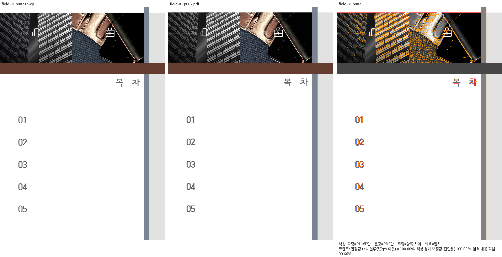
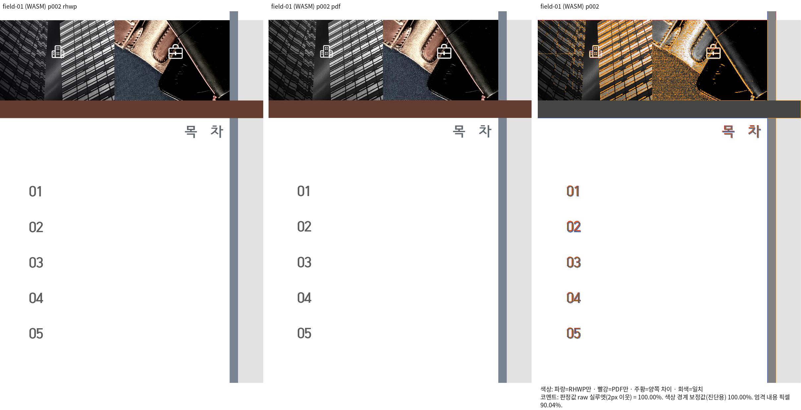
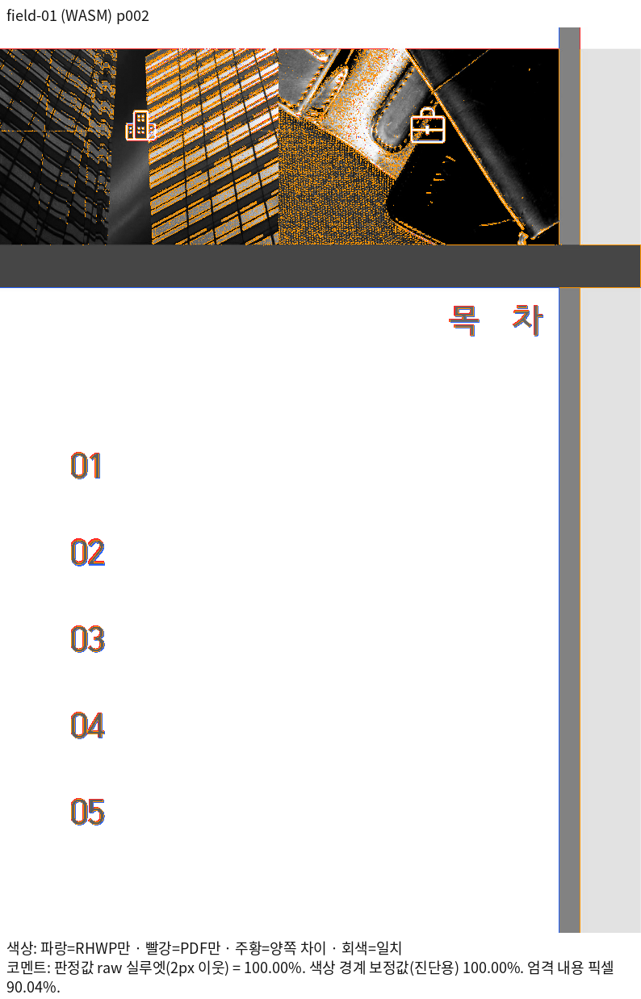

# PR #7715 검토 — SVG profile과 초기 안내문 인쇄

## 최종 판정

**메인터너 보정 후 승인** — [#7710](https://github.com/edwardkim/rhwp/issues/7710) 해결 범위의
필수 로컬 검증과 통합 code head CI를 완료했다. 원 head와 보정한 통합 후보를 구분한다.
남은 원격 조건은 문서 trailing head의 CI·mergeability 확인 및 승인된 정상 merge·후속 처리다.

## 접수와 코멘트

- 원 [PR #7715](https://github.com/edwardkim/rhwp/pull/7715), 기존 기여자 `wook8170`, base devel.
- 원 head `1fa2ed38c0fbf61fe10ff7ec26fd219bc2cae7a3`, 체리픽 `6de18364fc1bd51e783bd020fbed7df180a4499e`. 원 author와 `-x` 원 SHA를 보존했다.
- reviewer `jangster77`을 먼저 지정하고 기존 `edwardkim` 요청을 유지한 것을 API로 확인했다.
- [기존 코멘트](https://github.com/edwardkim/rhwp/pull/7715#issuecomment-6104228425)의
  지적을 실제 실행으로 재현하고 보정 전후로 확인했다. 최신 조회에서 새 코멘트·source head 변경은 없었다.

## 구현 주장·실행 증거와 조판 원칙 검토

`getPageSvg` options.profile → RPC enum 검증 → main handler → `renderPageSvgWithProfile`이
실제 경로다. 생략 경로는 기존 `renderPageSvg`와 byte 동일하고 fastPreview/screen/print/highQuality
4종을 허용하며 잘못된 값은 거절한다. 실제 SDK에서 값·Undo·전체 쪽수 3의 보존도 확인했다.

기존 코멘트의 인쇄 차이는 원본 bit15=0 초기 필드 중 도형 글상자 03/04/05가 적재 정규화의
본문·표 순회에서 빠져 일반 본문으로 남은 것이 원인이다. 기존 초기 상태·안내문 일치 규칙을
그대로 유지하고 공통 소유 트리 walker의 모든 문단으로 적용 범위를 복원했다.
정규화된 빈 field range → compose 안내 노드 → SVG/공통 paint의 editor_only 필터가 소비한다.
문자열만으로 출력을 숨기거나 문서별 예외·좌표 clamp를 추가하지 않았다.
수정됨 bit15가 켜진 실제 값은 안내문과 같은 문자열이어도 HWP 저장·재열기에서 보존한다.

새 `tests/cases/issue_7710_initial_field_container.rs`의 정식 3검사는 실제 CLI의 초기값·Print 내용,
수정됨 값 보존, 완료 2쪽의 독립 ±2px 번호 정렬과 소유·누락·중복·세로 순서를 보호한다.
독립 PDF x65.004768pt를 96dpi x86.673024px로 환산했다. Native/fresh WASM 양쪽 raw 98% 이상과
직접 판독을 먼저 충족한 2쪽을 선택했다. 100%인 3쪽은 글상자 경계를 실행하지 않는다.
수정 전 CLI에서 의도한 assertion FAIL / 보정 후 3 PASS, 기준 정렬 대조군 PASS다.
빌드 실패를 결함 재현으로 세지 않았다. 실제 SDK E2E에도 같은 정렬·관계·전쪽 수 검사를 추가했다.

`field-01`을 참조하는 기존 tests/cases 56파일도 확인했다. 기존 source/page 계약·관계 검사는
유지했고 부정확한 px pin이나 baseline을 완화하지 않았다. 입력·PDF·golden 변경은 없다.

## 공통 검증과 실제 CI

통합 [PR #8003](https://github.com/edwardkim/rhwp/pull/8003)의 정확한 code head는 `9c1c681ee44c65eb924a66ac18b0b86876ad767b`다.
[Adapter inter-diff](https://github.com/edwardkim/rhwp/actions/runs/39051970167) · [CI](https://github.com/edwardkim/rhwp/actions/runs/39051970186) · [CI Impact Policy Controller](https://github.com/edwardkim/rhwp/actions/runs/39051970001) · [CodeQL](https://github.com/edwardkim/rhwp/actions/runs/39051970099) · [Proptest roundtrip](https://github.com/edwardkim/rhwp/actions/runs/39051970173) · [Render Diff](https://github.com/edwardkim/rhwp/actions/runs/39051970257)가 실제 완료·성공했다. 언어별 CodeQL Analyze와 GHAS check도 확인했고,
정책상 skipped·neutral은 실제 실행 성공과 구분했다. 해당 merge ref의 열린 CodeQL alert는 0건이다.

| 로컬 검증 | 실제 결과 |
| --- | --- |
| 전체 nextest release-test | 10,823 PASS / 0 FAIL / 기존 45 SKIP, 실행 1310.134초 |
| fmt·Native/WASM Clippy·workspace build·all-target Clippy | 5개 모두 exit 0 |
| Native Skia lib | 4,043 PASS / 기존 12 IGNORE |
| Skia missing-picture PNG / direct-PDF | 2 PASS / 14 PASS |
| Studio 전체 단위·타입·production build | 2,327 PASS / 기존 2 SKIP, 타입·build exit 0 |
| editor / frontend bindings / hwpctrl | 36 / 3 / 26 PASS, 선언·pack exit 0 |
| 실제 Chrome E2E | 7종 exit 0, SDK profile 9개 assertion PASS |
| manifest·unit-tier·E2E manifest | 통과, E2E 161파일 / 161행 |
| 문서 링크·metadata | 링크 통과, base/head 기존 16오류 동일·신규 0 |

전체 Rust 명령은 `CARGO_BUILD_JOBS=8 cargo nextest run --locked --cargo-profile release-test
--target-dir /home/tsjang/rhwp/target/pr-review --tests --test-threads 12 --no-fail-fast`다.
공용 target을 순차 재사용했다. 제품 보정 source `cfd06cd2b5cc47a268134d0c09f657a7a9fd24d0`
이후 제품 입력 바이트가 동일한 것을 지문으로 확인했으며, 후속 변경은 E2E·증적뿐이다.
문서 trailing 때문에 같은 제품의 전체 회귀·WASM 빌드를 반복하지 않는다.

WASM은 Docker 없는 승인된 호스트 진단 경로에서 wrapper `--target web --out-dir pkg --no-opt`,
jobs 8·release codegen-units 16으로 fresh 빌드했다. 최적화 배포 검증으로 확대하지 않는다.
실제 Studio E2E는 Chrome 155.0.8059.79, 표준 Sweep의 지정 브라우저는 Chrome 154.0.8037.57이다.
Windows 모듈 URL은 기존 정규화 패턴에 맞췄으나 실제 Windows 실행으로 보고하지 않는다.

원격 후속 조건은 이 문서 trailing head의 실제 required check·fast-pass·mergeability 확인과 정상 merge다.
아직 실행 전인 merge·이슈 종료·댓글·정리를 완료로 쓰지 않는다. 사용자는 전체 후속 처리를 승인했다.

## 증적과 한계

[입력·독립 PDF 출처·SHA·전체 TSV·재현 명령·PNG](../assets/issue_7710/README.md)에
동일 조건의 고정 devel/보정 producer와 직접 판독 결과를 기록했다. PDF는 기존 oracle에 등록된
정상 3쪽 출력이고 당시·현재 HWP blob이 같다. Creator Hwp2022를 확인했으며 파일명만으로
MCP 엔진·PrintMethod 영수증을 추정하지 않았다. 새로운 MCP 변환을 수행한 것으로 쓰지 않는다.

| 쪽 | devel Native | 보정 Native | devel WASM | 보정 WASM |
| --- | ---: | ---: | ---: | ---: |
| 1 | 99.99154 | 99.99154 | 99.98702 | 99.98702 |
| 2 | 98.73913 | 99.99813 | 98.73280 | 99.99907 |
| 3 | 100 | 100 | 100 | 100 |

compat2022·Print·96dpi, 전 3쪽 Native Skia/fresh WASM Canvas2D export의 색상 경계 보정 전
raw 실루엣이다. 90% 미만·누락·쪽수 차이·0.01%p 이상 하락은 0쪽이다.
실제 SDK print SVG 전 3쪽은 99.97476/99.99220/100%다.
Native/fresh WASM 1–3쪽의 제목·번호·필드 주변·뒤 내용과 2쪽 guide 영역을 직접 대조했다.
수식은 변경 영역에 없다. Print의 추가 안내문 3개가 사라지고 번호·순서·간격은 보존됐다.
Native 1·3쪽과 2쪽 Screen PNG는 전후 byte 동일하다. 사진 색상 차이는 남으며
2쪽 엄격 내용 픽셀은 Native 90.66288%·WASM 90.03802%다. 실루엣을 전체 픽셀 fidelity로 쓰지 않는다.

실제 Studio Canvas2D·CanvasKit compat/default software도 기준/보정 package를 분리해 대조했다.
초기 WASM HTTP 응답 12건의 해시가 각 package와 모두 같고, 세 Screen PNG는 byte 동일하다.
Print 변경 픽셀은 안내문 3곳뿐이다. CanvasKit은 실제 software·등록 typeface 1·fallback 0·pending image 0·
unsupported op 0·render completed를 확인했다. GPU는 미실행이다.
Studio Print raw는 Canvas2D 98.67136→99.97856%, CanvasKit software 96.01535→97.23343%다.
이는 표준 export와 context가 다르다. 기준에도 있던 CanvasKit 윤곽선·1px 캡처 높이 차이와
일반 backend parity 예산 초과는 남아 있다. 전체 backend parity PASS로 기록하지 않고,
97% CanvasKit bitmap에 새 px golden을 만들지 않았다.

실행 로그·입력/producer 지문·CI API 영수증은 검토 중 ignored output에 보관하고,
후속 정리 시 `/home/tsjang/rhwp-pr-evidence/pr-8003/`에 해시 확인 후 보존한다.
공용 target·기존 입력/PDF·contributor fork는 보존한다.

## Merge 후 contributor PR comment 계획

정상 merge·devel 포함·duration 결과·관련 이슈 상태를 확인한 뒤 원 PR에 한국어 존댓말로
원 기여 감사, author/SHA 보존, 메인터너 보정 이유와 수정 전 FAIL/후 PASS, 실제 CI 링크,
개별 검토·범위와 남은 차이를 게시한다. 통합 완료에 따른 원 PR close임을 명시하고
직접 merge된 것으로 표시하지 않는다. contributor fork는 수정·삭제하지 않는다.
시각 비교는 [Visual Sweep 정본](../../manual/verification/visual_sweep_guide.md#github-merge-comment)을
연결하고 최종 merge SHA에 실제 존재하는 전체 TSV와 Native/fresh WASM review·standalone overlay를
raw URL Markdown 이미지로 다시 게시한다. 사진 색상·기존 CanvasKit 차이도 구분한다.
실제 줄바꿈의 UTF-8 body-file로 게시하고 API로 내용·한글·선두 BOM을 재확인한다.
같은 merge·증거의 댓글은 중복 게시하지 않는다. 사용자 승인 범위에서 이슈와 원 PR을 처리하고
자체 임시 branch·root output 전체를 정리한다.
