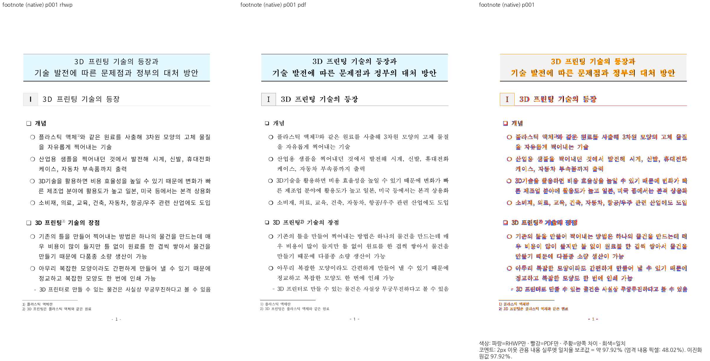
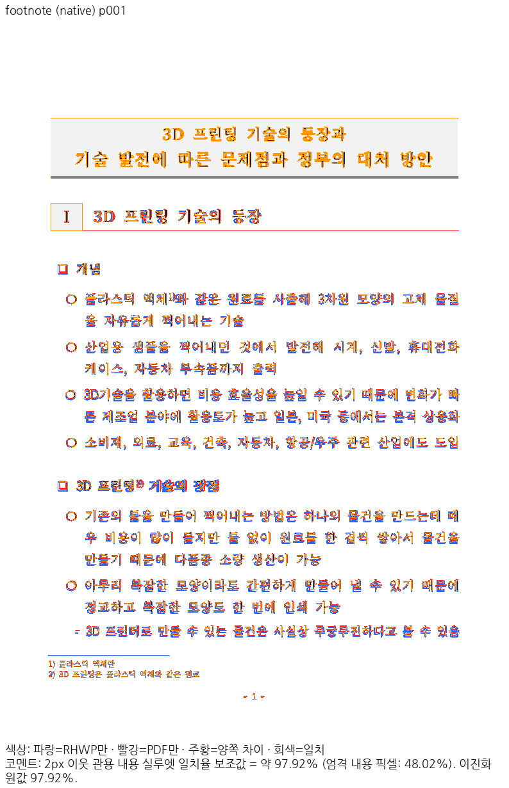
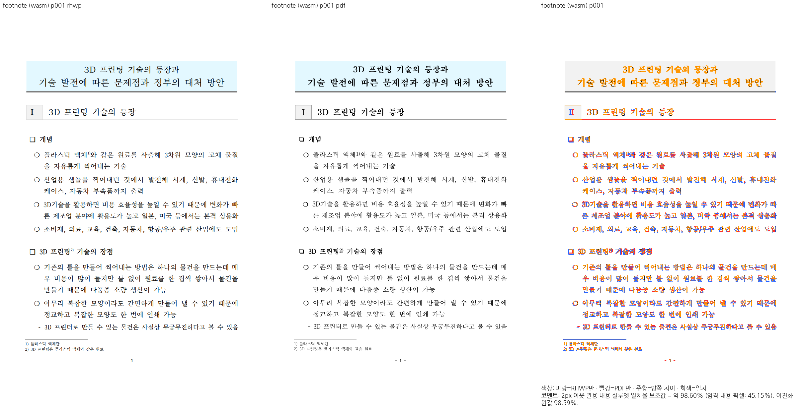
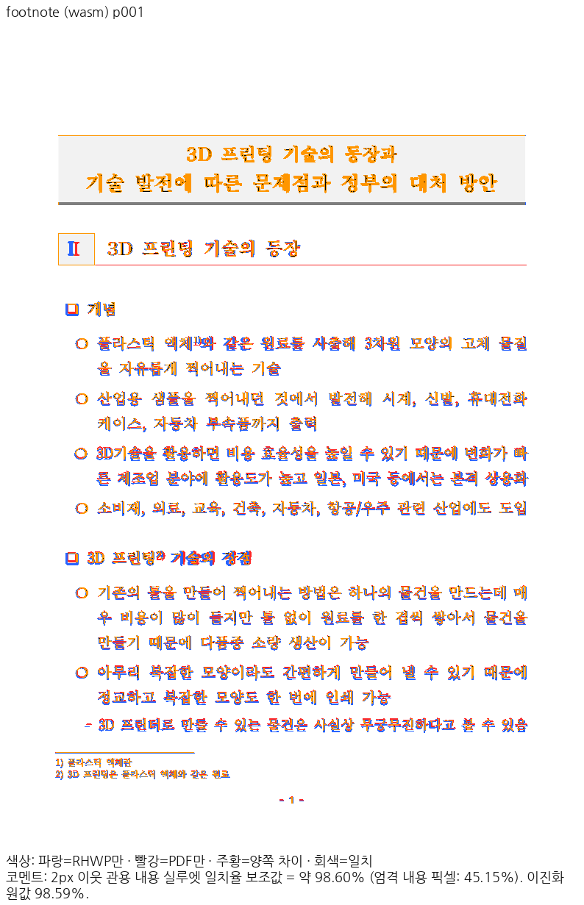
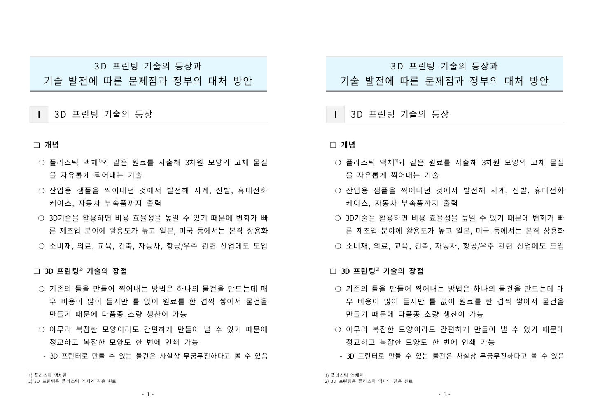

# PR #7829 리뷰 — Native Skia 픽셀을 재사용하는 CLI Sixel 출력

## 최종 판정

**승인 — Sixel 출력 계약의 구현·로컬 검증과 정확한 code head의 GitHub CI 성공을 확인했다.**
사용자는 실제 WezTerm·Windows Terminal SSH 출력 성공과 PR 생성 → CI → self-review → 병합 진행을 승인했다.
이 기록을 포함하는 문서-only trailing head의 CI·fast-pass·최신 base 병합 검증은 병합 전 별도로 확인한다.
Foot와 정확한 터미널 버전은 미검증이며 [#7820](https://github.com/edwardkim/rhwp/issues/7820)은 참조로 유지한다.

## 접수 정보

| 항목 | 값 |
| --- | --- |
| PR·작성자·base | [#7829](https://github.com/edwardkim/rhwp/pull/7829) / edwardkim / devel |
| 검증 base | `790a6f8f388445e7bff2bcb165aa7b384f9ece80` |
| 구현 / 최종 로컬 회귀 head | `dc72a324923c404fb38a46667fc841304f3669e9` / `c95269728f4d06e27b503d3d01d906e02e0ea07e` |
| GitHub 검증 code head | `83a32353e7b74bbc6d6bb58626dc8e8ad1b8a13a` |
| 경로·reviewer | collaborator self-merge / 별도 reviewer 지정 없음 |
| 작성 시점 참고 상태 | Open, MERGEABLE/CLEAN, code head 검사 success; 상태는 병합 직전 다시 조회 |

## 변경과 조판 원칙 준수 검토

`export-sixel`은 `native-skia` 기능으로 stdout의 단일 DCS 스트림, 0-based 쪽 선택,
출력 디렉터리의 전쪽/선택 쪽 `.six` 파일, 너비·profile·글꼴·호환성 옵션을 제공한다.
stdout에는 그래픽만 쓰며 진단은 stderr로 보낸다. 도움말·capabilities·명령 목록·에이전트 대전에도 등록했다.

실제 소비 경로는 `src/cli/outputs/sixel.rs:122` →
`src/document_core/queries/rendering.rs`의 `render_page_pixels_native_at_width` →
`src/renderer/skia/renderer.rs:548`의 `render_pixels_at_width` → `render_pixels_with_target_width` →
기존 PageLayerTree paint replay → 명시적 RGBA8888 Premul `read_pixels` → `RasterPixels`다.
동일한 픽셀 결과를 PNG 인코더와 Sixel의 흰색 합성·Wu 256색 양자화가 소비한다.
Native N32 채널 순서를 추정하지 않으며 premultiplied alpha·stride·sRGB·DPI와 크기 예산을 명시한다.

| 검토 계약 | 판정·근거 |
| --- | --- |
| 공통 실제 그리기 결과 소비 | 충족: PNG/Sixel은 동일한 paint replay 픽셀을 사용; 11쪽 PNG decoded 픽셀은 고정 base와 동일 |
| 입력 경계·출력 순서·오류 stdout | 충족: stride·채널·alpha·1..16384 치수·64 Mi-pixel/마지막 six-line 밴드 예산, 전쪽/선택/실패 계약 검사 |
| 조판 규칙·측정·배치·분할 정책 변경 | 비해당: 줄 메트릭·LineSeg·pagination·rowspan·continuation 조건을 변경하지 않음 |
| 문서별 예외·clamp·golden 완화 | 없음: 실물 문서 ID/절대 px 배치 golden을 추가하지 않음; 기존 테스트 기대값·baseline 유지 |
| 회귀 근거 | 합성 픽셀의 독립 채널/alpha 계약과 libsixel 복원, 실제 공개 문서 11쪽의 독립 Print 대조를 구분 |

`icy_sixel =0.7.0`은 Native-only optional 의존성이다. lock의 신규 18개 package와 기존 version 무변경을 확인했다.
암호 helper의 `Key::try_from(&key[..])`는 AsRef 추론 보정이며 암호 알고리즘은 바꾸지 않았다.
Native Clippy가 지적한 기존 `draw_arrow_heads`는 테스트 모듈 앞으로 옮겼으며 함수 본문은 base와 동일하다.
코드와 검증 상세는 [3단계](../../working/task_m100_7820_stage3.md), 제출/CI 보정은
[4단계](../../working/task_m100_7820_stage4.md)에 연결한다.

## 검증 입력과 결과

4개 공개 원문과 대응 독립 한컴 Print PDF는 기존 저장소 자료를 사용했다.
입력 출처·Print 계약 및 수동 판정은 [2단계](../../working/task_m100_7820_stage2.md)에 기록했다.
아래 8개 파일은 검토 commit의 바이트와 로컬 SHA-256이 동일하다. 개인 `21a.hwp`는 공개하지 않았다.

| 저장소 경로 | SHA-256 |
| --- | --- |
| `samples/hwp_table_test.hwp` | `dc3e57d7577447ae4b47f59bdb0f499a5ac29066b62af8a650bcdd8d70eee32a` |
| `samples/issue7688/reference/table-core-2020.pdf` | `c04ef8b2819529f83fe3e6043683982600535432426c8fb58f6e5cd31ea00963` |
| `samples/footnote-01.hwp` | `5bbc8a8fd23415aad59dd91d1eb261050946d9c64635933fcd49609ec2cc94e5` |
| `pdf/footnote-01-hwp-2020.pdf` | `2b47aa31b3d135f1621ba478189efcbfcacc77dfbc6c9d9082239f7885bb546e` |
| `samples/pic-crop-01.hwp` | `3b5afbe4cdb18faa49452a9cbed770d5caa27aed2f83b708e9ab8516c65ebf4c` |
| `samples/issue7688/reference/image-crop-2020.pdf` | `c9d29de7680e5642a24818a6924ef5f42b18e1194766b693d636853d8782d16d` |
| `samples/issue7688/arrow-controls/control-compound.hwpx` | `ab309908bce072332ab3b635a4a99ae58b1afe2806aada41871baefd321b804d` |
| `samples/issue7688/reference/compound-2020.pdf` | `1bd27989056bead55663b4b8735a822e613519ce00c4fe59865dfd285570d6f4` |

공용 `target/pr-review`에서 manifest `--prepare` 뒤 fmt, 기본/WASM/workspace all-target Clippy,
workspace build, base 고정 manifest·unit-tier 정책, 추가 Native Skia all-target Clippy를 순차 통과했다.
`c95269728`의 전체 release-test nextest는 **10,570 PASS / 0 FAIL / 50 SKIP**,
Native lib는 4,109 PASS / 13 ignored, missing-picture 2건, direct-PDF 4건, Native Sixel 7건이 통과했다.
Python 대전 생성기 14건과 Rust 대전 2건도 통과했다. 미실행 항목을 통과 건수에 포함하지 않았다.

최초 PR [CI 38136989011](https://github.com/edwardkim/rhwp/actions/runs/38136989011)은
새 출력 어댑터의 CI 영향 bucket 등록 누락으로 실패했다. `83a32353e`에서 실제 `tests/cases/`
원본 소유 검사와 Native job의 Sixel 실행을 등록했다. Rust source/test/Cargo/출력은 이 보정에서 동일하다.
Node 정책 327건, Python workflow 계약 186건과 CI 방식 Native Sixel 7건을 로컬에서 통과했다.

정확한 code head `83a32353e7b74bbc6d6bb58626dc8e8ad1b8a13a`의 GitHub 결과:

- [CI](https://github.com/edwardkim/rhwp/actions/runs/38137467182): Lint, Native Skia, frontend package,
  네 archive build/worker와 Build & Test success. Native job `114464261510` 로그에서 Sixel **7 PASS / 0 FAIL** 실행을 확인했다.
- [CodeQL](https://github.com/edwardkim/rhwp/actions/runs/38137467290): js/ts·Python·Actions·Rust Analyze와 CodeQL check success.
- [Render Diff](https://github.com/edwardkim/rhwp/actions/runs/38137467039),
  [Adapter](https://github.com/edwardkim/rhwp/actions/runs/38137467298),
  [Proptest](https://github.com/edwardkim/rhwp/actions/runs/38137467196): 모두 success.
- [CI Impact Policy](https://github.com/edwardkim/rhwp/actions/runs/38138651447): exact head status success.
  정책상 skipped job을 실행 통과로 세지 않았다.

## 시각 증적과 남은 차이

최종 Native CLI SHA-256은 `2318d7e6b718ccde00cf0e80a1fa5212dfd24a471626f4e1230f9294f6bde512`다.
Docker wrapper로 fresh WASM을 생성했고 pkg/Studio public의 JS·WASM 해시 동일성을 확인했다.
WASM SHA-256은 `2be5c801685a9af3b3048b103a5f1cbc367723de2df06108284831da9f1be16d`다.

4문서 전체 페이지 Native TSV와 Docker fresh WASM TSV는 최종 출력으로 다시 산출했다.
원문은 PR 본문의 접힌 절에 보존했으며 [3단계](../../working/task_m100_7820_stage3.md)에 실행 증적을 연결했다.
누락·쪽수 불일치·90% 미만은 없다. `not_evaluated` 실루엣 전용 gate를 자동 승인으로 취급하지 않았다.

| 문서 | 쪽수 | Native 최저 tolerant silhouette | Docker WASM 최저 |
| --- | ---: | ---: | ---: |
| table-core | 3 | 96.18681% | 97.41234% |
| footnote | 6 | 96.77648% | 98.15558% |
| image-crop | 1 | 99.83013% | 99.83033% |
| compound | 1 | 99.87079% | 99.87578% |

독립 PDF·변경 전후 Native·fresh WASM의 표·각주 확대와 그림·화살표 경계를 직접 판독했다.
본문 순서·셀 경계·그림 주요 위치는 보존됐으며 글꼴 형태/굵기, 회색 괘선·각주선과
compound 하단 `id`의 기존 차이는 남았다. 이번 PR의 조판 개선으로 주장하지 않는다.
선정 영역에 수식은 없으며 수식 동작 검증을 주장하지 않는다.
대표 footnote 1쪽은 Native pixel match 92.98086% / strict proxy 48.01787% / tolerant 97.91613%,
WASM은 92.49256% / 45.14831% / 98.60456%다. strict proxy를 fidelity 통과로 보고하지 않는다.

전체 11쪽 × 너비 360/720의 22개 스트림을 libsixel로 독립 디코딩했다.
크기·단일 DCS framing·양자화 예산 모두 통과했고 최대 RGB MAE는 0.31817/255,
채널 오차 p99는 5/255였다. 전쪽 파일·선택 파일·stdout 바이트 동일성,
잘못된 쪽/디렉터리의 실패와 빈 stdout을 확인했다.
사용자는 Windows 11 WezTerm·Windows Terminal → SSH → Omarchy의 파일 및 직접 stdout 표시를 통과 판정했다.
Foot 실행·터미널 정확한 버전은 미검증이며 원격 CLI의 후속 바이너리 교체는 수행하지 않았다.

## Merge 후 contributor PR comment 계획

self PR이므로 외부 기여자 감사나 기여 권한 보정 문구를 만들지 않는다.
실제 merge SHA와 최신 trailing head CI URL을 확인한 뒤 한국어 존댓말로 병합과 검증 결과를 게시한다.
위 11쪽 Native/fresh WASM 최저값, 22개 Sixel 독립 복원 및 사용자의 두 터미널 직접 통과,
기존 글꼴·선 차이와 Foot 미검증, #7820을 열린 참조로 유지함을 구분한다.
[Visual Sweep 정본](../../manual/verification/visual_sweep_guide.md#github-merge-comment)을 direct link로 남기고,
실제 merge commit에 존재하는 위 대표 이미지 5개를 merge SHA 고정 raw URL로 표시한다.
issue에도 구현 범위·검증·남은 Foot/버전 확인을 기록하며 close하지 않는다.
본문은 UTF-8 파일을 `--body-file`로 게시하고 API로 재조회해 한국어·줄바꿈·BOM 유무를 확인한다.
archive·오늘할일은 이 PR에 이미 포함하므로 별도 기록 commit을 만들지 않는다.
devel fast-forward와 병합 후 duration 결과를 확인하고 이 PR 전용 clean worktree/branch만 정리한다.
공유 target과 원격 Linux의 사용자 파일·CLI는 보존한다.
