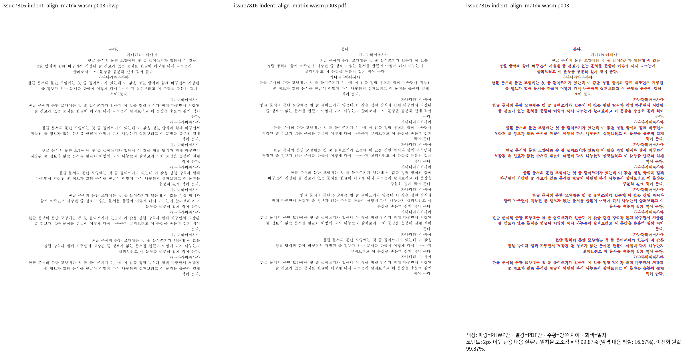

# PR #7878 리뷰 — 양쪽 정렬의 말미 구분 공백

## 최종 판정

**메인터너 보정 후 수용 가능 — 아래 통합 적용 범위의 로컬 검증 완료.**
검토 대상은 원 head `24918d7db1e85084a3975f8fea4ec25489a16d3a`를 누적·보정한 통합 code `39a634e547621c32ae6f9ba8c1694d35c827078b`다. 원 PR의 모든 첨부·golden이나 문서 전체 피델리티를 자동 수용한 판정은 아니다. [통합 PR #7923](https://github.com/edwardkim/rhwp/pull/7923)의 code candidate `cbc5815631d6c221dc6ec6e0f03565859cb1c346`에서 전체 CI·정책 체크 성공과 CLEAN을 확인했다. 문서 trailing head의 최신 체크·mergeability 확인이 병합 전 조건이다.

## 접수 정보

| 항목 | 값 |
| --- | --- |
| 원 PR | [#7878](https://github.com/edwardkim/rhwp/pull/7878) / planet6897 / base `devel` |
| source head | `24918d7db1e85084a3975f8fea4ec25489a16d3a` |
| 접수 시 상태 | OPEN, draft=True; draft와 무관하게 현재 통합을 진행하라는 사용자 지시 |
| 기준 devel | `463c48cc228170b576c832591b76826116e86a49` |
| 검토 역할 | collaborator의 체리픽 통합·보정 및 제출 PR self-review |

## 변경과 실제 소비 경로

현재 브랜치에 동등한 메인터너 보정이 있다. 말미 구분 공백을 정렬 배분에서 제외하고 가시 내용과 논리 공백은 보존한다. 단일 paint 런 결합을 가정한 미검증 문서6건은 사용자 지정으로 #7774/#7922에서 재구축한다.

- `src/renderer/composer/line_breaking.rs`
- `src/renderer/layout/paragraph_layout.rs`

현재 통합 계보의 관련 적용·보정 commit:

- `89f47eb1851afd01df2a5b4b05e45b58dcc5bda3`
- `570ea78ae1286b2c2c7e7324326330f2de8fdf80`

## 검증과 원칙 대조

- [통합 검증·원칙·이관 기록](planet6897_followup_20261015_review.md) 및 [입력/PDF/PNG SHA 증적](../assets/planet6897_followup_20261011/qualified-print-d80593/README.md)을 함께 적용한다.
- 최초 전체10,362건에서10,354PASS/8FAIL/45SKIP. 사용자 지정으로 실물6건 이관 후 폰트 계약 누락2건을 수정했고, 경로 변경을 포함한 관련55건을 모두 통과했다. 사용자 승인에 따라 이 결과를 합산해 전체 회귀 통과로 처리했다.
- 최종 code head의 fmt·native/WASM/workspace Clippy, workspace 빌드, suite/tier 검사, Native Skia와 문서 테스트를 완료했다. Studio1,875건과 네 배포 빌드/폰트 계약도 통과했다.
- 전쪽 시각 수용 범위는 명시한21문서·181쪽이다. 원본·독립 Print의 커밋 바이트와 SHA를 확인했고 새 Native/fresh WASM 출력은 모든 쪽90% 이상이다. 핵심 위치의 ±2px 검사는 양쪽98% 이상과 직접 판독을 조건으로 관계 검사와 함께 유지한다.
- 원 PR에서 넘어온 미달/미검증 신규 실물 검사·golden은 기존 이관 기록과 원문을 보존하며 새 정상 기준으로 등록하지 않는다. 구체적인 이관은 #7445와 자식 이슈에 남고 이번 PR에서 종료하지 않는다.

### 이 PR에 연결한 실제 문서 출력

| 문서 키 | 전쪽 | Native 최저% | fresh WASM 최저% | 직접 비교·핵심 쪽 |
| --- | ---: | ---: | ---: | --- |
| `issue7816-indent_align_matrix` | 3 | 99.50987 | 99.86866 | [3] |
| `issue7702-ratio_steps` | 2 | 98.30939 | 99.23084 | [2, 1] |

## Merge 후 contributor PR comment 계획

통합 PR 최신 CI와 실제 merge SHA를 확인한 뒤 원 PR에 한국어 존댓말로 원 기여·추가 보정·수용 범위를 설명한다. 해당 merge에 존재하는 PNG를 merge SHA 고정 raw URL로 표시하고 Visual Sweep 정본·실제 페이지/수치·남은 #7445 범위를 연결한다. 원 fork branch는 보존하며 supersede 처리와 게시 본문은 API로 재확인한다.
