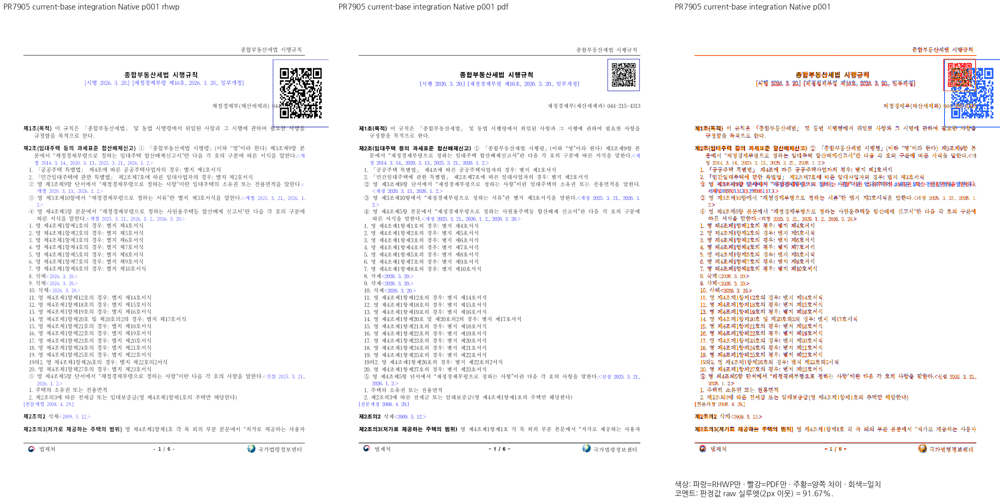
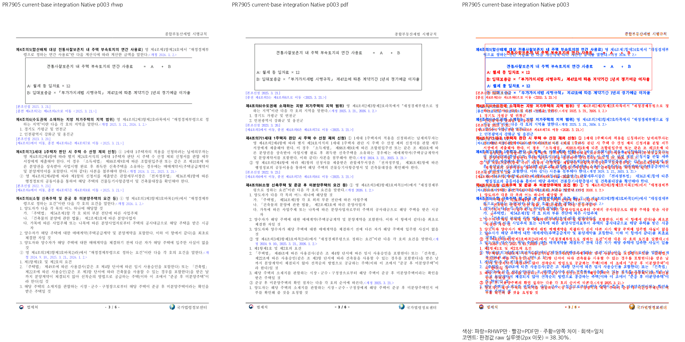

# PR #7905 검토 — 첫 기여 원 PR 통합

## 최종 판정

**승인 — 기존 devel 결함에 한정한 메인테이너 예외 적용.**
2026-10-29 작업지시자가 “기존 결함 한정 예외·원 PR 머지”를 승인했다. Native/fresh WASM에서
1쪽 개선과 2~6쪽의 적용 전후 PNG 바이트 동일을 확인했다. 원 기여 코드는 추가 수정하지 않는다.
전쪽 90% 자동 gate는 기존 3~6쪽에서 여전히 미달이며, 이를 통과로 표시하지 않는다.
남은 원격 절차는 검토 문서 trailing의 CI·최신 head·충돌 확인과 승인된 원 PR merge다.

검토일: 2026-10-29. 작성자: `bellkjtt`, 검토자: `edwardkim`.
목표는 기여자의 원 PR을 merge하고 원 커밋과 기여를 보존하는 것이다. 필수 보정은 메인테이너가 맡는다.

## 고정한 입력과 현재 결과

- 원 PR head: `b3f4b511053bc6bbb8d24f703ee687c5a574df1d`.
- 최신 devel: `f125c735c7d2d44eaa44b78c70465bc89af45fb1`.
- 충돌 없는 통합 tree: `debf6b0ff3a5ce626e8f2e01235d7e89cc8f38da`.
- 원 head의 GitHub Full CI `39275758478` 성공. 그대로인 코드를 대상으로 전체 CI를 로컬에서 중복 실행하지 않는다.
- 통합 tree의 Native Skia 빌드 성공. 새 회귀 2개 모듈의 6개 검사 모두 통과.
- 원본과 한컴 2018 Print는 [기여자 증적](../assets/legal_hwpx_cellsz_host_line/README.md)의 동일 바이트를 사용한다.

기여자의 2026-10-19 결과와 현재 Linux 결과는 실행 환경·base가 다르므로 직접적인 회귀 수치로 혼용하지 않는다.
동일 환경에서 최신 devel과 통합 tree를 비교했다. 명시적 Windows/Hancom 글꼴 경로를 공급했으며,
전체 6쪽의 Native PNG 및 TSV를 산출했다.

| 쪽 | 최신 devel Native raw % | 통합 tree Native raw % |
| --- | ---: | ---: |
| 1 | 50.71 | 91.67 |
| 2 | 92.21 | 92.21 |
| 3 | 38.30 | 38.30 |
| 4 | 57.30 | 57.30 |
| 5 | 36.23 | 36.23 |
| 6 | 42.77 | 42.77 |

첫 페이지 본문의 누락된 host 줄이 복원된다. 뒤쪽 차이는 원 PR 추가 전에도 재현된다.
현재 이 차이를 기여자의 회귀로 판정하지 않으며, 전체 쪽 검증 완료로도 표시하지 않는다.

[Native 기준 TSV](../assets/pr_7905_maintainer_20261029/base-native.tsv)와
[후보 TSV](../assets/pr_7905_maintainer_20261029/candidate-native.tsv)는 실행 원본 그대로 보존했다.

## 코드 검토와 대조군

- 머리글/꼬리글의 미측정 TAC 표: 실제 내용이 선언 행에 들어가고 `common.height`가 행합의
  2배 이상일 때 잔여 높이 추가를 생략한다. 작은 선언 차이, 내용 때문에 커진 표, 비 TAC 표는
  기존 동작을 유지한다. Native Skia 4개 검사에서 머리글과 꼬리글 양쪽을 확인했다.
- BehindText host: 저장 줄이 없고 가시 본문/인라인 컨트롤이 없는 문단 기준 그림에만 적용한다.
  같은 helper를 전체 문단의 줄 전진과 그림 항목의 최종 커서 보존에서 소비한다. 저장 줄이 있는
  입력, host 위치/연속 host/큰 그림의 2개 계약 검사가 통과했다.
- 기존 그림 배치 대조군 `tests/fixtures/issue_7642/no-ls/*-print-2020.pdf` 13문서·26쪽도 Native로
  실행해 최저 raw 99.99%를 확인했다. 이 대조군은 기존 페이지 경계 결함의 해결 증거가 아니다.
- 성능 측정은 하지 않았다. 미측정 TAC 표의 조건부 행 조회와 빈 그림 host 판정이 추가되며,
  일반 본문의 조판 결과 전체를 다시 만드는 변경은 없다. 무영향을 실측한 것으로 주장하지 않는다.
- `#7418`은 PR의 참조 표기다. 현재 해당 번호의 이슈 본문은 다른 문서의 PDF 버전 비교를 다루므로
  이 PR을 근거로 자동 종료하거나 해결 완료로 분류하지 않는다.

원 head의 [Full CI](https://github.com/edwardkim/rhwp/actions/runs/39275758478),
[CodeQL workflow](https://github.com/edwardkim/rhwp/actions/runs/39275758438),
[Render Diff](https://github.com/edwardkim/rhwp/actions/runs/39275757998), Proptest, Adapter가 성공했다.
별도 GHAS `CodeQL` check는 `neutral`이며, base 대비 JS/Python configuration 2개를 찾지 못했다는
메시지다. workflow의 Rust/Actions/Python/JavaScript 분석 작업 성공과 이 비교 경고를 구분한다.
source/test를 추가 수정하지 않았으므로 exact-head CI 재사용 규칙에 따라 전체 로컬 회귀·lint를
반복하지 않는다. 새 source/test 보정을 하게 되면 이 재사용 판정은 다시 확인해야 한다.

## 최신 devel에서 확인한 선행 결함

독립 Print의 2쪽 말미에는 제4조의5 본문이 있고, 해당 문단의 명시적 줄바꿈 뒤 인라인 그림은
3쪽 첫머리에 있다. 최신 devel과 통합 tree는 문단 전체를 3쪽으로 보내 뒤쪽 본문의 쪽 소속을 바꾼다.
이는 글꼴 획 차이가 아니라 실제 내용 소속의 차이다.

선행 이력은 PR #8348의 공통 그림 줄 경로다. `8da9286968`에서 물리 하단 수용을 보정했고
`21cee4bd066fcc72ff90ac73ef25f7b3bce28791`에서 소유 범위를 제한했다.
통합 commit은 `c76d87cfda742a4624e0a588aa09eb9d89b87d49`다.
현재 `typeset/section/flow.rs`는 `typeset_inline_flow_with_storage`를 일반 줄 분할보다 먼저 호출한다.
이 경로는 `InlineFlowPlan::occupied_end()`가 남은 높이를 넘으면, 새 쪽에 문단 전체가 들어가는지를
확인해 전체 `FullParagraph`를 이월한다. 먼저 들어갈 글줄이 있어도 기존 줄 분할 소유자에게 넘기지 않는다.

추가 보정이 필요하다면 조사 대상은 이 문단 전체 수용 경로와 기존 분할 경로의 책임 경계다. 원본의 글자처럼 취급 속성,
명시적 줄바꿈, 기존 공통 줄 상자의 수용 결과를 유지한다. 문서 ID·수치 예외나 글자/그림 위치 clamp를
추가하지 않는다. 같은 줄 그림·명시적 개행·줄바꿈·단 전환·마지막 줄 간격의 기존 대조군을 함께 확인한다.

## 통합 범위 결정

최적화를 포함한 WASM 빌드와 실제 브라우저 6쪽 출력까지 완료했다. 아래는 같은 조건의 WASM 결과다.

| 쪽 | 최신 devel WASM raw % | 통합 tree WASM raw % |
| --- | ---: | ---: |
| 1 | 49.18 | 91.21 |
| 2 | 93.04 | 93.04 |
| 3 | 38.15 | 38.15 |
| 4 | 57.53 | 57.53 |
| 5 | 36.37 | 36.37 |
| 6 | 42.82 | 42.82 |

[생산 조건·입력·원본 TSV](../assets/pr_7905_maintainer_20261029/README.md)에 연결했다.
Native 최저 36.23%, WASM 최저 36.37%이며 90% 미달은 각 3~6쪽, 누락은 없고 전체 쪽수는 양쪽 모두 6쪽이다.
최신 devel 대비 2%p 초과 하락은 양쪽 모두 0쪽이다. Native 첫 페이지 40.96%p, WASM 첫 페이지 42.03%p 개선이다.

기존 devel의 공통 문단 전체 이월 문제와 QR 크기 차이를 이번 기여자의 필수 수정으로 넘기지 않는다.
해당 기존 차이만 이번 PR의 차단 대상에서 제외한다. 새 회귀·테스트 실패·충돌·required CI 실패는 면제하지 않는다.
원 PR의 머리글/꼬리글 및 BehindText 개선과 기여 커밋을 그대로 보존한다.

중간 로그와 JSON은 ignored `output/pr-review/pr7905/`에만 있다. 최종 TSV와 대표 PNG는 위 정식 경로에 보존했다.

## Merge 후 contributor PR comment 계획

원 PR의 기여를 보존하고, 실제 merge SHA·CI·Native/fresh WASM 결과를 구분해 한국어 존댓말로
감사와 첫 기여 환영을 남긴다. 승인된 검증 예외와 기존 결함의 범위도 분명히 적는다.
시각 증적은 merge SHA에 고정한 raw 이미지 URL로 표시하며, `gh --body-file`로 게시하고 API로
실제 본문을 재조회한다. contributor의 fork branch는 삭제하지 않는다. 게시·push·merge는 필요한
승인과 최종 head 확인 뒤에 수행한다.

## 오늘할일 기록 경로

원 source에는 `mydocs/orders/20261029.md`가 없고 최신 devel에는 다른 PR의 기록이 있다.
원 PR에 해당 파일을 새로 만들면 add/add 충돌이 생기므로, 다른 PR의 기록을 복사하거나 코드 이력을
병합하지 않고 [당일 PR별 기록](../../orders/20261029_pr7905.md)에 이번 처리만 기록했다.
이는 기록 파일 배치만의 예외이며 기존 당일 기록은 최종 merge tree에서 바이트 그대로 보존한다.
