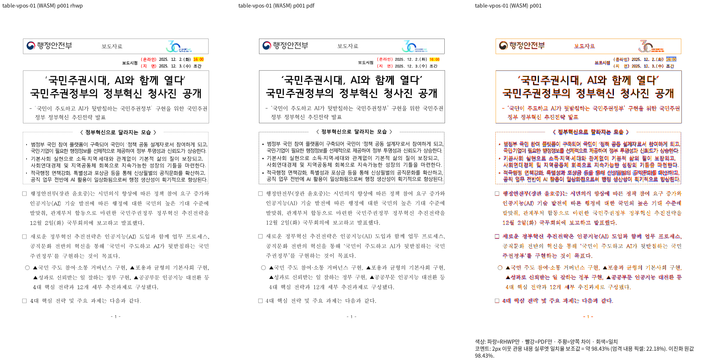
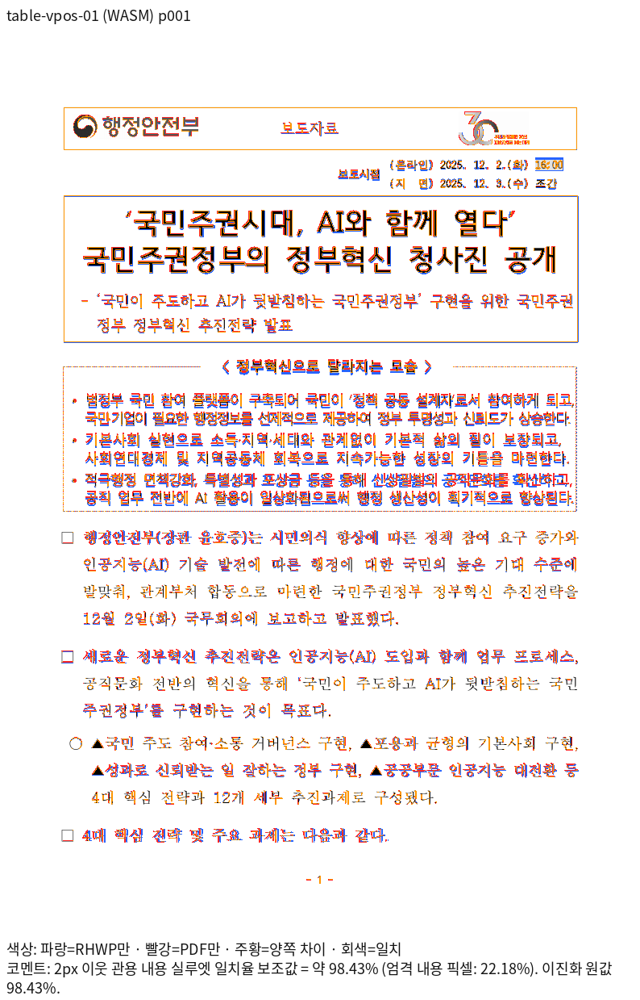
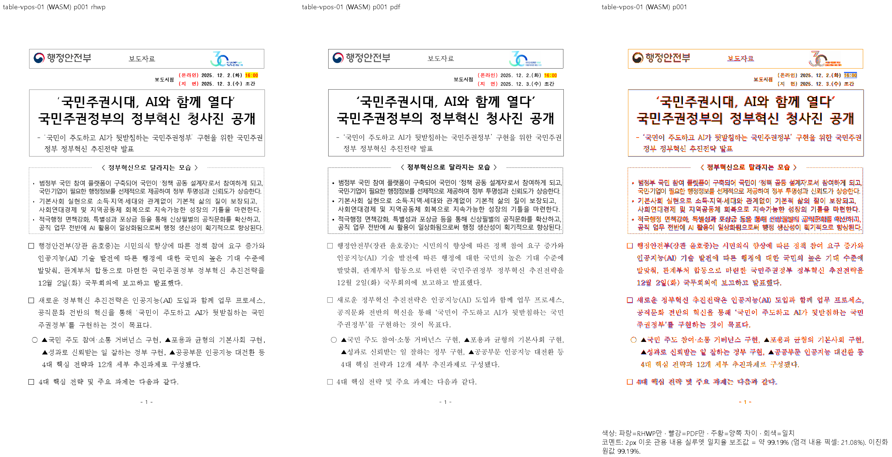
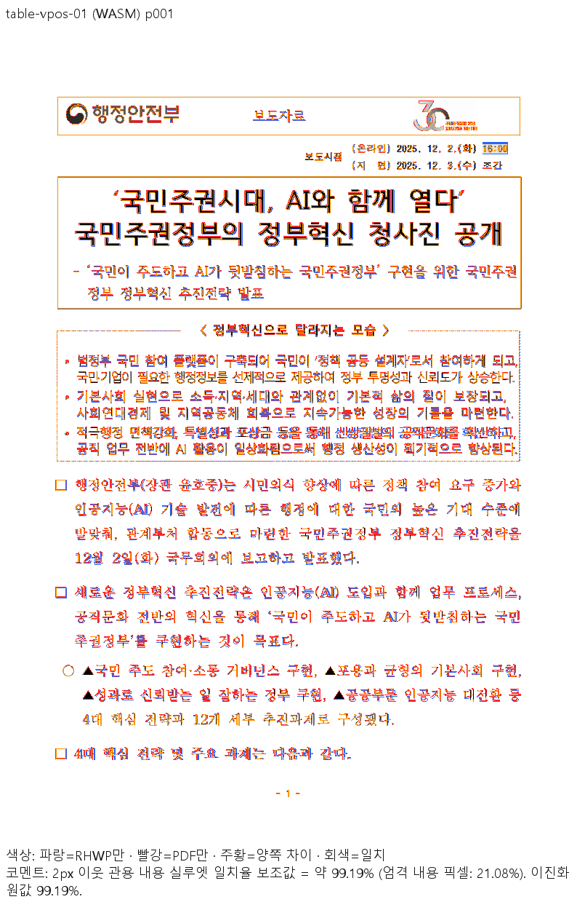
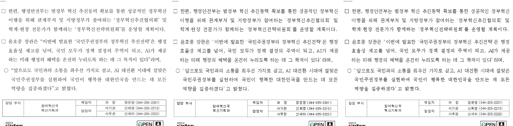

# PR #7907 self-review — Visual Sweep 글꼴 face 보존과 Windows 실행

## 판정과 범위

**승인 — 공급 글꼴 보존·Windows 인코딩 보정의 self-review.** 아래 code candidate의 로컬 검증과 GitHub Actions가 성공했다. 사용자 지시에 따라 문서-only trailing head의 실제 CI와 병합 조건을 확인한 뒤 merge·후속 처리를 수행한다. 이 기록 작성 시점에는 merge 전이다.

- [PR #7907](https://github.com/edwardkim/rhwp/pull/7907), 작성자 `jangster77`, base `devel`, branch `fix/visual-sweep-font-face-preservation-20261014`.
- 녹색 code candidate: `e99deef760e1e8066b120f76e2150c13339ef713`. 실제 Python 검증 source: `266a3df4da5083cedbcf6df30a910a0b058480de`; 이후 candidate는 Windows PNG만 추가했다.
- 시각 기준·변경 없는 Rust production source: `c0d330737fabae77ca2bf1706cba8514d0e8f1df`.
- 기본 경로 [collaborator self-merge](../../manual/pr_review/collaborator_self_merge.md), 보조 경로 intake·local validation·visual fixture evidence·review-only fast-pass·post-merge. 모두 로딩했고 외부 reviewer를 지정하지 않았다.
- [#7902](https://github.com/edwardkim/rhwp/issues/7902)는 Refs다. 이 도구 PR의 성공을 통합 브랜치 전체 문서 개선·이슈 해결로 확대하지 않는다.

## 구현·실제 소비 경로

[공급 helper](../../../scripts/visual_sweep_png.py)의 `font_catalog → write_font_face → SFNTWriter`는 원본 reader의 SFNT 테이블을 복사한다. directory/checksumAdjustment와 기존 format4 종료 cmap 보정만 다시 쓰며 CFF/glyf·메트릭·head 날짜/경계·name 원본은 보존한다. 기존 `TTFont.save`가 읽은 테이블을 재컴파일하고 CFF 모든 glyph의 bounds를 다시 계산하던 원인을 제거했다.

`font_family_names`는 nameID 1·4·16을 한 번씩 해독한다. 유효 family를 유지하고 Unicode/codec 오류의 원본 식별자·SHA·이유를 catalogue에 기록한다. 유효 이름이 전혀 없으면 실패하며 가짜 family를 만들지 않는다. 실제 PENHL/TAENMR의 8개 오류는 유효 이름과 원본 테이블을 보존한 상태로 검증했다.

`font_catalog → font-catalog.json → PNG HTTP 공급 → FontFace.load → Canvas2D`까지 실제 browser 검증을 수행했다. TTC face 선택·alias/weight/style/source SHA와 terminal cmap repair 계약을 확인했다. Native 공급 및 실제 PNG도 별도로 비교했다. `embedded_font_catalog`의 alias JSON과 [명령 실행](../../../scripts/visual_sweep.py)의 Rust/Node 출력은 명시적 UTF-8을 사용한다.

## 로컬 검증과 수정 전 재현

| 검증 | 결과와 독립 근거 |
| --- | --- |
| Linux·Windows Python | 각각 141 PASS. `python -m unittest discover -s scripts/tests -p 'test_visual_sweep*.py'` |
| PNG HTTP Node | 각각 4 PASS. 기존 PNG 공급 Node 계약 검사 |
| 원본 테이블 신규 계약 | 고정 devel helper에서 3 FAIL → 수정 후 3 PASS. glyf TTC·CFF TTC·terminal cmap-only; 원본 bytes·checksum으로 판단 |
| Windows UTF-8 계약 | 수정 전 명령 출력·내장 unicode alias 2 FAIL → 수정 후 PASS. 한글/Ω/emoji wire bytes·UTF-8 JSON을 독립 기대값으로 사용 |
| Windows legacy name | 수정 전 UnicodeDecodeError → 수정 후 PASS. 유효 family·오류 기록·원본 name bytes 보호; 모든 이름 오류는 거부 |
| Linux 설치 글꼴 | 원본 1,468개·face 1,540개. 추출 131개·cmap 보정 50개·raw 테이블 2,204개 검증 |
| Windows 설치 글꼴 | 원본 534개·face 582개. 추출 115개·cmap 보정 52개·raw 테이블 2,231개 검증, 이름 오류 8개 기록 |
| 실제 CFF TTC | Noto CJK Light 5 faces 6.34초 추출; bounds 재계산 0. Linux Chromium 5 faces 실제 적재·수정 전후 글자 PNG bytes 동일 |
| 공백·syntax | `git diff --check`, 변경 Python syntax PASS |

Linux 전체 catalogue 준비 230.33초, 원본 테이블·checksum 대조 포함 345.16초였다. Windows는 각각 32.422초·54.766초였다. 전체 문서 렌더 성능이나 모든 글꼴의 browser 적재를 검증했다는 의미는 아니다.

## 독립 Print와 전쪽 Native/fresh WASM

- 입력 [table-vpos-01.hwp](../../../samples/table-vpos-01.hwp), SHA-256 `2e6c5bb4bf29f60d97d332414a0ded023b894e59ae49b5f9d6bb11476d39d766`.
- 독립 [한컴 Print PDF](../../../pdf/table-vpos-01-hwp-2020.pdf), SHA-256 `3439059430495acc264bb6924195d5a8065265e405fb6e68cd05869f506185cf`. Windows에서도 같은 SHA를 확인했다.
- 전체 5쪽, Print profile·2022 compat·96dpi·동일 공급 글꼴 조건. 양쪽 SHA를 고정한 도구를 각각 실행했다.

| 환경 | Native 최저 | fresh WASM 최저 | 쪽수/누락/미달 | devel 대비 최대 하락 |
| --- | ---: | ---: | --- | ---: |
| Linux | 99.12143% | 98.42728% | 각5/Print5, 누락0·90% 미달0 | 0.00000%p |
| Windows | 98.83066% | 99.19474% | 각5/Print5, 누락0·90% 미달0 | 0.00000%p |

각 backend 전5쪽의 기준·후보 PNG와 render tree는 bytes 동일하다. Decimal 비교에서 0.01%p 이상 하락은 0쪽이며 실제 WASM 적재 face/source SHA/weight/style/repair도 대조했다. [TSV 원본과 페이지 비교](https://gist.github.com/jangster77/00e0c1619fd33d0fb320208fd9cae040)를 보존했다.

Linux 공용 `/home/tsjang/rhwp/target/pr-review`, jobs8에서 Native와 fresh WASM을 순차 새로 빌드했다. Rust production 변경이 없어 양쪽 도구 비교에 동일 producer를 사용했다. Windows 10 Pro19045의 PowerShell/Python3.12.10/Node24.19에서 Native는 공용 `C:\Users\admin\rhwp\target\pr-review`, jobs8로 새로 빌드했다. WASM은 Linux fresh portable package SHA `10d6773034546b7d3525d79eb88c2abb002458ba17d1e4bc5ac39bb3f9bcc21b`를 Windows Chrome에서 실행했다. Windows Rust WASM 재빌드로 보고하지 않는다.

Windows 기준 도구는 UTF-8 출력·legacy name 오류로 기본 조건에서 실패했다. 출력 비교는 양쪽 UTF-8 mode·동일한 유효 글꼴 집합으로 실행하고, 후보는 별도로 기본 CP949 locale(`PYTHONUTF8` 미사용)·전체 Windows Fonts로 전쪽 재실행했다. 두 조건의 후보 전5쪽 PNG·tree는 bytes 동일하다. 제외 비교 글꼴 PENHL/TAENMR는 이 문서에서 실제 적재되지 않았고 전체 글꼴 계약에는 포함했다. CLI 로그를 받을 때 `PYTHONIOENCODING=utf-8`을 사용했다.

초기 Linux 기준 WASM은 Node 의존성 연결 누락, Windows 준비는 시스템 Python의 Pillow 부재 및 불필요한 numpy 확인으로 실패했다. 기존 Node 연결·기존 venv 사용으로 바로잡았고 최초 실패 로그를 보존했다. 실패를 PASS로 세지 않았다.

ignored 실행 기록은 `output/pr-review/planet6897-followup-20261011/`의 `c61-*`, `pr7907-windows-*`에 보존했다. Windows 원본 실행·TSV·PNG·tree·metadata 186개를 zip과 개별 SHA-256으로 대조한 뒤 새 원격 worktree만 삭제했다. 기본 작업공간·node_modules·공유 target은 보존했다.

### 직접 판독

1·4쪽 review/overlay와 같은 Print/Native/WASM 영역의 3배 확대를 직접 열었다. 제목·따옴표·숫자·강조·본문 순서/줄바꿈·담당자 표 괘선/내용·그림에서 추가 이동·누락·겹침이 없다. 기존 래스터 획·AA 차이는 남는다. 이 문서에 없는 수식 종류의 개선을 주장하지 않는다.

## 조판 원칙 적용 검토

| 항목 | 판정·근거 |
| --- | --- |
| 구현 근거·일반성 | 충족: 원본 font bytes와 SFNT checksum 계약, TTFont 재컴파일 원인. 문서 ID/px 예외 없음 |
| 측정·배치 일관성 | 비해당: production 조판·메트릭 계산 변경 없음 |
| 최종 출력 소비 | 충족: catalogue/HTTP/FontFace/Canvas2D 실제 경로, Native 독립 비교, CFF 5 faces browser 적재 |
| 분할·이어받기 | 비해당: pagination/continuation 변경 없음 |
| 줄 소속·점유 높이 | 비해당: LineSeg/줄 높이 변경 없음 |
| 증거 독립성 | 충족: raw source bytes·실제 설치 글꼴·Unicode wire 계약·독립 한컴 Print; 합성 supplier 테스트와 실물 시각을 구분 |
| 기준값 변경 | 비해당: baseline/golden/래칫 변경 없음 |
| 렌더링 회귀 추가·변경 선행 | 비해당: 배치 assertion/golden을 추가·갱신하지 않음. 추가 검사는 공급/인코딩 계약 |
| 확대 판독 | 충족: 위1·4쪽 review/overlay/동일 영역 확대, 실제 형태와 내용 보존 확인 |
| 주장·검증 범위 | 충족: Windows 실행과 공급 face 보존만 판정. 원 통합 브랜치의54문서·1,849쪽 미해결 범위는 별도 작업 |

## 정확한 code candidate GitHub CI

`e99deef760e1e8066b120f76e2150c13339ef713`의 모든 workflow와 check/status를 완료 후 다시 읽어 실패·대기 없이 성공 또는 정책상 skipped임을 확인했다.

- [CI / Build & Test](https://github.com/edwardkim/rhwp/actions/runs/38597293963): fmt·세 Clippy/WASM check, Skia, fresh WASM을 빌드한 Frontend package gates, Rust archive A–D 빌드·회귀 및 집계 성공.
- [CodeQL](https://github.com/edwardkim/rhwp/actions/runs/38597293770): Python·JavaScript/TypeScript·Actions·Rust 분석 성공.
- [Adapter](https://github.com/edwardkim/rhwp/actions/runs/38597293628), [Proptest](https://github.com/edwardkim/rhwp/actions/runs/38597293407), [정책 controller](https://github.com/edwardkim/rhwp/actions/runs/38597290758) 성공; CI Impact Policy success.
- 별도 WASM Build·Frontend unit 등의 정책상 skipped는 로컬 fresh WASM/실제 browser 미실행을 뜻하지 않는다. Python/helper 변경 범위의 로컬141+Node4와 전쪽 실제 출력 검증을 완료했다. Rust source/test를 바꾸지 않아 CI가 성공한 광범위 Rust 전체를 로컬에서 중복 실행하지 않는다.

## Trailing·merge 후 처리 계획

[오늘할일](../../orders/20261015.md)과 이 review만 trailing 기록으로 반영한다. 최신 base와 실제 merge tree의 충돌·공백·Markdown 링크·기존 오늘 기록 보존을 확인해 push하고, latest head의 fast-pass/required checks를 다시 확인한다. 사용자에게 merge와 후속 처리까지 승인받았으므로 별도 승인 질문을 반복하지 않는다.

merge 뒤 문서/asset이 devel에 포함됐음을 확인하고 local devel을 fast-forward한다. [post_merge](../../manual/pr_review/post_merge.md)의 순서대로 duration 갱신 성공 또는 증거 부족 보류를 확인한다. 검증 CI를 재실행하지 않는다. 관련 #7902는 계속 OPEN으로 보존하고 도구 개선/남은 원 검증 범위를 comment에 구분한다.

### Merge 후 contributor PR comment 계획

실제 merge SHA, code/trailing CI 결과, Linux·Windows 최저값과 공급 계약, merge SHA로 고정한 review/overlay 이미지 및 [Visual Sweep 정본](../../manual/verification/visual_sweep_guide.md)을 PR comment에 남긴다. Refs 이슈의 해결 범위를 확대하지 않는다. 이번 PR 전용 clean worktree·local branch·원본 저장소의 임시 head branch만 소유/최종SHA/merge/CI를 확인한 뒤 정리한다. 원 통합 검토 브랜치·dirty 파일·다른 worktree·공유 target은 보존한다.
