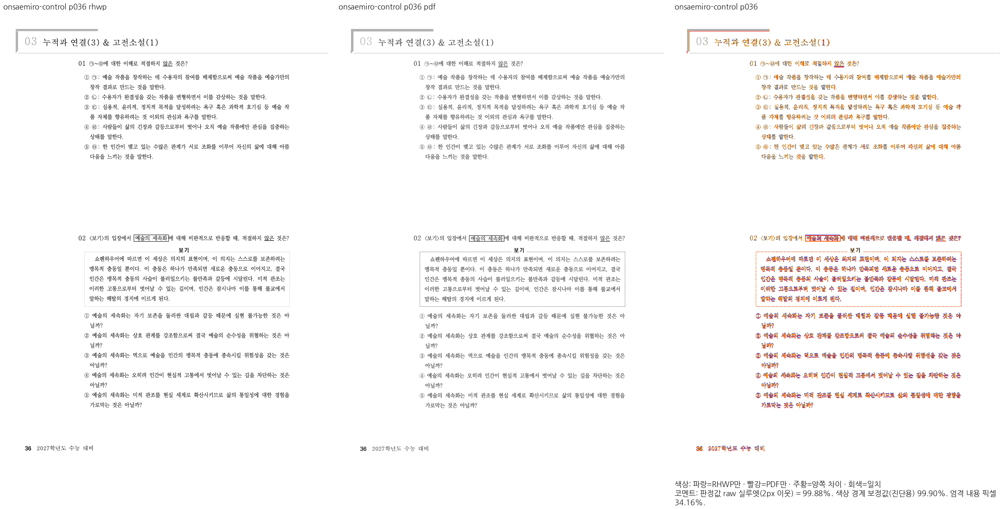
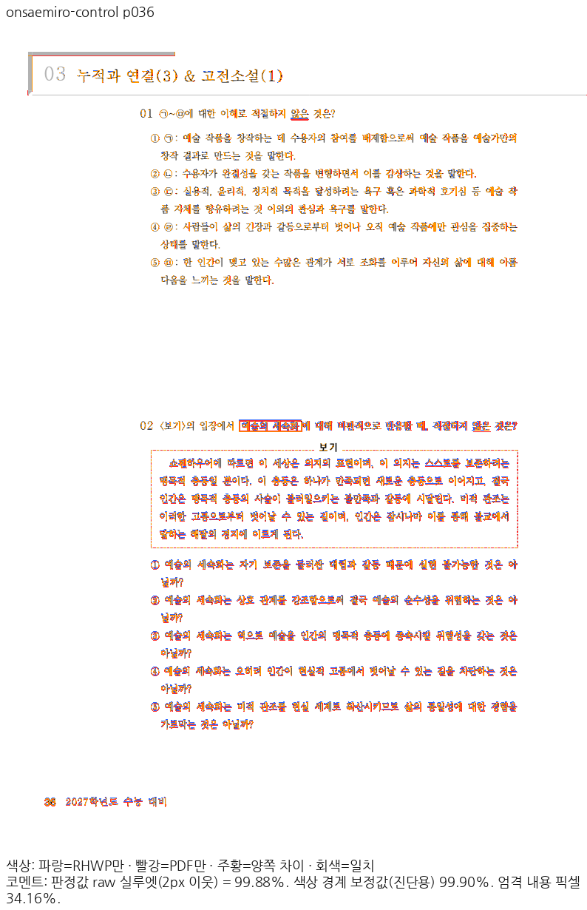
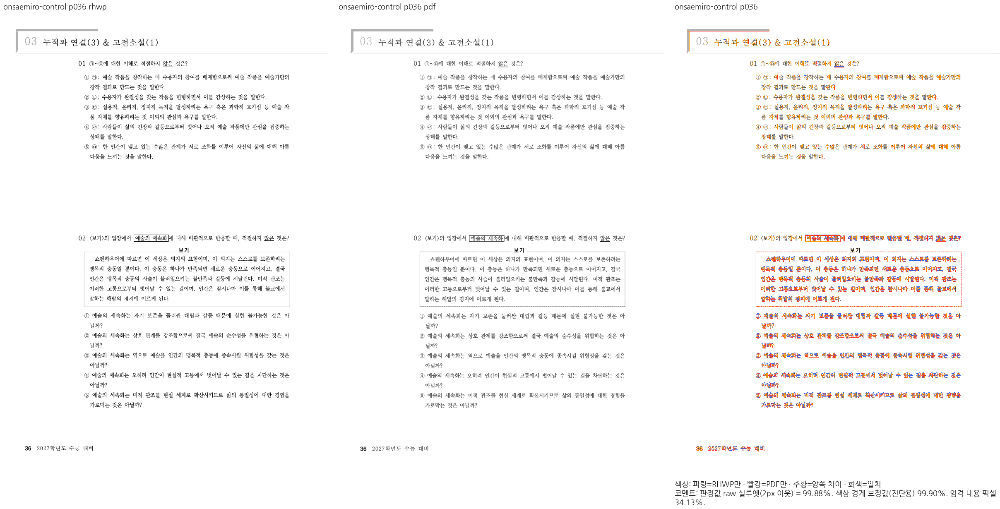
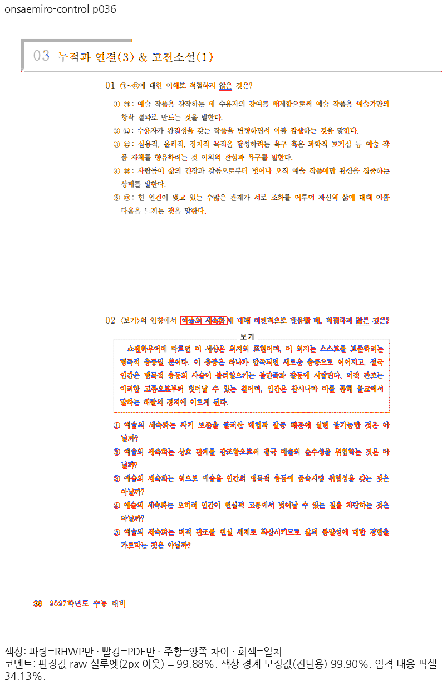

# PR #8111 리뷰 — fix(text): KoPub 한자·전각 기호를 한글이 아닌 글꼴 자신의 전진폭으로 잰다 (#8099)

## 최종 판정

**메인터너 보정 후 수용 가능 — 이 PR의 통합 검토 범위 로컬 검증 완료.**

원격 push·통합 PR 생성·CI·merge는 아직 수행하지 않았습니다. 사용자 승인 후 진행하며, 원 contributor head와 검증한 통합 head를 구분합니다.

## 접수 정보

| 항목 | 값 |
| --- | --- |
| 원 PR | [8111](https://github.com/edwardkim/rhwp/pull/8111) / planet6897 / devel |
| 원 contributor head | `ef97704cfcd4ff22c7f591434bfa134948b333a9` |
| 통합 검토 branch | `review/planet6897-20261024` |
| 검증 source / base | `673c1d5f7cdcb5573b793ba2d2abaaedd2602134` / `9418ed0c7cf289c5c4ac2b3bb8cdc18a1b637a9a` |
| 현재 제출 후보 | `673c1d5f7cdcb5573b793ba2d2abaaedd2602134` / runtime `38ad63a903` |
| 적용 순서 | 현재 누적 history의 1번째 PR. 원 PR별 적용 SHA는 아래 표 참조 |
| 종료 지시 / 참조 | 원 본문 Closes ['8099'] / Refs []; 실제 종료 판정 전에는 실행하지 않음 |
| 원 PR 상태 조회 | 2026-10-25T13:01:34.007187+00:00 / OPEN / MERGEABLE |
| 원 PR reviewer | jangster77 |

## 변경과 검토 범위

KoPub 한자·기호를 해당 글꼴의 전진폭으로 측정합니다.

### 원 기여와 메인터너 보정

0a275bdb8b에서 cmap 지원 범위·누락 기호 공급자·원본 PUA 반각 폭을 구분했습니다. 원 PR의 편람 그림은 사용자 제외 범위이므로 제출 증적에서 사용하지 않습니다. 현재 온새미로 36쪽 그림은 남아 있는 원문자·∼ 검사만 입증하며 편람의 한자 전체 수용으로 확대하지 않습니다.

| 원 기능 commit | 통합 branch의 적용 commit |
| --- | --- |
| `08bd263b72c4727ba02960178ddea7fe21924daf` | `c323ae68e527037566a377c74fe802cc36f9ca01` |
| `48bd1e337e9c41c3175de16ea381927c772a5182` | `76bf704b7c88a5d2e0725ed91908420a97c99595` |
| `ef97704cfcd4ff22c7f591434bfa134948b333a9` | `e78d9ce26ccf5b7522dc78653591a2f83859c5b8` |

아래 적용 commit은 이 통합 branch의 실제 history입니다. 원 PR source branch는 변경하지 않았습니다.

### 검토할 실제 소비 경로와 회귀 원본

- `src/renderer/layout/text_measurement.rs`
- `src/renderer/layout/text_measurement/kopub_symbol_advances.rs`
- `tests/cases/issue_8099_kopub_cjk_symbol_advance.rs`

KoPubWorld의 실제 cmap·hmtx 공급자를 따라 원문자와 ∼의 전진폭을 함께 보존합니다. text_measurement의 기호 공급자 선택 뒤 charX 소비를 검사합니다.

## 검증 입력과 결과

- code head `673c1d5f7cdcb5573b793ba2d2abaaedd2602134`, base `9418ed0c7cf289c5c4ac2b3bb8cdc18a1b637a9a`.
- 공통 통합 검증: 렌더러 집중 회귀 16/16 PASS, MCP 계약 4/4 PASS입니다. MCP 기존 실패는 제외한 sample16의 64쪽 기대값이 남은 오류였고 선택 fixture의 선언된 24쪽 기대값과 연결했습니다. 암호 stdin·비노출 검사는 유지했습니다.
- 최종 전체 회귀:      Summary [1920.075s] 11481 tests run: 11481 passed (46 slow), 45 skipped
- 필수 gate 상태 `complete`. [공통 검증 원장](../assets/integration-planet6897/final-validation-20261025/README.md).
- sample16 계열과 편람 HWP/HWPX는 사용자 지시로 제외하고 기존 검사 삭제를 유지합니다. 현재 판정 범위를 다른 #7445 항목으로 확대하지 않습니다.

### 전쪽 Native / fresh WASM TSV

| 조건 | Native 쪽수·최저 / TSV | fresh WASM 쪽수·최저 / TSV |
| --- | --- | --- |
| `onsaemiro-control` | 46쪽 / [92.38021%](../assets/integration-planet6897/final-validation-20261025/head/native/onsaemiro-control.tsv) | 46쪽 / [92.38142%](../assets/integration-planet6897/final-validation-20261025/head/wasm/onsaemiro-control.tsv) |

전체 페이지 90% 미만·누락 0쪽입니다. 같은 조건의 고정 base 대비 0.1%p 이상 하락은 0쪽이며, 쪽수 개선은 본문 소유·순서 보존을 따로 확인했습니다. [실제 입력·PDF SHA-256과 증적 바이트](../assets/integration-planet6897/final-validation-20261025/EVIDENCE.md).

## 변경 내용과 대응하는 증적

### `onsaemiro-control` · PDF p36 ↔ rhwp p36

- 입증 항목: KoPubWorld의 ㉠·∼·㉤ 전진폭과 이후 본문.
- 실행 원본: `samples/[2027] 온새미로 1 본교재.hwp`.
- 독립 Print PDF: `pdf/[2027] 온새미로 1 본교재-hwp-2020.pdf`.

| 출력 | review | overlay |
| --- | --- | --- |
| Native |  |  |
| fresh WASM |  |  |

- 이 쪽 raw: Native 99.87879% / fresh WASM 99.87876%.

### 이 원 PR에 대응하는 정식 회귀

현재 전체 회귀 로그의 대응 PASS 1건입니다.

- `rhwp::regression_suite_010 issue_8099_kopub_cjk_symbol_advance::kopub_world_similarity_and_circled_hangul_keep_equal_advances`

직접 판독: 첫 질문의 ㉠~㉤과 선택지 번호·다음 본문의 원점/줄바꿈을 대조했습니다. 미세한 자형·농도 차이는 남지만 기호 뒤 본문이 밀리는 차이는 보이지 않습니다.

## 원격 검토와 후속 처리

통합 PR 생성 전 최신 devel/source head와 제출 바이트를 확인합니다. 게시 후 exact-head CI와 raw 이미지·TSV 다운로드 해시를 검증합니다. 통합이 실제 merge된 뒤에만 merge SHA를 연결해 원 PR의 완료 범위와 comment/close 여부를 처리합니다. 원 contributor의 기여·메인터너 보정·남은 차이를 구분하여 한국어 존댓말로 설명합니다.
