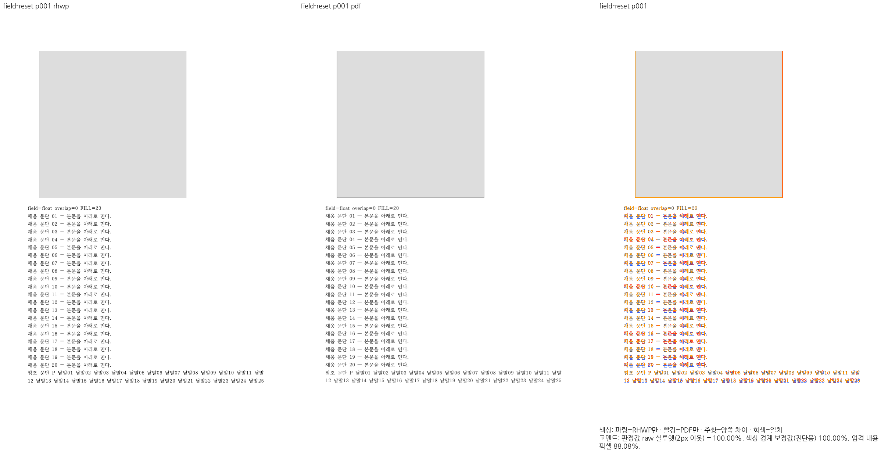
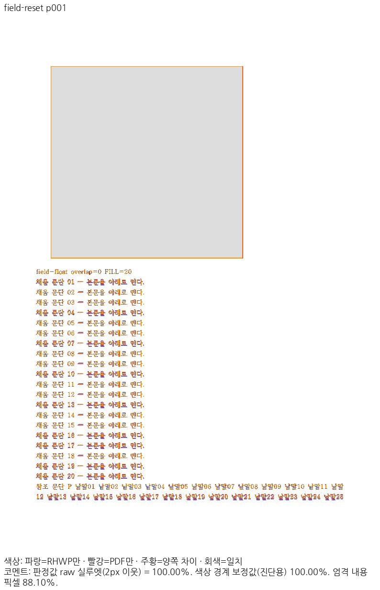

# PR #8130 리뷰 — fix(typeset): 앵커 문단도 자기 쪽·종이 기준 자리차지 밴드 아래에서 시작한다 (#8186)

## 최종 판정

**승인 — 중복 PR의 미병합 종료와 기존 대조군 보존을 확인했습니다. 통합 기능 기여로 계산하지 않습니다.**

통합 [PR #8228](https://github.com/edwardkim/rhwp/pull/8228)의 최종 head `b1e93d8de2d4842f725415aee19bd5b98ecfb8b3`가 [Full CI](https://github.com/edwardkim/rhwp/actions/runs/40196953497)를 통과했고, 2026-10-25 22:58:32 KST에 merge `3e02fe2749866a8453af3eb3901b9c1a674cccaf`로 devel에 반영됐습니다. 원 contributor head와 실제 검증한 통합 head를 구분하여 기록합니다.

## 접수 정보

| 항목 | 값 |
| --- | --- |
| 원 PR | [8130](https://github.com/edwardkim/rhwp/pull/8130) / planet6897 / devel |
| 원 contributor head | `c961778677bb0e793b2fa985cfa516e74599d486` |
| 통합 검토 branch | `review/planet6897-20261024` |
| 검증 source / base | `673c1d5f7cdcb5573b793ba2d2abaaedd2602134` / `9418ed0c7cf289c5c4ac2b3bb8cdc18a1b637a9a` |
| 현재 제출 후보 | `673c1d5f7cdcb5573b793ba2d2abaaedd2602134` / runtime `38ad63a903` |
| 적용 순서 | 현재 누적 history의 2번째 PR. 원 PR별 적용 SHA는 아래 표 참조 |
| 종료 지시 / 참조 | 원 본문 Closes ['8186'] / Refs []; 실제 종료 판정 전에는 실행하지 않음 |
| 원 PR 상태 조회 | 2026-10-25T13:01:34.007187+00:00 / CLOSED / MERGEABLE |
| 원 PR reviewer | jangster77 |

## 변경과 검토 범위

자기 쪽·종이 기준 자리차지 밴드와 앵커 문단의 소속을 검사합니다.

### 원 기여와 메인터너 보정

작성자가 미병합 종료한 중복 PR입니다. 기존 해결과 중복된 구현 및 임시 보정은 b0c5f9b4c8에서 제거했습니다. field-reset/field-plain/roadmap은 기존 정상 대조군이며 이 PR의 새 기여로 계산하지 않습니다.

| 원 기능 commit | 임시 적용 후 제거한 commit |
| --- | --- |
| `9c8499c3bc6636f3b2d7944c4be47dea66fe9168` | `4102858fe71a1d74536e81fbff1e8dead195e426` |
| `c961778677bb0e793b2fa985cfa516e74599d486` | `eaeaf3f0dc755118013b88cd3b70ba8ccb6a1a9a` |

아래 적용 commit은 이 통합 branch의 실제 history입니다. 원 PR source branch는 변경하지 않았습니다.

### 검토할 실제 소비 경로와 회귀 원본

- `src/renderer/typeset/paragraph.rs`
- `src/renderer/typeset/state/transition.rs`
- `tests/cases/stored_reset_field_float_suffix.rs`

작성자가 미병합 종료한 중복 PR입니다. 기존 해결과 중복된 구현 및 임시 보정은 b0c5f9b4c8에서 제거했습니다. field-reset/field-plain/roadmap은 기존 정상 대조군이며 이 PR의 새 기여로 계산하지 않습니다.

## 검증 입력과 결과

- code head `673c1d5f7cdcb5573b793ba2d2abaaedd2602134`, base `9418ed0c7cf289c5c4ac2b3bb8cdc18a1b637a9a`.
- 공통 통합 검증: 렌더러 집중 회귀 16/16 PASS, MCP 계약 4/4 PASS입니다. MCP 기존 실패는 제외한 sample16의 64쪽 기대값이 남은 오류였고 선택 fixture의 선언된 24쪽 기대값과 연결했습니다. 암호 stdin·비노출 검사는 유지했습니다.
- 최종 전체 회귀:      Summary [1920.075s] 11481 tests run: 11481 passed (46 slow), 45 skipped
- 필수 gate 상태 `complete`. [공통 검증 원장](../assets/integration-planet6897/final-validation-20261025/README.md).
- sample16 계열과 편람 HWP/HWPX는 사용자 지시로 제외하고 기존 검사 삭제를 유지합니다. 현재 판정 범위를 다른 #7445 항목으로 확대하지 않습니다.

### 전쪽 Native / fresh WASM TSV

| 조건 | Native 쪽수·최저 / TSV | fresh WASM 쪽수·최저 / TSV |
| --- | --- | --- |
| `field-reset` | 2쪽 / [100.00000%](../assets/integration-planet6897/final-validation-20261025/head/native/field-reset.tsv) | 2쪽 / [100.00000%](../assets/integration-planet6897/final-validation-20261025/head/wasm/field-reset.tsv) |
| `field-plain` | 2쪽 / [100.00000%](../assets/integration-planet6897/final-validation-20261025/head/native/field-plain.tsv) | 2쪽 / [100.00000%](../assets/integration-planet6897/final-validation-20261025/head/wasm/field-plain.tsv) |
| `roadmap-control` | 302쪽 / [94.97284%](../assets/integration-planet6897/final-validation-20261025/head/native/roadmap-control.tsv) | 302쪽 / [94.80964%](../assets/integration-planet6897/final-validation-20261025/head/wasm/roadmap-control.tsv) |

전체 페이지 90% 미만·누락 0쪽입니다. 같은 조건의 고정 base 대비 0.1%p 이상 하락은 0쪽이며, 쪽수 개선은 본문 소유·순서 보존을 따로 확인했습니다. [실제 입력·PDF SHA-256과 증적 바이트](../assets/integration-planet6897/final-validation-20261025/EVIDENCE.md).

## 변경 내용과 대응하는 증적

### `field-reset` · PDF p1 ↔ rhwp p1

- 입증 항목: 닫힌 중복 PR의 자리차지 앵커 정상 대조군.
- 실행 원본: `samples/stored_reset_float/field_float_reset.hwp`.
- 독립 Print PDF: `pdf/stored_reset_float/field_float_reset-2020.pdf`.

| 출력 | review | overlay |
| --- | --- | --- |
| Native |  |  |
| fresh WASM |  |  |

- 이 쪽 raw: Native 100.00000% / fresh WASM 100.00000%.

### 이 원 PR에 대응하는 정식 회귀

현재 전체 회귀 로그의 대응 PASS 2건입니다.

- `rhwp::regression_suite_005 stored_reset_field_float_suffix::paragraph_after_section_paper_band_splits_at_stored_line`
- `rhwp::regression_suite_005 stored_reset_field_float_suffix::section_first_paragraph_starts_below_its_own_paper_band`

직접 판독: float 밴드 아래 본문·20개 채움 문단·후속 참고 문단의 순서를 확인했습니다. 기존 해결의 유지 대조군입니다.

## 원격 검토와 후속 처리

중복 PR #8130은 이미 미병합 종료됐습니다. 임시 적용 후 제거한 2개 commit은 통합 기능 49개에 포함하지 않았고, 기존 대조군만 유지했습니다. 이 문서의 원격 통합 기록을 보완하며 원 PR을 재개하거나 중복 종료하지 않습니다.
