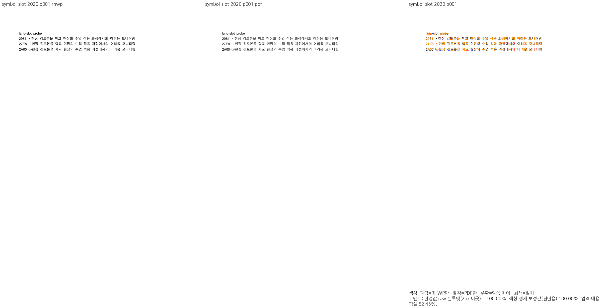
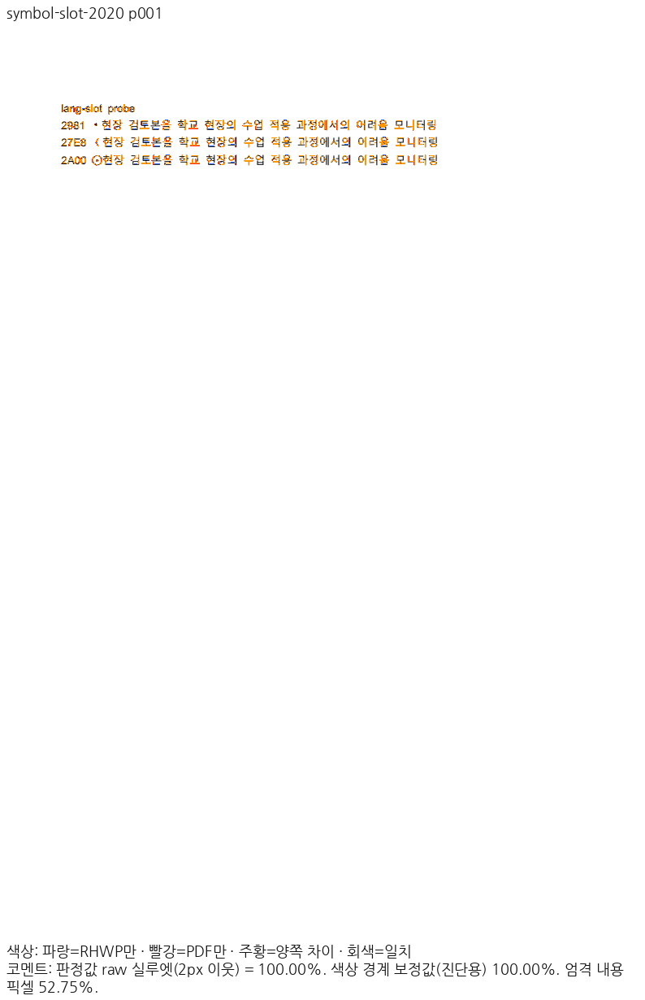
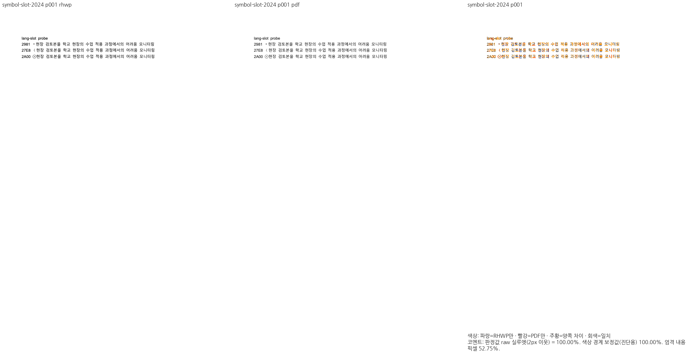
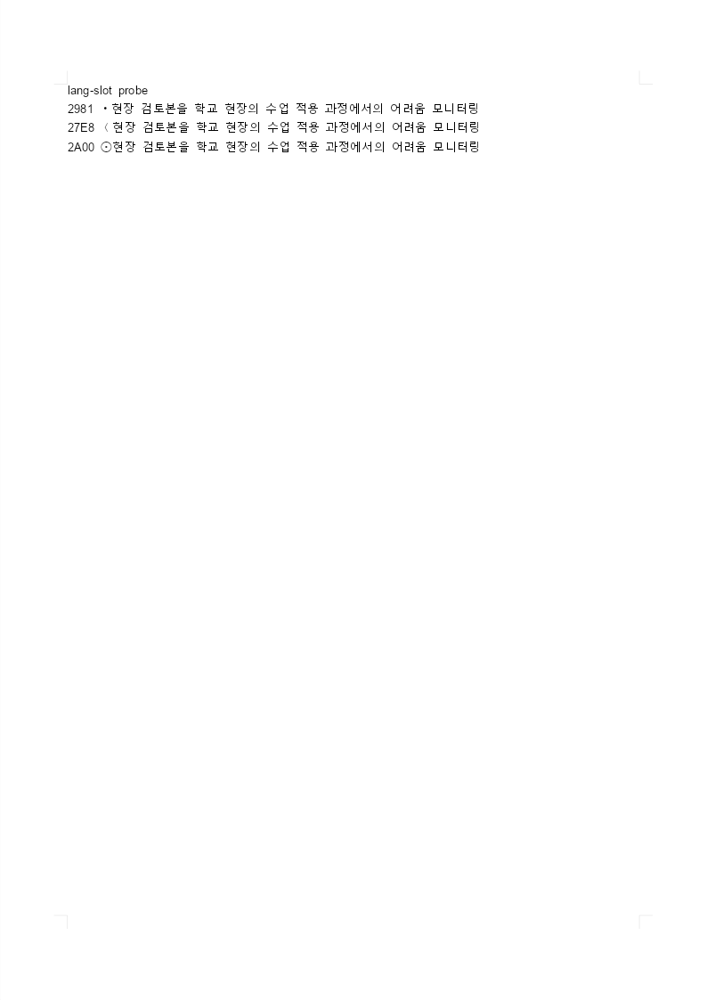

# PR #8141 리뷰 — fix(text): 수학 기호 보충 블록은 기호 슬롯 글꼴의 실제 전진폭으로 잰다

## 최종 판정

**통합 반영 완료 — 지정된 원 PR 범위의 로컬 검증·최종 CI를 통과한 뒤 PR #8228로 병합했습니다.**

통합 [PR #8228](https://github.com/edwardkim/rhwp/pull/8228)의 최종 head `b1e93d8de2d4842f725415aee19bd5b98ecfb8b3`가 [Full CI](https://github.com/edwardkim/rhwp/actions/runs/40196953497)를 통과했고, 2026-10-25 22:58:32 KST에 merge `3e02fe2749866a8453af3eb3901b9c1a674cccaf`로 devel에 반영됐습니다. 원 contributor head와 실제 검증한 통합 head를 구분하여 기록합니다.

## 접수 정보

| 항목 | 값 |
| --- | --- |
| 원 PR | [8141](https://github.com/edwardkim/rhwp/pull/8141) / planet6897 / devel |
| 원 contributor head | `a8c9df6db7dbbd72961208d1bd601e6fb2940048` |
| 통합 검토 branch | `review/planet6897-20261024` |
| 검증 source / base | `673c1d5f7cdcb5573b793ba2d2abaaedd2602134` / `9418ed0c7cf289c5c4ac2b3bb8cdc18a1b637a9a` |
| 현재 제출 후보 | `673c1d5f7cdcb5573b793ba2d2abaaedd2602134` / runtime `38ad63a903` |
| 적용 순서 | 현재 누적 history의 3번째 PR. 원 PR별 적용 SHA는 아래 표 참조 |
| 종료 지시 / 참조 | 원 본문 Closes [] / Refs []; 실제 종료 판정 전에는 실행하지 않음 |
| 원 PR 상태 조회 | 2026-10-25T13:01:34.007187+00:00 / OPEN / MERGEABLE |
| 원 PR reviewer | jangster77 |

## 변경과 검토 범위

수학 기호 보충 블록의 실제 기호 슬롯 전진폭을 적용합니다.

### 원 기여와 메인터너 보정

실제 수학 교과서 49쪽과 기호 슬롯 2020/2024 합성 입력을 구분합니다. 교육과정 415쪽을 수학 교과서의 증거로 사용하지 않습니다.

| 원 기능 commit | 통합 branch의 적용 commit |
| --- | --- |
| `dbad6049d4da328206131089641c0f9380edeb83` | `e9021d90858828bdd466cd6c7135281124bd7ce6` |
| `a8c9df6db7dbbd72961208d1bd601e6fb2940048` | `3afaacf0ecfefa068de036e4d91deb9ce0940efa` |

아래 적용 commit은 이 통합 branch의 실제 history입니다. 원 PR source branch는 변경하지 않았습니다.

### 검토할 실제 소비 경로와 회귀 원본

- `src/renderer/font_metric_math_symbol_blocks.rs`
- `src/renderer/font_metrics_data.rs`
- `src/renderer/style_resolver.rs`
- `tests/cases/symbol_slot_math_symbol_advance.rs`

수학 보충 블록 문자는 한글 슬롯이 아니라 기호 슬롯의 face와 전진폭을 사용합니다. 기호 선택 → 실제 폭 → 후속 본문 원점을 확인합니다.

## 검증 입력과 결과

- code head `673c1d5f7cdcb5573b793ba2d2abaaedd2602134`, base `9418ed0c7cf289c5c4ac2b3bb8cdc18a1b637a9a`.
- 공통 통합 검증: 렌더러 집중 회귀 16/16 PASS, MCP 계약 4/4 PASS입니다. MCP 기존 실패는 제외한 sample16의 64쪽 기대값이 남은 오류였고 선택 fixture의 선언된 24쪽 기대값과 연결했습니다. 암호 stdin·비노출 검사는 유지했습니다.
- 최종 전체 회귀:      Summary [1920.075s] 11481 tests run: 11481 passed (46 slow), 45 skipped
- 필수 gate 상태 `complete`. [공통 검증 원장](../assets/integration-planet6897/final-validation-20261025/README.md).
- sample16 계열과 편람 HWP/HWPX는 사용자 지시로 제외하고 기존 검사 삭제를 유지합니다. 현재 판정 범위를 다른 #7445 항목으로 확대하지 않습니다.

### 전쪽 Native / fresh WASM TSV

| 조건 | Native 쪽수·최저 / TSV | fresh WASM 쪽수·최저 / TSV |
| --- | --- | --- |
| `symbol-slot-2020` | 1쪽 / [100.00000%](../assets/integration-planet6897/final-validation-20261025/head/native/symbol-slot-2020.tsv) | 1쪽 / [100.00000%](../assets/integration-planet6897/final-validation-20261025/head/wasm/symbol-slot-2020.tsv) |
| `symbol-slot-2024` | 1쪽 / [100.00000%](../assets/integration-planet6897/final-validation-20261025/head/native/symbol-slot-2024.tsv) | 1쪽 / [100.00000%](../assets/integration-planet6897/final-validation-20261025/head/wasm/symbol-slot-2024.tsv) |
| `math1342000-actual` | 49쪽 / [92.90997%](../assets/integration-planet6897/final-validation-20261025/head/native/math1342000-actual.tsv) | 49쪽 / [92.76172%](../assets/integration-planet6897/final-validation-20261025/head/wasm/math1342000-actual.tsv) |

전체 페이지 90% 미만·누락 0쪽입니다. 같은 조건의 고정 base 대비 0.1%p 이상 하락은 0쪽이며, 쪽수 개선은 본문 소유·순서 보존을 따로 확인했습니다. [실제 입력·PDF SHA-256과 증적 바이트](../assets/integration-planet6897/final-validation-20261025/EVIDENCE.md).

## 변경 내용과 대응하는 증적

### `symbol-slot-2020` · PDF p1 ↔ rhwp p1

- 입증 항목: 2020 기호 슬롯의 수학 연산자 전진폭.
- 실행 원본: `samples/lang_slot/symbol_slot_bullets.hwpx`.
- 독립 Print PDF: `pdf/lang_slot/symbol_slot_bullets-2020.pdf`.

| 출력 | review | overlay |
| --- | --- | --- |
| Native |  |  |
| fresh WASM |  |  |

- 이 쪽 raw: Native 100.00000% / fresh WASM 100.00000%.

### `symbol-slot-2024` · PDF p1 ↔ rhwp p1

- 입증 항목: 2024 기호 슬롯의 수학 연산자 전진폭.
- 실행 원본: `samples/lang_slot/symbol_slot_bullets.hwpx`.
- 독립 Print PDF: `pdf/lang_slot/symbol_slot_bullets-2024.pdf`.

| 출력 | review | overlay |
| --- | --- | --- |
| Native |  |  |
| fresh WASM |  |  |

- 이 쪽 raw: Native 100.00000% / fresh WASM 100.00000%.

### 이 원 PR에 대응하는 정식 회귀

현재 전체 회귀 로그의 대응 PASS 1건입니다.

- `rhwp::regression_suite_019 symbol_slot_math_symbol_advance::math_symbol_block_uses_symbol_slot_face_and_advance`

직접 판독: U+2981/U+27E8/U+2A00과 뒤 한글 본문의 시작·줄 구성, 2020/2024 슬롯 공급을 대조했습니다. 기호 누락과 후속 본문 이동은 보이지 않습니다.

### 실제 CanvasKit 소비

동일 기호 슬롯 입력을 요청한 CanvasKit backend가 실제 소비했습니다. screen profile이며 Print TSV의 일치율과 구분합니다.

## 원격 검토와 후속 처리

제출 자산 223개의 실제 raw 다운로드 바이트·SHA-256과 게시 본문 API·GitHub 화면의 review/overlay 표시를 확인했습니다. 최종 head의 CI·CodeQL·Render Diff·Proptest·Adapter·Gym 계약은 모두 통과했고 MERGEABLE·CLEAN 상태에서 사용자 승인으로 병합했습니다. 통합 이후 확정 기록은 사용자 지정 옵션 2의 별도 문서 PR로 보완합니다. 원 PR에는 이 통합 PR과 개별 검토 기록을 연결해 기여·보정·잔여를 설명한 뒤 통합 반영을 이유로 종료하며, contributor 원 브랜치는 변경하지 않습니다.
