# PR #8152 리뷰 — fix(#8105): 나뉜 표 행의 실측 쪽 끝 — devel 위 재유도(행 선언 몫·첫 조각 닫는 선·각주 영역)

## 최종 판정

**메인터너 보정 후 수용 가능 — 이 PR의 통합 검토 범위 로컬 검증 완료.**

원격 push·통합 PR 생성·CI·merge는 아직 수행하지 않았습니다. 사용자 승인 후 진행하며, 원 contributor head와 검증한 통합 head를 구분합니다.

## 접수 정보

| 항목 | 값 |
| --- | --- |
| 원 PR | [8152](https://github.com/edwardkim/rhwp/pull/8152) / planet6897 / devel |
| 원 contributor head | `d9e144aac54896af466bdf3a61a0feb5c963a53b` |
| 통합 검토 branch | `review/planet6897-20261024` |
| 검증 source / base | `673c1d5f7cdcb5573b793ba2d2abaaedd2602134` / `9418ed0c7cf289c5c4ac2b3bb8cdc18a1b637a9a` |
| 현재 제출 후보 | `673c1d5f7cdcb5573b793ba2d2abaaedd2602134` / runtime `38ad63a903` |
| 적용 순서 | 현재 누적 history의 4번째 PR. 원 PR별 적용 SHA는 아래 표 참조 |
| 종료 지시 / 참조 | 원 본문 Closes [] / Refs ['8105']; 실제 종료 판정 전에는 실행하지 않음 |
| 원 PR 상태 조회 | 2026-10-25T13:01:34.007187+00:00 / OPEN / MERGEABLE |
| 원 PR reviewer | jangster77 |

## 변경과 검토 범위

분할 행의 선언 몫·닫는 선·각주 공간을 실제 물리 조각에 반영합니다.

### 원 기여와 메인터너 보정

38ad63a903에서 절대 쪽 프레임의 재기준화와 상대 셀 글줄 변경을 분리했습니다. 현재 변경한 셀만 span 높이·상대 정렬을 다시 요구하고, 변경하지 않은 이웃 셀의 선언 제약을 유지합니다. 교육과정 48/87/177→178과 규제분석 27~29쪽을 복원했습니다. 새 검사 3개는 415쪽 Native/fresh WASM 90% 이상 및 직접 판독을 마친 뒤 추가했습니다. 소유·순서·셀 포함·여백 관계를 보호하며, 178쪽은 양쪽 raw99.96581% 및 독립 Print 직접 판독을 충족하여 문구 원점 x320.0/y147.8931783에 ±2px 좌표 검사도 두었습니다. 이를 98% 미만 쪽으로 확대하지 않습니다. Center 정렬 검사와 기존 규제분석 검사의 실제 FAIL→PASS 근거를 보존했습니다.

| 원 기능 commit | 통합 branch의 적용 commit |
| --- | --- |
| `cf34ff9bd71795a0fff020591259476a2ef55605` | `3d90d01ab71dd25bc2ce6183bb6866f169be5d12` |
| `9c37dec15fe6d0e25710665507de5e667f55b1ad` | `bdc2452392a7f6826a915d86af5878dc386e0301` |
| `16dfd8d2f59322ccb717dc1fad049c25cb165b96` | `ad50a4376ceda064e7bdccbdc0a0a3d379a7061b` |
| `44522bed67c5c2c41edb0a1df058cdaa0ef0185d` | `1133b90a5b3266463a060cf9b0a31c8f556a0bf9` |
| `6f6948c7d62aebe103bfefb56c1d05daade3250f` | `a05c495248418ff039377d806d3a12deadf562d3` |
| `f18fc6c362185e630e0b89c30b0788a3284a0838` | `e6905784b3fd85151a46a40f491f4b4c80e3c549` |
| `53ecb85236fff83806864df53b7af23349a22022` | `2049edbbb5fb2436ddfdfed62c2781744bb69a65` |
| `d9e144aac54896af466bdf3a61a0feb5c963a53b` | `805ba46a70112e8e248ec6b6f0456258b03af9d6` |

아래 적용 commit은 이 통합 branch의 실제 history입니다. 원 PR source branch는 변경하지 않았습니다.

### 검토할 실제 소비 경로와 회귀 원본

- `src/renderer/layout/table_layout.rs`
- `src/renderer/layout/table_partial.rs`
- `src/renderer/typeset/table/block/prepare.rs`
- `src/renderer/typeset/table/continuation/fragment/emit.rs`
- `src/renderer/typeset/table/continuation/fragment/physical_rows.rs`
- `src/renderer/typeset/table/scan/runner/row_step.rs`
- `tests/cases/issue_1749_synthetic_cell_spacing.rs`
- `tests/cases/issue_8105_closing_fragment_trailing_empty_line.rs`
- `tests/cases/issue_8105_declared_overflow_row_content_fits.rs`
- `tests/cases/issue_8105_first_fragment_outer_top.rs`
- `tests/cases/issue_8105_footnote_area_closing_line.rs`
- `tests/cases/issue_8105_split_row_declared_cells.rs`
- `tests/cases/issue_8105_split_row_first_fragment_closing_line.rs`

행 선언 높이·첫 조각의 닫는 선·각주 예약 공간을 분할 조각의 물리 예산에 반영합니다. 측정과 배치가 동일한 프레임·현재 줄 구성을 소비하는지 확인합니다.

## 검증 입력과 결과

- code head `673c1d5f7cdcb5573b793ba2d2abaaedd2602134`, base `9418ed0c7cf289c5c4ac2b3bb8cdc18a1b637a9a`.
- 공통 통합 검증: 렌더러 집중 회귀 16/16 PASS, MCP 계약 4/4 PASS입니다. MCP 기존 실패는 제외한 sample16의 64쪽 기대값이 남은 오류였고 선택 fixture의 선언된 24쪽 기대값과 연결했습니다. 암호 stdin·비노출 검사는 유지했습니다.
- 최종 전체 회귀:      Summary [1920.075s] 11481 tests run: 11481 passed (46 slow), 45 skipped
- 필수 gate 상태 `complete`. [공통 검증 원장](../assets/integration-planet6897/final-validation-20261025/README.md).
- sample16 계열과 편람 HWP/HWPX는 사용자 지시로 제외하고 기존 검사 삭제를 유지합니다. 현재 판정 범위를 다른 #7445 항목으로 확대하지 않습니다.

### 전쪽 Native / fresh WASM TSV

| 조건 | Native 쪽수·최저 / TSV | fresh WASM 쪽수·최저 / TSV |
| --- | --- | --- |
| `briefing1487` | 6쪽 / [95.74283%](../assets/integration-planet6897/final-validation-20261025/head/native/briefing1487.tsv) | 6쪽 / [95.76159%](../assets/integration-planet6897/final-validation-20261025/head/wasm/briefing1487.tsv) |
| `franchise` | 142쪽 / [93.81069%](../assets/integration-planet6897/final-validation-20261025/head/native/franchise.tsv) | 142쪽 / [93.80829%](../assets/integration-planet6897/final-validation-20261025/head/wasm/franchise.tsv) |
| `regulatory86712` | 64쪽 / [98.73269%](../assets/integration-planet6897/final-validation-20261025/head/native/regulatory86712.tsv) | 64쪽 / [98.73139%](../assets/integration-planet6897/final-validation-20261025/head/wasm/regulatory86712.tsv) |
| `cbta1613` | 204쪽 / [91.87422%](../assets/integration-planet6897/final-validation-20261025/head/native/cbta1613.tsv) | 204쪽 / [91.82753%](../assets/integration-planet6897/final-validation-20261025/head/wasm/cbta1613.tsv) |
| `task1749x` | 5쪽 / [99.99836%](../assets/integration-planet6897/final-validation-20261025/head/native/task1749x.tsv) | 5쪽 / [99.99835%](../assets/integration-planet6897/final-validation-20261025/head/wasm/task1749x.tsv) |
| `task1749h` | 5쪽 / [99.99836%](../assets/integration-planet6897/final-validation-20261025/head/native/task1749h.tsv) | 5쪽 / [99.99835%](../assets/integration-planet6897/final-validation-20261025/head/wasm/task1749h.tsv) |
| `near-top-reset` | 205쪽 / [98.42761%](../assets/integration-planet6897/final-validation-20261025/head/native/near-top-reset.tsv) | 205쪽 / [98.42748%](../assets/integration-planet6897/final-validation-20261025/head/wasm/near-top-reset.tsv) |
| `curriculum-control` | 415쪽 / [95.79585%](../assets/integration-planet6897/final-validation-20261025/head/native/curriculum-control.tsv) | 415쪽 / [95.79585%](../assets/integration-planet6897/final-validation-20261025/head/wasm/curriculum-control.tsv) |
| `source8152-d2176` | 6쪽 / [95.84490%](../assets/integration-planet6897/final-validation-20261025/head/native/source8152-d2176.tsv) | 6쪽 / [95.96239%](../assets/integration-planet6897/final-validation-20261025/head/wasm/source8152-d2176.tsv) |
| `source8152-d17253` | 5쪽 / [99.49419%](../assets/integration-planet6897/final-validation-20261025/head/native/source8152-d17253.tsv) | 5쪽 / [99.49419%](../assets/integration-planet6897/final-validation-20261025/head/wasm/source8152-d17253.tsv) |
| `source8152-d80168` | 157쪽 / [95.44852%](../assets/integration-planet6897/final-validation-20261025/head/native/source8152-d80168.tsv) | 157쪽 / [95.44144%](../assets/integration-planet6897/final-validation-20261025/head/wasm/source8152-d80168.tsv) |
| `source8152-d1853` | 52쪽 / [95.71982%](../assets/integration-planet6897/final-validation-20261025/head/native/source8152-d1853.tsv) | 52쪽 / [95.70173%](../assets/integration-planet6897/final-validation-20261025/head/wasm/source8152-d1853.tsv) |
| `source8152-d1880` | 10쪽 / [98.40056%](../assets/integration-planet6897/final-validation-20261025/head/native/source8152-d1880.tsv) | 10쪽 / [98.40002%](../assets/integration-planet6897/final-validation-20261025/head/wasm/source8152-d1880.tsv) |
| `source8152-d5169` | 6쪽 / [99.84756%](../assets/integration-planet6897/final-validation-20261025/head/native/source8152-d5169.tsv) | 6쪽 / [99.84705%](../assets/integration-planet6897/final-validation-20261025/head/wasm/source8152-d5169.tsv) |
| `source8152-hfine` | 2쪽 / [100.00000%](../assets/integration-planet6897/final-validation-20261025/head/native/source8152-hfine.tsv) | 2쪽 / [100.00000%](../assets/integration-planet6897/final-validation-20261025/head/wasm/source8152-hfine.tsv) |
| `source8152-ha10m` | 3쪽 / [100.00000%](../assets/integration-planet6897/final-validation-20261025/head/native/source8152-ha10m.tsv) | 3쪽 / [100.00000%](../assets/integration-planet6897/final-validation-20261025/head/wasm/source8152-ha10m.tsv) |
| `source8152-dband` | 12쪽 / [99.96527%](../assets/integration-planet6897/final-validation-20261025/head/native/source8152-dband.tsv) | 12쪽 / [99.96529%](../assets/integration-planet6897/final-validation-20261025/head/wasm/source8152-dband.tsv) |
| `source8152-hs2` | 29쪽 / [95.83018%](../assets/integration-planet6897/final-validation-20261025/head/native/source8152-hs2.tsv) | 29쪽 / [95.82665%](../assets/integration-planet6897/final-validation-20261025/head/wasm/source8152-hs2.tsv) |
| `source8152-d80168x` | 156쪽 / [94.79496%](../assets/integration-planet6897/final-validation-20261025/head/native/source8152-d80168x.tsv) | 156쪽 / [94.79506%](../assets/integration-planet6897/final-validation-20261025/head/wasm/source8152-d80168x.tsv) |

전체 페이지 90% 미만·누락 0쪽입니다. 같은 조건의 고정 base 대비 0.1%p 이상 하락은 0쪽이며, 쪽수 개선은 본문 소유·순서 보존을 따로 확인했습니다. [실제 입력·PDF SHA-256과 증적 바이트](../assets/integration-planet6897/final-validation-20261025/EVIDENCE.md).

## 변경 내용과 대응하는 증적

### `curriculum-control` · PDF p48 ↔ rhwp p48

- 입증 항목: 선택 span 행의 Center 정렬.
- 실행 원본: `mydocs/pr/assets/issue7445/education-curriculum-map/1342000_edu_curriculum_map.hwp`.
- 독립 Print PDF: `mydocs/pr/assets/issue7445/education-curriculum-map/existing-hwp-hancom2020-print.pdf`.

| 출력 | review | overlay |
| --- | --- | --- |
| Native |  | 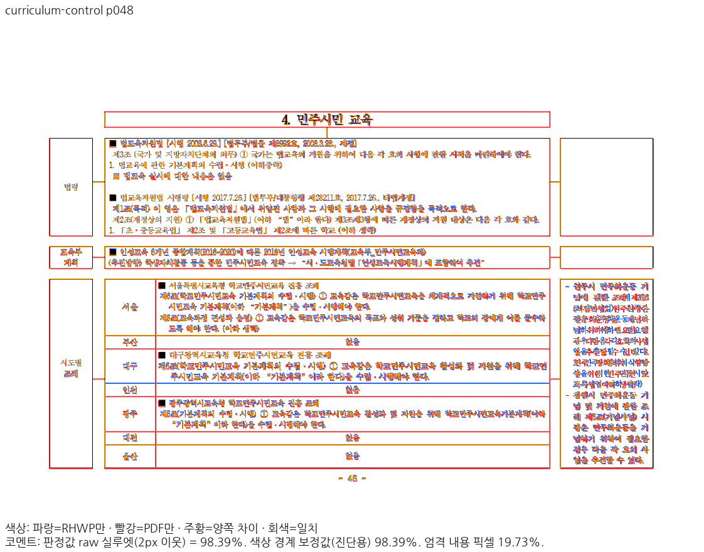 |
| fresh WASM | 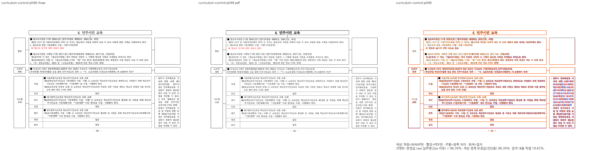 | 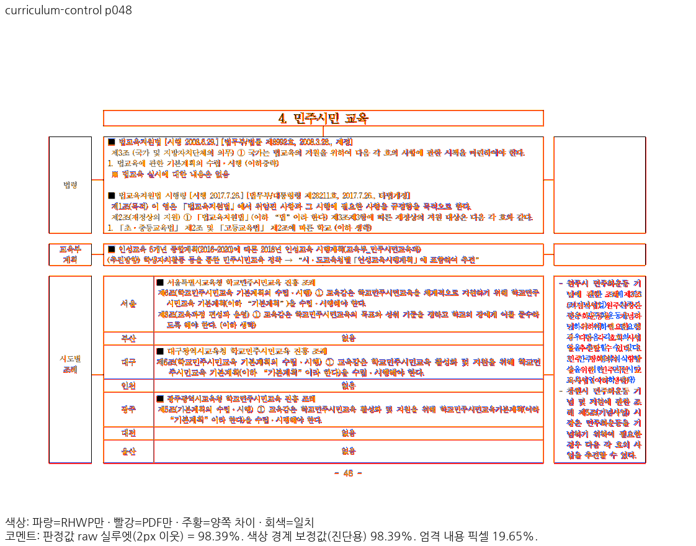 |

- 이 쪽 raw: Native 98.39299% / fresh WASM 98.39167%.

### `curriculum-control` · PDF p87 ↔ rhwp p87

- 입증 항목: 변경하지 않은 이웃 셀의 선언 행 띠.
- 실행 원본: `mydocs/pr/assets/issue7445/education-curriculum-map/1342000_edu_curriculum_map.hwp`.
- 독립 Print PDF: `mydocs/pr/assets/issue7445/education-curriculum-map/existing-hwp-hancom2020-print.pdf`.

| 출력 | review | overlay |
| --- | --- | --- |
| Native | 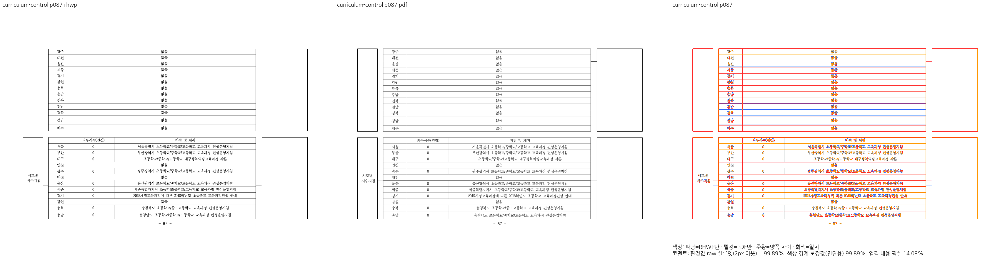 |  |
| fresh WASM |  | 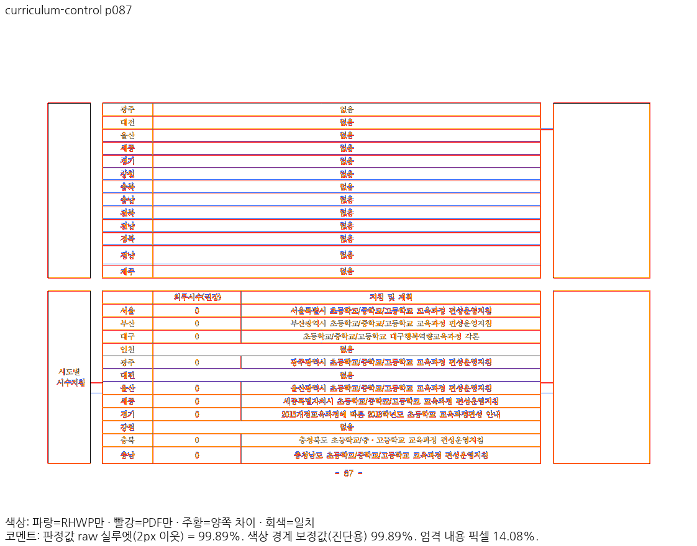 |

- 이 쪽 raw: Native 99.88704% / fresh WASM 99.88704%.

### `curriculum-control` · PDF p178 ↔ rhwp p178

- 입증 항목: 절대 쪽 프레임과 첫 이어받기 본문.
- 실행 원본: `mydocs/pr/assets/issue7445/education-curriculum-map/1342000_edu_curriculum_map.hwp`.
- 독립 Print PDF: `mydocs/pr/assets/issue7445/education-curriculum-map/existing-hwp-hancom2020-print.pdf`.

| 출력 | review | overlay |
| --- | --- | --- |
| Native | 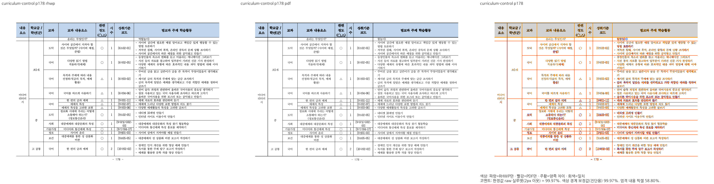 | 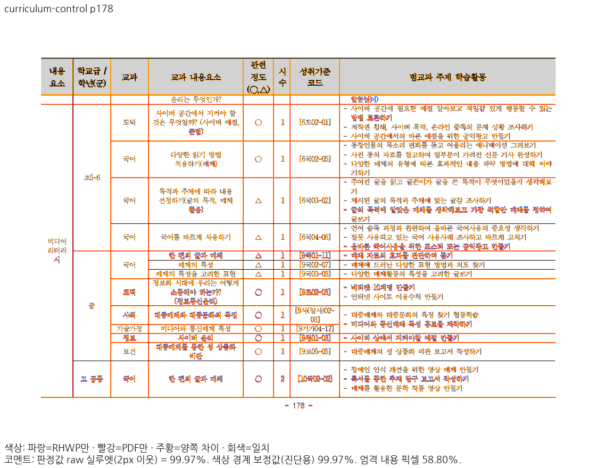 |
| fresh WASM | 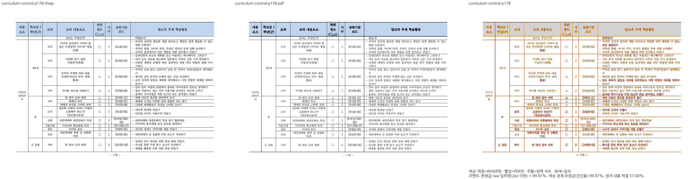 | 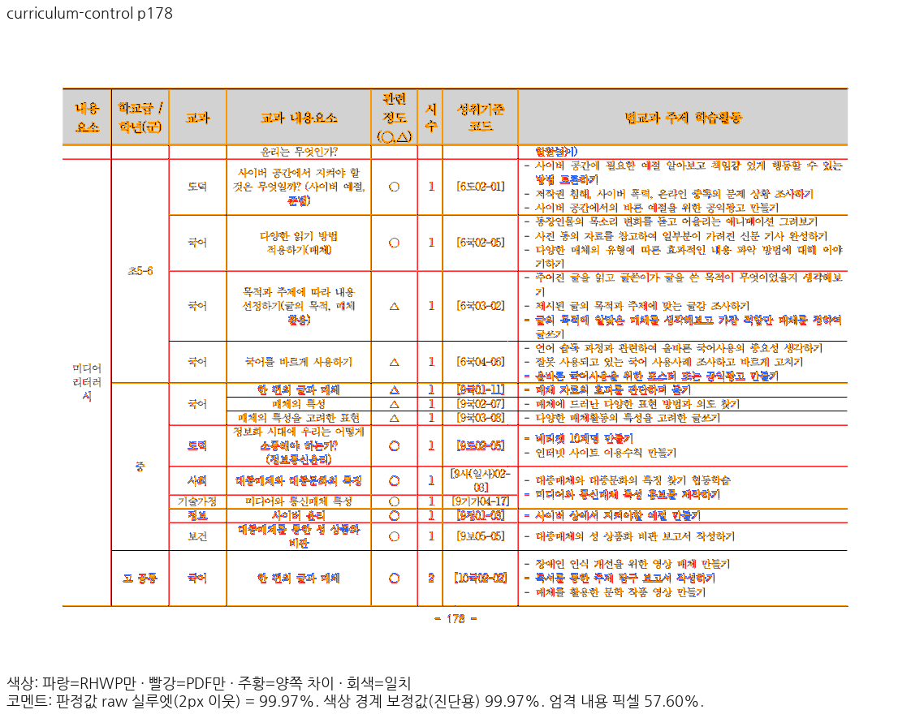 |

- 이 쪽 raw: Native 99.96581% / fresh WASM 99.96581%.

### `regulatory86712` · PDF p27 ↔ rhwp p27

- 입증 항목: 이어받기 셀의 닫는 선과 아래 표.
- 실행 원본: `samples/86712_regulatory_analysis.hwp`.
- 독립 Print PDF: `pdf/issue7382-regression-review/86712_regulatory_analysis-font-supplied-2024.pdf`.

| 출력 | review | overlay |
| --- | --- | --- |
| Native | 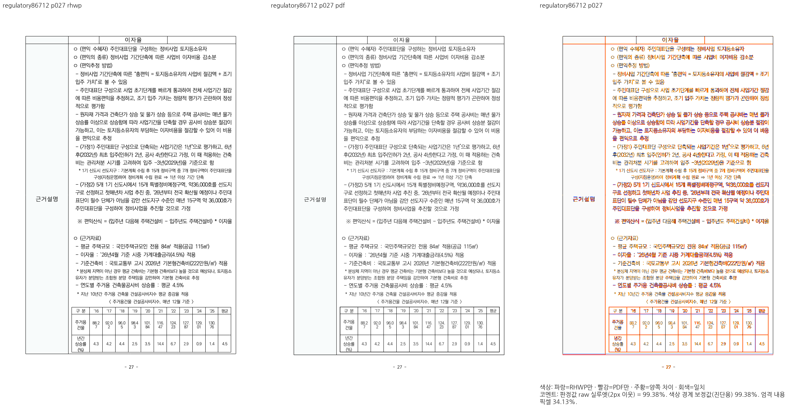 | 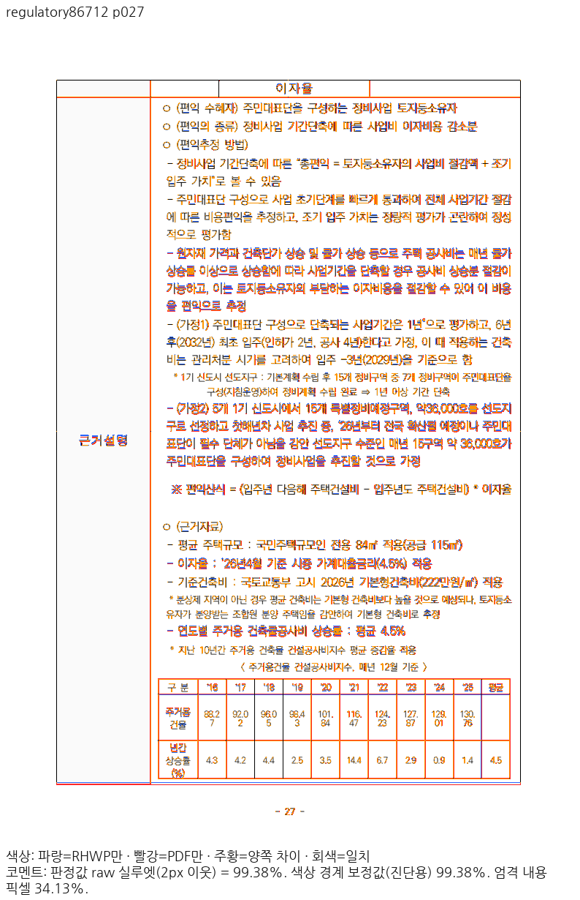 |
| fresh WASM | 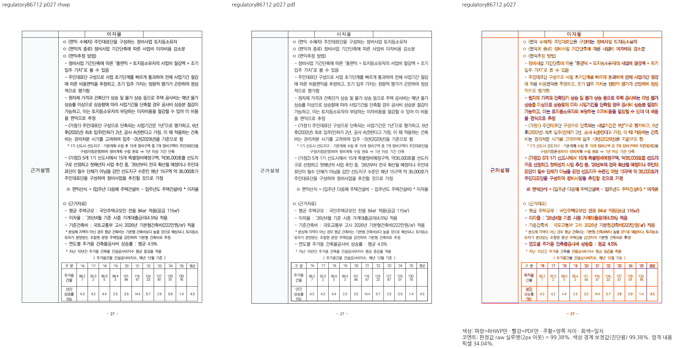 | 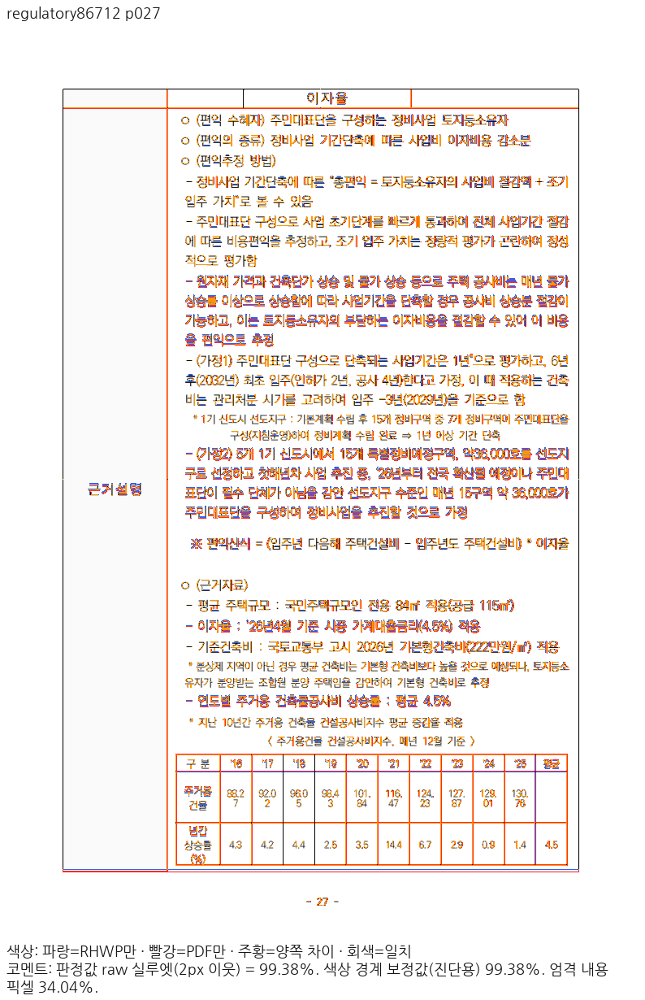 |

- 이 쪽 raw: Native 99.37739% / fresh WASM 99.37855%.

### `cbta1613` · PDF p48 ↔ rhwp p48

- 입증 항목: 기존 정상 대조군의 최저쪽·잔여 농도 차이.
- 실행 원본: `samples/issue6764/1613000-202200037-air-traffic-controller-cbta.hwp`.
- 독립 Print PDF: `pdf/issue6764/1613000-202200037-air-traffic-controller-cbta-hwp-2020.pdf`.

| 출력 | review | overlay |
| --- | --- | --- |
| Native | 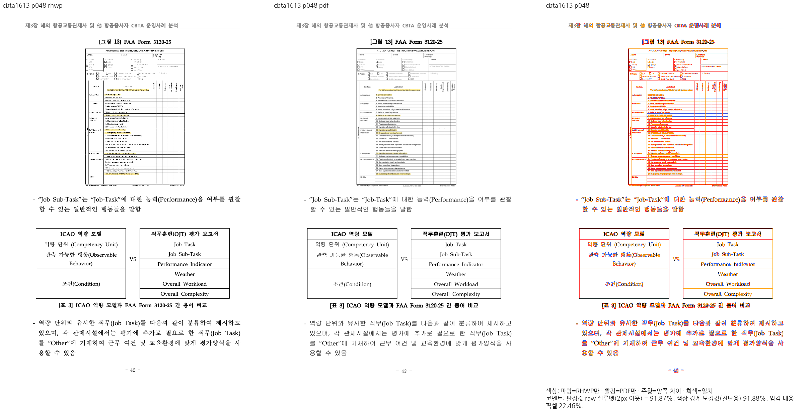 | 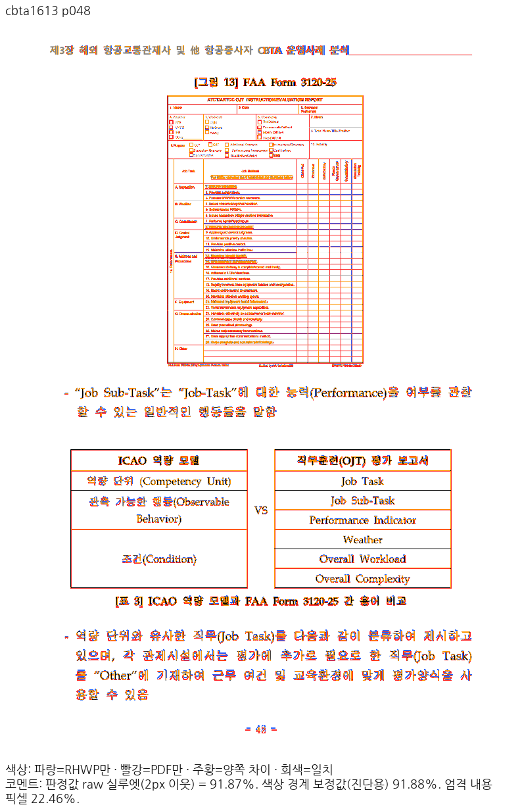 |
| fresh WASM | 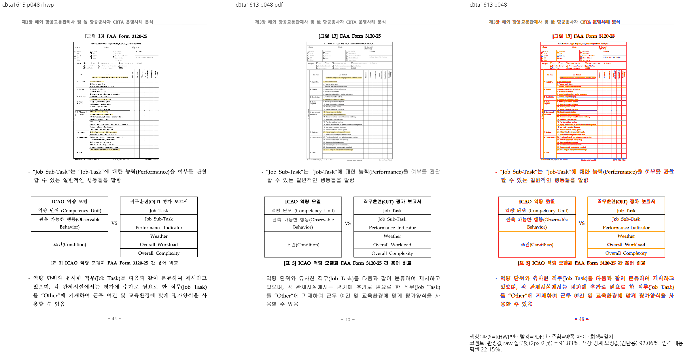 | 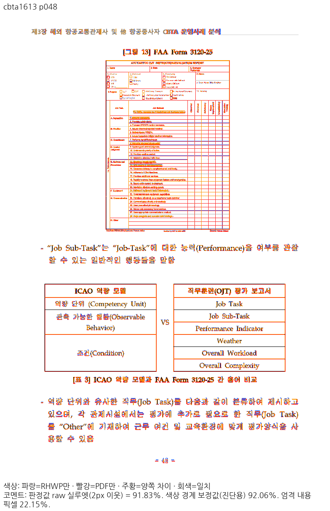 |

- 이 쪽 raw: Native 91.87422% / fresh WASM 91.82753%.

### 이 원 PR에 대응하는 정식 회귀

현재 전체 회귀 로그의 대응 PASS 25건입니다.

- `rhwp::regression_suite_001 issue_8105_declared_row_blank_tail::blank_tail_within_the_limit_is_absorbed_at_the_page_end`
- `rhwp::regression_suite_001 issue_8105_declared_row_blank_tail::blank_tail_above_the_limit_opens_the_next_page`
- `rhwp::regression_suite_001 issue_8105_declared_row_blank_tail::stored_rows_carry_declared_and_ending_span_remainders`
- `rhwp::regression_suite_005 issue_8105_numbered_stored_word_tail::ordered_probe_preserves_exact_width_cache_and_reflows_different_widths`
- `rhwp::regression_suite_005 issue_8105_declared_overflow_row_content_fits::row_whose_content_fits_stays_on_the_page_though_its_declared_height_overflows`
- `rhwp::regression_suite_005 issue_8105_numbered_stored_word_tail::numbered_cell_paragraph_rejoins_its_stored_word_tail`
- `rhwp::regression_suite_005 issue_8105_numbered_stored_word_tail::unnumbered_cell_paragraph_keeps_its_stored_word_tail`
- `rhwp::regression_suite_008 issue_8105_split_row_declared_cells::middle_fragment_without_carried_boxes_does_not_stretch_the_last_fragment`
- `rhwp::regression_suite_008 issue_8105_split_row_declared_cells::continued_row_fragment_keeps_to_its_declared_cell_height`
- `rhwp::regression_suite_009 issue_8105_closing_fragment_trailing_empty_line::closing_fragment_keeps_the_cell_trailing_empty_line_box`
- `rhwp::regression_suite_012 issue_8105_footnote_area_closing_line::footnote_page_limit_is_the_footnote_area_top`
- `rhwp::regression_suite_014 issue_8105_fragment_outer_top_and_restart_trim::consumed_offset_does_not_reopen_an_already_opened_margin`
- `rhwp::regression_suite_014 issue_8105_fragment_outer_top_and_restart_trim::continued_offset_table_reopens_its_outer_top_margin`
- `rhwp::regression_suite_014 issue_8105_fragment_outer_top_and_restart_trim::own_before_restart_keeps_the_closing_line_on_the_page`
- `rhwp::regression_suite_017 issue_1749_synthetic_cell_spacing::centered_synthetic_stack_owns_first_paragraph_before_space_once`
- `rhwp::regression_suite_017 issue_1749_synthetic_cell_spacing::opening_rowbreak_fragment_keeps_source_first_paragraph_before_space`
- `rhwp::regression_suite_020 issue_8105_split_row_first_fragment_closing_line::split_row_first_fragment_closes_at_the_closing_line`
- `rhwp::regression_suite_025 issue_8105_complete_cell_closing_slot::completed_cell_keeps_the_last_line_on_the_next_print_page`
- `rhwp::regression_suite_025 issue_8105_complete_cell_closing_slot::continued_cell_closes_after_ink_and_its_original_bottom_padding`
- `rhwp::regression_suite_026 issue_8105_first_fragment_outer_top::page_top_rowbreak_first_fragment_opens_the_outer_top`
- `rhwp::regression_suite_027 issue_8152_completed_curriculum_primary_program::current_program_keeps_the_declared_alignment_of_its_selected_span_lines`
- `rhwp::regression_suite_027 issue_8152_completed_curriculum_primary_program::selected_primary_program_keeps_completed_paragraph_origins`
- `rhwp::regression_suite_027 issue_8152_completed_curriculum_primary_program::projected_marker_tail_keeps_the_completed_continuation_owner`
- `rhwp::regression_suite_027 issue_8152_completed_curriculum_primary_program::current_line_closing_advance_preserves_both_page_owners`
- `rhwp::regression_suite_027 issue_8152_completed_curriculum_primary_program::unchanged_cell_keeps_its_local_continuation_frame_after_body_rebase`

직접 판독: 48쪽 선택 span의 Center 정렬,87쪽 물리 행 띠와 다음 내용,178쪽 첫 이어받기 문구·표 내용,규제분석27쪽 닫는 선과 아래 표를 확인했습니다. CBTA48쪽은 그림 내 작은 글자 농도·본문 자형 차이가 남습니다. 현재 raw는 base보다 높으며 별도 이미지 개선을 추가하지 않습니다.

### 실제 Studio 소비

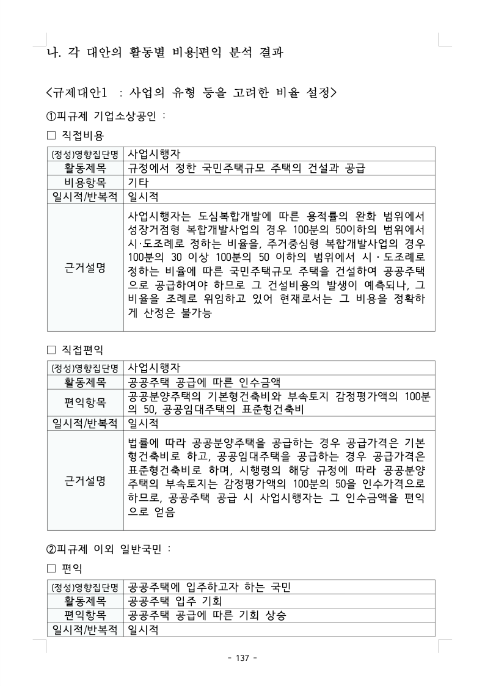

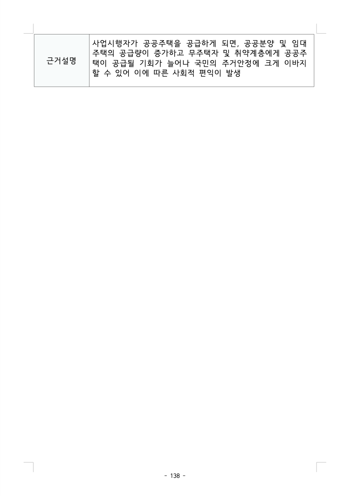

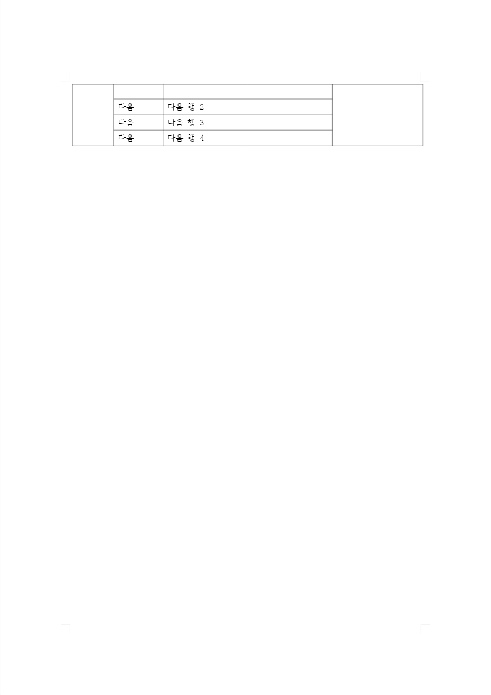

입력은 각각 `samples/issue1891/80168_regulatory_analysis.hwpx` 137/138쪽과 `samples/issue8105/declared_row_band.hwpx` 12쪽입니다. screen profile의 실제 backend 소비이며 위 Print TSV와 점수를 섞지 않습니다.

## 원격 검토와 후속 처리

통합 PR 생성 전 최신 devel/source head와 제출 바이트를 확인합니다. 게시 후 exact-head CI와 raw 이미지·TSV 다운로드 해시를 검증합니다. 통합이 실제 merge된 뒤에만 merge SHA를 연결해 원 PR의 완료 범위와 comment/close 여부를 처리합니다. 원 contributor의 기여·메인터너 보정·남은 차이를 구분하여 한국어 존댓말로 설명합니다.
