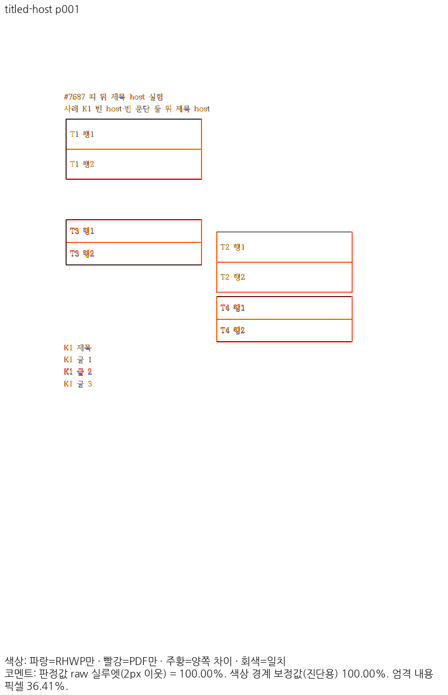
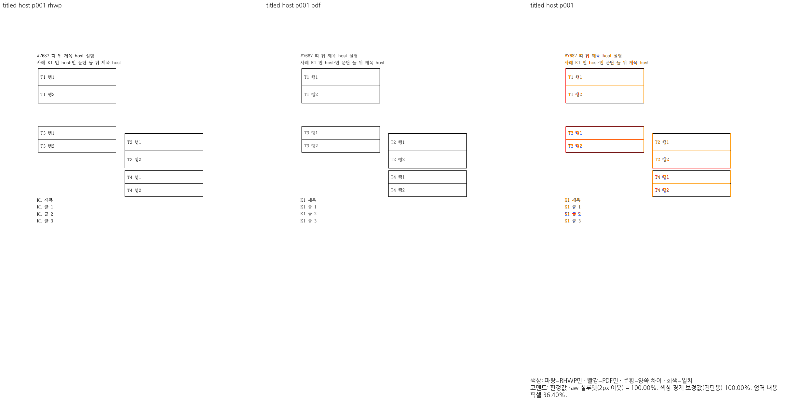
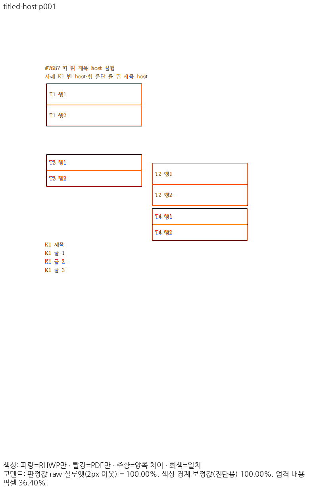

# PR #8157 리뷰 — fix(typeset): 빈 공동 앵커 host 자리차지 표의 띠·흐름에 바깥 여백을 거듭 더하지 않는다 (#7687)

## 최종 판정

**메인터너 보정 후 수용 가능 — 이 PR의 통합 검토 범위 로컬 검증 완료.**

원격 push·통합 PR 생성·CI·merge는 아직 수행하지 않았습니다. 사용자 승인 후 진행하며, 원 contributor head와 검증한 통합 head를 구분합니다.

## 접수 정보

| 항목 | 값 |
| --- | --- |
| 원 PR | [8157](https://github.com/edwardkim/rhwp/pull/8157) / planet6897 / devel |
| 원 contributor head | `495fc8f86a1500c17aa6cc6ae55a1afcb072e9bc` |
| 통합 검토 branch | `review/planet6897-20261024` |
| 검증 source / base | `673c1d5f7cdcb5573b793ba2d2abaaedd2602134` / `9418ed0c7cf289c5c4ac2b3bb8cdc18a1b637a9a` |
| 현재 제출 후보 | `673c1d5f7cdcb5573b793ba2d2abaaedd2602134` / runtime `38ad63a903` |
| 적용 순서 | 현재 누적 history의 5번째 PR. 원 PR별 적용 SHA는 아래 표 참조 |
| 종료 지시 / 참조 | 원 본문 Closes ['7687'] / Refs []; 실제 종료 판정 전에는 실행하지 않음 |
| 원 PR 상태 조회 | 2026-10-25T13:01:34.007187+00:00 / OPEN / MERGEABLE |
| 원 PR reviewer | jangster77 |

## 변경과 검토 범위

빈 공동 앵커 host 표의 바깥 여백을 중복 소비하지 않습니다.

### 원 기여와 메인터너 보정

원 기여를 유지했습니다. #8159에 중첩된 동일 패치를 중복 적용하지 않았습니다.

| 원 기능 commit | 통합 branch의 적용 commit |
| --- | --- |
| `160209fbd908ea9056dfffe4ec05064ce7ee137a` | `2f7c7069b168374876f049c6ae2272c2040de6b8` |
| `495fc8f86a1500c17aa6cc6ae55a1afcb072e9bc` | `5faeb112ef383c65a5d329d58e3736cfebceb39f` |

아래 적용 commit은 이 통합 branch의 실제 history입니다. 원 PR source branch는 변경하지 않았습니다.

### 검토할 실제 소비 경로와 회귀 원본

- `src/renderer/typeset/table/block/entry.rs`
- `tests/cases/issue_7687_empty_host_multi_float_gap.rs`

빈 공동 앵커 host의 선행 표 띠·뒤 표 원점에서 바깥 여백을 두 번 소비하지 않습니다. T1~T4와 K1 제목/뒤 본문의 관계를 검사합니다.

## 검증 입력과 결과

- code head `673c1d5f7cdcb5573b793ba2d2abaaedd2602134`, base `9418ed0c7cf289c5c4ac2b3bb8cdc18a1b637a9a`.
- 공통 통합 검증: 렌더러 집중 회귀 16/16 PASS, MCP 계약 4/4 PASS입니다. MCP 기존 실패는 제외한 sample16의 64쪽 기대값이 남은 오류였고 선택 fixture의 선언된 24쪽 기대값과 연결했습니다. 암호 stdin·비노출 검사는 유지했습니다.
- 최종 전체 회귀:      Summary [1920.075s] 11481 tests run: 11481 passed (46 slow), 45 skipped
- 필수 gate 상태 `complete`. [공통 검증 원장](../assets/integration-planet6897/final-validation-20261025/README.md).
- sample16 계열과 편람 HWP/HWPX는 사용자 지시로 제외하고 기존 검사 삭제를 유지합니다. 현재 판정 범위를 다른 #7445 항목으로 확대하지 않습니다.

### 전쪽 Native / fresh WASM TSV

| 조건 | Native 쪽수·최저 / TSV | fresh WASM 쪽수·최저 / TSV |
| --- | --- | --- |
| `titled-host` | 4쪽 / [94.04017%](../assets/integration-planet6897/final-validation-20261025/head/native/titled-host.tsv) | 4쪽 / [94.04017%](../assets/integration-planet6897/final-validation-20261025/head/wasm/titled-host.tsv) |

전체 페이지 90% 미만·누락 0쪽입니다. 같은 조건의 고정 base 대비 0.1%p 이상 하락은 0쪽이며, 쪽수 개선은 본문 소유·순서 보존을 따로 확인했습니다. [실제 입력·PDF SHA-256과 증적 바이트](../assets/integration-planet6897/final-validation-20261025/EVIDENCE.md).

## 변경 내용과 대응하는 증적

### `titled-host` · PDF p1 ↔ rhwp p1

- 입증 항목: 공동 앵커 host 표의 바깥 여백과 본문 흐름.
- 실행 원본: `samples/issue7687/titled-host.hwpx`.
- 독립 Print PDF: `pdf/issue7687/titled-host-2020.pdf`.

| 출력 | review | overlay |
| --- | --- | --- |
| Native |  |  |
| fresh WASM |  |  |

- 이 쪽 raw: Native 100.00000% / fresh WASM 100.00000%.

### 이 원 PR에 대응하는 정식 회귀

현재 전체 회귀 로그의 대응 PASS 2건입니다.

- `rhwp::regression_suite_009 issue_7687_empty_host_multi_float_gap::synthetic_empty_host_cases_follow_hancom_gap_rule`
- `rhwp::regression_suite_009 issue_7687_empty_host_multi_float_gap::titled_host_after_empty_host_band_keeps_its_float_offsets`

직접 판독: T1~T4 표 띠와 K1 제목·본문을 대조했습니다. 표/뒤 문단의 중복 여백은 보이지 않습니다. 테두리 안티앨리어싱 차이는 남습니다.

## 원격 검토와 후속 처리

통합 PR 생성 전 최신 devel/source head와 제출 바이트를 확인합니다. 게시 후 exact-head CI와 raw 이미지·TSV 다운로드 해시를 검증합니다. 통합이 실제 merge된 뒤에만 merge SHA를 연결해 원 PR의 완료 범위와 comment/close 여부를 처리합니다. 원 contributor의 기여·메인터너 보정·남은 차이를 구분하여 한국어 존댓말로 설명합니다.
