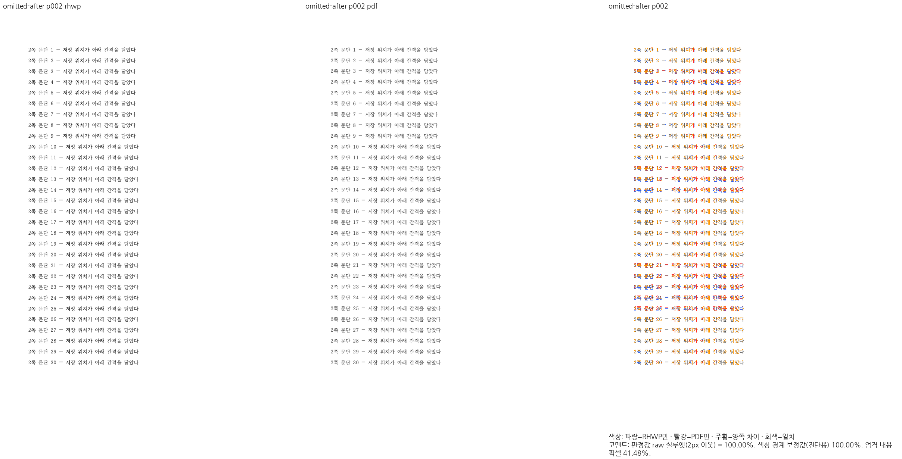
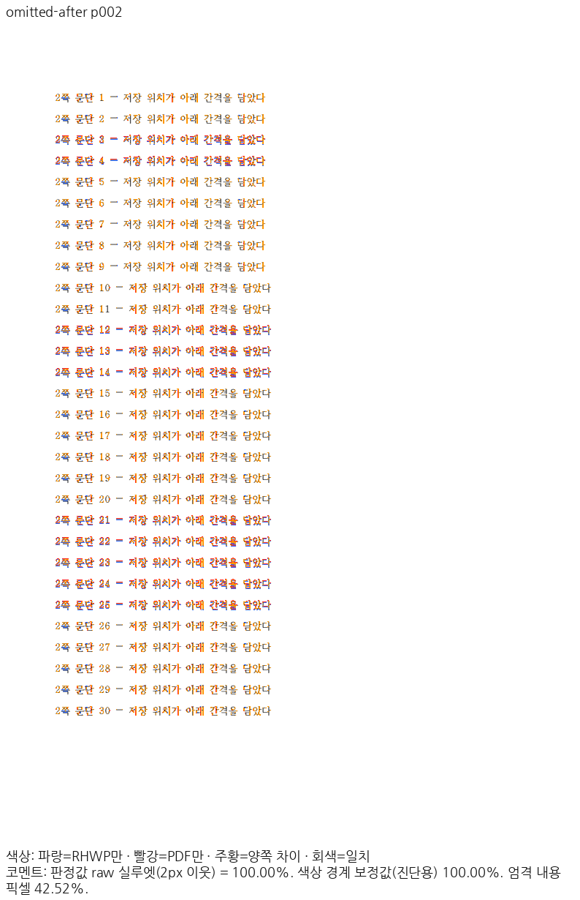

# PR #8163 리뷰 — fix(typeset): 저장 사다리가 뺀 문단 아래 간격을 조판과 배치가 같은 판정으로 둔다 (#7874)

## 최종 판정

**메인터너 보정 후 수용 가능 — 이 PR의 통합 검토 범위 로컬 검증 완료.**

원격 push·통합 PR 생성·CI·merge는 아직 수행하지 않았습니다. 사용자 승인 후 진행하며, 원 contributor head와 검증한 통합 head를 구분합니다.

## 접수 정보

| 항목 | 값 |
| --- | --- |
| 원 PR | [8163](https://github.com/edwardkim/rhwp/pull/8163) / planet6897 / devel |
| 원 contributor head | `44d7ef83145c728b433930606af68ea112d652e3` |
| 통합 검토 branch | `review/planet6897-20261024` |
| 검증 source / base | `673c1d5f7cdcb5573b793ba2d2abaaedd2602134` / `9418ed0c7cf289c5c4ac2b3bb8cdc18a1b637a9a` |
| 현재 제출 후보 | `673c1d5f7cdcb5573b793ba2d2abaaedd2602134` / runtime `38ad63a903` |
| 적용 순서 | 현재 누적 history의 11번째 PR. 원 PR별 적용 SHA는 아래 표 참조 |
| 종료 지시 / 참조 | 원 본문 Closes ['7874'] / Refs ['7445']; 실제 종료 판정 전에는 실행하지 않음 |
| 원 PR 상태 조회 | 2026-10-25T13:01:34.007187+00:00 / OPEN / MERGEABLE |
| 원 PR reviewer | jangster77 |

## 변경과 검토 범위

저장 사다리가 생략한 문단 아래 간격을 측정과 배치에서 같은 판정으로 처리합니다.

### 원 기여와 메인터너 보정

온새미로 원본 46쪽과 변환본을 분리했습니다. 변환본 base 48→현재 46쪽은 본문 29,868글자·480개 렌더 문단 소유키와 순서가 Native/WASM 양쪽에서 동일함을 확인했습니다. 쪽수가 다른 출력을 같은 쪽 번호의 raw 값으로 대체 비교하지 않았습니다.

| 원 기능 commit | 통합 branch의 적용 commit |
| --- | --- |
| `b6119b49ba82b2be560010a5d4e925d33f0c9189` | `483f63a060919551dc0737c331c4ed449716b924` |
| `07e11dac35f01899702494ff9bda4d2c22c90047` | `20de1e8e6de0b87074a2aa11f2035f00348a0577` |
| `bbe023654715c984df28f542ab08067533a8b68c` | `e27b83a201a392342bb086de1d7b6bcd1975ac63` |
| `44d7ef83145c728b433930606af68ea112d652e3` | `460970a664f6b77f45e85f997fafdf418cfb785c` |

아래 적용 commit은 이 통합 branch의 실제 history입니다. 원 PR source branch는 변경하지 않았습니다.

### 검토할 실제 소비 경로와 회귀 원본

- `src/renderer/height_cursor.rs`
- `src/renderer/typeset/paragraph/stored_lines.rs`
- `tests/cases/issue_7874_stored_ladder_omitted_spacing_after.rs`

저장 사다리에 이미 반영된 문단 아래 간격의 생략 여부를 높이 측정과 저장 줄 배치가 공유합니다. 후속 문단 간격과 내용 소유를 함께 보존합니다.

## 검증 입력과 결과

- code head `673c1d5f7cdcb5573b793ba2d2abaaedd2602134`, base `9418ed0c7cf289c5c4ac2b3bb8cdc18a1b637a9a`.
- 공통 통합 검증: 렌더러 집중 회귀 16/16 PASS, MCP 계약 4/4 PASS입니다. MCP 기존 실패는 제외한 sample16의 64쪽 기대값이 남은 오류였고 선택 fixture의 선언된 24쪽 기대값과 연결했습니다. 암호 stdin·비노출 검사는 유지했습니다.
- 최종 전체 회귀:      Summary [1920.075s] 11481 tests run: 11481 passed (46 slow), 45 skipped
- 필수 gate 상태 `complete`. [공통 검증 원장](../assets/integration-planet6897/final-validation-20261025/README.md).
- sample16 계열과 편람 HWP/HWPX는 사용자 지시로 제외하고 기존 검사 삭제를 유지합니다. 현재 판정 범위를 다른 #7445 항목으로 확대하지 않습니다.

### 전쪽 Native / fresh WASM TSV

| 조건 | Native 쪽수·최저 / TSV | fresh WASM 쪽수·최저 / TSV |
| --- | --- | --- |
| `omitted-after` | 2쪽 / [100.00000%](../assets/integration-planet6897/final-validation-20261025/head/native/omitted-after.tsv) | 2쪽 / [100.00000%](../assets/integration-planet6897/final-validation-20261025/head/wasm/omitted-after.tsv) |
| `hwp5-control` | 24쪽 / [98.01407%](../assets/integration-planet6897/final-validation-20261025/head/native/hwp5-control.tsv) | 24쪽 / [98.01624%](../assets/integration-planet6897/final-validation-20261025/head/wasm/hwp5-control.tsv) |
| `onsaemiro-control` | 46쪽 / [92.38021%](../assets/integration-planet6897/final-validation-20261025/head/native/onsaemiro-control.tsv) | 46쪽 / [92.38142%](../assets/integration-planet6897/final-validation-20261025/head/wasm/onsaemiro-control.tsv) |
| `onsaemiro-converted-control` | 46쪽 / [94.65583%](../assets/integration-planet6897/final-validation-20261025/head/native/onsaemiro-converted-control.tsv) | 46쪽 / [94.55536%](../assets/integration-planet6897/final-validation-20261025/head/wasm/onsaemiro-converted-control.tsv) |

전체 페이지 90% 미만·누락 0쪽입니다. 같은 조건의 고정 base 대비 0.1%p 이상 하락은 0쪽이며, 쪽수 개선은 본문 소유·순서 보존을 따로 확인했습니다. [실제 입력·PDF SHA-256과 증적 바이트](../assets/integration-planet6897/final-validation-20261025/EVIDENCE.md).

## 변경 내용과 대응하는 증적

### `omitted-after` · PDF p2 ↔ rhwp p2

- 입증 항목: 저장 사다리의 문단 아래 간격 생략과 후속 문단.
- 실행 원본: `samples/issue7874/omitted-spacing-after.hwpx`.
- 독립 Print PDF: `pdf/issue7874/omitted-spacing-after-2024.pdf`.

| 출력 | review | overlay |
| --- | --- | --- |
| Native |  |  |
| fresh WASM |  |  |

- 이 쪽 raw: Native 100.00000% / fresh WASM 100.00000%.

### 이 원 PR에 대응하는 정식 회귀

현재 전체 회귀 로그의 대응 PASS 1건입니다.

- `rhwp::regression_suite_014 issue_7874_stored_ladder_omitted_spacing_after::paragraphs_keep_spacing_after_omitted_by_stored_ladder`

직접 판독: 2쪽 30개 문단의 순서·세로 간격과 줄 소속을 대조했습니다. 개별 글자 raster 차이는 남습니다.

## 원격 검토와 후속 처리

통합 PR 생성 전 최신 devel/source head와 제출 바이트를 확인합니다. 게시 후 exact-head CI와 raw 이미지·TSV 다운로드 해시를 검증합니다. 통합이 실제 merge된 뒤에만 merge SHA를 연결해 원 PR의 완료 범위와 comment/close 여부를 처리합니다. 원 contributor의 기여·메인터너 보정·남은 차이를 구분하여 한국어 존댓말로 설명합니다.
