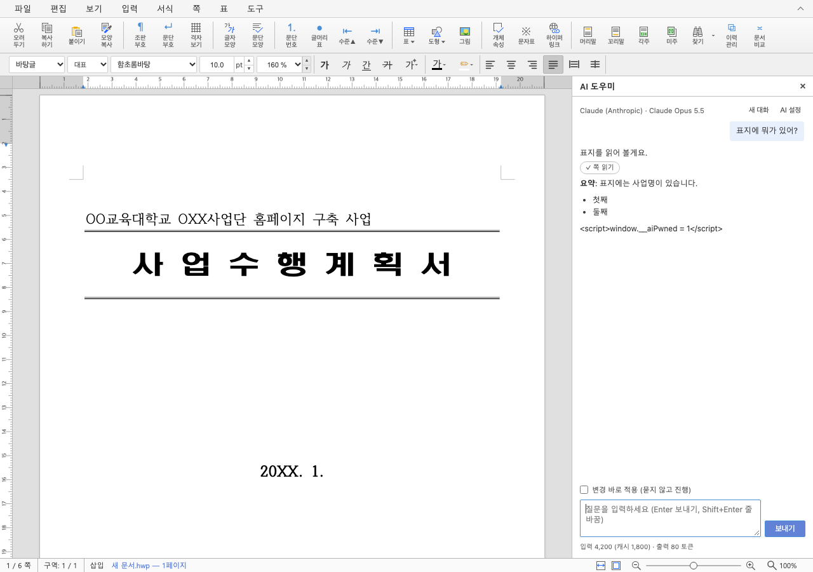
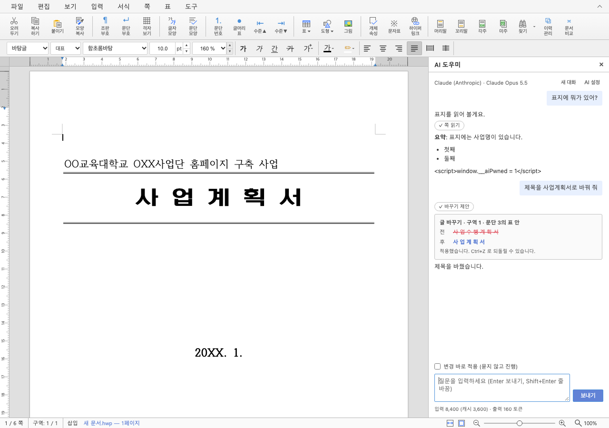
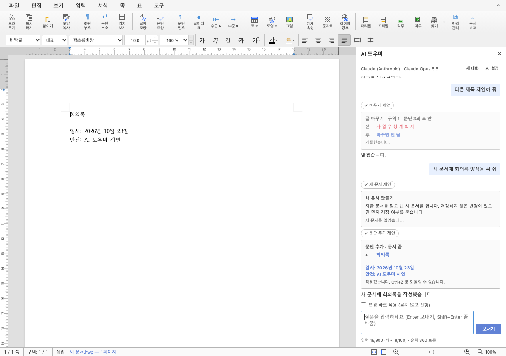

# PR #8170 리뷰 — feat(studio): AI 도우미 대화 패널 — 문서 읽기·편집·새 문서 작성 (P0, Claude)

## 최종 판정

**통합 반영 완료 — 지정된 원 PR 범위의 로컬 검증·최종 CI를 통과한 뒤 PR #8228로 병합했습니다.**

통합 [PR #8228](https://github.com/edwardkim/rhwp/pull/8228)의 최종 head `b1e93d8de2d4842f725415aee19bd5b98ecfb8b3`가 [Full CI](https://github.com/edwardkim/rhwp/actions/runs/40196953497)를 통과했고, 2026-10-25 22:58:32 KST에 merge `3e02fe2749866a8453af3eb3901b9c1a674cccaf`로 devel에 반영됐습니다. 원 contributor head와 실제 검증한 통합 head를 구분하여 기록합니다.

## 접수 정보

| 항목 | 값 |
| --- | --- |
| 원 PR | [8170](https://github.com/edwardkim/rhwp/pull/8170) / planet6897 / devel |
| 원 contributor head | `ab4e0808e4662a88a9f59d1f2b6e44df5161d8b1` |
| 통합 검토 branch | `review/planet6897-20261024` |
| 검증 source / base | `673c1d5f7cdcb5573b793ba2d2abaaedd2602134` / `9418ed0c7cf289c5c4ac2b3bb8cdc18a1b637a9a` |
| 현재 제출 후보 | `673c1d5f7cdcb5573b793ba2d2abaaedd2602134` / runtime `38ad63a903` |
| 적용 순서 | 현재 누적 history의 7번째 PR. 원 PR별 적용 SHA는 아래 표 참조 |
| 종료 지시 / 참조 | 원 본문 Closes ['8169'] / Refs ['8167']; 실제 종료 판정 전에는 실행하지 않음 |
| 원 PR 상태 조회 | 2026-10-25T13:01:34.007187+00:00 / OPEN / MERGEABLE |
| 원 PR reviewer | jangster77 |

## 변경과 검토 범위

Studio AI 대화·문서 읽기·편집·새 문서 작성 P0를 추가합니다.

### 원 기여와 메인터너 보정

cdc42f5614에서 StudioCommandError.report의 비동기 복구를 기다리도록 보정했습니다. 과거 E2E 93개 assertion과 현재 변경하지 않은 UI 소스의 재사용 근거를 구분하고, 현재 Rust/WASM 소비 검증 42건을 따로 기록했습니다.

| 원 기능 commit | 통합 branch의 적용 commit |
| --- | --- |
| `3fb95ab438e12b617cffbf2b243b5a6a3dddff83` | `c95d8e174ce1e1f03e3fb7c024ddca70d257a82a` |
| `57cc895a1ffabcab3d2a412d681f38c51843d14a` | `7fff0b2890c609df635371f95223c674fcdbb93d` |
| `f61b43fe08b62768bc3325bfd360f1db80132146` | `05ca534a3aa0113f16d755688d7b52e850f8be1e` |
| `bdbb02de304a1fa9233abc072af44160b2b1f513` | `0280453832dc404f6bc401aab975eaa928dc7621` |
| `aad18d2e45518e78415dd278d75de4d0e60d35bc` | `7013eb2245dcdf6e0c0fc5fa858a02535eb23df0` |
| `cbcdf307a35d567d4c57fdc506c58be2418d567a` | `a18f105198dc360d093ea24043ed3ce1cfba48fc` |
| `df9d83e0537d3bfb668bab925c936d86f07f91b4` | `265c7c88c029663fe793e322ee0465efb1a9f4cd` |
| `b6d972cb22767709b62e779f21a9f88b33d9a28b` | `20e6c86c4b8d046c300ec37c097138bfe83fcb2c` |
| `dda58a13857ed193cbd14138286fdc02dcd6b111` | `3f6e0680ac4049eb9a73d692ab38d8f847983a5c` |
| `2c2e740962976c470dd4cd2cf3b53947872e5eca` | `ab6337a1843cd32a31449a39b5ebb973a292d7fc` |
| `98cf153b3a9620fdf911c5461d6ec24ebf6b5d61` | `1a0f6a95d0339cb26738e1594ac6f20ab16c004e` |
| `b5d21d33d8378016f3b13dc6f00c5d2e9ce502a4` | `7b845a82ae17b35fbbe2e5a9f9353c4c5b5e80ac` |
| `99e90dfeebbb658f387c4aabe16fcd7108caed43` | `037b15b573f57b4fcb69687b67c15c1f895f2834` |
| `6f1446d6779df31724ec7ebf29e4604191200b43` | `0bede6ef83d6955891291bcde41b1ea84a9ca693` |
| `3fdeb9e7d47e8982abd08d9e967b7058f99b5fd6` | `dd1f98aacde48014373fc7048d057648498bf1c9` |
| `f8cc0bff17dcbae89fe69a1eb8b7b5eda1c9b87f` | `815efc93ee5bd09c9d706793011a72a11e6e5789` |
| `a69c3f826d1bae2e972f4297fda7e6330dc3fd50` | `7f6be6befc299eb11da7359eda3c1f2b05bf60fc` |
| `ab4e0808e4662a88a9f59d1f2b6e44df5161d8b1` | `7d443c73333ed1e3d9cb1cbe3d1b55a8cd728942` |

아래 적용 commit은 이 통합 branch의 실제 history입니다. 원 PR source branch는 변경하지 않았습니다.

### 검토할 실제 소비 경로와 회귀 원본

- `rhwp-studio/src/ai/agent/agent-loop.ts`
- `rhwp-studio/src/ai/agent/chat-controller.ts`
- `rhwp-studio/src/ai/agent/chat-session.ts`
- `rhwp-studio/src/ai/agent/system-prompt.ts`
- `rhwp-studio/src/ai/ai-context.ts`
- `rhwp-studio/src/ai/plugin.ts`
- `rhwp-studio/src/ai/provider/claude.ts`
- `rhwp-studio/src/ai/provider/models.ts`
- `rhwp-studio/src/ai/provider/types.ts`
- `rhwp-studio/src/ai/settings/ai-settings.ts`
- `rhwp-studio/src/ai/settings/key-store.ts`
- `rhwp-studio/src/ai/tools/command-tools.ts`
- `rhwp-studio/src/ai/tools/read-tools.ts`
- `rhwp-studio/src/ai/tools/schema-validate.ts`
- `rhwp-studio/src/ai/tools/untrusted.ts`
- `rhwp-studio/src/ai/tools/write-tools.ts`
- `rhwp-studio/src/ai/ui/ai-panel.css`
- `rhwp-studio/src/ai/ui/ai-panel.ts`
- `rhwp-studio/src/ai/ui/ai-settings-dialog.ts`
- `rhwp-studio/src/ai/ui/ai-unlock-dialog.ts`
- `rhwp-studio/src/ai/ui/message-render.ts`
- `rhwp-studio/src/i18n/locales/en.ts`
- `rhwp-studio/src/i18n/locales/ko.ts`
- `rhwp-studio/src/main.ts`
- `rhwp-studio/src/plugin/host.ts`
- `rhwp-studio/src/plugin/selection-text.ts`
- `rhwp-studio/src/plugin/types.ts`
- `rhwp-studio/src/style.css`
- `rhwp-studio/src/styles/editor.css`
- `rhwp-studio/src/styles/side-panel.css`
- `rhwp-studio/src/view/side-panel-host.ts`
- `rhwp-studio/src/vite-env.d.ts`
- `rhwp-studio/tests/ai-agent-loop.test.ts`
- `rhwp-studio/tests/ai-claude-errors.test.ts`
- `rhwp-studio/tests/ai-claude-request.test.ts`
- `rhwp-studio/tests/ai-command-tools.test.ts`
- `rhwp-studio/tests/ai-key-store.test.ts`
- `rhwp-studio/tests/ai-message-render.test.ts`
- `rhwp-studio/tests/ai-read-tools.test.ts`
- `rhwp-studio/tests/ai-settings.test.ts`
- `rhwp-studio/tests/ai-untrusted.test.ts`
- `rhwp-studio/tests/ai-write-tools.test.ts`
- `rhwp-studio/tests/plugin-selection-text.test.ts`
- `rhwp-studio/tests/plugin-side-panel.test.ts`
- `rhwp-studio/tests/side-panel-host.test.ts`

Studio AI 대화 패널·읽기 도구·변경 제안 승인/거부·Undo·새 문서 작성과 플러그인 수명주기입니다. mock SSE와 실제 browser UI로 검증했으며 유료 API 성공을 주장하지 않습니다.

## 검증 입력과 결과

- code head `673c1d5f7cdcb5573b793ba2d2abaaedd2602134`, base `9418ed0c7cf289c5c4ac2b3bb8cdc18a1b637a9a`.
- 공통 통합 검증: 렌더러 집중 회귀 16/16 PASS, MCP 계약 4/4 PASS입니다. MCP 기존 실패는 제외한 sample16의 64쪽 기대값이 남은 오류였고 선택 fixture의 선언된 24쪽 기대값과 연결했습니다. 암호 stdin·비노출 검사는 유지했습니다.
- 최종 전체 회귀:      Summary [1920.075s] 11481 tests run: 11481 passed (46 slow), 45 skipped
- 필수 gate 상태 `complete`. [공통 검증 원장](../assets/integration-planet6897/final-validation-20261025/README.md).
- sample16 계열과 편람 HWP/HWPX는 사용자 지시로 제외하고 기존 검사 삭제를 유지합니다. 현재 판정 범위를 다른 #7445 항목으로 확대하지 않습니다.

## 변경 내용과 대응하는 증적

아래 화면은 `ai-panel.test.mjs`의 mock SSE E2E에서 직접 생성했습니다. 질문 읽기 → 변경 제안/적용 → 새 문서 작성에 대응합니다. 해당 E2E는 93개 assertion/exit0이며, 그림의 원 producer와 현재 변경하지 않은 Studio UI 소스의 대응을 별도로 확인합니다. 현재 source에서 화면을 새로 캡처했다고 쓰지 않습니다.

기존 source b0c5f9b4c8의 브라우저 E2E와 source d3857432b6의 최신 frontend unit 2,572 PASS/2 skip·TypeScript 2종·AI 포함/제외 build PASS는 provenance를 구분합니다. 현재 UI runtime/unit source는 동일하며 현재 Rust/fresh WASM의 실제 소비 42건은 별도 실행했습니다. 실제 API 키나 네트워크 과금 호출을 검증한 기록이 아닙니다.

## 원격 검토와 후속 처리

제출 자산 223개의 실제 raw 다운로드 바이트·SHA-256과 게시 본문 API·GitHub 화면의 review/overlay 표시를 확인했습니다. 최종 head의 CI·CodeQL·Render Diff·Proptest·Adapter·Gym 계약은 모두 통과했고 MERGEABLE·CLEAN 상태에서 사용자 승인으로 병합했습니다. 통합 이후 확정 기록은 사용자 지정 옵션 2의 별도 문서 PR로 보완합니다. 원 PR에는 이 통합 PR과 개별 검토 기록을 연결해 기여·보정·잔여를 설명한 뒤 통합 반영을 이유로 종료하며, contributor 원 브랜치는 변경하지 않습니다.
