# PR #8185 리뷰 — fix(typeset/render): 1790387 정책연구 보고서 쪽 넘침·90% 미만 쪽 — 오프셋 표 첫 조각·반복 제목행 rowspan·끝 조각 후속 저장 줄·Native SVG 재표본 (#4599)

## 최종 판정

**메인터너 보정 후 수용 가능 — 이 PR의 통합 검토 범위 로컬 검증 완료.**

원격 push·통합 PR 생성·CI·merge는 아직 수행하지 않았습니다. 사용자 승인 후 진행하며, 원 contributor head와 검증한 통합 head를 구분합니다.

## 접수 정보

| 항목 | 값 |
| --- | --- |
| 원 PR | [8185](https://github.com/edwardkim/rhwp/pull/8185) / planet6897 / devel |
| 원 contributor head | `502ee8b32ebe1e8f4d8fdfdb0d9a73b4c9dcd06e` |
| 통합 검토 branch | `review/planet6897-20261024` |
| 검증 source / base | `673c1d5f7cdcb5573b793ba2d2abaaedd2602134` / `9418ed0c7cf289c5c4ac2b3bb8cdc18a1b637a9a` |
| 현재 제출 후보 | `673c1d5f7cdcb5573b793ba2d2abaaedd2602134` / runtime `38ad63a903` |
| 적용 순서 | 현재 누적 history의 9번째 PR. 원 PR별 적용 SHA는 아래 표 참조 |
| 종료 지시 / 참조 | 원 본문 Closes [] / Refs ['4599']; 실제 종료 판정 전에는 실행하지 않음 |
| 원 PR 상태 조회 | 2026-10-25T13:01:34.007187+00:00 / OPEN / MERGEABLE |
| 원 PR reviewer | jangster77 |

## 변경과 검토 범위

오프셋 표 첫 조각·제목행 rowspan·끝 조각 후속 저장 줄과 Native SVG 출력 경로를 보정합니다.

### 원 기여와 메인터너 보정

0a275bdb8b에서 벡터의 device-grid 처리는 유지하고 raster-only SVG는 이미지 재표본 경로로 보냈습니다. 정책연구 입력은 본문 소유 보존과 65→64쪽 정합을 확인했습니다. #4599 전체 해결·종료로 확대하지 않습니다.

| 원 기능 commit | 통합 branch의 적용 commit |
| --- | --- |
| `20db2b48c86c35b4d13ba260a05759dc4d7284e8` | `a930f94c5f6c6995d6c99af0d2e76fc50ea51cdf` |
| `c5ee2a385ee560fefdd80825c387ed8cff6a6dba` | `94793c5638dd3b2c3fd8180181b8c43d990d812f` |
| `27e698f31226e31a3bd577d939820f390febd0f8` | `89a8f58b5e3001f253eedc9a6e21461440a99593` |
| `1f2667335fa99489e45b96c6c1bf589bbe12a050` | `66e796989c3dcb597453f4dc4743a5fa746b7910` |
| `f232ee2e24af19d217a80b7375093279fe0a1aff` | `356fcfcf8312739c44bfa57041e513a6c88ca8ce` |
| `43cf90a4a8fdf58f582a2a4615ca29cbe8a777f9` | `6cf57f5d7db90a7b2b8bb4ce6f0132eccb3d684c` |
| `2c1f9af9aaaab5c956564735b7b525f7be43b54f` | `78974f3602f6d2d6b525e76f8acb1a64789ef260` |
| `502ee8b32ebe1e8f4d8fdfdb0d9a73b4c9dcd06e` | `ea62457318bd59ded3b2b332febb6dd1071b6786` |

아래 적용 commit은 이 통합 branch의 실제 history입니다. 원 PR source branch는 변경하지 않았습니다.

### 검토할 실제 소비 경로와 회귀 원본

- `src/model/table.rs`
- `src/renderer/float_placement.rs`
- `src/renderer/layout/table_layout.rs`
- `src/renderer/skia/image_conv.rs`
- `src/renderer/skia/svg_bitmap_mask.rs`
- `src/renderer/typeset/table.rs`
- `src/renderer/typeset/table/block/prepare.rs`
- `src/renderer/typeset/table/continuation/fragment/budget.rs`
- `src/renderer/typeset/table/continuation/fragment/emit.rs`
- `src/wmf/converter/svg/util.rs`
- `tests/cases/issue_4599_empty_host_offset_float_first_fragment.rs`
- `tests/cases/issue_4599_split_table_header_and_successor.rs`
- `tests/cases/native_svg_image_device_grid.rs`
- `tests/cases/wmf_shared_bitmap_serialization.rs`

오프셋 첫 표 조각·반복 제목행 rowspan·끝 조각 후속 저장 줄 및 Native SVG 이미지의 실제 장치 재표본 경로를 보정합니다. 표 앞뒤 본문과 제목/본문 행 소유를 확인합니다.

## 검증 입력과 결과

- code head `673c1d5f7cdcb5573b793ba2d2abaaedd2602134`, base `9418ed0c7cf289c5c4ac2b3bb8cdc18a1b637a9a`.
- 공통 통합 검증: 렌더러 집중 회귀 16/16 PASS, MCP 계약 4/4 PASS입니다. MCP 기존 실패는 제외한 sample16의 64쪽 기대값이 남은 오류였고 선택 fixture의 선언된 24쪽 기대값과 연결했습니다. 암호 stdin·비노출 검사는 유지했습니다.
- 최종 전체 회귀:      Summary [1920.075s] 11481 tests run: 11481 passed (46 slow), 45 skipped
- 필수 gate 상태 `complete`. [공통 검증 원장](../assets/integration-planet6897/final-validation-20261025/README.md).
- sample16 계열과 편람 HWP/HWPX는 사용자 지시로 제외하고 기존 검사 삭제를 유지합니다. 현재 판정 범위를 다른 #7445 항목으로 확대하지 않습니다.

### 전쪽 Native / fresh WASM TSV

| 조건 | Native 쪽수·최저 / TSV | fresh WASM 쪽수·최저 / TSV |
| --- | --- | --- |
| `offset-min` | 2쪽 / [98.90710%](../assets/integration-planet6897/final-validation-20261025/head/native/offset-min.tsv) | 2쪽 / [98.85533%](../assets/integration-planet6897/final-validation-20261025/head/wasm/offset-min.tsv) |
| `rowspan-header` | 4쪽 / [96.03764%](../assets/integration-planet6897/final-validation-20261025/head/native/rowspan-header.tsv) | 4쪽 / [95.48353%](../assets/integration-planet6897/final-validation-20261025/head/wasm/rowspan-header.tsv) |
| `tac-successor` | 4쪽 / [99.45515%](../assets/integration-planet6897/final-validation-20261025/head/native/tac-successor.tsv) | 4쪽 / [99.44577%](../assets/integration-planet6897/final-validation-20261025/head/wasm/tac-successor.tsv) |
| `policy1790387-actual` | 64쪽 / [92.18753%](../assets/integration-planet6897/final-validation-20261025/head/native/policy1790387-actual.tsv) | 64쪽 / [92.12692%](../assets/integration-planet6897/final-validation-20261025/head/wasm/policy1790387-actual.tsv) |
| `briefing1487` | 6쪽 / [95.74283%](../assets/integration-planet6897/final-validation-20261025/head/native/briefing1487.tsv) | 6쪽 / [95.76159%](../assets/integration-planet6897/final-validation-20261025/head/wasm/briefing1487.tsv) |

전체 페이지 90% 미만·누락 0쪽입니다. 같은 조건의 고정 base 대비 0.1%p 이상 하락은 0쪽이며, 쪽수 개선은 본문 소유·순서 보존을 따로 확인했습니다. [실제 입력·PDF SHA-256과 증적 바이트](../assets/integration-planet6897/final-validation-20261025/EVIDENCE.md).

## 변경 내용과 대응하는 증적

### `offset-min` · PDF p1 ↔ rhwp p1

- 입증 항목: 오프셋 표 첫 조각과 후속 쪽 경계.
- 실행 원본: `samples/issue4599/1790387_offset_float_split_min.hwpx`.
- 독립 Print PDF: `pdf/1790387_offset_float_split_min-2020.pdf`.

| 출력 | review | overlay |
| --- | --- | --- |
| Native | 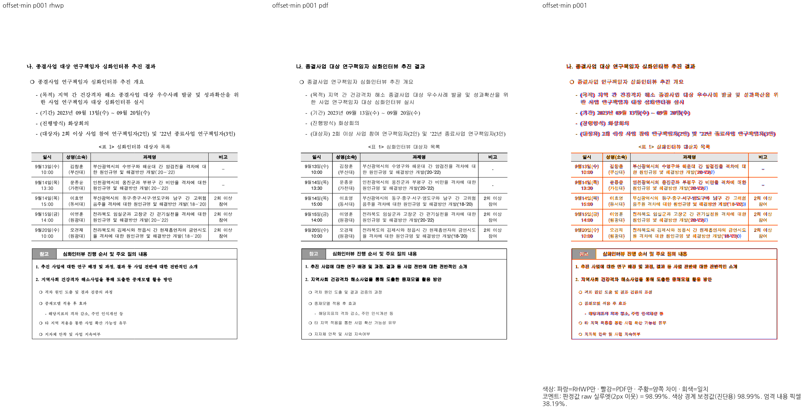 | 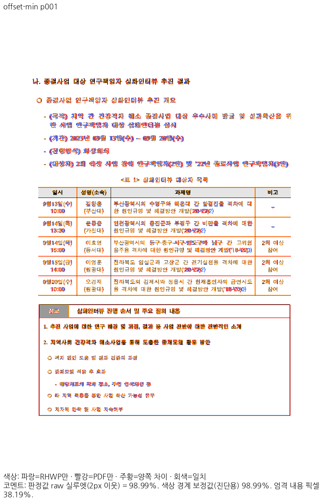 |
| fresh WASM | 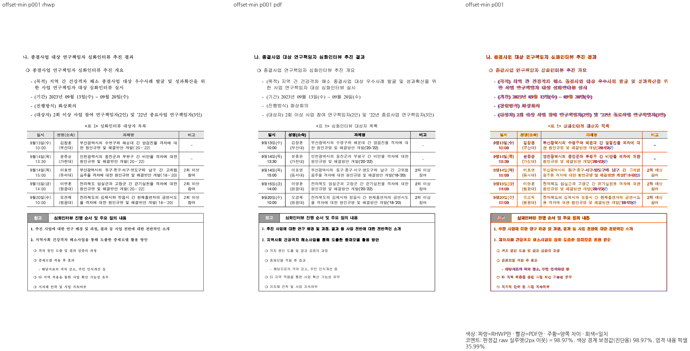 | 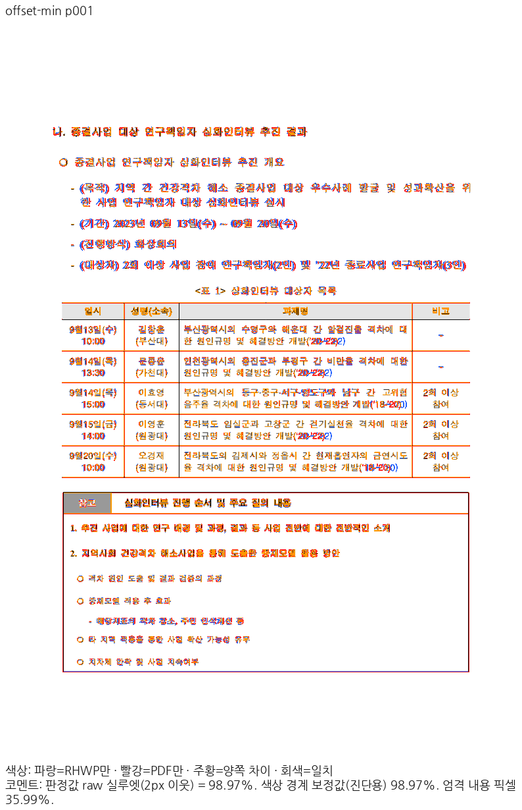 |

- 이 쪽 raw: Native 98.98711% / fresh WASM 98.97152%.

### `rowspan-header` · PDF p2 ↔ rhwp p2

- 입증 항목: 반복 제목행 rowspan과 본문 소유.
- 실행 원본: `samples/issue4599/1790387_rowspan_header_repeat.hwpx`.
- 독립 Print PDF: `pdf/1790387_rowspan_header_repeat-2020.pdf`.

| 출력 | review | overlay |
| --- | --- | --- |
| Native | 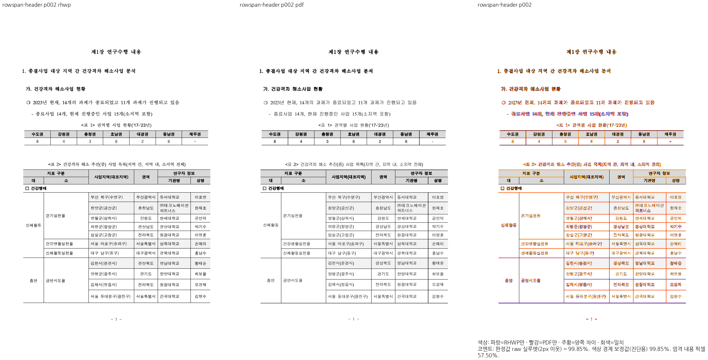 | 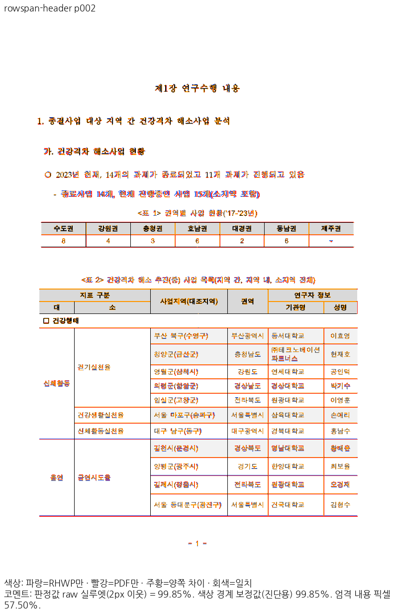 |
| fresh WASM | 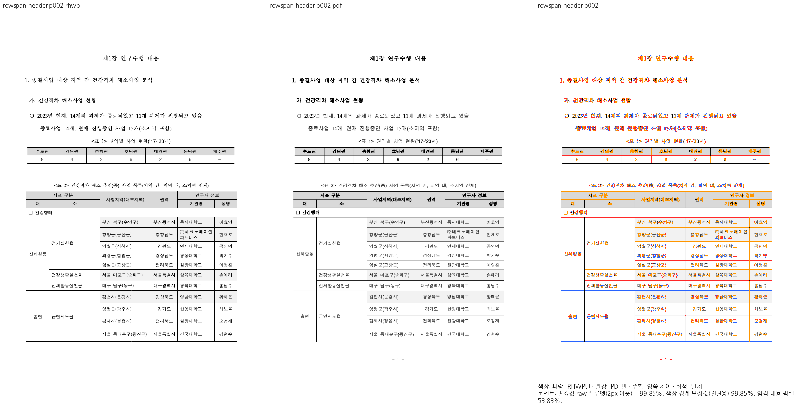 | 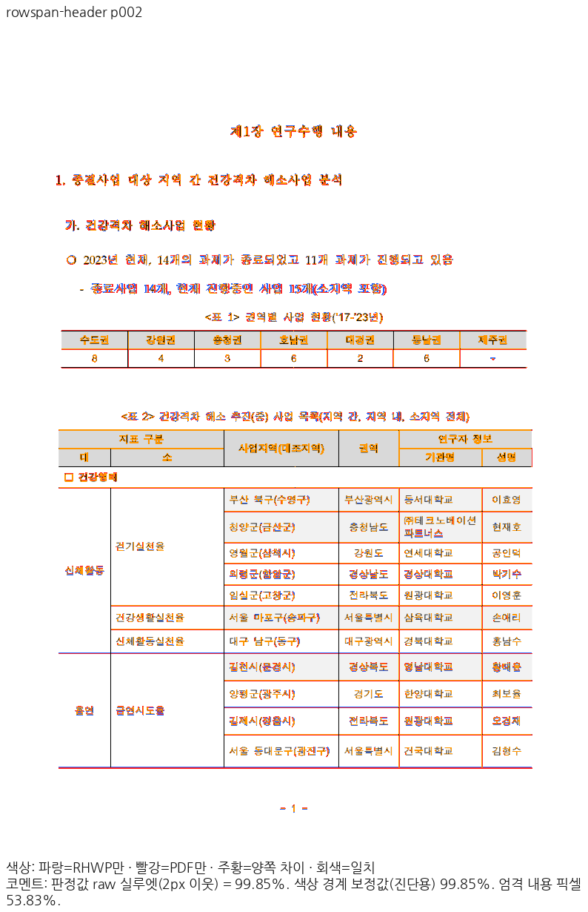 |

- 이 쪽 raw: Native 99.85414% / fresh WASM 99.85410%.

### `policy1790387-actual` · PDF p6 ↔ rhwp p6

- 입증 항목: 정책연구 원본의 반복 제목·표 본문 이어받기와 범례.
- 실행 원본: `samples/issue4599/1790387_policy_progress.hwpx`.
- 독립 Print PDF: `pdf/issue4599/1790387_policy_progress-hwpx-2020.pdf`.

| 출력 | review | overlay |
| --- | --- | --- |
| Native | 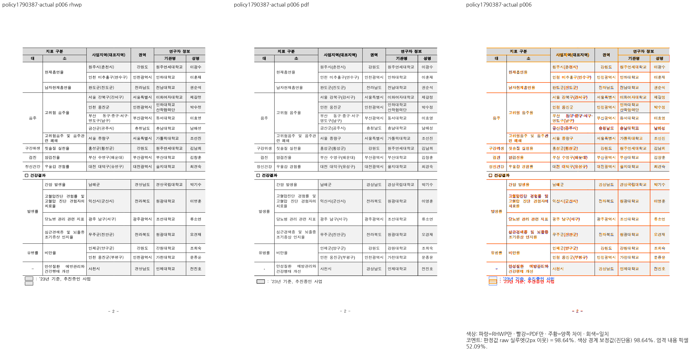 |  |
| fresh WASM | 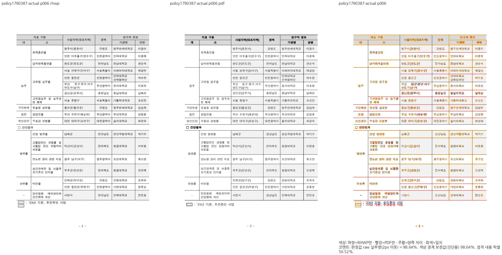 | 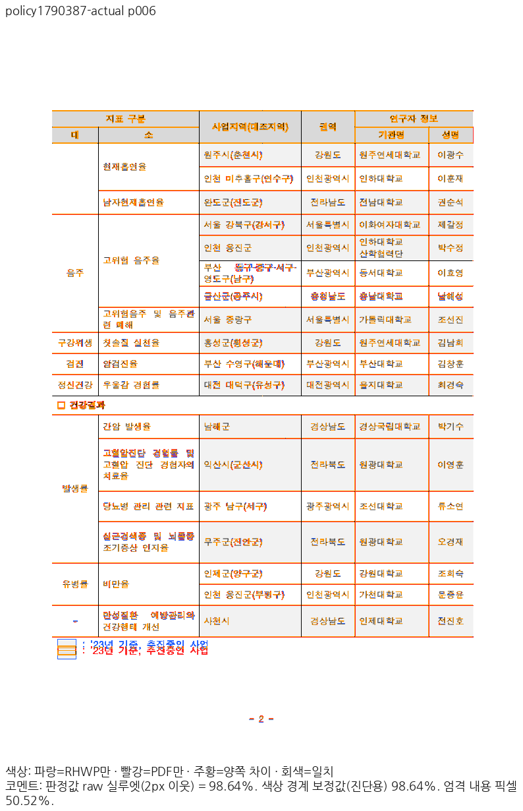 |

- 이 쪽 raw: Native 98.64286% / fresh WASM 98.64193%.

### `rowspan-header` · PDF p3 ↔ rhwp p3

- 입증 항목: 이어받기 조각에서 제목행 0·1 반복과 뒤 본문 보존.
- 실행 원본: `samples/issue4599/1790387_rowspan_header_repeat.hwpx`.
- 독립 Print PDF: `pdf/1790387_rowspan_header_repeat-2020.pdf`.

| 출력 | review | overlay |
| --- | --- | --- |
| Native |  |  |
| fresh WASM |  | 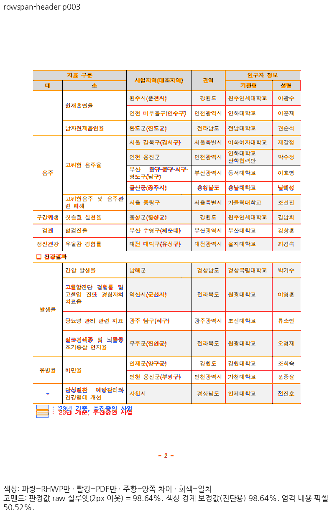 |

- 이 쪽 raw: Native 98.64286% / fresh WASM 98.64193%.

직접 판독: offset-min 첫 조각과 내용, rowspan-header2→3쪽의 제목행 반복·본문 이어받기를 확인했습니다. 원본 정책연구6쪽 범례의 작은 상자·기준선 raster 차이는 남으며 완전한 픽셀 일치로 표현하지 않습니다.

## 원격 검토와 후속 처리

통합 PR 생성 전 최신 devel/source head와 제출 바이트를 확인합니다. 게시 후 exact-head CI와 raw 이미지·TSV 다운로드 해시를 검증합니다. 통합이 실제 merge된 뒤에만 merge SHA를 연결해 원 PR의 완료 범위와 comment/close 여부를 처리합니다. 원 contributor의 기여·메인터너 보정·남은 차이를 구분하여 한국어 존댓말로 설명합니다.
