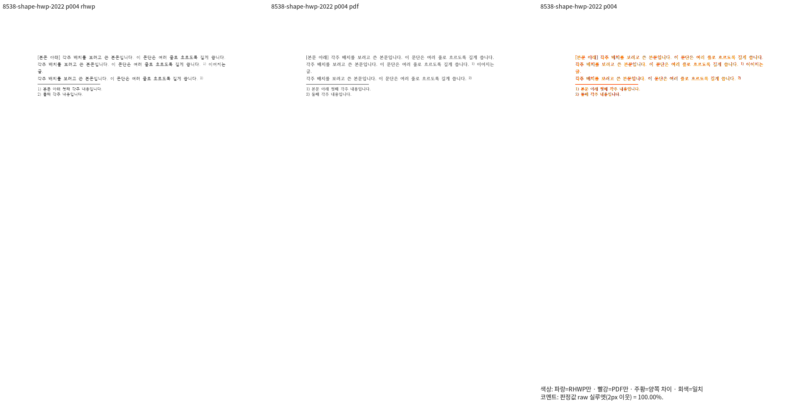
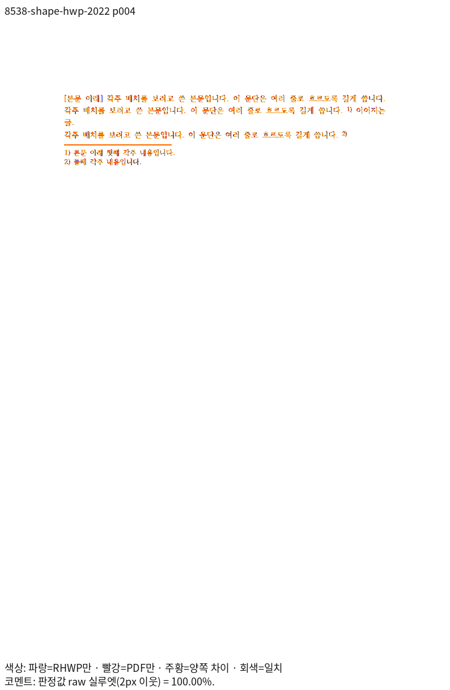
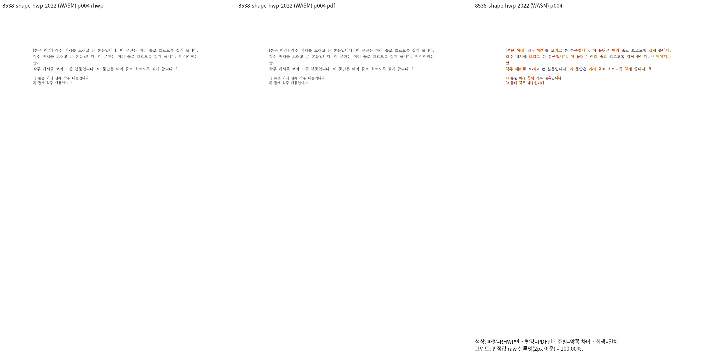
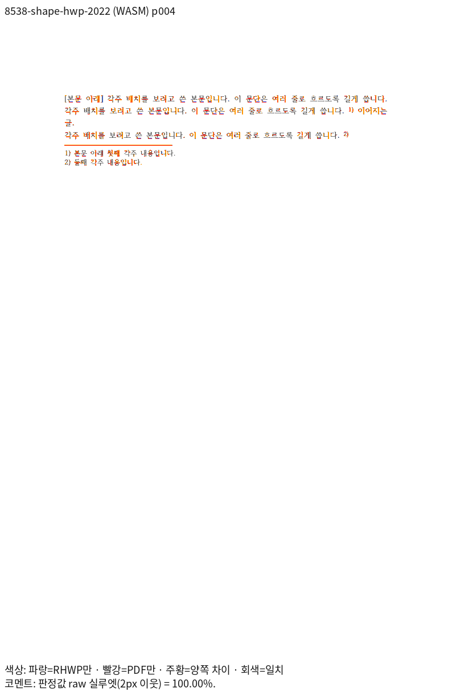
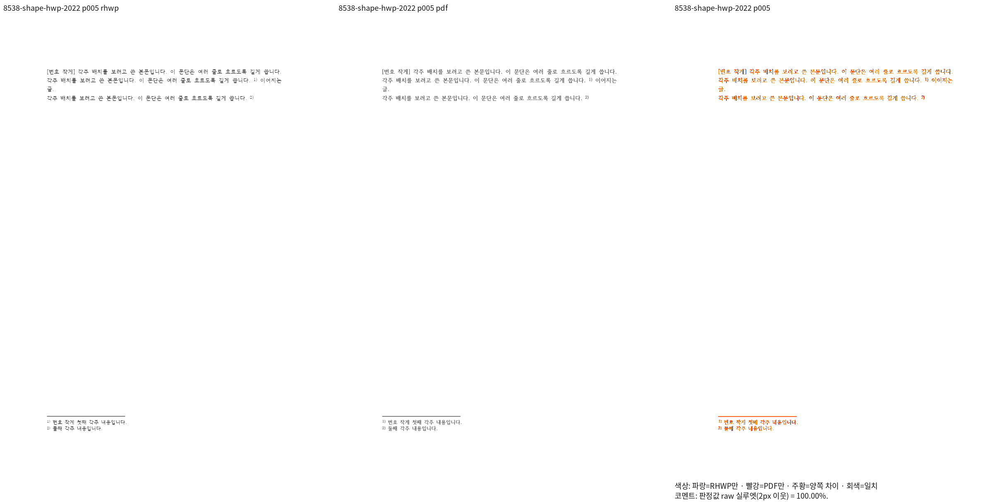
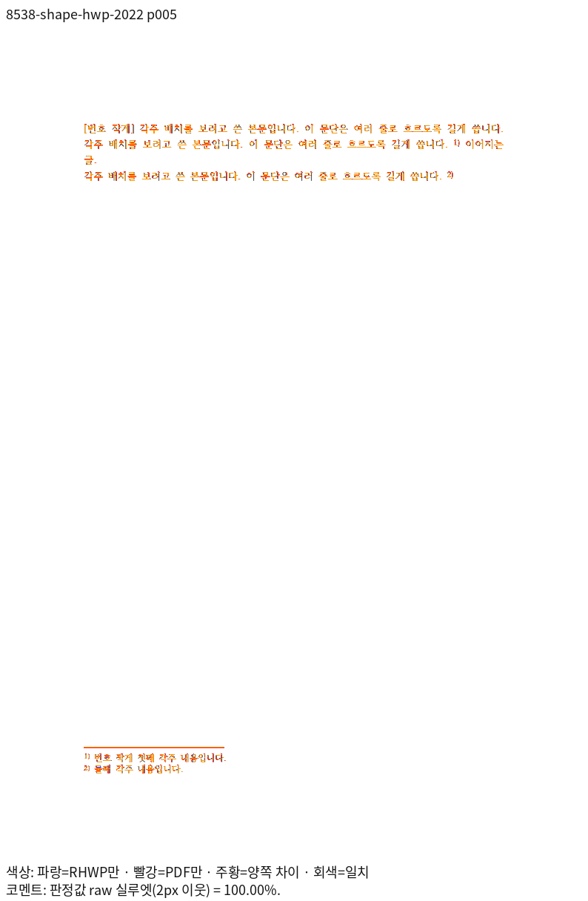
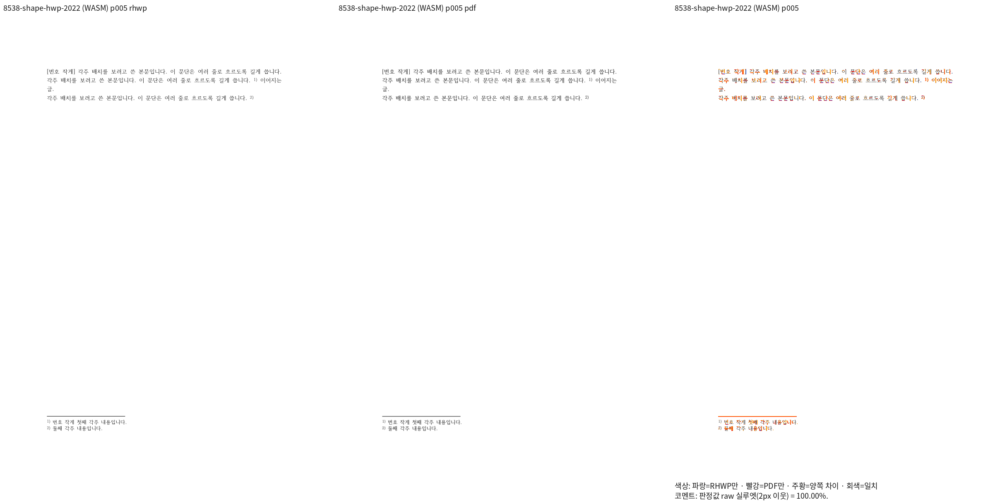
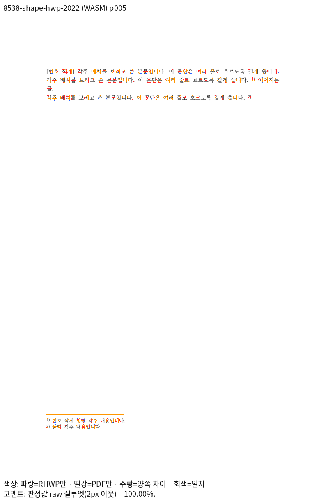

# PR #8538 리뷰 — fix(note): 각주 본문 아래·내용 번호 작게·구분선 종류를 한/글처럼 그린다

## 최종 판정

**메인터너 보정 후 수용 가능 — 원 PR 주장 범위의 로컬 검증 완료.**

원본별 Native/fresh WASM 전쪽 TSV와 같은 주장 페이지의 review·overlay를 아래에 연결했다. [통합 PR #8659](https://github.com/edwardkim/rhwp/pull/8659)의 정확한 code head CI가 성공했다. [통합 리뷰](pr_8659_review.md)에 실행 URL을 기록했으며, trailing head 확인·merge·원 PR close는 후속 조건이다.

## 접수 정보

- 원 PR: [PR #8538](https://github.com/edwardkim/rhwp/pull/8538), 작성자 `semanticist21`, reviewer `jangster77`.
- 원 head: `39669dd94237454610fb6ca522258836912396a6`. 2026-11-06 재조회에서 검토 시작 때와 같고 Open·Non-Draft다.
- 고정 base: `170b886f167b705b6e630c5b34bb638d92fae0a9`(PR #8542 포함).
- 현재 제품 source: Rust `86709ac16711820e61baa3b87e2c4ddaac23573e` · Studio `5feccb130e0f695de0046d994c060130fa3e928e`. 아래 표는 R6 새 Native·fresh WASM 실제 측정이다. R5 과거 증거는 출처를 구분해 보존한다.
- 통합 브랜치: `review/integration-20261105-semanticist21-open`.

## 원 주장과 실제 검증 범위

실행 트리거: 각주 본문 아래·작은 번호·구분선이 있는 원본 그리기.

독립 기대 동작: 본문 뒤 구분선의 위치, 작은 내용 번호와 선 모양 일치.

원본 열기·모델 저장 검사와 실제 편집·저장·한컴 Print 시각 증거를 구분한다. 보충 입력은 원 PR 원본을 검증한 것으로 표현하지 않는다.

## 체리픽과 메인터너 보정

| 원 commit | 170b 리베이스 후 적용 commit |
| --- | --- |
| `8a516f07240e5901561ebaa08849c6bf26d2422c` | `7cbcdee652a6b2cf181e42774f0f1d2bd1841341` |
| `39669dd94237454610fb6ca522258836912396a6` | `d5773d16bfface52e2be9a8c71b4216a75909cd0` |

공통 보정의 원인·소비 경로·리베이스 충돌 해소는 [통합 분석](../assets/semanticist21_20261105/integration-plan.md)에 기록했다.

## 검증 입력과 전쪽 결과

제품 R6의 실제 전체 페이지 측정이다. 두 출력 경로와 독립 Print PDF의 전체 쪽수가 일치하며,
모든 페이지가 90% 이상이다. 96 DPI·Print 프로필·색상 경계 보정 전 2px raw를 사용했다.

| 같은 원본·용도 | 전체 쪽수 | Native 최저 raw·TSV | fresh WASM 최저 raw·TSV | 독립 Print PDF |
| --- | ---: | --- | --- | --- |
| [shape.hwp](../../../tests/fixtures/footnote_drawing/shape.hwp) — 각주 본문 아래·작게·구분선 종류 | 7 | [92.35136%](../assets/semanticist21_20261105/validation-r6/tsv/8538-shape-hwp-2022-native.tsv) | [92.4024%](../assets/semanticist21_20261105/validation-r6/tsv/8538-shape-hwp-2022-wasm.tsv) | [PDF](../../../pdf/footnote_drawing/shape-hancom-mac-12.30.pdf) |
| [shape.hwpx](../../../tests/fixtures/footnote_drawing/shape.hwpx) — HWPX 각주 배치·작은 번호·구분선 | 7 | [92.35136%](../assets/semanticist21_20261105/validation-r6/tsv/8538-shape-hwpx-2022-native.tsv) | [92.4024%](../assets/semanticist21_20261105/validation-r6/tsv/8538-shape-hwpx-2022-wasm.tsv) | [PDF](../../../pdf/footnote_drawing/shape-hancom-mac-12.30.pdf) |

[원본·PDF SHA·producer·정밀 raw](../assets/semanticist21_20261105/validation-r6/measurements.md), [측정 명령·환경](../assets/semanticist21_20261105/validation-r6/README.md)를 연결한다. 원 PR 원본·실제 API 저장본·보충 대조군의 용도를 구분한다.

## 주장에 대응하는 페이지 증적

같은 원본·독립 PDF·페이지의 실제 PNG다. 직접 판독과 실제 API 검증을 구분한다. 일부 Native 패널은 현재 RHWP/PDF PNG 쌍의 SHA가 이전 판독 쌍과 각각 같음을 확인해 재사용했다.

### 8538-shape-hwp-2022 · 4쪽

본문 아래 각주 구분선과 작게 표시한 내용 번호

**native raw 100.0%** — 4쪽의 본문 바로 아래 구분선과 각주 두 줄, 5쪽 하단 작은 번호·각주 두 줄을 대조했다. 본문 개행·1) 2) 소속·선 시작·종료·각주 위치를 보존한다. raw 100%를 픽셀 바이트의 동일성으로 표현하지 않는다. 6쪽 review·overlay도 실제 열어 보통 크기 번호 1)·2), 각주 구분선·쪽 하단의 두 각주 행과 본문 네 행의 순서·소속을 Print와 대조했다. 이 기록은 Native 판독이며 fresh WASM 판독을 대신하지 않는다.

**wasm raw 100.0%** — 4쪽은 각주가 본문 마지막 줄 바로 아래에 있고, 5·6쪽은 작은 번호·보통 번호의 크기와 구분선 끝·본문 뒤 각주 내용 두 줄이 독립 Print와 대응한다.

### 8538-shape-hwp-2022 · 5쪽

본문 아래 각주 구분선과 작게 표시한 내용 번호

**native raw 100.0%** — 4쪽의 본문 바로 아래 구분선과 각주 두 줄, 5쪽 하단 작은 번호·각주 두 줄을 대조했다. 본문 개행·1) 2) 소속·선 시작·종료·각주 위치를 보존한다. raw 100%를 픽셀 바이트의 동일성으로 표현하지 않는다. 6쪽 review·overlay도 실제 열어 보통 크기 번호 1)·2), 각주 구분선·쪽 하단의 두 각주 행과 본문 네 행의 순서·소속을 Print와 대조했다. 이 기록은 Native 판독이며 fresh WASM 판독을 대신하지 않는다.

**wasm raw 100.0%** — 4쪽은 각주가 본문 마지막 줄 바로 아래에 있고, 5·6쪽은 작은 번호·보통 번호의 크기와 구분선 끝·본문 뒤 각주 내용 두 줄이 독립 Print와 대응한다.

## 회귀와 조판 원칙 준수

- [tests/cases/footnote_shape_drawing.rs](../../../tests/cases/footnote_shape_drawing.rs)

- 현재 전쪽 검증은 Native 128입력·301쪽 최저 91.81401%, fresh WASM 128입력·301쪽 최저 91.17272%다. 같은 새 base의 각 301쪽 대비 하락 0쪽이다. [현재 증거](../assets/semanticist21_20261105/validation-r6/README.md)를 연결한다.
- 실제 API 12그룹·브라우저 동작·TypeScript/production build·생성 타입 export와 소비 검사는 [API](../assets/semanticist21_20261105/validation-r6/api/README.md)·[UI](../assets/semanticist21_20261105/validation-r6/ui/README.md)에 연결했다. 원래 R5 전체 Rust 12,735건을 R6 새 실행으로 표현하지 않는다.
- 최소 공개 글꼴 5개에서 현재 전체 Rust 12,740건 PASS·기존 ignored 45건, 실제 목록 누락·중복 0이다. 최종 편람·lint·Skia·release·doctest도 완료했다.
- 실제 assertion을 확인해 관계형·고정형을 구분하고 27개 파일 첫머리를 실제 측정값으로 갱신했다. 원본 단위·비율 계약은 유지하며, [17개 완료 페이지](../assets/semanticist21_20261105/validation-r6/qualification.md)는 양쪽 98% 이상과 독립 확대 판독 근거로 기존 고정 좌표를 유지한다.
- 원래 웹폰트 수명 검사는 관련 충돌이 없어 재사용했으나, 최종 Studio 기호 공급 보정은 로딩 경로를 바꾸므로 로더 수명 14건과 실제 브라우저 7시나리오를 추가 실행해 모두 통과했다.

## Merge 후 contributor PR comment 계획

통합 PR의 실제 CI URL·code/trailing head와 확정 merge SHA를 기록한 뒤 원 PR에 한국어 존댓말로 결과를 게시한다. 기존 comment가 있으면 해당 comment를 수정하고 API로 다시 확인한다. 원 기여의 해결 범위와 위 공통 메인터너 보정을 구분한다.

- 실제 확인 페이지: 8538-shape-hwp-2022 p4/5.
- Native/fresh WASM의 위 같은 원본·쪽 review와 overlay를 사용한다. 수치와 직접 판독 결론·한계는 본문 관측을 그대로 반영한다.
- 대표 이미지 안정 경로: `mydocs/pr/assets/semanticist21_20261105/validation-r6/png/pr8538/<backend>/<key>/<review 또는 overlay>_NNN.png`. 같은 PR의 추가 완료 페이지는 [패널 목록](../assets/semanticist21_20261105/validation-r6/panels.md)을 따른다.
- URL은 `https://raw.githubusercontent.com/edwardkim/rhwp/<merge-commit-sha>/` 뒤에 위 실제 경로를 붙인다. devel 포함 확인 후 `--body-file` 게시·API 재조회한다.
- 문서 비교는 [Visual Sweep 정본](https://github.com/edwardkim/rhwp/blob/devel/mydocs/manual/verification/visual_sweep_guide.md#github-merge-comment)을 따른다. 원 PR·관련 이슈 close는 같은 해결 범위의 완료와 포함 관계를 확인한 뒤 처리한다.
