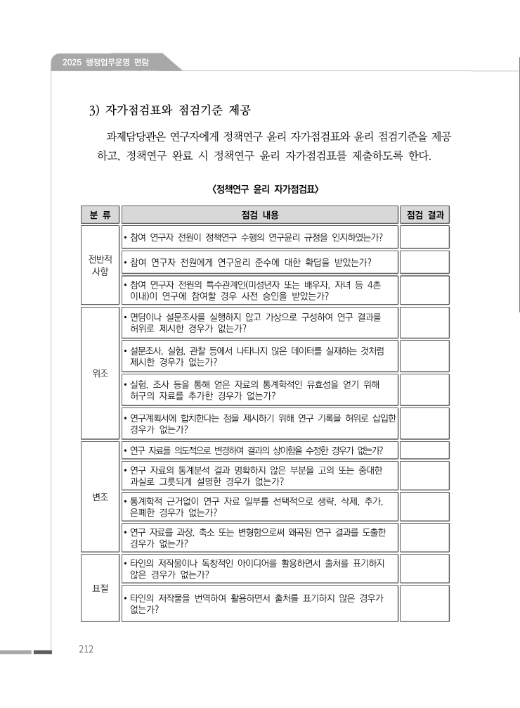
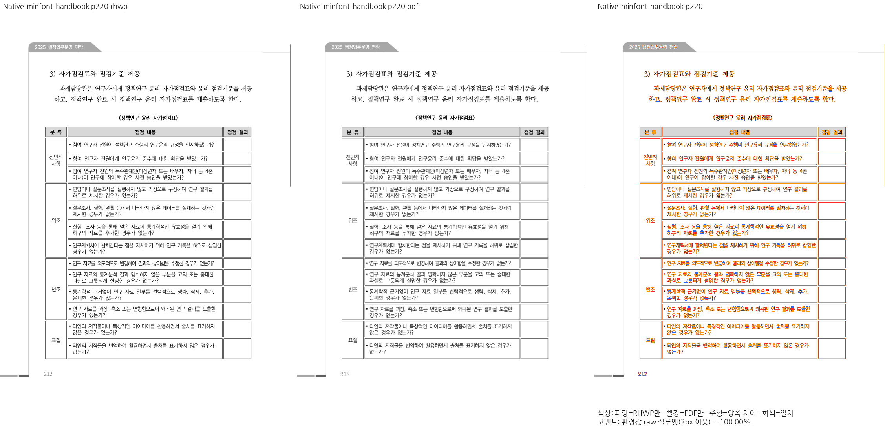
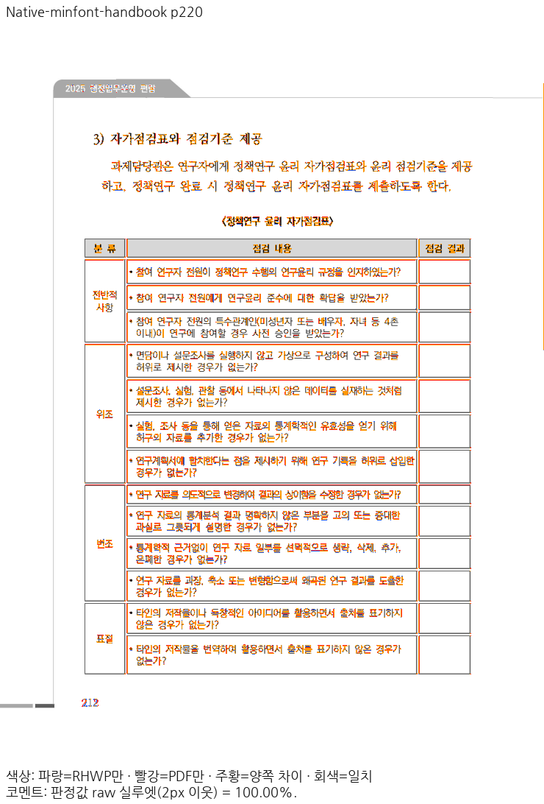
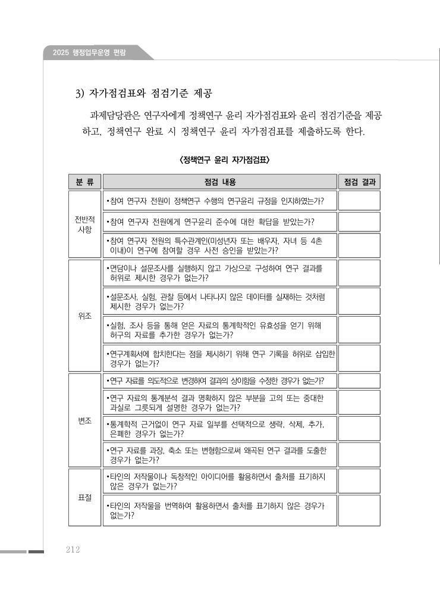
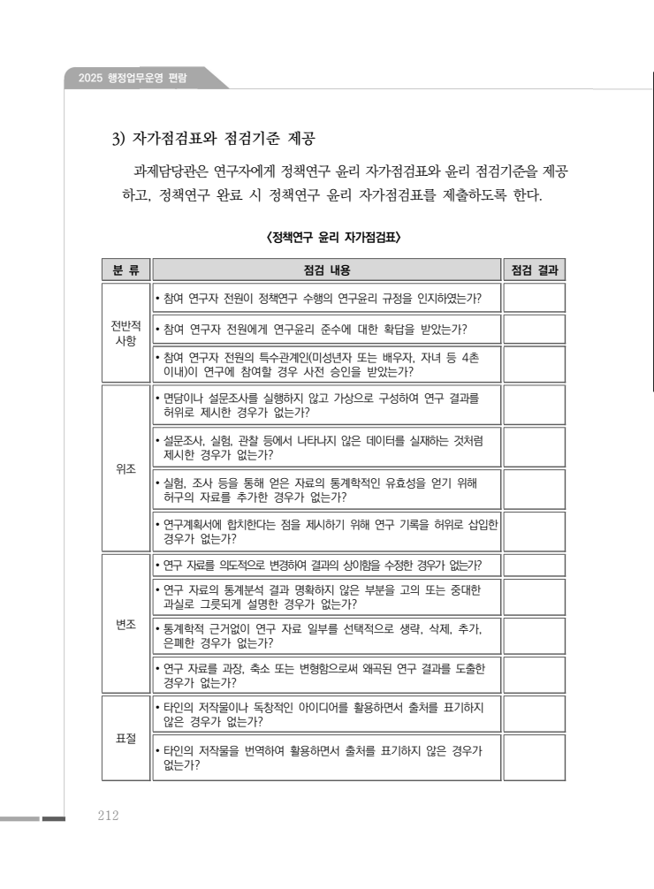
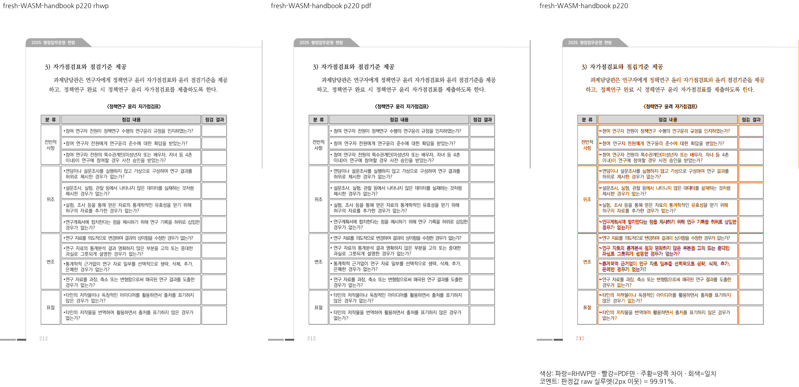
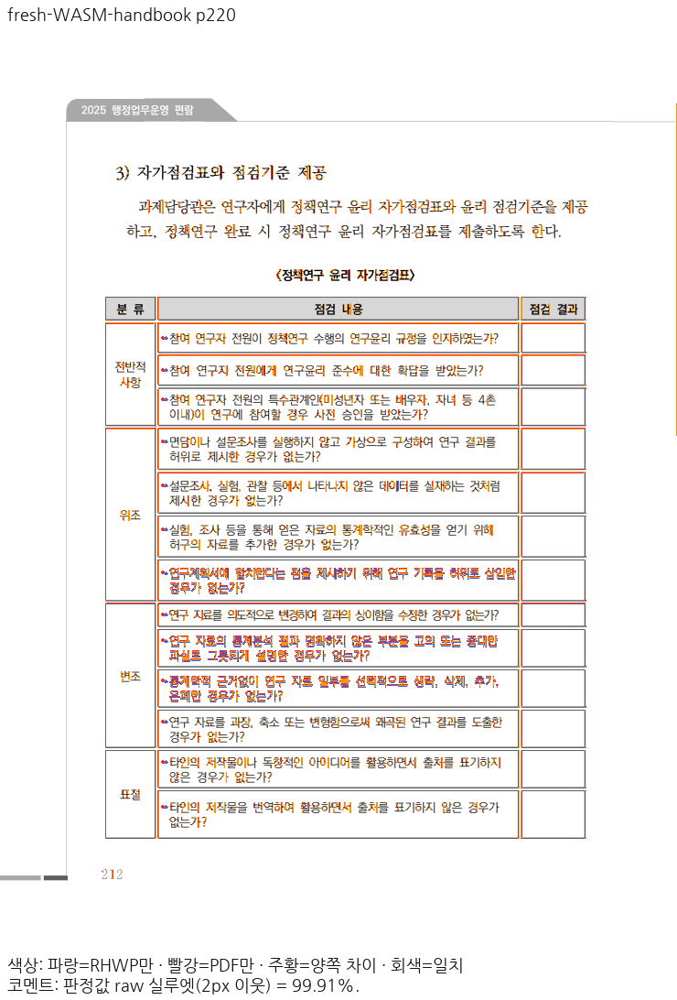

# PR #8565 리뷰 — Native 웹폰트 자동 공급과 편람 품질 보존

## 최종 판정

**승인 — Native 자동 공급과 편람 품질 보존의 검증을 완료했고 원 PR이 병합됐다.**
[원 PR #8565](https://github.com/edwardkim/rhwp/pull/8565)의 검토 code head는 `9deb5a9c1defd5ebf96d61996257cc6a75aeb1fc`,
병합 SHA는 `5551091085418c17d8321c0fee2626365911481b`다. 원 PR의 모든 CI와 `MERGEABLE / CLEAN`을 재확인하고
일반 squash merge를 수행했다. admin 또는 branch protection 우회는 사용하지 않았다.
이 기록은 옵션 2의 별도 기록 PR로 반영하며, 그 PR의 실제 preflight·required check를 별도로 확인한다.

## 접수 정보와 검토 범위

- 작성자 `jangster77`의 collaborator self-review이며 reviewer를 자동 지정하지 않았다.
- base `7d06d5c706f1d89f1662e739abf2b1b25d2a98e4`. 제품 producer `c031a38a41670f5e4f6ab0268ef46c62ab1445f5`,
  검증 호스트 `3ededa625581f4a4a052ef912dc30c0317fec0ed`, 최종 code head·병합 SHA를 구분한다.
- [#8533](https://github.com/edwardkim/rhwp/issues/8533)의 Native 글꼴 자동 공급과 편람 전쪽 검사를
  해결한다. 기존 종료 [#8153](https://github.com/edwardkim/rhwp/issues/8153)을 재종료하거나
  #7445 전체 잔여를 해결한 것으로 기록하지 않는다.
- base route: `collaborator_self_merge.md`.
- modifiers: `intake_and_review.md`, `review_template.md`, `local_validation.md`,
  `visual_fixture_evidence.md`, `review_only_fast_pass.md`, `rework_and_exceptions.md`, `post_merge.md`.
- loaded documents: 위 문서와 `pr_review_workflow.md`, `pr_review/README.md`, `AGENTS.md`,
  `CLAUDE.md`, 문서·Git·GitHub 운영 절차, Visual Sweep·실제 backend 검증 정본.
- 검토 기록 시각: 2026-11-04 12:17:44 KST.

## 조판 원칙 준수 검토

일반 Native PNG·SVG·PDF의 첫 조판 전 공통 `apply_font_environment`가 설치·내장 프로그램을 우선하고
없는 글꼴을 공개 공급 원장으로 보완한다. 측정의 원본 TTF/HFT 소유와 paint의 표시 대체를 구분해,
원본에 없는 기호의 전진을 표시 프로그램 폭으로 덮지 않는다. 실제 문서 지정 HFT 프로그램은 그
문장부호를 소유한다. 문서명·쪽 번호별 보정이 아니며 원본 메트릭과 실제 배치의 소비를 대조했다.

다운로드는 등록 URL·고정 revision/해시, 15초 timeout, redirect 거절, 32MiB 입력·해제·SFNT 제한을
확인한다. 캐시의 원본/Native hash·크기·face 파싱을 검증하며 미지원·공급 실패·일반 표시 대체를
원본 공급 성공과 구분한다. WOFF/WOFF2·TTC도 기존 paint 공급 예산에서 선별한다.
WASM 페이지 자원 조회는 실제 paint 요구를 읽으며 기존 64MiB guard를 올리지 않았다.
실제 PostScript name ID 6·legacy family·프로그램 바이트를 보존하고 명시 환경을 Canvas 측정 전에 준비한다.

관계형·프로그램 소유 검사와 실제 Native/fresh WASM 출력을 함께 확인했다. 기관명 5쪽의 독립
Print 원점·폭 ±2px 검사는 Native 98.91953%·WASM 99.37969%인 완료 페이지에 한정한다.
같은 문서의 최저 3쪽 91.74074%를 고정 px 근거로 쓰지 않는다. 분할·이어받기 알고리즘 자체는
변경하지 않았고 기존 분할 표·쪽 경계 입력을 전쪽 대조로 보호했다.

## 입력·실행과 코드 동일성

[입력/독립 Print PDF](../assets/issue8533/final-native-webfonts/input-index.md), [Git blob 감사](../assets/issue8533/final-native-webfonts/input-commit-audit.json):
37문서·74역할·실제 70파일이 검토 commit의 regular Git blob과 바이트가 같으며 LFS 포인터가 아니다.
[검증 실행·source 동일성](../assets/issue8533/final-native-webfonts/gate-results.md)에 실제 명령·exit·생산 신원을 연결했다.
제품·검사·프로그램 자원·Studio 제품 Git object는 producer와 최종 code head에서 같다.
마지막 두 수정은 CI 공간 정리와 작업 기록뿐이며 원 PR head와 squash 병합 tree도 동일했다.
글꼴 바이너리·임시 실행기·중간 로그는 제출하지 않았다.

- 로컬 workspace release-test 전체: 12,424 PASS / 0 FAIL / 45 skip, 테스트 581.283초.
- fmt·Native/WASM/all-target Clippy·workspace/release build·manifest/unit tier PASS.
- 로컬 Native Skia root 3,857 PASS·12 ignored, 다른 lib 248 PASS; 직접 PDF 22 PASS,
  placeholder 2 PASS, 독립 source frame 1 PASS, missing picture 2 PASS.
- release lib root 3,801 PASS·12 ignored, 다른 lib 182 PASS; doctest 8 PASS·3 ignored.
- Studio TypeScript PASS·Node 2,717 PASS·2 skip; 최신 Sweep Python 240 PASS·공급/원본 Node 34 PASS.
- 원장 검사는 봉인 v1과 실제 18개 change set을 독립 재생해 기대 집합을 도출한다.
  생성 suite drift는 source 집합 보존·실제 재컴파일 수집으로 정정했다. 이전 실제 실행의 12,424개
  함수와 수집 집합이 같으며 검사 제거·허용치 완화로 실패를 숨기지 않았다.

## 정확한 code head의 GitHub CI

모든 행의 head는 `9deb5a9c1defd5ebf96d61996257cc6a75aeb1fc`다. A–E 아카이브의 실제 합계는 12,239 PASS·45 skip이다.
CI의 root 패키지 아카이브와 로컬 workspace 전체 12,424 PASS를 같은 집합으로 주장하지 않는다.

| workflow | 실제 실행 | 결과 |
| --- | --- | --- |
| CI | [41762511260](https://github.com/edwardkim/rhwp/actions/runs/41762511260) | success |
| CodeQL | [41762511193](https://github.com/edwardkim/rhwp/actions/runs/41762511193) | success |
| Render Diff | [41762511110](https://github.com/edwardkim/rhwp/actions/runs/41762511110) | success |
| Adapter inter-diff | [41762511161](https://github.com/edwardkim/rhwp/actions/runs/41762511161) | success |
| Proptest roundtrip | [41762511244](https://github.com/edwardkim/rhwp/actions/runs/41762511244) | success |
| CI Impact Policy Controller | [41762508368](https://github.com/edwardkim/rhwp/actions/runs/41762508368) | success |

프런트엔드와 Render Diff는 이전 실행에서 디스크 부족으로 실패했다. 두 job에 기존 Native/archive와
같은 30GB 기준의 미사용 Android·.NET 도구 정리를 추가했고, 최종 head에서 모두 다시 성공했다.
시각 문턱·검사 명령·권한은 유지했다. actionlint, 관련 workflow 계약 83건, 실제 shell의 모의 공간
분기 합계 8건도 통과했다. [보정 기록](../../working/task_m100_8533_stage4.md)을 따른다.
실제 workflow 변경을 포함하므로 원 PR에 기록-only trailing commit을 넣지 않고 옵션 2로 분리했다.

## 전쪽 시각 검증과 직접 판독

[전체 TSV 원본](../assets/issue8533/final-native-webfonts/tsv-index.md), [정밀 raw·PNG hash](../assets/issue8533/final-native-webfonts/page-results.tsv),
[현재 환경별 생산 신원](../assets/issue8533/final-native-webfonts/current-host-verification.json), [파일 hash](../assets/issue8533/final-native-webfonts/sha256.md)을 보존했다.
같은 PDFium·96 DPI·Print·저장 세대 호환·2px 실루엣·색상 문턱 32 조건으로 대조했다.
일반 지침 2%p보다 엄격한 사용자 0.1%p 기준을 적용했으며 이를 넘는 하락·90% 미달은 없다.

| 범위 | 전체 쪽수 | 실제 판정 |
| --- | ---: | --- |
| Native 편람 설치/파일 접근 차단 | 각각 383 | 382쪽 표시 100%, 물리 130쪽 99.96%; raw 최저99.96463/99.96465% |
| #8438·#8517 Native 보존 | 36문서 1,201 | 같은 환경의 원 PR 재출력과 PNG 모두 동일 |
| 현재 호스트 일반 WASM | 원 36문서 1,201 + 편람 383 | base/후보 PNG 1,584쪽 모두 동일; 원 36문서 최저 91.74074%, 편람 99.68453%·198쪽 |
| Native 공개 프로그램 명시 추가 WASM | 383 | 최저 94.37243%·220쪽, 미달 0쪽; 272쪽 100% |

raw의 소수 둘째 자리 표시 100%, raw 자체 100%, RGB 픽셀 완전 동일은 서로 다르다.
일반 WASM의 순수 base 35문서와 읽기 전용 page-resource 조회만 더한 사양서 base 1문서를 구분했다.
순수 base의 상한 실패를 보존했으며 같은 호스트의 순수/관측 대조 3쪽도 PNG가 같았다.
추가 명시 환경 220쪽은 Canvas가 portable 6.666667px 대신 12.930099px 전진을 소비하는 간격
차이가 남는다. 이를 Native 완료 결과·일반 WASM 자동 다운로드·깨끗한 최소 설치 VM과 합치지 않는다.

### 편람 물리 220쪽 ↔ 인쇄 212쪽

Native 100%, 일반 fresh WASM 99.91442%다. 글머리표·표·본문의 소유·순서·줄바꿈을 직접 확인했다.

| 출력 | RHWP raw | PDF raw | review | overlay |
| --- | --- | --- | --- | --- |
| native |  |  |  |  |
| wasm |  |  |  |  |

기관명 5쪽·언어 슬롯 2쪽·분할 표 4쪽·사양서 20/21쪽·chart 42쪽·편람 130/198/220/272쪽의 실제
raw/review/overlay와 판독은 [PNG 목록](../assets/issue8533/final-native-webfonts/png-index.md)에 연결했다. 기존 글리프·얇은 선
차이와 새 코드 회귀를 구분했다. 추가 명시 WASM 220쪽의 간격 잔여도 별도 이미지로 공개했다.

[실제 소비 경로](../assets/issue8533/final-native-webfonts/consumer-evidence.md): 일반 Native 전 383쪽 단일 export와 온라인/오프라인
집중 4쪽 PNG 동일, SVG Chrome·두 PDF backend 272쪽을 확인했다. Studio Canvas2D 4사례와 지원
software CK 1대조군을 구분하며 CK 요청 fallback 4건을 CK 통과로 세지 않았다. Root pkg·Studio
public·실제 초기화 응답의 WASM hash 및 URL 변환을 되돌린 JS hash를 대조했다.
Mac fresh WASM은 locked no-opt 로컬 대체 빌드이며 Docker 최적화 통과로 기록하지 않는다.

## 병합 후 상태와 옵션 2

원 PR은 2026-11-04 12:13:59 KST에 위 merge SHA로 병합됐다. [#8533](https://github.com/edwardkim/rhwp/issues/8533)은
devel 이슈 처리 workflow가 12:14:11 KST에 닫았다. 원 PR head와 병합 tree의 동일성을 확인했고
기본 devel을 fast-forward했다. 병합 뒤 검증 CI를 수동 실행하지 않았다.

[duration 갱신](https://github.com/edwardkim/rhwp/actions/runs/41765821395)은 성공했다.
`ready=true / successful-pr-worker-measurements`, source run `41762511260`, head
`9deb5a9c1defd5ebf96d61996257cc6a75aeb1fc`, tested merge `0f5e5fe5d20856111312bac07e0d8235ff56cbae`와
B/C/D/E 실제 attempt 1·artifact 4개를 검증해 46개 target을 갱신했다. metrics branch commit은
`34cd7ca05391b929f9df695bea7a959e3b713be4`다. 검증 CI를 병합 뒤 재실행한 결과가 아니다.

이 문서와 오늘할일은 최신 devel의 별도 기록 PR로 반영한다. 그 PR의 실제 preflight·required check와
mergeability를 확인한 뒤 병합한다. 원 코드·test·workflow·asset을 다시 포함하지 않는다.

## Merge 후 contributor PR comment 계획

기록 PR 병합과 최종 devel 동기화 뒤 원 PR에 한국어 존댓말로 한 번 게시한다. 원 PR의 실제
merge SHA `5551091085418c17d8321c0fee2626365911481b`로 고정한 편람 물리 220쪽의 Native/fresh WASM raw·PDF·review·overlay를
첫 comment에 함께 넣고, 전쪽 결과와 추가 명시 WASM 220쪽의 간격 잔여를 같은 범위로 적는다.
[Visual Sweep 정본](../../manual/verification/visual_sweep_guide.md#github-merge-comment)과 이 review를
연결하며 이미지 응답의 실제 hash·형식을 확인한다. UTF-8 body-file로 게시하고 API 본문을 다시 확인한다.
#8533은 이미 CLOSED이므로 재종료하지 않고 실제 해결 결과와 증거만 한 번 기록한다. 기존 #8153과
#7445 전체에는 종료·댓글을 반복하지 않는다.

그 뒤 [post_merge.md](../../manual/pr_review/post_merge.md)의 안전 조건에 따라 이번 작업 전용
branch/worktree, 루트 output 전체, target/pr-review/debug를 정리한다. 기본 작업공간·원본·PDF·글꼴·
다른 worktree와 release/release-test/wasm32 profile은 보존하고 외부 정리 로그에서 잔여·확보 공간을 확인한다.
