# PR #8605 리뷰 — fix(render): WASM Canvas 합성 굵기를 실제 face 윤곽의 fill+stroke로 그린다 (#8430)

## 최종 판정

**메인터너 보정 후 수용 가능 — 원 기여와 추가 보정을 포함한 통합 code head의 주장 범위를 검증했습니다. 원 contributor head의 직접 병합을 승인하는 판정은 아닙니다.**

원 PR head와 메인터너 보정을 포함한 통합 code head를 구분합니다. 원격 통합 PR의 최신 head CI·충돌 여부는 게시 뒤 별도로 확인하고, 원 PR은 통합 병합을 확인한 뒤 종료합니다.

## 최종 source와 재사용 범위

제출 code head `2e262d0d4b2885b130e2db917b86e894710425e4`, base `e00f9b7e26e581896fa17eaff3c8eb3f4889f9d4`입니다. 아래 전체 회귀·전쪽 수치는 원 실측 HEAD의 증거를 재사용한 기록입니다. 최신 집중 검사와 페이지별 producer, 엄격 0.1%p 잔여 한 건은 [재사용·최종 판정](../assets/planet6897_20261106/final-b768bee1-20261109/validation-reuse.md)을 따릅니다. 보호 TSV 표시값 하락은 0입니다.

## 접수 정보

- 원 PR: [#8605](https://github.com/edwardkim/rhwp/pull/8605), 작성자 `planet6897`, reviewer `jangster77`.
- 원 head: `5d37286267136c9978d7ac2f804913730ab6becf`. 마지막 실시간 확인과 상태는 [조회 기록](../assets/planet6897_20261106/final-b768bee1-20261109/original-pr-heads.json)을 따릅니다.
- 통합 base: `b768bee1c4c0023087687f79a0a95f12108743e9`, 검증 code head: `eb876d1416fb558c874f9efec65c5722a6769751`.
- 브랜치: `review/integration-20261106-planet6897-open`. 원격 제출·CI·병합은 아직 하지 않았습니다.

## 변경과 검토 범위

fix(render): WASM Canvas 합성 굵기를 실제 face 윤곽의 fill+stroke로 그린다 (#8430)

[이 PR의 구현·메인터너 보정 계획](pr_8605_review_impl.md) · [통합 범위와 적용 순서](../assets/planet6897_20261106/integration-plan.md) · [원본→실제 적용 커밋](../assets/planet6897_20261106/contributor-commit-map-final.tsv).

## 검증 입력과 결과

code head `eb876d1416fb558c874f9efec65c5722a6769751`의 최소 글꼴 환경 기본 전체 회귀는 **13,105 PASS / 0 FAIL / 45 skipped**, 실행 570.421초입니다. Native 전쪽은 **94조건·2,995쪽**, 최저 **92.24%**, 90% 미만·쪽수 불일치·누락은 0입니다. 보호 TSV 1,771쪽의 공식 두 자리 표시값 하락은 0입니다. 이는 전체 범위의 요약이며 각 PR 주장은 아래 해당 입력·페이지로 대조합니다.

Native HWPX 편람 최소 글꼴/공개 웹폰트 383쪽 gate도 통과했습니다. 공식 두 자리 표시값은 130쪽 99.96%, 나머지 382쪽 100.00%입니다. 이는 보정 전 2px 내용 실루엣 값이며 엄격 RGB 동일성을 뜻하지 않습니다.

일반 base 대비 하락 허용폭은 이번 통합에 사용자가 지정한 **0.1%p**를 유지합니다. 별도 정본 보호 TSV의 공식 두 자리 표시값은 하락을 허용하지 않습니다. 최신 base `b768bee1`와 리베이스 전 후보를 같은 입력·PDF·글꼴·DPI·호환 버전으로 전쪽 대조했습니다. [Native 비교](../assets/planet6897_20261106/final-b768bee1-20261109/comparisons/latest-base-native-comparison.tsv) · [fresh WASM 비교](../assets/planet6897_20261106/final-b768bee1-20261109/comparisons/latest-base-wasm-comparison.tsv). 완료 쪽의98% 미만 후퇴·일반2%p 초과 하락은 없습니다. 엄격0.1%p 비교의 Native 뒤배경 표4쪽 잔여0.14171%p는 사용자 지시에 따라 신규 이슈로 분리하며 무회귀로 표기하지 않습니다.

## 시각 증적과 남은 차이

fresh WASM도 **94조건·2,995쪽**, 최저 **92.29%**, 90% 미만·누락·쪽수 불일치 0이며 보호 1,771쪽의 공식 표시값 하락은 0입니다. 추가 Native 전용 11개 모듈은 **73 PASS / 0 FAIL**입니다. 기본 전체 회귀의 45 skipped와 선택 밖 검사는 구분합니다.

### childcare

- 입력: [samples/issue8423/30396-childcare-leave-recommendation.hwp](../../../samples/issue8423/30396-childcare-leave-recommendation.hwp)
- 독립 Print: [pdf/issue8423/30396-childcare-leave-recommendation-2022.pdf](../../../pdf/issue8423/30396-childcare-leave-recommendation-2022.pdf)
- 전체 25쪽 Native 최저 98.72%. [TSV](../assets/planet6897_20261106/final-b768bee1-20261109/cases/childcare/native.tsv) · [입력/PDF·producer 해시](../assets/planet6897_20261106/final-b768bee1-20261109/cases/childcare/provenance.json).
- 전체 25쪽 fresh WASM 최저 98.74%. [TSV](../assets/planet6897_20261106/final-b768bee1-20261109/cases/childcare/wasm.tsv).

1쪽 Native **99.98%**: [raw](../assets/planet6897_20261106/final-b768bee1-20261109/cases/childcare/native/raw-001.png) · [PDF raw](../assets/planet6897_20261106/final-b768bee1-20261109/cases/childcare/native/pdf-001.png) · [review](../assets/planet6897_20261106/final-b768bee1-20261109/cases/childcare/native/review-001.png) · [overlay](../assets/planet6897_20261106/final-b768bee1-20261109/cases/childcare/native/overlay-001.png)

1쪽 fresh WASM **99.98%**: [raw](../assets/planet6897_20261106/final-b768bee1-20261109/cases/childcare/wasm/raw-001.png) · [PDF raw](../assets/planet6897_20261106/final-b768bee1-20261109/cases/childcare/wasm/pdf-001.png) · [review](../assets/planet6897_20261106/final-b768bee1-20261109/cases/childcare/wasm/review-001.png) · [overlay](../assets/planet6897_20261106/final-b768bee1-20261109/cases/childcare/wasm/overlay-001.png)

국민권익위원회 의결 제목과 의안번호·의안명·대상기관·의결일, 주문·이유의 상하 순서를 독립 Print와 대조했다. 본문 줄 소속과 권고안 문구가 보존되며 작은 글리프 윤곽 차이는 남는다.

| 경로 | raw | review | overlay |
| --- | --- | --- | --- |
| Native | 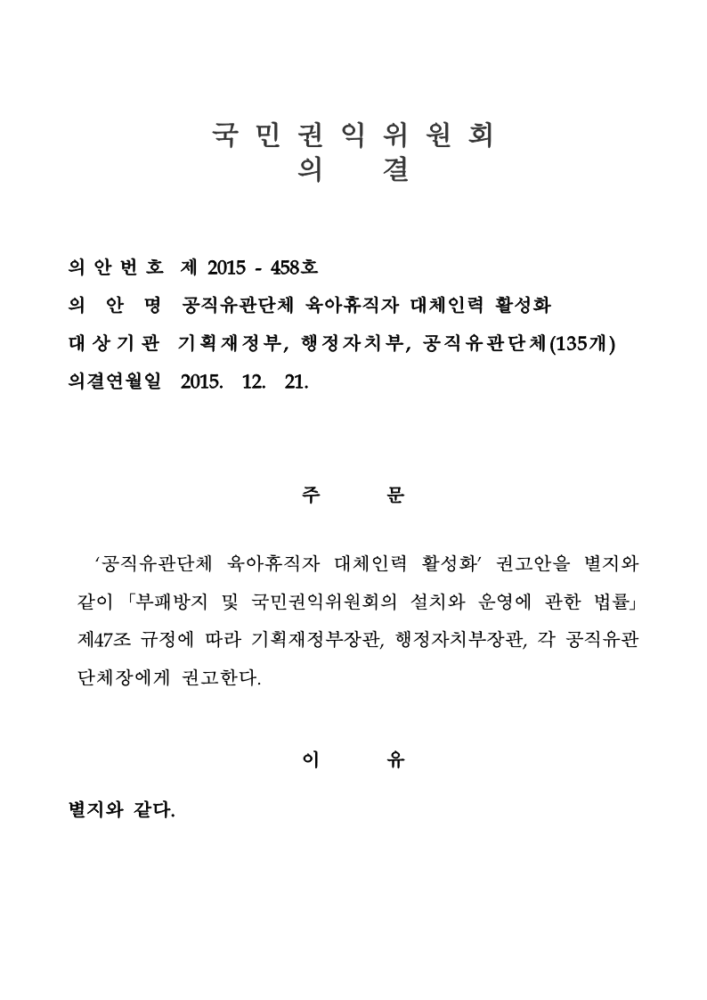 | 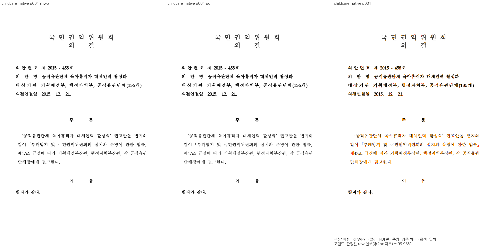 | 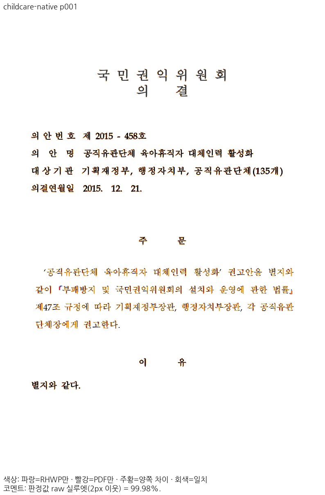 |
| fresh WASM | 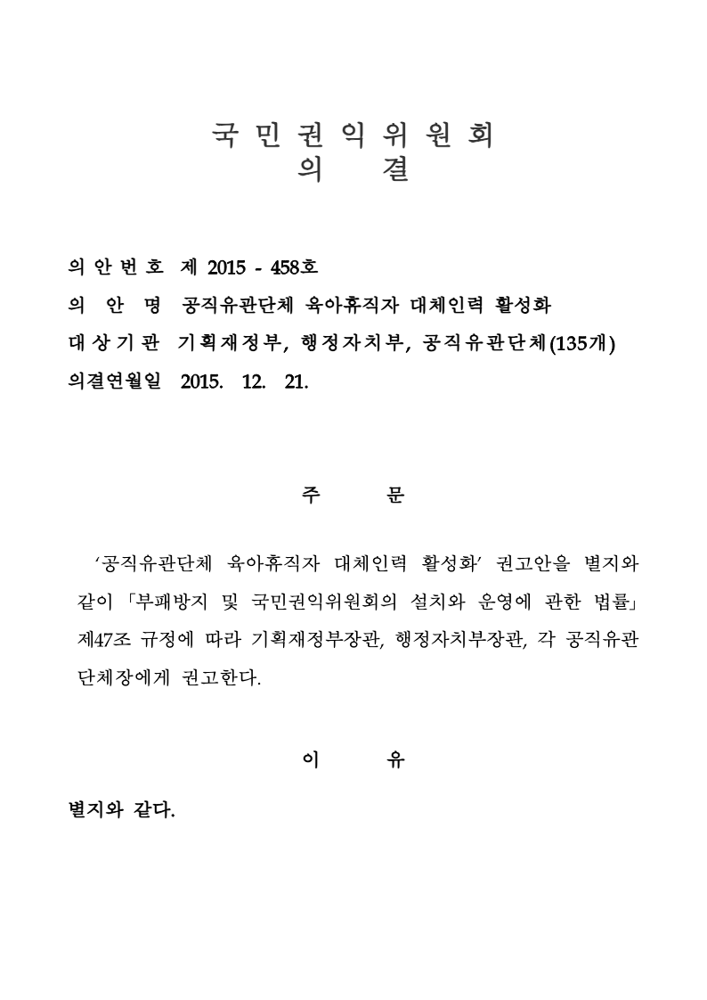 | 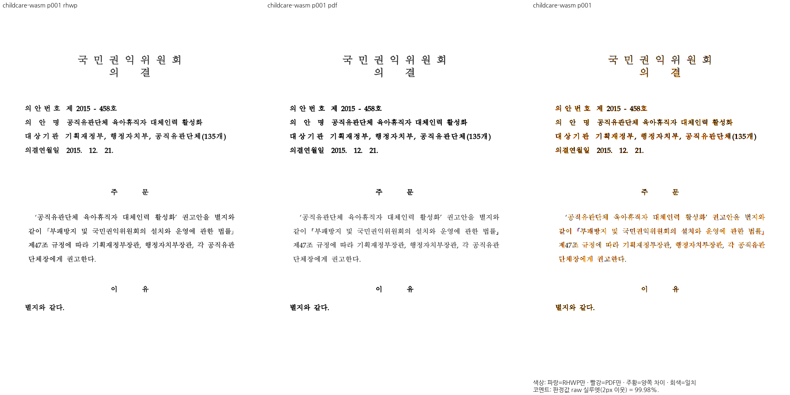 | 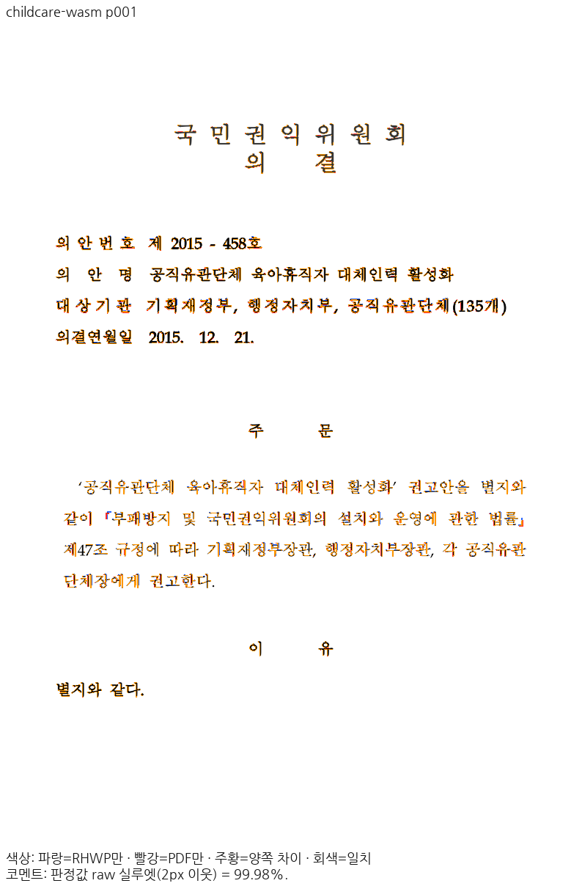 |

국민권익위원회 의결 표지의 제목·의안번호·의안명·대상기관·의결일, 주문·이유의 순서와 여백이 보존된다.

18쪽 Native **99.99%**: [raw](../assets/planet6897_20261106/final-b768bee1-20261109/cases/childcare/native/raw-018.png) · [PDF raw](../assets/planet6897_20261106/final-b768bee1-20261109/cases/childcare/native/pdf-018.png) · [review](../assets/planet6897_20261106/final-b768bee1-20261109/cases/childcare/native/review-018.png) · [overlay](../assets/planet6897_20261106/final-b768bee1-20261109/cases/childcare/native/overlay-018.png)

18쪽 fresh WASM **99.99%**: [raw](../assets/planet6897_20261106/final-b768bee1-20261109/cases/childcare/wasm/raw-018.png) · [PDF raw](../assets/planet6897_20261106/final-b768bee1-20261109/cases/childcare/wasm/pdf-018.png) · [review](../assets/planet6897_20261106/final-b768bee1-20261109/cases/childcare/wasm/review-018.png) · [overlay](../assets/planet6897_20261106/final-b768bee1-20261109/cases/childcare/wasm/overlay-018.png)

일자리 정보 연계 제목·본문과 알리오/개별기관/워크넷/지방공기업 클린아이 도식·화살표 및 마지막 빈 공간을 대조했다. 도식의 색과 소속은 보존되고 외곽 점선·글리프의 미세 래스터 차이가 남는다.

| 경로 | raw | review | overlay |
| --- | --- | --- | --- |
| Native | 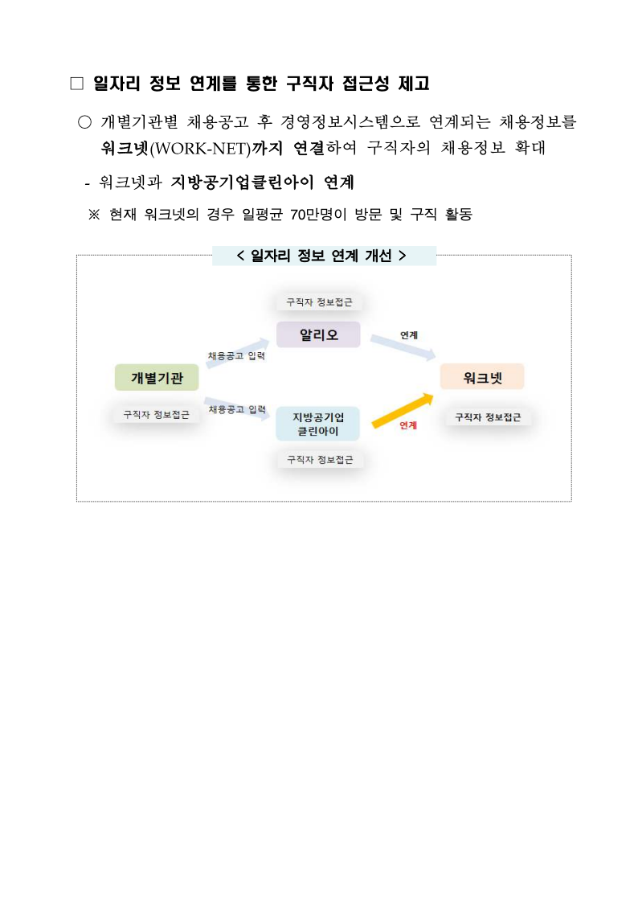 | 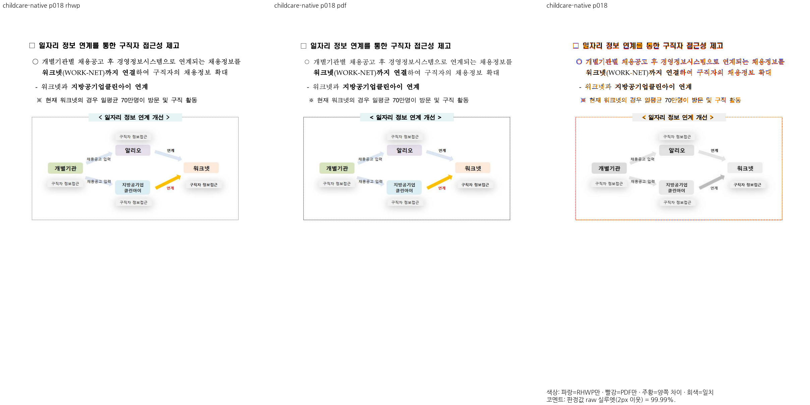 | 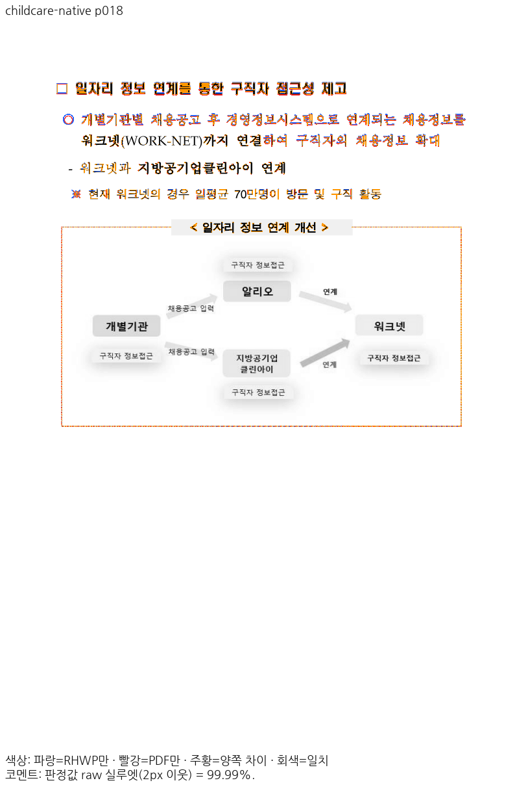 |
| fresh WASM | 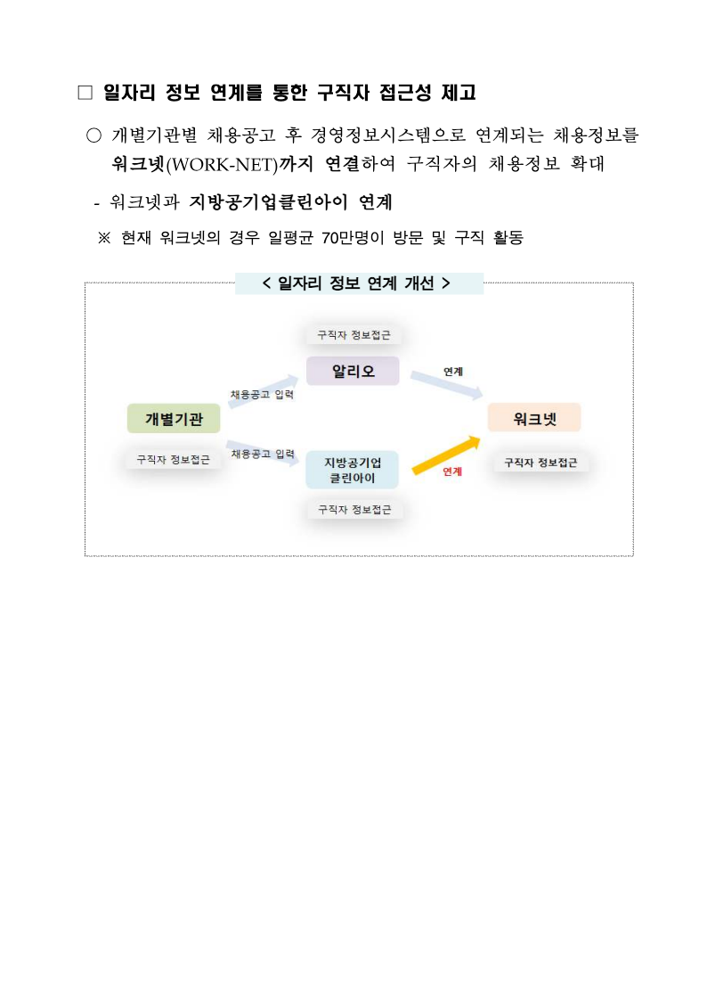 | 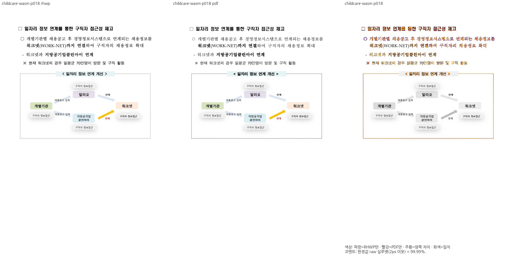 | 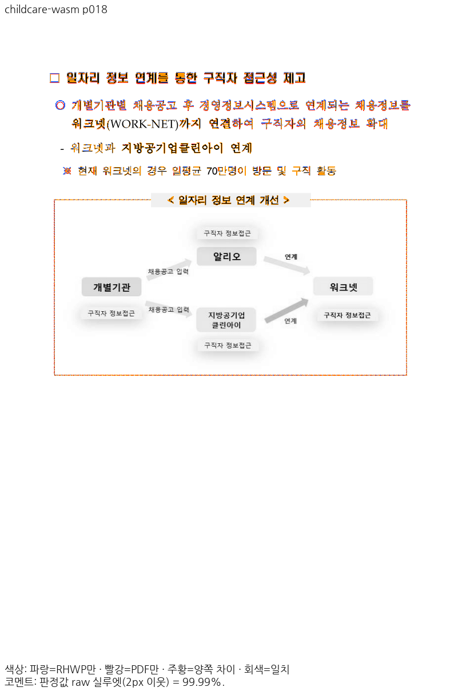 |

일자리 정보 연계 제목·설명과 도식의 개별기관/알리오/지방공기업 클린아이/워크넷·화살표가 모두 같은 프레임 안에 배치된다. 점선과 이미지 필터 잔차는 남는다.

## 최종 제출과 원격 조건

기존 전쪽 TSV·직접 판독을 유지하고 리베이스 후 영향 2조건 8쪽과 앞선 HWP3 3조건 10쪽과 필수 집중·lint를 추가 검증했습니다. 엄격0.1%p 비교 잔여1건은 새 이슈로 분리하며 완전 무회귀로 표기하지 않습니다. 원격 게시 직전에 원 PR head·upstream/devel·제출 diff와 병합 시뮬레이션을 재확인합니다. 통합 PR의 실제 CI 성공과 최종 head의 mergeability를 확인한 뒤 승인된 병합·후속처리를 수행합니다.

## Merge 후 contributor PR comment 계획

통합 병합이 완료되면 최종 merge SHA·CI URL과 이 PR이 주장한 입력/페이지의 raw 이미지를 고정 SHA 링크로 연결합니다. 원 기여와 메인터너 보정 이유·범위를 한국어 존댓말로 구분하며, 별도 검증하지 않은 문제까지 해결했다고 쓰지 않습니다. 원 PR의 종료는 통합 병합 후 실제 해결 범위를 확인하여 처리합니다.
