# PR #8611 리뷰 — fix(renderer): Native 경로 글꼴을 매핑으로 공유해 64MiB 넘는 파일도 싣기 (#8597)

## 최종 판정

**메인터너 보정 후 수용 가능 — 원 기여와 추가 보정을 포함한 통합 code head의 주장 범위를 검증했습니다. 원 contributor head의 직접 병합을 승인하는 판정은 아닙니다.**

원 PR head와 메인터너 보정을 포함한 통합 code head를 구분합니다. 위 exact code head의 필수 CI를 확인했습니다. 문서 trailing head의 실제 검사·충돌 여부를 다시 확인하며, 원 PR은 통합 병합을 확인한 뒤 종료합니다.

## 최종 source와 재사용 범위

제출 code head `2e262d0d4b2885b130e2db917b86e894710425e4`, base `e00f9b7e26e581896fa17eaff3c8eb3f4889f9d4`입니다. 아래 전체 회귀·전쪽 수치는 원 실측 HEAD의 증거를 재사용한 기록입니다. 최신 집중 검사와 페이지별 producer, 엄격 0.1%p 잔여 한 건은 [재사용·최종 판정](../assets/planet6897_20261106/final-b768bee1-20261109/validation-reuse.md)을 따릅니다. 보호 TSV 표시값 하락은 0입니다.

## 통합 PR의 exact code head CI

- [통합 PR #8857](https://github.com/edwardkim/rhwp/pull/8857), code head `29c74b69851bc6578f10a2c78e23592a05b69a5d`.
- [CI 실행](https://github.com/edwardkim/rhwp/actions/runs/42621490405)과 같은 code head의 CodeQL·Render Diff·Adapter·Proptest·정책 검사를 실제 확인했습니다. 기록 확인 시각: `2026-11-09T22:58:24.689803+09:00`.
- 기본 기능 worker A–E의 실제 nextest는 **12,934 PASS / 0 FAIL / 45 skip**입니다. 기존 로컬 13,105건과 실행 범위·HEAD가 다르므로 합산하지 않습니다.
- source·test·workflow를 추가로 변경하지 않고 이 검토·오늘할일만 단일 부모 trailing commit으로 보완합니다. trailing head의 실제 CI/fast-pass와 mergeability는 push 뒤 별도로 확인하며, 문서만 바뀌었다는 이유로 통과를 미리 가정하지 않습니다.
- [잔여 이슈 #8856](https://github.com/edwardkim/rhwp/issues/8856)은 9문서군의 글리프·간격·도형 및 clip5587 Native 4쪽의 엄격 0.1%p 미충족을 계속 추적합니다. 부분 해결 #8635·#8636과 부모 #7445는 일괄 종료하지 않습니다.

## 접수 정보

- 원 PR: [#8611](https://github.com/edwardkim/rhwp/pull/8611), 작성자 `planet6897`, reviewer `jangster77`.
- 원 head: `0cbe6a9ae5ee4ef8d994d21c170682f95f4bf236`. 마지막 실시간 확인과 상태는 [조회 기록](../assets/planet6897_20261106/final-b768bee1-20261109/original-pr-heads.json)을 따릅니다.
- 통합 base: `b768bee1c4c0023087687f79a0a95f12108743e9`, 검증 code head: `eb876d1416fb558c874f9efec65c5722a6769751`.
- 브랜치: `review/integration-20261106-planet6897-open`. 통합 PR #8857을 제출했고 위 code head CI를 완료했습니다. 최종 trailing head 검사·병합·원 PR 후속 종료는 별도로 확인합니다.

## 변경과 검토 범위

fix(renderer): Native 경로 글꼴을 매핑으로 공유해 64MiB 넘는 파일도 싣기 (#8597)

[이 PR의 구현·메인터너 보정 계획](pr_8611_review_impl.md) · [통합 범위와 적용 순서](../assets/planet6897_20261106/integration-plan.md) · [원본→실제 적용 커밋](../assets/planet6897_20261106/contributor-commit-map-final.tsv).

## 검증 입력과 결과

code head `eb876d1416fb558c874f9efec65c5722a6769751`의 최소 글꼴 환경 기본 전체 회귀는 **13,105 PASS / 0 FAIL / 45 skipped**, 실행 570.421초입니다. Native 전쪽은 **94조건·2,995쪽**, 최저 **92.24%**, 90% 미만·쪽수 불일치·누락은 0입니다. 보호 TSV 1,771쪽의 공식 두 자리 표시값 하락은 0입니다. 이는 전체 범위의 요약이며 각 PR 주장은 아래 해당 입력·페이지로 대조합니다.

Native HWPX 편람 최소 글꼴/공개 웹폰트 383쪽 gate도 통과했습니다. 공식 두 자리 표시값은 130쪽 99.96%, 나머지 382쪽 100.00%입니다. 이는 보정 전 2px 내용 실루엣 값이며 엄격 RGB 동일성을 뜻하지 않습니다.

일반 base 대비 하락 허용폭은 이번 통합에 사용자가 지정한 **0.1%p**를 유지합니다. 별도 정본 보호 TSV의 공식 두 자리 표시값은 하락을 허용하지 않습니다. 최신 base `b768bee1`와 리베이스 전 후보를 같은 입력·PDF·글꼴·DPI·호환 버전으로 전쪽 대조했습니다. [Native 비교](../assets/planet6897_20261106/final-b768bee1-20261109/comparisons/latest-base-native-comparison.tsv) · [fresh WASM 비교](../assets/planet6897_20261106/final-b768bee1-20261109/comparisons/latest-base-wasm-comparison.tsv). 완료 쪽의98% 미만 후퇴·일반2%p 초과 하락은 없습니다. 엄격0.1%p 비교의 Native 뒤배경 표4쪽 잔여0.14171%p는 사용자 지시에 따라 신규 이슈로 분리하며 무회귀로 표기하지 않습니다.

관련 회귀 source: [tests/cases/issue_8597_invalid_font_name_host_fallback.rs](../../../tests/cases/issue_8597_invalid_font_name_host_fallback.rs) · [tests/cases/issue_8597_native_font_path_budget.rs](../../../tests/cases/issue_8597_native_font_path_budget.rs)

## 시각 증적과 남은 차이

fresh WASM도 **94조건·2,995쪽**, 최저 **92.29%**, 90% 미만·누락·쪽수 불일치 0이며 보호 1,771쪽의 공식 표시값 하락은 0입니다. 추가 Native 전용 11개 모듈은 **73 PASS / 0 FAIL**입니다. 기본 전체 회귀의 45 skipped와 선택 밖 검사는 구분합니다.

### shortcut

- 입력: [samples/basic/shortcut.hwp](../../../samples/basic/shortcut.hwp)
- 독립 Print: [pdf/basic/shortcut-hwp-2020.pdf](../../../pdf/basic/shortcut-hwp-2020.pdf)
- 전체 7쪽 Native 최저 97.12%. [TSV](../assets/planet6897_20261106/final-b768bee1-20261109/cases/shortcut/native.tsv) · [입력/PDF·producer 해시](../assets/planet6897_20261106/final-b768bee1-20261109/cases/shortcut/provenance.json).
- 전체 7쪽 fresh WASM 최저 97.10%. [TSV](../assets/planet6897_20261106/final-b768bee1-20261109/cases/shortcut/wasm.tsv).

7쪽 Native **99.99%**: [raw](../assets/planet6897_20261106/final-b768bee1-20261109/cases/shortcut/native/raw-007.png) · [PDF raw](../assets/planet6897_20261106/final-b768bee1-20261109/cases/shortcut/native/pdf-007.png) · [review](../assets/planet6897_20261106/final-b768bee1-20261109/cases/shortcut/native/review-007.png) · [overlay](../assets/planet6897_20261106/final-b768bee1-20261109/cases/shortcut/native/overlay-007.png)

7쪽 fresh WASM **99.97%**: [raw](../assets/planet6897_20261106/final-b768bee1-20261109/cases/shortcut/wasm/raw-007.png) · [PDF raw](../assets/planet6897_20261106/final-b768bee1-20261109/cases/shortcut/wasm/pdf-007.png) · [review](../assets/planet6897_20261106/final-b768bee1-20261109/cases/shortcut/wasm/review-007.png) · [overlay](../assets/planet6897_20261106/final-b768bee1-20261109/cases/shortcut/wasm/overlay-007.png)

단축키7쪽의 좌우 항목·키 대응, 중앙 기타 회색띠·하단 큰7과 각 열의 점선 구분자를 확인했다. 점선/윤곽 래스터 잔차를 제외하면 내용 순서·칸 소속이 유지된다.

| 경로 | raw | review | overlay |
| --- | --- | --- | --- |
| Native | 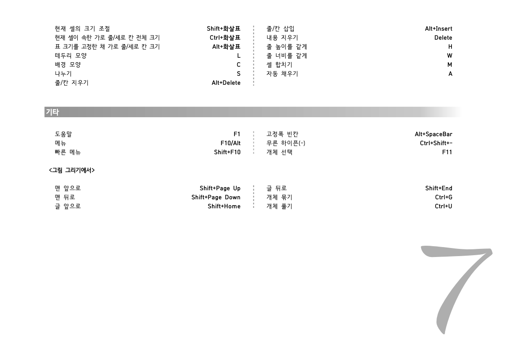 | 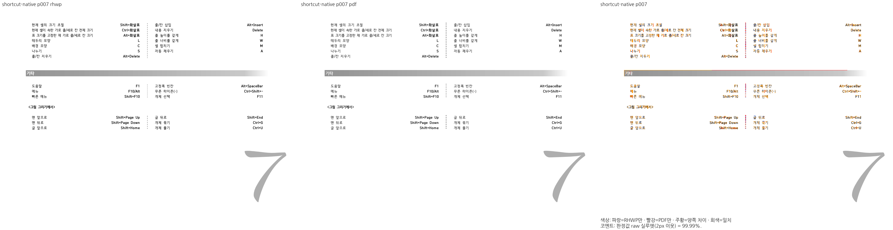 |  |
| fresh WASM | 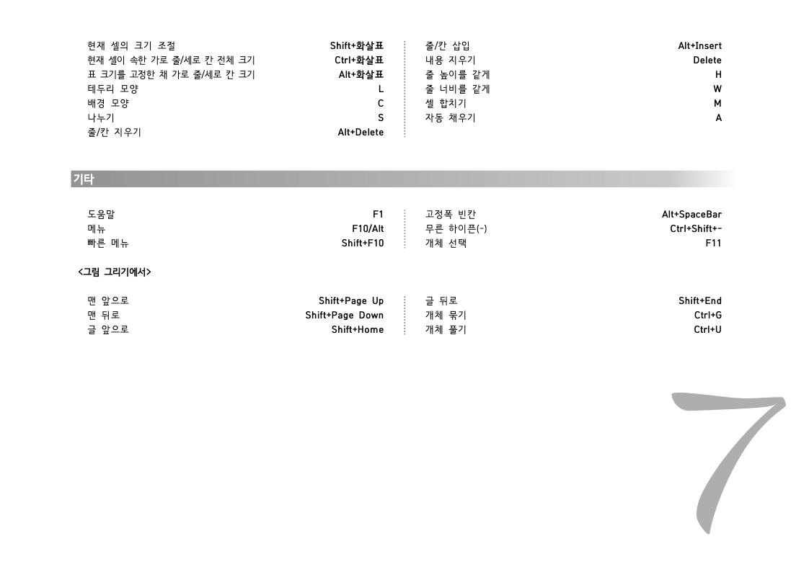 |  | 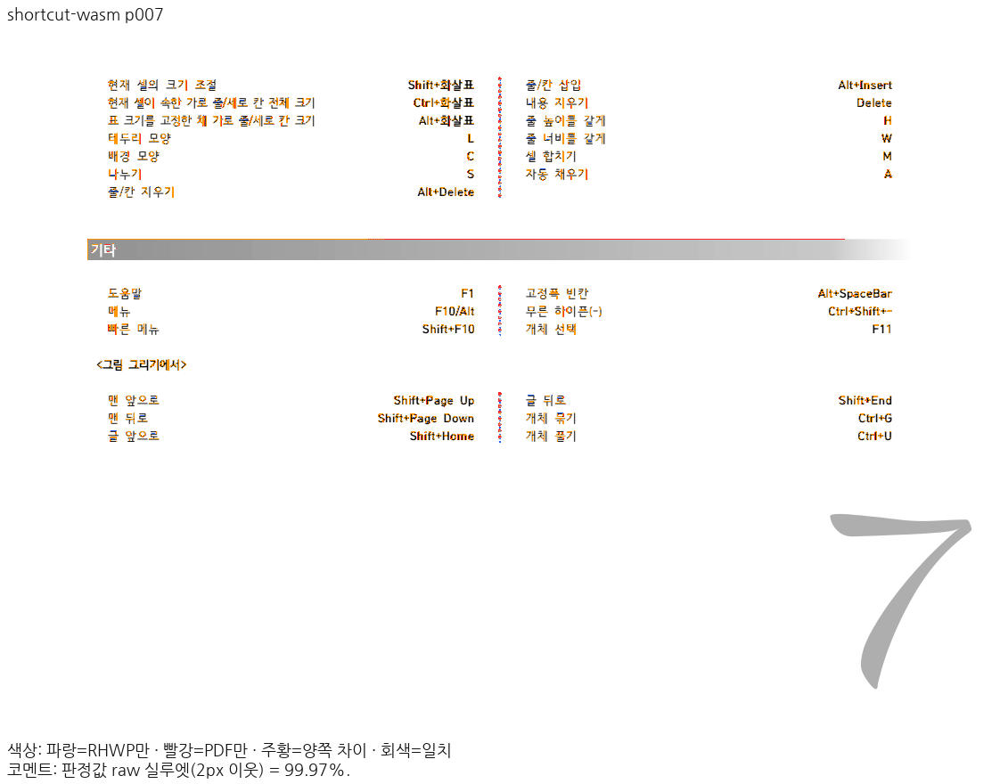 |

상단 기능/단축키의 두 묶음과 점선, 기타 밴드, 아래 그림 그리기 기능과 오른쪽 큰7 장식을 독립 Print와 대조했다. 각 기능에 대응하는 단축키·줄 소속을 보존하며 경로 글꼴 준비 실패로 텍스트나 마지막 쪽이 비지 않는다. 그라데이션/점선의 미세 래스터 차이는 남는다.

### sungeo

- 입력: [samples/basic/sungeo.hwp](../../../samples/basic/sungeo.hwp)
- 독립 Print: [pdf/basic/sungeo-hwp-2020.pdf](../../../pdf/basic/sungeo-hwp-2020.pdf)
- 전체 94쪽 Native 최저 99.99%. [TSV](../assets/planet6897_20261106/final-b768bee1-20261109/cases/sungeo/native.tsv) · [입력/PDF·producer 해시](../assets/planet6897_20261106/final-b768bee1-20261109/cases/sungeo/provenance.json).
- 전체 94쪽 fresh WASM 최저 100.00%. [TSV](../assets/planet6897_20261106/final-b768bee1-20261109/cases/sungeo/wasm.tsv).

1쪽 Native **100.00%**: [raw](../assets/planet6897_20261106/final-b768bee1-20261109/cases/sungeo/native/raw-001.png) · [PDF raw](../assets/planet6897_20261106/final-b768bee1-20261109/cases/sungeo/native/pdf-001.png) · [review](../assets/planet6897_20261106/final-b768bee1-20261109/cases/sungeo/native/review-001.png) · [overlay](../assets/planet6897_20261106/final-b768bee1-20261109/cases/sungeo/native/overlay-001.png)

1쪽 fresh WASM **100.00%**: [raw](../assets/planet6897_20261106/final-b768bee1-20261109/cases/sungeo/wasm/raw-001.png) · [PDF raw](../assets/planet6897_20261106/final-b768bee1-20261109/cases/sungeo/wasm/pdf-001.png) · [review](../assets/planet6897_20261106/final-b768bee1-20261109/cases/sungeo/wasm/review-001.png) · [overlay](../assets/planet6897_20261106/final-b768bee1-20261109/cases/sungeo/wasm/overlay-001.png)

漢字成語 제목·장식과 설명 두 문단·차례의 가~하 그림 단추12개·외곽 프레임을 대조했다. 글꼴 공급 실패에 따른 본문 누락은 없으며 장식/그림 필터·얇은 선·글리프의 미세 래스터 차이는 남는다.

| 경로 | raw | review | overlay |
| --- | --- | --- | --- |
| Native | 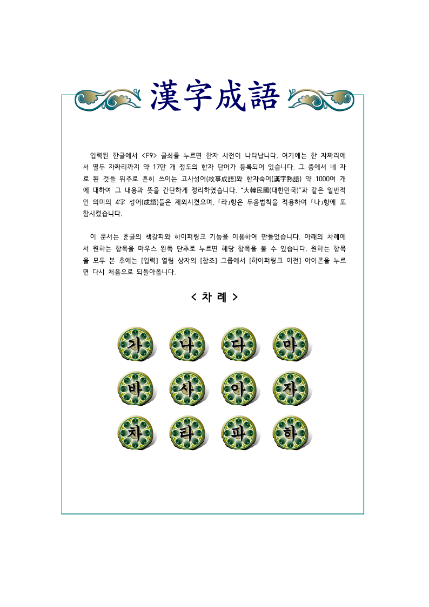 | 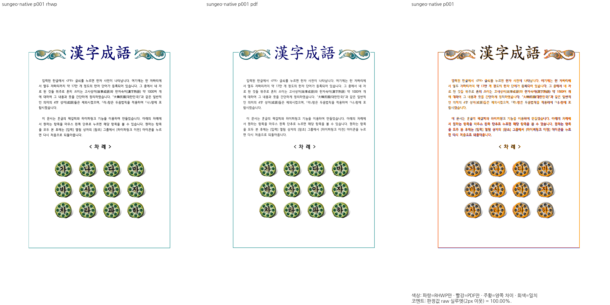 | 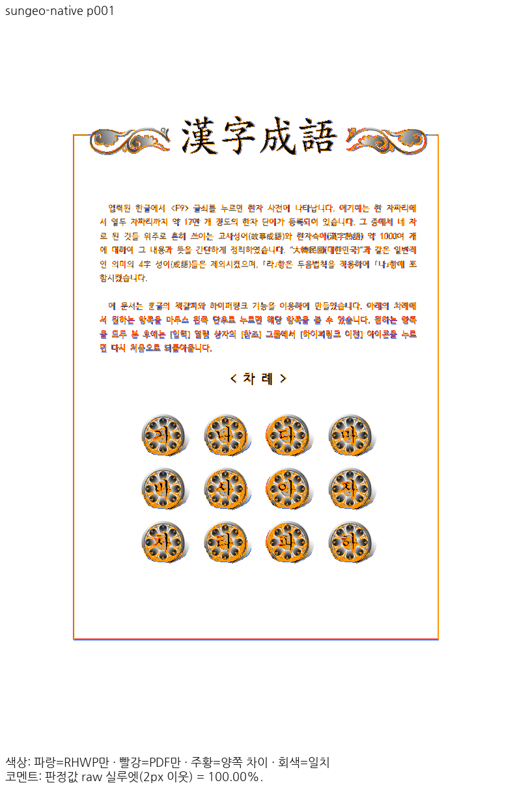 |
| fresh WASM | 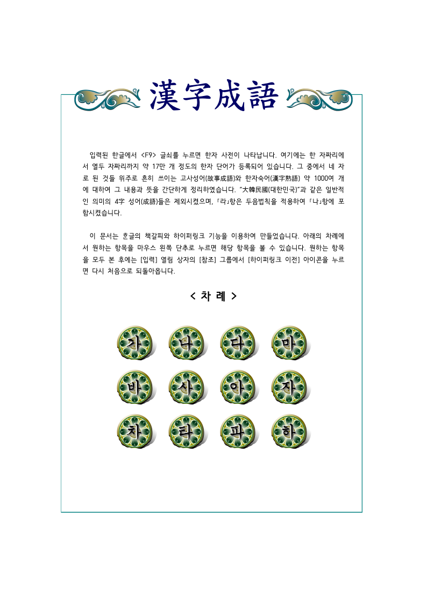 | 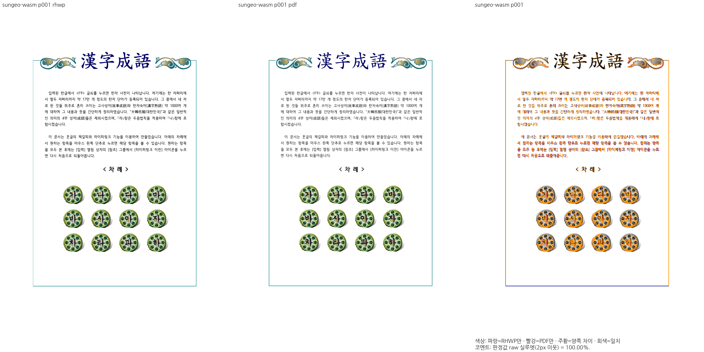 | 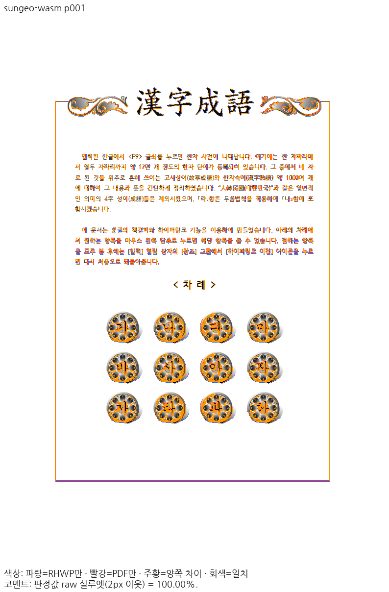 |

漢字成語 제목과 양쪽 장식·외곽 프레임, 본문 두 문단과 차례 아래12개 그림 단추를 독립 Print와 대조했다. 한글/한자·괄호와 줄 순서, 첫가/마지막하 단추 및 아래 빈 영역이 보존된다. 그림 필터·프레임 가장자리의 AA 차이는 남으며 raw100%를 색상 픽셀 완전 동일로 쓰지 않는다.

### bookreview

- 입력: [samples/basic/BlogForm_BookReview.hwp](../../../samples/basic/BlogForm_BookReview.hwp)
- 독립 Print: [pdf/basic/BlogForm_BookReview-hwp-2020.pdf](../../../pdf/basic/BlogForm_BookReview-hwp-2020.pdf)
- 전체 1쪽 Native 최저 100.00%. [TSV](../assets/planet6897_20261106/final-b768bee1-20261109/cases/bookreview/native.tsv) · [입력/PDF·producer 해시](../assets/planet6897_20261106/final-b768bee1-20261109/cases/bookreview/provenance.json).
- 전체 1쪽 fresh WASM 최저 100.00%. [TSV](../assets/planet6897_20261106/final-b768bee1-20261109/cases/bookreview/wasm.tsv).

1쪽 Native **100.00%**: [raw](../assets/planet6897_20261106/final-b768bee1-20261109/cases/bookreview/native/raw-001.png) · [PDF raw](../assets/planet6897_20261106/final-b768bee1-20261109/cases/bookreview/native/pdf-001.png) · [review](../assets/planet6897_20261106/final-b768bee1-20261109/cases/bookreview/native/review-001.png) · [overlay](../assets/planet6897_20261106/final-b768bee1-20261109/cases/bookreview/native/overlay-001.png)

1쪽 fresh WASM **100.00%**: [raw](../assets/planet6897_20261106/final-b768bee1-20261109/cases/bookreview/wasm/raw-001.png) · [PDF raw](../assets/planet6897_20261106/final-b768bee1-20261109/cases/bookreview/wasm/pdf-001.png) · [review](../assets/planet6897_20261106/final-b768bee1-20261109/cases/bookreview/wasm/review-001.png) · [overlay](../assets/planet6897_20261106/final-b768bee1-20261109/cases/bookreview/wasm/overlay-001.png)

초록색 책 정보표와 빈 표지 상자, 아래 여러 본문/평가 영역의 높이·색·기호를 확인했다. 제목/지은이/국적/분류/출간일/책 정보/평점의 소속과 순서가 유지된다.

| 경로 | raw | review | overlay |
| --- | --- | --- | --- |
| Native | 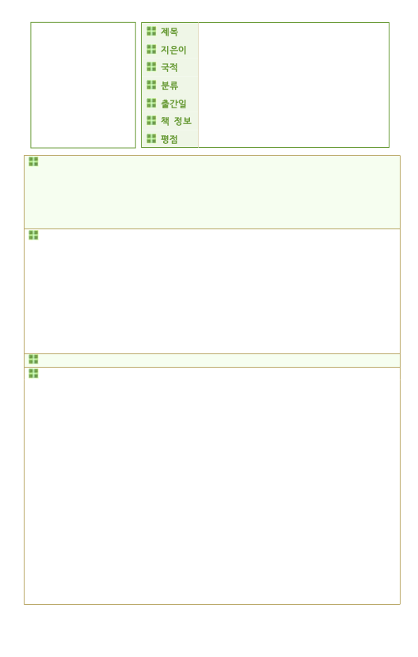 | 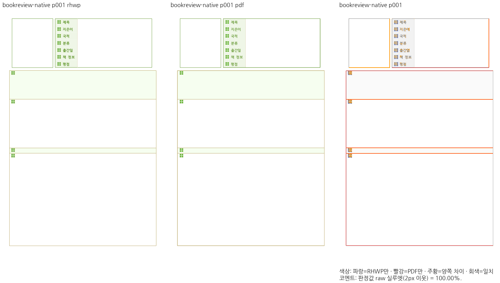 | 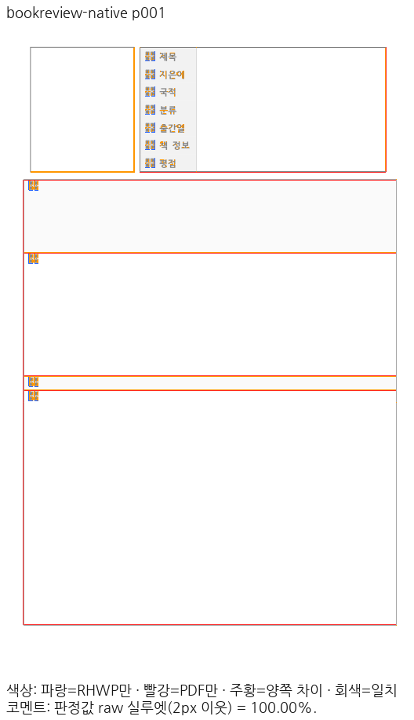 |
| fresh WASM |  |  |  |

제목·지은이·국적·분류·출간일·책 정보·평점 일곱 머리항목과 각 그림 기호·상자·큰 빈 작성 영역을 독립 Print와 대조했다. 글꼴 공급 실패로 텍스트나 완결 문서가 사라지지 않는다. 원본과 기준도 비어 있는 작성 칸이며 이를 본문 누락으로 판정하지 않는다.

### ktx

- 입력: [samples/basic/KTX.hwp](../../../samples/basic/KTX.hwp)
- 독립 Print: [pdf/basic/KTX-2022.pdf](../../../pdf/basic/KTX-2022.pdf)
- 전체 1쪽 Native 최저 99.85%. [TSV](../assets/planet6897_20261106/final-b768bee1-20261109/cases/ktx/native.tsv) · [입력/PDF·producer 해시](../assets/planet6897_20261106/final-b768bee1-20261109/cases/ktx/provenance.json).
- 전체 1쪽 fresh WASM 최저 99.85%. [TSV](../assets/planet6897_20261106/final-b768bee1-20261109/cases/ktx/wasm.tsv).

1쪽 Native **99.85%**: [raw](../assets/planet6897_20261106/final-b768bee1-20261109/cases/ktx/native/raw-001.png) · [PDF raw](../assets/planet6897_20261106/final-b768bee1-20261109/cases/ktx/native/pdf-001.png) · [review](../assets/planet6897_20261106/final-b768bee1-20261109/cases/ktx/native/review-001.png) · [overlay](../assets/planet6897_20261106/final-b768bee1-20261109/cases/ktx/native/overlay-001.png)

1쪽 fresh WASM **99.85%**: [raw](../assets/planet6897_20261106/final-b768bee1-20261109/cases/ktx/wasm/raw-001.png) · [PDF raw](../assets/planet6897_20261106/final-b768bee1-20261109/cases/ktx/wasm/pdf-001.png) · [review](../assets/planet6897_20261106/final-b768bee1-20261109/cases/ktx/wasm/review-001.png) · [overlay](../assets/planet6897_20261106/final-b768bee1-20261109/cases/ktx/wasm/overlay-001.png)

왼쪽 KTX 노선 지도·역·범례와 오른쪽 소요시간/운임 계단표의 숫자·소속을 대조했다. 제목 WordArt·밑줄 및 지도 가장자리와 범례 화살표의 차이는 별도 잔여로 명시한다.

| 경로 | raw | review | overlay |
| --- | --- | --- | --- |
| Native | 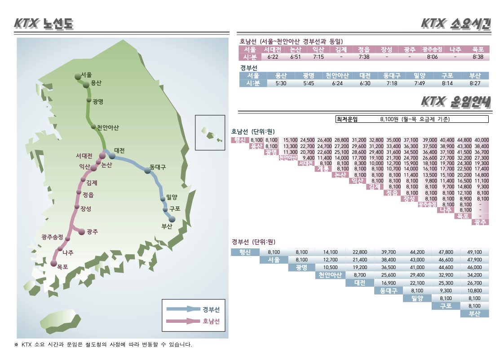 | 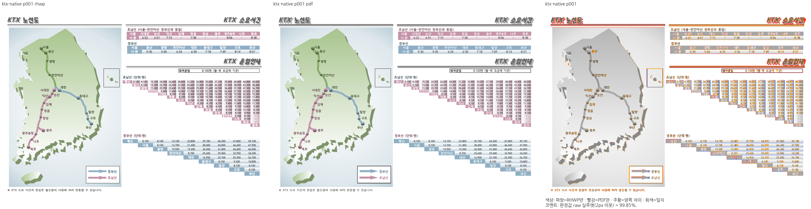 |  |
| fresh WASM | 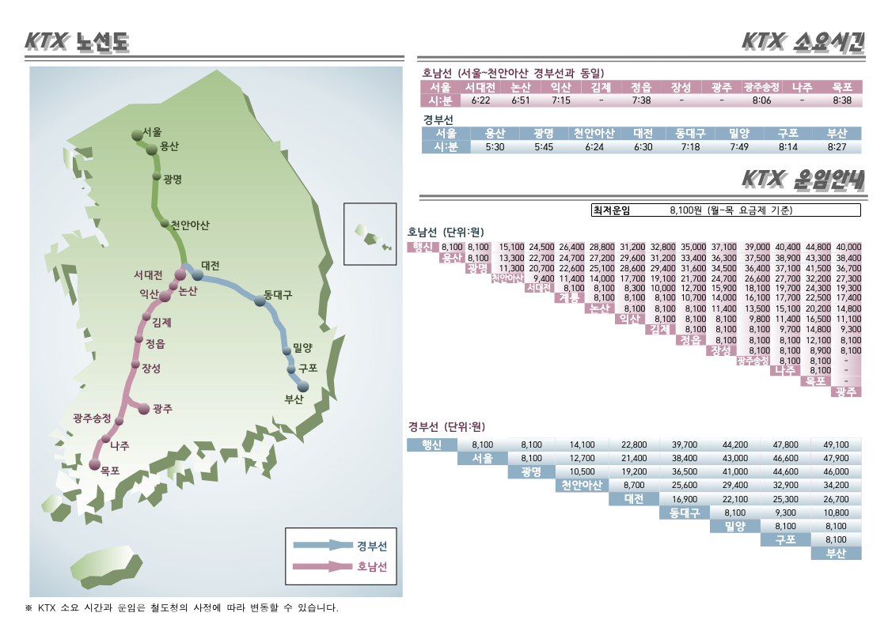 |  | 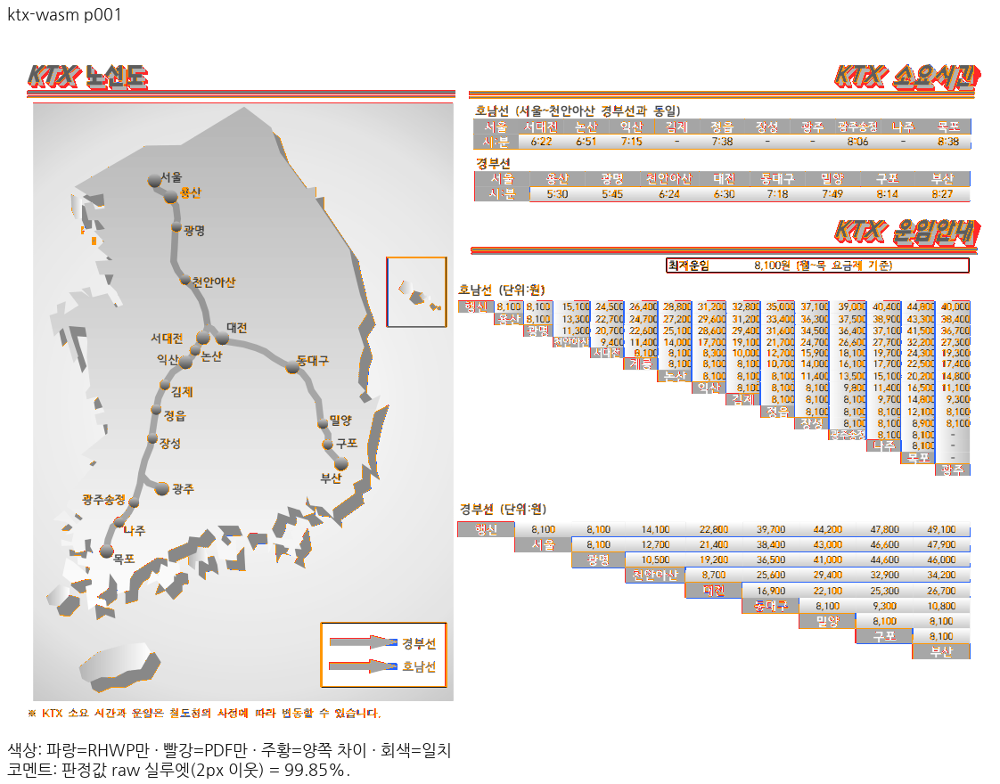 |

왼쪽 KTX 노선 지도·역 이름·범례와 오른쪽 소요시간/운임표의 열·삼각 계단 배치·최하단 경부선 칸을 독립 Print와 대조했다. 제목 WordArt·밑줄·범례 화살표와 지도 가장자리의 차이는 남지만 글자가 비거나 표 숫자가 다른 칸에 이동하지 않는다. 해당 잔차는 최종 fixed base 대조와 구분해 기록한다.

### interview

- 입력: [samples/basic/interview.hwp](../../../samples/basic/interview.hwp)
- 독립 Print: [pdf/basic/interview-hwp-2020.pdf](../../../pdf/basic/interview-hwp-2020.pdf)
- 전체 2쪽 Native 최저 97.52%. [TSV](../assets/planet6897_20261106/final-b768bee1-20261109/cases/interview/native.tsv) · [입력/PDF·producer 해시](../assets/planet6897_20261106/final-b768bee1-20261109/cases/interview/provenance.json).
- 전체 2쪽 fresh WASM 최저 97.63%. [TSV](../assets/planet6897_20261106/final-b768bee1-20261109/cases/interview/wasm.tsv).

1쪽 Native **97.52%**: [raw](../assets/planet6897_20261106/final-b768bee1-20261109/cases/interview/native/raw-001.png) · [PDF raw](../assets/planet6897_20261106/final-b768bee1-20261109/cases/interview/native/pdf-001.png) · [review](../assets/planet6897_20261106/final-b768bee1-20261109/cases/interview/native/review-001.png) · [overlay](../assets/planet6897_20261106/final-b768bee1-20261109/cases/interview/native/overlay-001.png)

1쪽 fresh WASM **97.63%**: [raw](../assets/planet6897_20261106/final-b768bee1-20261109/cases/interview/wasm/raw-001.png) · [PDF raw](../assets/planet6897_20261106/final-b768bee1-20261109/cases/interview/wasm/pdf-001.png) · [review](../assets/planet6897_20261106/final-b768bee1-20261109/cases/interview/wasm/review-001.png) · [overlay](../assets/planet6897_20261106/final-b768bee1-20261109/cases/interview/wasm/overlay-001.png)

면접·취업 두 열의1~10항목·큰 그림과 제목·주황색 소제목 띠의 소속·순서를 확인했다. 큰 제목 흰 그림자의 크기/위치와 그림의 흐린 테두리가 Print와 다른 점을 확인했으며 새 잔여 이슈에 포함한다.

| 경로 | raw | review | overlay |
| --- | --- | --- | --- |
| Native | 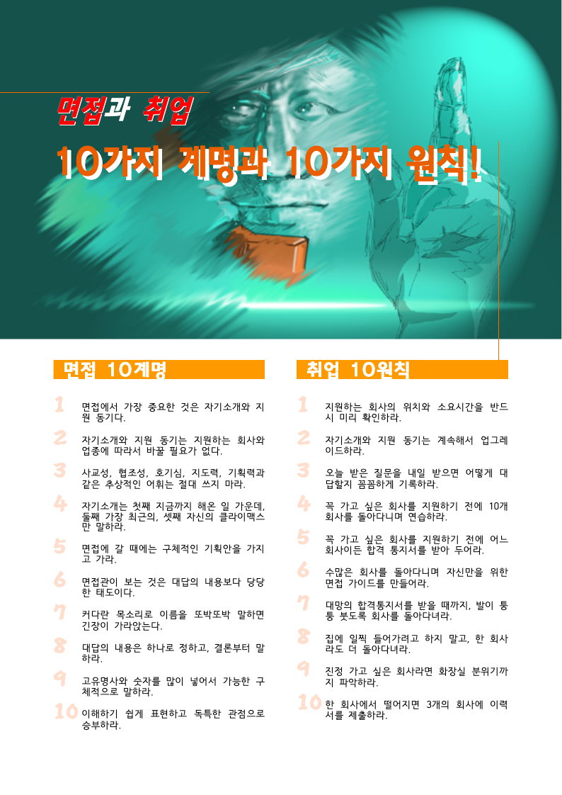 | 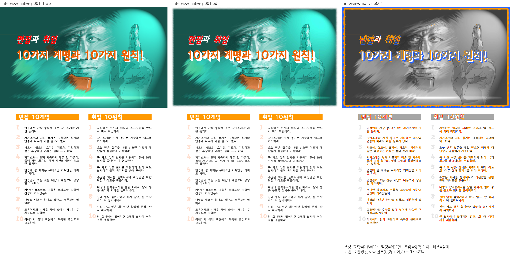 | 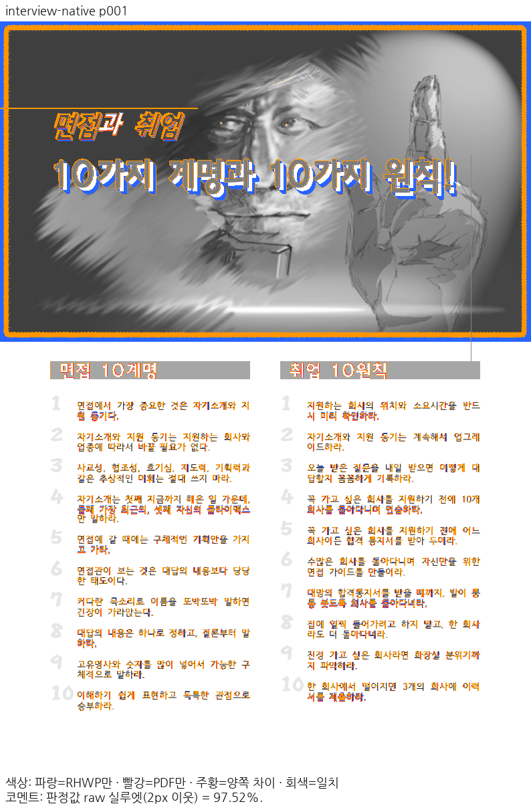 |
| fresh WASM | 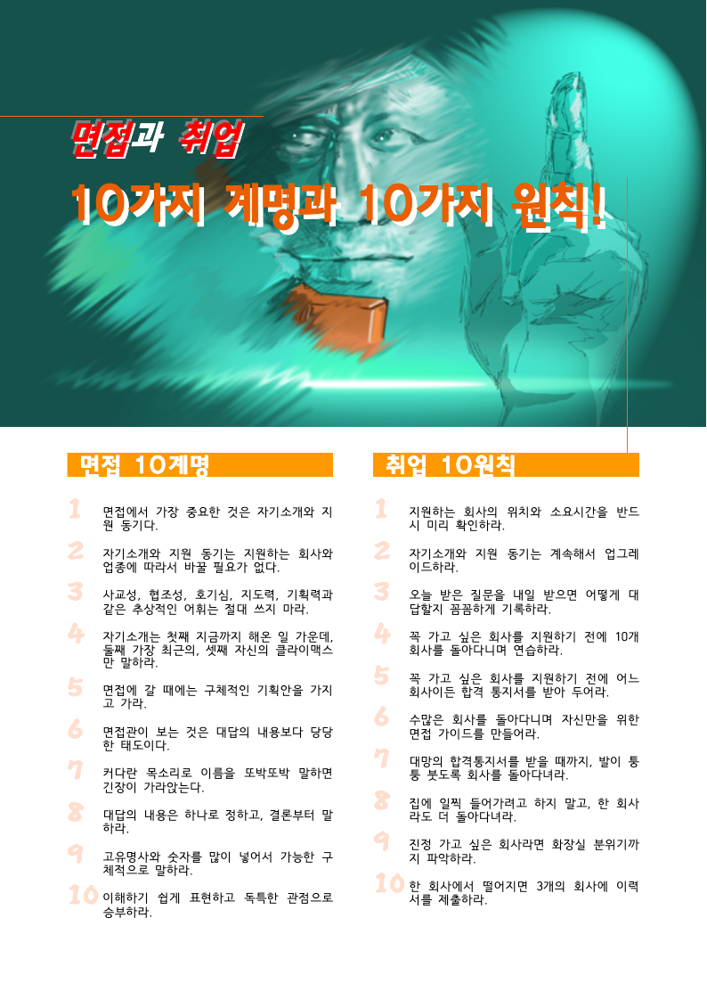 |  | 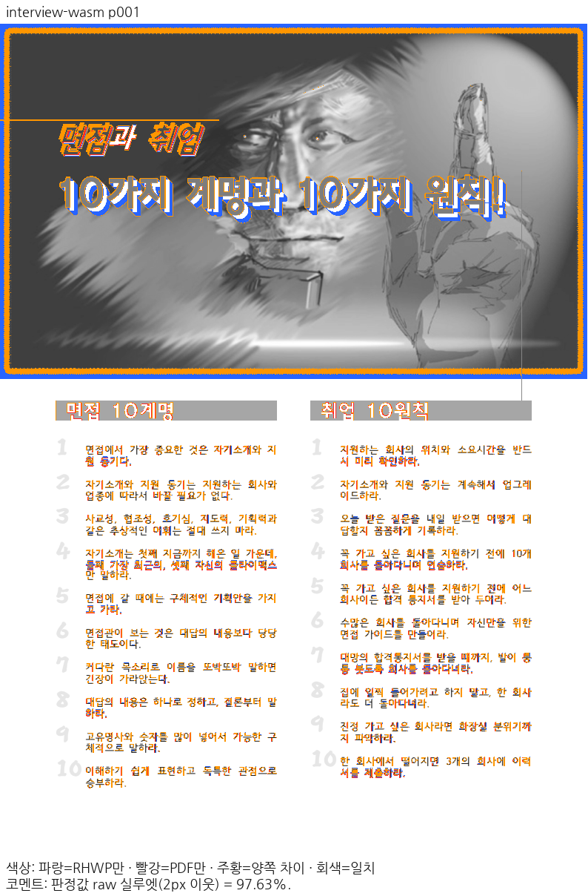 |

면접/취업 좌우 1~10 항목과 제목·큰 배경 그림의 소속 및 순서가 보존된다. 제목의 그림자·그림 테두리 필터링 차이는 남으며 97.52%를 픽셀 동일로 표현하지 않는다.

2쪽 Native **99.99%**: [raw](../assets/planet6897_20261106/final-b768bee1-20261109/cases/interview/native/raw-002.png) · [PDF raw](../assets/planet6897_20261106/final-b768bee1-20261109/cases/interview/native/pdf-002.png) · [review](../assets/planet6897_20261106/final-b768bee1-20261109/cases/interview/native/review-002.png) · [overlay](../assets/planet6897_20261106/final-b768bee1-20261109/cases/interview/native/overlay-002.png)

2쪽 fresh WASM **99.99%**: [raw](../assets/planet6897_20261106/final-b768bee1-20261109/cases/interview/wasm/raw-002.png) · [PDF raw](../assets/planet6897_20261106/final-b768bee1-20261109/cases/interview/wasm/pdf-002.png) · [review](../assets/planet6897_20261106/final-b768bee1-20261109/cases/interview/wasm/review-002.png) · [overlay](../assets/planet6897_20261106/final-b768bee1-20261109/cases/interview/wasm/overlay-002.png)

설명용 작은 그림과 여섯 노란 라벨·빨간 연결선·문단 번호와2단편집 상자를 대조했다. 그림 축소 윤곽/그림자 차이가 남지만 설명 요소가 누락되거나 다른 쪽으로 이동하지 않는다.

| 경로 | raw | review | overlay |
| --- | --- | --- | --- |
| Native | 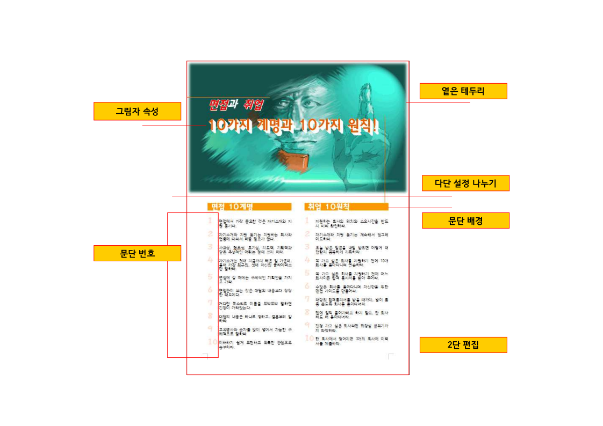 | 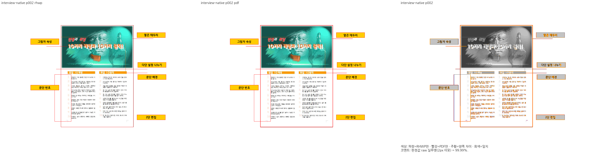 | 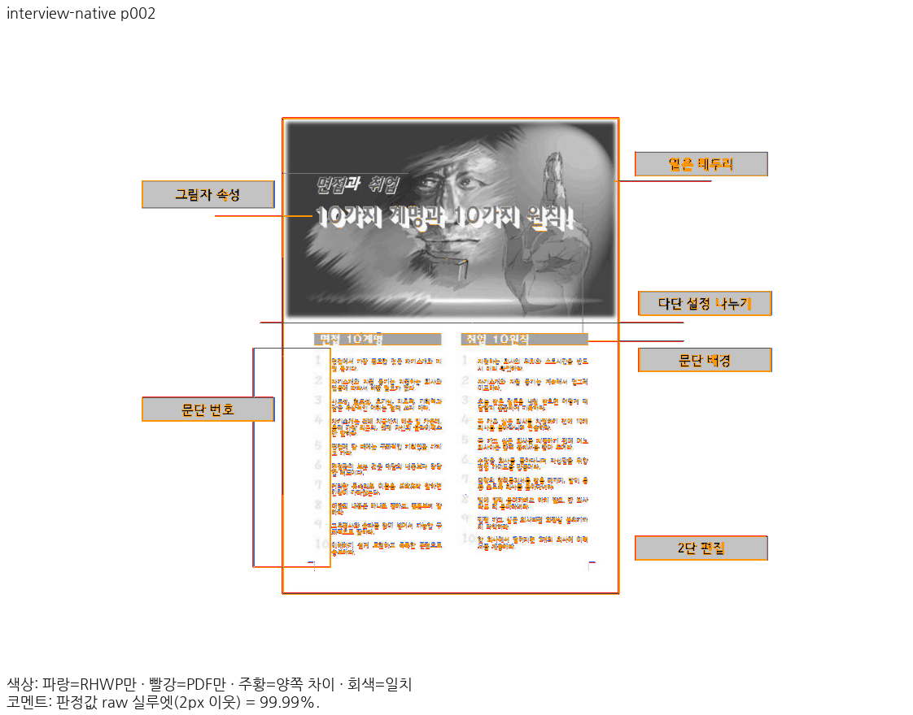 |
| fresh WASM | 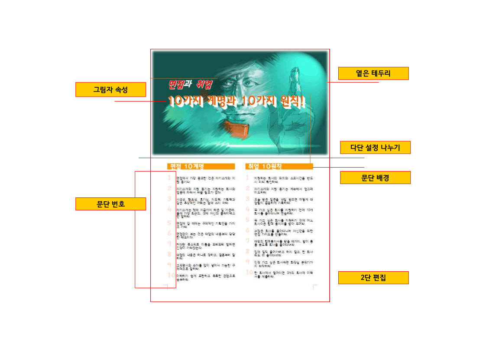 |  |  |

설명 삽화와 그림자·얇은 테두리·단 나누기·문단 배경·번호·2단 편집의 연결선과 표식이 보존된다. 축소 삽화 내부의 미세 윤곽 차이는 남는다.

### request

- 입력: [samples/basic/request.hwp](../../../samples/basic/request.hwp)
- 독립 Print: [pdf/basic/request-hwp-2020.pdf](../../../pdf/basic/request-hwp-2020.pdf)
- 전체 1쪽 Native 최저 96.18%. [TSV](../assets/planet6897_20261106/final-b768bee1-20261109/cases/request/native.tsv) · [입력/PDF·producer 해시](../assets/planet6897_20261106/final-b768bee1-20261109/cases/request/provenance.json).
- 전체 1쪽 fresh WASM 최저 96.12%. [TSV](../assets/planet6897_20261106/final-b768bee1-20261109/cases/request/wasm.tsv).

1쪽 Native **96.18%**: [raw](../assets/planet6897_20261106/final-b768bee1-20261109/cases/request/native/raw-001.png) · [PDF raw](../assets/planet6897_20261106/final-b768bee1-20261109/cases/request/native/pdf-001.png) · [review](../assets/planet6897_20261106/final-b768bee1-20261109/cases/request/native/review-001.png) · [overlay](../assets/planet6897_20261106/final-b768bee1-20261109/cases/request/native/overlay-001.png)

1쪽 fresh WASM **96.12%**: [raw](../assets/planet6897_20261106/final-b768bee1-20261109/cases/request/wasm/raw-001.png) · [PDF raw](../assets/planet6897_20261106/final-b768bee1-20261109/cases/request/wasm/pdf-001.png) · [review](../assets/planet6897_20261106/final-b768bee1-20261109/cases/request/wasm/review-001.png) · [overlay](../assets/planet6897_20261106/final-b768bee1-20261109/cases/request/wasm/overlay-001.png)

회원 가입 신청서의 전체 표·회원번호·주소·전화·참고 상자 배치를 대조했다. 광고접촉수단/직업 행에서 PDF의 오른쪽 홈쇼핑·기타 선택지가 후보에서 보이지 않으며 앞 선택지의 가로 간격도 다르다. 단순 래스터 차이로 처리하지 않고 별도 잔여 이슈에 명시한다.

| 경로 | raw | review | overlay |
| --- | --- | --- | --- |
| Native | 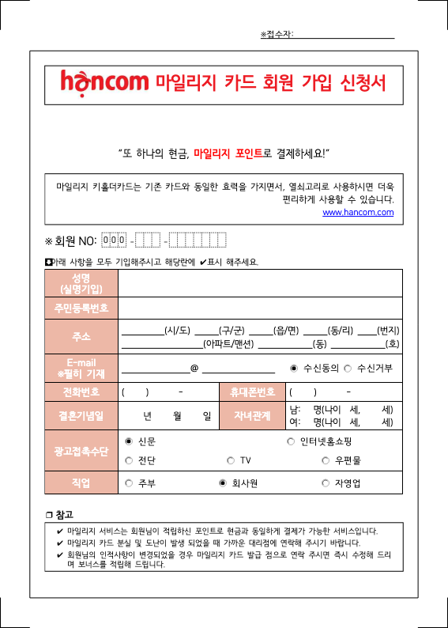 | 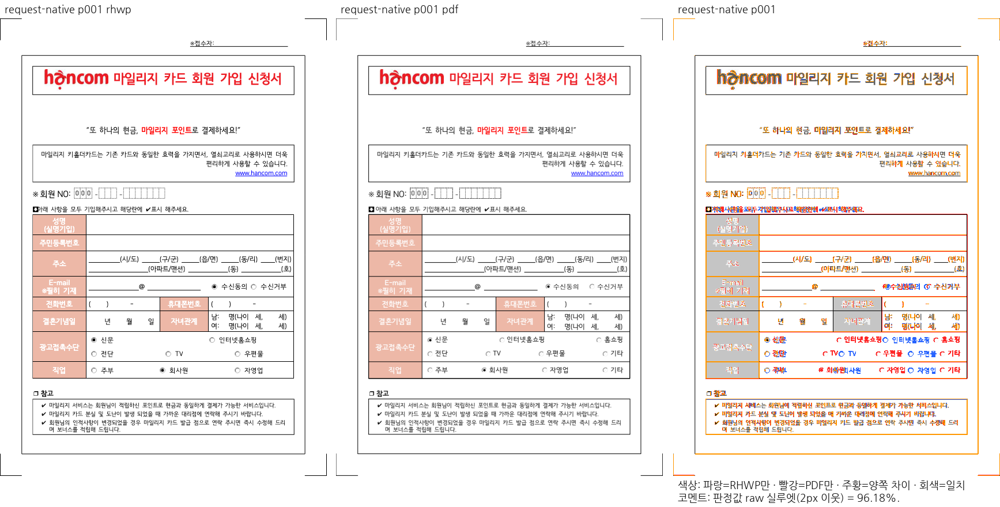 | 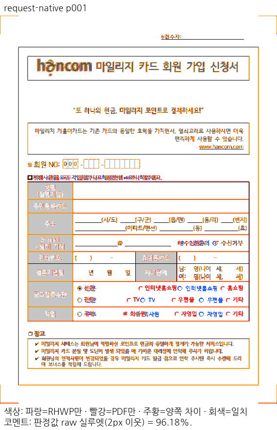 |
| fresh WASM | 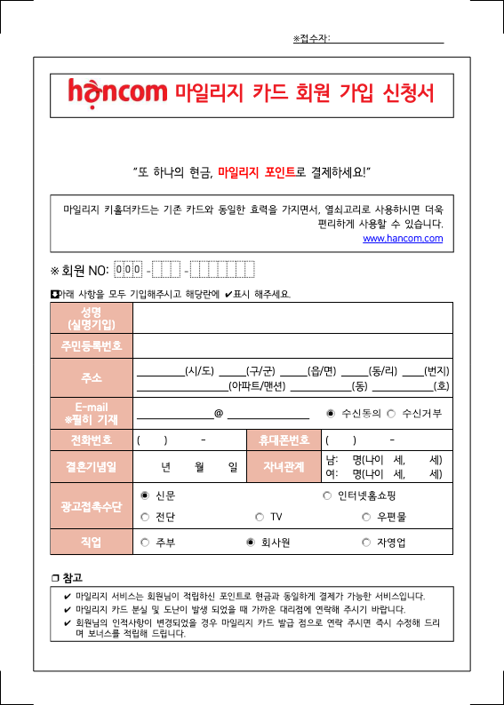 |  | 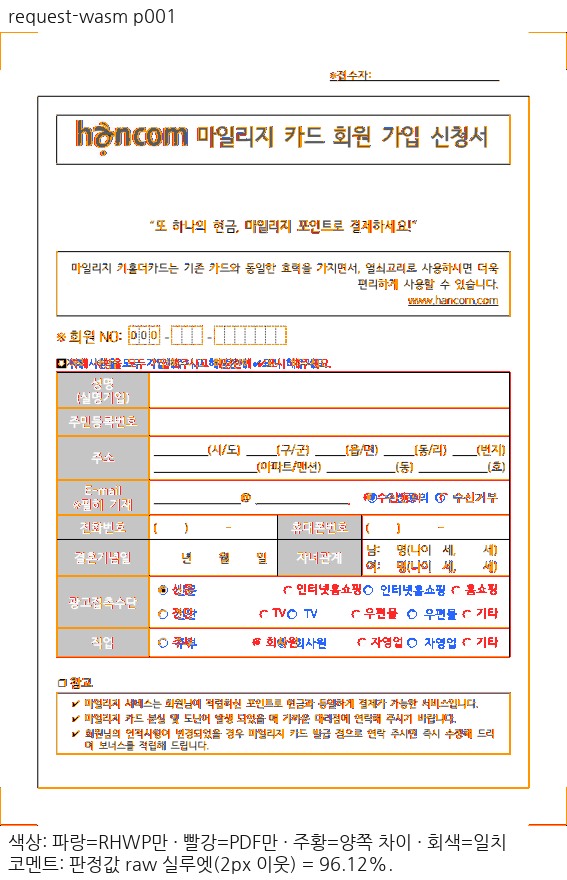 |

신청서 제목·접수자·회원번호·주소·전화·참고 상자의 같은 쪽 배치와 순서를 확인했다. 라디오 항목의 일부 줄 끝과 간격 차이가 남으므로 완전 일치로 기록하지 않고 latest base 대비 보존을 별도로 판정한다.

### english

- 입력: [samples/basic/english.hwp](../../../samples/basic/english.hwp)
- 독립 Print: [pdf/basic/english-hwp-2020.pdf](../../../pdf/basic/english-hwp-2020.pdf)
- 전체 1쪽 Native 최저 100.00%. [TSV](../assets/planet6897_20261106/final-b768bee1-20261109/cases/english/native.tsv) · [입력/PDF·producer 해시](../assets/planet6897_20261106/final-b768bee1-20261109/cases/english/provenance.json).
- 전체 1쪽 fresh WASM 최저 100.00%. [TSV](../assets/planet6897_20261106/final-b768bee1-20261109/cases/english/wasm.tsv).

1쪽 Native **100.00%**: [raw](../assets/planet6897_20261106/final-b768bee1-20261109/cases/english/native/raw-001.png) · [PDF raw](../assets/planet6897_20261106/final-b768bee1-20261109/cases/english/native/pdf-001.png) · [review](../assets/planet6897_20261106/final-b768bee1-20261109/cases/english/native/review-001.png) · [overlay](../assets/planet6897_20261106/final-b768bee1-20261109/cases/english/native/overlay-001.png)

1쪽 fresh WASM **100.00%**: [raw](../assets/planet6897_20261106/final-b768bee1-20261109/cases/english/wasm/raw-001.png) · [PDF raw](../assets/planet6897_20261106/final-b768bee1-20261109/cases/english/wasm/pdf-001.png) · [review](../assets/planet6897_20261106/final-b768bee1-20261109/cases/english/wasm/review-001.png) · [overlay](../assets/planet6897_20261106/final-b768bee1-20261109/cases/english/wasm/overlay-001.png)

초록 안내 상자와1~15영어 예문·우리말 번역 라벨의 줄 소속·앞뒤 순서·단락 사이 간격을 대조했다. 줄바꿈을 건너뛰거나 예문이 사라지지 않는다.

| 경로 | raw | review | overlay |
| --- | --- | --- | --- |
| Native | 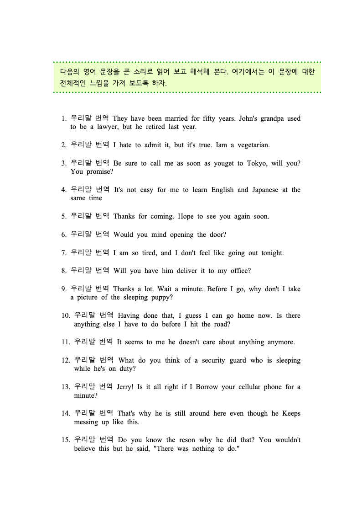 |  | 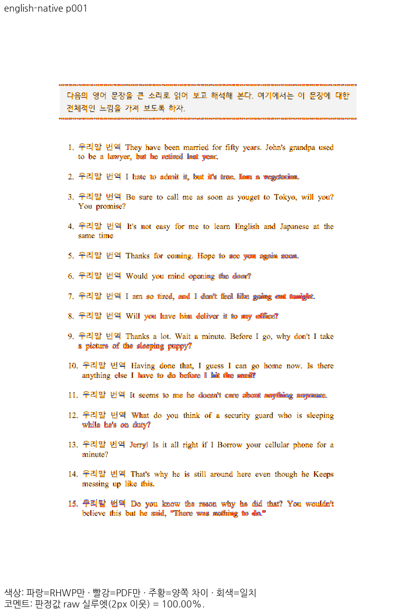 |
| fresh WASM | 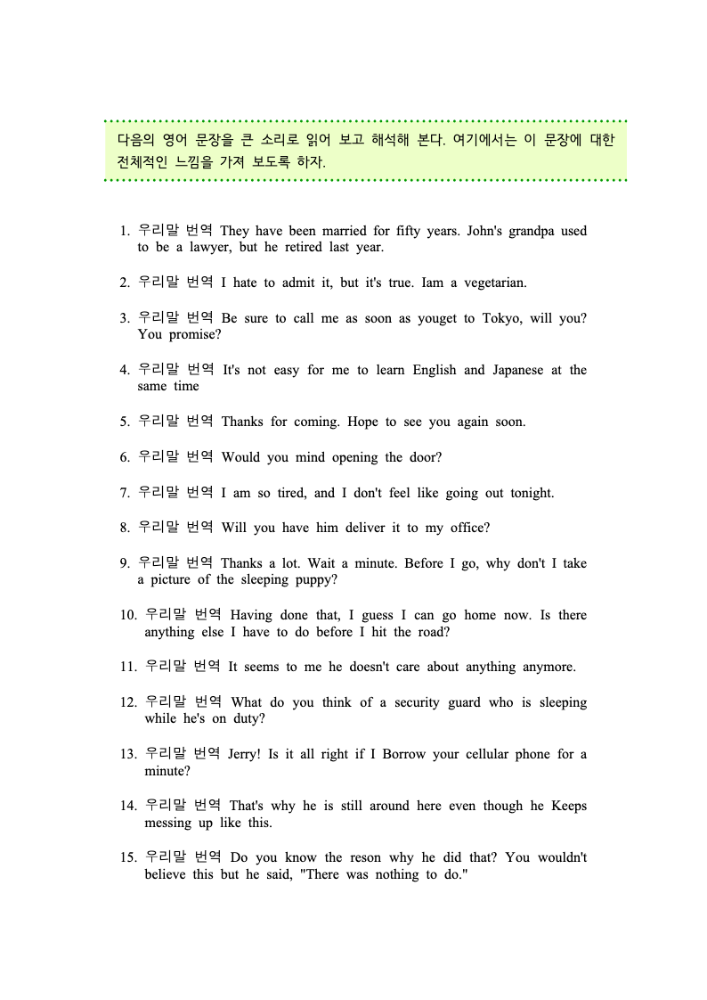 | 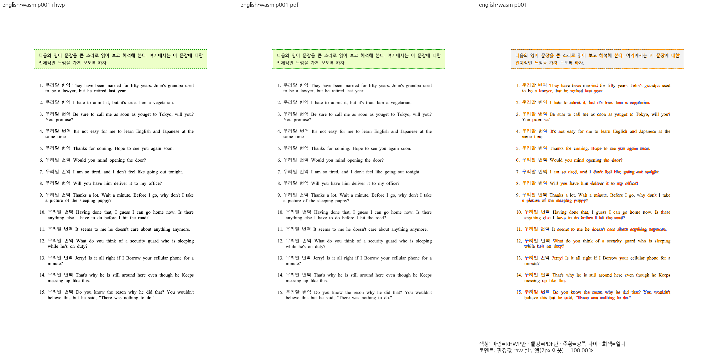 |  |

상단 녹색 설명 상자와 1~15 문항의 순서·영문 혼합 줄과 둘째 줄 시작·끝을 대조했다. 전쪽 실루엣 100.00%와 글리프 RGB 동일성을 구분한다.

### newyear

- 입력: [samples/basic/NewYear_s_Day.hwp](../../../samples/basic/NewYear_s_Day.hwp)
- 독립 Print: [pdf/basic/NewYear_s_Day-hwp-2020.pdf](../../../pdf/basic/NewYear_s_Day-hwp-2020.pdf)
- 전체 3쪽 Native 최저 98.45%. [TSV](../assets/planet6897_20261106/final-b768bee1-20261109/cases/newyear/native.tsv) · [입력/PDF·producer 해시](../assets/planet6897_20261106/final-b768bee1-20261109/cases/newyear/provenance.json).
- 전체 3쪽 fresh WASM 최저 98.45%. [TSV](../assets/planet6897_20261106/final-b768bee1-20261109/cases/newyear/wasm.tsv).

1쪽 Native **98.80%**: [raw](../assets/planet6897_20261106/final-b768bee1-20261109/cases/newyear/native/raw-001.png) · [PDF raw](../assets/planet6897_20261106/final-b768bee1-20261109/cases/newyear/native/pdf-001.png) · [review](../assets/planet6897_20261106/final-b768bee1-20261109/cases/newyear/native/review-001.png) · [overlay](../assets/planet6897_20261106/final-b768bee1-20261109/cases/newyear/native/overlay-001.png)

1쪽 fresh WASM **98.80%**: [raw](../assets/planet6897_20261106/final-b768bee1-20261109/cases/newyear/wasm/raw-001.png) · [PDF raw](../assets/planet6897_20261106/final-b768bee1-20261109/cases/newyear/wasm/pdf-001.png) · [review](../assets/planet6897_20261106/final-b768bee1-20261109/cases/newyear/wasm/review-001.png) · [overlay](../assets/planet6897_20261106/final-b768bee1-20261109/cases/newyear/wasm/overlay-001.png)

설 차례 상 제목과 설의 의미·차례 준비·음식1~4의 본문 및 배경을 대조했다. 제목의 글리프·자간 차이가 크며 일반 본문 줄 소속은 보존한다. 제목 차이를 잔여 이슈로 연결한다.

| 경로 | raw | review | overlay |
| --- | --- | --- | --- |
| Native | 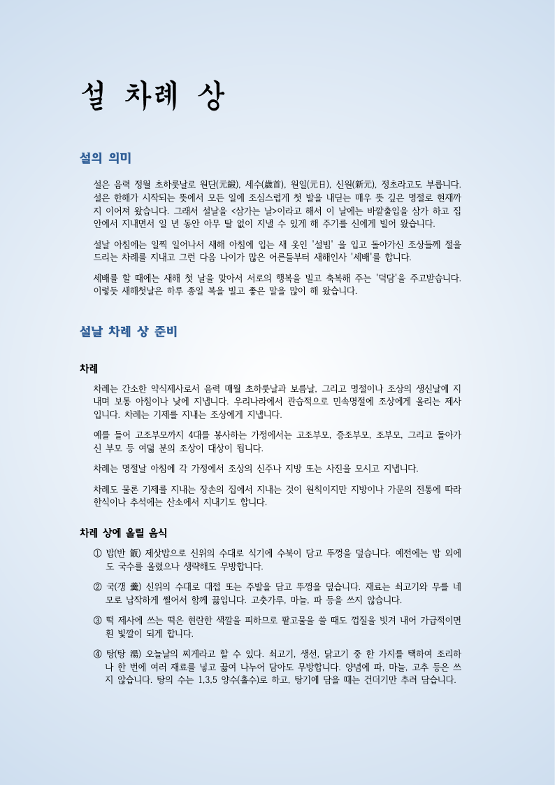 | 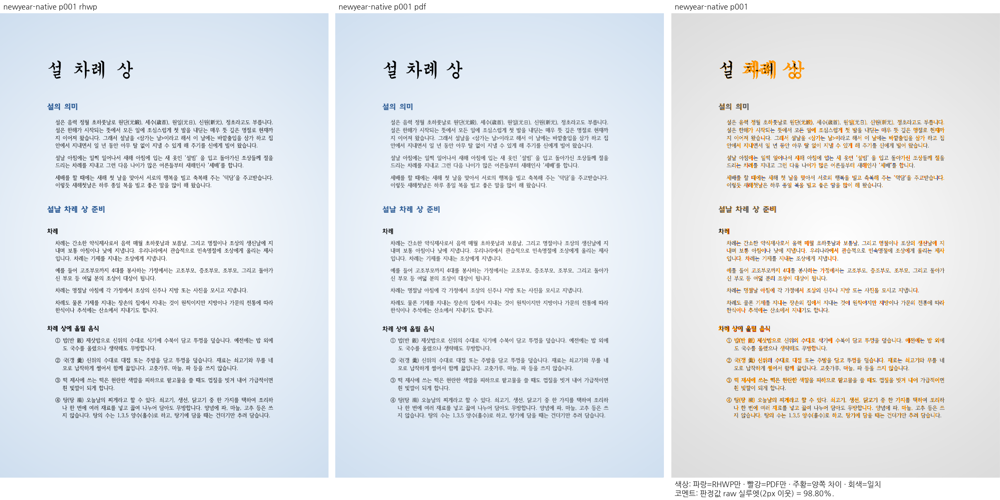 | 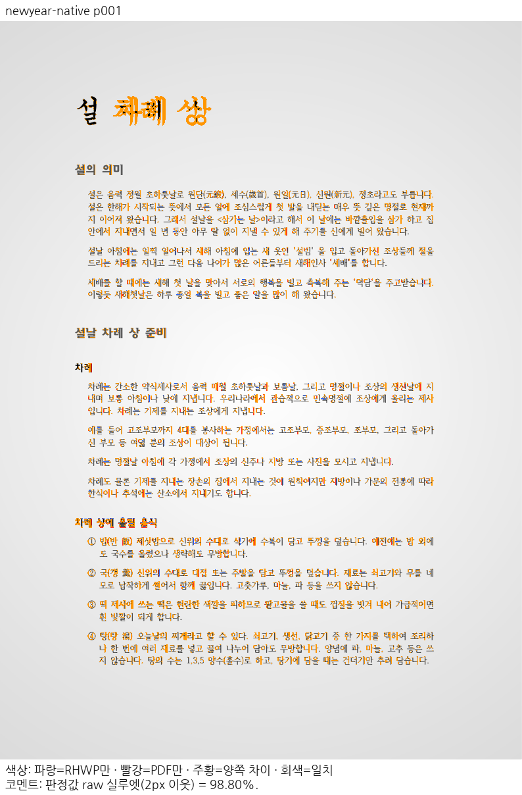 |
| fresh WASM | 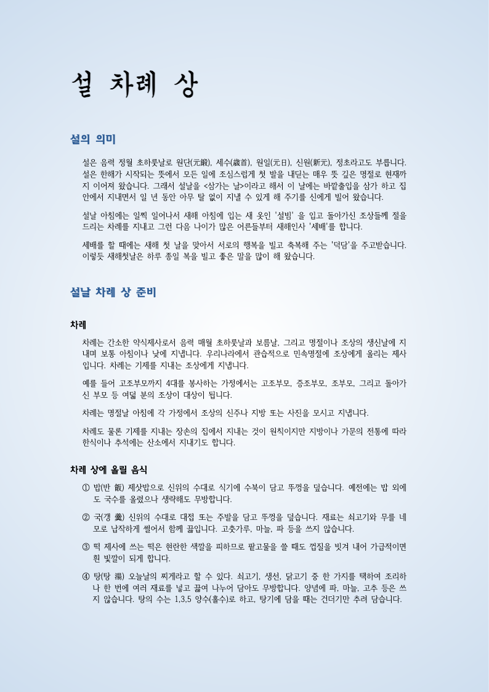 |  | 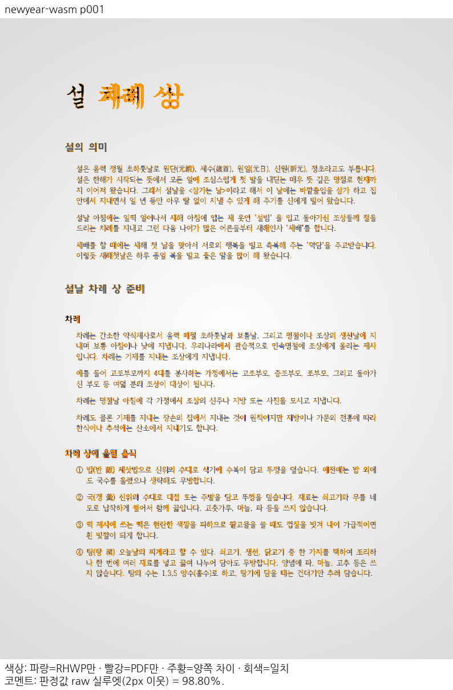 |

설 차례 상 제목과 설명·준비·음식 ①~④의 순서와 줄 소속을 확인했다. 제목 자간과 글리프 윤곽 차이는 남으며 색상 배경은 존재한다.

2쪽 Native **98.87%**: [raw](../assets/planet6897_20261106/final-b768bee1-20261109/cases/newyear/native/raw-002.png) · [PDF raw](../assets/planet6897_20261106/final-b768bee1-20261109/cases/newyear/native/pdf-002.png) · [review](../assets/planet6897_20261106/final-b768bee1-20261109/cases/newyear/native/review-002.png) · [overlay](../assets/planet6897_20261106/final-b768bee1-20261109/cases/newyear/native/overlay-002.png)

2쪽 fresh WASM **98.87%**: [raw](../assets/planet6897_20261106/final-b768bee1-20261109/cases/newyear/wasm/raw-002.png) · [PDF raw](../assets/planet6897_20261106/final-b768bee1-20261109/cases/newyear/wasm/pdf-002.png) · [review](../assets/planet6897_20261106/final-b768bee1-20261109/cases/newyear/wasm/review-002.png) · [overlay](../assets/planet6897_20261106/final-b768bee1-20261109/cases/newyear/wasm/overlay-002.png)

음식5~10과 중앙 진설법 그림·그림 아래 설명/기호·맨 아래1~3목록을 대조했다. 그림의 경계와 일부 글리프·맨 아래 안내의 가로 간격 차이는 잔여로 기록한다.

| 경로 | raw | review | overlay |
| --- | --- | --- | --- |
| Native | 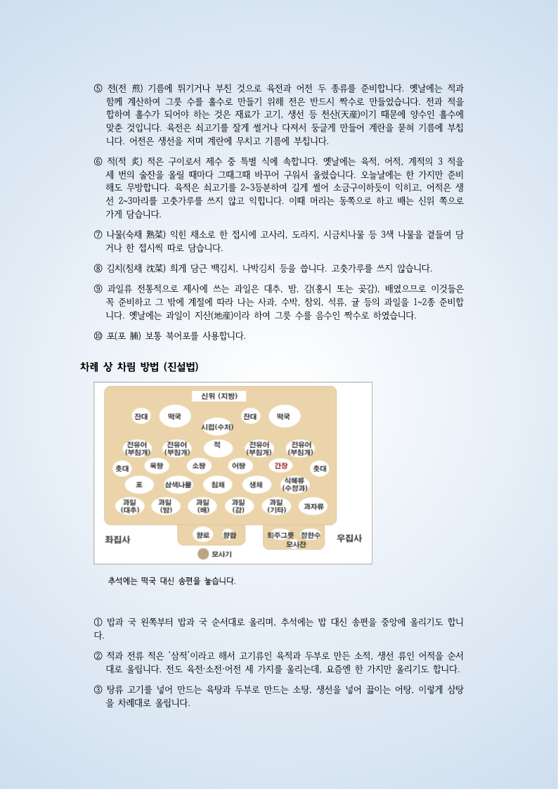 |  | 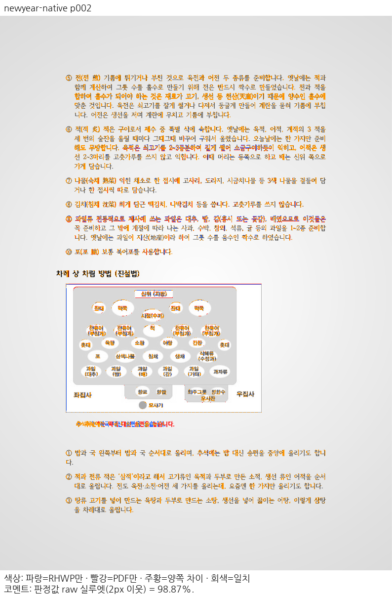 |
| fresh WASM | 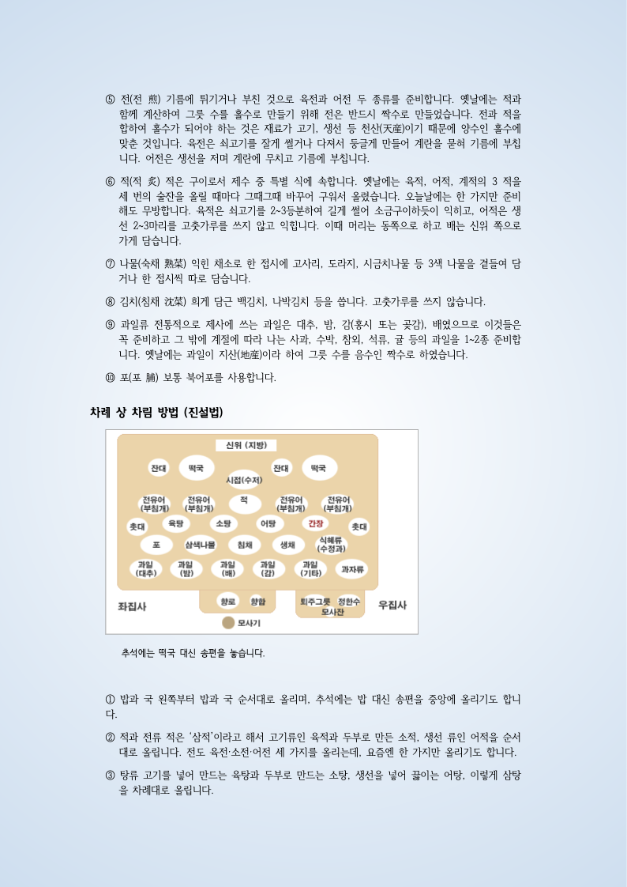 | 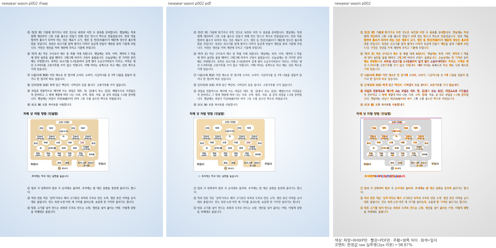 | 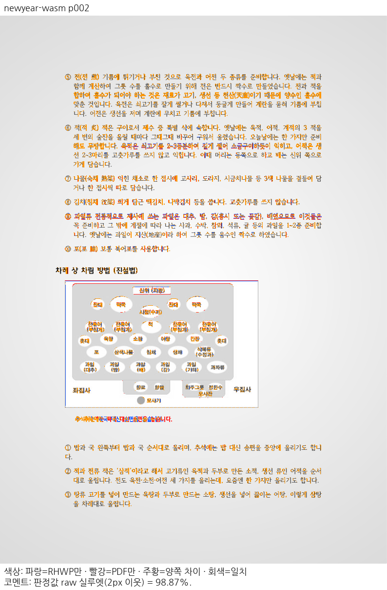 |

음식 ⑤~⑩, 중앙 진설법 도식과 아래 ①~③의 소속·순서를 확인했다. 도식 테두리·글리프·기호 및 일부 글줄 간격 차이는 잔여로 보존한다.

3쪽 Native **98.45%**: [raw](../assets/planet6897_20261106/final-b768bee1-20261109/cases/newyear/native/raw-003.png) · [PDF raw](../assets/planet6897_20261106/final-b768bee1-20261109/cases/newyear/native/pdf-003.png) · [review](../assets/planet6897_20261106/final-b768bee1-20261109/cases/newyear/native/review-003.png) · [overlay](../assets/planet6897_20261106/final-b768bee1-20261109/cases/newyear/native/overlay-003.png)

3쪽 fresh WASM **98.45%**: [raw](../assets/planet6897_20261106/final-b768bee1-20261109/cases/newyear/wasm/raw-003.png) · [PDF raw](../assets/planet6897_20261106/final-b768bee1-20261109/cases/newyear/wasm/pdf-003.png) · [review](../assets/planet6897_20261106/final-b768bee1-20261109/cases/newyear/wasm/review-003.png) · [overlay](../assets/planet6897_20261106/final-b768bee1-20261109/cases/newyear/wasm/overlay-003.png)

차례 상 규칙4·5뒤 조율이시부터적전중앙까지9개 제목/한자와 여백·순서를 대조했다. 한자 윤곽·가로 전진 차이는 잔여이며 글리프 동일로 주장하지 않는다.

| 경로 | raw | review | overlay |
| --- | --- | --- | --- |
| Native | 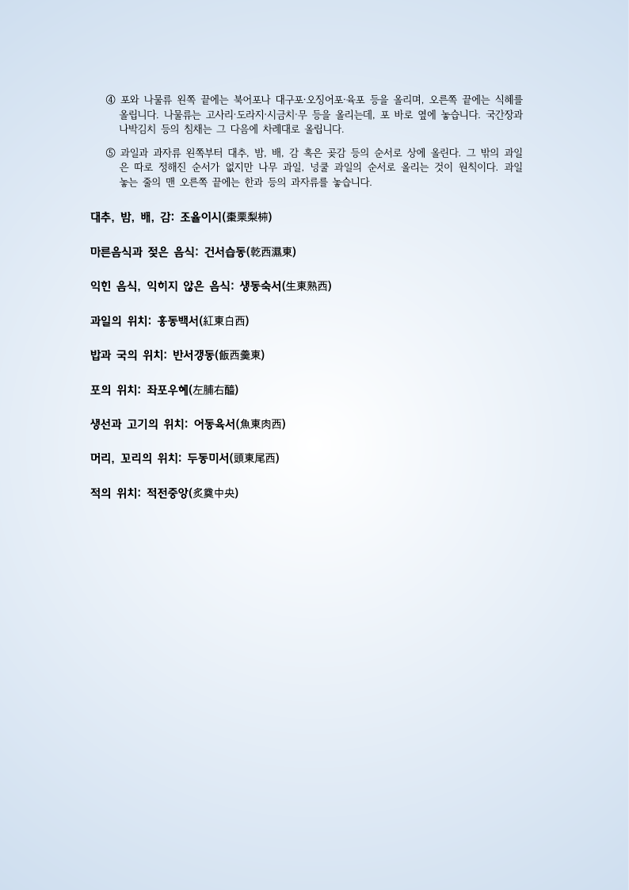 | 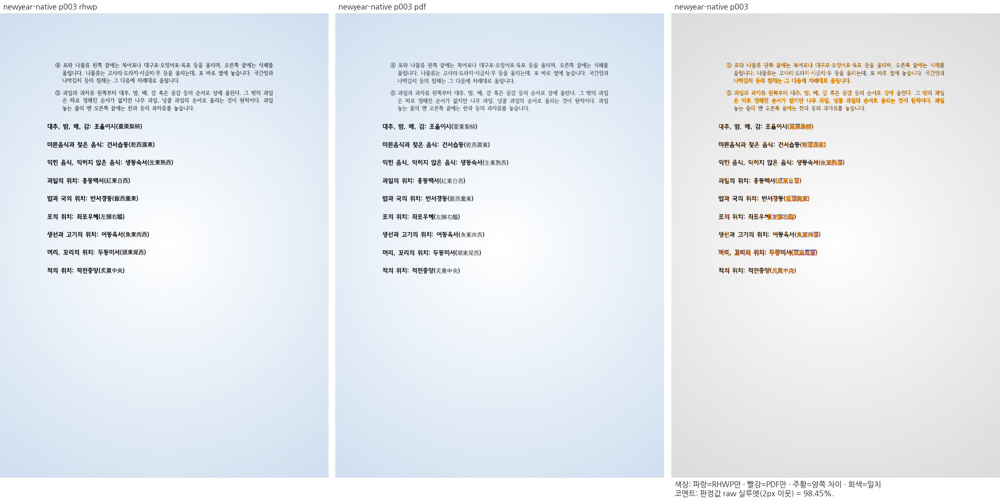 | 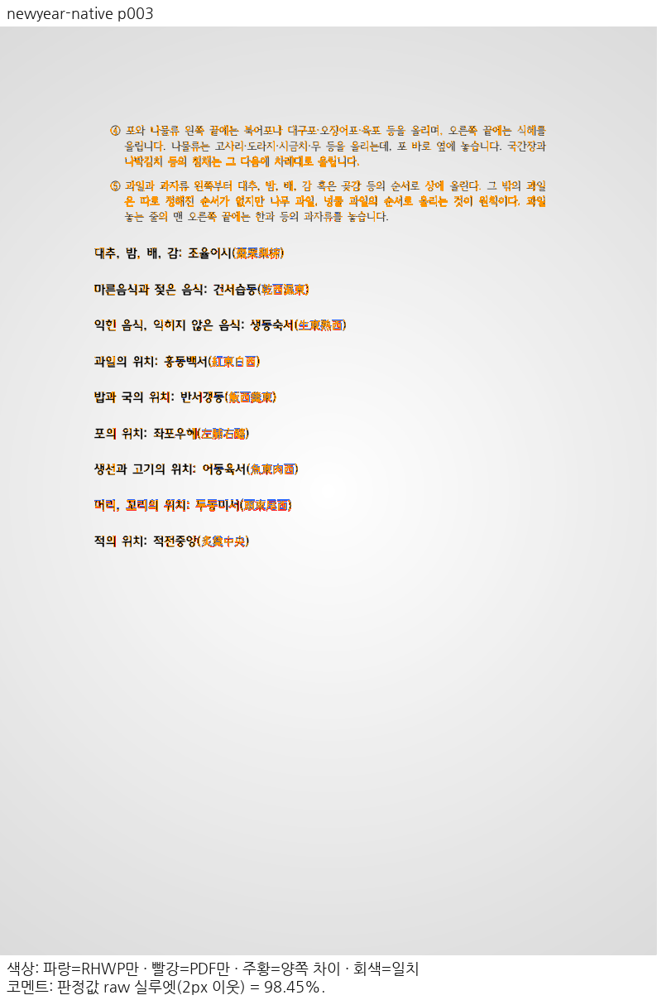 |
| fresh WASM | 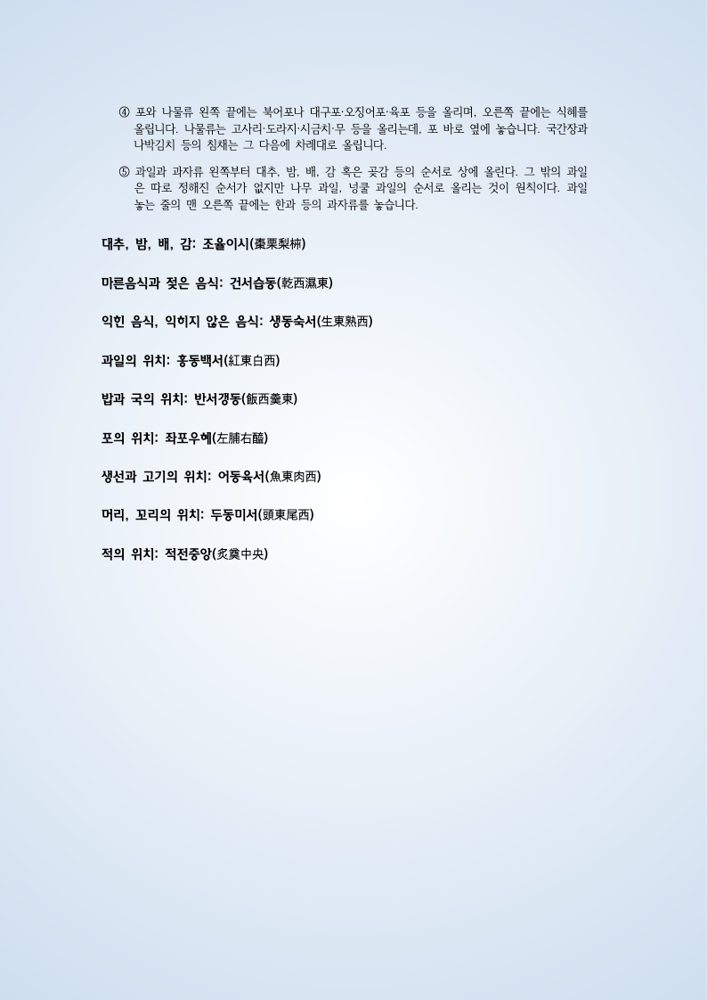 |  | 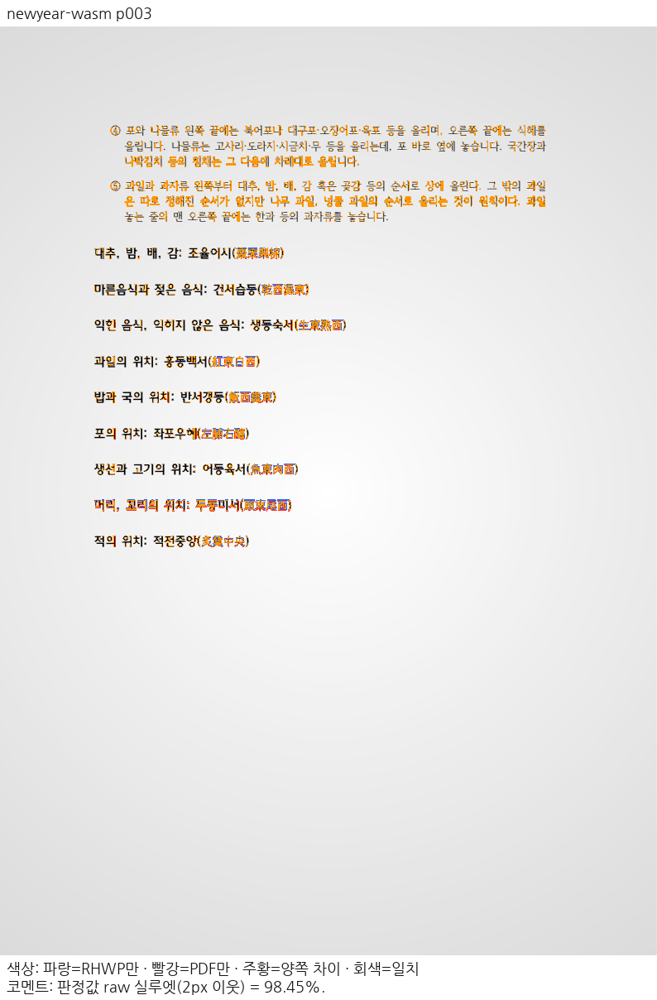 |

앞쪽의 ④~⑤와 조율이시·건서습동 등 아홉 규칙의 제목·한자·본문을 대조했다. 한자 윤곽 차이는 남으며 페이지 누락은 없다.

## 최종 제출과 원격 조건

기존 전쪽 TSV·직접 판독을 유지하고 리베이스 후 영향 2조건 8쪽과 앞선 HWP3 3조건 10쪽과 필수 집중·lint를 추가 검증했습니다. 엄격0.1%p 비교 잔여1건은 새 이슈로 분리하며 완전 무회귀로 표기하지 않습니다. 원격 게시 직전에 원 PR head·upstream/devel·제출 diff와 병합 시뮬레이션을 재확인합니다. 통합 PR의 실제 CI 성공과 최종 head의 mergeability를 확인한 뒤 승인된 병합·후속처리를 수행합니다.

## Merge 후 contributor PR comment 계획

통합 병합이 완료되면 최종 merge SHA·CI URL과 이 PR이 주장한 입력/페이지의 raw 이미지를 고정 SHA 링크로 연결합니다. 원 기여와 메인터너 보정 이유·범위를 한국어 존댓말로 구분하며, 별도 검증하지 않은 문제까지 해결했다고 쓰지 않습니다. 원 PR의 종료는 통합 병합 후 실제 해결 범위를 확인하여 처리합니다.
