# PR #8615 리뷰 — fix(layout): 칸 안 빈 host 의 글 위아래 표 띠가 뒤 문단 앞 간격을 흡수한다 (#8610)

## 최종 판정

**메인터너 보정 후 수용 가능 — 원 기여와 추가 보정을 포함한 통합 code head의 주장 범위를 검증했습니다. 원 contributor head의 직접 병합을 승인하는 판정은 아닙니다.**

원 PR head와 메인터너 보정을 포함한 통합 code head를 구분합니다. 위 exact code head의 필수 CI를 확인했습니다. 문서 trailing head의 실제 검사·충돌 여부를 다시 확인하며, 원 PR은 통합 병합을 확인한 뒤 종료합니다.

## 최종 source와 재사용 범위

제출 code head `2e262d0d4b2885b130e2db917b86e894710425e4`, base `e00f9b7e26e581896fa17eaff3c8eb3f4889f9d4`입니다. 아래 전체 회귀·전쪽 수치는 원 실측 HEAD의 증거를 재사용한 기록입니다. 최신 집중 검사와 페이지별 producer, 엄격 0.1%p 잔여 한 건은 [재사용·최종 판정](../assets/planet6897_20261106/final-b768bee1-20261109/validation-reuse.md)을 따릅니다. 보호 TSV 표시값 하락은 0입니다.

## 통합 PR의 exact code head CI

- [통합 PR #8857](https://github.com/edwardkim/rhwp/pull/8857), code head `29c74b69851bc6578f10a2c78e23592a05b69a5d`.
- [CI 실행](https://github.com/edwardkim/rhwp/actions/runs/42621490405)과 같은 code head의 CodeQL·Render Diff·Adapter·Proptest·정책 검사를 실제 확인했습니다. 기록 확인 시각: `2026-11-09T22:58:24.689803+09:00`.
- 기본 기능 worker A–E의 실제 nextest는 **12,934 PASS / 0 FAIL / 45 skip**입니다. 기존 로컬 13,105건과 실행 범위·HEAD가 다르므로 합산하지 않습니다.
- source·test·workflow를 추가로 변경하지 않고 이 검토·오늘할일만 단일 부모 trailing commit으로 보완합니다. trailing head의 실제 CI/fast-pass와 mergeability는 push 뒤 별도로 확인하며, 문서만 바뀌었다는 이유로 통과를 미리 가정하지 않습니다.
- [잔여 이슈 #8856](https://github.com/edwardkim/rhwp/issues/8856)은 9문서군의 글리프·간격·도형 및 clip5587 Native 4쪽의 엄격 0.1%p 미충족을 계속 추적합니다. 부분 해결 #8635·#8636과 부모 #7445는 일괄 종료하지 않습니다.

## 접수 정보

- 원 PR: [#8615](https://github.com/edwardkim/rhwp/pull/8615), 작성자 `planet6897`, reviewer `jangster77`.
- 원 head: `7d1d9b51f2f2cc9f92aef46eefe101a6d4b433a5`. 마지막 실시간 확인과 상태는 [조회 기록](../assets/planet6897_20261106/final-b768bee1-20261109/original-pr-heads.json)을 따릅니다.
- 통합 base: `b768bee1c4c0023087687f79a0a95f12108743e9`, 검증 code head: `eb876d1416fb558c874f9efec65c5722a6769751`.
- 브랜치: `review/integration-20261106-planet6897-open`. 통합 PR #8857을 제출했고 위 code head CI를 완료했습니다. 최종 trailing head 검사·병합·원 PR 후속 종료는 별도로 확인합니다.

## 변경과 검토 범위

fix(layout): 칸 안 빈 host 의 글 위아래 표 띠가 뒤 문단 앞 간격을 흡수한다 (#8610)

[이 PR의 구현·메인터너 보정 계획](pr_8615_review_impl.md) · [통합 범위와 적용 순서](../assets/planet6897_20261106/integration-plan.md) · [원본→실제 적용 커밋](../assets/planet6897_20261106/contributor-commit-map-final.tsv).

## 검증 입력과 결과

code head `eb876d1416fb558c874f9efec65c5722a6769751`의 최소 글꼴 환경 기본 전체 회귀는 **13,105 PASS / 0 FAIL / 45 skipped**, 실행 570.421초입니다. Native 전쪽은 **94조건·2,995쪽**, 최저 **92.24%**, 90% 미만·쪽수 불일치·누락은 0입니다. 보호 TSV 1,771쪽의 공식 두 자리 표시값 하락은 0입니다. 이는 전체 범위의 요약이며 각 PR 주장은 아래 해당 입력·페이지로 대조합니다.

Native HWPX 편람 최소 글꼴/공개 웹폰트 383쪽 gate도 통과했습니다. 공식 두 자리 표시값은 130쪽 99.96%, 나머지 382쪽 100.00%입니다. 이는 보정 전 2px 내용 실루엣 값이며 엄격 RGB 동일성을 뜻하지 않습니다.

일반 base 대비 하락 허용폭은 이번 통합에 사용자가 지정한 **0.1%p**를 유지합니다. 별도 정본 보호 TSV의 공식 두 자리 표시값은 하락을 허용하지 않습니다. 최신 base `b768bee1`와 리베이스 전 후보를 같은 입력·PDF·글꼴·DPI·호환 버전으로 전쪽 대조했습니다. [Native 비교](../assets/planet6897_20261106/final-b768bee1-20261109/comparisons/latest-base-native-comparison.tsv) · [fresh WASM 비교](../assets/planet6897_20261106/final-b768bee1-20261109/comparisons/latest-base-wasm-comparison.tsv). 완료 쪽의98% 미만 후퇴·일반2%p 초과 하락은 없습니다. 엄격0.1%p 비교의 Native 뒤배경 표4쪽 잔여0.14171%p는 사용자 지시에 따라 신규 이슈로 분리하며 무회귀로 표기하지 않습니다.

관련 회귀 source: [tests/cases/issue_8610_top_bottom_band_absorbs_spacing.rs](../../../tests/cases/issue_8610_top_bottom_band_absorbs_spacing.rs)

## 시각 증적과 남은 차이

fresh WASM도 **94조건·2,995쪽**, 최저 **92.29%**, 90% 미만·누락·쪽수 불일치 0이며 보호 1,771쪽의 공식 표시값 하락은 0입니다. 추가 Native 전용 11개 모듈은 **73 PASS / 0 FAIL**입니다. 기본 전체 회귀의 45 skipped와 선택 밖 검사는 구분합니다.

### nars-2019

- 입력: [samples/issue8610/25128-nars-press-release-20190517.hwp](../../../samples/issue8610/25128-nars-press-release-20190517.hwp)
- 독립 Print: [pdf/issue8610/25128-nars-press-release-20190517-2022.pdf](../../../pdf/issue8610/25128-nars-press-release-20190517-2022.pdf)
- 전체 1쪽 Native 최저 100.00%. [TSV](../assets/planet6897_20261106/final-b768bee1-20261109/cases/nars-2019/native.tsv) · [입력/PDF·producer 해시](../assets/planet6897_20261106/final-b768bee1-20261109/cases/nars-2019/provenance.json).
- 전체 1쪽 fresh WASM 최저 100.00%. [TSV](../assets/planet6897_20261106/final-b768bee1-20261109/cases/nars-2019/wasm.tsv).

1쪽 Native **100.00%**: [raw](../assets/planet6897_20261106/final-b768bee1-20261109/cases/nars-2019/native/raw-001.png) · [PDF raw](../assets/planet6897_20261106/final-b768bee1-20261109/cases/nars-2019/native/pdf-001.png) · [review](../assets/planet6897_20261106/final-b768bee1-20261109/cases/nars-2019/native/review-001.png) · [overlay](../assets/planet6897_20261106/final-b768bee1-20261109/cases/nars-2019/native/overlay-001.png)

1쪽 fresh WASM **100.00%**: [raw](../assets/planet6897_20261106/final-b768bee1-20261109/cases/nars-2019/wasm/raw-001.png) · [PDF raw](../assets/planet6897_20261106/final-b768bee1-20261109/cases/nars-2019/wasm/pdf-001.png) · [review](../assets/planet6897_20261106/final-b768bee1-20261109/cases/nars-2019/wasm/review-001.png) · [overlay](../assets/planet6897_20261106/final-b768bee1-20261109/cases/nars-2019/wasm/overlay-001.png)

국회입법조사처 로고·보도자료 제목·QR·일시/자료배포/담당부서 띠와 디지털전환 토론회 본문·마지막 토론자 줄·하단NARS를 확인했다. 외곽·제목·본문이 겹치거나 누락되지 않는다.

| 경로 | raw | review | overlay |
| --- | --- | --- | --- |
| Native | 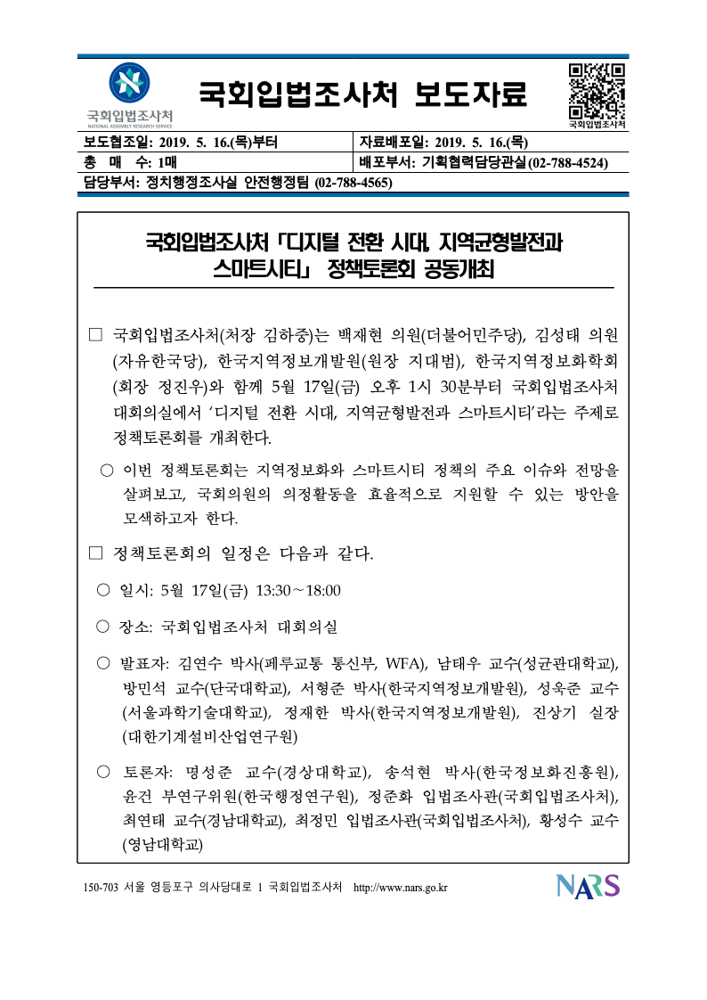 |  | 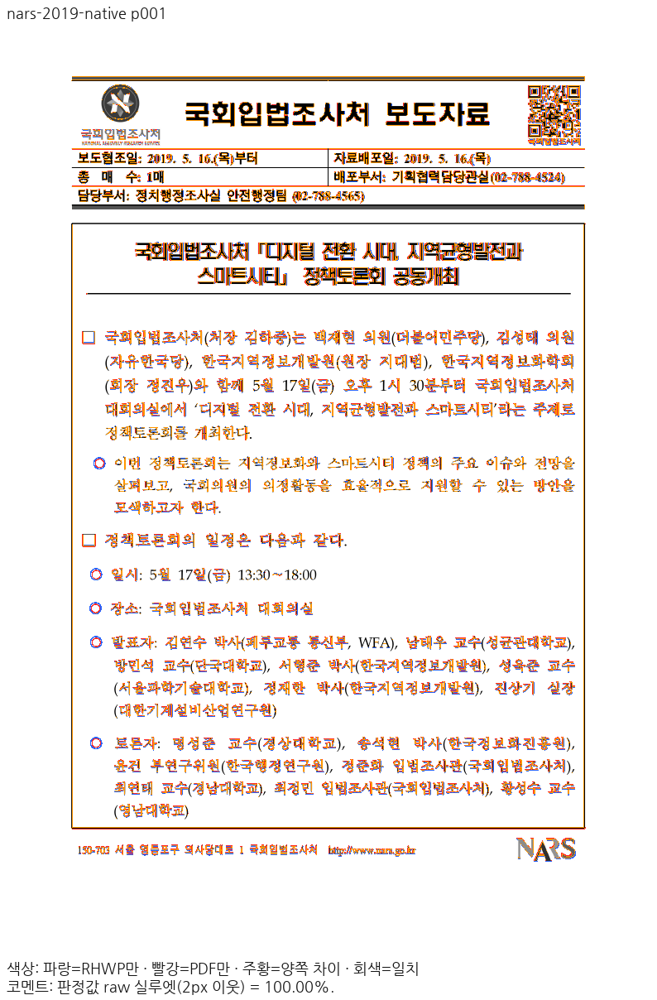 |
| fresh WASM | 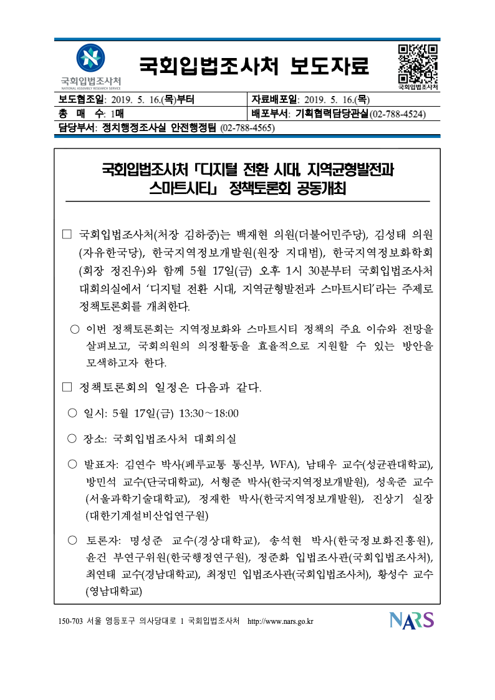 | 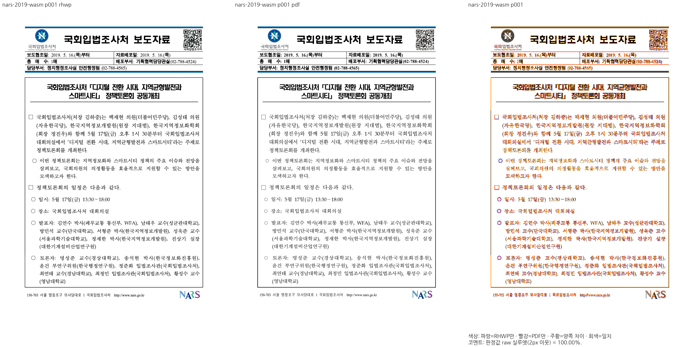 | 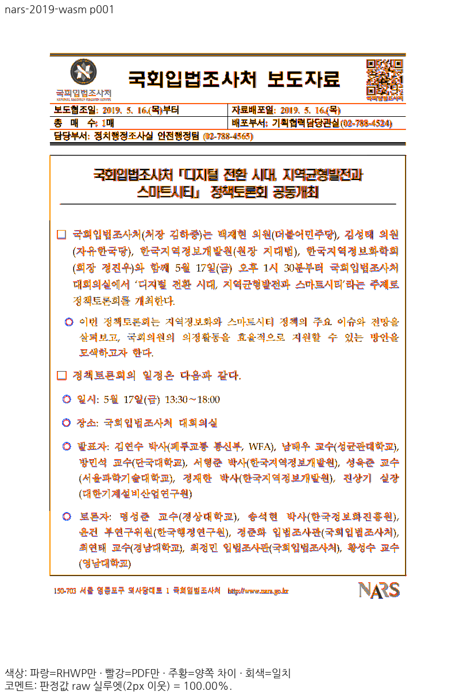 |

보도자료 머리의 로고·QR·배포/담당 정보, 본문 테두리와 제목·일시·장소·발표자·토론자, 하단 주소·로고의 소속을 확인했다.

### nars-2021

- 입력: [samples/issue8610/36849-nars-press-release-20211116.hwp](../../../samples/issue8610/36849-nars-press-release-20211116.hwp)
- 독립 Print: [pdf/issue8610/36849-nars-press-release-20211116-2022.pdf](../../../pdf/issue8610/36849-nars-press-release-20211116-2022.pdf)
- 전체 3쪽 Native 최저 99.97%. [TSV](../assets/planet6897_20261106/final-b768bee1-20261109/cases/nars-2021/native.tsv) · [입력/PDF·producer 해시](../assets/planet6897_20261106/final-b768bee1-20261109/cases/nars-2021/provenance.json).
- 전체 3쪽 fresh WASM 최저 99.97%. [TSV](../assets/planet6897_20261106/final-b768bee1-20261109/cases/nars-2021/wasm.tsv).

1쪽 Native **99.97%**: [raw](../assets/planet6897_20261106/final-b768bee1-20261109/cases/nars-2021/native/raw-001.png) · [PDF raw](../assets/planet6897_20261106/final-b768bee1-20261109/cases/nars-2021/native/pdf-001.png) · [review](../assets/planet6897_20261106/final-b768bee1-20261109/cases/nars-2021/native/review-001.png) · [overlay](../assets/planet6897_20261106/final-b768bee1-20261109/cases/nars-2021/native/overlay-001.png)

1쪽 fresh WASM **99.97%**: [raw](../assets/planet6897_20261106/final-b768bee1-20261109/cases/nars-2021/wasm/raw-001.png) · [PDF raw](../assets/planet6897_20261106/final-b768bee1-20261109/cases/nars-2021/wasm/pdf-001.png) · [review](../assets/planet6897_20261106/final-b768bee1-20261109/cases/nars-2021/wasm/review-001.png) · [overlay](../assets/planet6897_20261106/final-b768bee1-20261109/cases/nars-2021/wasm/overlay-001.png)

순환경제 토론회 자료의 로고·QR·헤더 정보, 제목과 사각/원형 항목·본문 마지막 문단의 줄/쪽 소속을 대조했다. 글머리 기호·제목 주변의 미세 윤곽 잔차는 구분한다.

| 경로 | raw | review | overlay |
| --- | --- | --- | --- |
| Native | 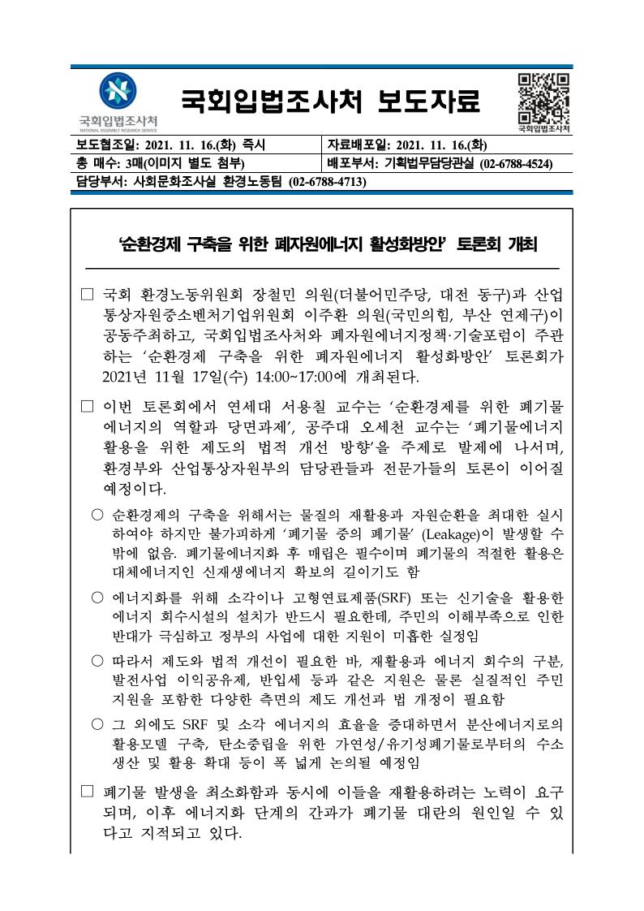 | 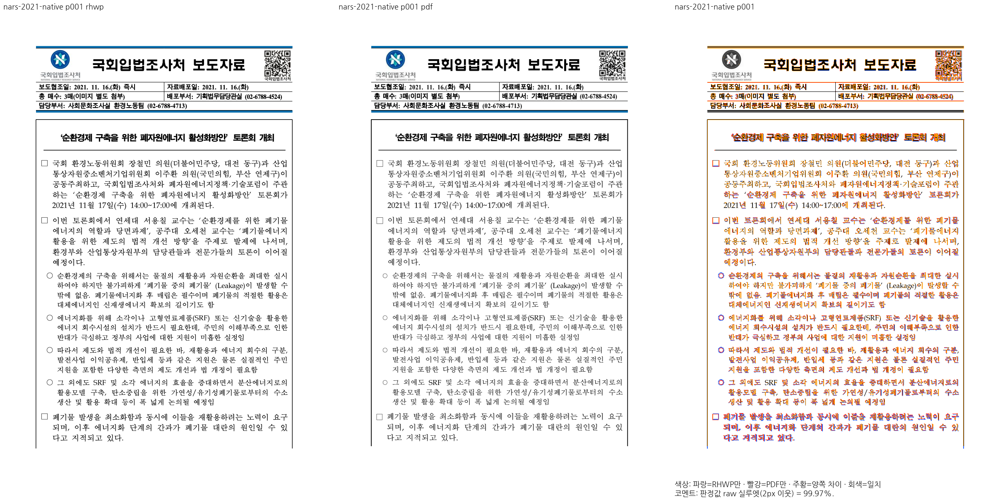 |  |
| fresh WASM | 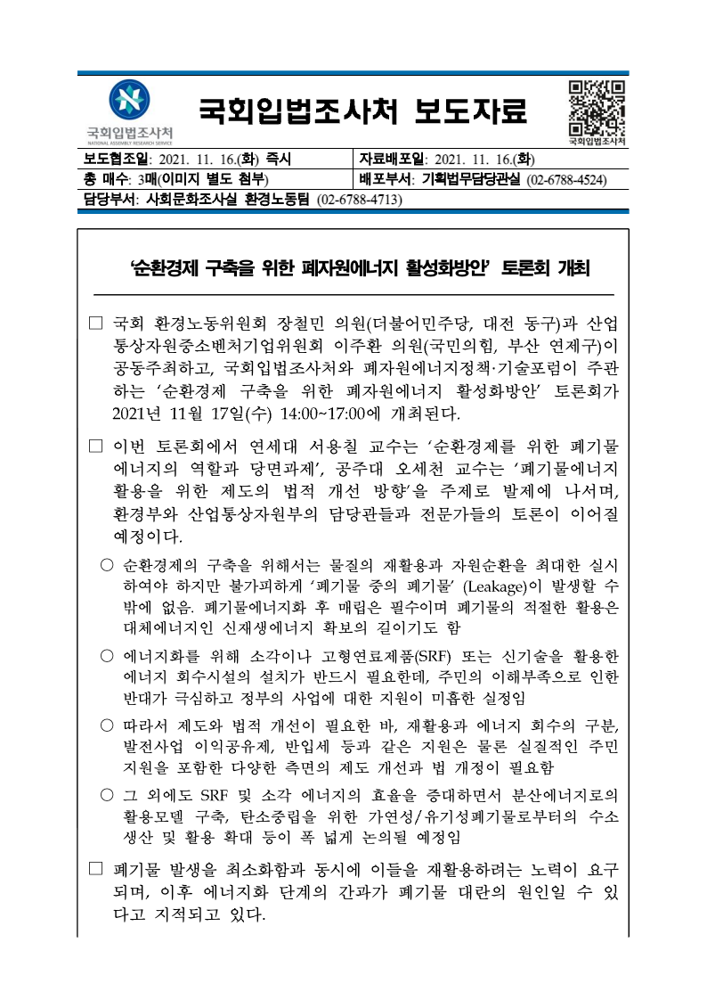 | 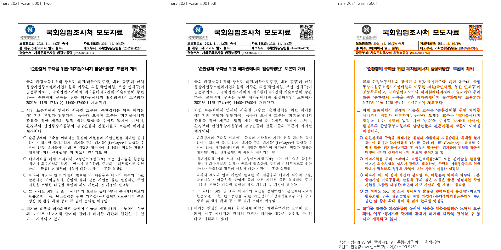 | 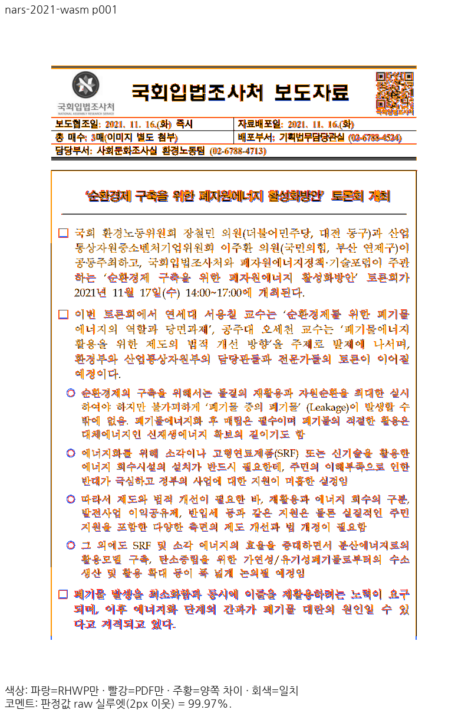 |

상단 배포 표와 제목·본문의 네모/원형 항목 및 하단 연속 프레임 시작을 확인했다. 제목과 본문의 글리프·윤곽 잔차는 남는다.

2쪽 Native **100.00%**: [raw](../assets/planet6897_20261106/final-b768bee1-20261109/cases/nars-2021/native/raw-002.png) · [PDF raw](../assets/planet6897_20261106/final-b768bee1-20261109/cases/nars-2021/native/pdf-002.png) · [review](../assets/planet6897_20261106/final-b768bee1-20261109/cases/nars-2021/native/review-002.png) · [overlay](../assets/planet6897_20261106/final-b768bee1-20261109/cases/nars-2021/native/overlay-002.png)

2쪽 fresh WASM **100.00%**: [raw](../assets/planet6897_20261106/final-b768bee1-20261109/cases/nars-2021/wasm/raw-002.png) · [PDF raw](../assets/planet6897_20261106/final-b768bee1-20261109/cases/nars-2021/wasm/pdf-002.png) · [review](../assets/planet6897_20261106/final-b768bee1-20261109/cases/nars-2021/wasm/review-002.png) · [overlay](../assets/planet6897_20261106/final-b768bee1-20261109/cases/nars-2021/wasm/overlay-002.png)

둘째 쪽의 이전 쪽에서 이어진 원형 항목과 현재까지도/이번 토론회/행사를 공동주최한 사각 항목, 세로 외곽과 마지막 인용문을 대조했다. 내용 누락·중복과 다음 쪽 침범이 없다.

| 경로 | raw | review | overlay |
| --- | --- | --- | --- |
| Native | 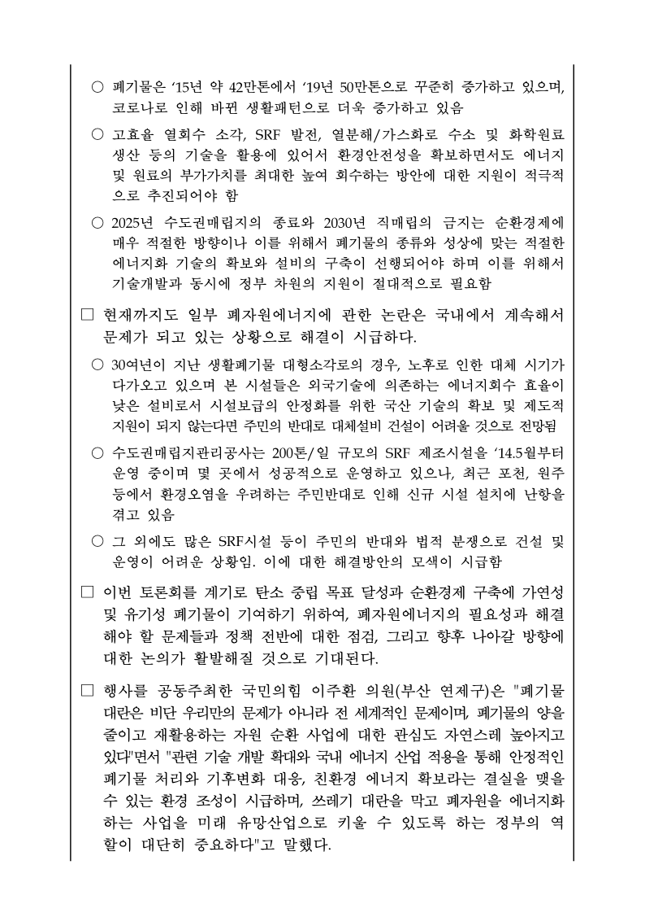 | 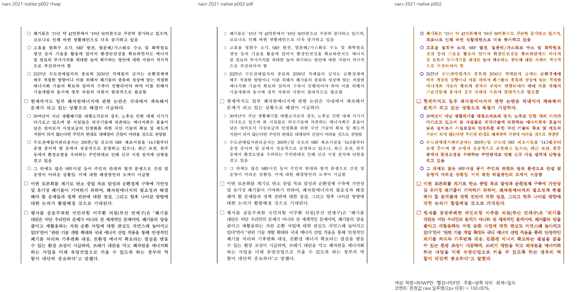 |  |
| fresh WASM | 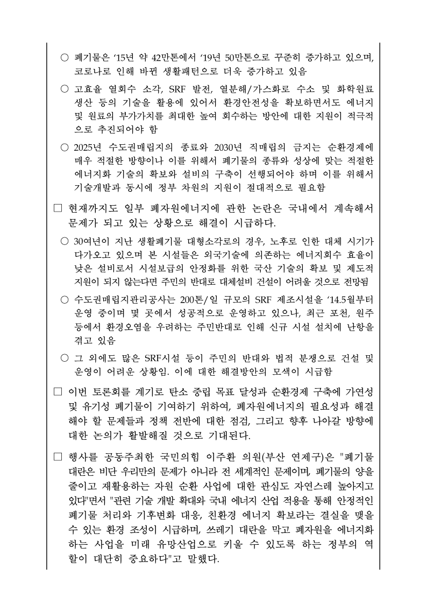 |  | 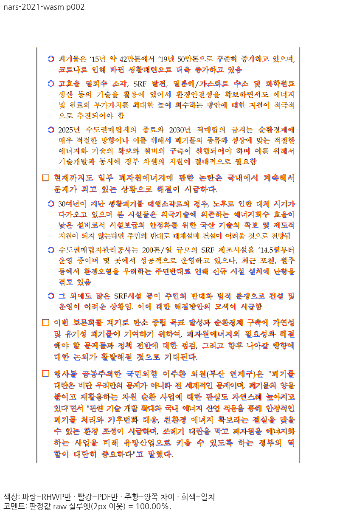 |

양옆 연속 괘선 사이 본문이 빠짐없이 이어지고, 마지막 인용문까지 같은 페이지에서 끝난다. 네모·원형 항목과 들여쓰기 및 줄 끝을 대조했다.

3쪽 Native **100.00%**: [raw](../assets/planet6897_20261106/final-b768bee1-20261109/cases/nars-2021/native/raw-003.png) · [PDF raw](../assets/planet6897_20261106/final-b768bee1-20261109/cases/nars-2021/native/pdf-003.png) · [review](../assets/planet6897_20261106/final-b768bee1-20261109/cases/nars-2021/native/review-003.png) · [overlay](../assets/planet6897_20261106/final-b768bee1-20261109/cases/nars-2021/native/overlay-003.png)

3쪽 fresh WASM **100.00%**: [raw](../assets/planet6897_20261106/final-b768bee1-20261109/cases/nars-2021/wasm/raw-003.png) · [PDF raw](../assets/planet6897_20261106/final-b768bee1-20261109/cases/nars-2021/wasm/pdf-003.png) · [review](../assets/planet6897_20261106/final-b768bee1-20261109/cases/nars-2021/wasm/review-003.png) · [overlay](../assets/planet6897_20261106/final-b768bee1-20261109/cases/nars-2021/wasm/overlay-003.png)

셋째 쪽 마지막 의원 인용문·두 담당자/이메일 줄, 외곽 아래끝과 주소/NARS footer를 확인했다. 표/float의 끝 문단이 사라지거나 footer를 덮지 않는다.

| 경로 | raw | review | overlay |
| --- | --- | --- | --- |
| Native | 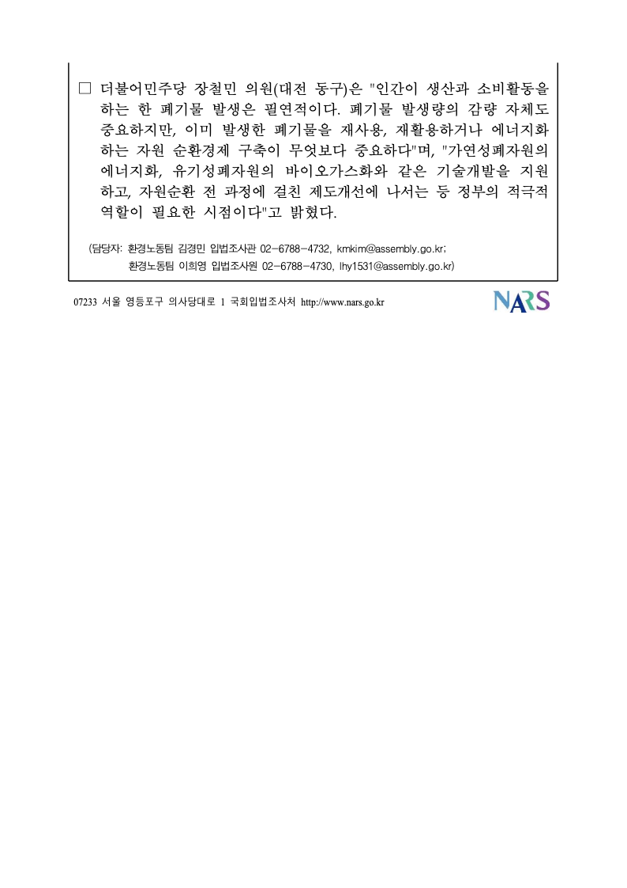 | 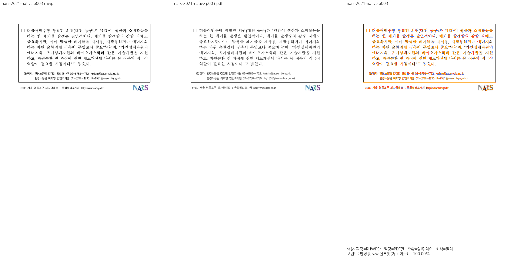 |  |
| fresh WASM | 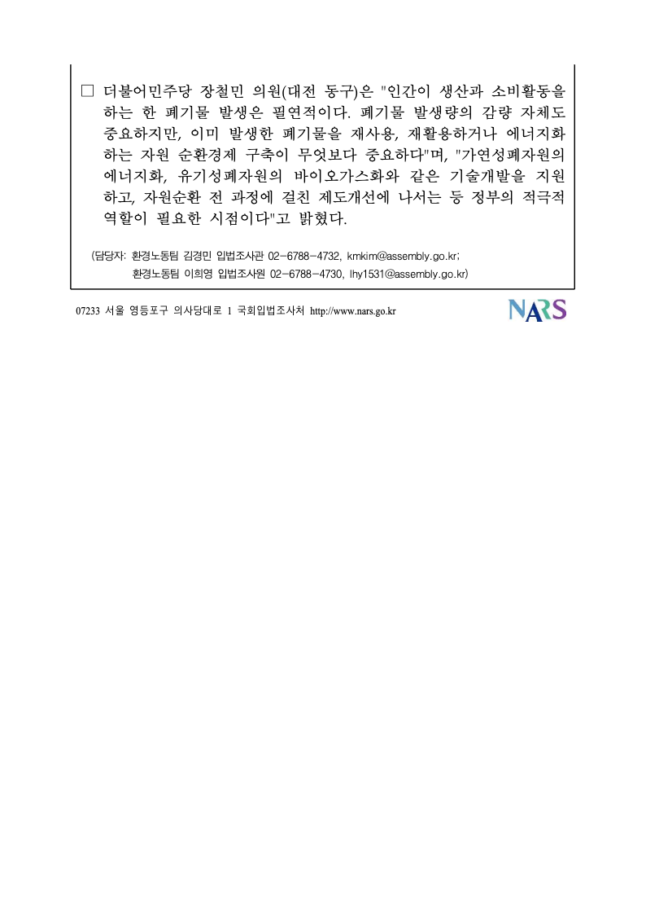 |  | 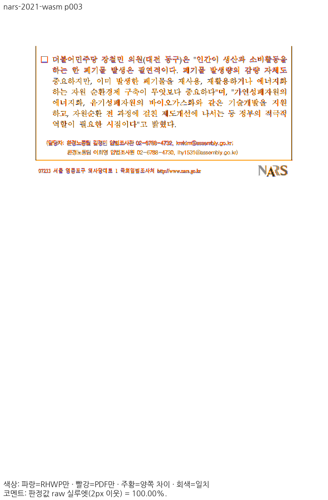 |

마지막 인용문과 담당자 두 줄·닫힌 하단 테두리·주소·NARS 로고를 확인했다. 큰 빈 영역은 기준과 같고 앞쪽 본문이 중복되지 않는다.

## 최종 제출과 원격 조건

기존 전쪽 TSV·직접 판독을 유지하고 리베이스 후 영향 2조건 8쪽과 앞선 HWP3 3조건 10쪽과 필수 집중·lint를 추가 검증했습니다. 엄격0.1%p 비교 잔여1건은 새 이슈로 분리하며 완전 무회귀로 표기하지 않습니다. 원격 게시 직전에 원 PR head·upstream/devel·제출 diff와 병합 시뮬레이션을 재확인합니다. 통합 PR의 실제 CI 성공과 최종 head의 mergeability를 확인한 뒤 승인된 병합·후속처리를 수행합니다.

## Merge 후 contributor PR comment 계획

통합 병합이 완료되면 최종 merge SHA·CI URL과 이 PR이 주장한 입력/페이지의 raw 이미지를 고정 SHA 링크로 연결합니다. 원 기여와 메인터너 보정 이유·범위를 한국어 존댓말로 구분하며, 별도 검증하지 않은 문제까지 해결했다고 쓰지 않습니다. 원 PR의 종료는 통합 병합 후 실제 해결 범위를 확인하여 처리합니다.
