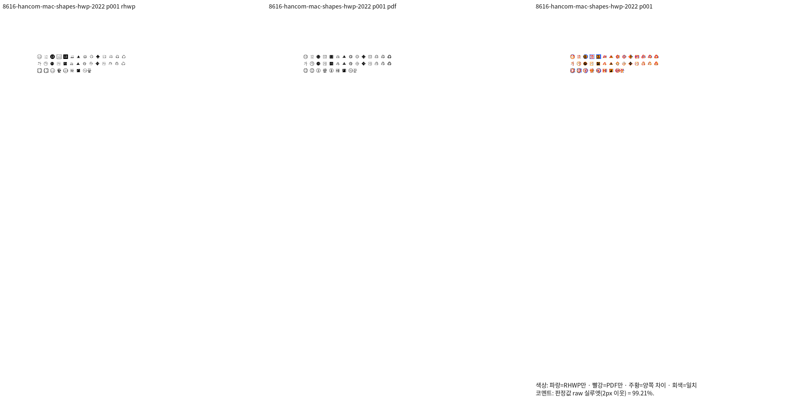
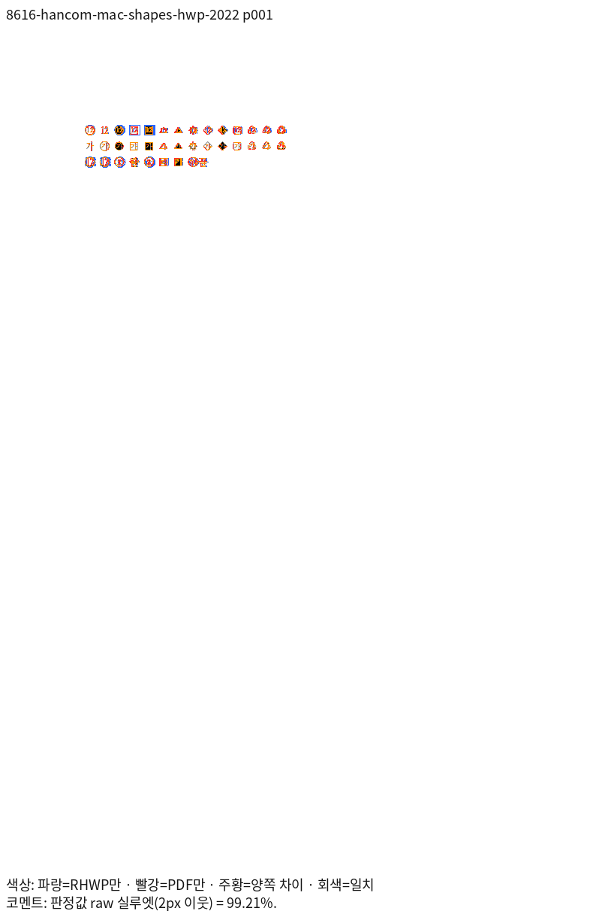
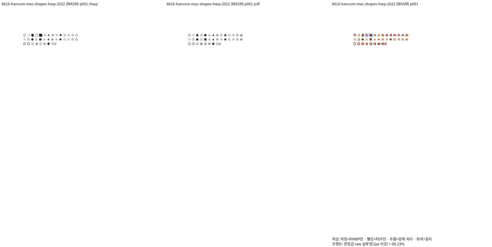
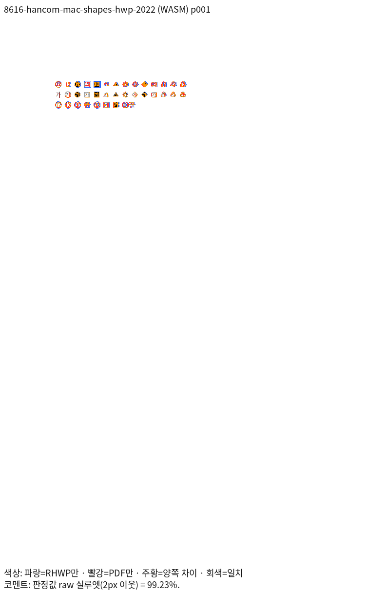
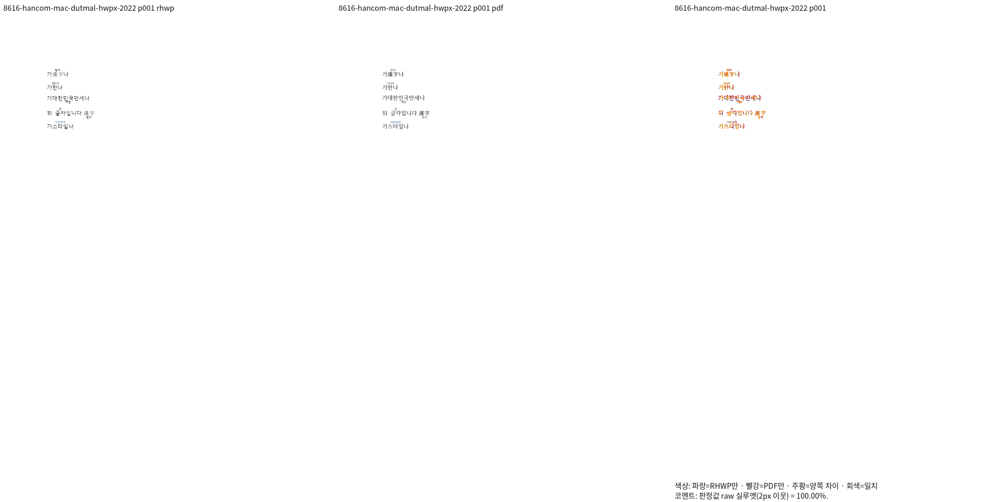
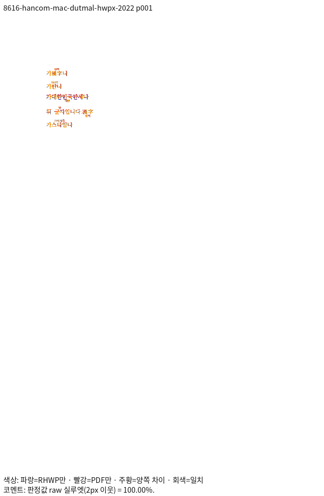
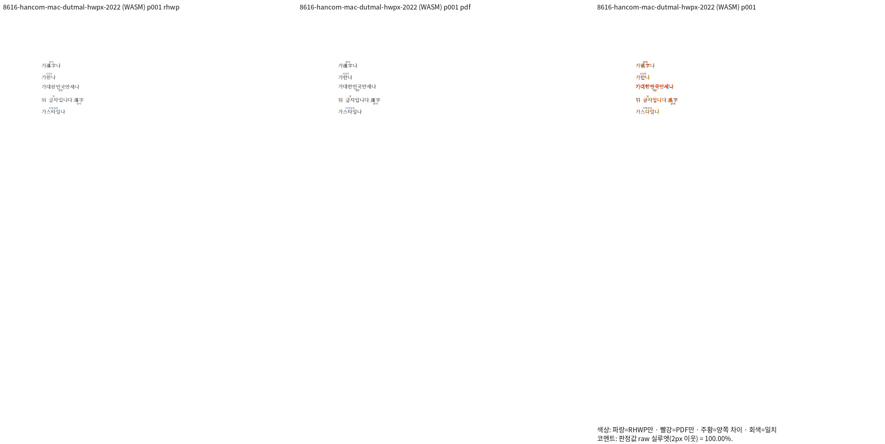
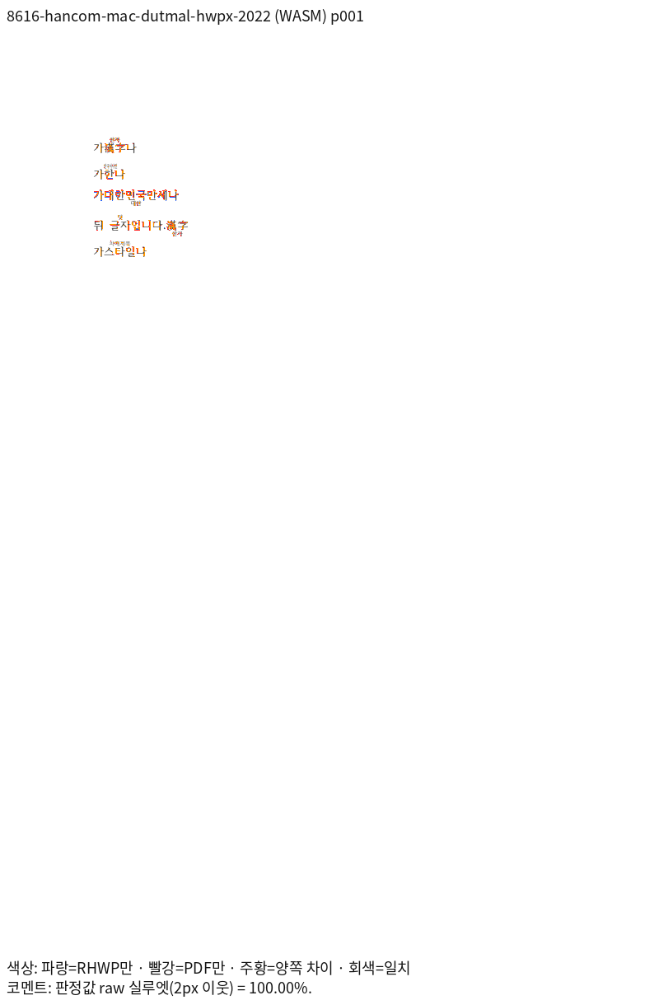

# PR #8616 리뷰 — fix: 덧말을 그리고 글자 겹치기 14모양을 한컴처럼 그리며 두 컨트롤을 넣고 고치는 API를 둔다 (#8019)

## 최종 판정

**메인터너 보정 후 수용 가능 — 원 PR 주장 범위의 로컬 검증 완료.**

원본별 Native/fresh WASM 전쪽 TSV와 같은 주장 페이지의 review·overlay를 아래에 연결했다. [통합 PR #8659](https://github.com/edwardkim/rhwp/pull/8659)의 정확한 code head CI가 성공했다. [통합 리뷰](pr_8659_review.md)에 실행 URL을 기록했으며, trailing head 확인·merge·원 PR close는 후속 조건이다.

## 접수 정보

- 원 PR: [PR #8616](https://github.com/edwardkim/rhwp/pull/8616), 작성자 `semanticist21`, reviewer `jangster77`.
- 원 head: `5768ed5323238c5b1e1027eb0e0dcba6c62e26d8`. 2026-11-06 재조회에서 검토 시작 때와 같고 Open·Non-Draft다.
- 고정 base: `170b886f167b705b6e630c5b34bb638d92fae0a9`(PR #8542 포함).
- 현재 제품 source: Rust `86709ac16711820e61baa3b87e2c4ddaac23573e` · Studio `5feccb130e0f695de0046d994c060130fa3e928e`. 아래 표는 R6 새 Native·fresh WASM 실제 측정이다. R5 과거 증거는 출처를 구분해 보존한다.
- 통합 브랜치: `review/integration-20261105-semanticist21-open`.

## 원 주장과 실제 검증 범위

실행 트리거: 덧말·14개 글자 겹치기 그리기 및 본문·셀·글상자·각주·미주 API 편집.

독립 기대 동작: 본말·덧말·테두리·PUA 숫자·전각 폭·줄 높이·캐럿·저장 보존.

원본 열기·모델 저장 검사와 실제 편집·저장·한컴 Print 시각 증거를 구분한다. 보충 입력은 원 PR 원본을 검증한 것으로 표현하지 않는다.

## 체리픽과 메인터너 보정

| 원 commit | 170b 리베이스 후 적용 commit |
| --- | --- |
| `70b3a3a937930e5752a271ed1d18c8efbf7cde14` | `2fb1103d8195261593769fef5255cc9f5a1aaee2` |
| `d0bddfa86f8f17a2dc2acefcd025484d8e7942d4` | `bb9341a4b2767d7be2412df014cf5b512ce447ea` |
| `28213394d0df5c1f96d417f46088d8a4dd318350` | `6417de28bcdcc0cfb6a1932074fee3aa4b55a3da` |
| `c469db2ce8128f016b70a8268fb2cb646457e15c` | `85da706892ad62e64fa4da08f6ae00660969f7eb` |
| `5768ed5323238c5b1e1027eb0e0dcba6c62e26d8` | `c4896bca1470d8555131b20574601c49a287fc05` |

공통 보정의 원인·소비 경로·리베이스 충돌 해소는 [통합 분석](../assets/semanticist21_20261105/integration-plan.md)에 기록했다.

## 검증 입력과 전쪽 결과

제품 R6의 실제 전체 페이지 측정이다. 두 출력 경로와 독립 Print PDF의 전체 쪽수가 일치하며,
모든 페이지가 90% 이상이다. 96 DPI·Print 프로필·색상 경계 보정 전 2px raw를 사용했다.

| 같은 원본·용도 | 전체 쪽수 | Native 최저 raw·TSV | fresh WASM 최저 raw·TSV | 독립 Print PDF |
| --- | ---: | --- | --- | --- |
| [hancom-mac-shapes.hwp](../../../samples/char_overlap/hancom-mac-shapes.hwp) — 글자 겹치기 14모양·PUA 숫자 | 1 | [99.2128%](../assets/semanticist21_20261105/validation-r6/tsv/8616-hancom-mac-shapes-hwp-2022-native.tsv) | [99.22558%](../assets/semanticist21_20261105/validation-r6/tsv/8616-hancom-mac-shapes-hwp-2022-wasm.tsv) | [PDF](../../../samples/char_overlap/hancom-mac-shapes.pdf) |
| [hancom-mac-shapes.hwpx](../../../samples/char_overlap/hancom-mac-shapes.hwpx) — HWPX 글자 겹치기 14모양 | 1 | [100.0%](../assets/semanticist21_20261105/validation-r6/tsv/8616-hancom-mac-shapes-hwpx-2022-native.tsv) | [100.0%](../assets/semanticist21_20261105/validation-r6/tsv/8616-hancom-mac-shapes-hwpx-2022-wasm.tsv) | [PDF](../../../samples/char_overlap/hancom-mac-shapes.pdf) |
| [hancom-mac-dutmal.hwp](../../../samples/dutmal/hancom-mac-dutmal.hwp) — 덧말 본말·덧말과 기준선 | 1 | [100.0%](../assets/semanticist21_20261105/validation-r6/tsv/8616-hancom-mac-dutmal-hwp-2022-native.tsv) | [100.0%](../assets/semanticist21_20261105/validation-r6/tsv/8616-hancom-mac-dutmal-hwp-2022-wasm.tsv) | [PDF](../../../samples/dutmal/hancom-mac-dutmal.pdf) |
| [hancom-mac-dutmal.hwpx](../../../samples/dutmal/hancom-mac-dutmal.hwpx) — HWPX 덧말 본말·덧말 | 1 | [100.0%](../assets/semanticist21_20261105/validation-r6/tsv/8616-hancom-mac-dutmal-hwpx-2022-native.tsv) | [100.0%](../assets/semanticist21_20261105/validation-r6/tsv/8616-hancom-mac-dutmal-hwpx-2022-wasm.tsv) | [PDF](../../../pdf/semanticist21-20261105/pr8616/hancom-mac-dutmal-hwpx-2020.pdf) |
| [hancom-mac-shapes.hwp](../../../samples/char_overlap/hancom-mac-shapes.hwp) — 글자 겹치기 14모양·PUA 숫자 | 1 | [99.27308%](../assets/semanticist21_20261105/validation-r6/tsv/8616-hancom-mac-shapes-hwp-2024-native.tsv) | [99.25168%](../assets/semanticist21_20261105/validation-r6/tsv/8616-hancom-mac-shapes-hwp-2024-wasm.tsv) | [PDF](../../../samples/char_overlap/hancom-mac-shapes.pdf) |
| [hancom-mac-shapes.hwpx](../../../samples/char_overlap/hancom-mac-shapes.hwpx) — HWPX 글자 겹치기 14모양 | 1 | [100.0%](../assets/semanticist21_20261105/validation-r6/tsv/8616-hancom-mac-shapes-hwpx-2024-native.tsv) | [100.0%](../assets/semanticist21_20261105/validation-r6/tsv/8616-hancom-mac-shapes-hwpx-2024-wasm.tsv) | [PDF](../../../samples/char_overlap/hancom-mac-shapes.pdf) |
| [hancom-mac-dutmal.hwp](../../../samples/dutmal/hancom-mac-dutmal.hwp) — 덧말 본말·덧말과 기준선 | 1 | [100.0%](../assets/semanticist21_20261105/validation-r6/tsv/8616-hancom-mac-dutmal-hwp-2024-native.tsv) | [100.0%](../assets/semanticist21_20261105/validation-r6/tsv/8616-hancom-mac-dutmal-hwp-2024-wasm.tsv) | [PDF](../../../samples/dutmal/hancom-mac-dutmal.pdf) |
| [36389301_결재문서본문_직장훈련계획_덧말.hwpx](../../../samples/hwpx/opengov/36389301_결재문서본문_직장훈련계획_덧말.hwpx) — 원 PR의 결재 문서 덧말 본말·덧말 표시 | 2 | [100.0%](../assets/semanticist21_20261105/validation-r6/tsv/8616-opengov-ruby-native.tsv) | [100.0%](../assets/semanticist21_20261105/validation-r6/tsv/8616-opengov-ruby-wasm.tsv) | [PDF](../../../pdf/semanticist21-20261105/pr8616/opengov-36389301-ruby-2020.pdf) |
| [nonbmp-endnote-false.hwp](../../../tests/fixtures/char_overlap_caret_axis/nonbmp-endnote-false.hwp) — 같은 검사 파일의 기존 ±2px 캐럿 핀을 유지하는 완료 페이지의 98% 조건 확인. 원 PR의 대표 문서로 대체하지 않음 | 1 | [100.0%](../assets/semanticist21_20261105/validation-r6/tsv/8616-existing-caret-false-hwp-native.tsv) | [100.0%](../assets/semanticist21_20261105/validation-r6/tsv/8616-existing-caret-false-hwp-wasm.tsv) | [PDF](../../../pdf/issue7819_char_overlap_caret_axis/nonbmp-endnote-false-hwp-2020.pdf) |
| [nonbmp-endnote-false.hwpx](../../../tests/fixtures/char_overlap_caret_axis/nonbmp-endnote-false.hwpx) — 같은 검사 파일의 기존 ±2px 캐럿 핀을 유지하는 완료 페이지의 98% 조건 확인. 원 PR의 대표 문서로 대체하지 않음 | 1 | [100.0%](../assets/semanticist21_20261105/validation-r6/tsv/8616-existing-caret-false-hwpx-native.tsv) | [100.0%](../assets/semanticist21_20261105/validation-r6/tsv/8616-existing-caret-false-hwpx-wasm.tsv) | [PDF](../../../pdf/issue7819_char_overlap_caret_axis/nonbmp-endnote-false-hwpx-2020.pdf) |
| [nonbmp-endnote-true.hwp](../../../tests/fixtures/char_overlap_caret_axis/nonbmp-endnote-true.hwp) — 같은 검사 파일의 기존 ±2px 캐럿 핀을 유지하는 완료 페이지의 98% 조건 확인. 원 PR의 대표 문서로 대체하지 않음 | 1 | [100.0%](../assets/semanticist21_20261105/validation-r6/tsv/8616-existing-caret-true-hwp-native.tsv) | [100.0%](../assets/semanticist21_20261105/validation-r6/tsv/8616-existing-caret-true-hwp-wasm.tsv) | [PDF](../../../pdf/issue7819_char_overlap_caret_axis/nonbmp-endnote-true-hwp-2020.pdf) |
| [nonbmp-endnote-true.hwpx](../../../tests/fixtures/char_overlap_caret_axis/nonbmp-endnote-true.hwpx) — 같은 검사 파일의 기존 ±2px 캐럿 핀을 유지하는 완료 페이지의 98% 조건 확인. 원 PR의 대표 문서로 대체하지 않음 | 1 | [100.0%](../assets/semanticist21_20261105/validation-r6/tsv/8616-existing-caret-true-hwpx-native.tsv) | [100.0%](../assets/semanticist21_20261105/validation-r6/tsv/8616-existing-caret-true-hwpx-wasm.tsv) | [PDF](../../../pdf/issue7819_char_overlap_caret_axis/nonbmp-endnote-true-hwpx-2020.pdf) |

[원본·PDF SHA·producer·정밀 raw](../assets/semanticist21_20261105/validation-r6/measurements.md), [측정 명령·환경](../assets/semanticist21_20261105/validation-r6/README.md)를 연결한다. 원 PR 원본·실제 API 저장본·보충 대조군의 용도를 구분한다.

## 주장에 대응하는 페이지 증적

같은 원본·독립 PDF·페이지의 실제 PNG다. 직접 판독과 실제 API 검증을 구분한다. 일부 Native 패널은 현재 RHWP/PDF PNG 쌍의 SHA가 이전 판독 쌍과 각각 같음을 확인해 재사용했다.

### 8616-hancom-mac-shapes-hwp-2022 · 1쪽

원 PR 한컴 저장본의 14개 겹침 모양·PUA 숫자와 전각 폭

**native raw 99.2128%** — 14개 모양의 순서·두 자리 12·반전 모양·뒤 한글·끝 문자열이 같은 첫 쪽에 남는다. PUA 자체가 본문으로 노출되지 않고 원·사각·삼각·순환 모양과 숫자가 보인다. 획 농도·경계의 차이는 raw와 구분한다.

**wasm raw 99.22558%** — 14개 모양의 원·반전원·사각형·삼각형·순환 기호와 PUA 숫자12, 아래 한글 겹침 글자·후속 끝 글자가 보존된다. 자원 글리프의 미세한 윤곽 차이는 있으나 전각 칸·문자 순서는 대응한다.

### 8616-hancom-mac-dutmal-hwpx-2022 · 1쪽

원 PR의 본말·덧말 실제 표시

**native raw 100.0%** — 漢字·한·대한민국만세·글자·스타일의 본말과 위·아래 덧말의 소속을 대조했다. 본문 앞 가·뒤 나·후속 문자열과 덧말의 위아래 위치, 차례제목의 색상·크기를 보존한다.

**wasm raw 100.0%** — 본말 漢字·한·대한민국만세·글자·스타일 및 위·아래 덧말의 소속과 순서, 후속 본문 원점이 독립 Print와 대응한다.

## 회귀와 조판 원칙 준수

- [tests/cases/char_overlap_caret_axis.rs](../../../tests/cases/char_overlap_caret_axis.rs)
- [tests/cases/char_overlap_hancom_shapes.rs](../../../tests/cases/char_overlap_hancom_shapes.rs)
- [tests/cases/compose_controls_insert.rs](../../../tests/cases/compose_controls_insert.rs)
- [tests/cases/ruby_hancom_render.rs](../../../tests/cases/ruby_hancom_render.rs)

- 현재 전쪽 검증은 Native 128입력·301쪽 최저 91.81401%, fresh WASM 128입력·301쪽 최저 91.17272%다. 같은 새 base의 각 301쪽 대비 하락 0쪽이다. [현재 증거](../assets/semanticist21_20261105/validation-r6/README.md)를 연결한다.
- 실제 API 12그룹·브라우저 동작·TypeScript/production build·생성 타입 export와 소비 검사는 [API](../assets/semanticist21_20261105/validation-r6/api/README.md)·[UI](../assets/semanticist21_20261105/validation-r6/ui/README.md)에 연결했다. 원래 R5 전체 Rust 12,735건을 R6 새 실행으로 표현하지 않는다.
- 최소 공개 글꼴 5개에서 현재 전체 Rust 12,740건 PASS·기존 ignored 45건, 실제 목록 누락·중복 0이다. 최종 편람·lint·Skia·release·doctest도 완료했다.
- 실제 assertion을 확인해 관계형·고정형을 구분하고 27개 파일 첫머리를 실제 측정값으로 갱신했다. 원본 단위·비율 계약은 유지하며, [17개 완료 페이지](../assets/semanticist21_20261105/validation-r6/qualification.md)는 양쪽 98% 이상과 독립 확대 판독 근거로 기존 고정 좌표를 유지한다.
- 원래 웹폰트 수명 검사는 관련 충돌이 없어 재사용했으나, 최종 Studio 기호 공급 보정은 로딩 경로를 바꾸므로 로더 수명 14건과 실제 브라우저 7시나리오를 추가 실행해 모두 통과했다.

## Merge 후 contributor PR comment 계획

통합 PR의 실제 CI URL·code/trailing head와 확정 merge SHA를 기록한 뒤 원 PR에 한국어 존댓말로 결과를 게시한다. 기존 comment가 있으면 해당 comment를 수정하고 API로 다시 확인한다. 원 기여의 해결 범위와 위 공통 메인터너 보정을 구분한다.

- 실제 확인 페이지: 8616-hancom-mac-shapes-hwp-2022 p1, 8616-hancom-mac-dutmal-hwpx-2022 p1.
- Native/fresh WASM의 위 같은 원본·쪽 review와 overlay를 사용한다. 수치와 직접 판독 결론·한계는 본문 관측을 그대로 반영한다.
- 대표 이미지 안정 경로: `mydocs/pr/assets/semanticist21_20261105/validation-r6/png/pr8616/<backend>/<key>/<review 또는 overlay>_NNN.png`. 같은 PR의 추가 완료 페이지는 [패널 목록](../assets/semanticist21_20261105/validation-r6/panels.md)을 따른다.
- URL은 `https://raw.githubusercontent.com/edwardkim/rhwp/<merge-commit-sha>/` 뒤에 위 실제 경로를 붙인다. devel 포함 확인 후 `--body-file` 게시·API 재조회한다.
- 문서 비교는 [Visual Sweep 정본](https://github.com/edwardkim/rhwp/blob/devel/mydocs/manual/verification/visual_sweep_guide.md#github-merge-comment)을 따른다. 원 PR·관련 이슈 close는 같은 해결 범위의 완료와 포함 관계를 확인한 뒤 처리한다.
- 실제 Studio의 추가 글꼴 보정은 `studio-symbol/overlap`·`studio-symbol/ruby`의 같은 원본 1쪽 review·overlay·TSV와 실제 backend 화면을 함께 사용한다.

## Mac 네 원본의 전체 페이지 계약

HWP/HWPX 겹침·덧말 네 입력의 전체 1쪽을 독립 Print와 대조했다. 기존 모양·내용 순서 검사는 유지하고 전체 쪽수·내용 보존 검사를 보완했다. [관련 6건 최소 글꼴 PASS](../assets/semanticist21_20261105/validation-r6/runtime-checks.md)를 연결한다. Mac PDF의 버전을 2020으로 재표기하거나 oracle PDF 선택 정책을 완화하지 않았다.

## 실제 Studio의 단색 기호 공급 보정

원 PR이 추가한 U+267B 겹침 모양은 원본과 독립 Print에서 검정이지만, Studio Canvas2D의
자동 fallback이 컬러 이모지를 선택했다. 기존 전각 함초롬바탕을 반각 D2Coding·자동 이모지보다 먼저 소비하고,
공통 CSS 병합에서 기존 원 요청·설치 별칭·로컬 승인·문서 대체 정책을 보존했다.
새 비공개 글꼴 프로그램을 추가하지 않았다. 실제 Canvas2D·CanvasKit compatibility/default의
screen/print 12캡처에서 검정 모양과 원래 파란 덧말을 함께 확인했다.
[원인·관계형 회귀·라이선스 분석](../assets/semanticist21_20261105/canvas-symbol-fallback-analysis.md),
[같은 두 원본 1쪽의 실제 Studio review·overlay·TSV](../assets/semanticist21_20261105/studio-symbol/README.md)를 연결한다.
Canvas2D raw는 겹침·덧말 모두 100.00000%이며 직접 WASM exporter 100.00%와 구분한다.

## 관련 이슈의 후속 처리

- [Issue #8019](https://github.com/edwardkim/rhwp/issues/8019): Ruby·CharOverlap의 실제 삽입/읽기/속성 편집·ByPath와 덧말·14모양 출력을 확인했다.
- 실제 통합 CI·merge·devel 포함을 확인한 뒤 같은 증거를 연결해 완료 처리한다. 로컬 판정과 원격 상태는 구분한다.
