# PR #8642 리뷰 — fix(typeset): 앞 조각만 들어가는 각주는 앞 조각만 비용으로 잡고, 블록 표 각주 조각은 paint 측정으로 잰다 (#8468 후속)

## 최종 판정

**메인터너 보정 후 수용 가능 — 원 기여와 추가 보정을 포함한 통합 code head의 주장 범위를 검증했습니다. 원 contributor head의 직접 병합을 승인하는 판정은 아닙니다.**

원 PR head와 메인터너 보정을 포함한 통합 code head를 구분합니다. 위 exact code head의 필수 CI를 확인했습니다. 문서 trailing head의 실제 검사·충돌 여부를 다시 확인하며, 원 PR은 통합 병합을 확인한 뒤 종료합니다.

## 최종 source와 재사용 범위

제출 code head `2e262d0d4b2885b130e2db917b86e894710425e4`, base `e00f9b7e26e581896fa17eaff3c8eb3f4889f9d4`입니다. 아래 전체 회귀·전쪽 수치는 원 실측 HEAD의 증거를 재사용한 기록입니다. 최신 집중 검사와 페이지별 producer, 엄격 0.1%p 잔여 한 건은 [재사용·최종 판정](../assets/planet6897_20261106/final-b768bee1-20261109/validation-reuse.md)을 따릅니다. 보호 TSV 표시값 하락은 0입니다.

## 통합 PR의 exact code head CI

- [통합 PR #8857](https://github.com/edwardkim/rhwp/pull/8857), code head `29c74b69851bc6578f10a2c78e23592a05b69a5d`.
- [CI 실행](https://github.com/edwardkim/rhwp/actions/runs/42621490405)과 같은 code head의 CodeQL·Render Diff·Adapter·Proptest·정책 검사를 실제 확인했습니다. 기록 확인 시각: `2026-11-09T22:58:24.689803+09:00`.
- 기본 기능 worker A–E의 실제 nextest는 **12,934 PASS / 0 FAIL / 45 skip**입니다. 기존 로컬 13,105건과 실행 범위·HEAD가 다르므로 합산하지 않습니다.
- source·test·workflow를 추가로 변경하지 않고 이 검토·오늘할일만 단일 부모 trailing commit으로 보완합니다. trailing head의 실제 CI/fast-pass와 mergeability는 push 뒤 별도로 확인하며, 문서만 바뀌었다는 이유로 통과를 미리 가정하지 않습니다.
- [잔여 이슈 #8856](https://github.com/edwardkim/rhwp/issues/8856)은 9문서군의 글리프·간격·도형 및 clip5587 Native 4쪽의 엄격 0.1%p 미충족을 계속 추적합니다. 부분 해결 #8635·#8636과 부모 #7445는 일괄 종료하지 않습니다.

## 접수 정보

- 원 PR: [#8642](https://github.com/edwardkim/rhwp/pull/8642), 작성자 `planet6897`, reviewer `jangster77`.
- 원 head: `7d40345bc014f3cb4eca4235783afcfb670899f9`. 마지막 실시간 확인과 상태는 [조회 기록](../assets/planet6897_20261106/final-b768bee1-20261109/original-pr-heads.json)을 따릅니다.
- 통합 base: `b768bee1c4c0023087687f79a0a95f12108743e9`, 검증 code head: `eb876d1416fb558c874f9efec65c5722a6769751`.
- 브랜치: `review/integration-20261106-planet6897-open`. 통합 PR #8857을 제출했고 위 code head CI를 완료했습니다. 최종 trailing head 검사·병합·원 PR 후속 종료는 별도로 확인합니다.

## 변경과 검토 범위

fix(typeset): 앞 조각만 들어가는 각주는 앞 조각만 비용으로 잡고, 블록 표 각주 조각은 paint 측정으로 잰다 (#8468 후속)

[이 PR의 구현·메인터너 보정 계획](pr_8642_review_impl.md) · [통합 범위와 적용 순서](../assets/planet6897_20261106/integration-plan.md) · [원본→실제 적용 커밋](../assets/planet6897_20261106/contributor-commit-map-final.tsv).

## 검증 입력과 결과

code head `eb876d1416fb558c874f9efec65c5722a6769751`의 최소 글꼴 환경 기본 전체 회귀는 **13,105 PASS / 0 FAIL / 45 skipped**, 실행 570.421초입니다. Native 전쪽은 **94조건·2,995쪽**, 최저 **92.24%**, 90% 미만·쪽수 불일치·누락은 0입니다. 보호 TSV 1,771쪽의 공식 두 자리 표시값 하락은 0입니다. 이는 전체 범위의 요약이며 각 PR 주장은 아래 해당 입력·페이지로 대조합니다.

Native HWPX 편람 최소 글꼴/공개 웹폰트 383쪽 gate도 통과했습니다. 공식 두 자리 표시값은 130쪽 99.96%, 나머지 382쪽 100.00%입니다. 이는 보정 전 2px 내용 실루엣 값이며 엄격 RGB 동일성을 뜻하지 않습니다.

일반 base 대비 하락 허용폭은 이번 통합에 사용자가 지정한 **0.1%p**를 유지합니다. 별도 정본 보호 TSV의 공식 두 자리 표시값은 하락을 허용하지 않습니다. 최신 base `b768bee1`와 리베이스 전 후보를 같은 입력·PDF·글꼴·DPI·호환 버전으로 전쪽 대조했습니다. [Native 비교](../assets/planet6897_20261106/final-b768bee1-20261109/comparisons/latest-base-native-comparison.tsv) · [fresh WASM 비교](../assets/planet6897_20261106/final-b768bee1-20261109/comparisons/latest-base-wasm-comparison.tsv). 완료 쪽의98% 미만 후퇴·일반2%p 초과 하락은 없습니다. 엄격0.1%p 비교의 Native 뒤배경 표4쪽 잔여0.14171%p는 사용자 지시에 따라 신규 이슈로 분리하며 무회귀로 표기하지 않습니다.

관련 회귀 source: [tests/cases/issue_8468_footnote_line_reserve.rs](../../../tests/cases/issue_8468_footnote_line_reserve.rs)

## 시각 증적과 남은 차이

fresh WASM도 **94조건·2,995쪽**, 최저 **92.29%**, 90% 미만·누락·쪽수 불일치 0이며 보호 1,771쪽의 공식 표시값 하락은 0입니다. 추가 Native 전용 11개 모듈은 **73 PASS / 0 FAIL**입니다. 기본 전체 회귀의 45 skipped와 선택 밖 검사는 구분합니다.

### reserve-a10

- 입력: [samples/issue8468/line_reserve_F20_L30_A10_R1_T20.hwp](../../../samples/issue8468/line_reserve_F20_L30_A10_R1_T20.hwp)
- 독립 Print: [pdf/issue8468/line_reserve_F20_L30_A10_R1_T20-2020.pdf](../../../pdf/issue8468/line_reserve_F20_L30_A10_R1_T20-2020.pdf)
- 전체 2쪽 Native 최저 100.00%. [TSV](../assets/planet6897_20261106/final-b768bee1-20261109/cases/reserve-a10/native.tsv) · [입력/PDF·producer 해시](../assets/planet6897_20261106/final-b768bee1-20261109/cases/reserve-a10/provenance.json).
- 전체 2쪽 fresh WASM 최저 100.00%. [TSV](../assets/planet6897_20261106/final-b768bee1-20261109/cases/reserve-a10/wasm.tsv).

1쪽 Native **100.00%**: [raw](../assets/planet6897_20261106/final-b768bee1-20261109/cases/reserve-a10/native/raw-001.png) · [PDF raw](../assets/planet6897_20261106/final-b768bee1-20261109/cases/reserve-a10/native/pdf-001.png) · [review](../assets/planet6897_20261106/final-b768bee1-20261109/cases/reserve-a10/native/review-001.png) · [overlay](../assets/planet6897_20261106/final-b768bee1-20261109/cases/reserve-a10/native/overlay-001.png)

1쪽 fresh WASM **100.00%**: [raw](../assets/planet6897_20261106/final-b768bee1-20261109/cases/reserve-a10/wasm/raw-001.png) · [PDF raw](../assets/planet6897_20261106/final-b768bee1-20261109/cases/reserve-a10/wasm/pdf-001.png) · [review](../assets/planet6897_20261106/final-b768bee1-20261109/cases/reserve-a10/wasm/review-001.png) · [overlay](../assets/planet6897_20261106/final-b768bee1-20261109/cases/reserve-a10/wasm/overlay-001.png)

본문 001~044와 각주 1의 분리를 확인했다. 본문이 하단 표의 높이를 미리 소모하지 않고 해당 쪽의 각주를 보존한다.

| 경로 | raw | review | overlay |
| --- | --- | --- | --- |
| Native | 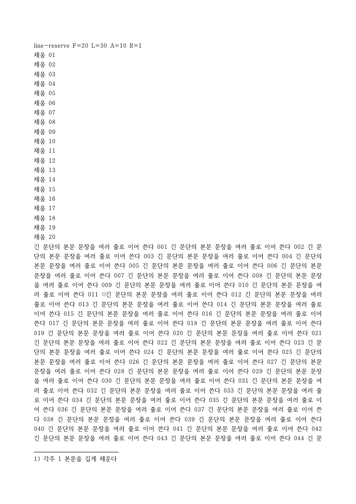 |  | 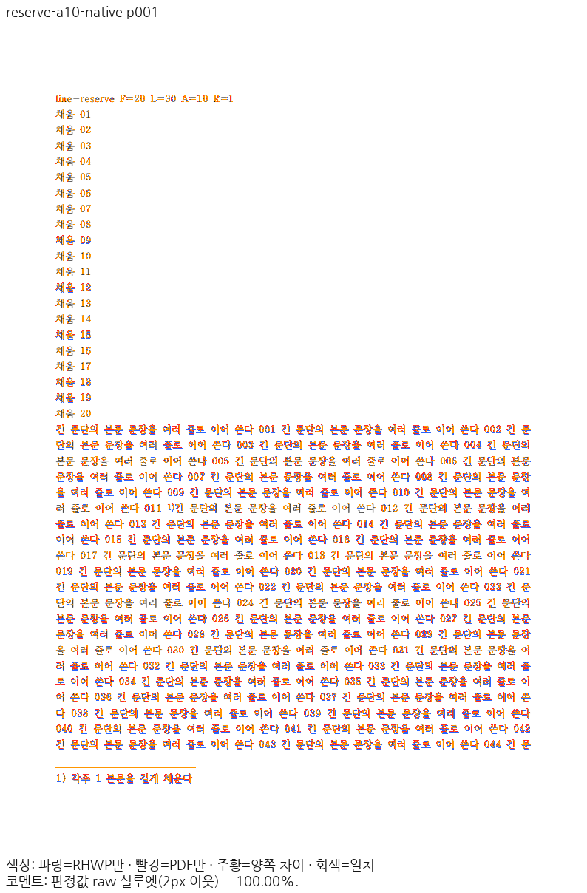 |
| fresh WASM | 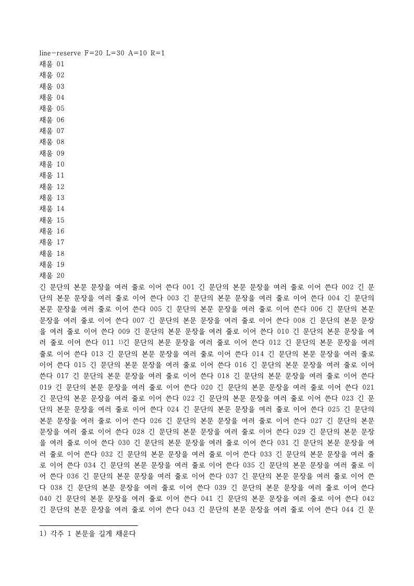 | 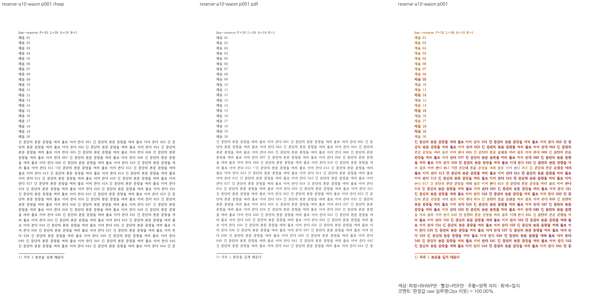 |  |

채움01~20과 긴 본문이 같은 위치에서 시작하고 본문044까지 1쪽에 남는다. 하단 각주1과 구분선이 본문을 침범하지 않는다.

2쪽 Native **100.00%**: [raw](../assets/planet6897_20261106/final-b768bee1-20261109/cases/reserve-a10/native/raw-002.png) · [PDF raw](../assets/planet6897_20261106/final-b768bee1-20261109/cases/reserve-a10/native/pdf-002.png) · [review](../assets/planet6897_20261106/final-b768bee1-20261109/cases/reserve-a10/native/review-002.png) · [overlay](../assets/planet6897_20261106/final-b768bee1-20261109/cases/reserve-a10/native/overlay-002.png)

2쪽 fresh WASM **100.00%**: [raw](../assets/planet6897_20261106/final-b768bee1-20261109/cases/reserve-a10/wasm/raw-002.png) · [PDF raw](../assets/planet6897_20261106/final-b768bee1-20261109/cases/reserve-a10/wasm/pdf-002.png) · [review](../assets/planet6897_20261106/final-b768bee1-20261109/cases/reserve-a10/wasm/review-002.png) · [overlay](../assets/planet6897_20261106/final-b768bee1-20261109/cases/reserve-a10/wasm/overlay-002.png)

본문 045~060과 TAIL이 이어지고 같은 쪽 하단에 각주 표 20행이 온전히 보존된다.

| 경로 | raw | review | overlay |
| --- | --- | --- | --- |
| Native | 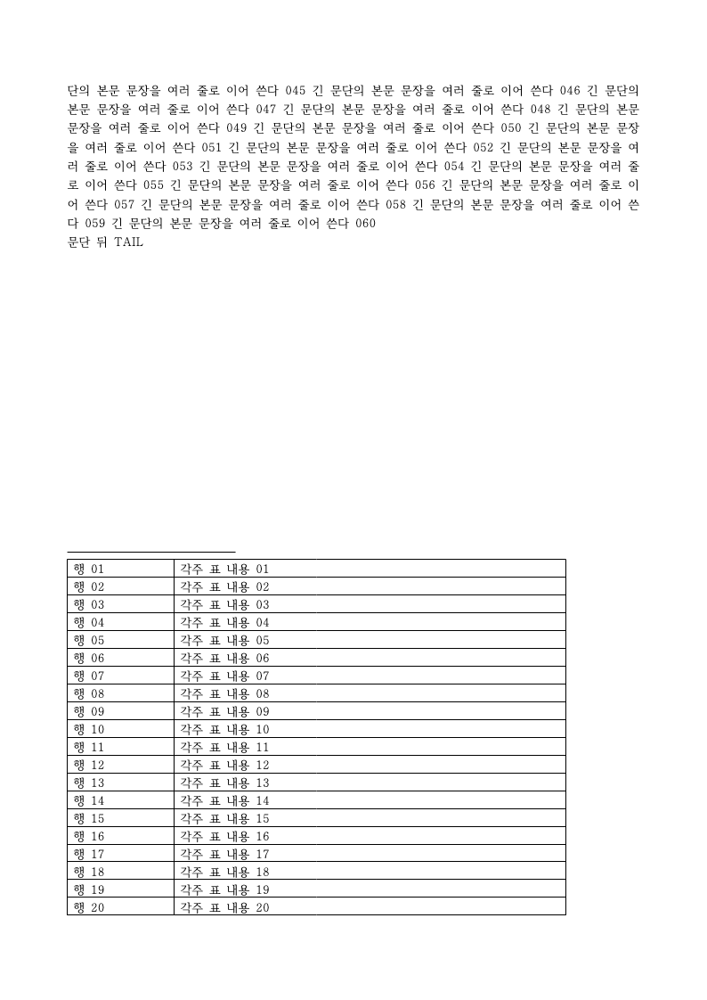 |  | 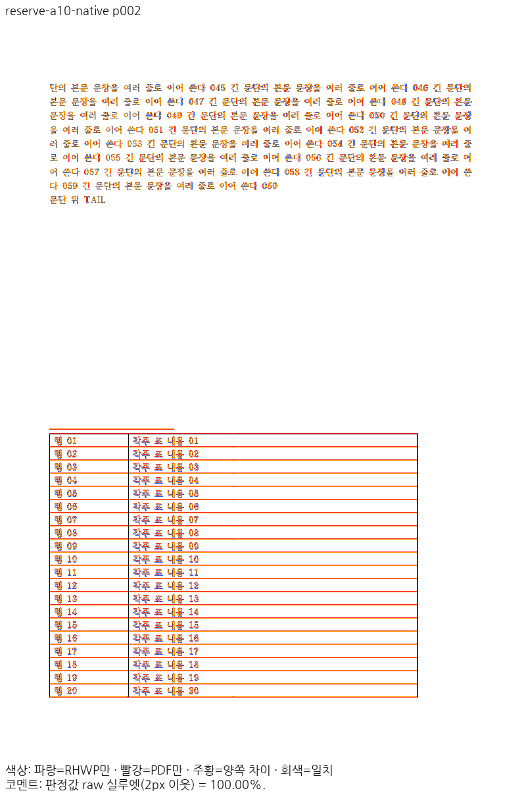 |
| fresh WASM | 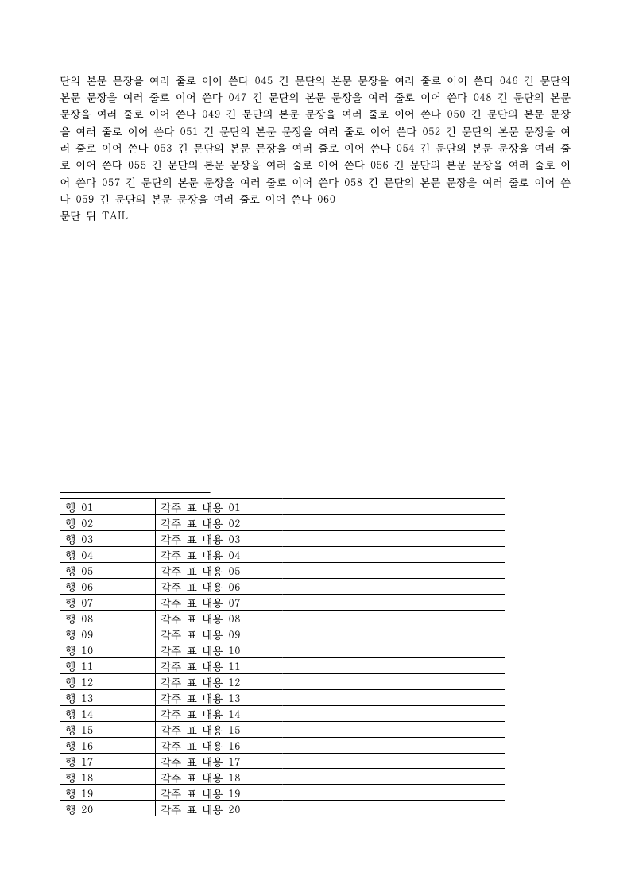 | 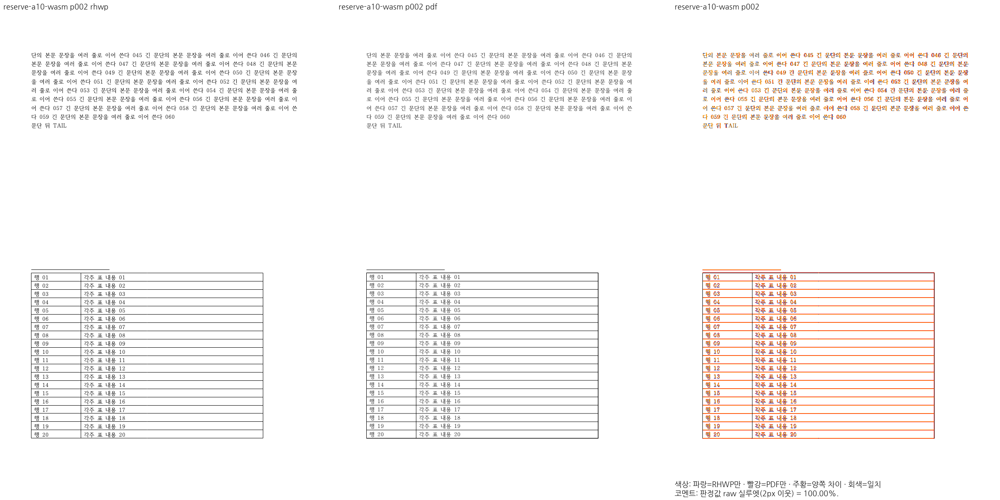 |  |

앞쪽의 단어 뒤에서 본문045~060과 TAIL이 이어지고 하단 각주 표20행을 누락 없이 보존한다.

### reserve-a30

- 입력: [samples/issue8468/line_reserve_F20_L30_A30_R12.hwp](../../../samples/issue8468/line_reserve_F20_L30_A30_R12.hwp)
- 독립 Print: [pdf/issue8468/line_reserve_F20_L30_A30_R12-2020.pdf](../../../pdf/issue8468/line_reserve_F20_L30_A30_R12-2020.pdf)
- 전체 2쪽 Native 최저 99.99%. [TSV](../assets/planet6897_20261106/final-b768bee1-20261109/cases/reserve-a30/native.tsv) · [입력/PDF·producer 해시](../assets/planet6897_20261106/final-b768bee1-20261109/cases/reserve-a30/provenance.json).
- 전체 2쪽 fresh WASM 최저 99.99%. [TSV](../assets/planet6897_20261106/final-b768bee1-20261109/cases/reserve-a30/wasm.tsv).

1쪽 Native **99.99%**: [raw](../assets/planet6897_20261106/final-b768bee1-20261109/cases/reserve-a30/native/raw-001.png) · [PDF raw](../assets/planet6897_20261106/final-b768bee1-20261109/cases/reserve-a30/native/pdf-001.png) · [review](../assets/planet6897_20261106/final-b768bee1-20261109/cases/reserve-a30/native/review-001.png) · [overlay](../assets/planet6897_20261106/final-b768bee1-20261109/cases/reserve-a30/native/overlay-001.png)

1쪽 fresh WASM **99.99%**: [raw](../assets/planet6897_20261106/final-b768bee1-20261109/cases/reserve-a30/wasm/raw-001.png) · [PDF raw](../assets/planet6897_20261106/final-b768bee1-20261109/cases/reserve-a30/wasm/pdf-001.png) · [review](../assets/planet6897_20261106/final-b768bee1-20261109/cases/reserve-a30/wasm/review-001.png) · [overlay](../assets/planet6897_20261106/final-b768bee1-20261109/cases/reserve-a30/wasm/overlay-001.png)

긴 각주의 4줄 영역을 본문과 분리하고 본문은 037에서 끝나는 독립 Print의 쪽 경계를 보존한다.

| 경로 | raw | review | overlay |
| --- | --- | --- | --- |
| Native | 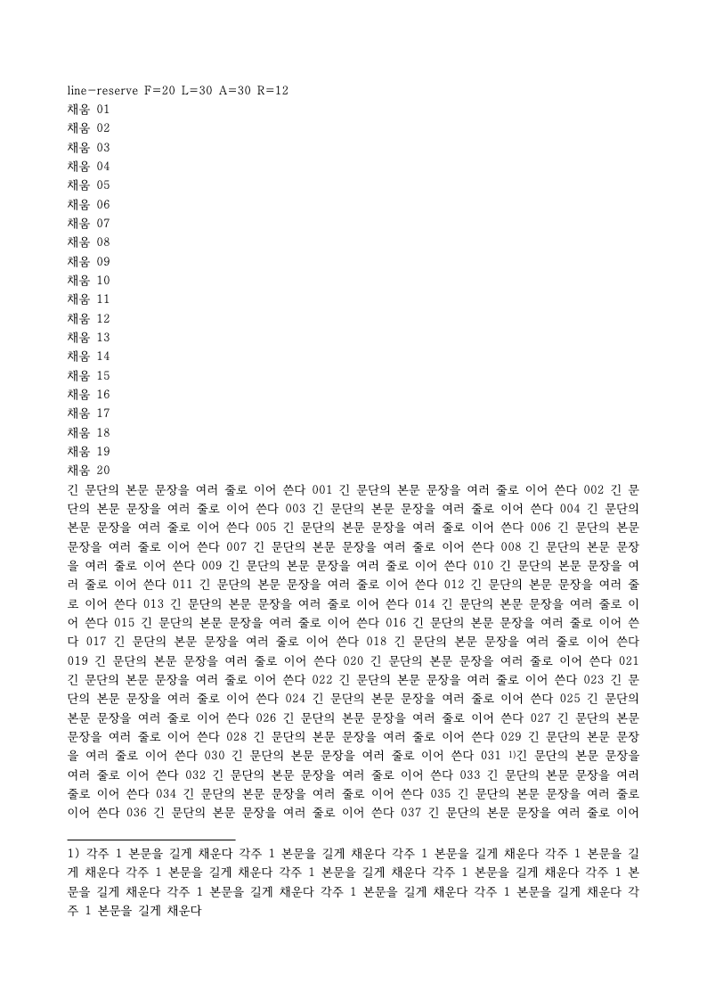 | 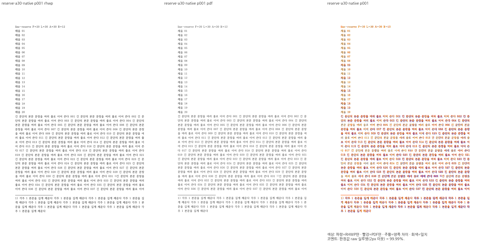 | 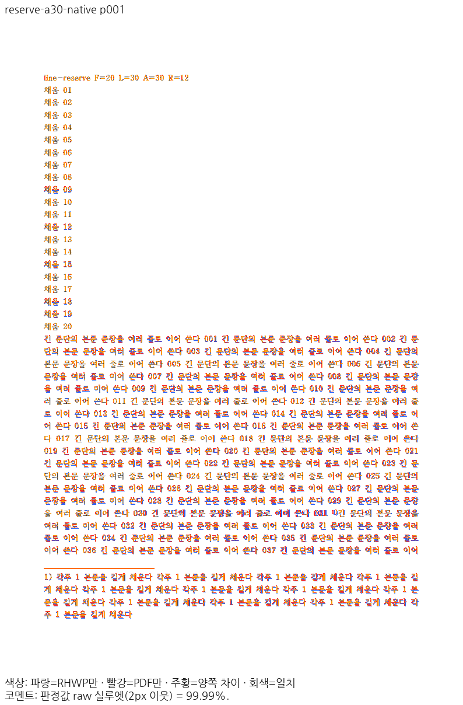 |
| fresh WASM | 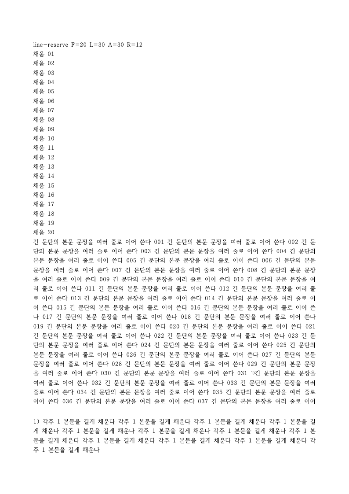 |  |  |

채움01~20 뒤 긴 본문이037까지 오고, 네 줄의 긴 각주1이 예약 공간 안에 보존된다. 각주와 본문이 겹치지 않는다.

2쪽 Native **100.00%**: [raw](../assets/planet6897_20261106/final-b768bee1-20261109/cases/reserve-a30/native/raw-002.png) · [PDF raw](../assets/planet6897_20261106/final-b768bee1-20261109/cases/reserve-a30/native/pdf-002.png) · [review](../assets/planet6897_20261106/final-b768bee1-20261109/cases/reserve-a30/native/review-002.png) · [overlay](../assets/planet6897_20261106/final-b768bee1-20261109/cases/reserve-a30/native/overlay-002.png)

2쪽 fresh WASM **100.00%**: [raw](../assets/planet6897_20261106/final-b768bee1-20261109/cases/reserve-a30/wasm/raw-002.png) · [PDF raw](../assets/planet6897_20261106/final-b768bee1-20261109/cases/reserve-a30/wasm/pdf-002.png) · [review](../assets/planet6897_20261106/final-b768bee1-20261109/cases/reserve-a30/wasm/review-002.png) · [overlay](../assets/planet6897_20261106/final-b768bee1-20261109/cases/reserve-a30/wasm/overlay-002.png)

2쪽은 038~060과 TAIL을 보존하고 긴 각주의 본문이 첫 쪽에서 중복되지 않는다.

| 경로 | raw | review | overlay |
| --- | --- | --- | --- |
| Native | 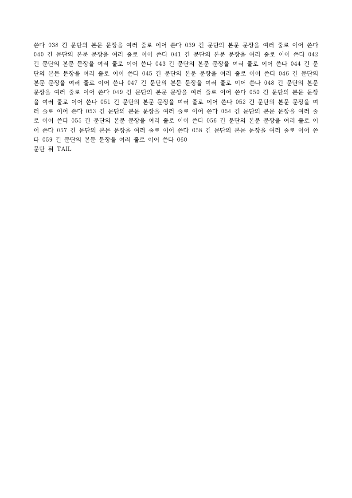 | 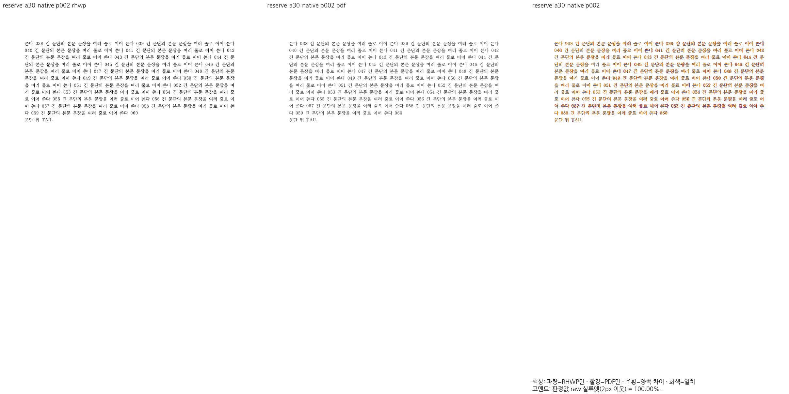 | 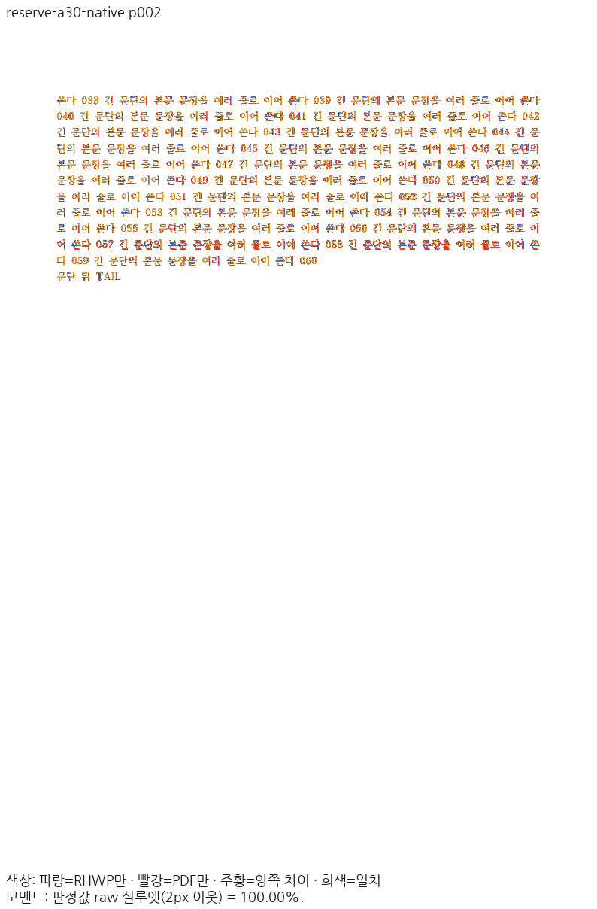 |
| fresh WASM | 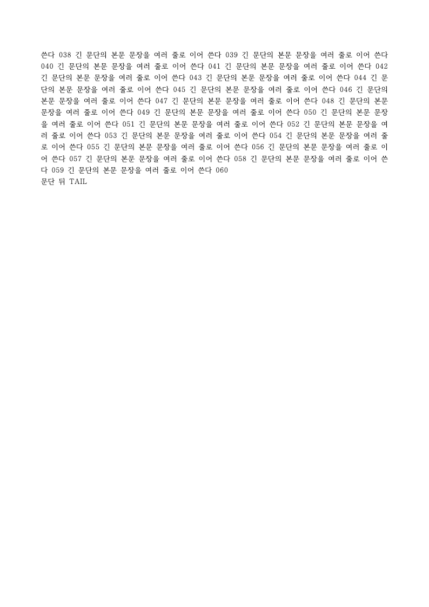 |  | 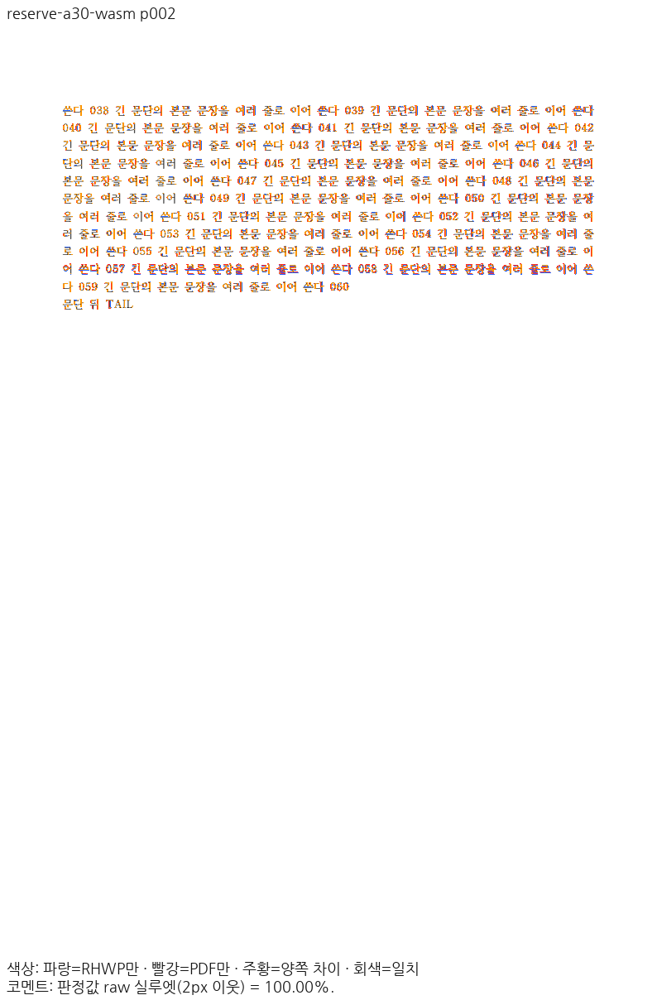 |

앞쪽037 뒤038~060 및 TAIL이 정확한 순서로 이어진다. 이 조건은 각주 표가 없는 실제 빈 하단을 보존한다.

### reserve-b4

- 입력: [samples/issue8468/line_reserve_F20_L30_A30_R4_B4.hwp](../../../samples/issue8468/line_reserve_F20_L30_A30_R4_B4.hwp)
- 독립 Print: [pdf/issue8468/line_reserve_F20_L30_A30_R4_B4-2020.pdf](../../../pdf/issue8468/line_reserve_F20_L30_A30_R4_B4-2020.pdf)
- 전체 2쪽 Native 최저 99.99%. [TSV](../assets/planet6897_20261106/final-b768bee1-20261109/cases/reserve-b4/native.tsv) · [입력/PDF·producer 해시](../assets/planet6897_20261106/final-b768bee1-20261109/cases/reserve-b4/provenance.json).
- 전체 2쪽 fresh WASM 최저 99.99%. [TSV](../assets/planet6897_20261106/final-b768bee1-20261109/cases/reserve-b4/wasm.tsv).

1쪽 Native **99.99%**: [raw](../assets/planet6897_20261106/final-b768bee1-20261109/cases/reserve-b4/native/raw-001.png) · [PDF raw](../assets/planet6897_20261106/final-b768bee1-20261109/cases/reserve-b4/native/pdf-001.png) · [review](../assets/planet6897_20261106/final-b768bee1-20261109/cases/reserve-b4/native/review-001.png) · [overlay](../assets/planet6897_20261106/final-b768bee1-20261109/cases/reserve-b4/native/overlay-001.png)

1쪽 fresh WASM **99.99%**: [raw](../assets/planet6897_20261106/final-b768bee1-20261109/cases/reserve-b4/wasm/raw-001.png) · [PDF raw](../assets/planet6897_20261106/final-b768bee1-20261109/cases/reserve-b4/wasm/pdf-001.png) · [review](../assets/planet6897_20261106/final-b768bee1-20261109/cases/reserve-b4/wasm/review-001.png) · [overlay](../assets/planet6897_20261106/final-b768bee1-20261109/cases/reserve-b4/wasm/overlay-001.png)

본문 031 뒤 하단 각주 2줄·4행 표·표 뒤 문단이 서로 분리되고 독립 Print의 순서를 보존한다.

| 경로 | raw | review | overlay |
| --- | --- | --- | --- |
| Native | 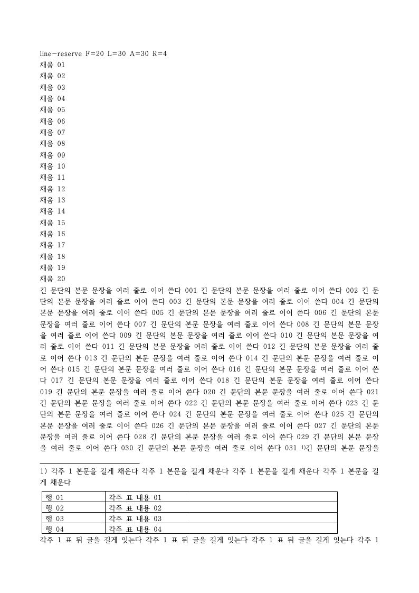 |  |  |
| fresh WASM | 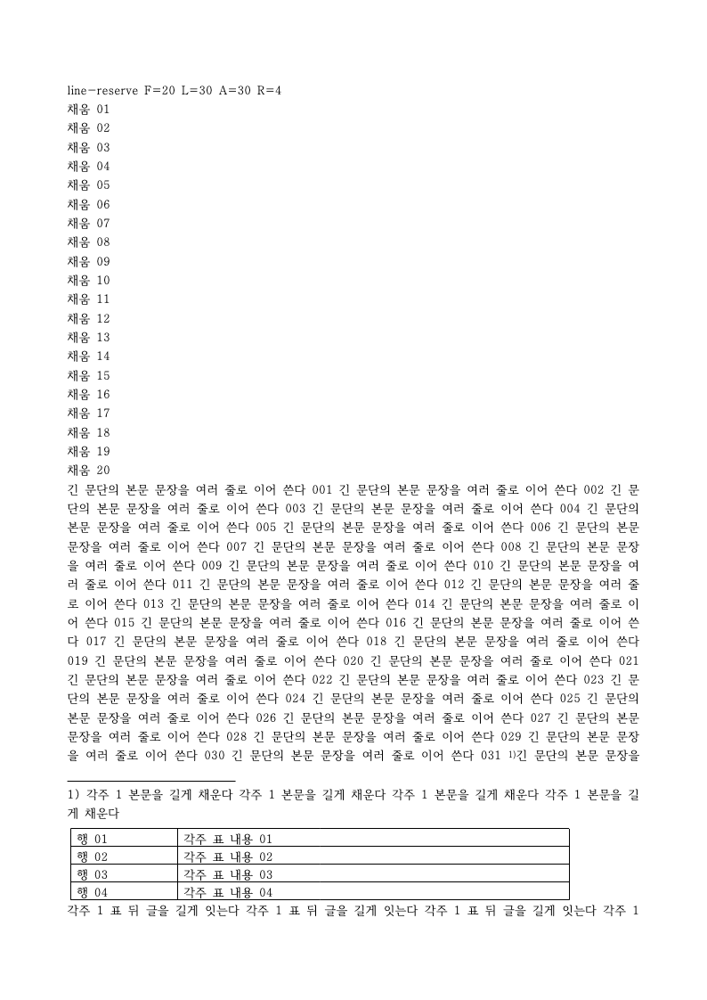 | 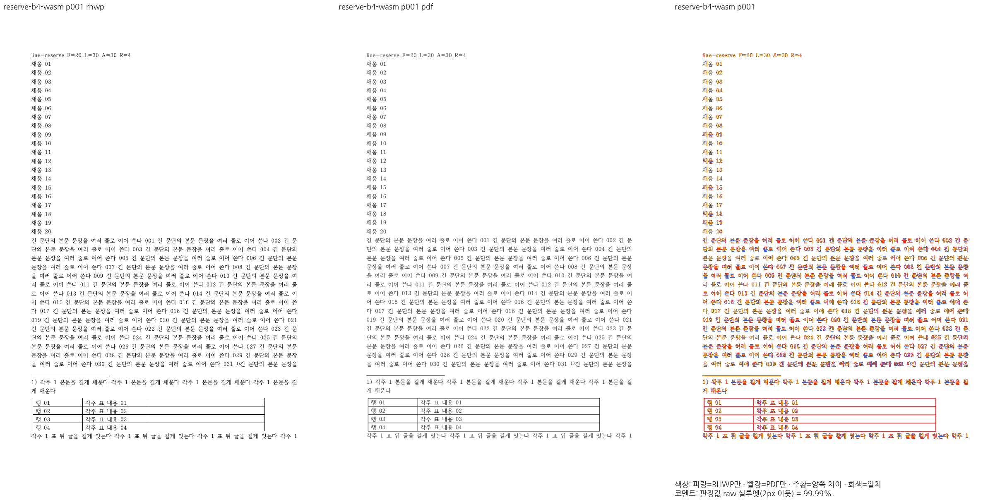 | 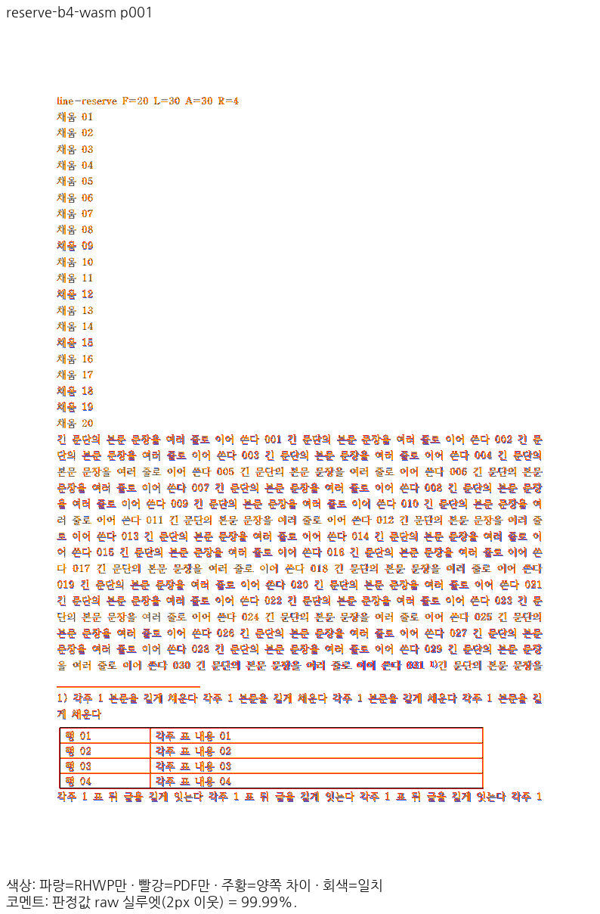 |

본문031까지와 각주1 본문·4행 표·표 뒤 문장의 첫 줄을 확인했다. 각주 내부 표를 버리지 않고 본문과 분리된 예약 영역에서 소모한다.

2쪽 Native **100.00%**: [raw](../assets/planet6897_20261106/final-b768bee1-20261109/cases/reserve-b4/native/raw-002.png) · [PDF raw](../assets/planet6897_20261106/final-b768bee1-20261109/cases/reserve-b4/native/pdf-002.png) · [review](../assets/planet6897_20261106/final-b768bee1-20261109/cases/reserve-b4/native/review-002.png) · [overlay](../assets/planet6897_20261106/final-b768bee1-20261109/cases/reserve-b4/native/overlay-002.png)

2쪽 fresh WASM **100.00%**: [raw](../assets/planet6897_20261106/final-b768bee1-20261109/cases/reserve-b4/wasm/raw-002.png) · [PDF raw](../assets/planet6897_20261106/final-b768bee1-20261109/cases/reserve-b4/wasm/pdf-002.png) · [review](../assets/planet6897_20261106/final-b768bee1-20261109/cases/reserve-b4/wasm/review-002.png) · [overlay](../assets/planet6897_20261106/final-b768bee1-20261109/cases/reserve-b4/wasm/overlay-002.png)

2쪽은 본문 032부터 TAIL까지 이어지고 각주 표 뒤 문단이 아래 영역에 분리되어 보존된다.

| 경로 | raw | review | overlay |
| --- | --- | --- | --- |
| Native | 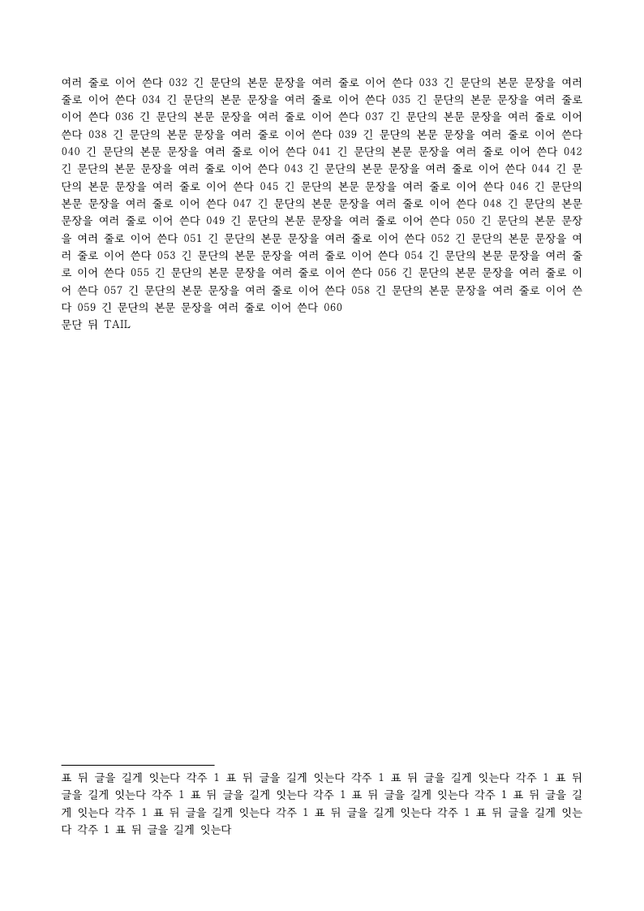 | 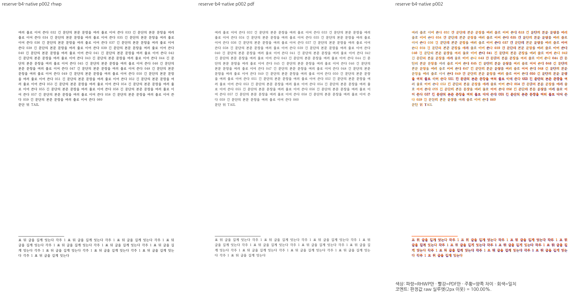 |  |
| fresh WASM | 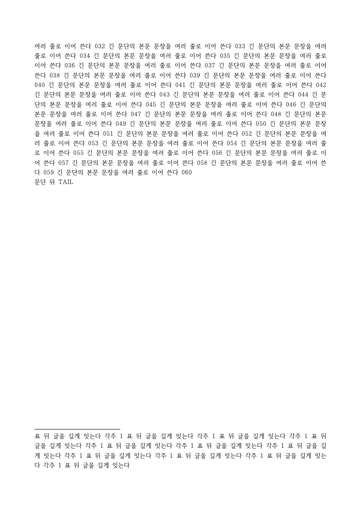 |  | 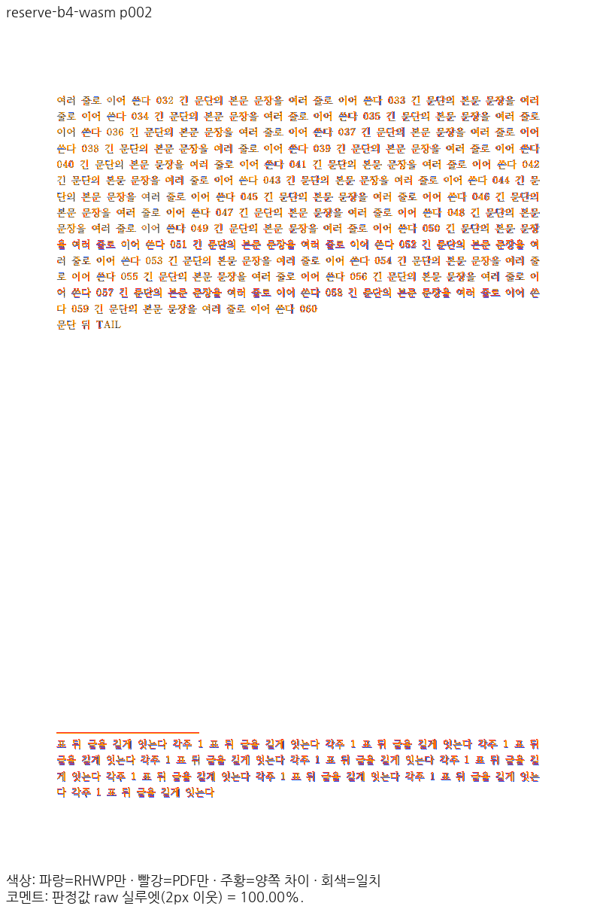 |

본문032~060·TAIL 및 각주 표 뒤의 나머지 네 줄이 이어진다. 표가 다시 그려지거나 본문 문장이 중복되지 않는다.

### reserve-a40

- 입력: [samples/issue8468/line_reserve_F20_L30_A40_R12.hwp](../../../samples/issue8468/line_reserve_F20_L30_A40_R12.hwp)
- 독립 Print: [pdf/issue8468/line_reserve_F20_L30_A40_R12-2020.pdf](../../../pdf/issue8468/line_reserve_F20_L30_A40_R12-2020.pdf)
- 전체 2쪽 Native 최저 100.00%. [TSV](../assets/planet6897_20261106/final-b768bee1-20261109/cases/reserve-a40/native.tsv) · [입력/PDF·producer 해시](../assets/planet6897_20261106/final-b768bee1-20261109/cases/reserve-a40/provenance.json).
- 전체 2쪽 fresh WASM 최저 100.00%. [TSV](../assets/planet6897_20261106/final-b768bee1-20261109/cases/reserve-a40/wasm.tsv).

1쪽 Native **100.00%**: [raw](../assets/planet6897_20261106/final-b768bee1-20261109/cases/reserve-a40/native/raw-001.png) · [PDF raw](../assets/planet6897_20261106/final-b768bee1-20261109/cases/reserve-a40/native/pdf-001.png) · [review](../assets/planet6897_20261106/final-b768bee1-20261109/cases/reserve-a40/native/review-001.png) · [overlay](../assets/planet6897_20261106/final-b768bee1-20261109/cases/reserve-a40/native/overlay-001.png)

1쪽 fresh WASM **100.00%**: [raw](../assets/planet6897_20261106/final-b768bee1-20261109/cases/reserve-a40/wasm/raw-001.png) · [PDF raw](../assets/planet6897_20261106/final-b768bee1-20261109/cases/reserve-a40/wasm/pdf-001.png) · [review](../assets/planet6897_20261106/final-b768bee1-20261109/cases/reserve-a40/wasm/review-001.png) · [overlay](../assets/planet6897_20261106/final-b768bee1-20261109/cases/reserve-a40/wasm/overlay-001.png)

첫 쪽 본문은 042까지 수용하고 짧은 각주 2줄을 하단에서 분리한다.

| 경로 | raw | review | overlay |
| --- | --- | --- | --- |
| Native | 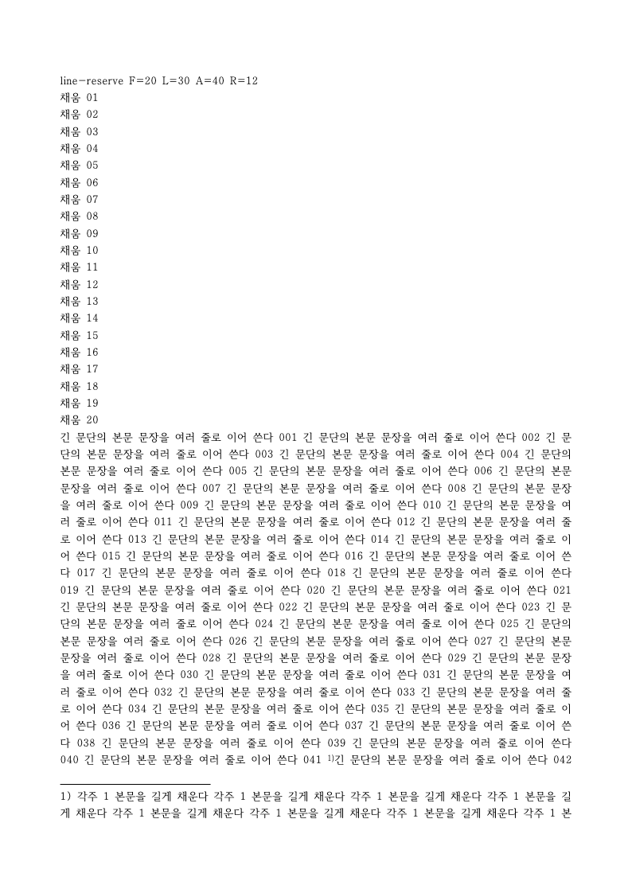 | 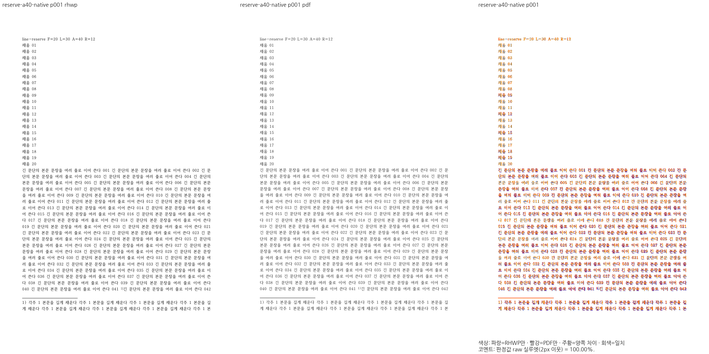 |  |
| fresh WASM | 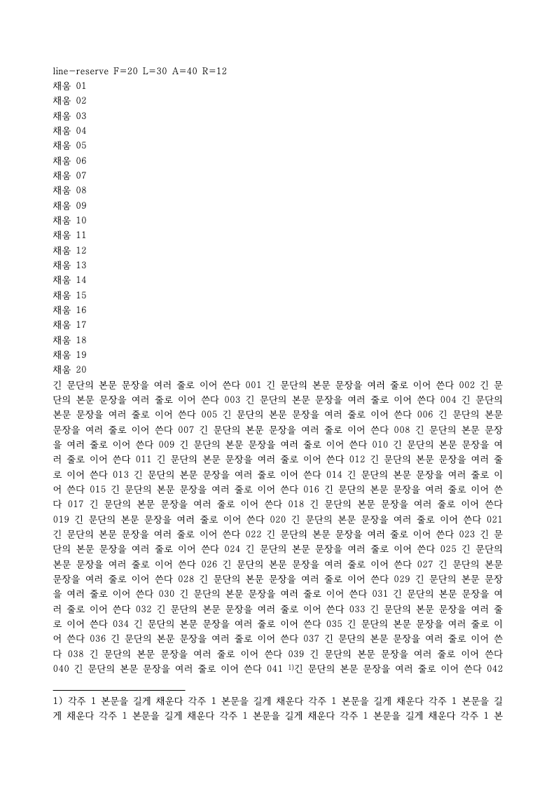 |  | 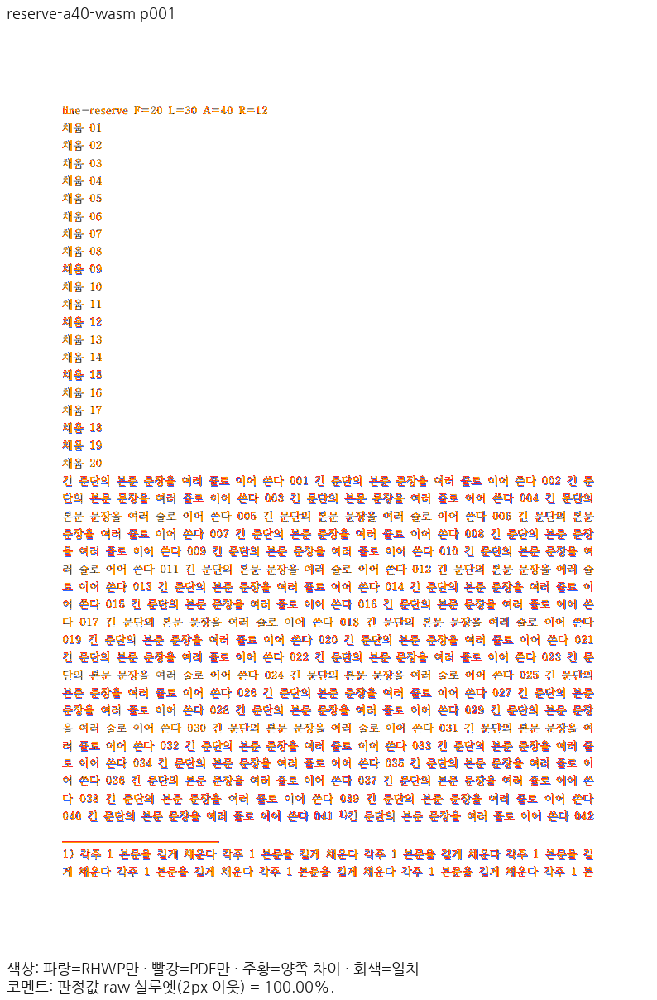 |

1쪽은 본문042에서 끊기며 각주1의 앞 두 줄이 구분선 아래 보존된다. 본문과 각주를 덮거나 043을 앞으로 당기지 않는다.

2쪽 Native **100.00%**: [raw](../assets/planet6897_20261106/final-b768bee1-20261109/cases/reserve-a40/native/raw-002.png) · [PDF raw](../assets/planet6897_20261106/final-b768bee1-20261109/cases/reserve-a40/native/pdf-002.png) · [review](../assets/planet6897_20261106/final-b768bee1-20261109/cases/reserve-a40/native/review-002.png) · [overlay](../assets/planet6897_20261106/final-b768bee1-20261109/cases/reserve-a40/native/overlay-002.png)

2쪽 fresh WASM **100.00%**: [raw](../assets/planet6897_20261106/final-b768bee1-20261109/cases/reserve-a40/wasm/raw-002.png) · [PDF raw](../assets/planet6897_20261106/final-b768bee1-20261109/cases/reserve-a40/wasm/pdf-002.png) · [review](../assets/planet6897_20261106/final-b768bee1-20261109/cases/reserve-a40/wasm/review-002.png) · [overlay](../assets/planet6897_20261106/final-b768bee1-20261109/cases/reserve-a40/wasm/overlay-002.png)

2쪽 본문은 043부터 이어지며 각주 연속 2줄이 동일한 하단 위치에 남는다.

| 경로 | raw | review | overlay |
| --- | --- | --- | --- |
| Native | 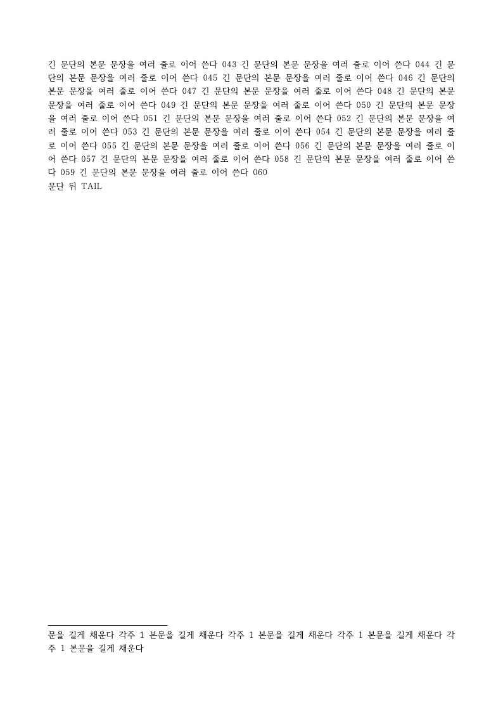 |  |  |
| fresh WASM | 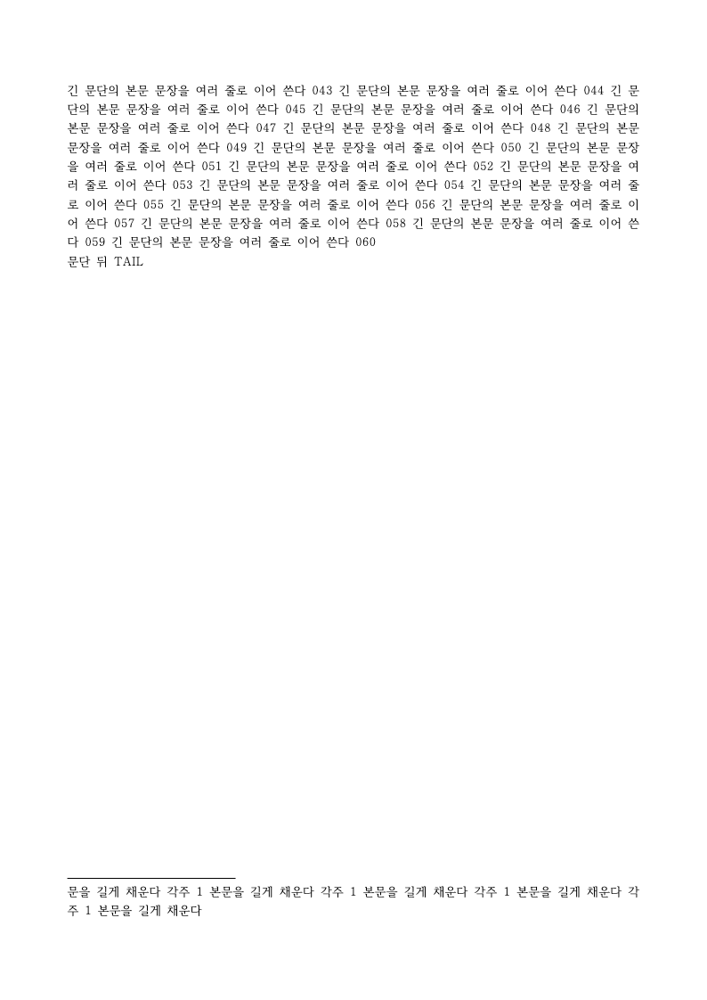 | 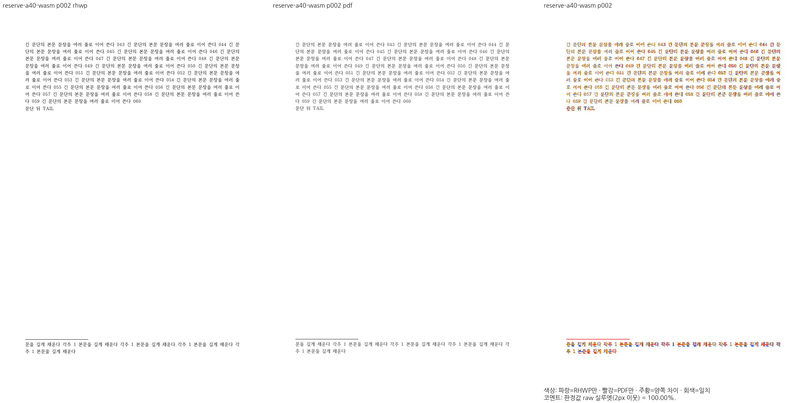 | 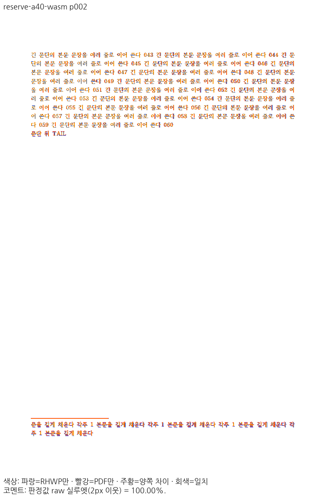 |

본문043~060·TAIL과 아래 각주1의 이어지는 두 줄을 확인했다. 같은 각주가 다음 쪽에서 완결되는 실제 Print 경계가 보존된다.

### reserve-a46

- 입력: [samples/issue8468/line_reserve_F20_L30_A46_R12.hwp](../../../samples/issue8468/line_reserve_F20_L30_A46_R12.hwp)
- 독립 Print: [pdf/issue8468/line_reserve_F20_L30_A46_R12-2020.pdf](../../../pdf/issue8468/line_reserve_F20_L30_A46_R12-2020.pdf)
- 전체 2쪽 Native 최저 100.00%. [TSV](../assets/planet6897_20261106/final-b768bee1-20261109/cases/reserve-a46/native.tsv) · [입력/PDF·producer 해시](../assets/planet6897_20261106/final-b768bee1-20261109/cases/reserve-a46/provenance.json).
- 전체 2쪽 fresh WASM 최저 100.00%. [TSV](../assets/planet6897_20261106/final-b768bee1-20261109/cases/reserve-a46/wasm.tsv).

1쪽 Native **100.00%**: [raw](../assets/planet6897_20261106/final-b768bee1-20261109/cases/reserve-a46/native/raw-001.png) · [PDF raw](../assets/planet6897_20261106/final-b768bee1-20261109/cases/reserve-a46/native/pdf-001.png) · [review](../assets/planet6897_20261106/final-b768bee1-20261109/cases/reserve-a46/native/review-001.png) · [overlay](../assets/planet6897_20261106/final-b768bee1-20261109/cases/reserve-a46/native/overlay-001.png)

1쪽 fresh WASM **100.00%**: [raw](../assets/planet6897_20261106/final-b768bee1-20261109/cases/reserve-a46/wasm/raw-001.png) · [PDF raw](../assets/planet6897_20261106/final-b768bee1-20261109/cases/reserve-a46/wasm/pdf-001.png) · [review](../assets/planet6897_20261106/final-b768bee1-20261109/cases/reserve-a46/wasm/review-001.png) · [overlay](../assets/planet6897_20261106/final-b768bee1-20261109/cases/reserve-a46/wasm/overlay-001.png)

큰 각주 예약이 있는 첫 쪽의 본문 001~048을 보존하고 이 쪽에 각주 표를 잘못 끌어오지 않는다.

| 경로 | raw | review | overlay |
| --- | --- | --- | --- |
| Native | 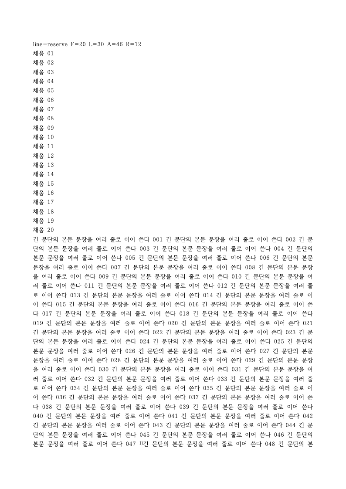 | 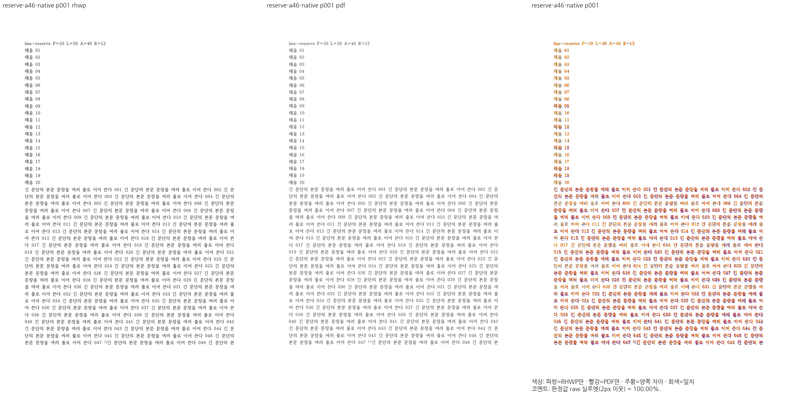 |  |
| fresh WASM | 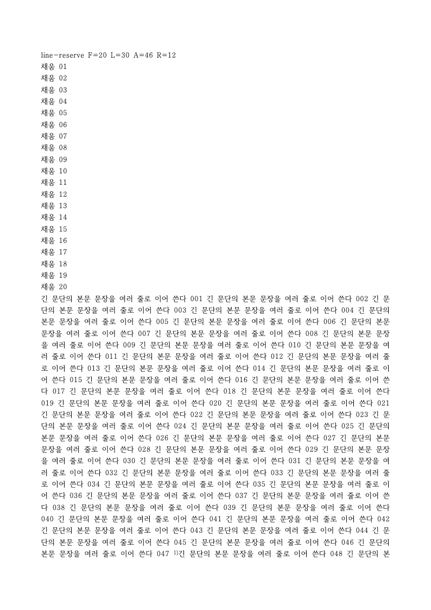 |  | 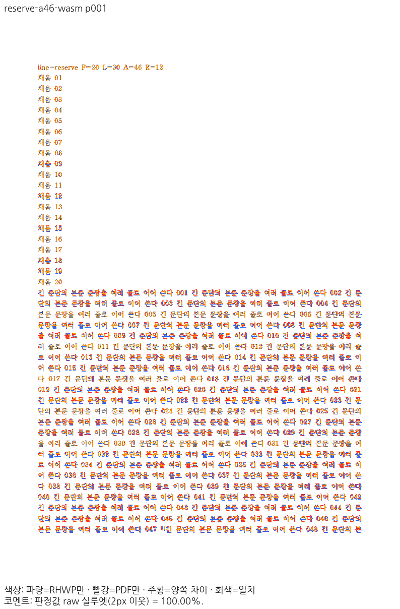 |

1쪽의 긴 본문이048까지 들어가고 각주는 다음 쪽에 예약된다. 본문 마지막 줄과 하단 여백이 Print와 같은 구성을 유지한다.

2쪽 Native **100.00%**: [raw](../assets/planet6897_20261106/final-b768bee1-20261109/cases/reserve-a46/native/raw-002.png) · [PDF raw](../assets/planet6897_20261106/final-b768bee1-20261109/cases/reserve-a46/native/pdf-002.png) · [review](../assets/planet6897_20261106/final-b768bee1-20261109/cases/reserve-a46/native/review-002.png) · [overlay](../assets/planet6897_20261106/final-b768bee1-20261109/cases/reserve-a46/native/overlay-002.png)

2쪽 fresh WASM **100.00%**: [raw](../assets/planet6897_20261106/final-b768bee1-20261109/cases/reserve-a46/wasm/raw-002.png) · [PDF raw](../assets/planet6897_20261106/final-b768bee1-20261109/cases/reserve-a46/wasm/pdf-002.png) · [review](../assets/planet6897_20261106/final-b768bee1-20261109/cases/reserve-a46/wasm/review-002.png) · [overlay](../assets/planet6897_20261106/final-b768bee1-20261109/cases/reserve-a46/wasm/overlay-002.png)

2쪽 본문 049~060과 TAIL 뒤에서 각주 본문 4줄을 하단에 보존한다.

| 경로 | raw | review | overlay |
| --- | --- | --- | --- |
| Native | 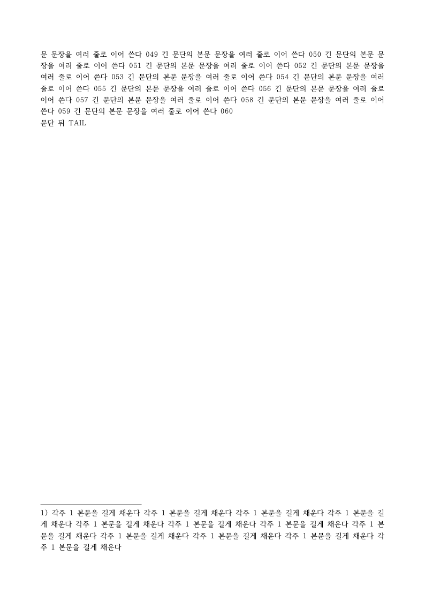 |  | 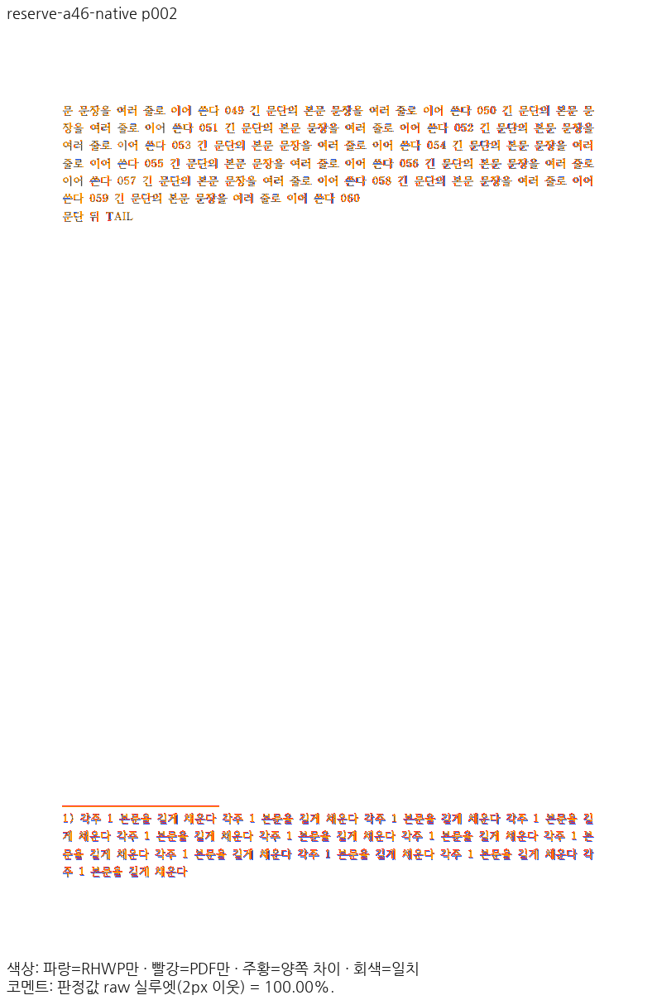 |
| fresh WASM | 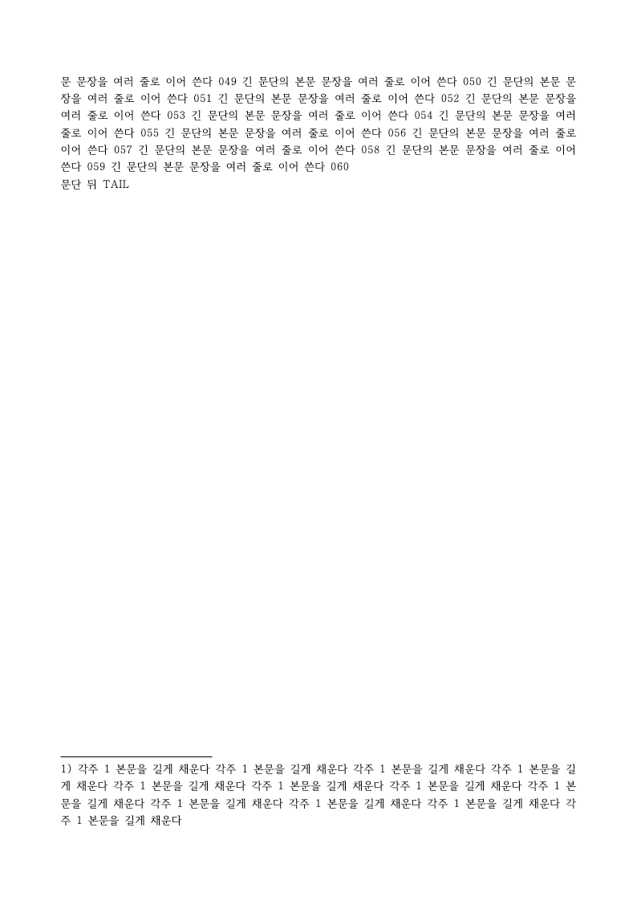 | 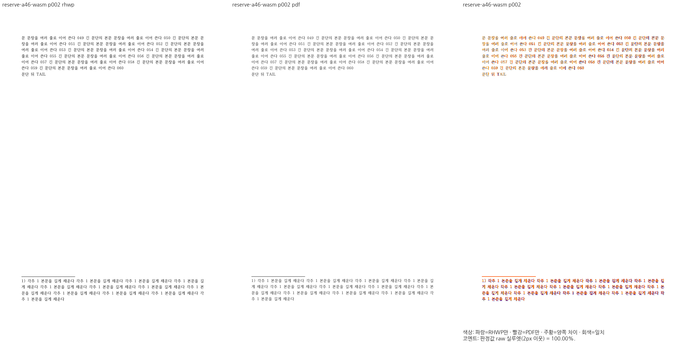 |  |

본문049~060·TAIL과 하단 각주1 네 줄이 같은 쪽에 보존된다. 앞쪽 각주의 중복 없이 이 조건의 전체 각주가 여기에 나온다.

### p4g

- 입력: [samples/issue8468/156454114-p4g-opening-remarks.hwp](../../../samples/issue8468/156454114-p4g-opening-remarks.hwp)
- 독립 Print: [pdf/issue8468/156454114-p4g-opening-remarks-2022.pdf](../../../pdf/issue8468/156454114-p4g-opening-remarks-2022.pdf)
- 전체 8쪽 Native 최저 100.00%. [TSV](../assets/planet6897_20261106/final-b768bee1-20261109/cases/p4g/native.tsv) · [입력/PDF·producer 해시](../assets/planet6897_20261106/final-b768bee1-20261109/cases/p4g/provenance.json).
- 전체 8쪽 fresh WASM 최저 99.95%. [TSV](../assets/planet6897_20261106/final-b768bee1-20261109/cases/p4g/wasm.tsv).

1쪽 Native **100.00%**: [raw](../assets/planet6897_20261106/final-b768bee1-20261109/cases/p4g/native/raw-001.png) · [PDF raw](../assets/planet6897_20261106/final-b768bee1-20261109/cases/p4g/native/pdf-001.png) · [review](../assets/planet6897_20261106/final-b768bee1-20261109/cases/p4g/native/review-001.png) · [overlay](../assets/planet6897_20261106/final-b768bee1-20261109/cases/p4g/native/overlay-001.png)

1쪽 fresh WASM **99.95%**: [raw](../assets/planet6897_20261106/final-b768bee1-20261109/cases/p4g/wasm/raw-001.png) · [PDF raw](../assets/planet6897_20261106/final-b768bee1-20261109/cases/p4g/wasm/pdf-001.png) · [review](../assets/planet6897_20261106/final-b768bee1-20261109/cases/p4g/wasm/review-001.png) · [overlay](../assets/planet6897_20261106/final-b768bee1-20261109/cases/p4g/wasm/overlay-001.png)

영문 표지의 두 청색 선 사이 제목, 첨부 상자, 날짜와 발신자 위치를 대조했다. 글자 굵기와 선의 래스터 경계 차이는 남는다.

| 경로 | raw | review | overlay |
| --- | --- | --- | --- |
| Native | 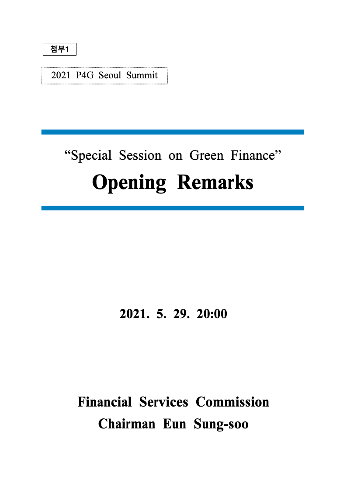 | 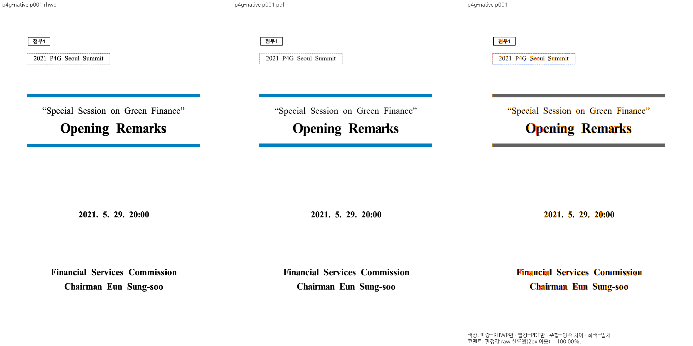 | 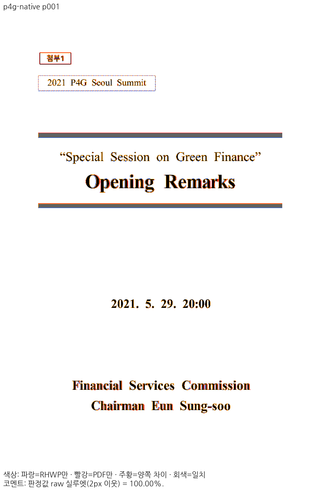 |
| fresh WASM | 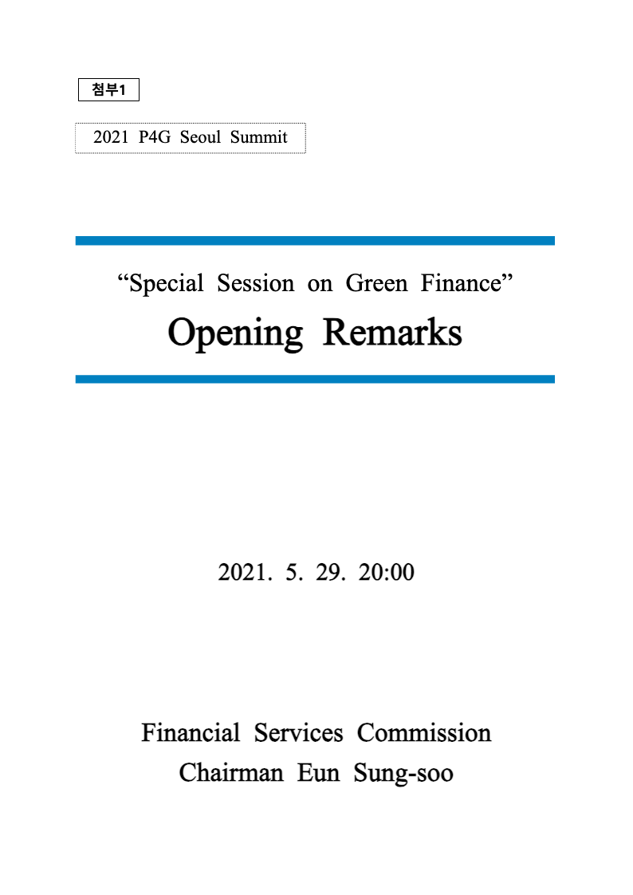 | 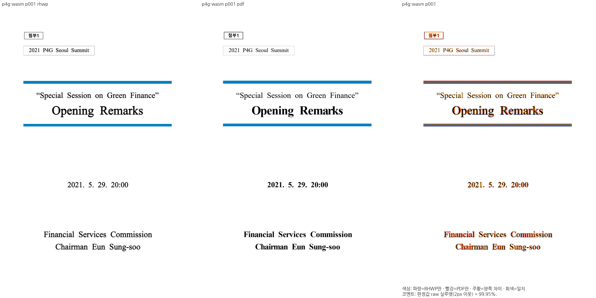 | 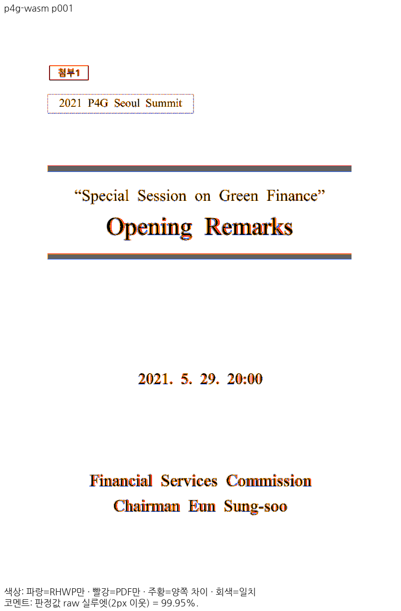 |

첨부1 머리와 영문 행사명, Opening Remarks 상하 파란 선·날짜·기관/이름의 중앙 배치를 확인했다. 표지 아래 빈 영역과 줄 간격을 보존한다.

### report-628

- 입력: [mydocs/pr/assets/planet6897_20261106/pr8642/report-628-original.hwp](../assets/planet6897_20261106/pr8642/report-628-original.hwp)
- 독립 Print: [pdf/planet6897-20261106/pr8642/report-628-original-2020.pdf](../../../pdf/planet6897-20261106/pr8642/report-628-original-2020.pdf)
- 전체 195쪽 Native 최저 93.24%. [TSV](../assets/planet6897_20261106/final-b768bee1-20261109/cases/report-628/native.tsv) · [입력/PDF·producer 해시](../assets/planet6897_20261106/final-b768bee1-20261109/cases/report-628/provenance.json).
- 전체 195쪽 fresh WASM 최저 93.24%. [TSV](../assets/planet6897_20261106/final-b768bee1-20261109/cases/report-628/wasm.tsv).

95쪽 Native **99.63%**: [raw](../assets/planet6897_20261106/final-b768bee1-20261109/cases/report-628/native/raw-095.png) · [PDF raw](../assets/planet6897_20261106/final-b768bee1-20261109/cases/report-628/native/pdf-095.png) · [review](../assets/planet6897_20261106/final-b768bee1-20261109/cases/report-628/native/review-095.png) · [overlay](../assets/planet6897_20261106/final-b768bee1-20261109/cases/report-628/native/overlay-095.png)

95쪽 fresh WASM **99.63%**: [raw](../assets/planet6897_20261106/final-b768bee1-20261109/cases/report-628/wasm/raw-095.png) · [PDF raw](../assets/planet6897_20261106/final-b768bee1-20261109/cases/report-628/wasm/pdf-095.png) · [review](../assets/planet6897_20261106/final-b768bee1-20261109/cases/report-628/wasm/review-095.png) · [overlay](../assets/planet6897_20261106/final-b768bee1-20261109/cases/report-628/wasm/overlay-095.png)

번호와 제목 본문이 PDF의 왼쪽 열 원점에 맞고 기존 13.333 CSS px 왼쪽 이탈이 해소됐다. 본문·각주·쪽수와 표의 내용 소속·순서를 대조했다. 본문 끝 줄 및 한자·각주 글리프의 잔여 차이는 별도 이슈 대상으로 남긴다.

| 경로 | raw | review | overlay |
| --- | --- | --- | --- |
| Native | 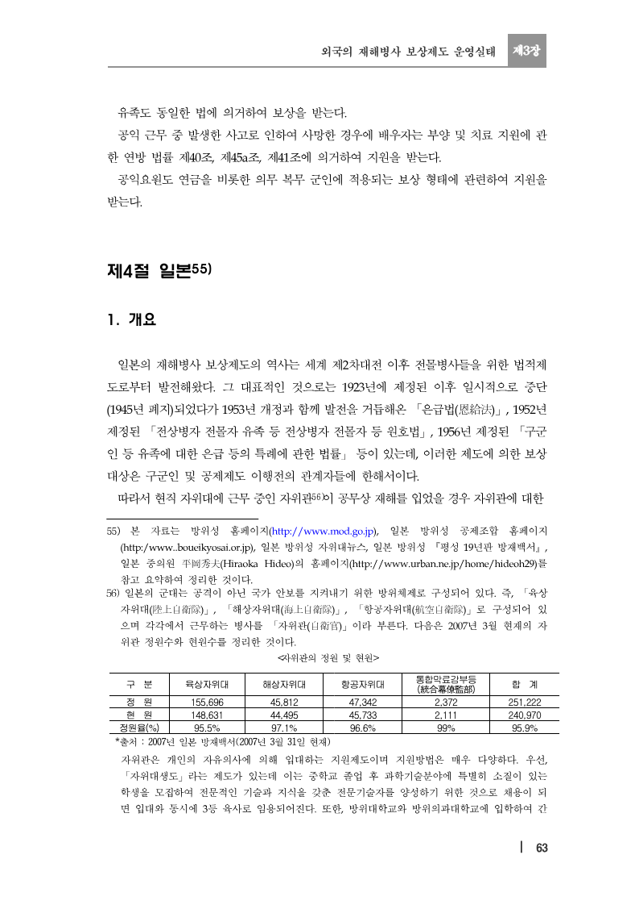 |  | 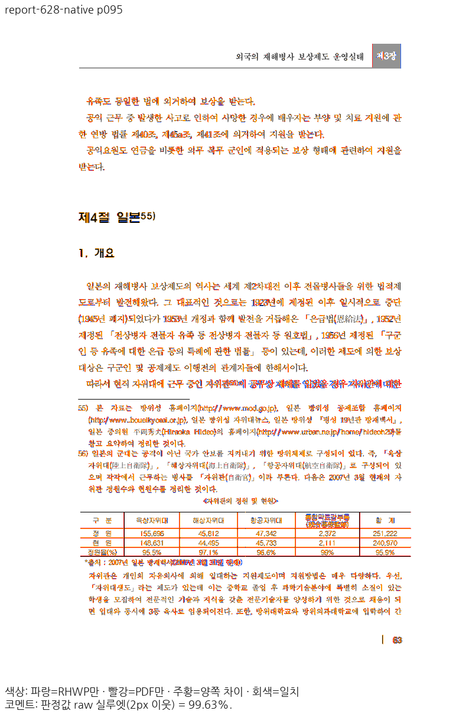 |
| fresh WASM | 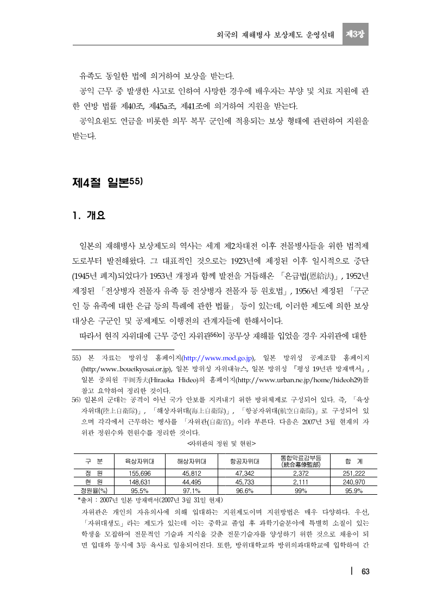 |  |  |

제4절 일본과1. 개요의 번호/본문이 독립 Print와 같은 열 시작을 사용한다. 소제목이 왼쪽으로13.333 CSSpx 나가던 문제를 확인할 수 없다. 아래 본문·각주55/56·각주 안 표와쪽63의 소속/순서를 보존한다. 본문 말미·일부 CJK/표머리 글리프는 별도 잔여로 구분한다.

96쪽 Native **99.92%**: [raw](../assets/planet6897_20261106/final-b768bee1-20261109/cases/report-628/native/raw-096.png) · [PDF raw](../assets/planet6897_20261106/final-b768bee1-20261109/cases/report-628/native/pdf-096.png) · [review](../assets/planet6897_20261106/final-b768bee1-20261109/cases/report-628/native/review-096.png) · [overlay](../assets/planet6897_20261106/final-b768bee1-20261109/cases/report-628/native/overlay-096.png)

96쪽 fresh WASM **99.90%**: [raw](../assets/planet6897_20261106/final-b768bee1-20261109/cases/report-628/wasm/raw-096.png) · [PDF raw](../assets/planet6897_20261106/final-b768bee1-20261109/cases/report-628/wasm/pdf-096.png) · [review](../assets/planet6897_20261106/final-b768bee1-20261109/cases/report-628/wasm/review-096.png) · [overlay](../assets/planet6897_20261106/final-b768bee1-20261109/cases/report-628/wasm/overlay-096.png)

번호와 제목 본문이 PDF의 왼쪽 열 원점에 맞고 기존 13.333 CSS px 왼쪽 이탈이 해소됐다. 본문·각주·쪽수와 표의 내용 소속·순서를 대조했다. 본문 끝 줄 및 한자·각주 글리프의 잔여 차이는 별도 이슈 대상으로 남긴다.

| 경로 | raw | review | overlay |
| --- | --- | --- | --- |
| Native |  |  |  |
| fresh WASM |  |  |  |

1) 법적근거에 의한 보상의 번호/본문이 Print의 같은 열 시작에 놓인다. 앞뒤 본문·이어진 각주·각주57·쪽64의 소속을 보존한다. 아래 본문 한 줄 말미의 자간·각주 일부 글리프 차이는 새 잔여 이슈에서 다룬다.

### report-838

- 입력: [mydocs/pr/assets/planet6897_20261106/pr8642/report-838-original.hwp](../assets/planet6897_20261106/pr8642/report-838-original.hwp)
- 독립 Print: [pdf/planet6897-20261106/pr8642/report-838-original-2020.pdf](../../../pdf/planet6897-20261106/pr8642/report-838-original-2020.pdf)
- 전체 109쪽 Native 최저 98.70%. [TSV](../assets/planet6897_20261106/final-b768bee1-20261109/cases/report-838/native.tsv) · [입력/PDF·producer 해시](../assets/planet6897_20261106/final-b768bee1-20261109/cases/report-838/provenance.json).
- 전체 109쪽 fresh WASM 최저 98.69%. [TSV](../assets/planet6897_20261106/final-b768bee1-20261109/cases/report-838/wasm.tsv).

91쪽 Native **100.00%**: [raw](../assets/planet6897_20261106/final-b768bee1-20261109/cases/report-838/native/raw-091.png) · [PDF raw](../assets/planet6897_20261106/final-b768bee1-20261109/cases/report-838/native/pdf-091.png) · [review](../assets/planet6897_20261106/final-b768bee1-20261109/cases/report-838/native/review-091.png) · [overlay](../assets/planet6897_20261106/final-b768bee1-20261109/cases/report-838/native/overlay-091.png)

91쪽 fresh WASM **100.00%**: [raw](../assets/planet6897_20261106/final-b768bee1-20261109/cases/report-838/wasm/raw-091.png) · [PDF raw](../assets/planet6897_20261106/final-b768bee1-20261109/cases/report-838/wasm/pdf-091.png) · [review](../assets/planet6897_20261106/final-b768bee1-20261109/cases/report-838/wasm/review-091.png) · [overlay](../assets/planet6897_20261106/final-b768bee1-20261109/cases/report-838/wasm/overlay-091.png)

영국 PA/TA 표·독일 소제목 뒤 표와 각주274~277 및 쪽번호를 대조했다. 두 표 사이 본문, 각주 separator와 아래 내용이 겹치거나 누락되지 않는다. 작은 글리프·일부 괘선 잔차를 기록한다.

| 경로 | raw | review | overlay |
| --- | --- | --- | --- |
| Native |  |  |  |
| fresh WASM |  |  |  |

영국 자격 표·독일 소제목·본문·하단 두 번째 표 및 각주274~277과 쪽수90을 대조했다. 표와 각주 내부 문장·순서·페이지 소속을 보존한다.

## 최종 제출과 원격 조건

기존 전쪽 TSV·직접 판독을 유지하고 리베이스 후 영향 2조건 8쪽과 앞선 HWP3 3조건 10쪽과 필수 집중·lint를 추가 검증했습니다. 엄격0.1%p 비교 잔여1건은 새 이슈로 분리하며 완전 무회귀로 표기하지 않습니다. 원격 게시 직전에 원 PR head·upstream/devel·제출 diff와 병합 시뮬레이션을 재확인합니다. 통합 PR의 실제 CI 성공과 최종 head의 mergeability를 확인한 뒤 승인된 병합·후속처리를 수행합니다.

## Merge 후 contributor PR comment 계획

통합 병합이 완료되면 최종 merge SHA·CI URL과 이 PR이 주장한 입력/페이지의 raw 이미지를 고정 SHA 링크로 연결합니다. 원 기여와 메인터너 보정 이유·범위를 한국어 존댓말로 구분하며, 별도 검증하지 않은 문제까지 해결했다고 쓰지 않습니다. 원 PR의 종료는 통합 병합 후 실제 해결 범위를 확인하여 처리합니다.
