# PR #8681 리뷰 — fix(layout): 자기 자리차지 표 띠 위끝에 걸친 저장 줄을 띠 끝으로 내린다 (#8679)

## 최종 판정

**메인터너 보정 후 수용 가능 — 원 기여와 추가 보정을 포함한 통합 code head의 주장 범위를 검증했습니다. 원 contributor head의 직접 병합을 승인하는 판정은 아닙니다.**

원 PR head와 메인터너 보정을 포함한 통합 code head를 구분합니다. 위 exact code head의 필수 CI를 확인했습니다. 문서 trailing head의 실제 검사·충돌 여부를 다시 확인하며, 원 PR은 통합 병합을 확인한 뒤 종료합니다.

## 최종 source와 재사용 범위

제출 code head `2e262d0d4b2885b130e2db917b86e894710425e4`, base `e00f9b7e26e581896fa17eaff3c8eb3f4889f9d4`입니다. 아래 전체 회귀·전쪽 수치는 원 실측 HEAD의 증거를 재사용한 기록입니다. 최신 집중 검사와 페이지별 producer, 엄격 0.1%p 잔여 한 건은 [재사용·최종 판정](../assets/planet6897_20261106/final-b768bee1-20261109/validation-reuse.md)을 따릅니다. 보호 TSV 표시값 하락은 0입니다.

## 통합 PR의 exact code head CI

- [통합 PR #8857](https://github.com/edwardkim/rhwp/pull/8857), code head `29c74b69851bc6578f10a2c78e23592a05b69a5d`.
- [CI 실행](https://github.com/edwardkim/rhwp/actions/runs/42621490405)과 같은 code head의 CodeQL·Render Diff·Adapter·Proptest·정책 검사를 실제 확인했습니다. 기록 확인 시각: `2026-11-09T22:58:24.689803+09:00`.
- 기본 기능 worker A–E의 실제 nextest는 **12,934 PASS / 0 FAIL / 45 skip**입니다. 기존 로컬 13,105건과 실행 범위·HEAD가 다르므로 합산하지 않습니다.
- source·test·workflow를 추가로 변경하지 않고 이 검토·오늘할일만 단일 부모 trailing commit으로 보완합니다. trailing head의 실제 CI/fast-pass와 mergeability는 push 뒤 별도로 확인하며, 문서만 바뀌었다는 이유로 통과를 미리 가정하지 않습니다.
- [잔여 이슈 #8856](https://github.com/edwardkim/rhwp/issues/8856)은 9문서군의 글리프·간격·도형 및 clip5587 Native 4쪽의 엄격 0.1%p 미충족을 계속 추적합니다. 부분 해결 #8635·#8636과 부모 #7445는 일괄 종료하지 않습니다.

## 접수 정보

- 원 PR: [#8681](https://github.com/edwardkim/rhwp/pull/8681), 작성자 `planet6897`, reviewer `jangster77`.
- 원 head: `3cc76d84d41b40f47304b62ff2b8b5010828b86b`. 마지막 실시간 확인과 상태는 [조회 기록](../assets/planet6897_20261106/final-b768bee1-20261109/original-pr-heads.json)을 따릅니다.
- 통합 base: `b768bee1c4c0023087687f79a0a95f12108743e9`, 검증 code head: `eb876d1416fb558c874f9efec65c5722a6769751`.
- 브랜치: `review/integration-20261106-planet6897-open`. 통합 PR #8857을 제출했고 위 code head CI를 완료했습니다. 최종 trailing head 검사·병합·원 PR 후속 종료는 별도로 확인합니다.

## 변경과 검토 범위

fix(layout): 자기 자리차지 표 띠 위끝에 걸친 저장 줄을 띠 끝으로 내린다 (#8679)

[이 PR의 구현·메인터너 보정 계획](pr_8681_review_impl.md) · [통합 범위와 적용 순서](../assets/planet6897_20261106/integration-plan.md) · [원본→실제 적용 커밋](../assets/planet6897_20261106/contributor-commit-map-final.tsv).

## 검증 입력과 결과

code head `eb876d1416fb558c874f9efec65c5722a6769751`의 최소 글꼴 환경 기본 전체 회귀는 **13,105 PASS / 0 FAIL / 45 skipped**, 실행 570.421초입니다. Native 전쪽은 **94조건·2,995쪽**, 최저 **92.24%**, 90% 미만·쪽수 불일치·누락은 0입니다. 보호 TSV 1,771쪽의 공식 두 자리 표시값 하락은 0입니다. 이는 전체 범위의 요약이며 각 PR 주장은 아래 해당 입력·페이지로 대조합니다.

Native HWPX 편람 최소 글꼴/공개 웹폰트 383쪽 gate도 통과했습니다. 공식 두 자리 표시값은 130쪽 99.96%, 나머지 382쪽 100.00%입니다. 이는 보정 전 2px 내용 실루엣 값이며 엄격 RGB 동일성을 뜻하지 않습니다.

일반 base 대비 하락 허용폭은 이번 통합에 사용자가 지정한 **0.1%p**를 유지합니다. 별도 정본 보호 TSV의 공식 두 자리 표시값은 하락을 허용하지 않습니다. 최신 base `b768bee1`와 리베이스 전 후보를 같은 입력·PDF·글꼴·DPI·호환 버전으로 전쪽 대조했습니다. [Native 비교](../assets/planet6897_20261106/final-b768bee1-20261109/comparisons/latest-base-native-comparison.tsv) · [fresh WASM 비교](../assets/planet6897_20261106/final-b768bee1-20261109/comparisons/latest-base-wasm-comparison.tsv). 완료 쪽의98% 미만 후퇴·일반2%p 초과 하락은 없습니다. 엄격0.1%p 비교의 Native 뒤배경 표4쪽 잔여0.14171%p는 사용자 지시에 따라 신규 이슈로 분리하며 무회귀로 표기하지 않습니다.

관련 회귀 source: [tests/cases/issue_8679_stored_band_crossing_line.rs](../../../tests/cases/issue_8679_stored_band_crossing_line.rs)

## 시각 증적과 남은 차이

fresh WASM도 **94조건·2,995쪽**, 최저 **92.29%**, 90% 미만·누락·쪽수 불일치 0이며 보호 1,771쪽의 공식 표시값 하락은 0입니다. 추가 Native 전용 11개 모듈은 **73 PASS / 0 FAIL**입니다. 기본 전체 회귀의 45 skipped와 선택 밖 검사는 구분합니다.

### cell-exclusion-36478532

- 입력: [mydocs/pr/assets/planet6897_20261106/pr8681/36478532-original.hwpx](../assets/planet6897_20261106/pr8681/36478532-original.hwpx)
- 독립 Print: [pdf/planet6897-20261106/pr8681/36478532-original-2020.pdf](../../../pdf/planet6897-20261106/pr8681/36478532-original-2020.pdf)
- 전체 2쪽 Native 최저 100.00%. [TSV](../assets/planet6897_20261106/final-b768bee1-20261109/cases/cell-exclusion-36478532/native.tsv) · [입력/PDF·producer 해시](../assets/planet6897_20261106/final-b768bee1-20261109/cases/cell-exclusion-36478532/provenance.json).
- 전체 2쪽 fresh WASM 최저 100.00%. [TSV](../assets/planet6897_20261106/final-b768bee1-20261109/cases/cell-exclusion-36478532/wasm.tsv).

1쪽 Native **100.00%**: [raw](../assets/planet6897_20261106/final-b768bee1-20261109/cases/cell-exclusion-36478532/native/raw-001.png) · [PDF raw](../assets/planet6897_20261106/final-b768bee1-20261109/cases/cell-exclusion-36478532/native/pdf-001.png) · [review](../assets/planet6897_20261106/final-b768bee1-20261109/cases/cell-exclusion-36478532/native/review-001.png) · [overlay](../assets/planet6897_20261106/final-b768bee1-20261109/cases/cell-exclusion-36478532/native/overlay-001.png)

1쪽 fresh WASM **100.00%**: [raw](../assets/planet6897_20261106/final-b768bee1-20261109/cases/cell-exclusion-36478532/wasm/raw-001.png) · [PDF raw](../assets/planet6897_20261106/final-b768bee1-20261109/cases/cell-exclusion-36478532/wasm/pdf-001.png) · [review](../assets/planet6897_20261106/final-b768bee1-20261109/cases/cell-exclusion-36478532/wasm/review-001.png) · [overlay](../assets/planet6897_20261106/final-b768bee1-20261109/cases/cell-exclusion-36478532/wasm/overlay-001.png)

예산집행의품의 상단 결재/수신 표와 본문 안 점검사항 표, 아래 지출결의서·계약/영수/품의 표가 같은 쪽에 보존된다. 셀 내부 제외 영역 주변 줄과 긴 마스킹을 확인했다.

| 경로 | raw | review | overlay |
| --- | --- | --- | --- |
| Native | 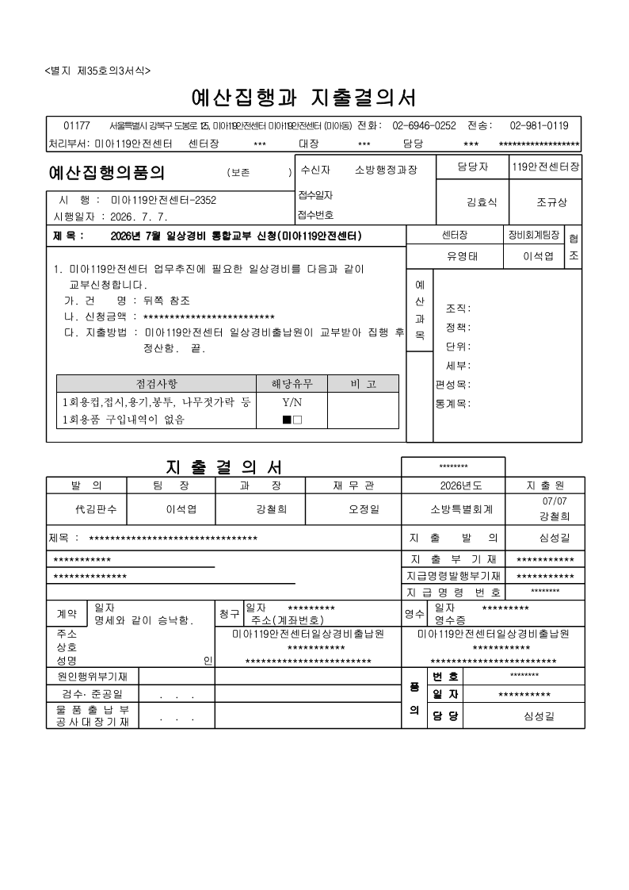 | 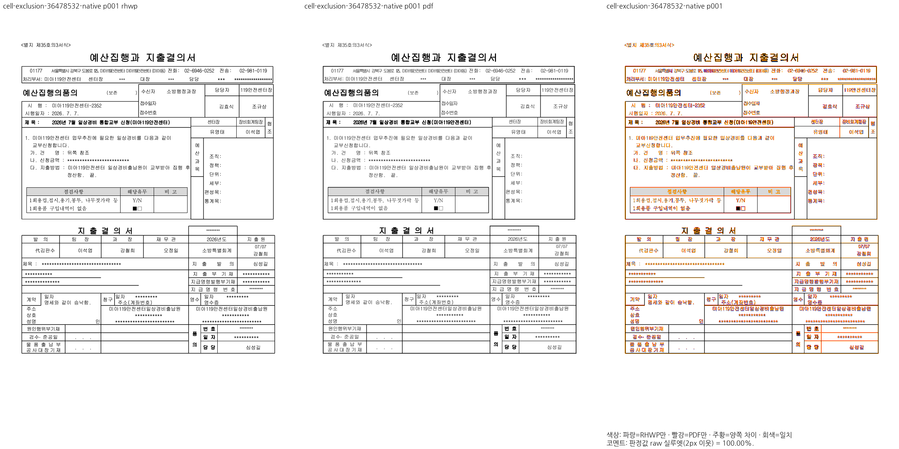 |  |
| fresh WASM | 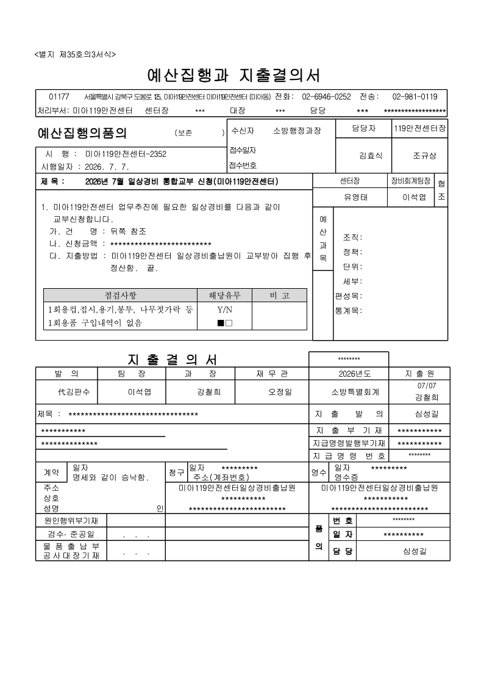 |  | 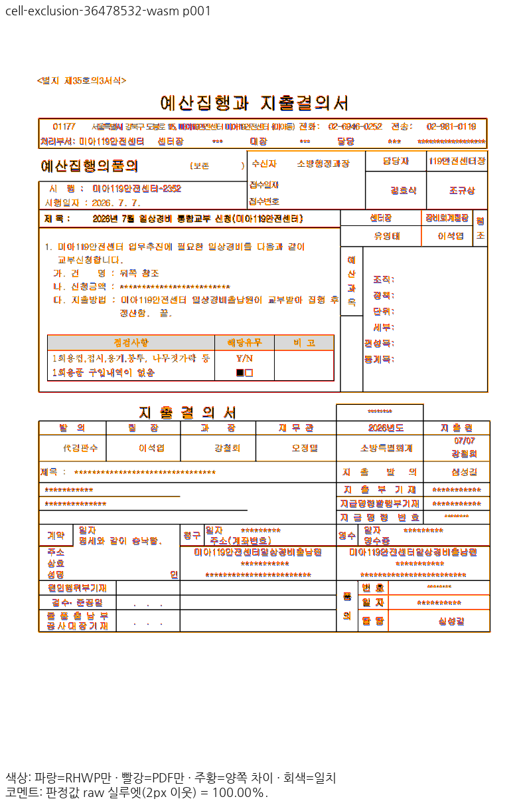 |

예산집행 품의 상단 수신/결재 셀과 하단 지출결의서의 중첩 표·제목·기관행을 대조했다. 부동 객체 주위 본문이 잘리거나 다른 셀로 흘러가지 않는다.

2쪽 Native **100.00%**: [raw](../assets/planet6897_20261106/final-b768bee1-20261109/cases/cell-exclusion-36478532/native/raw-002.png) · [PDF raw](../assets/planet6897_20261106/final-b768bee1-20261109/cases/cell-exclusion-36478532/native/pdf-002.png) · [review](../assets/planet6897_20261106/final-b768bee1-20261109/cases/cell-exclusion-36478532/native/review-002.png) · [overlay](../assets/planet6897_20261106/final-b768bee1-20261109/cases/cell-exclusion-36478532/native/overlay-002.png)

2쪽 fresh WASM **100.00%**: [raw](../assets/planet6897_20261106/final-b768bee1-20261109/cases/cell-exclusion-36478532/wasm/raw-002.png) · [PDF raw](../assets/planet6897_20261106/final-b768bee1-20261109/cases/cell-exclusion-36478532/wasm/pdf-002.png) · [review](../assets/planet6897_20261106/final-b768bee1-20261109/cases/cell-exclusion-36478532/wasm/review-002.png) · [overlay](../assets/planet6897_20261106/final-b768bee1-20261109/cases/cell-exclusion-36478532/wasm/overlay-002.png)

표 2쪽의 병합 품의담당 열과 예산 항목·별표 셀, 하단 붙임 문단의 소속·순서를 대조했다. 끝 셀까지 보존된다.

| 경로 | raw | review | overlay |
| --- | --- | --- | --- |
| Native | 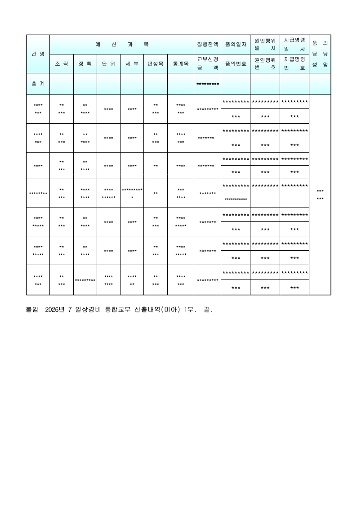 |  | 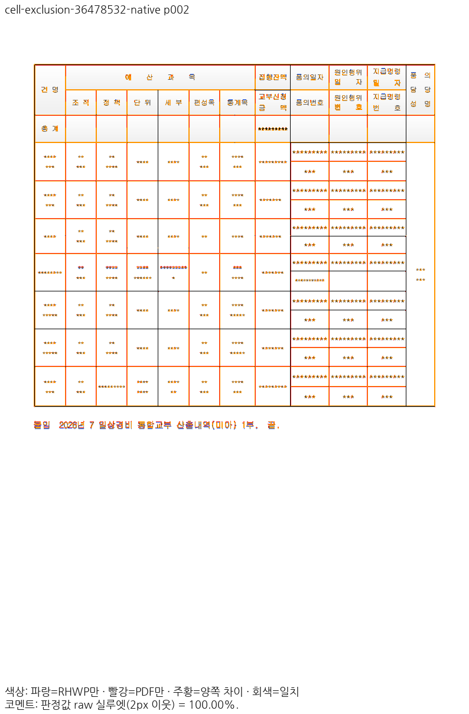 |
| fresh WASM | 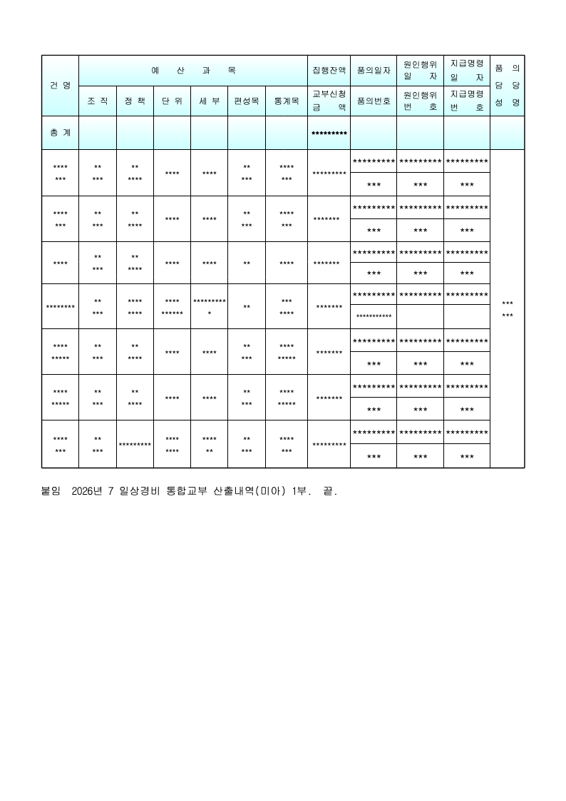 | 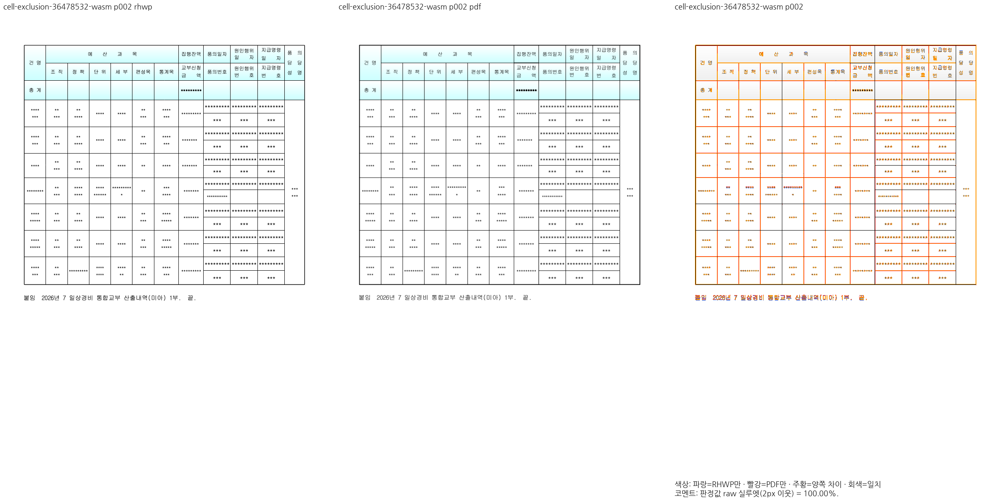 | 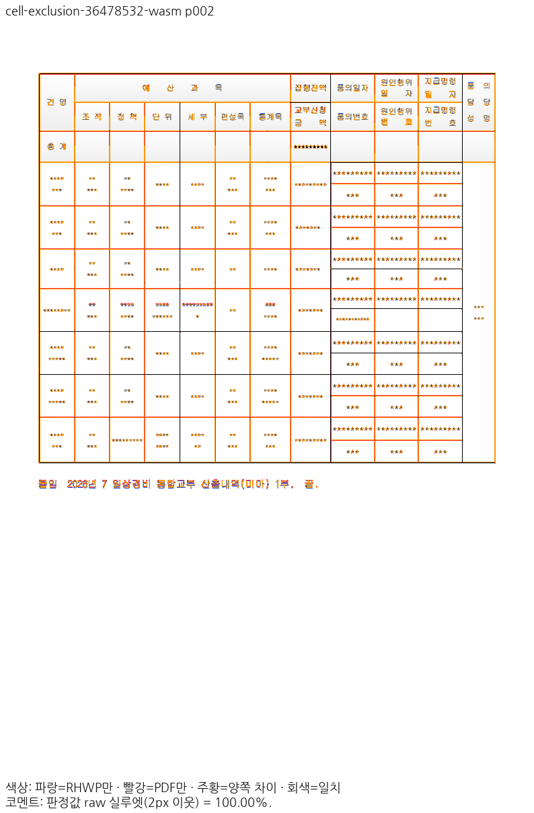 |

산출내역 표의 병합 머리·총계·별표 자료 행·오른쪽 세로 결재 셀 및 표 뒤 붙임 문장을 확인했다. 1쪽의 결의서가 중복되지 않는다.

### original-36493460

- 입력: [mydocs/pr/assets/planet6897_20261106/pr8681/36493460-original.hwpx](../assets/planet6897_20261106/pr8681/36493460-original.hwpx)
- 독립 Print: [pdf/planet6897-20261106/pr8681/36493460-original-2020.pdf](../../../pdf/planet6897-20261106/pr8681/36493460-original-2020.pdf)
- 전체 1쪽 Native 최저 99.99%. [TSV](../assets/planet6897_20261106/final-b768bee1-20261109/cases/original-36493460/native.tsv) · [입력/PDF·producer 해시](../assets/planet6897_20261106/final-b768bee1-20261109/cases/original-36493460/provenance.json).
- 전체 1쪽 fresh WASM 최저 99.99%. [TSV](../assets/planet6897_20261106/final-b768bee1-20261109/cases/original-36493460/wasm.tsv).

1쪽 Native **99.99%**: [raw](../assets/planet6897_20261106/final-b768bee1-20261109/cases/original-36493460/native/raw-001.png) · [PDF raw](../assets/planet6897_20261106/final-b768bee1-20261109/cases/original-36493460/native/pdf-001.png) · [review](../assets/planet6897_20261106/final-b768bee1-20261109/cases/original-36493460/native/review-001.png) · [overlay](../assets/planet6897_20261106/final-b768bee1-20261109/cases/original-36493460/native/overlay-001.png)

1쪽 fresh WASM **99.99%**: [raw](../assets/planet6897_20261106/final-b768bee1-20261109/cases/original-36493460/wasm/raw-001.png) · [PDF raw](../assets/planet6897_20261106/final-b768bee1-20261109/cases/original-36493460/wasm/pdf-001.png) · [review](../assets/planet6897_20261106/final-b768bee1-20261109/cases/original-36493460/wasm/review-001.png) · [overlay](../assets/planet6897_20261106/final-b768bee1-20261109/cases/original-36493460/wasm/overlay-001.png)

예산 집행 문서의 제목·상단 수신 결재 표·본문 금액 표·아래 지출결의서와 끝 문단을 확인했다. 일부 작은 글리프 래스터 차이가 남는다.

| 경로 | raw | review | overlay |
| --- | --- | --- | --- |
| Native | 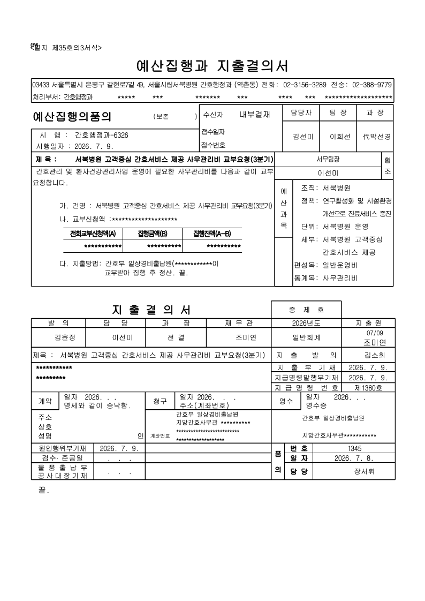 |  |  |
| fresh WASM | 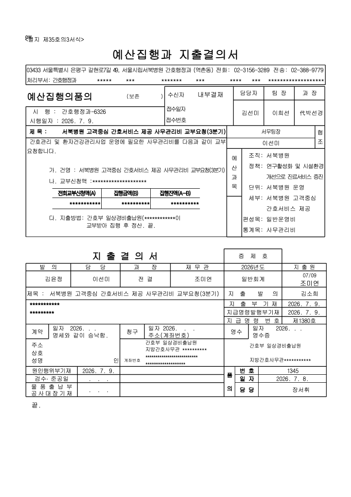 | 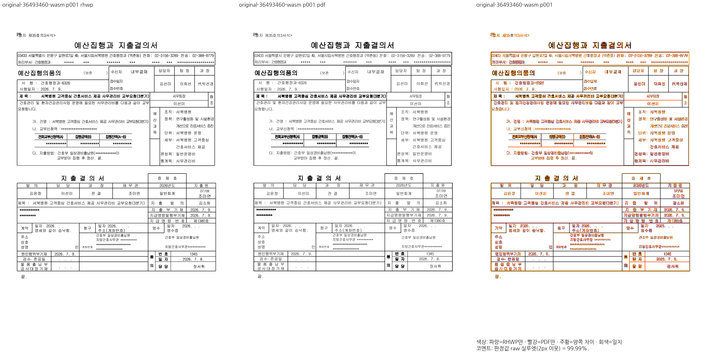 | 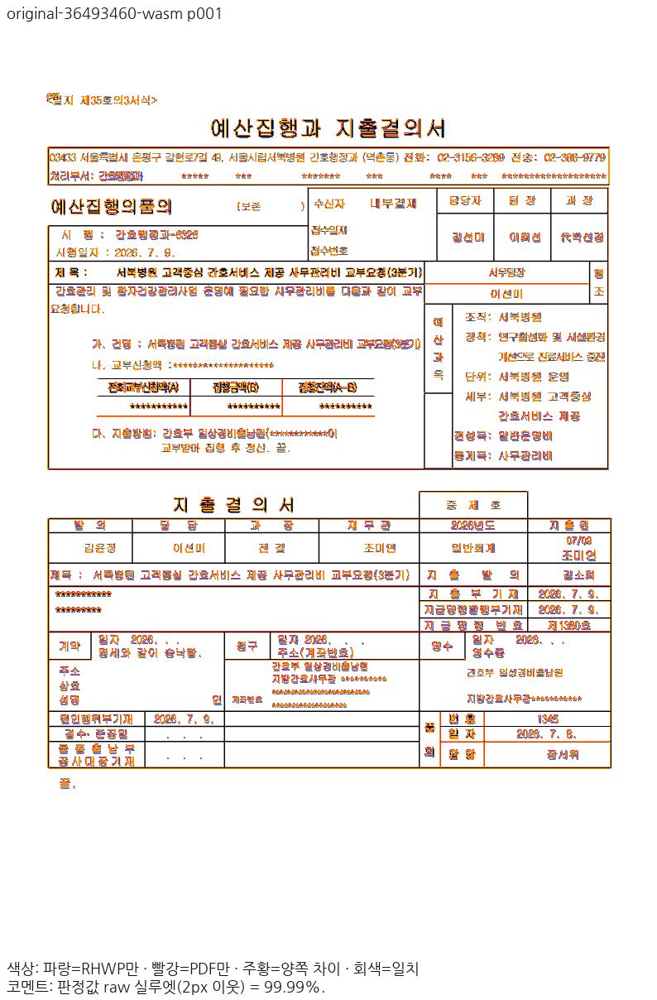 |

간호행정과 예산품의의 상단 결재·가운데 신청액 표·하단 지출결의서와 끝 문구를 대조했다. 본문과 접수/결재 셀의 소속을 유지한다.

### original-36474334

- 입력: [mydocs/pr/assets/planet6897_20261106/pr8681/36474334-original.hwpx](../assets/planet6897_20261106/pr8681/36474334-original.hwpx)
- 독립 Print: [pdf/planet6897-20261106/pr8681/36474334-original-2020.pdf](../../../pdf/planet6897-20261106/pr8681/36474334-original-2020.pdf)
- 전체 2쪽 Native 최저 100.00%. [TSV](../assets/planet6897_20261106/final-b768bee1-20261109/cases/original-36474334/native.tsv) · [입력/PDF·producer 해시](../assets/planet6897_20261106/final-b768bee1-20261109/cases/original-36474334/provenance.json).
- 전체 2쪽 fresh WASM 최저 100.00%. [TSV](../assets/planet6897_20261106/final-b768bee1-20261109/cases/original-36474334/wasm.tsv).

1쪽 Native **100.00%**: [raw](../assets/planet6897_20261106/final-b768bee1-20261109/cases/original-36474334/native/raw-001.png) · [PDF raw](../assets/planet6897_20261106/final-b768bee1-20261109/cases/original-36474334/native/pdf-001.png) · [review](../assets/planet6897_20261106/final-b768bee1-20261109/cases/original-36474334/native/review-001.png) · [overlay](../assets/planet6897_20261106/final-b768bee1-20261109/cases/original-36474334/native/overlay-001.png)

1쪽 fresh WASM **100.00%**: [raw](../assets/planet6897_20261106/final-b768bee1-20261109/cases/original-36474334/wasm/raw-001.png) · [PDF raw](../assets/planet6897_20261106/final-b768bee1-20261109/cases/original-36474334/wasm/pdf-001.png) · [review](../assets/planet6897_20261106/final-b768bee1-20261109/cases/original-36474334/wasm/review-001.png) · [overlay](../assets/planet6897_20261106/final-b768bee1-20261109/cases/original-36474334/wasm/overlay-001.png)

지출결의 문서의 상단 결재 표·본문 내 예산과목 표·아래 지출결의 표가 구분되고 셀 내용·행 높이·아래 수령인 영역이 보존된다.

| 경로 | raw | review | overlay |
| --- | --- | --- | --- |
| Native | 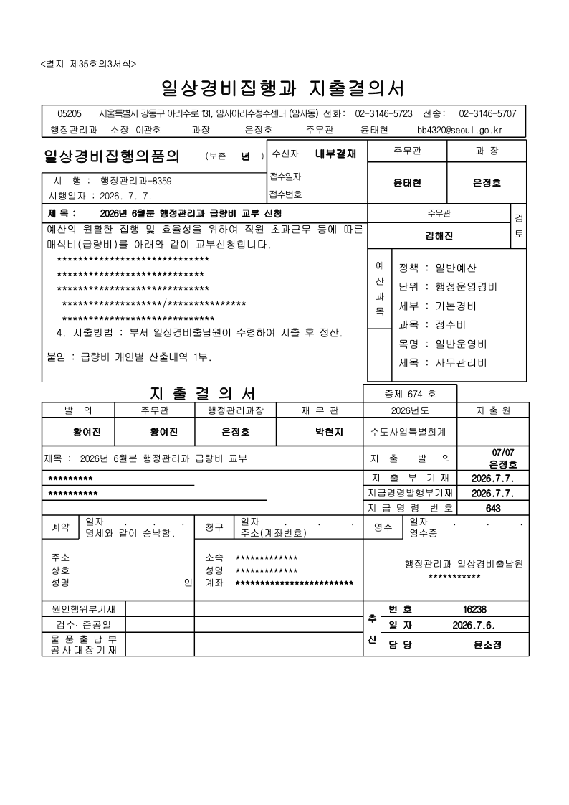 |  | 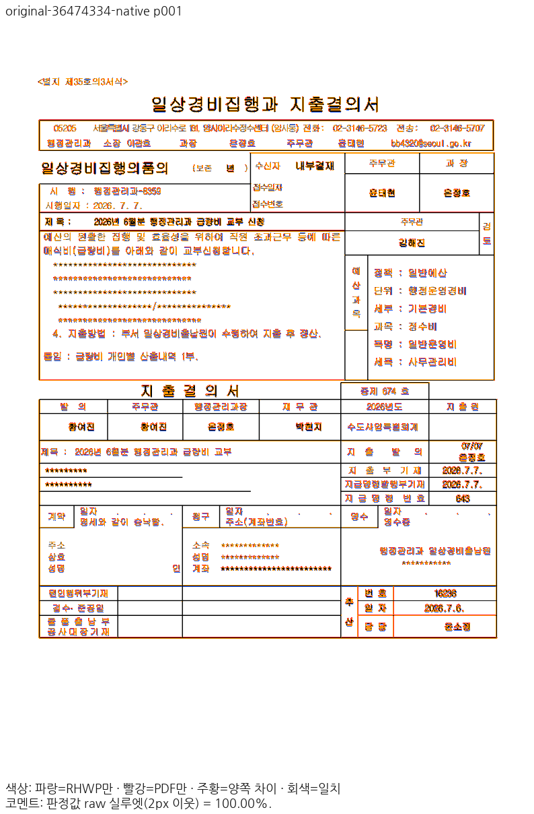 |
| fresh WASM | 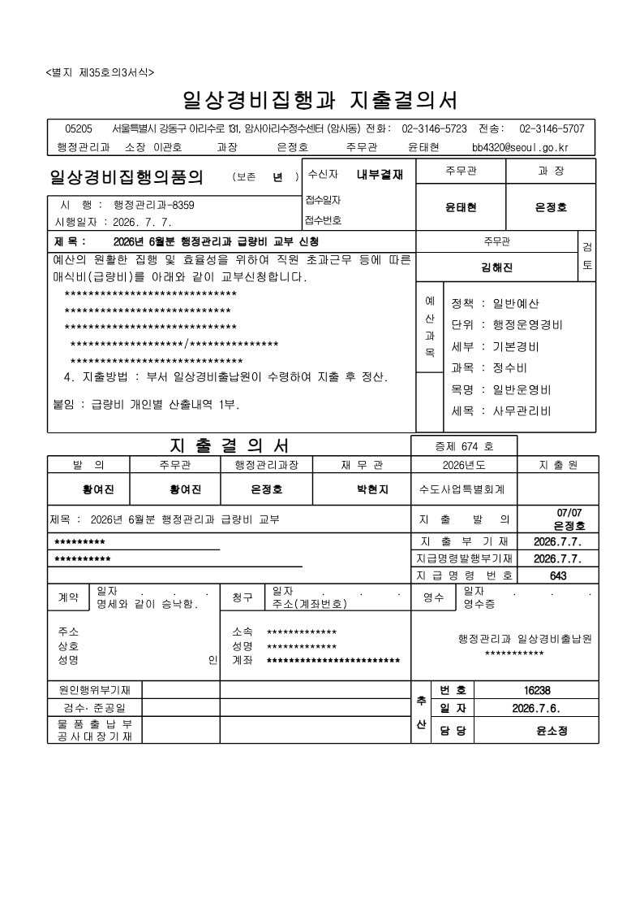 | 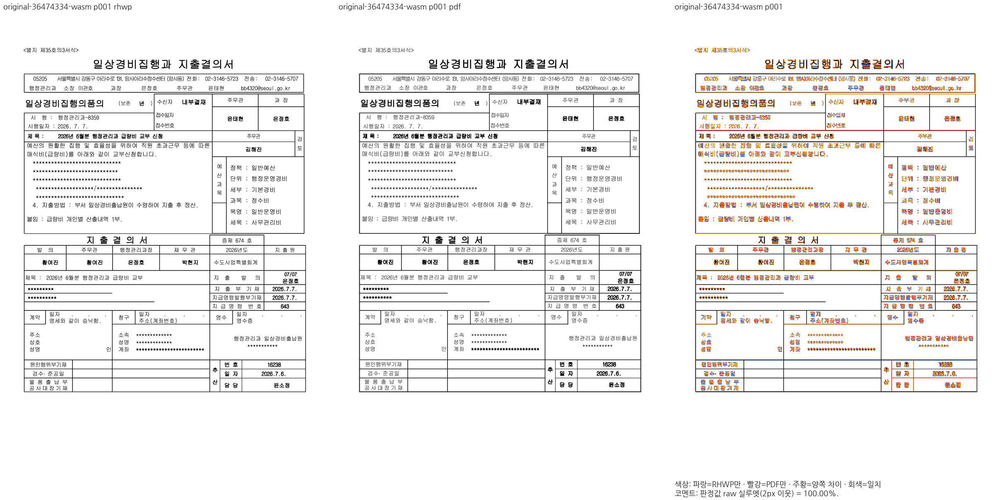 | 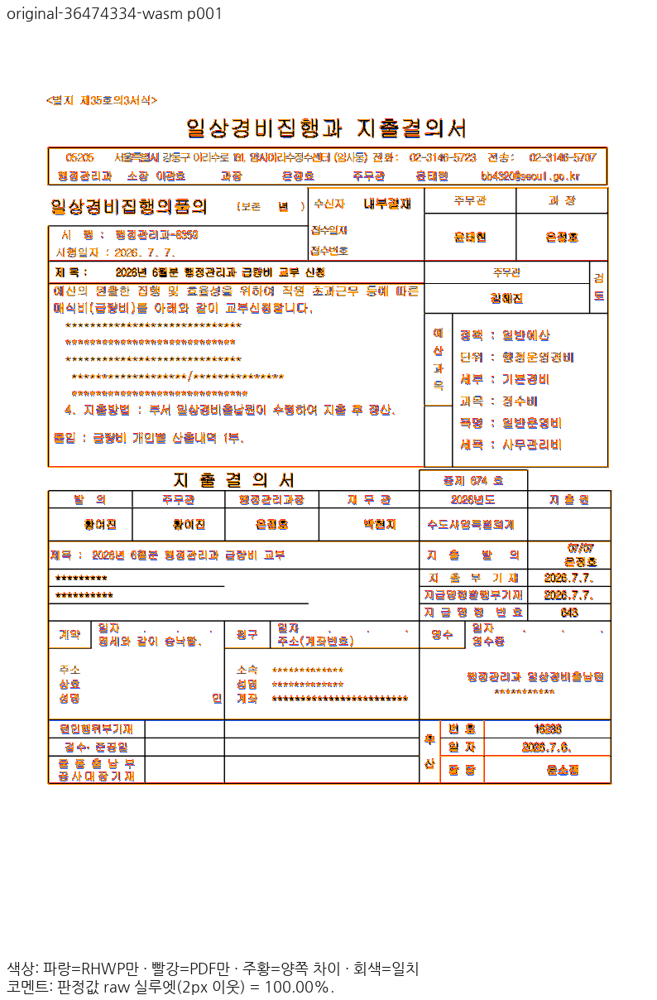 |

일상경비 품의의 결재 영역과 본문, 하단 지출결의서의 증제674호·금액·날짜·계좌·검수 행이 같은 셀에 보존된다.

2쪽 Native **100.00%**: [raw](../assets/planet6897_20261106/final-b768bee1-20261109/cases/original-36474334/native/raw-002.png) · [PDF raw](../assets/planet6897_20261106/final-b768bee1-20261109/cases/original-36474334/native/pdf-002.png) · [review](../assets/planet6897_20261106/final-b768bee1-20261109/cases/original-36474334/native/review-002.png) · [overlay](../assets/planet6897_20261106/final-b768bee1-20261109/cases/original-36474334/native/overlay-002.png)

2쪽 fresh WASM **100.00%**: [raw](../assets/planet6897_20261106/final-b768bee1-20261109/cases/original-36474334/wasm/raw-002.png) · [PDF raw](../assets/planet6897_20261106/final-b768bee1-20261109/cases/original-36474334/wasm/pdf-002.png) · [review](../assets/planet6897_20261106/final-b768bee1-20261109/cases/original-36474334/wasm/review-002.png) · [overlay](../assets/planet6897_20261106/final-b768bee1-20261109/cases/original-36474334/wasm/overlay-002.png)

독립 PDF와 후보 모두 빈 2쪽이다. 빈 페이지의 보존을 확인했으며 실내용 페이지로 해석하지 않는다.

| 경로 | raw | review | overlay |
| --- | --- | --- | --- |
| Native |  | 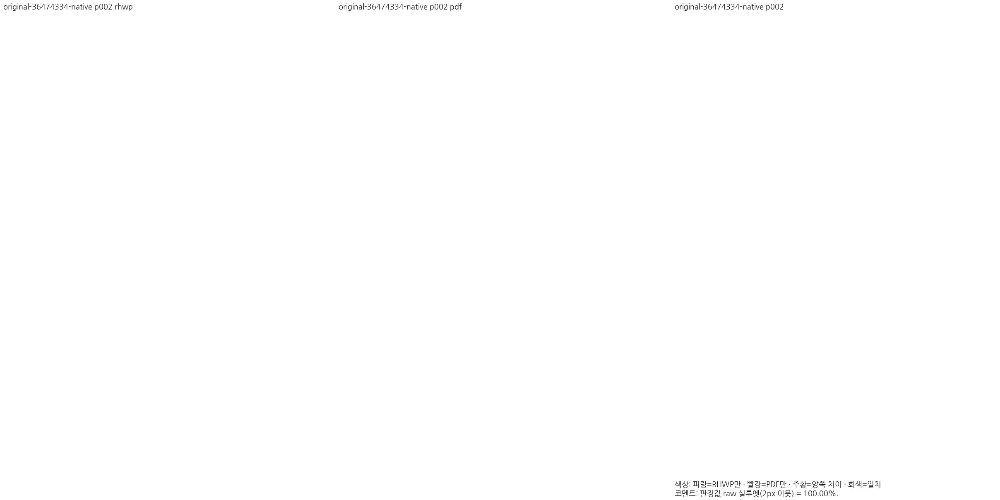 |  |
| fresh WASM |  | 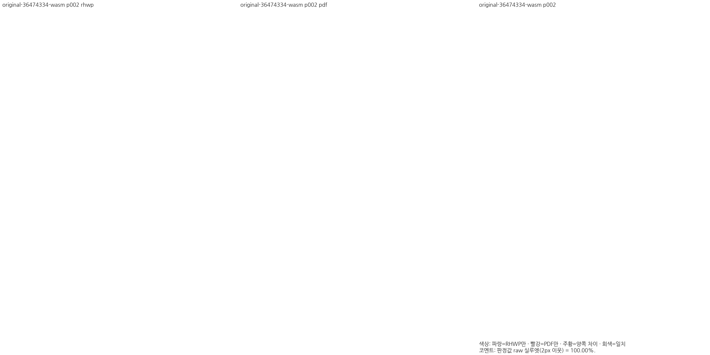 | 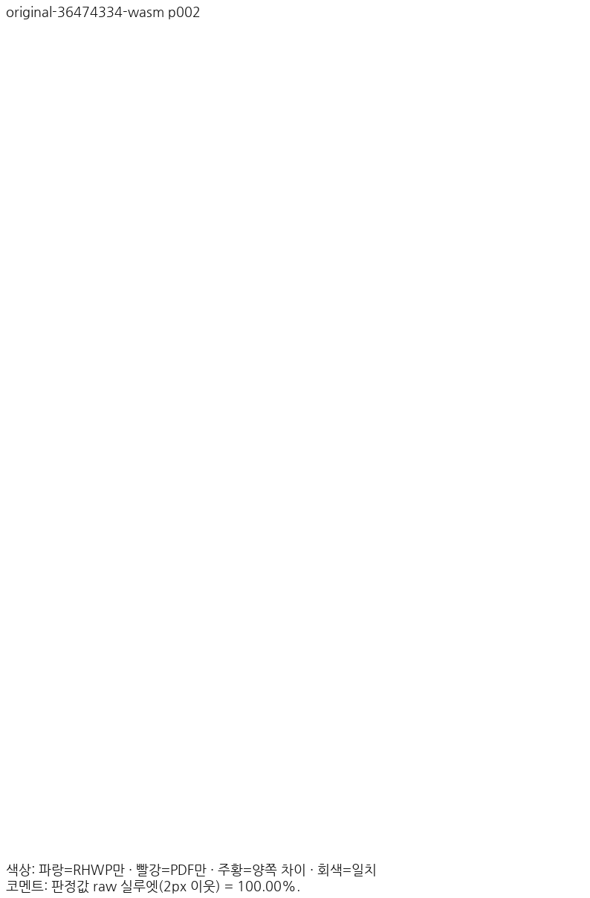 |

Print와 후보 모두 빈 2쪽이다. 이 결과는 총쪽수와 앞쪽 경계 보존에만 사용하며 빈 페이지 점수로 본문 피델리티를 대신하지 않는다.

### stored-band

- 입력: [samples/issue8679/stored_band_crossing_line.hwpx](../../../samples/issue8679/stored_band_crossing_line.hwpx)
- 독립 Print: [pdf/issue8679_stored_band_crossing_line-2020.pdf](../../../pdf/issue8679_stored_band_crossing_line-2020.pdf)
- 전체 2쪽 Native 최저 100.00%. [TSV](../assets/planet6897_20261106/final-b768bee1-20261109/cases/stored-band/native.tsv) · [입력/PDF·producer 해시](../assets/planet6897_20261106/final-b768bee1-20261109/cases/stored-band/provenance.json).
- 전체 2쪽 fresh WASM 최저 100.00%. [TSV](../assets/planet6897_20261106/final-b768bee1-20261109/cases/stored-band/wasm.tsv).

1쪽 Native **100.00%**: [raw](../assets/planet6897_20261106/final-b768bee1-20261109/cases/stored-band/native/raw-001.png) · [PDF raw](../assets/planet6897_20261106/final-b768bee1-20261109/cases/stored-band/native/pdf-001.png) · [review](../assets/planet6897_20261106/final-b768bee1-20261109/cases/stored-band/native/review-001.png) · [overlay](../assets/planet6897_20261106/final-b768bee1-20261109/cases/stored-band/native/overlay-001.png)

1쪽 fresh WASM **100.00%**: [raw](../assets/planet6897_20261106/final-b768bee1-20261109/cases/stored-band/wasm/raw-001.png) · [PDF raw](../assets/planet6897_20261106/final-b768bee1-20261109/cases/stored-band/wasm/pdf-001.png) · [review](../assets/planet6897_20261106/final-b768bee1-20261109/cases/stored-band/wasm/review-001.png) · [overlay](../assets/planet6897_20261106/final-b768bee1-20261109/cases/stored-band/wasm/overlay-001.png)

상단 예산집행품의와 내부 점검표가 상단 외곽 안에 배치되고 하단 지출결의서가 별도 원점·서명 영역을 보존한다.

| 경로 | raw | review | overlay |
| --- | --- | --- | --- |
| Native | 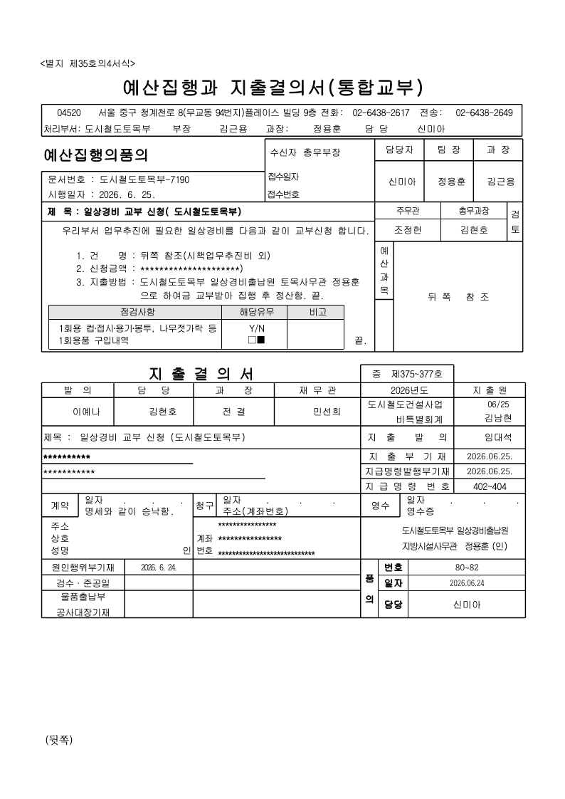 |  |  |
| fresh WASM | 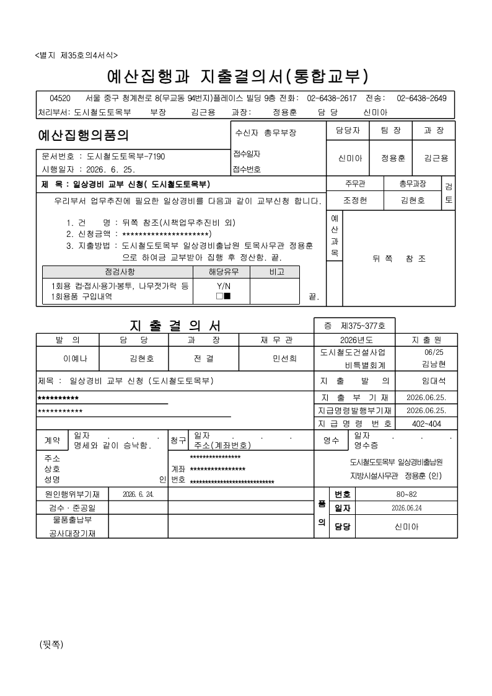 | 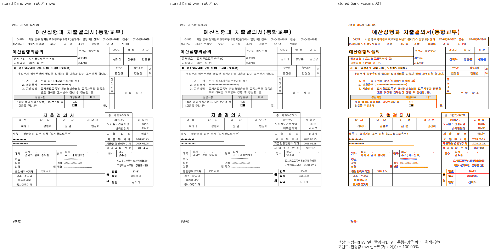 | 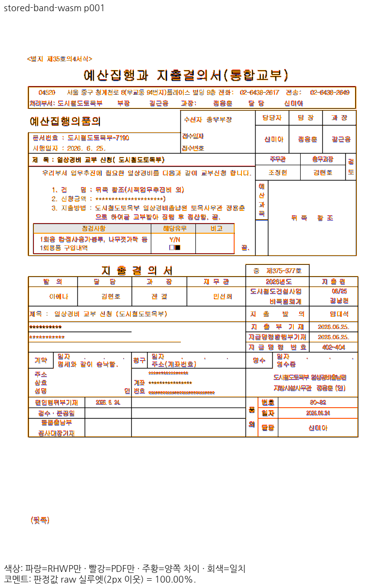 |

통합교부 예산품의 본문과 점검 표가 저장된 빈 영역 안에 있으며 아래 지출결의서와 뒤쪽 표식의 순서가 보존된다.

2쪽 Native **100.00%**: [raw](../assets/planet6897_20261106/final-b768bee1-20261109/cases/stored-band/native/raw-002.png) · [PDF raw](../assets/planet6897_20261106/final-b768bee1-20261109/cases/stored-band/native/pdf-002.png) · [review](../assets/planet6897_20261106/final-b768bee1-20261109/cases/stored-band/native/review-002.png) · [overlay](../assets/planet6897_20261106/final-b768bee1-20261109/cases/stored-band/native/overlay-002.png)

2쪽 fresh WASM **100.00%**: [raw](../assets/planet6897_20261106/final-b768bee1-20261109/cases/stored-band/wasm/raw-002.png) · [PDF raw](../assets/planet6897_20261106/final-b768bee1-20261109/cases/stored-band/wasm/pdf-002.png) · [review](../assets/planet6897_20261106/final-b768bee1-20261109/cases/stored-band/wasm/review-002.png) · [overlay](../assets/planet6897_20261106/final-b768bee1-20261109/cases/stored-band/wasm/overlay-002.png)

후속 집행 내역 표의 머리글·3개 실내용 행·빈 행 및 마지막 품의 담당 열을 PDF와 대조했다.

| 경로 | raw | review | overlay |
| --- | --- | --- | --- |
| Native | 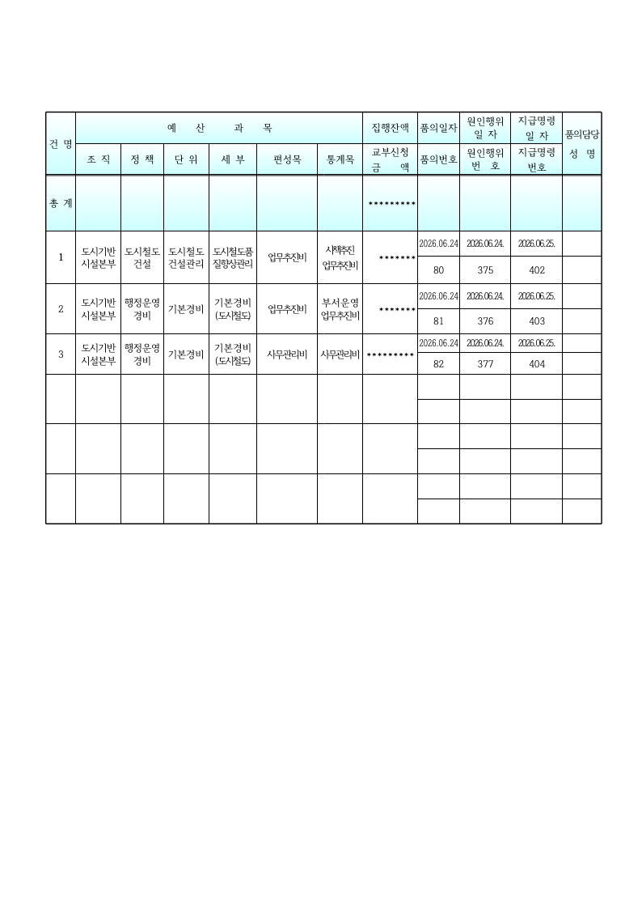 | 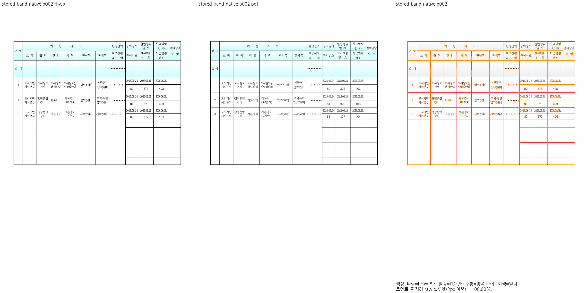 |  |
| fresh WASM | 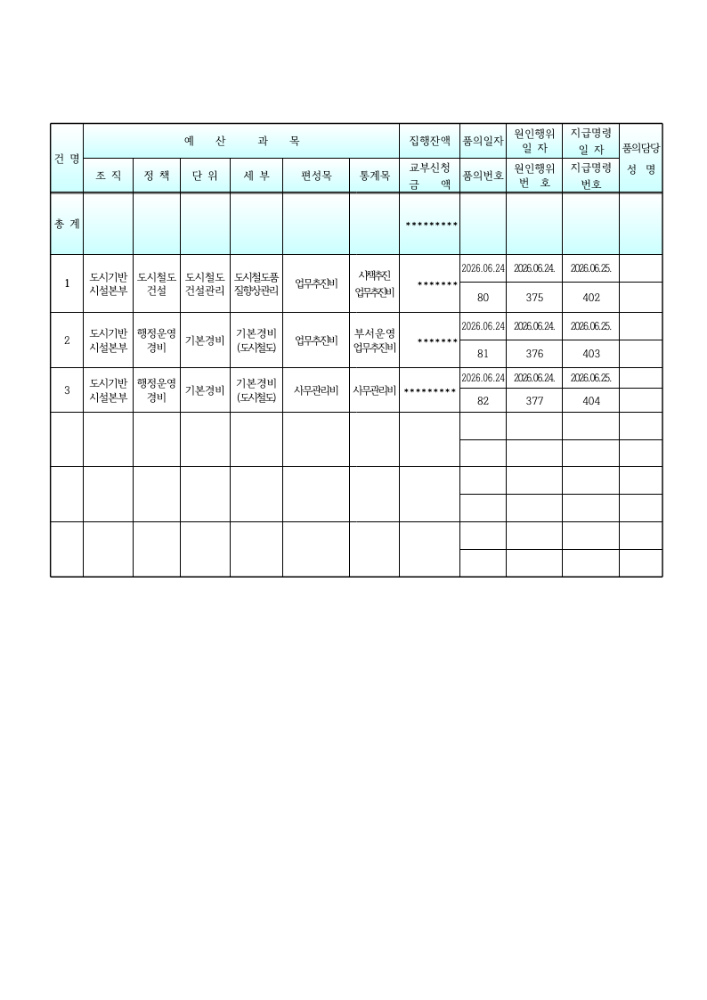 |  | 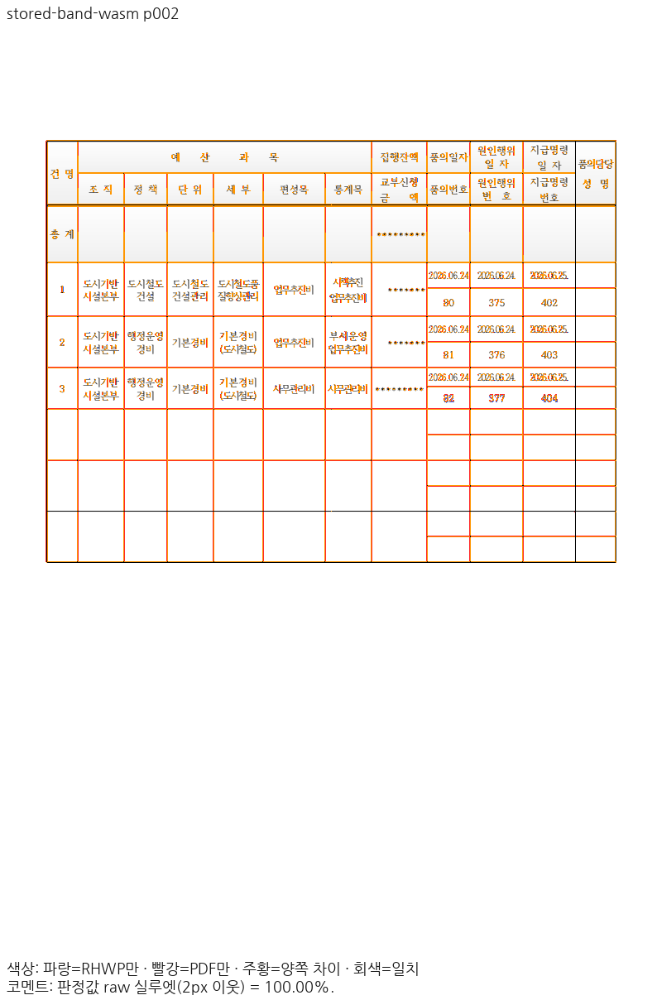 |

두 줄 머리·총계·자료1~3행·빈 후속 행·품의담당 세로셀을 대조했다. 저장된 행 밴드와 빈 영역을 임의 축소하지 않고 마지막 테두리를 보존한다.

## 최종 제출과 원격 조건

기존 전쪽 TSV·직접 판독을 유지하고 리베이스 후 영향 2조건 8쪽과 앞선 HWP3 3조건 10쪽과 필수 집중·lint를 추가 검증했습니다. 엄격0.1%p 비교 잔여1건은 새 이슈로 분리하며 완전 무회귀로 표기하지 않습니다. 원격 게시 직전에 원 PR head·upstream/devel·제출 diff와 병합 시뮬레이션을 재확인합니다. 통합 PR의 실제 CI 성공과 최종 head의 mergeability를 확인한 뒤 승인된 병합·후속처리를 수행합니다.

## Merge 후 contributor PR comment 계획

통합 병합이 완료되면 최종 merge SHA·CI URL과 이 PR이 주장한 입력/페이지의 raw 이미지를 고정 SHA 링크로 연결합니다. 원 기여와 메인터너 보정 이유·범위를 한국어 존댓말로 구분하며, 별도 검증하지 않은 문제까지 해결했다고 쓰지 않습니다. 원 PR의 종료는 통합 병합 후 실제 해결 범위를 확인하여 처리합니다.
