# PR #8691 리뷰 — fix(layout): 행 선언 합이 표 선언을 넘으면 마지막 행에서 회수한다 (#8682)

## 최종 판정

**승인 — 해당 원본·변경 범위의 로컬 검증 완료.**

원격 통합 PR의 CI·병합은 아직 별도 확인 대상이다. 이 판정은 contributor 원 head와 아래 메인터너 보정을 포함한 검증 code `21d62361fa670858e63fdfc475c236f112e20a3d`에 대한 결과다.

## 접수 정보

- [원 PR](https://github.com/edwardkim/rhwp/pull/8691), 작성자 planet6897, reviewer jangster77. 원 source head는 변경하지 않았다.
- 원 head `63b216c83b80d1cfcd5097aa9ada6bdd43df3a6f`; 통합 base `5ea1227505978156082121f1601cb03044a0583f`; 검증 code `21d62361fa670858e63fdfc475c236f112e20a3d`.
- live 원 PR head 재확인: 2026-11-11T02:22:08.125563+09:00, 접수 SHA와 동일, 상태 OPEN.
- 관련 이슈 표기는 원 PR 본문을 따르며, 통합 후 실제 해결 범위와 각 이슈의 잔여를 확인해 댓글·close한다.

## 주장과 코드 검토

모순된 표 선언 높이의 초과분을 마지막 행 빈 공간에서만 회수.

측정 단계에서 `declared_tail_row_height`의 마지막 행 회수 판정을 먼저 소비한다. 앞 행은 저장 선언을 유지하며 마지막 행의 실제 내용이 회수를 허용할 때만 초과분을 그 행에서 뺀다. rental·artifact의 실제 행 경계와 appendix 3쪽의 중첩 표 반례를 같은 Print와 대조했고, 회수 근거가 없는 경우의 비례 축소를 유지한다. 기여자의 별도 비공개 10k 코퍼스를 이번 검증에서 다시 실행했다고 표시하지 않는다.

주요 생산 경로:

- `src/renderer/height_measurer.rs`

조판 규칙은 원본 저장 줄·프레임·개체 소유와 독립 Print를 근거로 검사한다. 새 메인터너 보정은 문서명·문서 식별자·쪽 번호에 따른 제품 분기나 판정 문턱 완화를 추가하지 않았다. 실제 회귀·원본·반례로 확인한 범위와 기존 차이는 구분한다.

## 검증 입력과 결과

96 DPI·Print·해당 compat·현행 Visual Sweep·색상 경계 보정 전2px raw 기준이다. 같은 base/후보 원본·PDF와 글꼴 공급을 사용했다. 표의 수치는 각 문서의 전쪽 최저이며 대표 페이지 값과 혼동하지 않는다.

| 원본 | 후보 쪽수 | Native base → 후보 최저 | fresh WASM base → 후보 최저 | 후보 전쪽 TSV |
| --- | ---: | ---: | ---: | --- |
| `ai_procurement_appendix.hwp` | 4 | 97.47 → 97.47% | 97.46 → 97.46% | [Native](../assets/planet6897_clean19_20261110/pr8691/cases/pr8691-ai_procurement_appendix/native/silhouette.tsv) · [WASM](../assets/planet6897_clean19_20261110/pr8691/cases/pr8691-ai_procurement_appendix/wasm/silhouette.tsv) |
| `artifact_loan_form.hwp` | 1 | 72.36 → 100.00% | 72.37 → 100.00% | [Native](../assets/planet6897_clean19_20261110/pr8691/cases/pr8691-artifact_loan_form/native/silhouette.tsv) · [WASM](../assets/planet6897_clean19_20261110/pr8691/cases/pr8691-artifact_loan_form/wasm/silhouette.tsv) |
| `rental_approval_form.hwp` | 1 | 69.75 → 100.00% | 69.75 → 100.00% | [Native](../assets/planet6897_clean19_20261110/pr8691/cases/pr8691-rental_approval_form/native/silhouette.tsv) · [WASM](../assets/planet6897_clean19_20261110/pr8691/cases/pr8691-rental_approval_form/wasm/silhouette.tsv) |

고정 base의 기존 쪽수 불일치 원본은 PDF와 대응하는 모든 페이지의 값과 PDF에 없는 추가 RHWP 쪽을 함께 보존했다. `base-base-producer-link.json`에 원래 count 실패·추가 쪽 hash를 기록했으며 이를 통과 자료로 표시하지 않는다. 후보의 전체 쪽수는 독립 PDF와 일치한다. 입력 별칭은 동일 byte의 정식 fixture와 대응하며 비공개 글꼴은 Git에 포함하지 않았다.

- `samples/issue8682/ai_procurement_appendix.hwp` / `pdf/issue8682/ai_procurement_appendix-2020.pdf`; 입력·PDF 해시와 producer·글꼴·실제 쪽수는 [Native manifest](../assets/planet6897_clean19_20261110/pr8691/cases/pr8691-ai_procurement_appendix/native/manifest.json) 및 [WASM manifest](../assets/planet6897_clean19_20261110/pr8691/cases/pr8691-ai_procurement_appendix/wasm/manifest.json).
- `samples/issue8682/artifact_loan_form.hwp` / `pdf/issue8682/artifact_loan_form-2020.pdf`; 입력·PDF 해시와 producer·글꼴·실제 쪽수는 [Native manifest](../assets/planet6897_clean19_20261110/pr8691/cases/pr8691-artifact_loan_form/native/manifest.json) 및 [WASM manifest](../assets/planet6897_clean19_20261110/pr8691/cases/pr8691-artifact_loan_form/wasm/manifest.json).
- `samples/issue8682/rental_approval_form.hwp` / `pdf/issue8682/rental_approval_form-2020.pdf`; 입력·PDF 해시와 producer·글꼴·실제 쪽수는 [Native manifest](../assets/planet6897_clean19_20261110/pr8691/cases/pr8691-rental_approval_form/native/manifest.json) 및 [WASM manifest](../assets/planet6897_clean19_20261110/pr8691/cases/pr8691-rental_approval_form/wasm/manifest.json).

## 회귀와 실제 소비 경로

- 최소 글꼴 환경의 전체 회귀: `Summary [ 545.222s] 13227 tests run: 13227 passed (2 slow), 45 skipped`. 개인 글꼴을 제거하거나 비활성화하지 않고 접근 차단한 Mac 검증 환경이다.
- Native Skia 전체 lib·missing-picture·direct-PDF, Native/WASM/all-target Clippy·workspace build·fmt·manifest base 비교를 최종 제품 코드에서 확인했다.
- [전체 Rust 결과](../assets/planet6897_clean19_20261110/rust-final-validation.json), [Native 전쪽](../assets/planet6897_clean19_20261110/native-final-validation.json), [WASM 전쪽](../assets/planet6897_clean19_20261110/wasm-final-validation.json), [실제 browser](../assets/planet6897_clean19_20261110/consumers/browser-validation.json), [SVG](../assets/planet6897_clean19_20261110/consumers/svg-validation.json)를 연결한다. Studio 44건 중 실제 Canvas2D 28·CanvasKit 16건이며, 글꼴 요구 목록 미준비 6건은 Canvas2D fallback으로 기록했다. 지원 CanvasKit 15건의 실제 software surface·readiness를 확인했다. 별도의 누락 그림 screen 반례 1건은 `image:dataMissing`과 readiness 실패를 그대로 기록하며 통과로 바꾸지 않았다. 모든 backend의 glyph 또는 RGB 동일을 주장하지 않는다.
- Mac fresh WASM은 locked wrapper `--target web --out-dir pkg --no-opt` 로컬 대체 빌드다. Docker 최적화 결과가 아니다. root pkg·Studio public·실제 초기화 응답 hash와 실제 Canvas2D/지원 CanvasKit·SVG 소비 결과는 통합 검증 기록에 별도로 연결한다.
- 필수 편람 HWPX Native 383쪽과 collaborator 정본 보호 TSV 전체는 통합 후보에서 실행했다. 다른 PR의 보호 문서 점수로 이 PR 주장의 직접 증거를 대신하지 않는다.
- 원 회귀 source(자동 수집 suite에서 실제 실행):

- `tests/cases/issue_8682_declared_excess_tail_row.rs`

## 같은 페이지 시각 증적

전쪽 TSV와 별도로 원본 내용·쪽 소속·누락/중복·변경 영역·미세 간격을 직접 판독했다. raw·PDF·review·overlay는 각각 같은 원본·페이지·backend다. 100.00%는 2px 내용 실루엣 지표이며 RGB 전체 픽셀 동일을 뜻하지 않는다.

ai_procurement_appendix.hwp 3쪽 Native
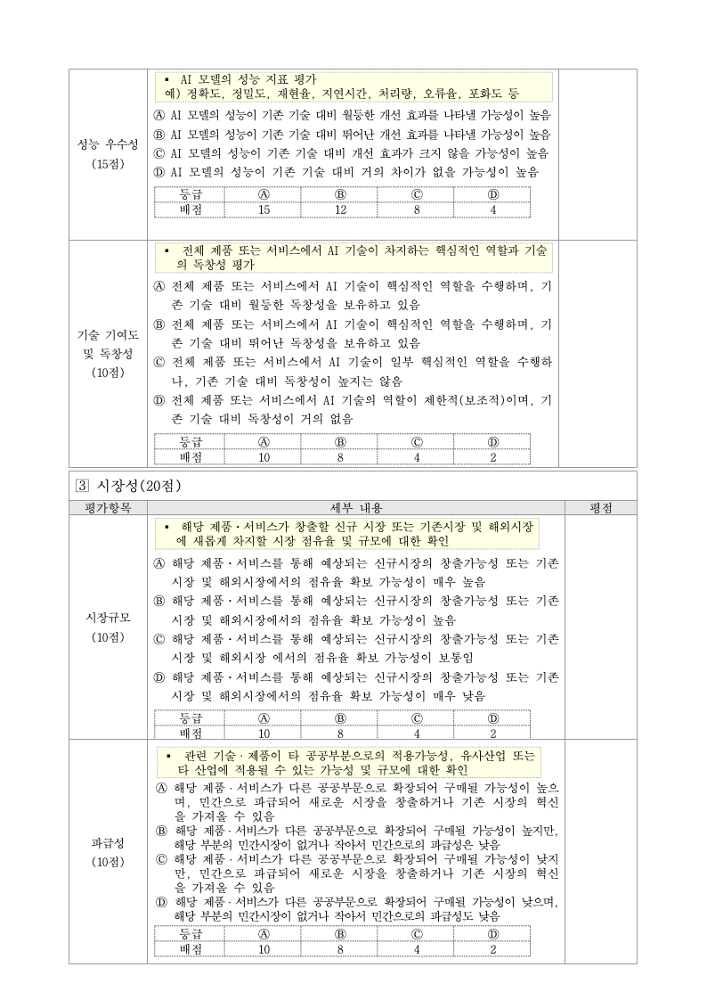
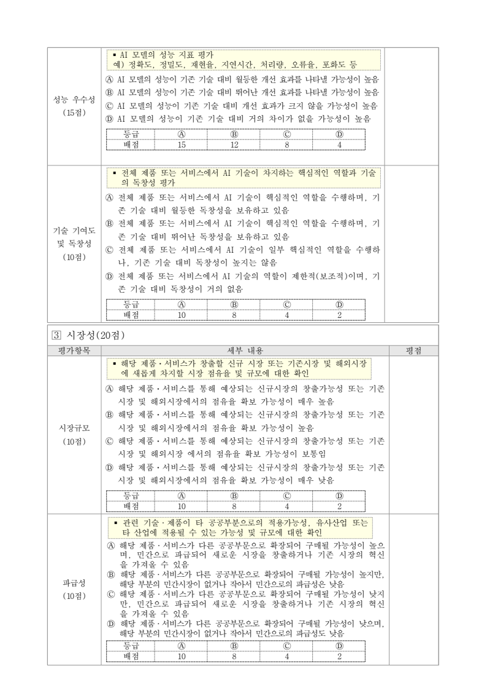
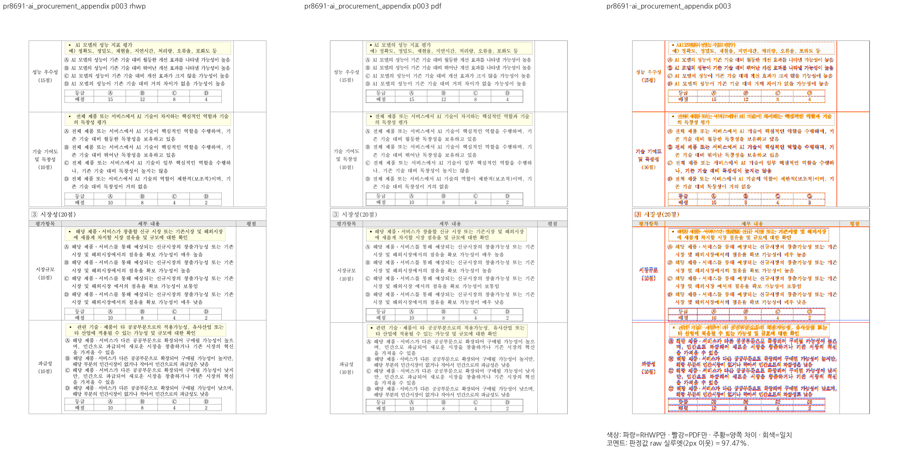

ai_procurement_appendix.hwp 3쪽 fresh WASM
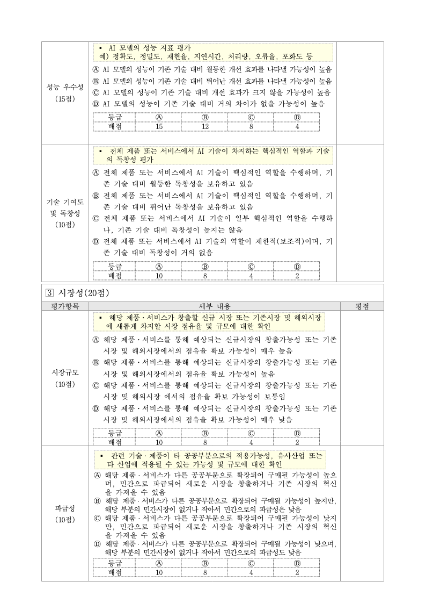

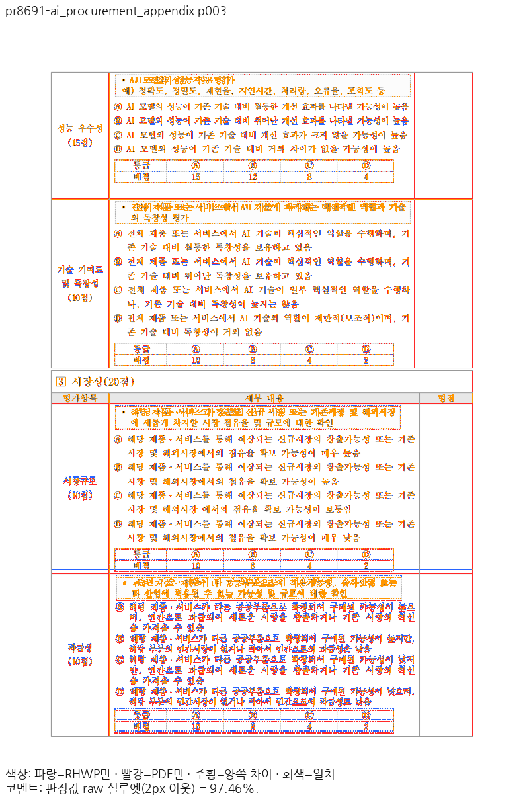
artifact_loan_form.hwp 1쪽 Native
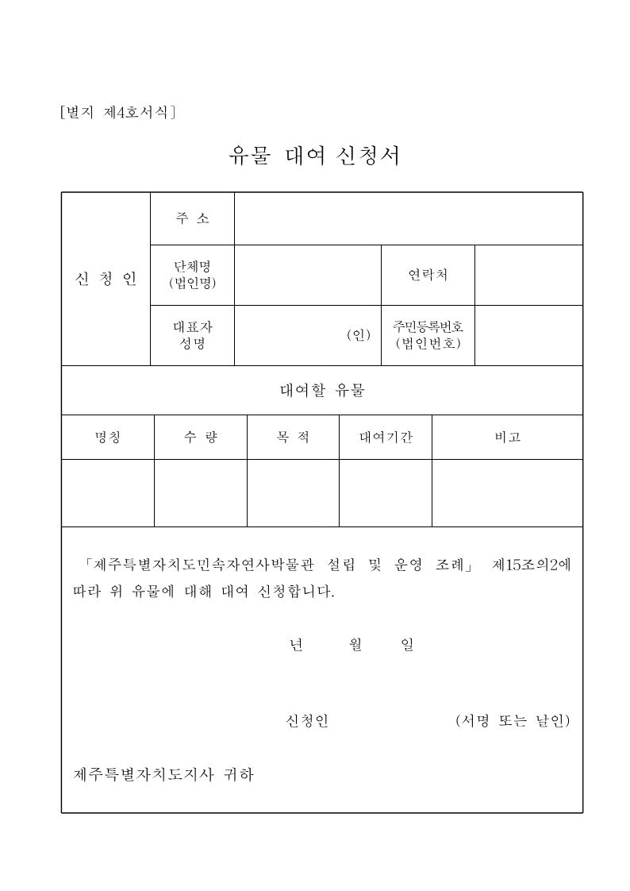
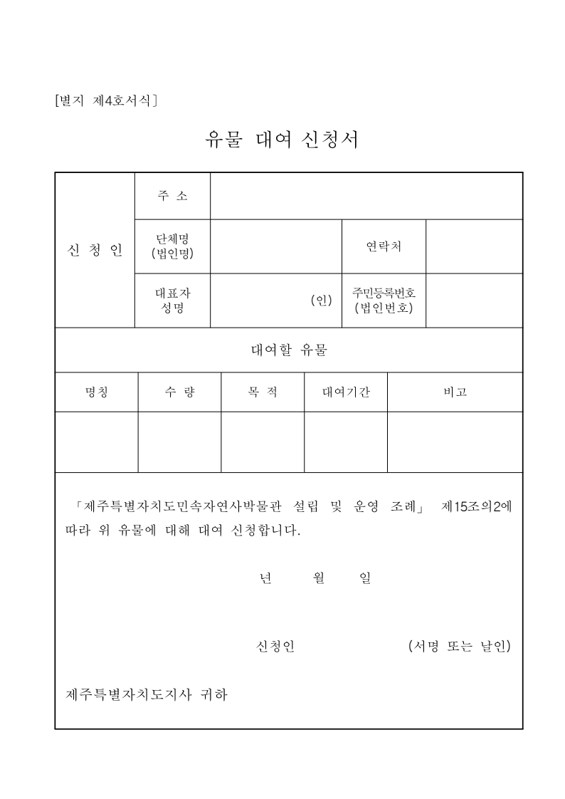

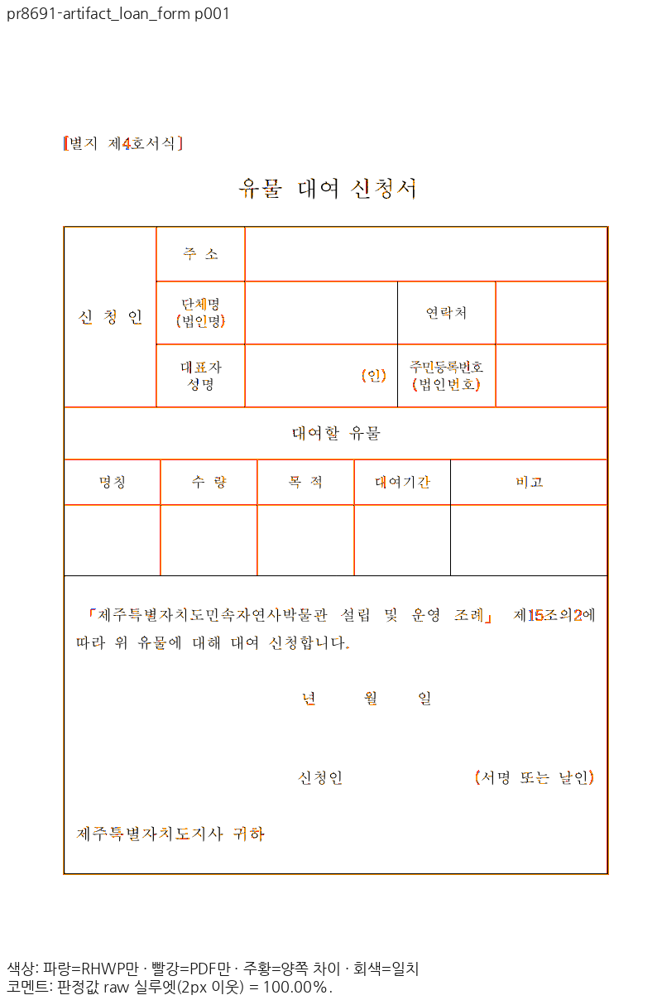
artifact_loan_form.hwp 1쪽 fresh WASM
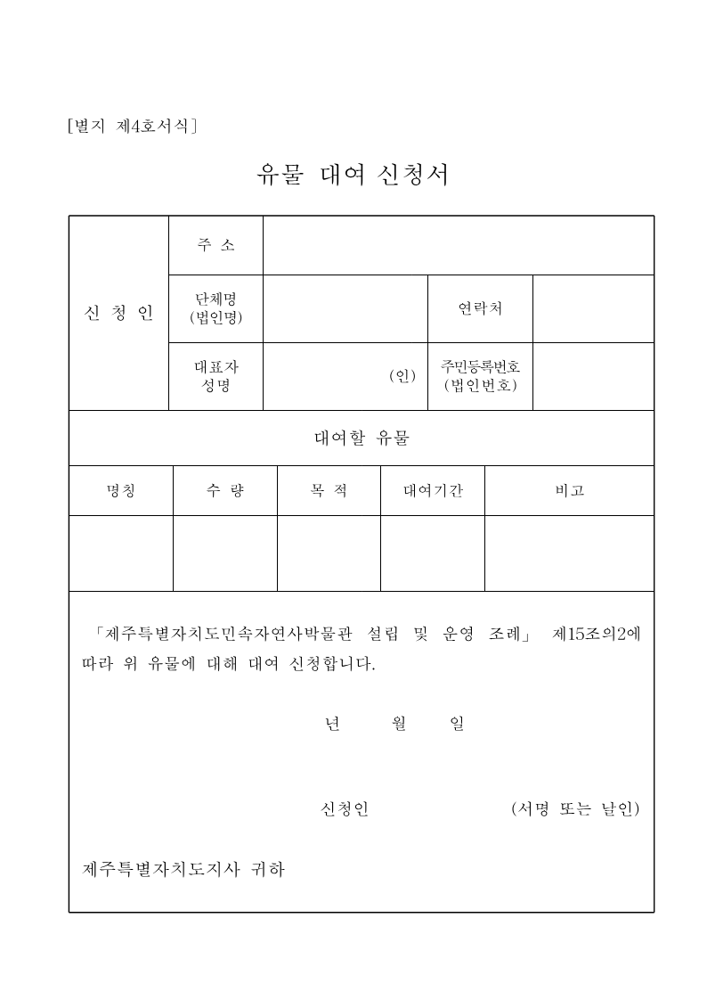

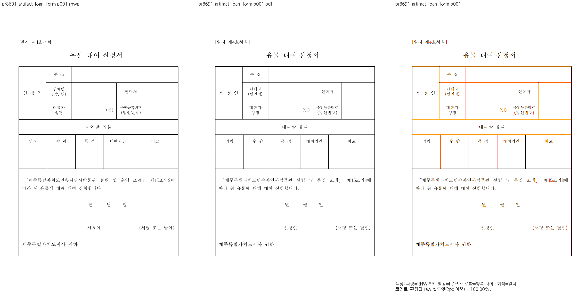

rental_approval_form.hwp 1쪽 Native
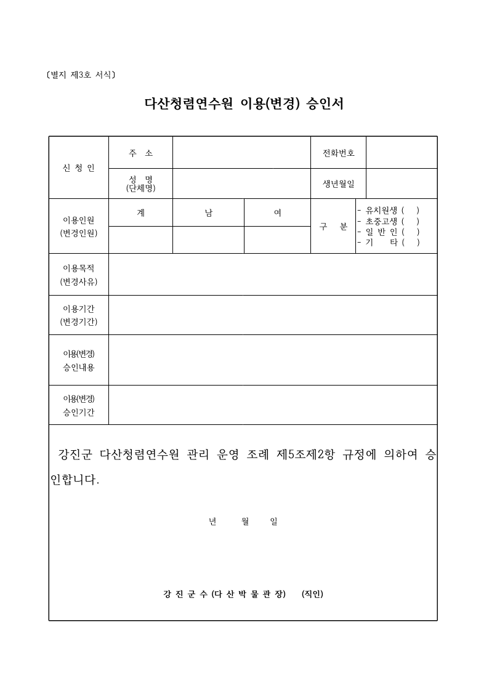
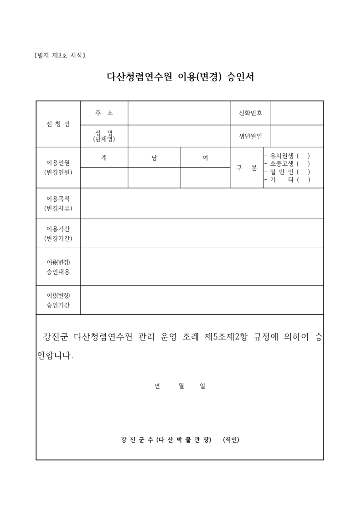

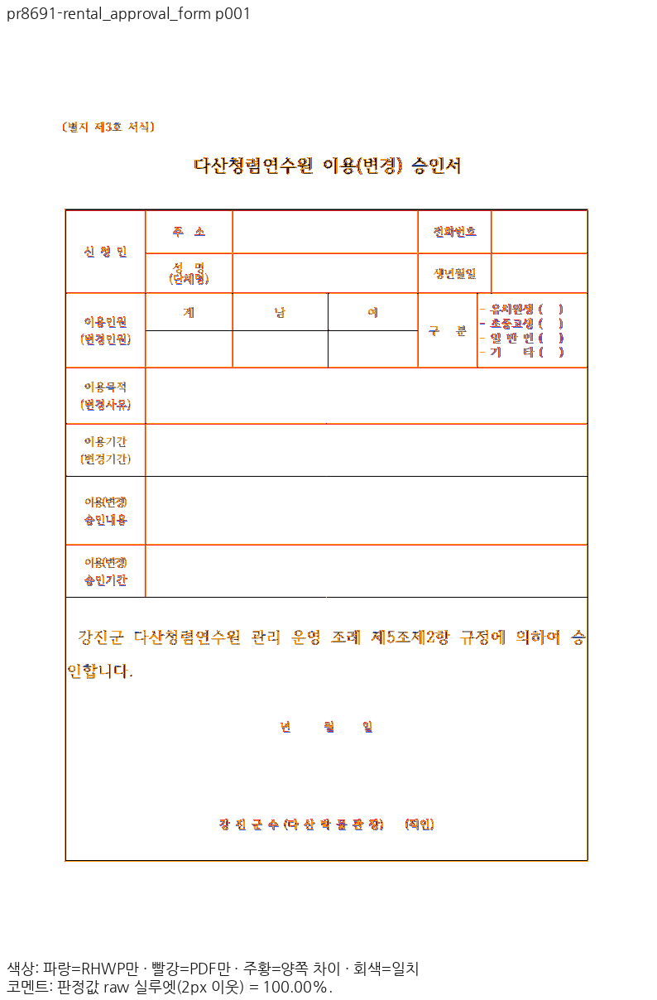
rental_approval_form.hwp 1쪽 fresh WASM

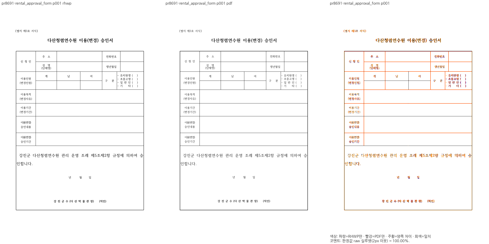

## 통합 후 contributor 안내

최종 merge SHA·CI·이 검토 문서와 주장 페이지의 raw/PDF/review/overlay를 이미지로 포함해 한국어 존댓말로 안내한다. 메인터너 보정은 기여자가 해결한 부분과 추가로 발견한 결함·보정·검증 이유를 구분한다. 원 fork branch는 삭제하지 않는다.
