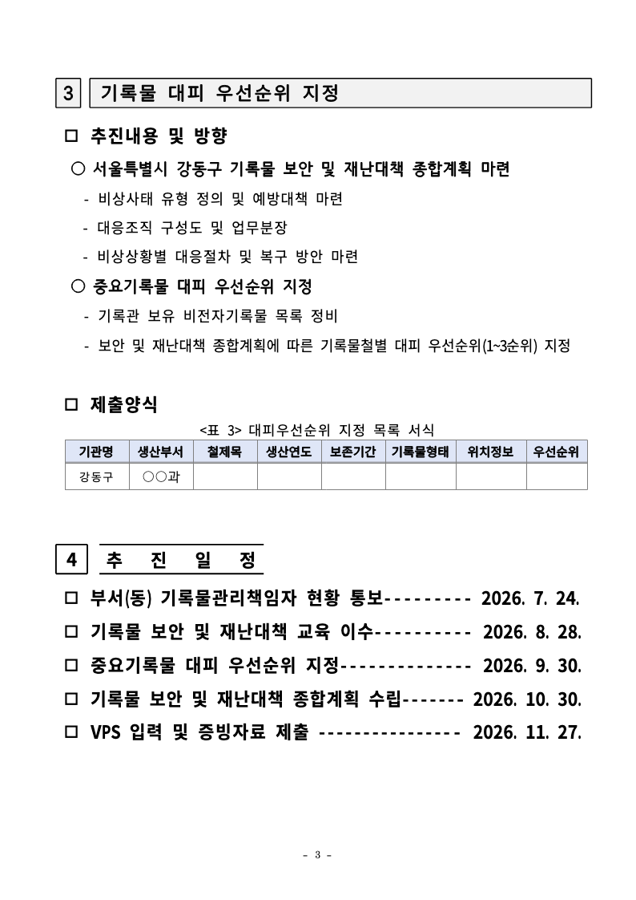
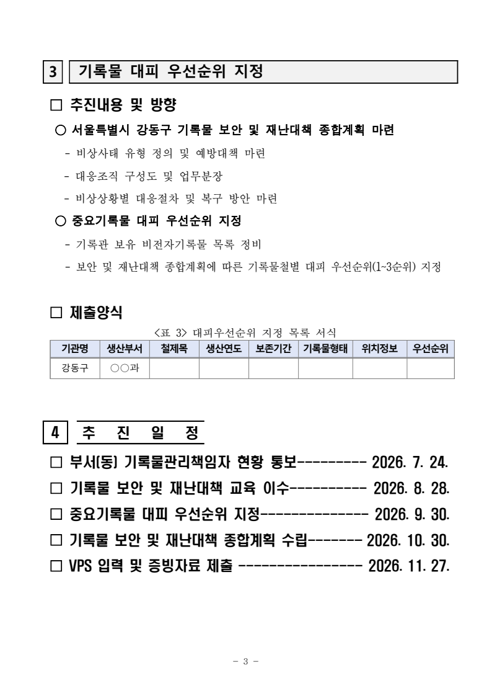
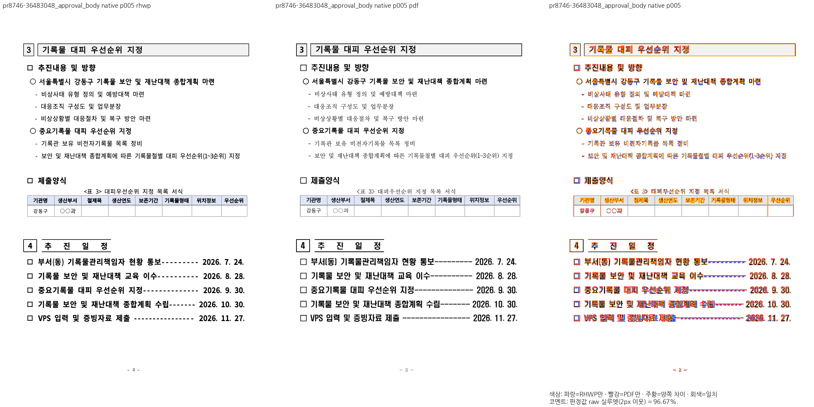
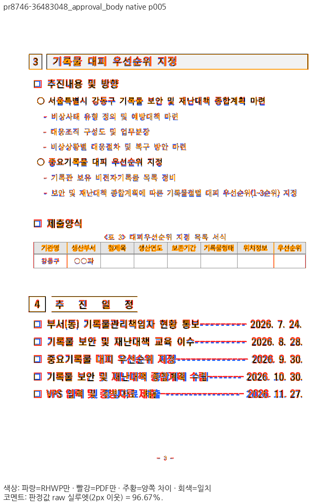
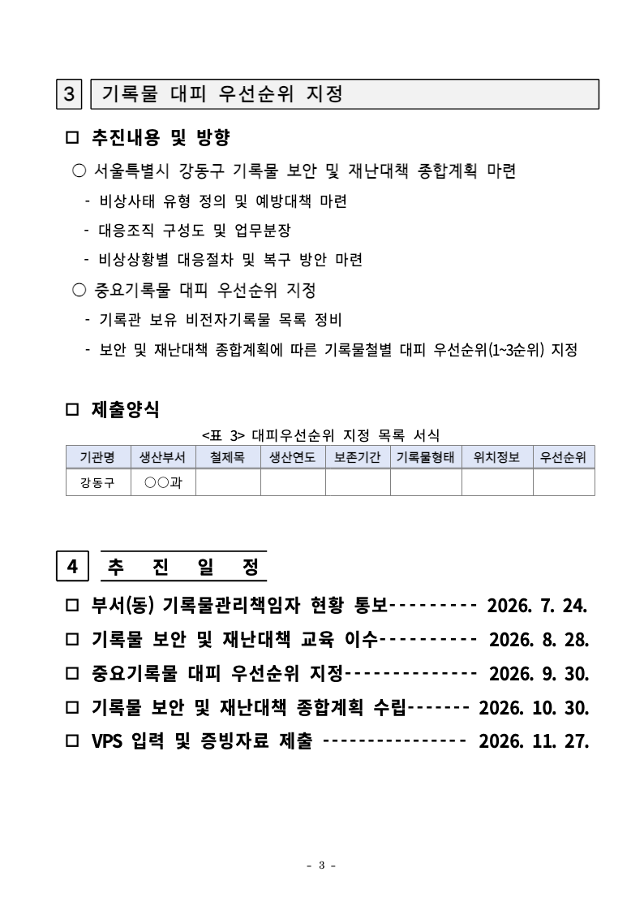
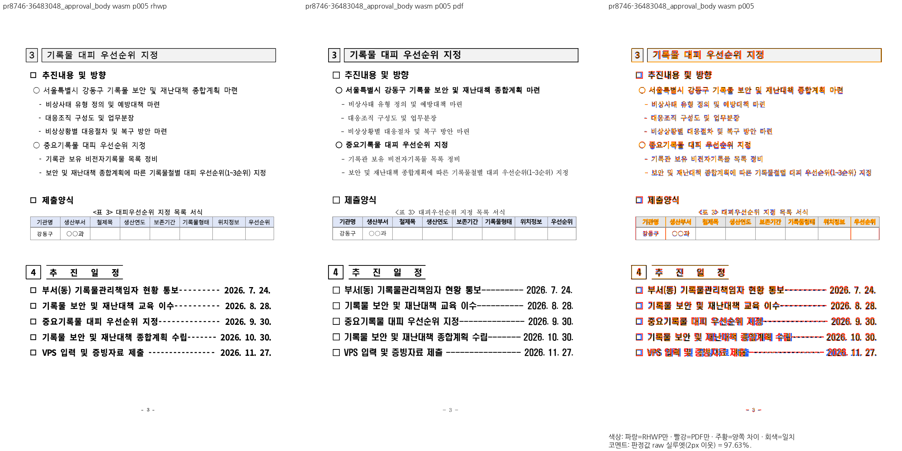
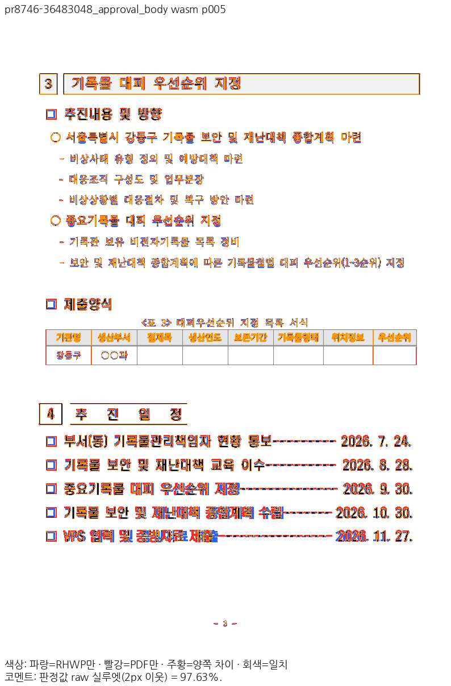

# PR #8746 리뷰 — 자리차지 표 위 틈의 줄을 측정도 배치와 같은 판정으로 틈에 둔다 (#8742)

## 최종 판정

**메인터너 보정 후 수용 가능 — 검증한 통합 후보에서 원 PR의 주장 범위와 기존 보호 문서 기준을 충족합니다.**

검증 제품 코드 `3575d814f44053483bb51f54b01dcf8044d0b575`의 검토입니다. 리베이스된 최신 HEAD를 Native/fresh WASM으로 새로 빌드해 주장 페이지와 보호 문서를 재출력했습니다. 이전 직접 판독은 새 출력 raw/PDF 해시가 동일한 경우에만 재사용했습니다. [재사용 기록](../assets/planet6897_remaining39_20261111/maintainer-repair/rebase-reuse.json). [통합 PR #8958](https://github.com/edwardkim/rhwp/pull/8958)의 최종 code head `67715b56b7149e552f983244e63e5770035f51fc`에서 Full CI를 확인하고 `6f9c6ecae7732ccab590ad3c1cb8b4169b5ca19a`로 병합했습니다. [확정 CI·병합 기록](../assets/planet6897_remaining39_20261111/pr8958-ci-merge.json)을 따릅니다. 원 PR의 댓글·supersede close와 관련 이슈 처리는 이 후속 기록 PR 병합 뒤 실제 상태를 확인하여 진행합니다. 원 PR 범위 밖의 기존 미달을 추가 수용 조건으로 확대하지 않았습니다.

## 접수와 실제 적용

- 원 PR: https://github.com/edwardkim/rhwp/pull/8746 (`planet6897`, base `devel`).
- 원 head: `339eb121400478a780b420657780cb2f1210caf0`. 고정 base: `4c876654d86d071d342fc78706c51cfff6ddbde4`. 검토 코드 head: `3575d814f44053483bb51f54b01dcf8044d0b575`.
- 로컬 브랜치: `review/integration-20261111-planet6897-open39`. reviewer `jangster77` 지정·API 확인 후 적용했습니다.
- 적층 중복을 제외한 실제 102개 커밋을 `cherry-pick -x`로 적용했고 충돌은 없었습니다. 이 PR의 신규 커밋: `007d27175d4d28b37c06c71da612adb60b685a4a`, `339eb121400478a780b420657780cb2f1210caf0`.
- 원본→로컬 SHA는 [최초 체리픽 기록](../assets/planet6897_remaining39_20261111/cherry-pick.json)과 [리베이스 SHA 대응](../assets/planet6897_remaining39_20261111/maintainer-repair/rebase-reuse.json), 원 head 재확인은 [39개 head 대조](../assets/planet6897_remaining39_20261111/maintainer-repair/latest-head-3575d814/source-head-check.json)를 따릅니다. 이후 추가된 #8932는 이 39개 검토에 넣지 않았습니다.

## 변경과 조판 검토 범위

fix(layout): 자리차지 표 위 틈의 줄을 측정도 배치와 같은 판정으로 틈에 둔다 (#8742).

이 PR에서 새로 소개한 제품 경로:

- `src/renderer/height_cursor.rs`
- `src/renderer/layout.rs`
- `src/renderer/typeset/controls/paragraph_flow.rs`
- `src/renderer/typeset/section/vpos.rs`
- `src/renderer/typeset/state.rs`
- `src/renderer/typeset/state/commands.rs`
- `src/renderer/typeset/state/data.rs`
- `src/renderer/typeset/state/transition.rs`
- `src/renderer/typeset/table/block/entry.rs`

원본 저장 줄·문단 모양·개체 속성에서 공통 줄/행 컷·자리차지 원점을 계산하고 layout·paint가 소비하는 경로를 대조했습니다. 문서명/파일 해시에 따른 분기나 기준 PDF·Visual Sweep 문턱 변경으로 결과를 맞추지 않았습니다. 아래 원 PR 주장 페이지의 결과와 기능 검사를 대조하며, 원 PR 범위 밖의 기존 미달을 추가 개선 대상으로 확대하지 않습니다.

## 검증 입력과 실제 결과

- 이 PR에 대응하는 실제 회귀: **2 PASS / 0 FAIL**. [최신 함수별 실행 대조](../assets/planet6897_remaining39_20261111/maintainer-repair/latest-head-3575d814/individual-tests.json).
- Mac 최소 글꼴 전체 회귀: **13,312 PASS / 0 FAIL / 45 skip**, 452.943초. [최종 결과](../assets/planet6897_remaining39_20261111/maintainer-repair/latest-head-3575d814/full-nextest.json).
- fmt·Native/WASM/all-target Clippy·workspace build·Skia 4,034 PASS (12 ignore)·PNG 2 PASS·PDF 35 PASS·manifest/unit tiers를 포함한 [Rust 필수 게이트 12개](../assets/planet6897_remaining39_20261111/maintainer-repair/latest-head-3575d814/rust-gates.json)가 통과했습니다.
- Native/fresh WASM 보호 문서 각각 **18조건·1,771쪽, 공식 두 자리 표시값 하락 0쪽**입니다. [보호 비교 정본](../assets/planet6897_remaining39_20261111/maintainer-repair/latest-head-3575d814/protected-comparison.json).
- WASM은 최신 HEAD에서 Mac locked wrapper `--target web --out-dir pkg --no-opt`로 새로 만든 로컬 대체 빌드입니다. Docker 최적화 통과를 주장하지 않습니다. [소스·프로그램·root/Studio 해시 대조](../assets/planet6897_remaining39_20261111/maintainer-repair/latest-head-3575d814/producer.json).
- 최소 글꼴 회귀·공개 글꼴 주장 페이지 대조와, 기승인 원본 글꼴 조건의 보호 문서 대조는 서로 구분했습니다.

### 원 PR 주장 페이지의 Visual Sweep 결과

PDFium·96 DPI·해당 입력의 compat·Print profile·색상 경계 보정 전 2px raw이며, 아래는 선택한 주장 페이지의 수치입니다. 다른 페이지 전부를 개선했다는 뜻이 아닙니다.

| 입력 | 쪽 | Native | fresh WASM |
| --- | ---: | ---: | ---: |
| `36345427_approval_body.hwpx` | 1 | 99.76% | 99.77% |
| `36453591_approval_body.hwpx` | 4 | 99.86% | 99.85% |
| `36453591_approval_body.hwpx` | 5 | 99.22% | 99.23% |
| `36483048_approval_body.hwpx` | 4 | 92.32% | 92.19% |
| `36483048_approval_body.hwpx` | 5 | 96.67% | 97.63% |
| `36483048_approval_body.hwpx` | 6 | 98.96% | 98.99% |

전 주장 페이지의 raw/PDF/review/overlay·TSV와 producer 연결은 [증적 색인](../assets/planet6897_remaining39_20261111/maintainer-repair/latest-head-3575d814/claims/index.json)을 따릅니다. 아래 대표 쪽은 실제 직접 판독 또는 raw/PDF 해시가 동일한 기존 판독 근거로 확인했습니다. 대표 이외 쪽을 모두 직접 판독했다고 표기하지 않습니다.

## 주장 페이지의 증적과 직접 판독

### Native 5쪽

기록물 대피 우선순위 본문·제출양식 표·추진 일정이 독립 Print와 같은 쪽의 대응 위치에 보존됩니다. 표 뒤 안내 줄의 불필요한 세로 밀림은 보이지 않습니다. 글자 굵기와 일정 리더 길이 차이는 이 PR의 빈 TAC 안내 줄 보정과 구분합니다.

### fresh WASM 5쪽

기록물 대피 우선순위 본문과 제출 양식, 추진 일정이 한 페이지에 보존됩니다. 글꼴 굵기·리더 길이 차이는 있으나, 원 PR의 빈 안내문 높이 때문에 제출 표나 일정이 밀리는 문제는 재현되지 않습니다.

## 검증 입력 커밋 확인

[입력·기준 PDF 감사](../assets/planet6897_remaining39_20261111/inputs-committed.json)와 [리베이스 입력 보존 대조](../assets/planet6897_remaining39_20261111/maintainer-repair/rebase-reuse.json)에서 실행 입력과 Git/LFS 내용의 일치를 확인했습니다. 새 출력은 최신 producer·run manifest·TSV 해시로 연결합니다.

## Merge 후 contributor PR comment 계획

[Visual Sweep merge comment 정본](../../manual/verification/visual_sweep_guide.md#github-merge-comment)을 따릅니다. 위 표의 입력·주장 페이지·raw 실루엣 수치와 실제 판독의 차이를 설명하고, 대표 raw/PDF/review/overlay를 게시합니다. `pixel_match`나 `visual_accuracy_proxy_percent`를 raw 실루엣과 같은 값으로 쓰지 않으며 별도 산출되지 않은 값은 미산출로 기록합니다. 통합 PR 병합과 asset의 devel 존재를 확인한 뒤 `6f9c6ecae7732ccab590ad3c1cb8b4169b5ca19a` 고정 raw URL을 사용하고, 게시 뒤 API로 본문·이미지 응답을 확인합니다.

- `36345427_approval_body.hwpx` 1쪽: Native/fresh WASM의 같은 입력·쪽 raw/PDF/review/overlay를 게시하며 위 TSV의 실제 값을 사용합니다.

`https://raw.githubusercontent.com/edwardkim/rhwp/6f9c6ecae7732ccab590ad3c1cb8b4169b5ca19a/mydocs/pr/assets/planet6897_remaining39_20261111/maintainer-repair/latest-head-3575d814/claims/pr8746-36345427_approval_body/native/raw-001.png`

`https://raw.githubusercontent.com/edwardkim/rhwp/6f9c6ecae7732ccab590ad3c1cb8b4169b5ca19a/mydocs/pr/assets/planet6897_remaining39_20261111/maintainer-repair/latest-head-3575d814/claims/pr8746-36345427_approval_body/native/pdf-001.png`

`https://raw.githubusercontent.com/edwardkim/rhwp/6f9c6ecae7732ccab590ad3c1cb8b4169b5ca19a/mydocs/pr/assets/planet6897_remaining39_20261111/maintainer-repair/latest-head-3575d814/claims/pr8746-36345427_approval_body/native/review_001.png`

`https://raw.githubusercontent.com/edwardkim/rhwp/6f9c6ecae7732ccab590ad3c1cb8b4169b5ca19a/mydocs/pr/assets/planet6897_remaining39_20261111/maintainer-repair/latest-head-3575d814/claims/pr8746-36345427_approval_body/native/overlay_001.png`

`https://raw.githubusercontent.com/edwardkim/rhwp/6f9c6ecae7732ccab590ad3c1cb8b4169b5ca19a/mydocs/pr/assets/planet6897_remaining39_20261111/maintainer-repair/latest-head-3575d814/claims/pr8746-36345427_approval_body/wasm/raw-001.png`

`https://raw.githubusercontent.com/edwardkim/rhwp/6f9c6ecae7732ccab590ad3c1cb8b4169b5ca19a/mydocs/pr/assets/planet6897_remaining39_20261111/maintainer-repair/latest-head-3575d814/claims/pr8746-36345427_approval_body/wasm/pdf-001.png`

`https://raw.githubusercontent.com/edwardkim/rhwp/6f9c6ecae7732ccab590ad3c1cb8b4169b5ca19a/mydocs/pr/assets/planet6897_remaining39_20261111/maintainer-repair/latest-head-3575d814/claims/pr8746-36345427_approval_body/wasm/review_001.png`

`https://raw.githubusercontent.com/edwardkim/rhwp/6f9c6ecae7732ccab590ad3c1cb8b4169b5ca19a/mydocs/pr/assets/planet6897_remaining39_20261111/maintainer-repair/latest-head-3575d814/claims/pr8746-36345427_approval_body/wasm/overlay_001.png`

- `36453591_approval_body.hwpx` 4쪽: Native/fresh WASM의 같은 입력·쪽 raw/PDF/review/overlay를 게시하며 위 TSV의 실제 값을 사용합니다.

`https://raw.githubusercontent.com/edwardkim/rhwp/6f9c6ecae7732ccab590ad3c1cb8b4169b5ca19a/mydocs/pr/assets/planet6897_remaining39_20261111/maintainer-repair/latest-head-3575d814/claims/pr8746-36453591_approval_body/native/raw-004.png`

`https://raw.githubusercontent.com/edwardkim/rhwp/6f9c6ecae7732ccab590ad3c1cb8b4169b5ca19a/mydocs/pr/assets/planet6897_remaining39_20261111/maintainer-repair/latest-head-3575d814/claims/pr8746-36453591_approval_body/native/pdf-004.png`

`https://raw.githubusercontent.com/edwardkim/rhwp/6f9c6ecae7732ccab590ad3c1cb8b4169b5ca19a/mydocs/pr/assets/planet6897_remaining39_20261111/maintainer-repair/latest-head-3575d814/claims/pr8746-36453591_approval_body/native/review_004.png`

`https://raw.githubusercontent.com/edwardkim/rhwp/6f9c6ecae7732ccab590ad3c1cb8b4169b5ca19a/mydocs/pr/assets/planet6897_remaining39_20261111/maintainer-repair/latest-head-3575d814/claims/pr8746-36453591_approval_body/native/overlay_004.png`

`https://raw.githubusercontent.com/edwardkim/rhwp/6f9c6ecae7732ccab590ad3c1cb8b4169b5ca19a/mydocs/pr/assets/planet6897_remaining39_20261111/maintainer-repair/latest-head-3575d814/claims/pr8746-36453591_approval_body/wasm/raw-004.png`

`https://raw.githubusercontent.com/edwardkim/rhwp/6f9c6ecae7732ccab590ad3c1cb8b4169b5ca19a/mydocs/pr/assets/planet6897_remaining39_20261111/maintainer-repair/latest-head-3575d814/claims/pr8746-36453591_approval_body/wasm/pdf-004.png`

`https://raw.githubusercontent.com/edwardkim/rhwp/6f9c6ecae7732ccab590ad3c1cb8b4169b5ca19a/mydocs/pr/assets/planet6897_remaining39_20261111/maintainer-repair/latest-head-3575d814/claims/pr8746-36453591_approval_body/wasm/review_004.png`

`https://raw.githubusercontent.com/edwardkim/rhwp/6f9c6ecae7732ccab590ad3c1cb8b4169b5ca19a/mydocs/pr/assets/planet6897_remaining39_20261111/maintainer-repair/latest-head-3575d814/claims/pr8746-36453591_approval_body/wasm/overlay_004.png`

- `36453591_approval_body.hwpx` 5쪽: Native/fresh WASM의 같은 입력·쪽 raw/PDF/review/overlay를 게시하며 위 TSV의 실제 값을 사용합니다.

`https://raw.githubusercontent.com/edwardkim/rhwp/6f9c6ecae7732ccab590ad3c1cb8b4169b5ca19a/mydocs/pr/assets/planet6897_remaining39_20261111/maintainer-repair/latest-head-3575d814/claims/pr8746-36453591_approval_body/native/raw-005.png`

`https://raw.githubusercontent.com/edwardkim/rhwp/6f9c6ecae7732ccab590ad3c1cb8b4169b5ca19a/mydocs/pr/assets/planet6897_remaining39_20261111/maintainer-repair/latest-head-3575d814/claims/pr8746-36453591_approval_body/native/pdf-005.png`

`https://raw.githubusercontent.com/edwardkim/rhwp/6f9c6ecae7732ccab590ad3c1cb8b4169b5ca19a/mydocs/pr/assets/planet6897_remaining39_20261111/maintainer-repair/latest-head-3575d814/claims/pr8746-36453591_approval_body/native/review_005.png`

`https://raw.githubusercontent.com/edwardkim/rhwp/6f9c6ecae7732ccab590ad3c1cb8b4169b5ca19a/mydocs/pr/assets/planet6897_remaining39_20261111/maintainer-repair/latest-head-3575d814/claims/pr8746-36453591_approval_body/native/overlay_005.png`

`https://raw.githubusercontent.com/edwardkim/rhwp/6f9c6ecae7732ccab590ad3c1cb8b4169b5ca19a/mydocs/pr/assets/planet6897_remaining39_20261111/maintainer-repair/latest-head-3575d814/claims/pr8746-36453591_approval_body/wasm/raw-005.png`

`https://raw.githubusercontent.com/edwardkim/rhwp/6f9c6ecae7732ccab590ad3c1cb8b4169b5ca19a/mydocs/pr/assets/planet6897_remaining39_20261111/maintainer-repair/latest-head-3575d814/claims/pr8746-36453591_approval_body/wasm/pdf-005.png`

`https://raw.githubusercontent.com/edwardkim/rhwp/6f9c6ecae7732ccab590ad3c1cb8b4169b5ca19a/mydocs/pr/assets/planet6897_remaining39_20261111/maintainer-repair/latest-head-3575d814/claims/pr8746-36453591_approval_body/wasm/review_005.png`

`https://raw.githubusercontent.com/edwardkim/rhwp/6f9c6ecae7732ccab590ad3c1cb8b4169b5ca19a/mydocs/pr/assets/planet6897_remaining39_20261111/maintainer-repair/latest-head-3575d814/claims/pr8746-36453591_approval_body/wasm/overlay_005.png`

- `36483048_approval_body.hwpx` 4쪽: Native/fresh WASM의 같은 입력·쪽 raw/PDF/review/overlay를 게시하며 위 TSV의 실제 값을 사용합니다.

`https://raw.githubusercontent.com/edwardkim/rhwp/6f9c6ecae7732ccab590ad3c1cb8b4169b5ca19a/mydocs/pr/assets/planet6897_remaining39_20261111/maintainer-repair/latest-head-3575d814/claims/pr8746-36483048_approval_body/native/raw-004.png`

`https://raw.githubusercontent.com/edwardkim/rhwp/6f9c6ecae7732ccab590ad3c1cb8b4169b5ca19a/mydocs/pr/assets/planet6897_remaining39_20261111/maintainer-repair/latest-head-3575d814/claims/pr8746-36483048_approval_body/native/pdf-004.png`

`https://raw.githubusercontent.com/edwardkim/rhwp/6f9c6ecae7732ccab590ad3c1cb8b4169b5ca19a/mydocs/pr/assets/planet6897_remaining39_20261111/maintainer-repair/latest-head-3575d814/claims/pr8746-36483048_approval_body/native/review_004.png`

`https://raw.githubusercontent.com/edwardkim/rhwp/6f9c6ecae7732ccab590ad3c1cb8b4169b5ca19a/mydocs/pr/assets/planet6897_remaining39_20261111/maintainer-repair/latest-head-3575d814/claims/pr8746-36483048_approval_body/native/overlay_004.png`

`https://raw.githubusercontent.com/edwardkim/rhwp/6f9c6ecae7732ccab590ad3c1cb8b4169b5ca19a/mydocs/pr/assets/planet6897_remaining39_20261111/maintainer-repair/latest-head-3575d814/claims/pr8746-36483048_approval_body/wasm/raw-004.png`

`https://raw.githubusercontent.com/edwardkim/rhwp/6f9c6ecae7732ccab590ad3c1cb8b4169b5ca19a/mydocs/pr/assets/planet6897_remaining39_20261111/maintainer-repair/latest-head-3575d814/claims/pr8746-36483048_approval_body/wasm/pdf-004.png`

`https://raw.githubusercontent.com/edwardkim/rhwp/6f9c6ecae7732ccab590ad3c1cb8b4169b5ca19a/mydocs/pr/assets/planet6897_remaining39_20261111/maintainer-repair/latest-head-3575d814/claims/pr8746-36483048_approval_body/wasm/review_004.png`

`https://raw.githubusercontent.com/edwardkim/rhwp/6f9c6ecae7732ccab590ad3c1cb8b4169b5ca19a/mydocs/pr/assets/planet6897_remaining39_20261111/maintainer-repair/latest-head-3575d814/claims/pr8746-36483048_approval_body/wasm/overlay_004.png`

- `36483048_approval_body.hwpx` 5쪽: Native/fresh WASM의 같은 입력·쪽 raw/PDF/review/overlay를 게시하며 위 TSV의 실제 값을 사용합니다.

`https://raw.githubusercontent.com/edwardkim/rhwp/6f9c6ecae7732ccab590ad3c1cb8b4169b5ca19a/mydocs/pr/assets/planet6897_remaining39_20261111/maintainer-repair/latest-head-3575d814/claims/pr8746-36483048_approval_body/native/raw-005.png`

`https://raw.githubusercontent.com/edwardkim/rhwp/6f9c6ecae7732ccab590ad3c1cb8b4169b5ca19a/mydocs/pr/assets/planet6897_remaining39_20261111/maintainer-repair/latest-head-3575d814/claims/pr8746-36483048_approval_body/native/pdf-005.png`

`https://raw.githubusercontent.com/edwardkim/rhwp/6f9c6ecae7732ccab590ad3c1cb8b4169b5ca19a/mydocs/pr/assets/planet6897_remaining39_20261111/maintainer-repair/latest-head-3575d814/claims/pr8746-36483048_approval_body/native/review_005.png`

`https://raw.githubusercontent.com/edwardkim/rhwp/6f9c6ecae7732ccab590ad3c1cb8b4169b5ca19a/mydocs/pr/assets/planet6897_remaining39_20261111/maintainer-repair/latest-head-3575d814/claims/pr8746-36483048_approval_body/native/overlay_005.png`

`https://raw.githubusercontent.com/edwardkim/rhwp/6f9c6ecae7732ccab590ad3c1cb8b4169b5ca19a/mydocs/pr/assets/planet6897_remaining39_20261111/maintainer-repair/latest-head-3575d814/claims/pr8746-36483048_approval_body/wasm/raw-005.png`

`https://raw.githubusercontent.com/edwardkim/rhwp/6f9c6ecae7732ccab590ad3c1cb8b4169b5ca19a/mydocs/pr/assets/planet6897_remaining39_20261111/maintainer-repair/latest-head-3575d814/claims/pr8746-36483048_approval_body/wasm/pdf-005.png`

`https://raw.githubusercontent.com/edwardkim/rhwp/6f9c6ecae7732ccab590ad3c1cb8b4169b5ca19a/mydocs/pr/assets/planet6897_remaining39_20261111/maintainer-repair/latest-head-3575d814/claims/pr8746-36483048_approval_body/wasm/review_005.png`

`https://raw.githubusercontent.com/edwardkim/rhwp/6f9c6ecae7732ccab590ad3c1cb8b4169b5ca19a/mydocs/pr/assets/planet6897_remaining39_20261111/maintainer-repair/latest-head-3575d814/claims/pr8746-36483048_approval_body/wasm/overlay_005.png`

- `36483048_approval_body.hwpx` 6쪽: Native/fresh WASM의 같은 입력·쪽 raw/PDF/review/overlay를 게시하며 위 TSV의 실제 값을 사용합니다.

`https://raw.githubusercontent.com/edwardkim/rhwp/6f9c6ecae7732ccab590ad3c1cb8b4169b5ca19a/mydocs/pr/assets/planet6897_remaining39_20261111/maintainer-repair/latest-head-3575d814/claims/pr8746-36483048_approval_body/native/raw-006.png`

`https://raw.githubusercontent.com/edwardkim/rhwp/6f9c6ecae7732ccab590ad3c1cb8b4169b5ca19a/mydocs/pr/assets/planet6897_remaining39_20261111/maintainer-repair/latest-head-3575d814/claims/pr8746-36483048_approval_body/native/pdf-006.png`

`https://raw.githubusercontent.com/edwardkim/rhwp/6f9c6ecae7732ccab590ad3c1cb8b4169b5ca19a/mydocs/pr/assets/planet6897_remaining39_20261111/maintainer-repair/latest-head-3575d814/claims/pr8746-36483048_approval_body/native/review_006.png`

`https://raw.githubusercontent.com/edwardkim/rhwp/6f9c6ecae7732ccab590ad3c1cb8b4169b5ca19a/mydocs/pr/assets/planet6897_remaining39_20261111/maintainer-repair/latest-head-3575d814/claims/pr8746-36483048_approval_body/native/overlay_006.png`

`https://raw.githubusercontent.com/edwardkim/rhwp/6f9c6ecae7732ccab590ad3c1cb8b4169b5ca19a/mydocs/pr/assets/planet6897_remaining39_20261111/maintainer-repair/latest-head-3575d814/claims/pr8746-36483048_approval_body/wasm/raw-006.png`

`https://raw.githubusercontent.com/edwardkim/rhwp/6f9c6ecae7732ccab590ad3c1cb8b4169b5ca19a/mydocs/pr/assets/planet6897_remaining39_20261111/maintainer-repair/latest-head-3575d814/claims/pr8746-36483048_approval_body/wasm/pdf-006.png`

`https://raw.githubusercontent.com/edwardkim/rhwp/6f9c6ecae7732ccab590ad3c1cb8b4169b5ca19a/mydocs/pr/assets/planet6897_remaining39_20261111/maintainer-repair/latest-head-3575d814/claims/pr8746-36483048_approval_body/wasm/review_006.png`

`https://raw.githubusercontent.com/edwardkim/rhwp/6f9c6ecae7732ccab590ad3c1cb8b4169b5ca19a/mydocs/pr/assets/planet6897_remaining39_20261111/maintainer-repair/latest-head-3575d814/claims/pr8746-36483048_approval_body/wasm/overlay_006.png`

## 공통 보호 검사와 검토 범위

[최종 범위 기록](../assets/planet6897_remaining39_20261111/maintainer-repair/final-scope.md)에 따라 원 PR의 기능·페이지와 기존 보호 문서를 검토했습니다. 예전 전쪽 비교의 범위 밖 미달을 이번 PR이 해결했다고 주장하거나, 그 미달만으로 이번 주장 수용을 보류하지 않습니다. 기존 검사나 보호 문턱은 제거·완화하지 않았습니다.

원 PR #8930의 GitHub Render Diff 실패를 전달한 CI Impact Policy 실패는 별도 CI 결함으로 처리하지 않았습니다. 통합 후보의 공통 채우기 순서 보정 후 Linux에서 같은 Canvas diff와 기본 픽셀·채우기 순서 검사를 통과했으며, [실제 소비 결과](../assets/planet6897_remaining39_20261111/maintainer-repair/latest-head-3575d814/linux-canvas.json)를 보존했습니다. 원 PR head의 원격 CI를 통과로 바꾸어 표기하지 않습니다.
