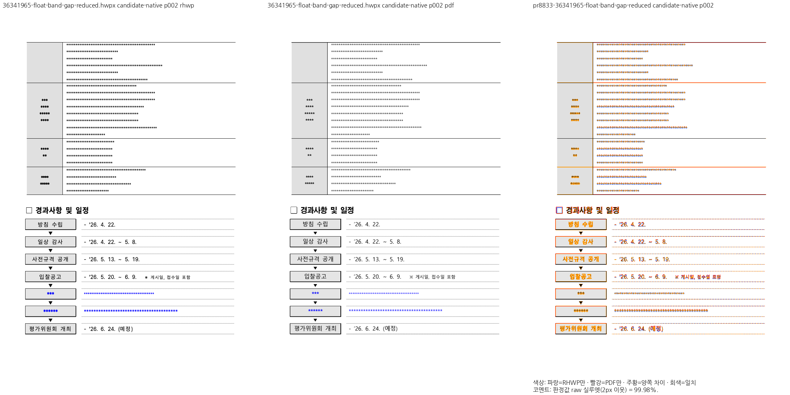
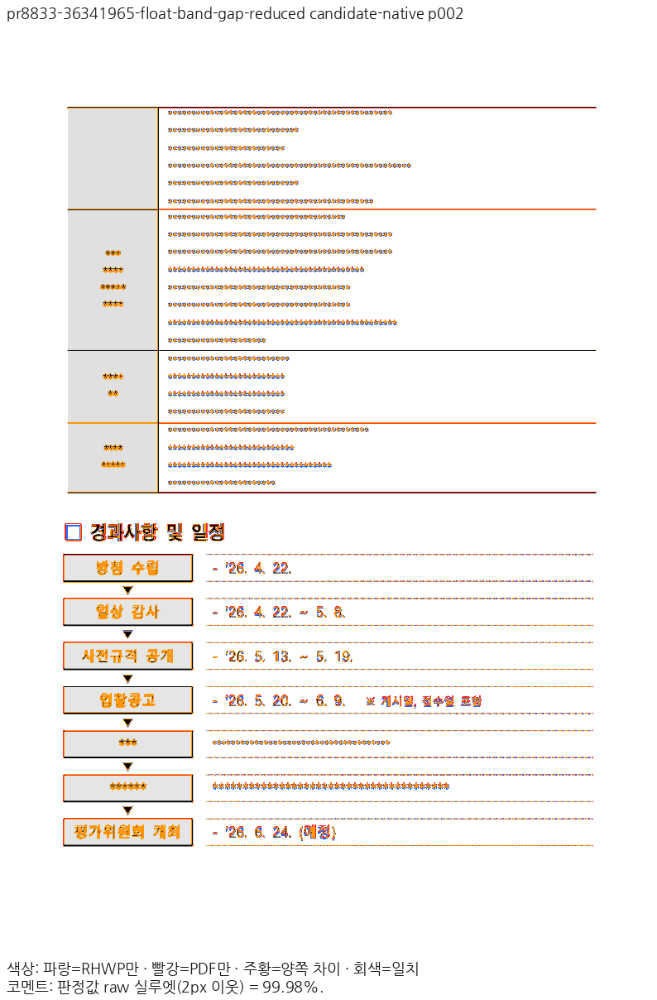
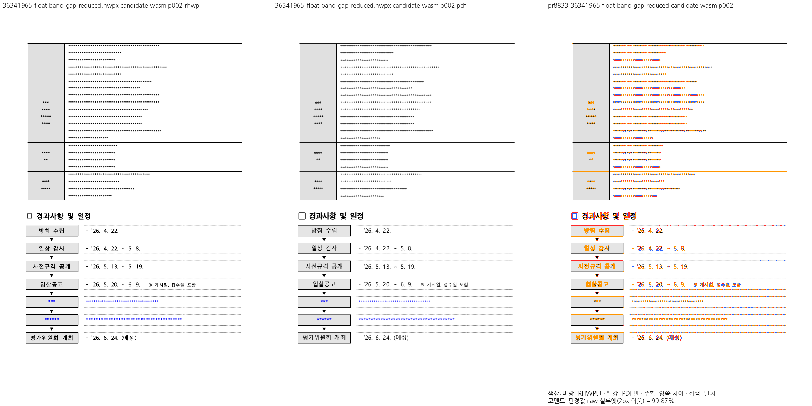
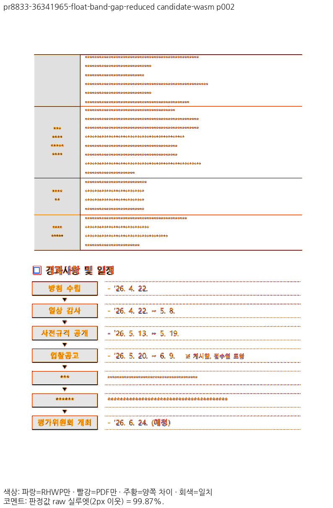

# PR #8833 리뷰 — fix: 문단 기준 자리차지 표 위 빈 공간의 후속 문단 — 로드 vpos 재계산과 나뉘는 표 첫 조각 (#8808)

## 최종 판정

**머지 보류 — 통합 후보의 공통 보호 TSV 비교를 충족하지 못해 이 head의 수용을 보류합니다.**

이 문서는 원 PR의 변경을 실제 누적 체리픽한 통합 코드 head의 검토입니다. 개별 수정 효과와 통합 후보 전체의 수용 조건을 구분합니다. 공통 실패를 모두 이 원 PR 하나의 결함으로 단정하지 않습니다. GitHub 승인·댓글·close·통합 PR 게시 기록은 없습니다.

## 접수와 실제 적용

- 원 PR: https://github.com/edwardkim/rhwp/pull/8833 (`planet6897`, base `devel`).
- 원 head: `df6e3677d16c90ee6e7014e02c29ef1ec15d3164`. 고정 base: `e118de8abadd2dffb2798036b9ffd381b96ed7d5`. 검토 코드 head: `e6261fd4ecd4ed2c5b0039d7526915c8c7837408`.
- 로컬 브랜치: `review/integration-20261111-planet6897-open39`. reviewer `jangster77` 지정·API 확인 후 적용했습니다.
- 적층 중복을 제외한 실제 102개 커밋을 `cherry-pick -x`로 적용했고 충돌은 없었습니다. 이 PR의 신규 커밋: `6c0c7767809a916b35c9f17d5504212fa4fdb8f5`, `3196d0e2d0abd0983abe48e31f17510ed49e369e`, `8b8fcb687eca41ed03b7f504eb84d573db7739cf`, `5fe3f325037c0782583abd06518f3a1b4b939771`, `9123393ea5990ca394a442f8b5b90976526e2c93`, `49450123ad02aa086e699d8ed806a56b5ae66526`, `df6e3677d16c90ee6e7014e02c29ef1ec15d3164`.
- 원본→로컬 SHA는 [체리픽 기록](../assets/planet6897_remaining39_20261111/cherry-pick.json), 원 head 재확인은 [39개 head 대조](../assets/planet6897_remaining39_20261111/source-head-check.json)를 따릅니다. 이후 추가된 #8932는 이 39개 검토에 넣지 않았습니다.

## 변경과 조판 검토 범위

fix: 문단 기준 자리차지 표 위 빈 공간의 후속 문단 — 로드 vpos 재계산과 나뉘는 표 첫 조각 (#8808).

이 PR에서 새로 소개한 제품 경로:

- `src/document_core/commands/document.rs`
- `src/renderer/typeset/table/block/prepare.rs`
- `src/renderer/typeset/table/deferred_float_flow.rs`

원본 저장 줄·문단 모양·개체 속성에서 공통 줄/행 컷·자리차지 원점을 계산하고 layout·paint가 소비하는 경로를 대조했습니다. 문서명/파일 해시에 따른 분기나 기준 PDF·Visual Sweep 문턱 변경으로 결과를 맞추지 않았습니다. 아래 전쪽 수치와 판독이 미충족이면 코드·단위 검사 PASS만으로 수용하지 않습니다.

## 검증 입력과 실제 결과

- [실제 입력 96개 확인](../assets/planet6897_remaining39_20261111/inputs-committed.json): 48개 조건의 HWP/HWPX와 독립 한컴 Print PDF 모두 실행 SHA와 검토 commit의 내용/LFS object를 대조했고 누락·불일치 0입니다.
- [최소 글꼴 전체 회귀](../assets/planet6897_remaining39_20261111/validation/full-nextest.json): 13,302 PASS / 0 FAIL / 45 skip, 395.627초. Mac 프로세스 격리에서 OS 글꼴 528 face / 208 프로그램을 확인했으며 개인 글꼴을 삭제·비활성화하지 않았습니다.
- 이 PR에 대응하는 실제 회귀: 4 PASS / 0 FAIL. [함수별 실행 대조](../assets/planet6897_remaining39_20261111/validation/individual-tests.json).
- [필수 빌드·lint 게이트](../assets/planet6897_remaining39_20261111/validation/build-gates.json): fmt·Native/WASM/all-target Clippy·workspace build·Skia lib 4,034 PASS (12 ignore)·PNG 2 PASS·PDF 35 PASS·manifest/unit tiers 완료.
- fresh WASM은 Mac locked wrapper `--target web --out-dir pkg --no-opt` 로컬 대체 빌드입니다. Docker 최적화 결과가 아닙니다. [JS/WASM producer 및 root/Studio 해시](../assets/planet6897_remaining39_20261111/producers/wasm.json).
- 반복 저장 4개 입력 × 8단계는 IR diff 0, 쪽수 보존, 삽입 문자열 1회 확인입니다. [반복 저장 결과](../assets/planet6897_remaining39_20261111/validation/repeated-save.json).

### 독립 Print 전쪽 비교

현재 정본 PDFium·96 DPI·print profile·색상 경계 보정 전 2px raw 실루엣입니다. 공식 TSV 두 자리 표시는 보존하고 일반 base 하락은 canonical manifest의 원래 5자리 값으로 판정합니다.

| 입력 | 전체 쪽수 | Native 최저 / 미달 쪽 | fresh WASM 최저 / 미달 쪽 |
| --- | ---: | --- | --- |
| `samples/issue8808/36341965-float-band-gap-reduced.hwpx` | 2 | 93.60097% / 없음 | 93.01161% / 없음 |

쪽수는 후보 Native/fresh WASM 모두 독립 PDF와 일치합니다. 48개 조건 1,665쪽에는 정상/기존 미달 지원 대조군도 들어 있으며 전부를 이 PR의 완료 주장으로 세지 않습니다. base와 후보의 쪽수가 다르면 숫자가 같은 쪽을 정렬된 비교라고 취급하지 않고 구조 차이로 기록합니다.

전쪽 TSV와 base 대비 원값 하락 목록: [전쪽 비교 정본](../assets/planet6897_remaining39_20261111/visual-final.json). 입력·PDF hash·backend·source/build 신원도 이 파일과 [입력 감사](../assets/planet6897_remaining39_20261111/inputs-committed.json)에 연결합니다.

## 주장 페이지의 증적과 직접 판독

### Native 2쪽

[raw PNG](../assets/planet6897_remaining39_20261111/cases/pr8833-36341965-float-band-gap-reduced/native/raw-002.png) · [한컴 PDF PNG](../assets/planet6897_remaining39_20261111/cases/pr8833-36341965-float-band-gap-reduced/native/pdf-002.png).

표 조각 뒤 경과사항/일정 도형과 설명 줄이 같은 쪽에 보존됩니다. 정상화가 글자 순서나 후속 도형을 삼키지 않으며 일부 괘선/글리프 경계 차이는 남습니다.

### fresh WASM 2쪽

[raw PNG](../assets/planet6897_remaining39_20261111/cases/pr8833-36341965-float-band-gap-reduced/wasm/raw-002.png) · [한컴 PDF PNG](../assets/planet6897_remaining39_20261111/cases/pr8833-36341965-float-band-gap-reduced/wasm/pdf-002.png).

위쪽 표 조각과 아래 경과사항의 일정 도형이 같은 쪽에 있고 마지막 평가위원회 항목까지 보존됩니다. 별표 모양과 목록 기호 크기 차이를 확인했습니다.

대표 페이지의 직접 판독은 전체 페이지 TSV 판정과 별개입니다. 그림을 생성한 것만으로 모든 페이지의 모든 글리프를 직접 판독했다고 기록하지 않습니다. 나머지 주장 페이지 88개에 대해서도 raw·PDF·review·overlay를 같은 asset의 각 문서/backend 디렉터리에 보존했습니다.

## 공통 보호 검사와 수용 해제 조건

정본 보호 문서 18종·1,771쪽의 Native/fresh WASM 전쪽 TSV를 완료했습니다. 공식 두 자리 기준보다 낮은 쪽은 Native 532쪽·fresh WASM 967쪽입니다. 이 수치는 **모두 새 코드 회귀라는 뜻이 아닙니다**. 같은 현재 조건의 고정 base Native 11종·1,761쪽 대조도 완료했습니다. 1,749쪽은 base/후보 PNG hash가 같고, 532쪽의 공식 기준 미달은 base에도 있습니다. 후보가 base보다 추가로 낮춘 공식 표시값은 `issue7905` 2쪽 93.77→93.72%(raw −0.04790%p) 한 곳입니다. 기존 보호 점수를 재현하지 못한 조건과 통합 코드가 추가로 낮춘 쪽을 [보호 비교 정본](../assets/planet6897_remaining39_20261111/protected-final.json)에 구분했습니다. WASM 보호 검사의 동일 조건 base 비교는 수행하지 않았으므로 해당 하락의 제품 원인을 확정하지 않습니다.

필수 편람 HWPX Native 383쪽은 258쪽 100.00→99.99%, 272쪽 100.00→99.94%, 368쪽 100.00→99.97%로 `re_review_required`입니다. 최소 글꼴 전체 회귀와 기존 원본 글꼴 보호 조건의 재현 성공을 혼동하지 않으며 보호 문턱을 면제하지 않습니다.

실제 브라우저는 같은 WASM 응답 hash를 확인한 뒤 5개 입력 × Canvas2D/CanvasKit compat/default = 15개를 캡처했습니다. [소비 경로 결과](../assets/planet6897_remaining39_20261111/validation/actual-browser.json)에서 HFT 표본의 CanvasKit 두 경로가 `textRun:glyphMapping` 계약을 실패했습니다. 비교 가능한 Canvas2D↔CanvasKit 8쌍도 기본 시각 차이 예산을 초과했습니다. 캡처 완료를 소비 경로 PASS로 쓰지 않습니다. 같은 조건의 고정 base에서도 동일한 glyphMapping 계약 실패 두 건과 시각 예산 초과 8쌍이 재현됐습니다. 따라서 이 실패를 이번 원 PR의 새 결함으로 단정하지 않습니다. [base/후보 브라우저 대조](../assets/planet6897_remaining39_20261111/validation/actual-browser-base-comparison.json)를 보존하며 이 조건의 소비 경로 수용도 보류합니다.

[원 PR CI 대조](../assets/planet6897_remaining39_20261111/validation/source-ci.json)는 고정한 39개 head에 대해 조회했습니다. #8930의 Linux `Canvas visual diff` 실패가 남아 있습니다. 다른 38개는 조회한 check run에 실패·실행 중 항목이 없었습니다. 원 PR CI 통과가 누적 통합 후보 검증을 대신하지 않습니다.

1. 이 PR의 미달·미확인과 통합 후보의 실제 회귀를 해소하고 같은 head에서 관련 Native/fresh WASM 전체 TSV를 재검증합니다.
2. 보호 문서의 동일 조건·공식 표시값 하락 0과 HWPX 편람 383쪽 `--handbook-gate`를 확인합니다.
3. 원 PR 최신 head CI와 통합 후보의 필수 실제 소비 경로를 확인합니다. #8930의 Linux CI 실패를 Mac PASS로 대체하지 않습니다.

검토 중 발견한 차이를 새 baseline 갱신·90%/2%p 문턱 변경·검사 제거로 숨기지 않습니다. 소스 보정/추가 제출과 GitHub 댓글·승인·close는 실제 실행 및 별도 권한 범위에 따라 기록합니다.
