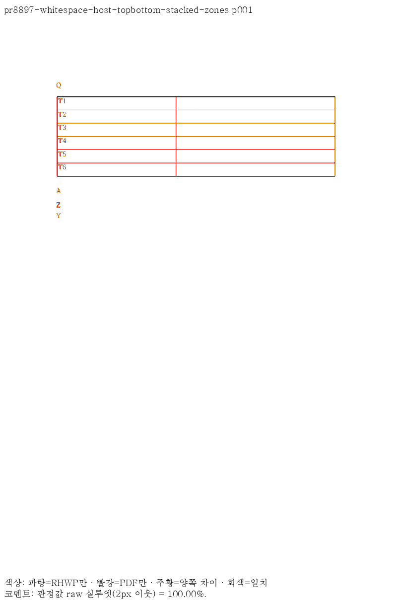
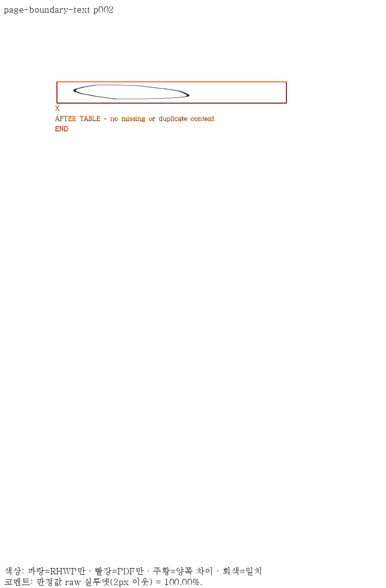
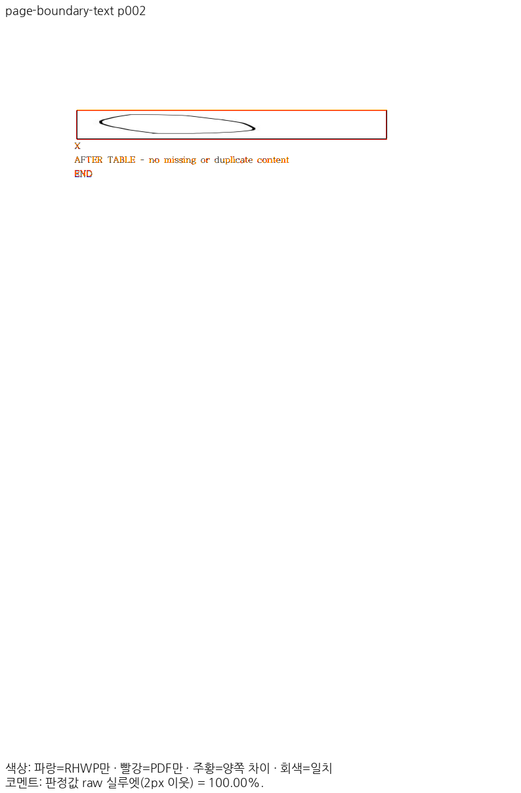

# PR #8897 리뷰 — 빈·공백 host의 어울림 표와 후속 자리차지 표 배치

## 최종 판정

**머지 보류** — 이 PR의 공개 입력 22종·28쪽은 Native 최저 97.18%, fresh WASM 최저 97.18%다. 두 경로 모두 90% 미만·devel 대비 2%p 초과 하락은 없으며 독립 Print와 쪽수가 일치한다. 이 이슈의 최소 글꼴 Native 집중 검사 22건도 모두 통과했다.

현재 검증 code head는 `8fe7d1fb8bc5024d0377ff7aa37d98c78e8f071a`다. 공통 Native 집중 126 PASS와 정본 Native 18종·1,771쪽의 공식 표시값 하락 0쪽을 확인했다. 최소 글꼴 전체 회귀는 **13,356 PASS / 0 FAIL / 45 skipped**(774.340초), fmt는 PASS다. [실제 전체 회귀 결과](../assets/hyunmyungjanelee_20261112/final-print-8fe7d1fb/full-nextest-validation.json)를 보존했다. Native·WASM·workspace all-target Clippy와 workspace build도 모두 PASS다. 정본 fresh WASM은 **18종·1,771쪽, 공식 표시값 하락·누락·추가 0쪽**으로 완료했다. [Native 보호](../assets/hyunmyungjanelee_20261112/final-print-8fe7d1fb/protected-native-validation.json)와 [fresh WASM 보호](../assets/hyunmyungjanelee_20261112/final-print-8fe7d1fb/protected-wasm-validation.json)를 각각 보존한다. 추가 Native Skia·suite/단위 정책은 진행 중이다. 실제 Studio 48건의 캡처에서 #8916의 `textRun:invalidGeometry`와 #8918의 `textRun:glyphMapping`이 확인되어 소비 경로 검증은 미충족이다. [보정 전 증거](../assets/hyunmyungjanelee_20261112/final-print-8fe7d1fb/actual-backends-before/failure-summary.json)를 보존하고, 이 결함·지원 범위의 보정과 재검증이 필요하므로 최종 통합 판정은 그 완료 뒤 갱신한다. 과거 Cairo 점수나 이전 head 결과를 현재 완료로 재인용하지 않는다.

## 접수와 검증 범위

- 원 PR [#8897](https://github.com/edwardkim/rhwp/pull/8897), 작성자 `hyunmyungJaneLee`, 이슈 [#8573](https://github.com/edwardkim/rhwp/issues/8573).
- 원 head `e263b59c25ae949065dec6726978c9fe2751e4d4`·reviewer `edwardkim`를 확인한 뒤 체리픽했다. 원 contributor 브랜치를 변경하지 않았다.
- devel 기준 `80b1c354c29b7a02fb2b3c14a274da7f5b653ada`, 통합 브랜치 `review/integration-20261112-hyunmyungjanelee`. 원 29개 커밋의 [적용 기록](../assets/hyunmyungjanelee_20261112/cherry-pick-result.json)과 [additive 충돌 해소](../assets/hyunmyungjanelee_20261112/conflicts.json)를 보존한다.
- 현재 요청 reviewer는 `edwardkim, jangster77`다. 원격 원 head·devel은 검토 시작 때와 동일하다. 최종 push·merge 직전에 다시 확인한다.

## 변경과 조판 원칙 검토

가시 글자가 없는 host도 줄 상자와 배제 영역을 구분해 앞 문단 어울림 표 옆의 글줄을 보존한다. 후속 자리차지 표가 배제 영역과 겹치면 표만 내려가며 host 글줄은 앞서 놓일 수 있다.

`mod.rs::is_unstored_whitespace_object_host`와 `inline_flow.rs::plan_square_table_host`에서 host·최소 가용 띠·동반 개체를 분류한다. `typeset/table/block/entry.rs::square_side_pushed_placement`의 원점·점유 하한을 `ParagraphFloatPlacement`로 전달하고 상태의 배제 영역과 최종 배치가 소비한다. 폭 1430/1450HU, 음수 오프셋, 다중 개체, 단 영역 쌓임과 일반 저장 줄 대조군을 구분한다.

## 메인터너 보정과 수용 경계

미공개 원본 3건은 확보하지 못했다. 사용자 지시에 따라 같은 위험 형상의 공개 합성 6종을 새로 만들고 동일 입력의 독립 Windows Print를 확보했다. 공백·빈·글자 host, 그림 안 여백, 물리 첫 opening과 continuation, 그림 19+1개 소속·AFTER/END의 단일 소속을 검사한다. 원 비공개 3건을 직접 검증했다는 주장은 하지 않는다. 새 데스크톱 Print에서 확인한 단 구역 경계의 줄간격 중복은 `8fe7d1fb8b`로 보정했다. 저장 줄이 없는 마지막 문단의 확정 구성을 측정·배치에 전달하며 [전후 증적](../assets/hyunmyungjanelee_20261112/stacked-zone-spacing-repair/cause.md)의 Native 99.06% → 100.00%와 관계 검사 3 PASS / 1 FAIL → 4 PASS를 확인했다. `299630021a`와 `cab15c005a`의 메인터너 보정을 함께 적용한 통합 후보만 수용 대상이다.

## 공식 Print와 Native/fresh WASM 전쪽 대조

총 22종·28쪽, 최저 97.18%, 90% 미만 0쪽이다. 같은 입력·PDF의 devel 대비 2%p 초과 하락 0쪽이다. 기준 출력에 없던 쪽은 임의의 0점으로 채우지 않고 복원으로 구분한다. [Native 전쪽 비교 TSV](../assets/hyunmyungjanelee_20261112/final-print-8fe7d1fb/native-comparison.tsv)·[생산 SHA와 입력/PNG 해시](../assets/hyunmyungjanelee_20261112/final-print-8fe7d1fb/native-validation.json)를 연결한다.

| 입력 | 쪽수 | Native 최저 | fresh WASM |
| --- | ---: | ---: | --- |
| [empty-host-split-table.hwp](../../../samples/issue8573/empty-host-split-table.hwp) | 2 | 100.00% | 100.00% |
| [empty-host-square-band-1430-below.hwp](../../../samples/issue8573/empty-host-square-band-1430-below.hwp) | 1 | 100.00% | 100.00% |
| [empty-host-square-band-1450-beside.hwp](../../../samples/issue8573/empty-host-square-band-1450-beside.hwp) | 1 | 100.00% | 100.00% |
| [empty-host-square-band-600-no-extra-line.hwp](../../../samples/issue8573/empty-host-square-band-600-no-extra-line.hwp) | 1 | 100.00% | 100.00% |
| [empty-host-square-beside-line.hwp](../../../samples/issue8573/empty-host-square-beside-line.hwp) | 1 | 100.00% | 100.00% |
| [empty-host-square-then-topbottom-push.hwp](../../../samples/issue8573/empty-host-square-then-topbottom-push.hwp) | 1 | 100.00% | 100.00% |
| [text-host-split-table.hwp](../../../samples/issue8573/text-host-split-table.hwp) | 2 | 100.00% | 100.00% |
| [text-host-square-paper-companion-beside-line.hwp](../../../samples/issue8573/text-host-square-paper-companion-beside-line.hwp) | 1 | 100.00% | 100.00% |
| [text-host-square-then-topbottom-push.hwp](../../../samples/issue8573/text-host-square-then-topbottom-push.hwp) | 1 | 100.00% | 100.00% |
| [text-host-topbottom-line-below.hwp](../../../samples/issue8573/text-host-topbottom-line-below.hwp) | 1 | 100.00% | 100.00% |
| [whitespace-host-negative-offset-table.hwp](../../../samples/issue8573/whitespace-host-negative-offset-table.hwp) | 1 | 100.00% | 100.00% |
| [whitespace-host-split-table.hwp](../../../samples/issue8573/whitespace-host-split-table.hwp) | 2 | 100.00% | 100.00% |
| [whitespace-host-square-then-topbottom-push.hwp](../../../samples/issue8573/whitespace-host-square-then-topbottom-push.hwp) | 1 | 100.00% | 100.00% |
| [whitespace-host-topbottom-line-below.hwp](../../../samples/issue8573/whitespace-host-topbottom-line-below.hwp) | 1 | 100.00% | 100.00% |
| [whitespace-host-topbottom-stacked-zones.hwp](../../../samples/issue8573/whitespace-host-topbottom-stacked-zones.hwp) | 1 | 100.00% | 100.00% |
| [whitespace-host-two-tables-negative-offset.hwp](../../../samples/issue8573/whitespace-host-two-tables-negative-offset.hwp) | 1 | 100.00% | 100.00% |
| [picture-cell-short-empty.hwpx (메인터너 대조군)](../../../samples/issue8573/picture-cell-short-empty.hwpx) | 1 | 100.00% | 100.00% |
| [picture-cell-short-spaces.hwpx (메인터너 대조군)](../../../samples/issue8573/picture-cell-short-spaces.hwpx) | 1 | 100.00% | 100.00% |
| [picture-cell-short-text.hwpx (메인터너 대조군)](../../../samples/issue8573/picture-cell-short-text.hwpx) | 1 | 100.00% | 100.00% |
| [picture-cell-page-boundary-empty.hwpx (메인터너 대조군)](../../../samples/issue8573/picture-cell-page-boundary-empty.hwpx) | 2 | 97.18% | 97.18% |
| [picture-cell-page-boundary-spaces.hwpx (메인터너 대조군)](../../../samples/issue8573/picture-cell-page-boundary-spaces.hwpx) | 2 | 97.18% | 97.18% |
| [picture-cell-page-boundary-text.hwpx (메인터너 대조군)](../../../samples/issue8573/picture-cell-page-boundary-text.hwpx) | 2 | 97.18% | 97.18% |

## 기준 PDF의 출처와 제외한 자료

원 PR이 기준으로 제시한 **한컴 웹한글기안기 PDF(Cairo)는 이 검토의 검증 대상에서 제외했다.** 동일 원본의 **Windows 데스크톱 한컴 인쇄(Print) PDF**로 대조했으며, 실제 출력 제품은 한컴 2020 11.0.0.9136(MCP `engine: 2020`, HOffice110) 16종, 한컴 2024 13.0.0.3901(MCP `engine: 2024`, HOffice130) 6종이다. 원본의 저장 제품과 Print 출력 제품을 혼동하지 않는다. [공식 Print 영수증](../assets/hyunmyungjanelee_20261112/mcp-print-reference/receipts.json)에 입력·PDF SHA-256, 엔진·제품 버전·Print method 0·작업 ID 또는 사용자 Print 확인을 보존했다.

현재 기준은 입력 34종 가운데 MCP Print 33종·사용자 확인 한컴 2024 Print 1종이다. 입력·기준 PDF는 Git에 보존하고, 이전 형식 미표기 경로에서 원본 형식·엔진을 명시한 정본 경로로 이름만 바로잡았다. [공식 Print 영수증](../assets/hyunmyungjanelee_20261112/mcp-print-reference/receipts.json)의 파일 SHA와 현재 실행·커밋이 일치한다. 이전 Cairo 기준은 Git 이력이며 현재 수용 근거로 쓰지 않는다.

## 증적과 직접 판독

[Native 직접 판독](../assets/hyunmyungjanelee_20261112/final-print-8fe7d1fb/native-direct-reading.json)과 [fresh WASM 직접 판독](../assets/hyunmyungjanelee_20261112/final-print-8fe7d1fb/wasm-direct-reading.json)에 대표 7쪽의 같은 페이지 review·overlay 확인을 기록했다. [fresh WASM 전쪽 비교](../assets/hyunmyungjanelee_20261112/final-print-8fe7d1fb/wasm-comparison.tsv)와 [실제 빌드·초기화 응답 해시](../assets/hyunmyungjanelee_20261112/final-print-8fe7d1fb/wasm-validation.json)를 함께 연결한다.

각 입력의 같은 쪽 raw·독립 PDF PNG·review·overlay 및 전체 TSV는 아래 폴더에 있다. 원 PR 주장에 대응하는 입력을 사용하며 다른 문서의 그림으로 대체하지 않는다.

- `pr8897-empty-host-split-table`: [전쪽 TSV](../assets/hyunmyungjanelee_20261112/final-print-8fe7d1fb/pr8897/pr8897-empty-host-split-table/native/candidate-silhouette.tsv) · [raw](../assets/hyunmyungjanelee_20261112/final-print-8fe7d1fb/pr8897/pr8897-empty-host-split-table/native/raw-001.png) · [PDF](../assets/hyunmyungjanelee_20261112/final-print-8fe7d1fb/pr8897/pr8897-empty-host-split-table/native/pdf-001.png) · [review](../assets/hyunmyungjanelee_20261112/final-print-8fe7d1fb/pr8897/pr8897-empty-host-split-table/native/review-001.png) · [overlay](../assets/hyunmyungjanelee_20261112/final-print-8fe7d1fb/pr8897/pr8897-empty-host-split-table/native/overlay-001.png).
- `pr8897-empty-host-square-band-1430-below`: [전쪽 TSV](../assets/hyunmyungjanelee_20261112/final-print-8fe7d1fb/pr8897/pr8897-empty-host-square-band-1430-below/native/candidate-silhouette.tsv) · [raw](../assets/hyunmyungjanelee_20261112/final-print-8fe7d1fb/pr8897/pr8897-empty-host-square-band-1430-below/native/raw-001.png) · [PDF](../assets/hyunmyungjanelee_20261112/final-print-8fe7d1fb/pr8897/pr8897-empty-host-square-band-1430-below/native/pdf-001.png) · [review](../assets/hyunmyungjanelee_20261112/final-print-8fe7d1fb/pr8897/pr8897-empty-host-square-band-1430-below/native/review-001.png) · [overlay](../assets/hyunmyungjanelee_20261112/final-print-8fe7d1fb/pr8897/pr8897-empty-host-square-band-1430-below/native/overlay-001.png).
- `pr8897-empty-host-square-band-1450-beside`: [전쪽 TSV](../assets/hyunmyungjanelee_20261112/final-print-8fe7d1fb/pr8897/pr8897-empty-host-square-band-1450-beside/native/candidate-silhouette.tsv) · [raw](../assets/hyunmyungjanelee_20261112/final-print-8fe7d1fb/pr8897/pr8897-empty-host-square-band-1450-beside/native/raw-001.png) · [PDF](../assets/hyunmyungjanelee_20261112/final-print-8fe7d1fb/pr8897/pr8897-empty-host-square-band-1450-beside/native/pdf-001.png) · [review](../assets/hyunmyungjanelee_20261112/final-print-8fe7d1fb/pr8897/pr8897-empty-host-square-band-1450-beside/native/review-001.png) · [overlay](../assets/hyunmyungjanelee_20261112/final-print-8fe7d1fb/pr8897/pr8897-empty-host-square-band-1450-beside/native/overlay-001.png).
- `pr8897-empty-host-square-band-600-no-extra-line`: [전쪽 TSV](../assets/hyunmyungjanelee_20261112/final-print-8fe7d1fb/pr8897/pr8897-empty-host-square-band-600-no-extra-line/native/candidate-silhouette.tsv) · [raw](../assets/hyunmyungjanelee_20261112/final-print-8fe7d1fb/pr8897/pr8897-empty-host-square-band-600-no-extra-line/native/raw-001.png) · [PDF](../assets/hyunmyungjanelee_20261112/final-print-8fe7d1fb/pr8897/pr8897-empty-host-square-band-600-no-extra-line/native/pdf-001.png) · [review](../assets/hyunmyungjanelee_20261112/final-print-8fe7d1fb/pr8897/pr8897-empty-host-square-band-600-no-extra-line/native/review-001.png) · [overlay](../assets/hyunmyungjanelee_20261112/final-print-8fe7d1fb/pr8897/pr8897-empty-host-square-band-600-no-extra-line/native/overlay-001.png).
- `pr8897-empty-host-square-beside-line`: [전쪽 TSV](../assets/hyunmyungjanelee_20261112/final-print-8fe7d1fb/pr8897/pr8897-empty-host-square-beside-line/native/candidate-silhouette.tsv) · [raw](../assets/hyunmyungjanelee_20261112/final-print-8fe7d1fb/pr8897/pr8897-empty-host-square-beside-line/native/raw-001.png) · [PDF](../assets/hyunmyungjanelee_20261112/final-print-8fe7d1fb/pr8897/pr8897-empty-host-square-beside-line/native/pdf-001.png) · [review](../assets/hyunmyungjanelee_20261112/final-print-8fe7d1fb/pr8897/pr8897-empty-host-square-beside-line/native/review-001.png) · [overlay](../assets/hyunmyungjanelee_20261112/final-print-8fe7d1fb/pr8897/pr8897-empty-host-square-beside-line/native/overlay-001.png).
- `pr8897-empty-host-square-then-topbottom-push`: [전쪽 TSV](../assets/hyunmyungjanelee_20261112/final-print-8fe7d1fb/pr8897/pr8897-empty-host-square-then-topbottom-push/native/candidate-silhouette.tsv) · [raw](../assets/hyunmyungjanelee_20261112/final-print-8fe7d1fb/pr8897/pr8897-empty-host-square-then-topbottom-push/native/raw-001.png) · [PDF](../assets/hyunmyungjanelee_20261112/final-print-8fe7d1fb/pr8897/pr8897-empty-host-square-then-topbottom-push/native/pdf-001.png) · [review](../assets/hyunmyungjanelee_20261112/final-print-8fe7d1fb/pr8897/pr8897-empty-host-square-then-topbottom-push/native/review-001.png) · [overlay](../assets/hyunmyungjanelee_20261112/final-print-8fe7d1fb/pr8897/pr8897-empty-host-square-then-topbottom-push/native/overlay-001.png).
- `pr8897-text-host-split-table`: [전쪽 TSV](../assets/hyunmyungjanelee_20261112/final-print-8fe7d1fb/pr8897/pr8897-text-host-split-table/native/candidate-silhouette.tsv) · [raw](../assets/hyunmyungjanelee_20261112/final-print-8fe7d1fb/pr8897/pr8897-text-host-split-table/native/raw-001.png) · [PDF](../assets/hyunmyungjanelee_20261112/final-print-8fe7d1fb/pr8897/pr8897-text-host-split-table/native/pdf-001.png) · [review](../assets/hyunmyungjanelee_20261112/final-print-8fe7d1fb/pr8897/pr8897-text-host-split-table/native/review-001.png) · [overlay](../assets/hyunmyungjanelee_20261112/final-print-8fe7d1fb/pr8897/pr8897-text-host-split-table/native/overlay-001.png).
- `pr8897-text-host-square-paper-companion-beside-line`: [전쪽 TSV](../assets/hyunmyungjanelee_20261112/final-print-8fe7d1fb/pr8897/pr8897-text-host-square-paper-companion-beside-line/native/candidate-silhouette.tsv) · [raw](../assets/hyunmyungjanelee_20261112/final-print-8fe7d1fb/pr8897/pr8897-text-host-square-paper-companion-beside-line/native/raw-001.png) · [PDF](../assets/hyunmyungjanelee_20261112/final-print-8fe7d1fb/pr8897/pr8897-text-host-square-paper-companion-beside-line/native/pdf-001.png) · [review](../assets/hyunmyungjanelee_20261112/final-print-8fe7d1fb/pr8897/pr8897-text-host-square-paper-companion-beside-line/native/review-001.png) · [overlay](../assets/hyunmyungjanelee_20261112/final-print-8fe7d1fb/pr8897/pr8897-text-host-square-paper-companion-beside-line/native/overlay-001.png).
- `pr8897-text-host-square-then-topbottom-push`: [전쪽 TSV](../assets/hyunmyungjanelee_20261112/final-print-8fe7d1fb/pr8897/pr8897-text-host-square-then-topbottom-push/native/candidate-silhouette.tsv) · [raw](../assets/hyunmyungjanelee_20261112/final-print-8fe7d1fb/pr8897/pr8897-text-host-square-then-topbottom-push/native/raw-001.png) · [PDF](../assets/hyunmyungjanelee_20261112/final-print-8fe7d1fb/pr8897/pr8897-text-host-square-then-topbottom-push/native/pdf-001.png) · [review](../assets/hyunmyungjanelee_20261112/final-print-8fe7d1fb/pr8897/pr8897-text-host-square-then-topbottom-push/native/review-001.png) · [overlay](../assets/hyunmyungjanelee_20261112/final-print-8fe7d1fb/pr8897/pr8897-text-host-square-then-topbottom-push/native/overlay-001.png).
- `pr8897-text-host-topbottom-line-below`: [전쪽 TSV](../assets/hyunmyungjanelee_20261112/final-print-8fe7d1fb/pr8897/pr8897-text-host-topbottom-line-below/native/candidate-silhouette.tsv) · [raw](../assets/hyunmyungjanelee_20261112/final-print-8fe7d1fb/pr8897/pr8897-text-host-topbottom-line-below/native/raw-001.png) · [PDF](../assets/hyunmyungjanelee_20261112/final-print-8fe7d1fb/pr8897/pr8897-text-host-topbottom-line-below/native/pdf-001.png) · [review](../assets/hyunmyungjanelee_20261112/final-print-8fe7d1fb/pr8897/pr8897-text-host-topbottom-line-below/native/review-001.png) · [overlay](../assets/hyunmyungjanelee_20261112/final-print-8fe7d1fb/pr8897/pr8897-text-host-topbottom-line-below/native/overlay-001.png).
- `pr8897-whitespace-host-negative-offset-table`: [전쪽 TSV](../assets/hyunmyungjanelee_20261112/final-print-8fe7d1fb/pr8897/pr8897-whitespace-host-negative-offset-table/native/candidate-silhouette.tsv) · [raw](../assets/hyunmyungjanelee_20261112/final-print-8fe7d1fb/pr8897/pr8897-whitespace-host-negative-offset-table/native/raw-001.png) · [PDF](../assets/hyunmyungjanelee_20261112/final-print-8fe7d1fb/pr8897/pr8897-whitespace-host-negative-offset-table/native/pdf-001.png) · [review](../assets/hyunmyungjanelee_20261112/final-print-8fe7d1fb/pr8897/pr8897-whitespace-host-negative-offset-table/native/review-001.png) · [overlay](../assets/hyunmyungjanelee_20261112/final-print-8fe7d1fb/pr8897/pr8897-whitespace-host-negative-offset-table/native/overlay-001.png).
- `pr8897-whitespace-host-split-table`: [전쪽 TSV](../assets/hyunmyungjanelee_20261112/final-print-8fe7d1fb/pr8897/pr8897-whitespace-host-split-table/native/candidate-silhouette.tsv) · [raw](../assets/hyunmyungjanelee_20261112/final-print-8fe7d1fb/pr8897/pr8897-whitespace-host-split-table/native/raw-001.png) · [PDF](../assets/hyunmyungjanelee_20261112/final-print-8fe7d1fb/pr8897/pr8897-whitespace-host-split-table/native/pdf-001.png) · [review](../assets/hyunmyungjanelee_20261112/final-print-8fe7d1fb/pr8897/pr8897-whitespace-host-split-table/native/review-001.png) · [overlay](../assets/hyunmyungjanelee_20261112/final-print-8fe7d1fb/pr8897/pr8897-whitespace-host-split-table/native/overlay-001.png).
- `pr8897-whitespace-host-square-then-topbottom-push`: [전쪽 TSV](../assets/hyunmyungjanelee_20261112/final-print-8fe7d1fb/pr8897/pr8897-whitespace-host-square-then-topbottom-push/native/candidate-silhouette.tsv) · [raw](../assets/hyunmyungjanelee_20261112/final-print-8fe7d1fb/pr8897/pr8897-whitespace-host-square-then-topbottom-push/native/raw-001.png) · [PDF](../assets/hyunmyungjanelee_20261112/final-print-8fe7d1fb/pr8897/pr8897-whitespace-host-square-then-topbottom-push/native/pdf-001.png) · [review](../assets/hyunmyungjanelee_20261112/final-print-8fe7d1fb/pr8897/pr8897-whitespace-host-square-then-topbottom-push/native/review-001.png) · [overlay](../assets/hyunmyungjanelee_20261112/final-print-8fe7d1fb/pr8897/pr8897-whitespace-host-square-then-topbottom-push/native/overlay-001.png).
- `pr8897-whitespace-host-topbottom-line-below`: [전쪽 TSV](../assets/hyunmyungjanelee_20261112/final-print-8fe7d1fb/pr8897/pr8897-whitespace-host-topbottom-line-below/native/candidate-silhouette.tsv) · [raw](../assets/hyunmyungjanelee_20261112/final-print-8fe7d1fb/pr8897/pr8897-whitespace-host-topbottom-line-below/native/raw-001.png) · [PDF](../assets/hyunmyungjanelee_20261112/final-print-8fe7d1fb/pr8897/pr8897-whitespace-host-topbottom-line-below/native/pdf-001.png) · [review](../assets/hyunmyungjanelee_20261112/final-print-8fe7d1fb/pr8897/pr8897-whitespace-host-topbottom-line-below/native/review-001.png) · [overlay](../assets/hyunmyungjanelee_20261112/final-print-8fe7d1fb/pr8897/pr8897-whitespace-host-topbottom-line-below/native/overlay-001.png).
- `pr8897-whitespace-host-topbottom-stacked-zones`: [전쪽 TSV](../assets/hyunmyungjanelee_20261112/final-print-8fe7d1fb/pr8897/pr8897-whitespace-host-topbottom-stacked-zones/native/candidate-silhouette.tsv) · [raw](../assets/hyunmyungjanelee_20261112/final-print-8fe7d1fb/pr8897/pr8897-whitespace-host-topbottom-stacked-zones/native/raw-001.png) · [PDF](../assets/hyunmyungjanelee_20261112/final-print-8fe7d1fb/pr8897/pr8897-whitespace-host-topbottom-stacked-zones/native/pdf-001.png) · [review](../assets/hyunmyungjanelee_20261112/final-print-8fe7d1fb/pr8897/pr8897-whitespace-host-topbottom-stacked-zones/native/review-001.png) · [overlay](../assets/hyunmyungjanelee_20261112/final-print-8fe7d1fb/pr8897/pr8897-whitespace-host-topbottom-stacked-zones/native/overlay-001.png).
- `pr8897-whitespace-host-two-tables-negative-offset`: [전쪽 TSV](../assets/hyunmyungjanelee_20261112/final-print-8fe7d1fb/pr8897/pr8897-whitespace-host-two-tables-negative-offset/native/candidate-silhouette.tsv) · [raw](../assets/hyunmyungjanelee_20261112/final-print-8fe7d1fb/pr8897/pr8897-whitespace-host-two-tables-negative-offset/native/raw-001.png) · [PDF](../assets/hyunmyungjanelee_20261112/final-print-8fe7d1fb/pr8897/pr8897-whitespace-host-two-tables-negative-offset/native/pdf-001.png) · [review](../assets/hyunmyungjanelee_20261112/final-print-8fe7d1fb/pr8897/pr8897-whitespace-host-two-tables-negative-offset/native/review-001.png) · [overlay](../assets/hyunmyungjanelee_20261112/final-print-8fe7d1fb/pr8897/pr8897-whitespace-host-two-tables-negative-offset/native/overlay-001.png).
- `short-empty`: [전쪽 TSV](../assets/hyunmyungjanelee_20261112/final-print-8fe7d1fb/pr8897/short-empty/native/candidate-silhouette.tsv) · [raw](../assets/hyunmyungjanelee_20261112/final-print-8fe7d1fb/pr8897/short-empty/native/raw-001.png) · [PDF](../assets/hyunmyungjanelee_20261112/final-print-8fe7d1fb/pr8897/short-empty/native/pdf-001.png) · [review](../assets/hyunmyungjanelee_20261112/final-print-8fe7d1fb/pr8897/short-empty/native/review-001.png) · [overlay](../assets/hyunmyungjanelee_20261112/final-print-8fe7d1fb/pr8897/short-empty/native/overlay-001.png).
- `short-spaces`: [전쪽 TSV](../assets/hyunmyungjanelee_20261112/final-print-8fe7d1fb/pr8897/short-spaces/native/candidate-silhouette.tsv) · [raw](../assets/hyunmyungjanelee_20261112/final-print-8fe7d1fb/pr8897/short-spaces/native/raw-001.png) · [PDF](../assets/hyunmyungjanelee_20261112/final-print-8fe7d1fb/pr8897/short-spaces/native/pdf-001.png) · [review](../assets/hyunmyungjanelee_20261112/final-print-8fe7d1fb/pr8897/short-spaces/native/review-001.png) · [overlay](../assets/hyunmyungjanelee_20261112/final-print-8fe7d1fb/pr8897/short-spaces/native/overlay-001.png).
- `short-text`: [전쪽 TSV](../assets/hyunmyungjanelee_20261112/final-print-8fe7d1fb/pr8897/short-text/native/candidate-silhouette.tsv) · [raw](../assets/hyunmyungjanelee_20261112/final-print-8fe7d1fb/pr8897/short-text/native/raw-001.png) · [PDF](../assets/hyunmyungjanelee_20261112/final-print-8fe7d1fb/pr8897/short-text/native/pdf-001.png) · [review](../assets/hyunmyungjanelee_20261112/final-print-8fe7d1fb/pr8897/short-text/native/review-001.png) · [overlay](../assets/hyunmyungjanelee_20261112/final-print-8fe7d1fb/pr8897/short-text/native/overlay-001.png).
- `page-boundary-empty`: [전쪽 TSV](../assets/hyunmyungjanelee_20261112/final-print-8fe7d1fb/pr8897/page-boundary-empty/native/candidate-silhouette.tsv) · [raw](../assets/hyunmyungjanelee_20261112/final-print-8fe7d1fb/pr8897/page-boundary-empty/native/raw-001.png) · [PDF](../assets/hyunmyungjanelee_20261112/final-print-8fe7d1fb/pr8897/page-boundary-empty/native/pdf-001.png) · [review](../assets/hyunmyungjanelee_20261112/final-print-8fe7d1fb/pr8897/page-boundary-empty/native/review-001.png) · [overlay](../assets/hyunmyungjanelee_20261112/final-print-8fe7d1fb/pr8897/page-boundary-empty/native/overlay-001.png).
- `page-boundary-spaces`: [전쪽 TSV](../assets/hyunmyungjanelee_20261112/final-print-8fe7d1fb/pr8897/page-boundary-spaces/native/candidate-silhouette.tsv) · [raw](../assets/hyunmyungjanelee_20261112/final-print-8fe7d1fb/pr8897/page-boundary-spaces/native/raw-001.png) · [PDF](../assets/hyunmyungjanelee_20261112/final-print-8fe7d1fb/pr8897/page-boundary-spaces/native/pdf-001.png) · [review](../assets/hyunmyungjanelee_20261112/final-print-8fe7d1fb/pr8897/page-boundary-spaces/native/review-001.png) · [overlay](../assets/hyunmyungjanelee_20261112/final-print-8fe7d1fb/pr8897/page-boundary-spaces/native/overlay-001.png).
- `page-boundary-text`: [전쪽 TSV](../assets/hyunmyungjanelee_20261112/final-print-8fe7d1fb/pr8897/page-boundary-text/native/candidate-silhouette.tsv) · [raw](../assets/hyunmyungjanelee_20261112/final-print-8fe7d1fb/pr8897/page-boundary-text/native/raw-001.png) · [PDF](../assets/hyunmyungjanelee_20261112/final-print-8fe7d1fb/pr8897/page-boundary-text/native/pdf-001.png) · [review](../assets/hyunmyungjanelee_20261112/final-print-8fe7d1fb/pr8897/page-boundary-text/native/review-001.png) · [overlay](../assets/hyunmyungjanelee_20261112/final-print-8fe7d1fb/pr8897/page-boundary-text/native/overlay-001.png).

## 이 PR의 집중 회귀와 직접 판독

최소 글꼴 Native 실행에서 이슈 #8573에 대응하는 **22 PASS / 0 FAIL**을 확인했다. 공통 126건 중 해당 PR의 검사만 아래에 구분한다. 선택 밖 4,903건은 실행 완료 수에 넣지 않는다. [실제 명령·검사명·로그 해시](../assets/hyunmyungjanelee_20261112/final-print-8fe7d1fb/focused-validation.json)를 보존한다.

- `issue_8573_whitespace_host_topbottom_line_below::whitespace_host_line_sits_below_table_outer_box`: PASS.
- `issue_8573_whitespace_host_topbottom_line_below::whitespace_host_places_next_paragraph_like_text_host`: PASS.
- `issue_8573_stacked_zones_topbottom::first_paragraph_is_not_pushed_by_paragraph_table_reservation`: PASS.
- `issue_8573_stacked_zones_topbottom::stacked_single_column_zones_share_one_page`: PASS.
- `issue_8573_stacked_zones_topbottom::second_zone_first_paragraph_follows_previous_zone_without_table_height`: PASS.
- `issue_8573_stacked_zones_topbottom::next_zone_starts_after_the_source_column_gap_without_old_line_tail`: PASS.
- `issue_8573_empty_host_square_beside_line::topbottom_table_moves_below_empty_host_square_box`: PASS.
- `issue_8573_empty_host_square_beside_line::text_host_line_stays_beside_square_table_with_paper_companion`: PASS.
- `issue_8573_empty_host_square_beside_line::empty_host_advances_one_line_of_largest_char_shape`: PASS.
- `issue_8573_empty_host_square_beside_line::topbottom_table_starts_from_paragraph_origin_beside_square_table`: PASS.
- `issue_8573_square_then_topbottom_push::host_and_following_lines_stay_beside_square_table`: PASS.
- `issue_8573_square_then_topbottom_push::topbottom_table_moves_below_preceding_square_box`: PASS.
- `issue_8573_whitespace_host_negative_offset::single_negative_offset_table_stays_on_page`: PASS.
- `issue_8573_whitespace_host_negative_offset::two_tables_with_negative_offset_sign_table_stay_on_page`: PASS.
- `issue_8573_picture_cell_row_frame::boundary_rows_and_following_text_keep_independent_print_page_ownership`: PASS.
- `issue_8573_picture_cell_row_frame::continuation_preserves_the_same_host_gap_after_the_last_picture_row`: PASS.
- `issue_8573_picture_cell_row_frame::host_text_does_not_compress_the_picture_row_frame`: PASS.
- `issue_8573_picture_cell_row_frame::unstored_picture_rows_keep_the_bottom_padding_inside_the_cell`: PASS.
- `issue_8573_split_table_host_kinds::whitespace_host_first_fragment_matches_text_and_empty_hosts`: PASS.
- `issue_8573_empty_host_band_min_width::band_at_least_min_line_width_flows_beside_table`: PASS.
- `issue_8573_empty_host_band_min_width::band_narrower_than_min_line_width_keeps_lines_below_table`: PASS.
- `issue_8573_empty_host_band_min_width::near_column_width_table_adds_no_empty_host_line_below`: PASS.

- `pr8897-whitespace-host-topbottom-stacked-zones` 1쪽: Q·표·A를 보존하고 Z·Y의 중복 후행 간격이 제거됐다. fresh WASM 100.00%.
- `page-boundary-text` 2쪽: 마지막 그림 1개와 X·AFTER TABLE·END의 순서와 단일 소속이 Print에 대응한다. base에 없던 둘째 쪽의 구조 복원이다.

아래 이미지는 이 PR의 같은 입력·같은 쪽이다. Native와 fresh WASM의 review·overlay를 각각 직접 열어 확인했으며 raw·PDF PNG도 함께 연결한다.

### `pr8897-whitespace-host-topbottom-stacked-zones` 1쪽

**native** · [raw](../assets/hyunmyungjanelee_20261112/final-print-8fe7d1fb/pr8897/pr8897-whitespace-host-topbottom-stacked-zones/native/raw-001.png) · [독립 Print PNG](../assets/hyunmyungjanelee_20261112/final-print-8fe7d1fb/pr8897/pr8897-whitespace-host-topbottom-stacked-zones/native/pdf-001.png)

**wasm** · [raw](../assets/hyunmyungjanelee_20261112/final-print-8fe7d1fb/pr8897/pr8897-whitespace-host-topbottom-stacked-zones/wasm/raw-001.png) · [독립 Print PNG](../assets/hyunmyungjanelee_20261112/final-print-8fe7d1fb/pr8897/pr8897-whitespace-host-topbottom-stacked-zones/wasm/pdf-001.png)

### `page-boundary-text` 2쪽

**native** · [raw](../assets/hyunmyungjanelee_20261112/final-print-8fe7d1fb/pr8897/page-boundary-text/native/raw-002.png) · [독립 Print PNG](../assets/hyunmyungjanelee_20261112/final-print-8fe7d1fb/pr8897/page-boundary-text/native/pdf-002.png)

**wasm** · [raw](../assets/hyunmyungjanelee_20261112/final-print-8fe7d1fb/pr8897/page-boundary-text/wasm/raw-002.png) · [독립 Print PNG](../assets/hyunmyungjanelee_20261112/final-print-8fe7d1fb/pr8897/page-boundary-text/wasm/pdf-002.png)

## 공통 최종 검증과 후속 처리

현재 Native 증적은 동결 실행 파일의 실제 생산 SHA와 현재 커밋 소스의 바이트 동일성을 구분해 기록했다. Native/fresh WASM 전쪽 판정, 최소 글꼴 전체 회귀, 필수 lint/build/Skia와 정본 보호 TSV의 공식 두 자리 하락 금지를 모두 충족한 후 통합 PR을 생성한다. 원 PR head·통합 head·CI·작업지시자 승인 및 원 이슈 전체 해결 여부를 구분하며, 원 PR은 통합 PR 병합을 확인한 뒤 증적을 연결해 후속 처리한다.
