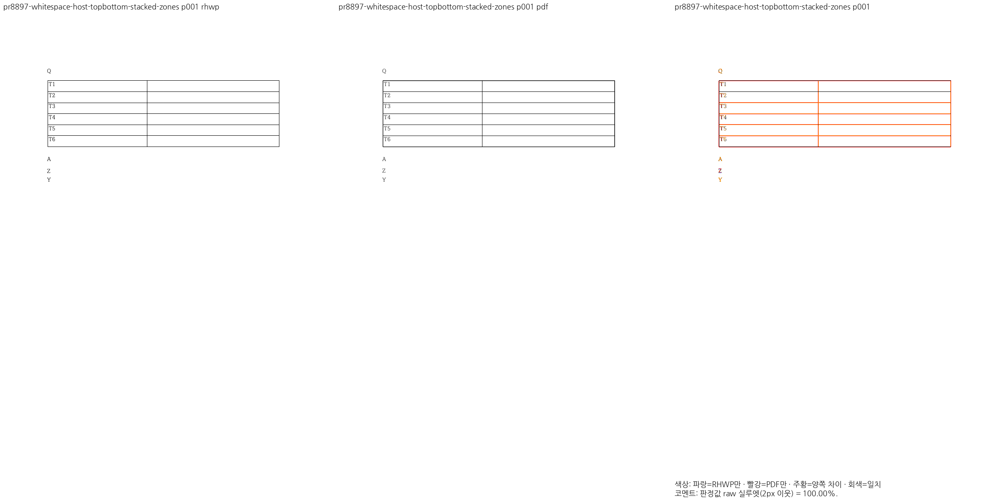
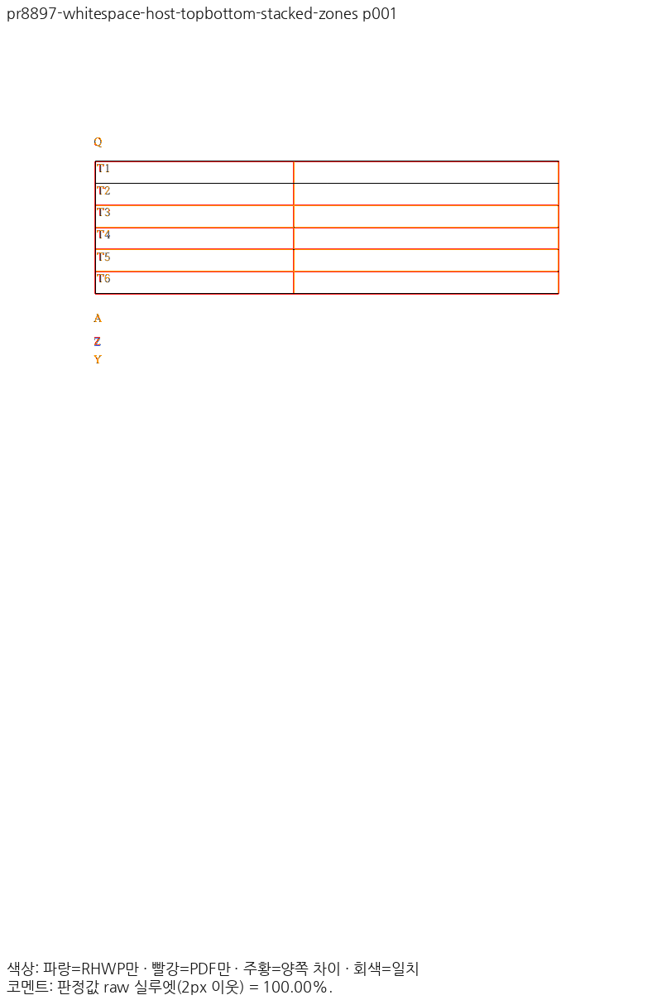
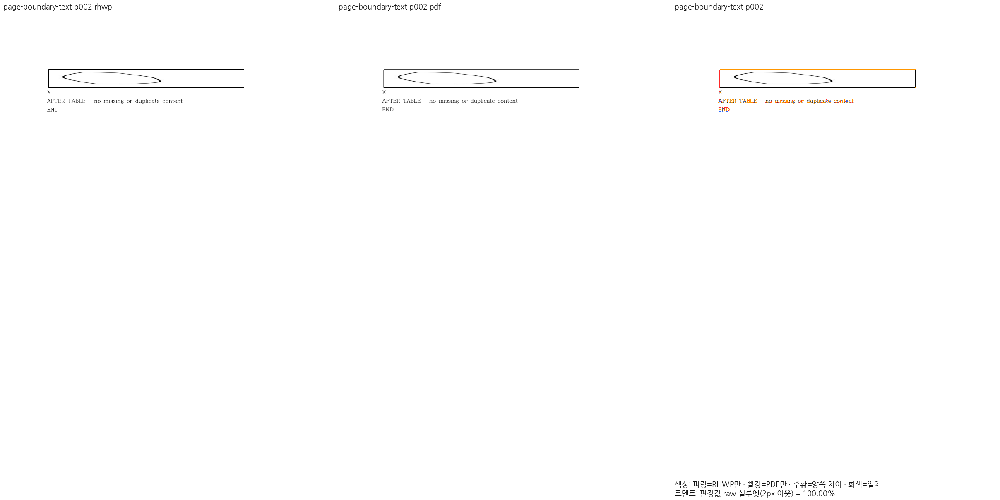
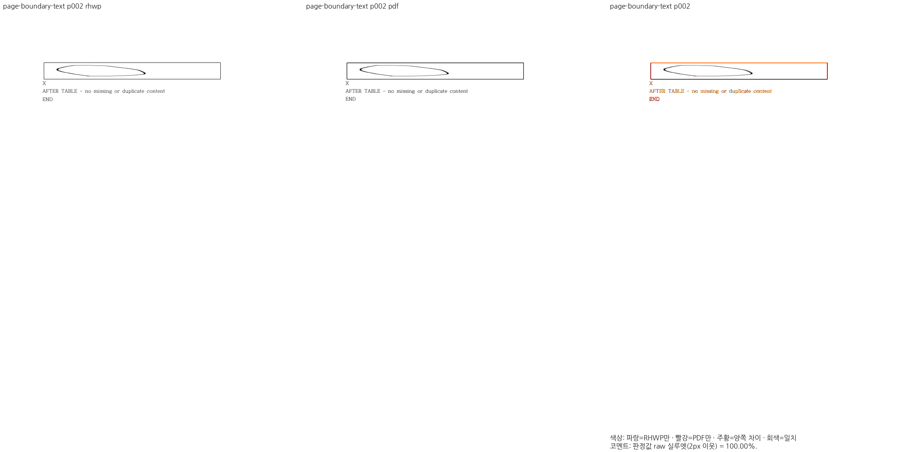

# PR #8897 리뷰 — 빈·공백 host의 어울림 표와 후속 자리차지 표 배치

## 최종 판정

**메인터너 보정 후 통합 가능 — 통합 PR의 exact-head CI 확인 필요**. 현재 검증 제품 source는 `73d06ed0b18df7c222a850bb5d9340c9b7de2bcc`, base는 `a85d3265dd10b316d1a0ae029ca3f67245b38b77`(#9017)다. 최소 글꼴 Native 집중 **164 PASS / 0 FAIL**, 전체 nextest **13,380 PASS / 0 FAIL / 45 skipped**(실행 404.945초)와 필수 게이트를 완료했다. [최신 실제 실행 원장](../assets/hyunmyungjanelee_20261112/final-rebase-30fa7739/rebase-a85d3265/gates-validation.json)에 명령·종료 코드·로그 해시를 보존했다. 원 PR head를 그대로 승인하는 판정이 아니라 아래 메인터너 보정을 포함한 통합 후보의 판정이다.

시각 증적을 실제 산출한 source는 `30fa7739f0340f2a248b22542c7dd36d9354f056`, 당시 base는 `1a3ed4a7cd76701085a24ac81d30bc5fb31942c1`(#8956)이다. 이 PR의 공개 입력 22종·28쪽을 새 Native/fresh WASM으로 다시 출력해 최저 **97.18% / 97.18%**, 미달·새 하락 0쪽을 확인했다. 공개 전체 34종·46쪽의 raw·PDF·review·overlay 368개는 리베이스 전 직접 판독한 증적과 바이트가 같다.

#9017 리베이스의 44개 patch ID와 기존 출력·입력·폰트·캡처 경로 동일성을 확인해 전쪽 TSV·PNG·독립 Print를 재사용했다. 원 producer와 원 source를 유지하며 새 head에서 전쪽을 재캡처했다고 표시하지 않는다. 같은 최소 글꼴 조건의 새 base/후보 HTML 계약 23건은 모두 통과했고, 최신 WASM의 실제 브라우저 본문·셀 붙여넣기 6사례 및 HWP/HWPX 두 차례 저장 24회, 기존 표 경로 API 11건도 통과했다. [재사용 경계](../assets/hyunmyungjanelee_20261112/final-rebase-30fa7739/rebase-a85d3265/README.md), [새 base 대조](../assets/hyunmyungjanelee_20261112/final-rebase-30fa7739/rebase-a85d3265/incoming-base-validation.json), [실제 응답 해시](../assets/hyunmyungjanelee_20261112/final-rebase-30fa7739/rebase-a85d3265/browser-runtime-result.json)를 구분한다.

시각 증적 source `30fa7739`의 최소 글꼴 Native 집중 **141 PASS / 0 FAIL**에 이 PR의 22건과 새 #8956 API 4건을 포함했다. 실제 브라우저 표 경로 API 11건도 PASS이며 Root pkg·Studio public·초기화 응답의 JS/WASM 해시를 대조했다. 실제 Studio 48개 강제 진단 캡처의 현재 hard-gate 위반은 0건이지만 이 값만으로 내용 보존을 판정하지 않았다. CanvasKit 지원 캡처 28개와, 기존 미지원 RawSvg를 강제한 차트 4개를 구분했다. 차트의 정상 auto 선택은 사전 검사로 Canvas2D에 전환하며 양 모드 screen/print 4회에서 차트를 보존했다(Print 95.08%). 미지원 4회를 CanvasKit 지원 통과로 세지 않는다. 백엔드 간 report-only 픽셀 비교는 32건 중 16건 미달이며 픽셀 동등성을 주장하지 않는다. [현재 실제 소비 결과](../assets/hyunmyungjanelee_20261112/final-rebase-30fa7739/actual-backends/summary.json)를 연결한다.

편람 Native 383쪽 gate는 최저 99.96%·공식 표시값 하락 0쪽으로 통과했다. 정본 Native/fresh WASM 각 18종·1771쪽의 TSV도 현재 canonical로 다시 계산해 최저 98.36%·공식 표시값 하락 0쪽을 확인했다. 정본 PNG의 원 producer d66568ef와 `30fa7739`의 직접 편람 캡처를 구분한다. [리베이스 소비 경로·재사용 근거](../assets/hyunmyungjanelee_20261112/final-rebase-30fa7739/rebase-read-path-audit.md), [Native 보호](../assets/hyunmyungjanelee_20261112/final-rebase-30fa7739/protected-native-validation.json), [WASM 보호](../assets/hyunmyungjanelee_20261112/final-rebase-30fa7739/protected-wasm-validation.json)를 보존한다. `30fa7739`에서는 최소 글꼴 전체 회귀 13,365 PASS / 0 FAIL / 45 skipped와 필수 16단계 게이트를 모두 통과했고, #8956의 새 base Native 4건·후보 4건·브라우저 API 11건도 통과했다. [전체 실행 결과](../assets/hyunmyungjanelee_20261112/final-rebase-30fa7739/gates-validation.json)와 [base/후보 대조](../assets/hyunmyungjanelee_20261112/final-rebase-30fa7739/incoming-base-validation.json)를 현재 #9017 추가 검증과 구분한다.

초기 source 8fe7d1fb에서는 크기 0·F0FA의 CanvasKit 결함이 발견됐고, 이후 이를 보정했다. 초기 전체 회귀나 초기 Cairo/웹한글기안기 점수를 현재 head의 완료 근거로 사용하지 않는다. [이전 결함 기록](../assets/hyunmyungjanelee_20261112/final-print-8fe7d1fb/actual-backends-before/failure-summary.json)은 이력으로 보존한다.

## 접수와 검증 범위

- 원 PR [#8897](https://github.com/edwardkim/rhwp/pull/8897), 작성자 `hyunmyungJaneLee`, 이슈 [#8573](https://github.com/edwardkim/rhwp/issues/8573).
- 원 head `e263b59c25ae949065dec6726978c9fe2751e4d4`·reviewer `edwardkim`를 확인한 뒤 체리픽했다. 원 contributor 브랜치를 변경하지 않았다.
- 최초 devel 기준 `80b1c354c29b7a02fb2b3c14a274da7f5b653ada`(#8956·#9017 반영 뒤 현재 base는 위 a85d3265), 통합 브랜치 `review/integration-20261112-hyunmyungjanelee`. 원 29개 커밋의 [적용 기록](../assets/hyunmyungjanelee_20261112/cherry-pick-result.json)과 [additive 충돌 해소](../assets/hyunmyungjanelee_20261112/conflicts.json)를 보존한다.
- 현재 요청 reviewer는 `edwardkim, jangster77`다. 원 PR head의 출처를 보존했다. devel은 #8956·#9017 반영으로 갱신됐으며, 최종 push·merge 직전에 원 PR head와 devel을 다시 확인한다.

## 변경과 조판 원칙 검토

가시 글자가 없는 host도 줄 상자와 배제 영역을 구분해 앞 문단 어울림 표 옆의 글줄을 보존한다. 후속 자리차지 표가 배제 영역과 겹치면 표만 내려가며 host 글줄은 앞서 놓일 수 있다.

`mod.rs::is_unstored_whitespace_object_host`와 `inline_flow.rs::plan_square_table_host`에서 host·최소 가용 띠·동반 개체를 분류한다. `typeset/table/block/entry.rs::square_side_pushed_placement`의 원점·점유 하한을 `ParagraphFloatPlacement`로 전달하고 상태의 배제 영역과 최종 배치가 소비한다. 폭 1430/1450HU, 음수 오프셋, 다중 개체, 단 영역 쌓임과 일반 저장 줄 대조군을 구분한다.

## 메인터너 보정과 수용 경계

미공개 원본 3건은 확보하지 못했다. 사용자 지시에 따라 같은 위험 형상의 공개 합성 6종을 새로 만들고 동일 입력의 독립 Windows Print를 확보했다. 공백·빈·글자 host, 그림 안 여백, 물리 첫 opening과 continuation, 그림 19+1개 소속·AFTER/END의 단일 소속을 검사한다. 원 비공개 3건을 직접 검증했다는 주장은 하지 않는다. 새 데스크톱 Print에서 확인한 단 구역 경계의 줄간격 중복은 `8fe7d1fb8b`로 보정했다. 저장 줄이 없는 마지막 문단의 확정 구성을 측정·배치에 전달하며 [전후 증적](../assets/hyunmyungjanelee_20261112/stacked-zone-spacing-repair/cause.md)의 Native 99.06% → 100.00%와 관계 검사 3 PASS / 1 FAIL → 4 PASS를 확인했다. `299630021a`와 `cab15c005a`의 메인터너 보정을 함께 적용한 통합 후보만 수용 대상이다.

## 공식 Print와 Native/fresh WASM 전쪽 대조

총 22종·28쪽, 최저 97.18%, 90% 미만 0쪽이다. 같은 입력·PDF의 devel 대비 2%p 초과 하락 0쪽이다. 기준 출력에 없던 쪽은 임의의 0점으로 채우지 않고 복원으로 구분한다. [Native 전쪽 비교 TSV](../assets/hyunmyungjanelee_20261112/final-rebase-30fa7739/native-comparison.tsv)·[생산 SHA와 입력/PNG 해시](../assets/hyunmyungjanelee_20261112/final-rebase-30fa7739/native-validation.json)를 연결한다.

| 입력 | 쪽수 | Native 최저 | fresh WASM |
| --- | ---: | ---: | --- |
| [empty-host-split-table.hwp](../../../samples/issue8573/empty-host-split-table.hwp) | 2 | 100.00% | 100.00% |
| [empty-host-square-band-1430-below.hwp](../../../samples/issue8573/empty-host-square-band-1430-below.hwp) | 1 | 100.00% | 100.00% |
| [empty-host-square-band-1450-beside.hwp](../../../samples/issue8573/empty-host-square-band-1450-beside.hwp) | 1 | 100.00% | 100.00% |
| [empty-host-square-band-600-no-extra-line.hwp](../../../samples/issue8573/empty-host-square-band-600-no-extra-line.hwp) | 1 | 100.00% | 100.00% |
| [empty-host-square-beside-line.hwp](../../../samples/issue8573/empty-host-square-beside-line.hwp) | 1 | 100.00% | 100.00% |
| [empty-host-square-then-topbottom-push.hwp](../../../samples/issue8573/empty-host-square-then-topbottom-push.hwp) | 1 | 100.00% | 100.00% |
| [text-host-split-table.hwp](../../../samples/issue8573/text-host-split-table.hwp) | 2 | 100.00% | 100.00% |
| [text-host-square-paper-companion-beside-line.hwp](../../../samples/issue8573/text-host-square-paper-companion-beside-line.hwp) | 1 | 100.00% | 100.00% |
| [text-host-square-then-topbottom-push.hwp](../../../samples/issue8573/text-host-square-then-topbottom-push.hwp) | 1 | 100.00% | 100.00% |
| [text-host-topbottom-line-below.hwp](../../../samples/issue8573/text-host-topbottom-line-below.hwp) | 1 | 100.00% | 100.00% |
| [whitespace-host-negative-offset-table.hwp](../../../samples/issue8573/whitespace-host-negative-offset-table.hwp) | 1 | 100.00% | 100.00% |
| [whitespace-host-split-table.hwp](../../../samples/issue8573/whitespace-host-split-table.hwp) | 2 | 100.00% | 100.00% |
| [whitespace-host-square-then-topbottom-push.hwp](../../../samples/issue8573/whitespace-host-square-then-topbottom-push.hwp) | 1 | 100.00% | 100.00% |
| [whitespace-host-topbottom-line-below.hwp](../../../samples/issue8573/whitespace-host-topbottom-line-below.hwp) | 1 | 100.00% | 100.00% |
| [whitespace-host-topbottom-stacked-zones.hwp](../../../samples/issue8573/whitespace-host-topbottom-stacked-zones.hwp) | 1 | 100.00% | 100.00% |
| [whitespace-host-two-tables-negative-offset.hwp](../../../samples/issue8573/whitespace-host-two-tables-negative-offset.hwp) | 1 | 100.00% | 100.00% |
| [picture-cell-short-empty.hwpx (메인터너 대조군)](../../../samples/issue8573/picture-cell-short-empty.hwpx) | 1 | 100.00% | 100.00% |
| [picture-cell-short-spaces.hwpx (메인터너 대조군)](../../../samples/issue8573/picture-cell-short-spaces.hwpx) | 1 | 100.00% | 100.00% |
| [picture-cell-short-text.hwpx (메인터너 대조군)](../../../samples/issue8573/picture-cell-short-text.hwpx) | 1 | 100.00% | 100.00% |
| [picture-cell-page-boundary-empty.hwpx (메인터너 대조군)](../../../samples/issue8573/picture-cell-page-boundary-empty.hwpx) | 2 | 97.18% | 97.18% |
| [picture-cell-page-boundary-spaces.hwpx (메인터너 대조군)](../../../samples/issue8573/picture-cell-page-boundary-spaces.hwpx) | 2 | 97.18% | 97.18% |
| [picture-cell-page-boundary-text.hwpx (메인터너 대조군)](../../../samples/issue8573/picture-cell-page-boundary-text.hwpx) | 2 | 97.18% | 97.18% |

## 기준 PDF의 출처와 제외한 자료

원 PR이 기준으로 제시한 **한컴 웹한글기안기 PDF(Cairo)는 이 검토의 검증 대상에서 제외했다.** 동일 원본의 **Windows 데스크톱 한컴 인쇄(Print) PDF**로 대조했으며, 실제 출력 제품은 한컴 2020 11.0.0.9136(MCP `engine: 2020`, HOffice110) 16종, 한컴 2024 13.0.0.3901(MCP `engine: 2024`, HOffice130) 6종이다. 원본의 저장 제품과 Print 출력 제품을 혼동하지 않는다. [공식 Print 영수증](../assets/hyunmyungjanelee_20261112/mcp-print-reference/receipts.json)에 입력·PDF SHA-256, 엔진·제품 버전·Print method 0·작업 ID 또는 사용자 Print 확인을 보존했다.

현재 기준은 입력 34종 가운데 MCP Print 33종·사용자 확인 한컴 2024 Print 1종이다. 입력·기준 PDF는 Git에 보존하고, 이전 형식 미표기 경로에서 원본 형식·엔진을 명시한 정본 경로로 이름만 바로잡았다. [공식 Print 영수증](../assets/hyunmyungjanelee_20261112/mcp-print-reference/receipts.json)의 파일 SHA와 현재 실행·커밋이 일치한다. 이전 Cairo 기준은 Git 이력이며 현재 수용 근거로 쓰지 않는다.

## 증적과 직접 판독

[Native 직접 판독](../assets/hyunmyungjanelee_20261112/final-print-d66568ef/native-direct-reading.json)과 [fresh WASM 직접 판독](../assets/hyunmyungjanelee_20261112/final-print-d66568ef/wasm-direct-reading.json)에 대표 7쪽의 같은 페이지 review·overlay 확인을 기록했다. [fresh WASM 전쪽 비교](../assets/hyunmyungjanelee_20261112/final-rebase-30fa7739/wasm-comparison.tsv)와 [실제 빌드·초기화 응답 해시](../assets/hyunmyungjanelee_20261112/final-rebase-30fa7739/wasm-validation.json)를 함께 연결한다.

각 입력의 같은 쪽 raw·독립 PDF PNG·review·overlay 및 전체 TSV는 아래 폴더에 있다. 원 PR 주장에 대응하는 입력을 사용하며 다른 문서의 그림으로 대체하지 않는다.

- `pr8897-empty-host-split-table`: [전쪽 TSV](../assets/hyunmyungjanelee_20261112/final-print-d66568ef/pr8897/pr8897-empty-host-split-table/native/candidate-silhouette.tsv) · [raw](../assets/hyunmyungjanelee_20261112/final-print-d66568ef/pr8897/pr8897-empty-host-split-table/native/raw-001.png) · [PDF](../assets/hyunmyungjanelee_20261112/final-print-d66568ef/pr8897/pr8897-empty-host-split-table/native/pdf-001.png) · [review](../assets/hyunmyungjanelee_20261112/final-print-d66568ef/pr8897/pr8897-empty-host-split-table/native/review-001.png) · [overlay](../assets/hyunmyungjanelee_20261112/final-print-d66568ef/pr8897/pr8897-empty-host-split-table/native/overlay-001.png).
- `pr8897-empty-host-square-band-1430-below`: [전쪽 TSV](../assets/hyunmyungjanelee_20261112/final-print-d66568ef/pr8897/pr8897-empty-host-square-band-1430-below/native/candidate-silhouette.tsv) · [raw](../assets/hyunmyungjanelee_20261112/final-print-d66568ef/pr8897/pr8897-empty-host-square-band-1430-below/native/raw-001.png) · [PDF](../assets/hyunmyungjanelee_20261112/final-print-d66568ef/pr8897/pr8897-empty-host-square-band-1430-below/native/pdf-001.png) · [review](../assets/hyunmyungjanelee_20261112/final-print-d66568ef/pr8897/pr8897-empty-host-square-band-1430-below/native/review-001.png) · [overlay](../assets/hyunmyungjanelee_20261112/final-print-d66568ef/pr8897/pr8897-empty-host-square-band-1430-below/native/overlay-001.png).
- `pr8897-empty-host-square-band-1450-beside`: [전쪽 TSV](../assets/hyunmyungjanelee_20261112/final-print-d66568ef/pr8897/pr8897-empty-host-square-band-1450-beside/native/candidate-silhouette.tsv) · [raw](../assets/hyunmyungjanelee_20261112/final-print-d66568ef/pr8897/pr8897-empty-host-square-band-1450-beside/native/raw-001.png) · [PDF](../assets/hyunmyungjanelee_20261112/final-print-d66568ef/pr8897/pr8897-empty-host-square-band-1450-beside/native/pdf-001.png) · [review](../assets/hyunmyungjanelee_20261112/final-print-d66568ef/pr8897/pr8897-empty-host-square-band-1450-beside/native/review-001.png) · [overlay](../assets/hyunmyungjanelee_20261112/final-print-d66568ef/pr8897/pr8897-empty-host-square-band-1450-beside/native/overlay-001.png).
- `pr8897-empty-host-square-band-600-no-extra-line`: [전쪽 TSV](../assets/hyunmyungjanelee_20261112/final-print-d66568ef/pr8897/pr8897-empty-host-square-band-600-no-extra-line/native/candidate-silhouette.tsv) · [raw](../assets/hyunmyungjanelee_20261112/final-print-d66568ef/pr8897/pr8897-empty-host-square-band-600-no-extra-line/native/raw-001.png) · [PDF](../assets/hyunmyungjanelee_20261112/final-print-d66568ef/pr8897/pr8897-empty-host-square-band-600-no-extra-line/native/pdf-001.png) · [review](../assets/hyunmyungjanelee_20261112/final-print-d66568ef/pr8897/pr8897-empty-host-square-band-600-no-extra-line/native/review-001.png) · [overlay](../assets/hyunmyungjanelee_20261112/final-print-d66568ef/pr8897/pr8897-empty-host-square-band-600-no-extra-line/native/overlay-001.png).
- `pr8897-empty-host-square-beside-line`: [전쪽 TSV](../assets/hyunmyungjanelee_20261112/final-print-d66568ef/pr8897/pr8897-empty-host-square-beside-line/native/candidate-silhouette.tsv) · [raw](../assets/hyunmyungjanelee_20261112/final-print-d66568ef/pr8897/pr8897-empty-host-square-beside-line/native/raw-001.png) · [PDF](../assets/hyunmyungjanelee_20261112/final-print-d66568ef/pr8897/pr8897-empty-host-square-beside-line/native/pdf-001.png) · [review](../assets/hyunmyungjanelee_20261112/final-print-d66568ef/pr8897/pr8897-empty-host-square-beside-line/native/review-001.png) · [overlay](../assets/hyunmyungjanelee_20261112/final-print-d66568ef/pr8897/pr8897-empty-host-square-beside-line/native/overlay-001.png).
- `pr8897-empty-host-square-then-topbottom-push`: [전쪽 TSV](../assets/hyunmyungjanelee_20261112/final-print-d66568ef/pr8897/pr8897-empty-host-square-then-topbottom-push/native/candidate-silhouette.tsv) · [raw](../assets/hyunmyungjanelee_20261112/final-print-d66568ef/pr8897/pr8897-empty-host-square-then-topbottom-push/native/raw-001.png) · [PDF](../assets/hyunmyungjanelee_20261112/final-print-d66568ef/pr8897/pr8897-empty-host-square-then-topbottom-push/native/pdf-001.png) · [review](../assets/hyunmyungjanelee_20261112/final-print-d66568ef/pr8897/pr8897-empty-host-square-then-topbottom-push/native/review-001.png) · [overlay](../assets/hyunmyungjanelee_20261112/final-print-d66568ef/pr8897/pr8897-empty-host-square-then-topbottom-push/native/overlay-001.png).
- `pr8897-text-host-split-table`: [전쪽 TSV](../assets/hyunmyungjanelee_20261112/final-print-d66568ef/pr8897/pr8897-text-host-split-table/native/candidate-silhouette.tsv) · [raw](../assets/hyunmyungjanelee_20261112/final-print-d66568ef/pr8897/pr8897-text-host-split-table/native/raw-001.png) · [PDF](../assets/hyunmyungjanelee_20261112/final-print-d66568ef/pr8897/pr8897-text-host-split-table/native/pdf-001.png) · [review](../assets/hyunmyungjanelee_20261112/final-print-d66568ef/pr8897/pr8897-text-host-split-table/native/review-001.png) · [overlay](../assets/hyunmyungjanelee_20261112/final-print-d66568ef/pr8897/pr8897-text-host-split-table/native/overlay-001.png).
- `pr8897-text-host-square-paper-companion-beside-line`: [전쪽 TSV](../assets/hyunmyungjanelee_20261112/final-print-d66568ef/pr8897/pr8897-text-host-square-paper-companion-beside-line/native/candidate-silhouette.tsv) · [raw](../assets/hyunmyungjanelee_20261112/final-print-d66568ef/pr8897/pr8897-text-host-square-paper-companion-beside-line/native/raw-001.png) · [PDF](../assets/hyunmyungjanelee_20261112/final-print-d66568ef/pr8897/pr8897-text-host-square-paper-companion-beside-line/native/pdf-001.png) · [review](../assets/hyunmyungjanelee_20261112/final-print-d66568ef/pr8897/pr8897-text-host-square-paper-companion-beside-line/native/review-001.png) · [overlay](../assets/hyunmyungjanelee_20261112/final-print-d66568ef/pr8897/pr8897-text-host-square-paper-companion-beside-line/native/overlay-001.png).
- `pr8897-text-host-square-then-topbottom-push`: [전쪽 TSV](../assets/hyunmyungjanelee_20261112/final-print-d66568ef/pr8897/pr8897-text-host-square-then-topbottom-push/native/candidate-silhouette.tsv) · [raw](../assets/hyunmyungjanelee_20261112/final-print-d66568ef/pr8897/pr8897-text-host-square-then-topbottom-push/native/raw-001.png) · [PDF](../assets/hyunmyungjanelee_20261112/final-print-d66568ef/pr8897/pr8897-text-host-square-then-topbottom-push/native/pdf-001.png) · [review](../assets/hyunmyungjanelee_20261112/final-print-d66568ef/pr8897/pr8897-text-host-square-then-topbottom-push/native/review-001.png) · [overlay](../assets/hyunmyungjanelee_20261112/final-print-d66568ef/pr8897/pr8897-text-host-square-then-topbottom-push/native/overlay-001.png).
- `pr8897-text-host-topbottom-line-below`: [전쪽 TSV](../assets/hyunmyungjanelee_20261112/final-print-d66568ef/pr8897/pr8897-text-host-topbottom-line-below/native/candidate-silhouette.tsv) · [raw](../assets/hyunmyungjanelee_20261112/final-print-d66568ef/pr8897/pr8897-text-host-topbottom-line-below/native/raw-001.png) · [PDF](../assets/hyunmyungjanelee_20261112/final-print-d66568ef/pr8897/pr8897-text-host-topbottom-line-below/native/pdf-001.png) · [review](../assets/hyunmyungjanelee_20261112/final-print-d66568ef/pr8897/pr8897-text-host-topbottom-line-below/native/review-001.png) · [overlay](../assets/hyunmyungjanelee_20261112/final-print-d66568ef/pr8897/pr8897-text-host-topbottom-line-below/native/overlay-001.png).
- `pr8897-whitespace-host-negative-offset-table`: [전쪽 TSV](../assets/hyunmyungjanelee_20261112/final-print-d66568ef/pr8897/pr8897-whitespace-host-negative-offset-table/native/candidate-silhouette.tsv) · [raw](../assets/hyunmyungjanelee_20261112/final-print-d66568ef/pr8897/pr8897-whitespace-host-negative-offset-table/native/raw-001.png) · [PDF](../assets/hyunmyungjanelee_20261112/final-print-d66568ef/pr8897/pr8897-whitespace-host-negative-offset-table/native/pdf-001.png) · [review](../assets/hyunmyungjanelee_20261112/final-print-d66568ef/pr8897/pr8897-whitespace-host-negative-offset-table/native/review-001.png) · [overlay](../assets/hyunmyungjanelee_20261112/final-print-d66568ef/pr8897/pr8897-whitespace-host-negative-offset-table/native/overlay-001.png).
- `pr8897-whitespace-host-split-table`: [전쪽 TSV](../assets/hyunmyungjanelee_20261112/final-print-d66568ef/pr8897/pr8897-whitespace-host-split-table/native/candidate-silhouette.tsv) · [raw](../assets/hyunmyungjanelee_20261112/final-print-d66568ef/pr8897/pr8897-whitespace-host-split-table/native/raw-001.png) · [PDF](../assets/hyunmyungjanelee_20261112/final-print-d66568ef/pr8897/pr8897-whitespace-host-split-table/native/pdf-001.png) · [review](../assets/hyunmyungjanelee_20261112/final-print-d66568ef/pr8897/pr8897-whitespace-host-split-table/native/review-001.png) · [overlay](../assets/hyunmyungjanelee_20261112/final-print-d66568ef/pr8897/pr8897-whitespace-host-split-table/native/overlay-001.png).
- `pr8897-whitespace-host-square-then-topbottom-push`: [전쪽 TSV](../assets/hyunmyungjanelee_20261112/final-print-d66568ef/pr8897/pr8897-whitespace-host-square-then-topbottom-push/native/candidate-silhouette.tsv) · [raw](../assets/hyunmyungjanelee_20261112/final-print-d66568ef/pr8897/pr8897-whitespace-host-square-then-topbottom-push/native/raw-001.png) · [PDF](../assets/hyunmyungjanelee_20261112/final-print-d66568ef/pr8897/pr8897-whitespace-host-square-then-topbottom-push/native/pdf-001.png) · [review](../assets/hyunmyungjanelee_20261112/final-print-d66568ef/pr8897/pr8897-whitespace-host-square-then-topbottom-push/native/review-001.png) · [overlay](../assets/hyunmyungjanelee_20261112/final-print-d66568ef/pr8897/pr8897-whitespace-host-square-then-topbottom-push/native/overlay-001.png).
- `pr8897-whitespace-host-topbottom-line-below`: [전쪽 TSV](../assets/hyunmyungjanelee_20261112/final-print-d66568ef/pr8897/pr8897-whitespace-host-topbottom-line-below/native/candidate-silhouette.tsv) · [raw](../assets/hyunmyungjanelee_20261112/final-print-d66568ef/pr8897/pr8897-whitespace-host-topbottom-line-below/native/raw-001.png) · [PDF](../assets/hyunmyungjanelee_20261112/final-print-d66568ef/pr8897/pr8897-whitespace-host-topbottom-line-below/native/pdf-001.png) · [review](../assets/hyunmyungjanelee_20261112/final-print-d66568ef/pr8897/pr8897-whitespace-host-topbottom-line-below/native/review-001.png) · [overlay](../assets/hyunmyungjanelee_20261112/final-print-d66568ef/pr8897/pr8897-whitespace-host-topbottom-line-below/native/overlay-001.png).
- `pr8897-whitespace-host-topbottom-stacked-zones`: [전쪽 TSV](../assets/hyunmyungjanelee_20261112/final-print-d66568ef/pr8897/pr8897-whitespace-host-topbottom-stacked-zones/native/candidate-silhouette.tsv) · [raw](../assets/hyunmyungjanelee_20261112/final-print-d66568ef/pr8897/pr8897-whitespace-host-topbottom-stacked-zones/native/raw-001.png) · [PDF](../assets/hyunmyungjanelee_20261112/final-print-d66568ef/pr8897/pr8897-whitespace-host-topbottom-stacked-zones/native/pdf-001.png) · [review](../assets/hyunmyungjanelee_20261112/final-print-d66568ef/pr8897/pr8897-whitespace-host-topbottom-stacked-zones/native/review-001.png) · [overlay](../assets/hyunmyungjanelee_20261112/final-print-d66568ef/pr8897/pr8897-whitespace-host-topbottom-stacked-zones/native/overlay-001.png).
- `pr8897-whitespace-host-two-tables-negative-offset`: [전쪽 TSV](../assets/hyunmyungjanelee_20261112/final-print-d66568ef/pr8897/pr8897-whitespace-host-two-tables-negative-offset/native/candidate-silhouette.tsv) · [raw](../assets/hyunmyungjanelee_20261112/final-print-d66568ef/pr8897/pr8897-whitespace-host-two-tables-negative-offset/native/raw-001.png) · [PDF](../assets/hyunmyungjanelee_20261112/final-print-d66568ef/pr8897/pr8897-whitespace-host-two-tables-negative-offset/native/pdf-001.png) · [review](../assets/hyunmyungjanelee_20261112/final-print-d66568ef/pr8897/pr8897-whitespace-host-two-tables-negative-offset/native/review-001.png) · [overlay](../assets/hyunmyungjanelee_20261112/final-print-d66568ef/pr8897/pr8897-whitespace-host-two-tables-negative-offset/native/overlay-001.png).
- `short-empty`: [전쪽 TSV](../assets/hyunmyungjanelee_20261112/final-print-d66568ef/pr8897/short-empty/native/candidate-silhouette.tsv) · [raw](../assets/hyunmyungjanelee_20261112/final-print-d66568ef/pr8897/short-empty/native/raw-001.png) · [PDF](../assets/hyunmyungjanelee_20261112/final-print-d66568ef/pr8897/short-empty/native/pdf-001.png) · [review](../assets/hyunmyungjanelee_20261112/final-print-d66568ef/pr8897/short-empty/native/review-001.png) · [overlay](../assets/hyunmyungjanelee_20261112/final-print-d66568ef/pr8897/short-empty/native/overlay-001.png).
- `short-spaces`: [전쪽 TSV](../assets/hyunmyungjanelee_20261112/final-print-d66568ef/pr8897/short-spaces/native/candidate-silhouette.tsv) · [raw](../assets/hyunmyungjanelee_20261112/final-print-d66568ef/pr8897/short-spaces/native/raw-001.png) · [PDF](../assets/hyunmyungjanelee_20261112/final-print-d66568ef/pr8897/short-spaces/native/pdf-001.png) · [review](../assets/hyunmyungjanelee_20261112/final-print-d66568ef/pr8897/short-spaces/native/review-001.png) · [overlay](../assets/hyunmyungjanelee_20261112/final-print-d66568ef/pr8897/short-spaces/native/overlay-001.png).
- `short-text`: [전쪽 TSV](../assets/hyunmyungjanelee_20261112/final-print-d66568ef/pr8897/short-text/native/candidate-silhouette.tsv) · [raw](../assets/hyunmyungjanelee_20261112/final-print-d66568ef/pr8897/short-text/native/raw-001.png) · [PDF](../assets/hyunmyungjanelee_20261112/final-print-d66568ef/pr8897/short-text/native/pdf-001.png) · [review](../assets/hyunmyungjanelee_20261112/final-print-d66568ef/pr8897/short-text/native/review-001.png) · [overlay](../assets/hyunmyungjanelee_20261112/final-print-d66568ef/pr8897/short-text/native/overlay-001.png).
- `page-boundary-empty`: [전쪽 TSV](../assets/hyunmyungjanelee_20261112/final-print-d66568ef/pr8897/page-boundary-empty/native/candidate-silhouette.tsv) · [raw](../assets/hyunmyungjanelee_20261112/final-print-d66568ef/pr8897/page-boundary-empty/native/raw-001.png) · [PDF](../assets/hyunmyungjanelee_20261112/final-print-d66568ef/pr8897/page-boundary-empty/native/pdf-001.png) · [review](../assets/hyunmyungjanelee_20261112/final-print-d66568ef/pr8897/page-boundary-empty/native/review-001.png) · [overlay](../assets/hyunmyungjanelee_20261112/final-print-d66568ef/pr8897/page-boundary-empty/native/overlay-001.png).
- `page-boundary-spaces`: [전쪽 TSV](../assets/hyunmyungjanelee_20261112/final-print-d66568ef/pr8897/page-boundary-spaces/native/candidate-silhouette.tsv) · [raw](../assets/hyunmyungjanelee_20261112/final-print-d66568ef/pr8897/page-boundary-spaces/native/raw-001.png) · [PDF](../assets/hyunmyungjanelee_20261112/final-print-d66568ef/pr8897/page-boundary-spaces/native/pdf-001.png) · [review](../assets/hyunmyungjanelee_20261112/final-print-d66568ef/pr8897/page-boundary-spaces/native/review-001.png) · [overlay](../assets/hyunmyungjanelee_20261112/final-print-d66568ef/pr8897/page-boundary-spaces/native/overlay-001.png).
- `page-boundary-text`: [전쪽 TSV](../assets/hyunmyungjanelee_20261112/final-print-d66568ef/pr8897/page-boundary-text/native/candidate-silhouette.tsv) · [raw](../assets/hyunmyungjanelee_20261112/final-print-d66568ef/pr8897/page-boundary-text/native/raw-001.png) · [PDF](../assets/hyunmyungjanelee_20261112/final-print-d66568ef/pr8897/page-boundary-text/native/pdf-001.png) · [review](../assets/hyunmyungjanelee_20261112/final-print-d66568ef/pr8897/page-boundary-text/native/review-001.png) · [overlay](../assets/hyunmyungjanelee_20261112/final-print-d66568ef/pr8897/page-boundary-text/native/overlay-001.png).

## 이 PR의 집중 회귀와 직접 판독

최소 글꼴 Native 실행에서 이슈 #8573에 대응하는 **22 PASS / 0 FAIL**을 확인했다. `30fa7739`의 공통 141건 중 이 PR의 검사를 아래에 구분한다. 선택 밖 5,964건은 실행 완료 수에 넣지 않는다. [실제 명령·검사명·로그 해시](../assets/hyunmyungjanelee_20261112/final-rebase-30fa7739/focused-validation.json)를 보존하며 이 생산 SHA를 현재 #9017 추가 검사 결과로 바꾸어 쓰지 않는다.

- `issue_8573_empty_host_square_beside_line::text_host_line_stays_beside_square_table_with_paper_companion`: PASS.
- `issue_8573_empty_host_square_beside_line::topbottom_table_moves_below_empty_host_square_box`: PASS.
- `issue_8573_empty_host_square_beside_line::topbottom_table_starts_from_paragraph_origin_beside_square_table`: PASS.
- `issue_8573_empty_host_square_beside_line::empty_host_advances_one_line_of_largest_char_shape`: PASS.
- `issue_8573_whitespace_host_topbottom_line_below::whitespace_host_places_next_paragraph_like_text_host`: PASS.
- `issue_8573_whitespace_host_topbottom_line_below::whitespace_host_line_sits_below_table_outer_box`: PASS.
- `issue_8573_whitespace_host_negative_offset::single_negative_offset_table_stays_on_page`: PASS.
- `issue_8573_whitespace_host_negative_offset::two_tables_with_negative_offset_sign_table_stay_on_page`: PASS.
- `issue_8573_stacked_zones_topbottom::first_paragraph_is_not_pushed_by_paragraph_table_reservation`: PASS.
- `issue_8573_stacked_zones_topbottom::next_zone_starts_after_the_source_column_gap_without_old_line_tail`: PASS.
- `issue_8573_stacked_zones_topbottom::second_zone_first_paragraph_follows_previous_zone_without_table_height`: PASS.
- `issue_8573_stacked_zones_topbottom::stacked_single_column_zones_share_one_page`: PASS.
- `issue_8573_picture_cell_row_frame::host_text_does_not_compress_the_picture_row_frame`: PASS.
- `issue_8573_picture_cell_row_frame::boundary_rows_and_following_text_keep_independent_print_page_ownership`: PASS.
- `issue_8573_picture_cell_row_frame::continuation_preserves_the_same_host_gap_after_the_last_picture_row`: PASS.
- `issue_8573_picture_cell_row_frame::unstored_picture_rows_keep_the_bottom_padding_inside_the_cell`: PASS.
- `issue_8573_square_then_topbottom_push::host_and_following_lines_stay_beside_square_table`: PASS.
- `issue_8573_square_then_topbottom_push::topbottom_table_moves_below_preceding_square_box`: PASS.
- `issue_8573_split_table_host_kinds::whitespace_host_first_fragment_matches_text_and_empty_hosts`: PASS.
- `issue_8573_empty_host_band_min_width::band_at_least_min_line_width_flows_beside_table`: PASS.
- `issue_8573_empty_host_band_min_width::band_narrower_than_min_line_width_keeps_lines_below_table`: PASS.
- `issue_8573_empty_host_band_min_width::near_column_width_table_adds_no_empty_host_line_below`: PASS.

- `pr8897-whitespace-host-topbottom-stacked-zones` 1쪽: Q·표·A를 보존하고 Z·Y의 중복 후행 간격이 제거됐다. fresh WASM 100.00%.
- `page-boundary-text` 2쪽: 마지막 그림 1개와 X·AFTER TABLE·END의 순서와 단일 소속이 Print에 대응한다. base에 없던 둘째 쪽의 구조 복원이다.

아래 이미지는 이 PR의 같은 입력·같은 쪽이다. Native와 fresh WASM의 review·overlay를 각각 직접 열어 확인했으며 raw·PDF PNG도 함께 연결한다.

### `pr8897-whitespace-host-topbottom-stacked-zones` 1쪽

**native** · [raw](../assets/hyunmyungjanelee_20261112/final-print-d66568ef/pr8897/pr8897-whitespace-host-topbottom-stacked-zones/native/raw-001.png) · [독립 Print PNG](../assets/hyunmyungjanelee_20261112/final-print-d66568ef/pr8897/pr8897-whitespace-host-topbottom-stacked-zones/native/pdf-001.png)

**wasm** · [raw](../assets/hyunmyungjanelee_20261112/final-print-d66568ef/pr8897/pr8897-whitespace-host-topbottom-stacked-zones/wasm/raw-001.png) · [독립 Print PNG](../assets/hyunmyungjanelee_20261112/final-print-d66568ef/pr8897/pr8897-whitespace-host-topbottom-stacked-zones/wasm/pdf-001.png)

### `page-boundary-text` 2쪽

**native** · [raw](../assets/hyunmyungjanelee_20261112/final-print-d66568ef/pr8897/page-boundary-text/native/raw-002.png) · [독립 Print PNG](../assets/hyunmyungjanelee_20261112/final-print-d66568ef/pr8897/page-boundary-text/native/pdf-002.png)

**wasm** · [raw](../assets/hyunmyungjanelee_20261112/final-print-d66568ef/pr8897/page-boundary-text/wasm/raw-002.png) · [독립 Print PNG](../assets/hyunmyungjanelee_20261112/final-print-d66568ef/pr8897/page-boundary-text/wasm/pdf-002.png)

## 공통 최종 검증과 후속 처리

현재 제품 source `73d06ed0b1`의 최소 글꼴 Native 집중 164건·전체 13,380건과 모든 필수 게이트가 통과했다. 실제 브라우저 6사례·24회 반복 저장·API 11건도 통과했다. 이전 30fa의 시각·Studio 전체 테스트·실제 backend 증적은 동일성 감사와 원 producer를 유지해 재사용했다. 검증용 공유 캐시에 남은 기준 worktree의 root/chart library는 내용 변경 없이 현재 소스에서 실제 재컴파일했으며, 중간 실패를 제품 회귀나 최종 통과로 바꾸어 세지 않았다. 통합 PR의 최종 exact-head CI와 merge 조건을 확인한 뒤 원 PR·이슈의 정의된 해결 범위를 후속 처리한다. #8678의 부분 해결 범위는 OPEN으로 유지한다.