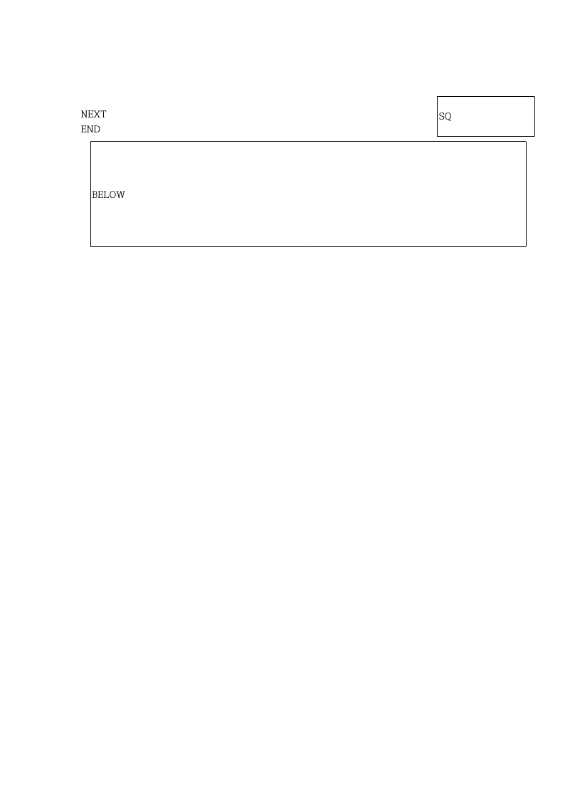
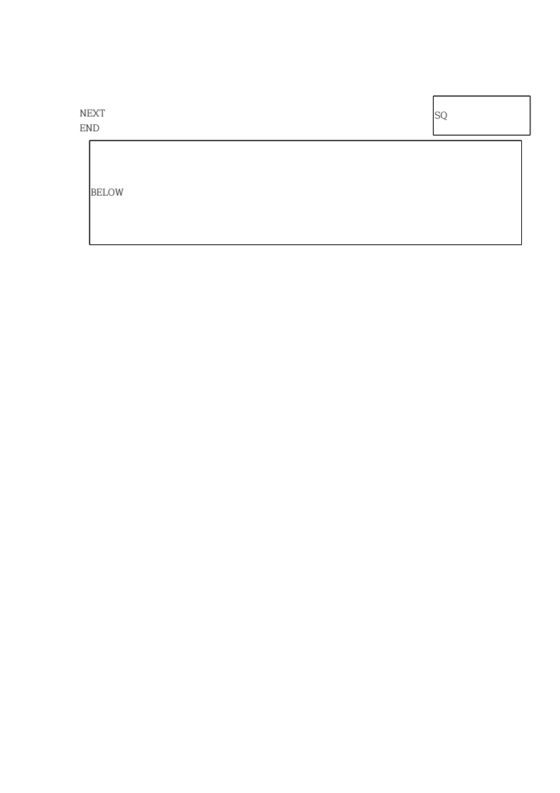
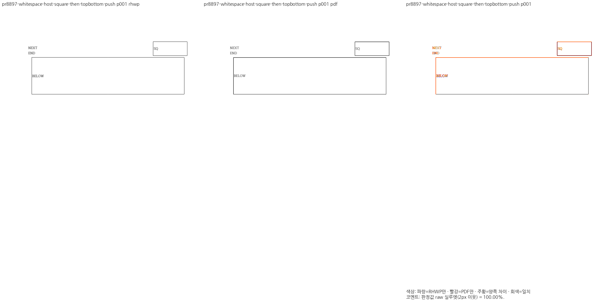
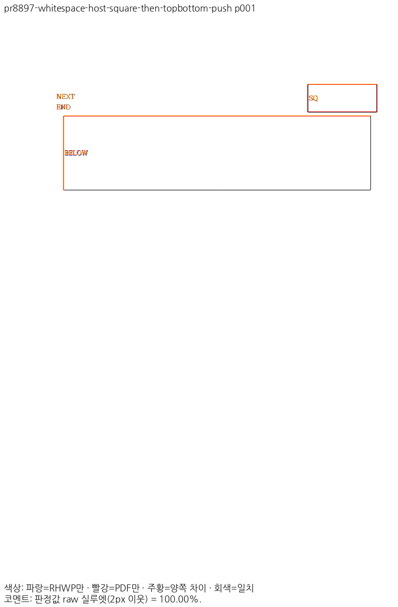

# PR #8897 리뷰 — 빈·공백 host의 어울림 표와 후속 자리차지 표 배치

## 최종 판정

**머지 보류 — 공개 입력의 Native·fresh WASM 전쪽과 최소 글꼴 전체 회귀를 완료했으며, Native 정본 보호 18종·1,771쪽까지 완료했으며 devel fresh WASM 비교와 WASM 정본 보호 검증을 진행 중이다.** 원 PR의 공개되지 않은 보류 범위는 별도로 해소해야 한다. 원격 승인·병합을 수행한 기록이 아니다.

## 접수 정보

- 원 PR: [#8897](https://github.com/edwardkim/rhwp/pull/8897), 작성자 `hyunmyungJaneLee`, 관련 이슈 [#8573](https://github.com/edwardkim/rhwp/issues/8573).
- 원 head: `e263b59c25ae949065dec6726978c9fe2751e4d4`. reviewer `edwardkim`를 API로 확인한 뒤 fetch·순차 체리픽했다.
- 고정 devel: `80b1c354c29b7a02fb2b3c14a274da7f5b653ada`. 측정한 통합 code head: `0c9819d698bcbe3e3d83f563a0154ccb00eb6f07`. 브랜치 `review/integration-20261112-hyunmyungjanelee`.
- 원 contributor 브랜치의 head를 바꾸지 않았다. 적용 SHA와 additive 충돌 해소는 [체리픽 기록](../assets/hyunmyungjanelee_20261112/cherry-pick-result.json)·[충돌 기록](../assets/hyunmyungjanelee_20261112/conflicts.json)에 남겼다. 원격 CI·mergeability는 최종 판단 전에 다시 확인한다.

## 기준 PDF의 출처와 제외한 자료

원 PR이 기준으로 제시한 **한컴 웹한글기안기 PDF(Cairo)는 이 검토의 검증 대상에서 제외했다.** 동일 원본의 **Windows 데스크톱 한컴 인쇄(Print) PDF**로 대조했으며, 실제 출력 제품은 한컴 2020 11.0.0.9136(MCP `engine: 2020`, HOffice110) 16종, 한컴 2024 13.0.0.3901(MCP `engine: 2024`, HOffice130) 6종이다. 원본의 저장 제품과 Print 출력 제품을 혼동하지 않는다. [공식 Print 영수증](../assets/hyunmyungjanelee_20261112/mcp-print-reference/receipts.json)에 입력·PDF SHA-256, 엔진·제품 버전·Print method 0·작업 ID 또는 사용자 Print 확인을 보존했다.

## 변경과 조판 원칙 검토

가시 글자가 없는 host도 줄 상자와 배제 영역을 구분해 앞 문단 어울림 표 옆의 글줄을 보존한다. 후속 자리차지 표가 배제 영역과 겹치면 표만 내려가며 host 글줄은 앞서 놓일 수 있다.

`mod.rs::is_unstored_whitespace_object_host`와 `inline_flow.rs::plan_square_table_host`에서 host·최소 가용 띠·동반 개체를 분류한다. `typeset/table/block/entry.rs::square_side_pushed_placement`의 원점·점유 하한을 `ParagraphFloatPlacement`로 전달하고 상태의 배제 영역과 최종 배치가 소비한다. 폭 1430/1450HU, 음수 오프셋, 다중 개체, 단 영역 쌓임과 일반 저장 줄 대조군을 구분한다.

## 검증 입력과 결과

공개 16종·19쪽을 같은 입력·독립 웹한글기안기 Print PDF로 비교했다. Native Skia direct PNG, 인쇄 프로필·compat2022·96 DPI, PDFium `pdfium_smooth_rgb_exact_dpi_v2`, raw 실루엣 2px 기준이다. 입력/PDF가 code head의 Git blob과 같은지, 전쪽 쪽수·페이지 번호와 PNG 해시를 확인했다. [생산·입력 감사](../assets/hyunmyungjanelee_20261112/native-validation.json)를 참조한다.

| 입력 키 | 쪽 | devel Native | 후보 Native | 변화(%p) |
| --- | ---: | ---: | ---: | ---: |
| `pr8897-empty-host-split-table` | 1 | 100.00% | 100.00% | 0.00 |
| `pr8897-empty-host-split-table` | 2 | 100.00% | 100.00% | 0.00 |
| `pr8897-empty-host-square-band-1430-below` | 1 | 100.00% | 100.00% | 0.00 |
| `pr8897-empty-host-square-band-1450-beside` | 1 | 97.54% | 100.00% | 2.46 |
| `pr8897-empty-host-square-band-600-no-extra-line` | 1 | 100.00% | 100.00% | 0.00 |
| `pr8897-empty-host-square-beside-line` | 1 | 46.15% | 100.00% | 53.85 |
| `pr8897-empty-host-square-then-topbottom-push` | 1 | 49.55% | 100.00% | 50.45 |
| `pr8897-text-host-split-table` | 1 | 100.00% | 100.00% | 0.00 |
| `pr8897-text-host-split-table` | 2 | 100.00% | 100.00% | 0.00 |
| `pr8897-text-host-square-paper-companion-beside-line` | 1 | 35.96% | 100.00% | 64.04 |
| `pr8897-text-host-square-then-topbottom-push` | 1 | 26.45% | 100.00% | 73.55 |
| `pr8897-text-host-topbottom-line-below` | 1 | 100.00% | 100.00% | 0.00 |
| `pr8897-whitespace-host-negative-offset-table` | 1 | 100.00% | 100.00% | 0.00 |
| `pr8897-whitespace-host-split-table` | 1 | 73.72% | 100.00% | 26.28 |
| `pr8897-whitespace-host-split-table` | 2 | 95.40% | 100.00% | 4.60 |
| `pr8897-whitespace-host-square-then-topbottom-push` | 1 | 9.33% | 100.00% | 90.67 |
| `pr8897-whitespace-host-topbottom-line-below` | 1 | 97.45% | 100.00% | 2.55 |
| `pr8897-whitespace-host-topbottom-stacked-zones` | 1 | 1.48% | 98.96% | 97.48 |
| `pr8897-whitespace-host-two-tables-negative-offset` | 1 | 100.00% | 100.00% | 0.00 |

모든 공개 페이지가 90% 이상이며 devel 대비 2%p 초과 하락은 없다. 이 표는 fresh WASM이나 정본 보호 3,542행의 통과 증거가 아니다. 최소 글꼴 집중 회귀에는 해당 PR의 새 검사, 충돌 파일의 보안·off-canvas positive, 새 devel의 #8896 글꼴·마지막 표 조각 기능을 함께 포함했다. 최소 글꼴 집중 회귀는 97 PASS / 0 FAIL(8.371초)이며 선택 밖 4,230건을 전체 회귀 통과로 계산하지 않는다. [격리·실행 증거](../assets/hyunmyungjanelee_20261112/minimal-font-focused-result.json)를 보존했다.

필수 편람 HWPX Native gate는 최종 code head에서 전 383쪽 PASS, 최저 99.96%, 공식 보호값 하락 0쪽이다([gate](../assets/hyunmyungjanelee_20261112/handbook-native-gate.json) · [전쪽 TSV](../assets/hyunmyungjanelee_20261112/handbook-native-silhouette.tsv)). 이는 나머지 보호 입력 17종 및 WASM 보호 검증의 대체가 아니다.

fresh WASM도 같은 공개 입력의 전 19쪽을 실제 출력했으며 최저 98.96%, 90% 미만 0쪽이다([후보 전쪽 TSV](../assets/hyunmyungjanelee_20261112/wasm-candidate.tsv) · [빌드·실제 초기화 응답](../assets/hyunmyungjanelee_20261112/browser-runtime-result.json)). 새 devel의 fresh WASM 전쪽 비교는 아직 미실행이며 Native 기준값으로 대신하지 않는다.

최소 글꼴 전체 회귀는 **13,347 PASS / 0 FAIL / 45 skip**, 실행 401.230초다([결과](../assets/hyunmyungjanelee_20261112/full-nextest-result.json)). fmt·Native Clippy·WASM Clippy·workspace build·all-target Clippy·Native Skia 3종·suite manifest가 모두 통과했다([Rust gate 기록](../assets/hyunmyungjanelee_20261112/rust-gates.json)). 원 PR 6개 head는 [재조회](../assets/hyunmyungjanelee_20261112/live-pr-head-check.json)에서 모두 최초 검토 SHA와 같았다.

Native 정본 보호 18종·1,771쪽은 최저 98.36%, 공식 두 자리 값 하락 0쪽이다([전쪽 비교](../assets/hyunmyungjanelee_20261112/protected-native-comparison.tsv) · [환경·생산 증거](../assets/hyunmyungjanelee_20261112/protected-native-validation.json)). 중첩 표와 편람 HWP는 잘못된 초기 조건을 같은 입력의 문서 전체 재검증으로 교체했다. 쪽별 최댓값을 조합하지 않았다.

원 head의 [CI run 42758092733](https://github.com/edwardkim/rhwp/actions/runs/42758092733)은 성공이다([조회 범위](../assets/hyunmyungjanelee_20261112/source-ci-status.json)). 이는 현재 누적 통합 head의 원격 CI가 아니다.

## 시각 증적과 알려진 차이

아래는 이 PR 자체의 입력·페이지에 대응한 후보 증적이다. 직접 판독의 최종 결론은 검증 완료 시 기록한다.

[메인터너 보류 요청](https://github.com/edwardkim/rhwp/pull/8897#issuecomment-6784857821)의 그림 전용 칸 3건은 현재 미확인이다. 원 작성자의 사내 4,427건 수치를 독립 검증 결과로 인용하지 않는다. #8660의 그림 다음 쪽 이월과도 별개의 높이 예약 문제다. 같은 증상을 입증하는 입력·독립 Print를 확보하고 실제 측정→컷→예약→paint 경로를 확인하기 전에는 수용하지 않는다.

## 후속 판단

남은 필수 검증·메인터너 보정이 완료되기 전에는 승인 또는 해결 완료로 바꾸지 않는다. 원 PR 댓글·close는 통합 결과와 별도 원격 승인 범위를 확인한 뒤 처리한다. 게시가 승인되면 확정 commit의 raw/PDF/review/overlay를 이미지 문법으로 함께 표시한다.
