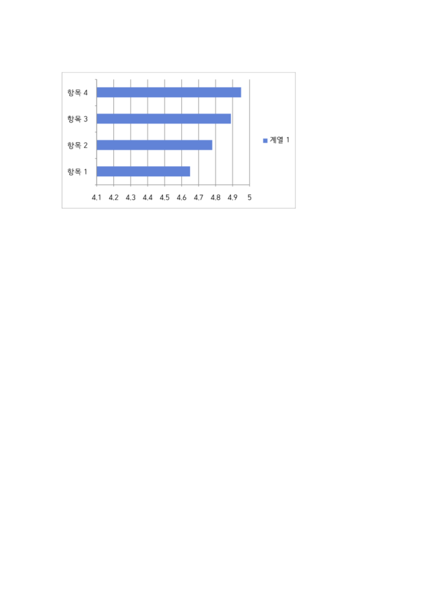
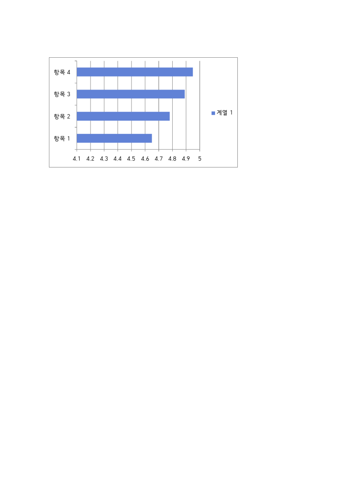
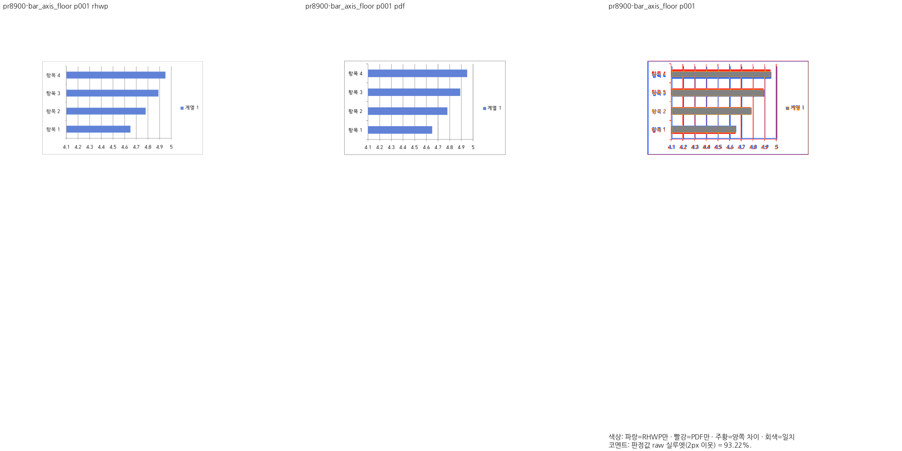
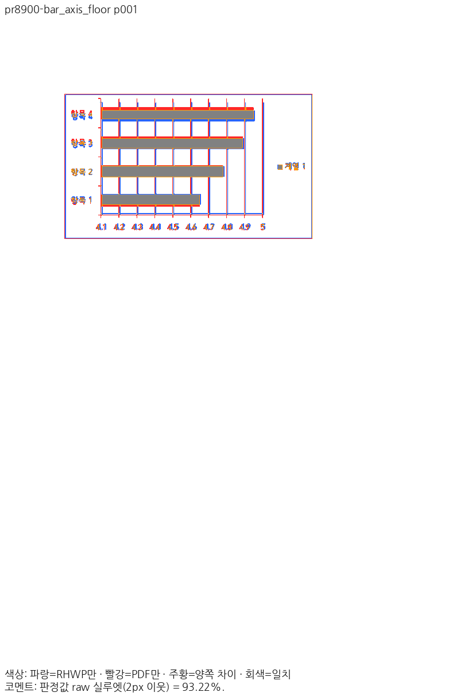

# PR #8900 리뷰 — 양수 차트 값축 시작값·눈금 간격

## 최종 판정

**머지 보류 — 공개 입력의 Native·fresh WASM 전쪽과 최소 글꼴 전체 회귀를 완료했으며, devel fresh WASM 비교와 정본 보호 검증을 진행 중이다.** 원 PR의 공개되지 않은 보류 범위는 별도로 해소해야 한다. 원격 승인·병합을 수행한 기록이 아니다.

## 접수 정보

- 원 PR: [#8900](https://github.com/edwardkim/rhwp/pull/8900), 작성자 `hyunmyungJaneLee`, 관련 이슈 [#8678](https://github.com/edwardkim/rhwp/issues/8678).
- 원 head: `b215fce8179da1b5ed1a3c3c889388611a87c093`. reviewer `edwardkim`를 API로 확인한 뒤 fetch·순차 체리픽했다.
- 고정 devel: `80b1c354c29b7a02fb2b3c14a274da7f5b653ada`. 측정한 통합 code head: `0c9819d698bcbe3e3d83f563a0154ccb00eb6f07`. 브랜치 `review/integration-20261112-hyunmyungjanelee`.
- 원 contributor 브랜치의 head를 바꾸지 않았다. 적용 SHA와 additive 충돌 해소는 [체리픽 기록](../assets/hyunmyungjanelee_20261112/cherry-pick-result.json)·[충돌 기록](../assets/hyunmyungjanelee_20261112/conflicts.json)에 남겼다. 원격 CI·mergeability는 최종 판단 전에 다시 확인한다.

## 변경과 조판 원칙 검토

최솟값 부근에 모인 양수 차트의 자동 축 floor와 step을 독립 한컴 차트 출력의 관측 규칙과 대조한다. 차트 전체 피델리티나 관련 이슈 전체 해결을 주장하지 않는다.

`crates/rhwp-ooxml-chart/src/renderer/cartesian_layout.rs`의 자동 axis 계산을 `renderer.rs` 차트 출력이 소비한다. 4개 독립 출력은 가로막대·세로막대·큰 값·세로 길이 변경을 구분한다. 1/2/5 눈금 선택과 값 범위 분기를 문서 식별자 예외 없이 검토하며 일반 0-origin 차트·명시 축 설정은 정상 대조군으로 남긴다.

## 검증 입력과 결과

공개 4종·4쪽을 같은 입력·독립 웹한글기안기 Print PDF로 비교했다. Native Skia direct PNG, 인쇄 프로필·compat2022·96 DPI, PDFium `pdfium_smooth_rgb_exact_dpi_v2`, raw 실루엣 2px 기준이다. 입력/PDF가 code head의 Git blob과 같은지, 전쪽 쪽수·페이지 번호와 PNG 해시를 확인했다. [생산·입력 감사](../assets/hyunmyungjanelee_20261112/native-validation.json)를 참조한다.

| 입력 키 | 쪽 | devel Native | 후보 Native | 변화(%p) |
| --- | ---: | ---: | ---: | ---: |
| `pr8900-bar_axis_floor` | 1 | 80.79% | 93.22% | 12.43 |
| `pr8900-column_axis_floor` | 1 | 73.58% | 99.90% | 26.32 |
| `pr8900-column_axis_floor_large` | 1 | 72.87% | 99.73% | 26.86 |
| `pr8900-column_axis_step_tall` | 1 | 78.27% | 99.70% | 21.43 |

모든 공개 페이지가 90% 이상이며 devel 대비 2%p 초과 하락은 없다. 이 표는 fresh WASM이나 정본 보호 3,542행의 통과 증거가 아니다. 최소 글꼴 집중 회귀에는 해당 PR의 새 검사, 충돌 파일의 보안·off-canvas positive, 새 devel의 #8896 글꼴·마지막 표 조각 기능을 함께 포함했다. 최소 글꼴 집중 회귀는 97 PASS / 0 FAIL(8.371초)이며 선택 밖 4,230건을 전체 회귀 통과로 계산하지 않는다. [격리·실행 증거](../assets/hyunmyungjanelee_20261112/minimal-font-focused-result.json)를 보존했다.

필수 편람 HWPX Native gate는 최종 code head에서 전 383쪽 PASS, 최저 99.96%, 공식 보호값 하락 0쪽이다([gate](../assets/hyunmyungjanelee_20261112/handbook-native-gate.json) · [전쪽 TSV](../assets/hyunmyungjanelee_20261112/handbook-native-silhouette.tsv)). 이는 나머지 보호 입력 17종 및 WASM 보호 검증의 대체가 아니다.

fresh WASM도 같은 공개 입력의 전 4쪽을 실제 출력했으며 최저 92.33%, 90% 미만 0쪽이다([후보 전쪽 TSV](../assets/hyunmyungjanelee_20261112/wasm-candidate.tsv) · [빌드·실제 초기화 응답](../assets/hyunmyungjanelee_20261112/browser-runtime-result.json)). 새 devel의 fresh WASM 전쪽 비교는 아직 미실행이며 Native 기준값으로 대신하지 않는다.

최소 글꼴 전체 회귀는 **13,347 PASS / 0 FAIL / 45 skip**, 실행 401.230초다([결과](../assets/hyunmyungjanelee_20261112/full-nextest-result.json)). fmt·Native Clippy·WASM Clippy·workspace build·all-target Clippy·Native Skia 3종·suite manifest가 모두 통과했다([Rust gate 기록](../assets/hyunmyungjanelee_20261112/rust-gates.json)). 원 PR 6개 head는 [재조회](../assets/hyunmyungjanelee_20261112/live-pr-head-check.json)에서 모두 최초 검토 SHA와 같았다.

## 시각 증적과 알려진 차이

아래는 이 PR 자체의 입력·페이지에 대응한 후보 증적이다. 직접 판독의 최종 결론은 검증 완료 시 기록한다.

[기존 메인터너 검토](https://github.com/edwardkim/rhwp/pull/8900#issuecomment-6784904604)는 공개 4종 개선만 수용 범위로 보았다. 이슈 #8678은 잔여 축·제목·범례 문제가 있어 OPEN을 유지한다. 원 PR 본문의 `Closes #8678`을 그대로 통합 PR의 자동 종료 목록으로 옮기지 않는다.

## 후속 판단

남은 필수 검증·메인터너 보정이 완료되기 전에는 승인 또는 해결 완료로 바꾸지 않는다. 원 PR 댓글·close는 통합 결과와 별도 원격 승인 범위를 확인한 뒤 처리한다. 게시가 승인되면 확정 commit의 raw/PDF/review/overlay를 이미지 문법으로 함께 표시한다.
