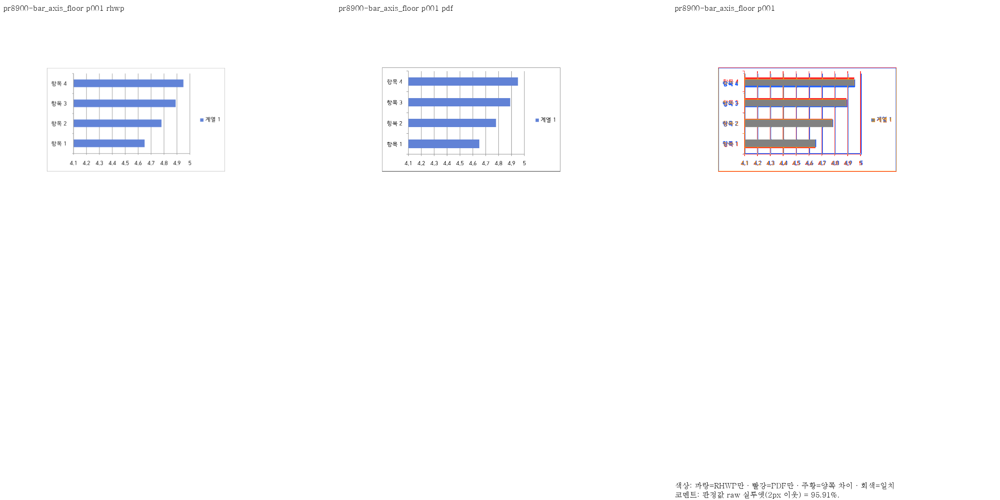
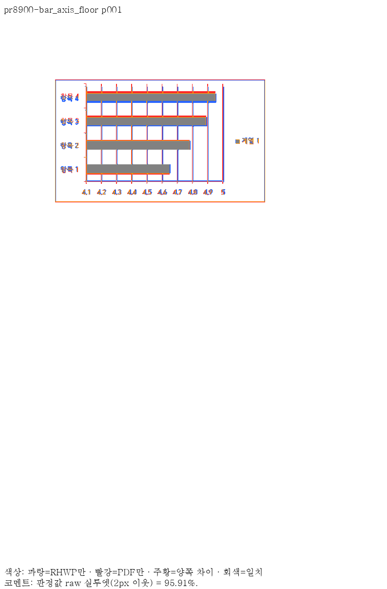
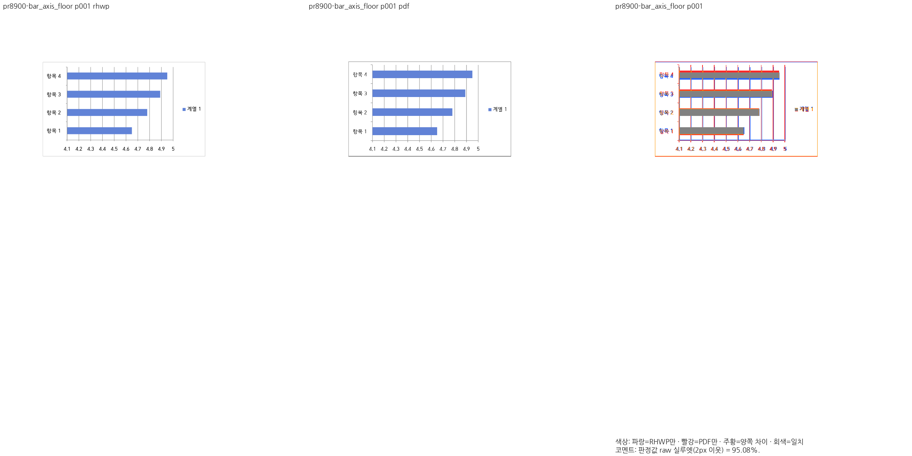
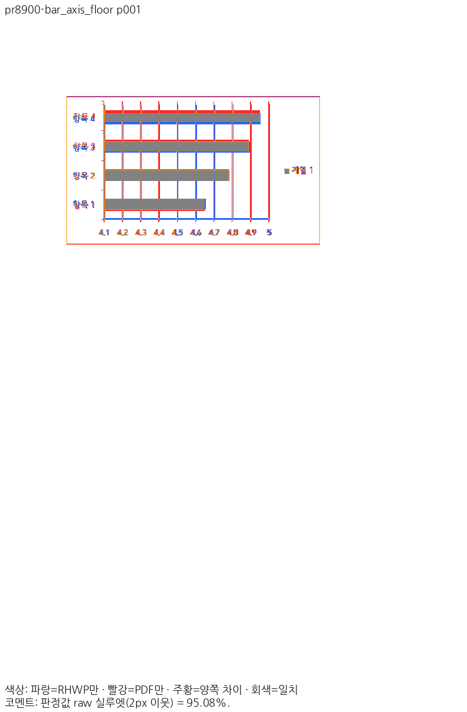

# PR #8900 리뷰 — 양수 차트 값축 시작값·눈금 간격

## 최종 판정

**최종 재검증 중 — PR 제출 보류**. 최신 보정 source는 `d66568ef247859a9c184546cad3ba42b06e806e1`다. 아래의 이 PR 전쪽 수치는 보정 전 8fe7d1fb 결과다. 새 소스의 공개 전쪽·정본 보호·전체 회귀를 갱신 중이며, 이전 head의 통과를 최신 head 통과로 바꾸어 인용하지 않는다.

크기 0 문단과 U+F0FA 보정 후 실제 Studio 2입력 × 3백엔드 × screen/print 12캡처에서 런타임 계약 위반은 **0건**이다. 두 CanvasKit 모드가 실제 선택됐으며 숨은 Canvas2D overlay로 대신하지 않았다. 백엔드 간 report-only 픽셀 비교는 8건 중 4건이 문턱을 넘으므로 전체 픽셀 동등성을 주장하지 않는다. [추가 보정·집중 검증](../assets/hyunmyungjanelee_20261112/wingdings-arrow-shaft-repair/cause.md)과 [실제 소비 경로](../assets/hyunmyungjanelee_20261112/wingdings-arrow-shaft-repair/actual-consumers/summary.json)를 보존한다. 최종 공개 전쪽·Native/fresh WASM 정본 보호·전체 회귀·전체 실제 소비 경로 결과는 완료 후 갱신한다.

## 보정 전 전쪽 검증 기록 (8fe7d1fb)

**머지 보류** — 이 PR의 공개 입력 4종·4쪽은 Native 최저 95.91%, fresh WASM 최저 95.08%다. 두 경로 모두 90% 미만·devel 대비 2%p 초과 하락은 없으며 독립 Print와 쪽수가 일치한다. 이 이슈의 최소 글꼴 Native 집중 검사 4건도 모두 통과했다.

보정 전 검증 code head는 `8fe7d1fb8bc5024d0377ff7aa37d98c78e8f071a`다. 공통 Native 집중 126 PASS와 정본 Native 18종·1,771쪽의 공식 표시값 하락 0쪽을 확인했다. 최소 글꼴 전체 회귀는 **13,356 PASS / 0 FAIL / 45 skipped**(774.340초), fmt는 PASS다. [실제 전체 회귀 결과](../assets/hyunmyungjanelee_20261112/final-print-8fe7d1fb/full-nextest-validation.json)를 보존했다. Native·WASM·workspace all-target Clippy와 workspace build도 모두 PASS다. 정본 fresh WASM은 **18종·1,771쪽, 공식 표시값 하락·누락·추가 0쪽**으로 완료했다. [Native 보호](../assets/hyunmyungjanelee_20261112/final-print-8fe7d1fb/protected-native-validation.json)와 [fresh WASM 보호](../assets/hyunmyungjanelee_20261112/final-print-8fe7d1fb/protected-wasm-validation.json)를 각각 보존한다. 추가 Native Skia·suite/단위 정책도 모두 PASS다. [실제 게이트 기록](../assets/hyunmyungjanelee_20261112/final-print-8fe7d1fb/gates-validation.json)을 보존한다. 실제 Studio 48건의 캡처에서 #8916의 `textRun:invalidGeometry`와 #8918의 `textRun:glyphMapping`이 확인되어 소비 경로 검증은 미충족이다. [보정 전 증거](../assets/hyunmyungjanelee_20261112/final-print-8fe7d1fb/actual-backends-before/failure-summary.json)를 보존하고, 이 결함·지원 범위의 보정과 재검증이 필요하므로 최종 통합 판정은 그 완료 뒤 갱신한다. 과거 Cairo 점수나 이전 head 결과를 새 소스의 완료로 재인용하지 않는다.

## 접수와 검증 범위

- 원 PR [#8900](https://github.com/edwardkim/rhwp/pull/8900), 작성자 `hyunmyungJaneLee`, 이슈 [#8678](https://github.com/edwardkim/rhwp/issues/8678).
- 원 head `b215fce8179da1b5ed1a3c3c889388611a87c093`·reviewer `edwardkim`를 확인한 뒤 체리픽했다. 원 contributor 브랜치를 변경하지 않았다.
- devel 기준 `80b1c354c29b7a02fb2b3c14a274da7f5b653ada`, 통합 브랜치 `review/integration-20261112-hyunmyungjanelee`. 원 29개 커밋의 [적용 기록](../assets/hyunmyungjanelee_20261112/cherry-pick-result.json)과 [additive 충돌 해소](../assets/hyunmyungjanelee_20261112/conflicts.json)를 보존한다.
- 현재 요청 reviewer는 `edwardkim, jangster77`다. 원격 원 head·devel은 검토 시작 때와 동일하다. 최종 push·merge 직전에 다시 확인한다.

## 변경과 조판 원칙 검토

최솟값 부근에 모인 양수 차트의 자동 축 floor와 step을 독립 한컴 차트 출력의 관측 규칙과 대조한다. 차트 전체 피델리티나 관련 이슈 전체 해결을 주장하지 않는다.

`crates/rhwp-ooxml-chart/src/renderer/cartesian_layout.rs`의 자동 axis 계산을 `renderer.rs` 차트 출력이 소비한다. 4개 독립 출력은 가로막대·세로막대·큰 값·세로 길이 변경을 구분한다. 1/2/5 눈금 선택과 값 범위 분기를 문서 식별자 예외 없이 검토하며 일반 0-origin 차트·명시 축 설정은 정상 대조군으로 남긴다.

## 메인터너 보정과 수용 경계

공개 4종의 값축 시작값·눈금 간격만 수용 범위다. 가로막대의 plot 높이·세로 배치 등 남은 차이와 원 PR이 명시한 다른 데이터·범례·제목의 차이는 전체 해결로 확장하지 않는다. 관련 이슈 #8678은 OPEN을 유지한다.

## 공식 Print와 Native/fresh WASM 전쪽 대조

총 4종·4쪽, 최저 95.91%, 90% 미만 0쪽이다. 같은 입력·PDF의 devel 대비 2%p 초과 하락 0쪽이다. 기준 출력에 없던 쪽은 임의의 0점으로 채우지 않고 복원으로 구분한다. [Native 전쪽 비교 TSV](../assets/hyunmyungjanelee_20261112/final-print-8fe7d1fb/native-comparison.tsv)·[생산 SHA와 입력/PNG 해시](../assets/hyunmyungjanelee_20261112/final-print-8fe7d1fb/native-validation.json)를 연결한다.

| 입력 | 쪽수 | Native 최저 | fresh WASM |
| --- | ---: | ---: | --- |
| [bar_axis_floor.hwpx](../../../samples/issue8678/bar_axis_floor.hwpx) | 1 | 95.91% | 95.08% |
| [column_axis_floor.hwpx](../../../samples/issue8678/column_axis_floor.hwpx) | 1 | 99.97% | 99.99% |
| [column_axis_floor_large.hwpx](../../../samples/issue8678/column_axis_floor_large.hwpx) | 1 | 99.96% | 99.99% |
| [column_axis_step_tall.hwpx](../../../samples/issue8678/column_axis_step_tall.hwpx) | 1 | 99.93% | 99.97% |

## 기준 PDF의 출처와 제외한 자료

원 PR이 기준으로 제시한 **한컴 웹한글기안기 PDF(Cairo)는 이 검토의 검증 대상에서 제외했다.** 동일 원본의 **Windows 데스크톱 한컴 인쇄(Print) PDF**로 대조했으며, 실제 출력 제품은 한컴 2020 11.0.0.9136(MCP `engine: 2020`, HOffice110) 4종이다. 원본의 저장 제품과 Print 출력 제품을 혼동하지 않는다. [공식 Print 영수증](../assets/hyunmyungjanelee_20261112/mcp-print-reference/receipts.json)에 입력·PDF SHA-256, 엔진·제품 버전·Print method 0·작업 ID 또는 사용자 Print 확인을 보존했다.

현재 기준은 입력 34종 가운데 MCP Print 33종·사용자 확인 한컴 2024 Print 1종이다. 입력·기준 PDF는 Git에 보존하고, 이전 형식 미표기 경로에서 원본 형식·엔진을 명시한 정본 경로로 이름만 바로잡았다. [공식 Print 영수증](../assets/hyunmyungjanelee_20261112/mcp-print-reference/receipts.json)의 파일 SHA와 현재 실행·커밋이 일치한다. 이전 Cairo 기준은 Git 이력이며 현재 수용 근거로 쓰지 않는다.

## 증적과 직접 판독

[Native 직접 판독](../assets/hyunmyungjanelee_20261112/final-print-8fe7d1fb/native-direct-reading.json)과 [fresh WASM 직접 판독](../assets/hyunmyungjanelee_20261112/final-print-8fe7d1fb/wasm-direct-reading.json)에 대표 7쪽의 같은 페이지 review·overlay 확인을 기록했다. [fresh WASM 전쪽 비교](../assets/hyunmyungjanelee_20261112/final-print-8fe7d1fb/wasm-comparison.tsv)와 [실제 빌드·초기화 응답 해시](../assets/hyunmyungjanelee_20261112/final-print-8fe7d1fb/wasm-validation.json)를 함께 연결한다.

각 입력의 같은 쪽 raw·독립 PDF PNG·review·overlay 및 전체 TSV는 아래 폴더에 있다. 원 PR 주장에 대응하는 입력을 사용하며 다른 문서의 그림으로 대체하지 않는다.

- `pr8900-bar_axis_floor`: [전쪽 TSV](../assets/hyunmyungjanelee_20261112/final-print-8fe7d1fb/pr8900/pr8900-bar_axis_floor/native/candidate-silhouette.tsv) · [raw](../assets/hyunmyungjanelee_20261112/final-print-8fe7d1fb/pr8900/pr8900-bar_axis_floor/native/raw-001.png) · [PDF](../assets/hyunmyungjanelee_20261112/final-print-8fe7d1fb/pr8900/pr8900-bar_axis_floor/native/pdf-001.png) · [review](../assets/hyunmyungjanelee_20261112/final-print-8fe7d1fb/pr8900/pr8900-bar_axis_floor/native/review-001.png) · [overlay](../assets/hyunmyungjanelee_20261112/final-print-8fe7d1fb/pr8900/pr8900-bar_axis_floor/native/overlay-001.png).
- `pr8900-column_axis_floor`: [전쪽 TSV](../assets/hyunmyungjanelee_20261112/final-print-8fe7d1fb/pr8900/pr8900-column_axis_floor/native/candidate-silhouette.tsv) · [raw](../assets/hyunmyungjanelee_20261112/final-print-8fe7d1fb/pr8900/pr8900-column_axis_floor/native/raw-001.png) · [PDF](../assets/hyunmyungjanelee_20261112/final-print-8fe7d1fb/pr8900/pr8900-column_axis_floor/native/pdf-001.png) · [review](../assets/hyunmyungjanelee_20261112/final-print-8fe7d1fb/pr8900/pr8900-column_axis_floor/native/review-001.png) · [overlay](../assets/hyunmyungjanelee_20261112/final-print-8fe7d1fb/pr8900/pr8900-column_axis_floor/native/overlay-001.png).
- `pr8900-column_axis_floor_large`: [전쪽 TSV](../assets/hyunmyungjanelee_20261112/final-print-8fe7d1fb/pr8900/pr8900-column_axis_floor_large/native/candidate-silhouette.tsv) · [raw](../assets/hyunmyungjanelee_20261112/final-print-8fe7d1fb/pr8900/pr8900-column_axis_floor_large/native/raw-001.png) · [PDF](../assets/hyunmyungjanelee_20261112/final-print-8fe7d1fb/pr8900/pr8900-column_axis_floor_large/native/pdf-001.png) · [review](../assets/hyunmyungjanelee_20261112/final-print-8fe7d1fb/pr8900/pr8900-column_axis_floor_large/native/review-001.png) · [overlay](../assets/hyunmyungjanelee_20261112/final-print-8fe7d1fb/pr8900/pr8900-column_axis_floor_large/native/overlay-001.png).
- `pr8900-column_axis_step_tall`: [전쪽 TSV](../assets/hyunmyungjanelee_20261112/final-print-8fe7d1fb/pr8900/pr8900-column_axis_step_tall/native/candidate-silhouette.tsv) · [raw](../assets/hyunmyungjanelee_20261112/final-print-8fe7d1fb/pr8900/pr8900-column_axis_step_tall/native/raw-001.png) · [PDF](../assets/hyunmyungjanelee_20261112/final-print-8fe7d1fb/pr8900/pr8900-column_axis_step_tall/native/pdf-001.png) · [review](../assets/hyunmyungjanelee_20261112/final-print-8fe7d1fb/pr8900/pr8900-column_axis_step_tall/native/review-001.png) · [overlay](../assets/hyunmyungjanelee_20261112/final-print-8fe7d1fb/pr8900/pr8900-column_axis_step_tall/native/overlay-001.png).

## 이 PR의 집중 회귀와 직접 판독

최소 글꼴 Native 실행에서 이슈 #8678에 대응하는 **4 PASS / 0 FAIL**을 확인했다. 공통 126건 중 해당 PR의 검사만 아래에 구분한다. 선택 밖 4,903건은 실행 완료 수에 넣지 않는다. [실제 명령·검사명·로그 해시](../assets/hyunmyungjanelee_20261112/final-print-8fe7d1fb/focused-validation.json)를 보존한다.

- `issue_8678_chart_value_axis_floor::bar_axis_starts_below_clustered_minimum`: PASS.
- `issue_8678_chart_value_axis_floor::column_axis_starts_below_clustered_minimum`: PASS.
- `issue_8678_chart_value_axis_floor::large_column_axis_hugs_minimum`: PASS.
- `issue_8678_chart_value_axis_floor::tall_column_axis_uses_finer_step`: PASS.

- `pr8900-bar_axis_floor` 1쪽: 4.1부터 5.0까지 0.1 눈금과 가로막대 끝 x 위치를 확인했다. plot 높이·세로 배치는 다르므로 차트 전체 해결로 확대하지 않고 #8678을 OPEN 유지한다.

아래 이미지는 이 PR의 같은 입력·같은 쪽이다. Native와 fresh WASM의 review·overlay를 각각 직접 열어 확인했으며 raw·PDF PNG도 함께 연결한다.

### `pr8900-bar_axis_floor` 1쪽

**native** · [raw](../assets/hyunmyungjanelee_20261112/final-print-8fe7d1fb/pr8900/pr8900-bar_axis_floor/native/raw-001.png) · [독립 Print PNG](../assets/hyunmyungjanelee_20261112/final-print-8fe7d1fb/pr8900/pr8900-bar_axis_floor/native/pdf-001.png)

**wasm** · [raw](../assets/hyunmyungjanelee_20261112/final-print-8fe7d1fb/pr8900/pr8900-bar_axis_floor/wasm/raw-001.png) · [독립 Print PNG](../assets/hyunmyungjanelee_20261112/final-print-8fe7d1fb/pr8900/pr8900-bar_axis_floor/wasm/pdf-001.png)

## 공통 최종 검증과 후속 처리

현재 Native 증적은 동결 실행 파일의 실제 생산 SHA와 현재 커밋 소스의 바이트 동일성을 구분해 기록했다. Native/fresh WASM 전쪽 판정, 최소 글꼴 전체 회귀, 필수 lint/build/Skia와 정본 보호 TSV의 공식 두 자리 하락 금지를 모두 충족한 후 통합 PR을 생성한다. 원 PR head·통합 head·CI·작업지시자 승인 및 원 이슈 전체 해결 여부를 구분하며, 원 PR은 통합 PR 병합을 확인한 뒤 증적을 연결해 후속 처리한다.
