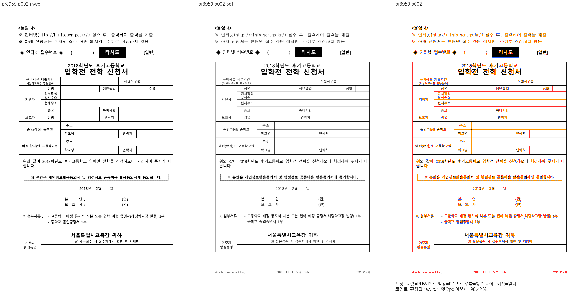
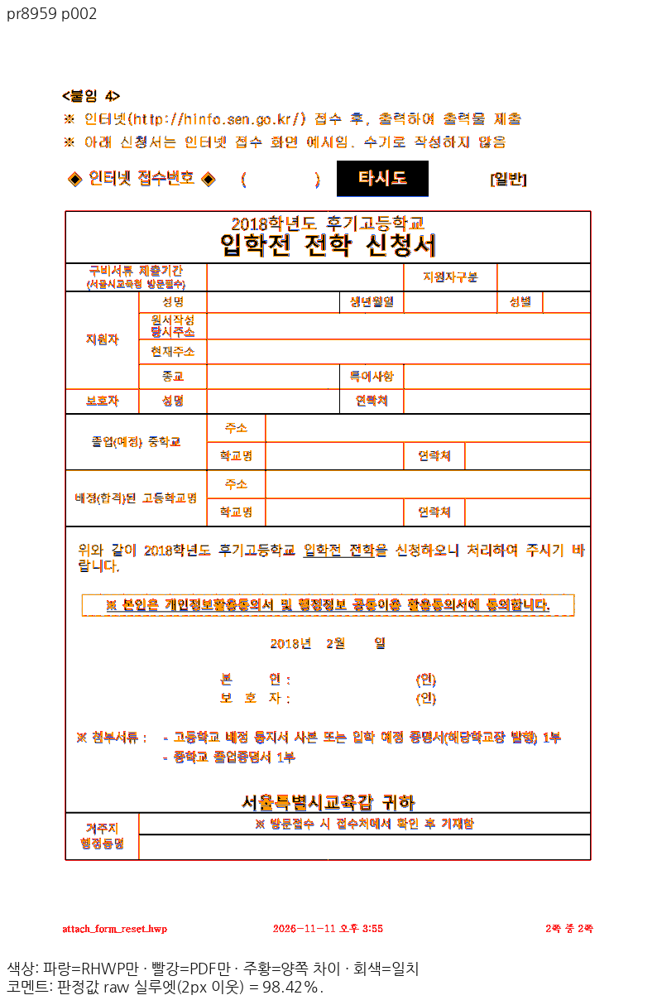

# PR #8959 리뷰 — fix: 한/글 저장 줄의 LineSeg tag bit 31 을 rhwp 합성 표지와 구별 (#8939)

## 최종 판정

**메인터너 보정 후 수용 가능 — 원 PR 주장 범위의 로컬 검증 완료.** 통합 PR의 최신 head CI·mergeability를 확인한 뒤 승인된 병합을 진행한다. 원 PR 직접 병합·원격 게시 완료를 뜻하지 않는다.

## 접수 정보

- 원 PR: https://github.com/edwardkim/rhwp/pull/8959 (`planet6897`, base `devel`). 원 head `1f5878dfd4a19ceb3652bdeef46806f3e07fcc34`.
- 통합 branch: `review/integration-20261113-planet6897-clean20`. 검증 제품 code `d0cc46573c7505633721c19062e504faff017d59`.
- 고정 devel: `31a422575722f634cfc2d9eb97e708da58aea188`. source53개를 누적 `cherry-pick -x`했고 중복9개는 다시 적용하지 않았다. 충돌 제외 #8937·#8972·#8976은 포함하지 않는다.
- 원 PR reviewer `jangster77`를 실제 API로 확인했다. 원 contributor branch를 rewrite하지 않았다.
- 원 head·고유 커밋·의존 범위: [source-plan.json](../assets/planet6897_clean20_20261113/source-plan.json).

## 변경과 공통 조판 원칙 검토

한컴 원본 LineSeg bit31과 rhwp 합성 표지를 구분하며 실제 HWP 저장·재열기 후에도 provenance를 보존한다.

독립 CFB marker의 section SHA → parser의 합성 표지 해석 → 셀 측정 → serializer의 원본 태그 보존. 유효한 marker가 없는 원본 bit31을 합성으로 취급하지 않는다.

검토 소스: `src/model/line_seg_tags.rs`, `src/model/mod.rs`, `src/parser/body_text.rs`, `src/parser/mod.rs`, `src/renderer/height_measurer.rs`, `src/serializer/cfb_writer.rs`.
수치·문서 ID를 맞추는 예외 대신 원본 줄·칸·개체 속성과 공통 측정·배치 소비를 확인했다.

## 실제 회귀·제품 경로 검증

최소 글꼴 macOS 격리 환경(OS 기본528/nonOS0·허가된 저장소 fixture)에서 전체 nextest를 실제 실행해 **13,420 PASS / 0 FAIL / 45 skip**, 테스트 실행510.868초를 확인했다.
그중 이 PR의 관련 모듈 **3건 PASS**를 최신 전체 로그에서 다시 추출했다. 의존 PR과 중복될 수 있으므로 고유 신규 검사 수로 합산하지 않는다.

검사 소스: `tests/cases/issue_8939_stored_bit31_cell_flow.rs`.
기록: [individual-test-execution.json](../assets/planet6897_clean20_20261113/final-d0cc4657/individual-test-execution.json) · [rust-validation.json](../assets/planet6897_clean20_20261113/final-d0cc4657/rust-validation.json).

fmt·Native/WASM Clippy·workspace build·all-target Clippy를 통과했다. Native Skia lib workspace 합계4,034 PASS/12 ignore, PNG2 PASS, PDF36 PASS를 확인했다.
후속 핵심 회귀1건을 추가한 뒤 관련 모듈4+15=19건과 lint·manifest를 별도로 통과했다. 새 검사1건이 위 전체13,420에 포함됐다고 표시하지 않는다.
fresh WASM은 Mac locked wrapper의 `--target web --out-dir pkg --no-opt` 로컬 대체 빌드다. Docker 최적화 통과가 아니다.

## 공통 조판 원칙 준수 판정

| 항목 | 판정 | 근거 |
| --- | --- | --- |
| 제출 전 로컬 검증과 PR 상태 | 충족 | 아래 전체·집중·lint·Skia·Mac fresh WASM 기록. 통합 PR은 로컬 필수 검증 완료 뒤 Open으로 제출하며 최신 head CI는 별도 병합 조건이다. |
| 기존 이슈·해결 PR의 선행 분석 | 충족 | 원 PR의 고정 head·고유 커밋·의존 순서와 현재 base 동작을 대조했다. 반례 보정은 별도 d0cc 원인 기록으로 연결한다. |
| 구현 근거와 일반성 | 충족 | 독립 CFB marker의 section SHA → parser의 합성 표지 해석 → 셀 측정 → serializer의 원본 태그 보존. 유효한 marker가 없는 원본 bit31을 합성으로 취급하지 않는다. |
| 측정·배치 일관성 | 충족 | 독립 CFB marker의 section SHA → parser의 합성 표지 해석 → 셀 측정 → serializer의 원본 태그 보존. 유효한 marker가 없는 원본 bit31을 합성으로 취급하지 않는다. |
| 리베이스 반영 PR의 기능 보존 | 비해당 | 이번 검토 branch는 고정31a42257 위에서 누적 적용했고 이후 base 전진이 없었다. 제출 직전 live base를 다시 확인한다. |
| 최종 출력 소비 계약 | 충족 | 전쪽 Native/fresh WASM, 실제 Canvas2D와 지원 CK의 소비 및 미지원 입력의 기존 fallback·guard 보존을 아래 실제 backend 기록으로 구분했다. |
| 분할·이어받기 계약 | 충족 | 위 컷·예약 예산·새 쪽 소유와 다음 본문 보존을 실제 전쪽·회귀로 대조했다. |
| 줄 소속과 점유 높이 | 충족 | 독립 CFB marker의 section SHA → parser의 합성 표지 해석 → 셀 측정 → serializer의 원본 태그 보존. 유효한 marker가 없는 원본 bit31을 합성으로 취급하지 않는다. |
| 사례와 증거의 독립성 | 충족 | 독립 데스크톱 Print·원본·base/후보 전쪽을 대조하고 합성 반례·정상 대조군을 구분했다. |
| 기준값 변경 | 비해당 | 이 PR의 기존 baseline·golden 문턱 변경 없음. |
| 회귀 추가·변경의 선행 조건 | 충족 | 관련 문서 전쪽 양쪽90% 이상과 실제 판독을 확인했다. 추가 health5·6쪽의 양쪽98% 이상·독립±2px 좌표는 별도 증거에 한정한다. |
| 90% 통과 후 확대 판독 | 충족 | 아래 Native·fresh WASM의 실제 판독 페이지와 같은 쪽 raw/PDF/review/overlay 및 잔여 차이를 구분했다. |
| 주장과 검증 범위 | 충족 | 아래 source·test 모듈·실제 결과·입력과 출력에 한정한다. 통합의 전체 보호 결과를 개별 PR의 새 개선량으로 쓰지 않는다. |

공개CLI의 실제 표 편집→HWP 저장→재열기→재저장3회 출력이 독립 CFB 감사와 같은 본문·marker 바이트를 유지했다.
제품 진입점·명령·결과·SHA: [qualification.json](../assets/planet6897_clean20_20261113/final-d0cc4657/api-consumers/qualification.json) · [README.md](../assets/planet6897_clean20_20261113/final-d0cc4657/api-consumers/README.md).

## 같은 원본·독립 Print의 전쪽 비교

96 DPI·compat2022·PDFium5.13·색상 경계 보정 전2px raw 실루엣으로 측정했다. 평균 대신 아래 전쪽 최저와 모든 페이지 TSV를 사용했다.

| 입력 | 쪽수 후보/PDF | Native base→후보 최저 | fresh WASM base→후보 최저 | TSV |
| --- | --- | --- | --- | --- |
| `pr8959` | 2/2 | 31.48592% → 98.39975% | 31.48256% → 98.39998% | [Native](../assets/planet6897_clean20_20261113/final-d0cc4657/native/claims/pr8959.tsv) · [WASM](../assets/planet6897_clean20_20261113/final-d0cc4657/wasm/claims/pr8959.tsv) |

전쪽 90%未満0・devel 대비2%p 초과 하락0을 확인했다. 위 지표는 strict RGB 일치율이 아니다. `pixel_match`·`visual_accuracy_proxy_percent`를 별도 실행한 것처럼 기입하지 않는다.

- `pr8959` 입력 [attach_form_reset.hwp](../../../samples/issue8939/attach_form_reset.hwp), SHA-256 `49fdefd36c8555fa39029ce2dc1f783c6f753c8d7a11b9075d116fa69ccc7e68`. PDF [attach_form_reset-2020.pdf](../../../pdf/issue8939/attach_form_reset-2020.pdf), SHA-256 `24dccbe14de832a5a11ffd56dc71e72e629fa250dcf636dbebfe9d2e45804b76`. 실제 PDF Creator `Hwp 2022 12.0.0.4547`, Producer `Hancom PDF 1.3.0.547`. 파일명의 `-2020`만으로 실제 출력 연도를 단정하지 않는다.

입력과 PDF는 검토 commit의 파일과 실제 실행 바이트를 대조했다. 기존의 유효한 데스크톱 한컴 Print를 재사용했으며 웹한글기안기/Cairo 출력을 판정 기준으로 사용하지 않았다. 제품·빌드·파일 크기는 [reference-pdf-products.json](../assets/planet6897_clean20_20261113/final-d0cc4657/reference-pdf-products.json)에 기록했다.

## 직접 판독·시각 증적

- **native** `pr8959` 2쪽: 신청서의 새 쪽 시작, 제목·칸 경계·동의 항목·마지막 행을 대조했다. 미세한 글리프 윤곽 차이와 PR이 수정한 줄 소유를 구분했다. [raw](../assets/planet6897_clean20_20261113/final-d0cc4657/panels/native/pr8959/raw-p002.png) · [PDF PNG](../assets/planet6897_clean20_20261113/final-d0cc4657/panels/native/pr8959/pdf-p002.png) · [review](../assets/planet6897_clean20_20261113/final-d0cc4657/panels/native/pr8959/review-p002.png) · [overlay](../assets/planet6897_clean20_20261113/final-d0cc4657/panels/native/pr8959/overlay-p002.png).
- **wasm** `pr8959` 2쪽: 신청서 제목·각 행·동의 문구·서명·하단 기입 칸이 보존되며 이전 쪽 내용이 중복되지 않는다. [raw](../assets/planet6897_clean20_20261113/final-d0cc4657/panels/wasm/pr8959/raw-p002.png) · [PDF PNG](../assets/planet6897_clean20_20261113/final-d0cc4657/panels/wasm/pr8959/pdf-p002.png) · [review](../assets/planet6897_clean20_20261113/final-d0cc4657/panels/wasm/pr8959/review-p002.png) · [overlay](../assets/planet6897_clean20_20261113/final-d0cc4657/panels/wasm/pr8959/overlay-p002.png).

Native/fresh WASM 대표90쌍의 raw·PDF PNG는 새 제품 code로 다시 출력한 결과와 SHA가 동일함을 확인해 기존 panel 바이트를 재사용했다. 직접 판독한 페이지와 수치만 확인한 페이지를 [direct-reading.json](../assets/planet6897_clean20_20261113/final-d0cc4657/direct-reading.json)에서 구분한다.

## 원 PR 반례와 메인터너 보정

원 PR 공개 반례 `3930000-201800017`의6쪽은 devel Native31.31734%→초기 통합20.75171%로 악화됐다. `d0cc46573c`에서 원본 LH3013+LS900+before1000=다음vpos4913HU의 닫힌 계약을 공통 질의로 인증하고, 조기 stored TAC 계획과 physical 계획·최종 원점이 같은 전진을 소비하도록 고쳤다.
보정 후6쪽 Native99.98623%/fresh WASM99.99723%, 관련5쪽99.91223%/99.91211%를 확인했다. 독립 한컴2020 11.0.0.9136 MCP Print의 괘선 중심109.63997px를 ±2px로 검사하며 소유·순서·중복·비겹침도 보호한다. 실제 이전/보정 CLI 좌표 FAIL→PASS와 새 정식 검사1건의 실제 PASS를 구분했다.
전7쪽의 기존1쪽 미달80.50731%/80.51907%는 숨기지 않고 전체 문서 통과로 주장하지 않는다. 새 회귀 관련 페이지는5·6쪽이며 기존1쪽을 golden으로 고정하지 않았다.
[cause.md](../assets/planet6897_clean20_20261113/maintainer-repair/cause.md) · [health-visual-precondition.json](../assets/planet6897_clean20_20261113/maintainer-repair/health-visual-precondition.json) · [added-regression-validation.json](../assets/planet6897_clean20_20261113/maintainer-repair/added-regression-validation.json).

## 통합 보호·후속 조건

Native 정본 보호18조건1,771쪽은 공식 두 자리 표시값 하락0이며 별도 `--handbook-gate`383쪽도 통과했다. fresh WASM 정본 보호18조건1,771쪽도 공식 두 자리 표시값 하락0이다. 같은 code의 전쪽 비교는 [최종 보호·주장 검증](../assets/planet6897_clean20_20261113/final-d0cc4657/whole-visual-qualification.json)으로 연결한다. 일반 기여자에게 비공개 OTF 설치를 요구하지 않는다.

## 실제 backend 선택과 초기화 출처

일반48건과 실제 주장 페이지 추가12건을 분리해 캡처했다. 일반 검사의 실제 Canvas2D 요청16건, 지원되는 실제 CanvasKit16건, 안전한 Canvas2D 대체16건을 확인했다. 추가 검사에서는 #8999의2쪽에 실제 CK4건·Canvas2D2건, #9001의14쪽에 Canvas2D2건·기존 preflight 미완료 대체4건을 확인했다.
일반·추가 observer의 원본 종료코드는 각각1이며 각 실행의 #9001 CK 미지원 요청에 대한8개 hard violation을 그대로 보존했다. base/후보 모두 기본 작업 한도50,000에서19쪽 중18쪽을 검사한 뒤 미완료로 판정해 CK를 시작하지 않았다. 한도·글꼴 guard를 우회하거나 CK 성공으로 계산하지 않았다. 그 대체 화면은 실제 Canvas2D와 픽셀이 같았다. 나머지 글꼴 미준비 대체12건은 기존 fontFallbackGate12/12를 통과했다. backend 간 RGB parity는 report-only이며8/16 통과·8/16 차이를 원본대로 남겼다.
실제 렌더48회·독립 초기화6회와 추가 주장 페이지12회의 WASM 수신 해시를 확인했다. `c8596bc0...`은 새 제품 빌드와 일치한다. Vite가 변환한 JS는 원본 파일 SHA와 직접 같지 않으므로, 설치 Vite의 실제 변환·응답 바이트를 재현해 초기화 응답6/6을 검증했다.
[실제 backend·54개 WASM 수신 근거](../assets/planet6897_clean20_20261113/final-d0cc4657/actual-backend-qualification.json) · [추가 주장 페이지12건](../assets/planet6897_clean20_20261113/final-d0cc4657/actual-claim-pages-qualification.json). 전자는54개, 후자는12개 영수증을 보존한다.

## 검증 입력 커밋 확인

**충족.** HWP/HWPX/HML·PDF85개를 실제 실행 파일과 검토 commit의 Git blob SHA-256으로 대조했다. 대용량 sample10 PDF(96,185,197바이트)는 기존 파일을 로컬 재사용했으며 이 PR에 새 PDF·사본을 추가하지 않았다. [입력 감사](../assets/planet6897_clean20_20261113/final-d0cc4657/committed-input-audit.json)를 따른다. 비공개 글꼴 바이너리는 Git에 넣지 않았다.

## Merge 후 contributor PR comment 계획

통합 PR의 최신 head CI 성공과 실제 병합 뒤에만 원 PR에 한국어 존댓말로 결과·통합 PR·merge SHA를 안내하고 close한다. 이 문서의 판정과 원격 조치를 구분한다. 원 기여의 해결 범위와 추가 보정의 원인·SHA를 구분해 설명한다.
Visual Sweep 정본: [GitHub merge comment](../../manual/verification/visual_sweep_guide.md#github-merge-comment).
같은 주장 페이지의 raw·PDF PNG·review·overlay를 `https://raw.githubusercontent.com/edwardkim/rhwp/<merge-commit-sha>/` 아래의 `mydocs/pr/assets/planet6897_clean20_20261113/final-d0cc4657/panels/native/pr8959` 자산으로 **Markdown 이미지** 표시한다. 웹한글기안기 PDF와 데스크톱 Print를 혼동하지 않고 실제 Creator를 함께 안내한다.
여러 단락은 UTF-8 본문 파일로 게시하고 API로 실제 본문·이미지 URL을 재조회한다. 원 contributor fork branch는 삭제하지 않는다.
