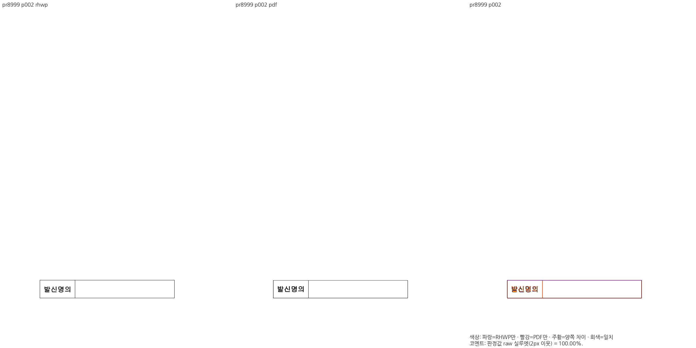
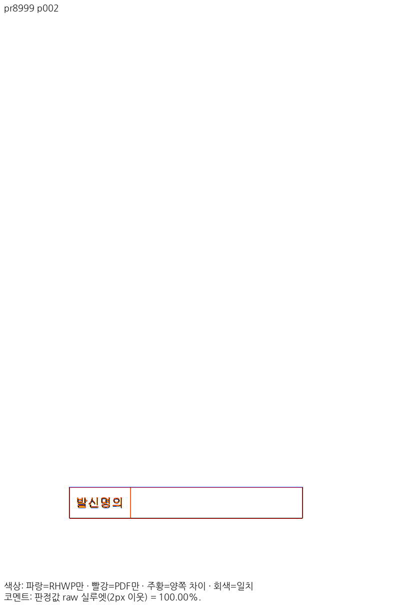

# PR #8999 리뷰 — fix(paint): #8986 표 괘선과 칸 clip 을 같은 Print 프레임에 두고 장치 clip 을 세대 무관으로 쓴다

## 최종 판정

**메인터너 보정 후 수용 가능 — 원 PR 제품 동작과 보정한 실제 Canvas 검사에서 주장 범위의 로컬 검증을 완료했다.** 통합 PR의 최신 head CI·mergeability를 확인한 뒤 승인된 병합을 진행한다. 원 PR 직접 병합·원격 게시 완료를 뜻하지 않는다.

## 접수 정보

- 원 PR: https://github.com/edwardkim/rhwp/pull/8999 (`planet6897`, base `devel`). 원 head `bb5bda615db0715a5bede34b6f57149d7b880df2`.
- 통합 branch: `review/integration-20261113-planet6897-clean20`. 검증 제품 code `d0cc46573c7505633721c19062e504faff017d59`.
- 고정 devel: `31a422575722f634cfc2d9eb97e708da58aea188`. source53개를 누적 `cherry-pick -x`했고 중복9개는 다시 적용하지 않았다. 충돌 제외 #8937·#8972·#8976은 포함하지 않는다.
- 원 PR reviewer `jangster77`를 실제 API로 확인했다. 원 contributor branch를 rewrite하지 않았다.
- 원 head·고유 커밋·의존 범위: [source-plan.json](../assets/planet6897_clean20_20261113/source-plan.json).

## 변경과 공통 조판 원칙 검토

표 괘선과 칸 clip을 같은 Print 프레임에서 계산하며 장치 clip을 문서 세대와 무관하게 적용한다.

공통 Print frame → paper viewport/cell clip → LayerTree paint. 한쪽 backend 좌표 보정만으로 선이 잘린 증상을 숨기지 않는다.

검토 소스: `src/model/control.rs`, `src/paint/layer_tree.rs`, `src/paint/paper_viewport.rs`.
수치·문서 ID를 맞추는 예외 대신 원본 줄·칸·개체 속성과 공통 측정·배치 소비를 확인했다.

## 실제 Canvas 검사 계약 보정

첫 통합 CI의 실제 Canvas 검사에서 `rasterClipCoverage`를 2024 Print에서만 켜야 한다는 이전 기대값이 남아 실패했다. 원 PR 구현 `e3427b7b`·Rust 검사 `49418126`의 세대 무관 Print clip 변경과 독립 2020 Print 근거를 대조했다. 제품 오류나 환경 추정으로 처리하지 않고 기존 검사로 현재 WASM의 실제 FAIL을 재현했다.

메인터너 보정 `c72b10990938a6f1f84f1477c48d461ee7140d4a`는 `scripts/tests/print-text-geometry.browser.mjs`에서 글자 기하와 장치 clip의 독립 기대값을 분리한다. Screen clip은 비적용, 2022/2024 Print clip은 적용, 글자 기하는 2024 Print만 적용하며 실제 `ctx.rect`와 `fillText` 소비까지 검사한다. 검사 제거·문턱 완화·제품 변경은 없다. 같은 CI entry 실제19 PASS/0 FAIL, 고정 base의 2022 Print 누락은 새 검사에서 의도한 FAIL이다. 추가 macOS sandbox Chrome 초기화 오류는 별도 미성립 실행으로 남기며 통과 결과로 세지 않는다.

[원인·실행·해시 근거](../assets/planet6897_clean20_20261113/final-d0cc4657/canvas-print-clip-contract-repair.json). 제품 code `d0cc4657`·WASM SHA는 변하지 않아 기존 전쪽 TSV·Native/fresh WASM·실제 backend 증적은 그대로 유효하다. 새 통합 head의 CI 성공은 별도로 확인한다.

## 실제 회귀·제품 경로 검증

최소 글꼴 macOS 격리 환경(OS 기본528/nonOS0·허가된 저장소 fixture)에서 전체 nextest를 실제 실행해 **13,420 PASS / 0 FAIL / 45 skip**, 테스트 실행510.868초를 확인했다.
그중 이 PR의 관련 모듈 **13건 PASS**를 최신 전체 로그에서 다시 추출했다. 의존 PR과 중복될 수 있으므로 고유 신규 검사 수로 합산하지 않는다.

검사 소스: `tests/cases/issue_8153_print_glyph_geometry.rs`, `tests/cases/issue_8985_plain_command_guide.rs`, `tests/cases/issue_8986_cell_clip_table_border.rs`, `tests/edit_format_preserve_contract.rs`.
기록: [individual-test-execution.json](../assets/planet6897_clean20_20261113/final-d0cc4657/individual-test-execution.json) · [rust-validation.json](../assets/planet6897_clean20_20261113/final-d0cc4657/rust-validation.json).

fmt·Native/WASM Clippy·workspace build·all-target Clippy를 통과했다. Native Skia lib workspace 합계4,034 PASS/12 ignore, PNG2 PASS, PDF36 PASS를 확인했다.
후속 핵심 회귀1건을 추가한 뒤 관련 모듈4+15=19건과 lint·manifest를 별도로 통과했다. 새 검사1건이 위 전체13,420에 포함됐다고 표시하지 않는다.
fresh WASM은 Mac locked wrapper의 `--target web --out-dir pkg --no-opt` 로컬 대체 빌드다. Docker 최적화 통과가 아니다.

## 공통 조판 원칙 준수 판정

| 항목 | 판정 | 근거 |
| --- | --- | --- |
| 제출 전 로컬 검증과 PR 상태 | 충족 | 아래 전체·집중·lint·Skia·Mac fresh WASM 기록. 통합 PR은 로컬 필수 검증 완료 뒤 Open으로 제출하며 최신 head CI는 별도 병합 조건이다. |
| 기존 이슈·해결 PR의 선행 분석 | 충족 | 원 PR의 고정 head·고유 커밋·의존 순서와 현재 base 동작을 대조했다. 반례 보정은 별도 d0cc 원인 기록으로 연결한다. |
| 구현 근거와 일반성 | 충족 | 공통 Print frame → paper viewport/cell clip → LayerTree paint. 한쪽 backend 좌표 보정만으로 선이 잘린 증상을 숨기지 않는다. |
| 측정·배치 일관성 | 충족 | 공통 Print frame → paper viewport/cell clip → LayerTree paint. 한쪽 backend 좌표 보정만으로 선이 잘린 증상을 숨기지 않는다. |
| 리베이스 반영 PR의 기능 보존 | 비해당 | 이번 검토 branch는 고정31a42257 위에서 누적 적용했고 이후 base 전진이 없었다. 제출 직전 live base를 다시 확인한다. |
| 최종 출력 소비 계약 | 충족 | 전쪽 Native/fresh WASM, 실제 Canvas2D와 지원 CK의 소비 및 미지원 입력의 기존 fallback·guard 보존을 아래 실제 backend 기록으로 구분했다. |
| 분할·이어받기 계약 | 비해당 | 이 PR은 분할 scanner·continuation 소비 규칙을 바꾸지 않는다. 해당 변경은 다른 원 PR에서 개별 검토한다. |
| 줄 소속과 점유 높이 | 충족 | 공통 Print frame → paper viewport/cell clip → LayerTree paint. 한쪽 backend 좌표 보정만으로 선이 잘린 증상을 숨기지 않는다. |
| 사례와 증거의 독립성 | 충족 | 독립 데스크톱 Print·원본·base/후보 전쪽을 대조하고 합성 반례·정상 대조군을 구분했다. |
| 기준값 변경 | 비해당 | 이 PR의 기존 baseline·golden 문턱 변경 없음. |
| 회귀 추가·변경의 선행 조건 | 충족 | 관련 문서 전쪽 양쪽90% 이상과 실제 판독을 확인했다. 추가 health5·6쪽의 양쪽98% 이상·독립±2px 좌표는 별도 증거에 한정한다. |
| 90% 통과 후 확대 판독 | 충족 | 아래 Native·fresh WASM의 실제 판독 페이지와 같은 쪽 raw/PDF/review/overlay 및 잔여 차이를 구분했다. |
| 주장과 검증 범위 | 충족 | 아래 source·test 모듈·실제 결과·입력과 출력에 한정한다. 통합의 전체 보호 결과를 개별 PR의 새 개선량으로 쓰지 않는다. |

## 같은 원본·독립 Print의 전쪽 비교

96 DPI·compat2022·PDFium5.13·색상 경계 보정 전2px raw 실루엣으로 측정했다. 평균 대신 아래 전쪽 최저와 모든 페이지 TSV를 사용했다.

| 입력 | 쪽수 후보/PDF | Native base→후보 최저 | fresh WASM base→후보 최저 | TSV |
| --- | --- | --- | --- | --- |
| `pr8999` | 2/2 | 64.43785% → 99.95833% | 64.47616% → 99.95830% | [Native](../assets/planet6897_clean20_20261113/final-d0cc4657/native/claims/pr8999.tsv) · [WASM](../assets/planet6897_clean20_20261113/final-d0cc4657/wasm/claims/pr8999.tsv) |

전쪽 90%未満0・devel 대비2%p 초과 하락0을 확인했다. 위 지표는 strict RGB 일치율이 아니다. `pixel_match`·`visual_accuracy_proxy_percent`를 별도 실행한 것처럼 기입하지 않는다.

- `pr8999` 입력 [36325899-nested-table-top-border.hwpx](../../../samples/issue8986/36325899-nested-table-top-border.hwpx), SHA-256 `ac7d16633d39eed788c65b305613471c709622f698a228bd7bc1008d605fee86`. PDF [36325899-2020.pdf](../../../pdf/issue8986/36325899-2020.pdf), SHA-256 `11187f270723648d0693e249877f3fea3bd983ce73f7667519e7f4f6e594b26b`. 실제 PDF Creator `Hwp 2020 0.0.0.0`, Producer `Hancom PDF 1.3.0.550`. 파일명의 `-2020`만으로 실제 출력 연도를 단정하지 않는다.

입력과 PDF는 검토 commit의 파일과 실제 실행 바이트를 대조했다. 기존의 유효한 데스크톱 한컴 Print를 재사용했으며 웹한글기안기/Cairo 출력을 판정 기준으로 사용하지 않았다. 제품·빌드·파일 크기는 [reference-pdf-products.json](../assets/planet6897_clean20_20261113/final-d0cc4657/reference-pdf-products.json)에 기록했다.

## 직접 판독·시각 증적

- **native** `pr8999` 1쪽: 물품구매계약 심사요청서의 두 결재 표·금액/예산 표·체크박스·첨부 목록을 대조했다. 줄과 셀 소속은 같으며 일부 가로 경계에 얇은 1px 수준 차이가 보인다. [raw](../assets/planet6897_clean20_20261113/final-d0cc4657/panels/native/pr8999/raw-p001.png) · [PDF PNG](../assets/planet6897_clean20_20261113/final-d0cc4657/panels/native/pr8999/pdf-p001.png) · [review](../assets/planet6897_clean20_20261113/final-d0cc4657/panels/native/pr8999/review-p001.png) · [overlay](../assets/planet6897_clean20_20261113/final-d0cc4657/panels/native/pr8999/overlay-p001.png).
- **wasm** `pr8999` 1쪽: 중첩 표의 위 괘선·행 경계·제조 내용·첨부 목록이 clip 밖에서 중복되거나 사라지지 않는다. [raw](../assets/planet6897_clean20_20261113/final-d0cc4657/panels/wasm/pr8999/raw-p001.png) · [PDF PNG](../assets/planet6897_clean20_20261113/final-d0cc4657/panels/wasm/pr8999/pdf-p001.png) · [review](../assets/planet6897_clean20_20261113/final-d0cc4657/panels/wasm/pr8999/review-p001.png) · [overlay](../assets/planet6897_clean20_20261113/final-d0cc4657/panels/wasm/pr8999/overlay-p001.png).
- **native** `pr8999` 2쪽: 원 PR이 지적한2쪽 하단 발신명의 표의 위 괘선·칸 경계·글자가 독립 Print와 대응한다. 1쪽은 정상 대조군이며 문제 페이지의 증거로 대체하지 않는다. [raw](../assets/planet6897_clean20_20261113/final-d0cc4657/panels/native/pr8999/raw-p002.png) · [PDF PNG](../assets/planet6897_clean20_20261113/final-d0cc4657/panels/native/pr8999/pdf-p002.png) · [review](../assets/planet6897_clean20_20261113/final-d0cc4657/panels/native/pr8999/review-p002.png) · [overlay](../assets/planet6897_clean20_20261113/final-d0cc4657/panels/native/pr8999/overlay-p002.png).
- **wasm** `pr8999` 2쪽: 원 PR이 지적한2쪽 하단 발신명의 표의 위 괘선·칸 경계·글자가 독립 Print와 대응한다. 1쪽은 정상 대조군이며 문제 페이지의 증거로 대체하지 않는다. [raw](../assets/planet6897_clean20_20261113/final-d0cc4657/panels/wasm/pr8999/raw-p002.png) · [PDF PNG](../assets/planet6897_clean20_20261113/final-d0cc4657/panels/wasm/pr8999/pdf-p002.png) · [review](../assets/planet6897_clean20_20261113/final-d0cc4657/panels/wasm/pr8999/review-p002.png) · [overlay](../assets/planet6897_clean20_20261113/final-d0cc4657/panels/wasm/pr8999/overlay-p002.png).

Native/fresh WASM 대표90쌍의 raw·PDF PNG는 새 제품 code로 다시 출력한 결과와 SHA가 동일함을 확인해 기존 panel 바이트를 재사용했다. 직접 판독한 페이지와 수치만 확인한 페이지를 [direct-reading.json](../assets/planet6897_clean20_20261113/final-d0cc4657/direct-reading.json)에서 구분한다.

## 통합 보호·후속 조건

Native 정본 보호18조건1,771쪽은 공식 두 자리 표시값 하락0이며 별도 `--handbook-gate`383쪽도 통과했다. fresh WASM 정본 보호18조건1,771쪽도 공식 두 자리 표시값 하락0이다. 같은 code의 전쪽 비교는 [최종 보호·주장 검증](../assets/planet6897_clean20_20261113/final-d0cc4657/whole-visual-qualification.json)으로 연결한다. 일반 기여자에게 비공개 OTF 설치를 요구하지 않는다.

## 실제 backend 선택과 초기화 출처

일반48건과 실제 주장 페이지 추가12건을 분리해 캡처했다. 일반 검사의 실제 Canvas2D 요청16건, 지원되는 실제 CanvasKit16건, 안전한 Canvas2D 대체16건을 확인했다. 추가 검사에서는 #8999의2쪽에 실제 CK4건·Canvas2D2건, #9001의14쪽에 Canvas2D2건·기존 preflight 미완료 대체4건을 확인했다.
일반·추가 observer의 원본 종료코드는 각각1이며 각 실행의 #9001 CK 미지원 요청에 대한8개 hard violation을 그대로 보존했다. base/후보 모두 기본 작업 한도50,000에서19쪽 중18쪽을 검사한 뒤 미완료로 판정해 CK를 시작하지 않았다. 한도·글꼴 guard를 우회하거나 CK 성공으로 계산하지 않았다. 그 대체 화면은 실제 Canvas2D와 픽셀이 같았다. 나머지 글꼴 미준비 대체12건은 기존 fontFallbackGate12/12를 통과했다. backend 간 RGB parity는 report-only이며8/16 통과·8/16 차이를 원본대로 남겼다.
실제 렌더48회·독립 초기화6회와 추가 주장 페이지12회의 WASM 수신 해시를 확인했다. `c8596bc0...`은 새 제품 빌드와 일치한다. Vite가 변환한 JS는 원본 파일 SHA와 직접 같지 않으므로, 설치 Vite의 실제 변환·응답 바이트를 재현해 초기화 응답6/6을 검증했다.
[실제 backend·54개 WASM 수신 근거](../assets/planet6897_clean20_20261113/final-d0cc4657/actual-backend-qualification.json) · [추가 주장 페이지12건](../assets/planet6897_clean20_20261113/final-d0cc4657/actual-claim-pages-qualification.json). 전자는54개, 후자는12개 영수증을 보존한다.

## 검증 입력 커밋 확인

**충족.** HWP/HWPX/HML·PDF85개를 실제 실행 파일과 검토 commit의 Git blob SHA-256으로 대조했다. 대용량 sample10 PDF(96,185,197바이트)는 기존 파일을 로컬 재사용했으며 이 PR에 새 PDF·사본을 추가하지 않았다. [입력 감사](../assets/planet6897_clean20_20261113/final-d0cc4657/committed-input-audit.json)를 따른다. 비공개 글꼴 바이너리는 Git에 넣지 않았다.

## Merge 후 contributor PR comment 계획

통합 PR의 최신 head CI 성공과 실제 병합 뒤에만 원 PR에 한국어 존댓말로 결과·통합 PR·merge SHA를 안내하고 close한다. 이 문서의 판정과 원격 조치를 구분한다. 원 PR의 clip 구현·독립 Print 근거와 실제 Canvas 검사 보정 SHA·FAIL→PASS를 구분해 설명한다.
Visual Sweep 정본: [GitHub merge comment](../../manual/verification/visual_sweep_guide.md#github-merge-comment).
같은 주장 페이지의 raw·PDF PNG·review·overlay를 `https://raw.githubusercontent.com/edwardkim/rhwp/<merge-commit-sha>/` 아래의 `mydocs/pr/assets/planet6897_clean20_20261113/final-d0cc4657/panels/native/pr8999` 자산으로 **Markdown 이미지** 표시한다. 웹한글기안기 PDF와 데스크톱 Print를 혼동하지 않고 실제 Creator를 함께 안내한다.
여러 단락은 UTF-8 본문 파일로 게시하고 API로 실제 본문·이미지 URL을 재조회한다. 원 contributor fork branch는 삭제하지 않는다.
