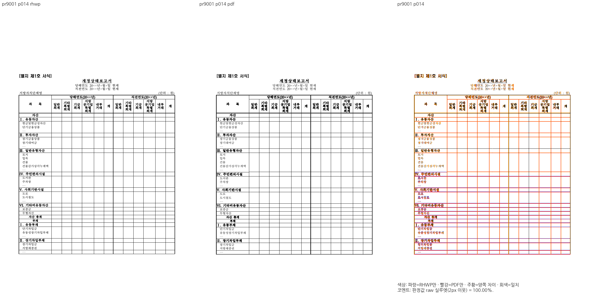
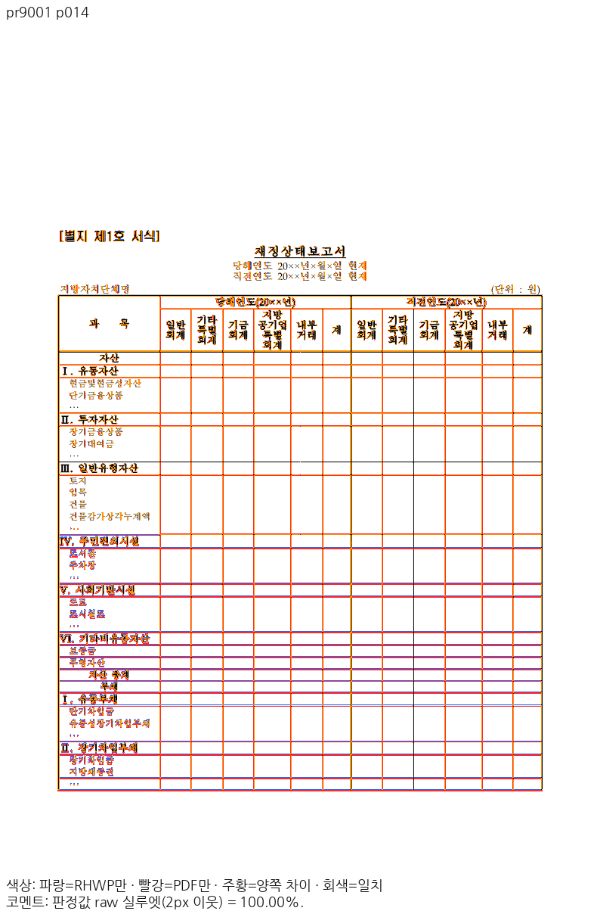

# PR #9001 리뷰 — fix(typeset): 저장 프레임이 본문을 넘는 RowBreak 표는 첫 행이 들어가면 그 자리에서 나눈다 (#8993)

## 최종 판정

**메인터너 보정 후 수용 가능 — 원 PR 주장 범위의 로컬 검증 완료.** 통합 PR의 최신 head CI·mergeability를 확인한 뒤 승인된 병합을 진행한다. 원 PR 직접 병합·원격 게시 완료를 뜻하지 않는다.

## 접수 정보

- 원 PR: https://github.com/edwardkim/rhwp/pull/9001 (`planet6897`, base `devel`). 원 head `f2447f15a87e71852366d72bad43191a000f42e4`.
- 통합 branch: `review/integration-20261113-planet6897-clean20`. 검증 제품 code `d0cc46573c7505633721c19062e504faff017d59`.
- 고정 devel: `31a422575722f634cfc2d9eb97e708da58aea188`. source53개를 누적 `cherry-pick -x`했고 중복9개는 다시 적용하지 않았다. 충돌 제외 #8937·#8972·#8976은 포함하지 않는다.
- 원 PR reviewer `jangster77`를 실제 API로 확인했다. 원 contributor branch를 rewrite하지 않았다.
- 원 head·고유 커밋·의존 범위: [source-plan.json](../assets/planet6897_clean20_20261113/source-plan.json).

## 변경과 공통 조판 원칙 검토

저장 표 상자가 본문 아래를 넘는 RowBreak 표는 첫 행이 실제로 들어가면 남은 쪽에서 분할한다.

호스트 간격·상단 캡션·첫 행 예산 → 선언 높이 이월 판단 → 공통 row-cut scanner → 실제 조각. 원 PR이 공개한 #8997 악화 원본도 고정 base·후보와 독립 Print로 대조했고 새 악화를 보정했다.

검토 소스: `src/renderer/typeset/table/block/entry.rs`.
수치·문서 ID를 맞추는 예외 대신 원본 줄·칸·개체 속성과 공통 측정·배치 소비를 확인했다.

## 실제 회귀·제품 경로 검증

최소 글꼴 macOS 격리 환경(OS 기본528/nonOS0·허가된 저장소 fixture)에서 전체 nextest를 실제 실행해 **13,420 PASS / 0 FAIL / 45 skip**, 테스트 실행510.868초를 확인했다.
그중 이 PR의 관련 모듈 **1건 PASS**를 최신 전체 로그에서 다시 추출했다. 의존 PR과 중복될 수 있으므로 고유 신규 검사 수로 합산하지 않는다.

검사 소스: `tests/cases/issue_8993_rowbreak_overflowing_frame_split.rs`.
기록: [individual-test-execution.json](../assets/planet6897_clean20_20261113/final-d0cc4657/individual-test-execution.json) · [rust-validation.json](../assets/planet6897_clean20_20261113/final-d0cc4657/rust-validation.json).

fmt·Native/WASM Clippy·workspace build·all-target Clippy를 통과했다. Native Skia lib workspace 합계4,034 PASS/12 ignore, PNG2 PASS, PDF36 PASS를 확인했다.
후속 핵심 회귀1건을 추가한 뒤 관련 모듈4+15=19건과 lint·manifest를 별도로 통과했다. 새 검사1건이 위 전체13,420에 포함됐다고 표시하지 않는다.
fresh WASM은 Mac locked wrapper의 `--target web --out-dir pkg --no-opt` 로컬 대체 빌드다. Docker 최적화 통과가 아니다.

## 공통 조판 원칙 준수 판정

| 항목 | 판정 | 근거 |
| --- | --- | --- |
| 제출 전 로컬 검증과 PR 상태 | 충족 | 아래 전체·집중·lint·Skia·Mac fresh WASM 기록. 통합 PR은 로컬 필수 검증 완료 뒤 Open으로 제출하며 최신 head CI는 별도 병합 조건이다. |
| 기존 이슈·해결 PR의 선행 분석 | 충족 | 원 PR의 고정 head·고유 커밋·의존 순서와 현재 base 동작을 대조했다. 반례 보정은 별도 d0cc 원인 기록으로 연결한다. |
| 구현 근거와 일반성 | 충족 | 호스트 간격·상단 캡션·첫 행 예산 → 선언 높이 이월 판단 → 공통 row-cut scanner → 실제 조각. 원 PR이 공개한 #8997 악화 원본도 고정 base·후보와 독립 Print로 대조했고 새 악화를 보정했다. |
| 측정·배치 일관성 | 충족 | 호스트 간격·상단 캡션·첫 행 예산 → 선언 높이 이월 판단 → 공통 row-cut scanner → 실제 조각. 원 PR이 공개한 #8997 악화 원본도 고정 base·후보와 독립 Print로 대조했고 새 악화를 보정했다. |
| 리베이스 반영 PR의 기능 보존 | 비해당 | 이번 검토 branch는 고정31a42257 위에서 누적 적용했고 이후 base 전진이 없었다. 제출 직전 live base를 다시 확인한다. |
| 최종 출력 소비 계약 | 충족 | 전쪽 Native/fresh WASM, 실제 Canvas2D와 지원 CK의 소비 및 미지원 입력의 기존 fallback·guard 보존을 아래 실제 backend 기록으로 구분했다. |
| 분할·이어받기 계약 | 충족 | 위 컷·예약 예산·새 쪽 소유와 다음 본문 보존을 실제 전쪽·회귀로 대조했다. |
| 줄 소속과 점유 높이 | 충족 | 호스트 간격·상단 캡션·첫 행 예산 → 선언 높이 이월 판단 → 공통 row-cut scanner → 실제 조각. 원 PR이 공개한 #8997 악화 원본도 고정 base·후보와 독립 Print로 대조했고 새 악화를 보정했다. |
| 사례와 증거의 독립성 | 충족 | 독립 데스크톱 Print·원본·base/후보 전쪽을 대조하고 합성 반례·정상 대조군을 구분했다. |
| 기준값 변경 | 충족 | body_overflow 새 원본2건 등록은 수정 전후 실제 값과 독립 Print 위치를 대조한다. 기존 문서 값·문턱은 바꾸지 않았다. |
| 회귀 추가·변경의 선행 조건 | 충족 | 관련 문서 전쪽 양쪽90% 이상과 실제 판독을 확인했다. 추가 health5·6쪽의 양쪽98% 이상·독립±2px 좌표는 별도 증거에 한정한다. |
| 90% 통과 후 확대 판독 | 충족 | 아래 Native·fresh WASM의 실제 판독 페이지와 같은 쪽 raw/PDF/review/overlay 및 잔여 차이를 구분했다. |
| 주장과 검증 범위 | 충족 | 아래 source·test 모듈·실제 결과·입력과 출력에 한정한다. 통합의 전체 보호 결과를 개별 PR의 새 개선량으로 쓰지 않는다. |

## 같은 원본·독립 Print의 전쪽 비교

96 DPI·compat2022·PDFium5.13·색상 경계 보정 전2px raw 실루엣으로 측정했다. 평균 대신 아래 전쪽 최저와 모든 페이지 TSV를 사용했다.

| 입력 | 쪽수 후보/PDF | Native base→후보 최저 | fresh WASM base→후보 최저 | TSV |
| --- | --- | --- | --- | --- |
| `pr9001` | 19/19 | 0.00000% → 99.99673% | 0.00000% → 99.99675% | [Native](../assets/planet6897_clean20_20261113/final-d0cc4657/native/claims/pr9001.tsv) · [WASM](../assets/planet6897_clean20_20261113/final-d0cc4657/wasm/claims/pr9001.tsv) |

전쪽 90%未満0・devel 대비2%p 초과 하락0을 확인했다. 위 지표는 strict RGB 일치율이 아니다. `pixel_match`·`visual_accuracy_proxy_percent`를 별도 실행한 것처럼 기입하지 않는다.

- `pr9001` 입력 [31675-rowbreak-overflowing-frame.hwp](../../../samples/issue8993/31675-rowbreak-overflowing-frame.hwp), SHA-256 `03c35242f6d88dd33bde907b64b31b061e600f54ee5e66758e3b5a8c18d84a84`. PDF [31675-rowbreak-overflowing-frame-2020.pdf](../../../pdf/issue8993/31675-rowbreak-overflowing-frame-2020.pdf), SHA-256 `abad2bc7b5691e5bd6c4b3a5fbaae0eb95b21662f6bc5a3a7472d9027acbb73d`. 실제 PDF Creator `Hwp 2022 12.0.0.4547`, Producer `Hancom PDF 1.3.0.547`. 파일명의 `-2020`만으로 실제 출력 연도를 단정하지 않는다.

입력과 PDF는 검토 commit의 파일과 실제 실행 바이트를 대조했다. 기존의 유효한 데스크톱 한컴 Print를 재사용했으며 웹한글기안기/Cairo 출력을 판정 기준으로 사용하지 않았다. 제품·빌드·파일 크기는 [reference-pdf-products.json](../assets/planet6897_clean20_20261113/final-d0cc4657/reference-pdf-products.json)에 기록했다.

## 직접 판독·시각 증적

- **native** `pr9001` 14쪽: 재정상태보고서 첫 표 조각의 제목·헤더·자산/부채 행과 종료 경계를 대조했다. 긴 선언 높이로 표 전체가 다음 쪽으로 이동하지 않으며 첫 조각 안의 행 소속이 기준 Print와 같다. 얇은 일부 가로선 차이가 보이므로 엄격 RGB 일치로 표현하지 않는다. [raw](../assets/planet6897_clean20_20261113/final-d0cc4657/panels/native/pr9001/raw-p014.png) · [PDF PNG](../assets/planet6897_clean20_20261113/final-d0cc4657/panels/native/pr9001/pdf-p014.png) · [review](../assets/planet6897_clean20_20261113/final-d0cc4657/panels/native/pr9001/review-p014.png) · [overlay](../assets/planet6897_clean20_20261113/final-d0cc4657/panels/native/pr9001/overlay-p014.png).
- **native** `pr9001` 15쪽: 전쪽 표의 마지막 조각에서 기타비유동부채·부채 총계·순자산·부채와 순자산 총계가 같은 행·칸에 보존되며 괘선·본문 위치가 대응한다. [raw](../assets/planet6897_clean20_20261113/final-d0cc4657/panels/native/pr9001/raw-p015.png) · [PDF PNG](../assets/planet6897_clean20_20261113/final-d0cc4657/panels/native/pr9001/pdf-p015.png) · [review](../assets/planet6897_clean20_20261113/final-d0cc4657/panels/native/pr9001/review-p015.png) · [overlay](../assets/planet6897_clean20_20261113/final-d0cc4657/panels/native/pr9001/overlay-p015.png).
- **wasm** `pr9001` 14쪽: 재정상태 보고서의 당해·직전연도 머리행과 자산·부채 내용이 같은 쪽의 첫 조각에 보존된다. [raw](../assets/planet6897_clean20_20261113/final-d0cc4657/panels/wasm/pr9001/raw-p014.png) · [PDF PNG](../assets/planet6897_clean20_20261113/final-d0cc4657/panels/wasm/pr9001/pdf-p014.png) · [review](../assets/planet6897_clean20_20261113/final-d0cc4657/panels/wasm/pr9001/review-p014.png) · [overlay](../assets/planet6897_clean20_20261113/final-d0cc4657/panels/wasm/pr9001/overlay-p014.png).

Native/fresh WASM 대표90쌍의 raw·PDF PNG는 새 제품 code로 다시 출력한 결과와 SHA가 동일함을 확인해 기존 panel 바이트를 재사용했다. 직접 판독한 페이지와 수치만 확인한 페이지를 [direct-reading.json](../assets/planet6897_clean20_20261113/final-d0cc4657/direct-reading.json)에서 구분한다.

## 원 PR 반례와 메인터너 보정

원 PR이 공개한 `1543000-202100035`는 고정 devel143쪽/독립 한컴2020 Print141쪽이며 초기 통합에서144쪽으로 악화됐다. `d0cc46573c`에서 저장 프레임의 포함 판정을 아직 배치하지 않은 미래 조각의 각주 예산과 비교하던 오류를 고쳤다. 실제 배치된 각주만 예약한 본문과 비교하며, 실제 cut scanner/fit의 projected 각주 예산은 유지했다.
후보는143쪽으로 복원됐다. 같은 독립 Print141쪽 전체의 공통 물리 페이지를 Native/fresh WASM 각각 base/후보로 재산출했다. 최대 하락0.65796%p/0.65441%p, 2%p 초과 하락0이다. 이 공통141쪽 비교를143쪽 전부의 독립 PDF 통과로 표시하지 않는다. 기존143↔141쪽 불일치·미달은 #8997에서 계속 추적하며 이 통합으로 close하지 않는다.
[cause.md](../assets/planet6897_clean20_20261113/maintainer-repair/cause.md) · [food-common-qualification.json](../assets/planet6897_clean20_20261113/maintainer-repair/food-common-qualification.json).

실제 CanvasKit preflight는 base/후보 모두19쪽 중18쪽에서 작업 한도50,000에 도달해 미완료·사용불가로 판정됐다. 이 입력의 Canvas2D fallback을 CK 통과로 쓰지 않고, guard·한도를 바꾸지 않는다. 지원되는 CK 대조군과 구분해 최종 소비 경로 기록을 연결한다.

원 PR이 추가한 body_overflow 원장2건도 독립 재검토했다. 고정 base/보정 후보 모두 같은17·19쪽의 같은 TAC 표2개이며 실제 좌표가 동일하다. 양쪽 Print 실루엣은 두 쪽 모두100%였다. [원장·독립 PNG 근거](../assets/planet6897_clean20_20261113/final-d0cc4657/body-overflow-baseline-review.json). 원장의 기존 문서 값·문턱을 완화하지 않았다.

## 통합 보호·후속 조건

Native 정본 보호18조건1,771쪽은 공식 두 자리 표시값 하락0이며 별도 `--handbook-gate`383쪽도 통과했다. fresh WASM 정본 보호18조건1,771쪽도 공식 두 자리 표시값 하락0이다. 같은 code의 전쪽 비교는 [최종 보호·주장 검증](../assets/planet6897_clean20_20261113/final-d0cc4657/whole-visual-qualification.json)으로 연결한다. 일반 기여자에게 비공개 OTF 설치를 요구하지 않는다.

## 실제 backend 선택과 초기화 출처

일반48건과 실제 주장 페이지 추가12건을 분리해 캡처했다. 일반 검사의 실제 Canvas2D 요청16건, 지원되는 실제 CanvasKit16건, 안전한 Canvas2D 대체16건을 확인했다. 추가 검사에서는 #8999의2쪽에 실제 CK4건·Canvas2D2건, #9001의14쪽에 Canvas2D2건·기존 preflight 미완료 대체4건을 확인했다.
일반·추가 observer의 원본 종료코드는 각각1이며 각 실행의 #9001 CK 미지원 요청에 대한8개 hard violation을 그대로 보존했다. base/후보 모두 기본 작업 한도50,000에서19쪽 중18쪽을 검사한 뒤 미완료로 판정해 CK를 시작하지 않았다. 한도·글꼴 guard를 우회하거나 CK 성공으로 계산하지 않았다. 그 대체 화면은 실제 Canvas2D와 픽셀이 같았다. 나머지 글꼴 미준비 대체12건은 기존 fontFallbackGate12/12를 통과했다. backend 간 RGB parity는 report-only이며8/16 통과·8/16 차이를 원본대로 남겼다.
실제 렌더48회·독립 초기화6회와 추가 주장 페이지12회의 WASM 수신 해시를 확인했다. `c8596bc0...`은 새 제품 빌드와 일치한다. Vite가 변환한 JS는 원본 파일 SHA와 직접 같지 않으므로, 설치 Vite의 실제 변환·응답 바이트를 재현해 초기화 응답6/6을 검증했다.
[실제 backend·54개 WASM 수신 근거](../assets/planet6897_clean20_20261113/final-d0cc4657/actual-backend-qualification.json) · [추가 주장 페이지12건](../assets/planet6897_clean20_20261113/final-d0cc4657/actual-claim-pages-qualification.json). 전자는54개, 후자는12개 영수증을 보존한다.

## 검증 입력 커밋 확인

**충족.** HWP/HWPX/HML·PDF85개를 실제 실행 파일과 검토 commit의 Git blob SHA-256으로 대조했다. 대용량 sample10 PDF(96,185,197바이트)는 기존 파일을 로컬 재사용했으며 이 PR에 새 PDF·사본을 추가하지 않았다. [입력 감사](../assets/planet6897_clean20_20261113/final-d0cc4657/committed-input-audit.json)를 따른다. 비공개 글꼴 바이너리는 Git에 넣지 않았다.

## Merge 후 contributor PR comment 계획

통합 PR의 최신 head CI 성공과 실제 병합 뒤에만 원 PR에 한국어 존댓말로 결과·통합 PR·merge SHA를 안내하고 close한다. 이 문서의 판정과 원격 조치를 구분한다. 원 기여의 해결 범위와 추가 보정의 원인·SHA를 구분해 설명한다.
Visual Sweep 정본: [GitHub merge comment](../../manual/verification/visual_sweep_guide.md#github-merge-comment).
같은 주장 페이지의 raw·PDF PNG·review·overlay를 `https://raw.githubusercontent.com/edwardkim/rhwp/<merge-commit-sha>/` 아래의 `mydocs/pr/assets/planet6897_clean20_20261113/final-d0cc4657/panels/native/pr9001` 자산으로 **Markdown 이미지** 표시한다. 웹한글기안기 PDF와 데스크톱 Print를 혼동하지 않고 실제 Creator를 함께 안내한다.
여러 단락은 UTF-8 본문 파일로 게시하고 API로 실제 본문·이미지 URL을 재조회한다. 원 contributor fork branch는 삭제하지 않는다.
