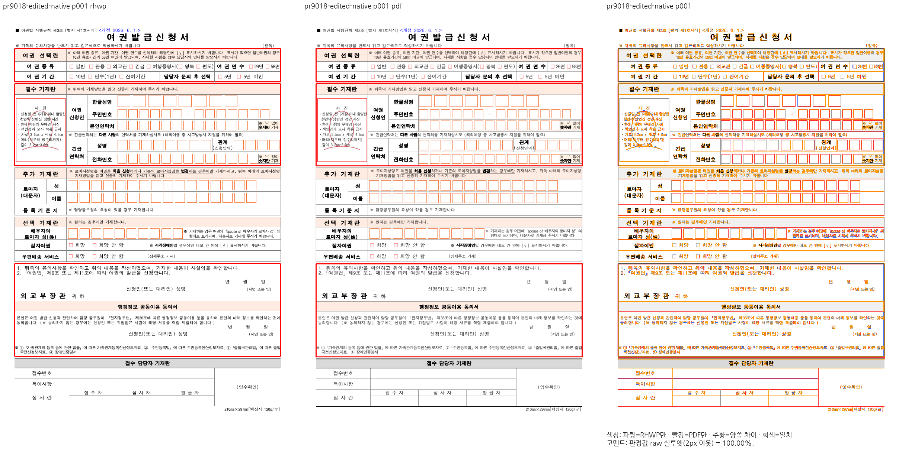
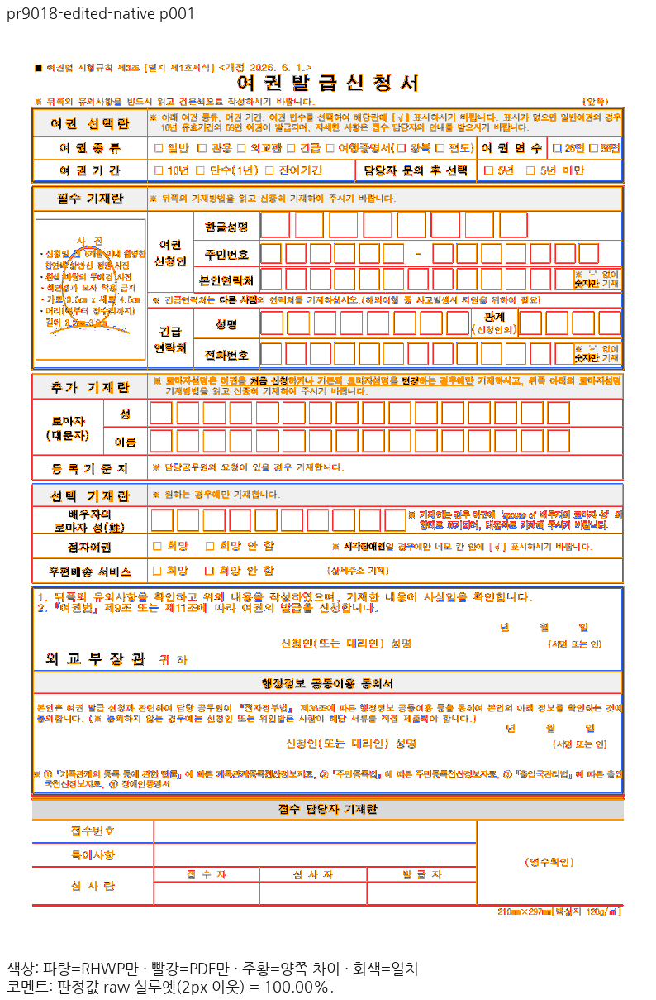
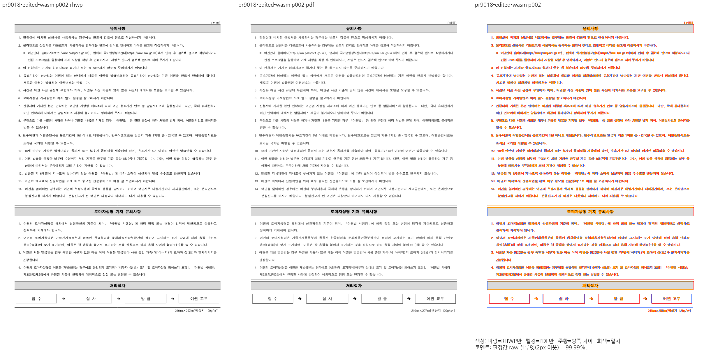
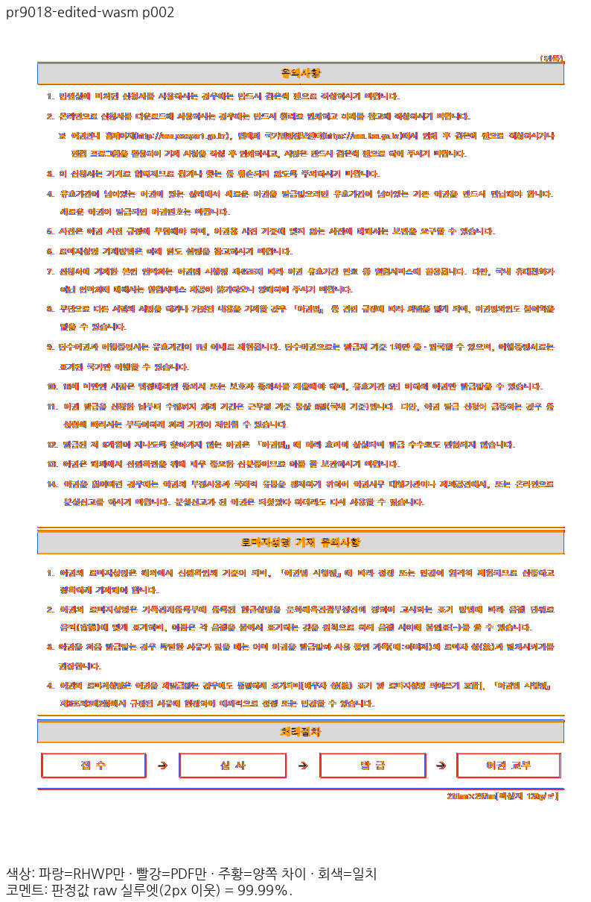

# PR #9018 리뷰 — 제어 전용 문단 삽입 좌표와 시각 검증 한글 라벨

## 최종 판정

**메인터너 보정 후 수용 가능 — #8199 해결 범위의 로컬 검증 완료.**
원 contributor head를 직접 병합하지 않고 도구 보정과 확인된 모델 보정을 포함한 통합 후보를 검토한다.

## 접수 정보

- 원 PR: [#9018](https://github.com/edwardkim/rhwp/pull/9018), `johndoekim`, `devel` 대상.
- 원 head: `be67439b02f42779b50361ace7b8a47dd0d1439a`. 원본 fork branch는 변경하지 않았다.
- 원 기능·검사·증적 3개 커밋을 누적 체리픽했다. base는 `fa32a1633b0677f3dc48ea5cc99a4cab309361b6`이고 리베이스 충돌은 없었다.
- 코드 후보: `cc6c60381dfeff9b7892e836b8bf01803d0a5c1a`. 원 PR reviewer는 `jangster77`이며 통합 PR에 owner를 자동 지정하지 않는다.
- 관련 이슈는 [#8199](https://github.com/edwardkim/rhwp/issues/8199)를 참조한다. 원 PR은 `Refs`이며 표 끝 추가 정책 등 별도 범위를 이 검토로 해결했다고 확대하지 않는다.

## 원 기여와 메인터너 보정

원 기여는 `text`·`char_offsets`가 없는 제어 전용 문단에서 삽입점의 8유닛을 줄 시작·글자모양·범위 표식에 함께 반영한다.
그림·도형·책갈피·구역 분할과 재조판하는 주석·새 번호·덧말·글자 겹침을 12개 관계 검사로 보호한다.
올바르게 저장된 입력을 읽는 출력 경로는 그대로이며, 이전 base에서 해당 저장본이 이미 2쪽으로 보인다는 사실과
편집 직후 잘못 저장한 결과가 3쪽으로 늘어나는 결함을 구분했다.

추가 보정은 두 범위다.

1. `visual_sweep.py`의 주석 글꼴 선택은 파일이 열린다는 이유만으로 한글 지원을 가정하지 않도록 Unicode cmap을 확인한다.
   공개 Noto Sans KR은 기존 저장소 파일을 사용하고 문서 글꼴·PNG·PDF 래스터·점수 계산을 바꾸지 않는다.
   원 PR 이미지의 두부문자는 하단 한글 설명이며 문서 본문은 읽힌다. 작성자가 Mac이라고 기록했으므로 Windows에서 생성했다고 추측하지 않았다.
2. 글자 없는 누름틀의 END는 `controls[]` 밖에서도 8유닛을 차지한다. 원 코드로 뒤에 그림을 붙이면 앞선 줄 시작이 48에서 56으로 밀리는 반례를 재현했다.
   `field_ranges`가 있을 때는 새 컨트롤 개수 추정을 적용하지 않고 기존 경로를 유지한다. 기존 12개와 추가 1개는 모두 통과했다.
   고아 종료·제목 차례나 다른 문서로 범위를 넓히지 않았다. [원인·검사 근거](../assets/issue8199_review_20261113/field-end-repair/cause.md).

## 입력과 독립 Print

| 구분 | 저장소 입력·기준 PDF | 출처 |
| --- | --- | --- |
| 원본 | `samples/issue2020/passport_application_lawgo.hwp` / `pdf/issue2020/passport_application_lawgo-lawgo-2020.pdf` | 국가법령정보센터 공개 여권발급신청서와 기존 2020 기준 자료 재사용 |
| 그림 추가 저장본 | `mydocs/pr/assets/issue_8199_control_only_para_line_seg/passport-picture-at-start.hwp` / 같은 경로 `passport-picture-at-start-hwp2022-print.pdf` | 작성자가 확인한 데스크톱 한컴 2022 12.0.0.535, Print → Microsoft Print to PDF |

입력 HWP SHA-256은 원본 `ec8bb9495d78bce5de338dae7a4b68a35a96e66fa3a7f324c8318ee8626cac8f`,
편집본 `6be52359642a60194f9f3eda0ae40a4e2d8084bd55979fb12d6d8ece61aa8fb9`다.
편집본 PDF는 `afd03ca1bbdeab436c539994d069aa193741877f5e08f07b2af60adef59d33f7`(158,700바이트, 2쪽)이다.
원본과 PDF는 기존 커밋 파일을 재사용하고 중복 입력을 추가하지 않았다.
옛 3쪽 PDF-save 산출물은 정량 판정 기준으로 사용하지 않았다. 웹한글기안기/Cairo PDF 또는 새 MCP 출력으로 표시하지 않는다.

## 검증

최소 글꼴 환경의 Rust 회귀와 일반 원본 글꼴 환경의 Visual Sweep을 분리했다. 개인 글꼴을 삭제·비활성화하지 않았다.
Mac WASM은 locked wrapper의 `--target web --out-dir pkg --no-opt` 로컬 대체 빌드이며 Docker 최적화 통과로 표기하지 않는다.

[최종 검증 원장](../assets/issue8199_review_20261113/final-validation.json)의 실제 종료 결과를 확인했다.

| 항목 | 결과 |
| --- | --- |
| 최소 글꼴 집중 / 전체 | 13 PASS / 13,446 PASS·0 FAIL·45 skip |
| Native Skia / PNG / 직접 PDF | 4,034 PASS·기존 12 ignore / 2 PASS / 36 PASS |
| fmt·Native/WASM/all-target Clippy·workspace build·manifest·unit-tier | 모두 통과 |
| Visual Sweep Python / manifest 계약 | 89 PASS / 24 PASS |
| 원본·편집본·실제 생성 저장본 | Native 각 2쪽·합 6쪽, fresh WASM 각 2쪽·합 6쪽 모두 통과 |
| 전쪽 최저 raw | Native 99.99049%, fresh WASM 99.99050% |
| 편람 HWPX Native 필수 gate | 383쪽, 최저 99.96%(130쪽), 공식 기준 하락 0쪽 |
| 실제 편집·저장·재열기 | HWP/HWPX 각 2라운드, 모든 단계 2쪽·본문 보존 |
| 실제 초기화 응답 | root pkg·Studio public·HTTP JS/WASM 해시 일치 |

Windows의 주석 선택 전체 89 PASS는 같은 스크립트 해시를 확인해 재사용한다.
Windows의 원본 Rust/HWP 렌더링 전체를 실행했다고 주장하지 않는다.

## 변경 주장과 관측

| 주장 | 경로·독립 계약 | 관측 |
| --- | --- | --- |
| 일반 제어 전용 문단 삽입의 줄 소속 보존 | 공통 metadata 이동 → 그림/도형/책갈피/구역 편집 → HWP 저장·재열기 | 원 12개 유지 |
| 누름틀 끝 뒤 삽입에서 앞선 줄 보존 | END는 목록 밖 8유닛, 뒤 삽입은 앞선 줄을 움직이지 않음 | 추가 관계 검사 FAIL→PASS, px 핀·샘플별 분기 없음 |
| 한글 주석 두부문자 방지 | 실제 필요한 Unicode cmap → 기존 공개/OS 글꼴 | Windows Arial 강제 우선에서 한글 누락 30자→0자, raw 수치 불변 |
| 출력·실제 저장의 안정성 | 같은 입력·PDF·조건의 전쪽 Native/fresh WASM 및 실제 편집·반복 저장 | 원본·편집본 전 8개 raw PNG는 base와 동일, 실제 생성본도 편집본 출력과 동일 |

## 시각 증적과 재사용 경계

[전쪽 지표·해시](../assets/issue8199_review_20261113/page-evidence.json)와
[실제 API 결과](../assets/issue8199_review_20261113/actual-edit-save-results.json)를 연결했다.
2px 보정 전 raw90% 기준과 PDF를 그대로 사용했으며 예외·마스크·쪽 제외가 없다.
100.00이라는 두 자리 표시는 RGB 동일을 뜻하지 않는다. 알려진 획 경계·색상 차이는 그대로이며
현재 두 입력의 base/후보 raw는 backend별로 바이트까지 같다.

| 입력 | Native1쪽 / 2쪽 | fresh WASM1쪽 / 2쪽 |
| --- | --- | --- |
| 원본 | 99.99877 / 99.99049 | 99.99877 / 99.99050 |
| 편집본·실제 생성본 | 99.99840 / 99.99061 | 99.99841 / 99.99061 |

대표 쪽의 서식 군·두 표·유의사항 1–14·로마자성명·처리 절차를 직접 판독했고 누락·중복·추가 쪽은 없다.
누름틀 합성 반례는 px 배치 검사가 아니라 원시 스트림·줄 소속 관계이며,
[새 WASM 저장본의 별도 레코드 판독](../assets/issue8199_review_20261113/field-end-repair/actual-wasm-validation.json)에서도
뒤 삽입 전후 줄 시작 56이 유지됐다.

보호 18조건 Native/WASM 각 1,771쪽은 [재사용 자격](../assets/issue8199_review_20261113/protected-reuse-audit.json)의
입력/PDF/원 producer/프로그램 바이트와 공식 하락 0쪽 근거를 재사용했다. 현재 head의 재캡처라고 쓰지 않는다.
리베이스 #9012는 딸기 HFT 꾸밈과 미해결 연결 그림의 인쇄만 바꾼다. 실제 사용한 딸기 선언은 TTF여서
새 자격이 false이며, 다른 보호 입력은 딸기를 요청하지 않거나 굵게 사용하지 않는다.
외부 그림 참조는 sample10의 3개뿐이며 동일 커밋의 원본을 공급해 모두 loaded 상태를 확인했다.
우리 변경은 고정 입력 출력에서 호출하지 않는 편집 명령이다. 필수 편람 Native383쪽은 새 head에서 별도로 다시 실행했다.
기준 캡처의 base6217d3cb와 현재 basefa32a163은 이 범위 증거로 연결하며 서로의 fresh producer로 바꾸어 쓰지 않는다.

원 PR의 정확한 source head는 계속 `be67439b02f42779b50361ace7b8a47dd0d1439a`이며
[원 Full CI](https://github.com/edwardkim/rhwp/actions/runs/43223354792)는 성공했다.
[통합 PR #9053](https://github.com/edwardkim/rhwp/pull/9053)의 exact head
`4499047f5560eaee03347400ff424cede156653e`에서 [Full CI](https://github.com/edwardkim/rhwp/actions/runs/43417460037),
CodeQL 4언어·GHAS check·Canvas Render Diff·Adapter·Proptest·최종 CI Impact Policy 성공을 확인했다.
[CI 영수증](../assets/issue8199_review_20261113/ci9053-code-complete.json)에 source SHA·repo/branch·실행 시각·실제 attempt·각 worker를 연결했다.
기록 시점 checks는 34 SUCCESS·정상 SKIP 5건, MERGEABLE/CLEAN이다. CI Archives A–E는
13,261 PASS/0 FAIL/45 skip이며 로컬 workspace 집계 13,446과 구분했다. 원 CI로 통합 CI를 대신하지 않았다.

이 문서 전용 trailing commit은 Rust·테스트·도구·입력·baseline·CI 정책을 바꾸지 않는다.
남은 병합 조건은 같은 PR의 최신 trailing head required checks·MERGEABLE/CLEAN·승인된 후속 처리다.
원 PR close는 통합 병합 이후이며 #8199는 신고 덧붙임의 별도 #7996 범위를 해결했다고 확대하지 않고 참조로 유지한다.

## Merge 후 원 PR 코멘트 계획

통합 후보의 CI·승인·실제 병합 후에만 원 PR에 한국어 존댓말로 결과와 추가 보정의 이유를 설명한다.
여권 서식의 같은 쪽 raw/PDF/review/overlay를 실제 merge SHA 고정 Markdown 이미지로 표시하고
Visual Sweep 정본 및 실제 한컴 2022 Print 출처를 연결한다. 라벨 검증은 Windows Pillow 검사로 구분한다.
원 PR close는 통합 merge 확인 이후 처리하며 contributor fork는 보존한다. 이 문서가 GitHub review/merge 완료를 뜻하지 않는다.
