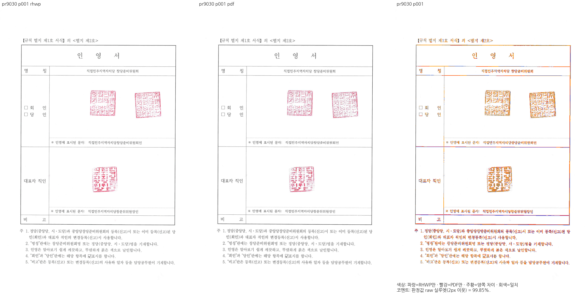
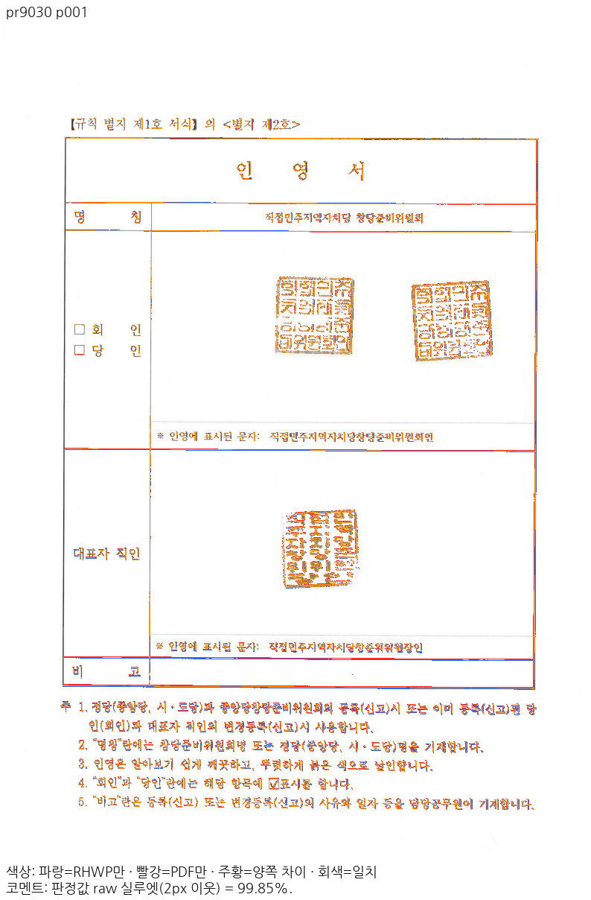

# PR #9030 리뷰 — DocInfo 예약 태그 잔여 바이트와 BinData 이름 대소문자 호환

## 최종 판정

**승인 — 명시한 통합 head에서 원 PR 주장 범위의 로컬 검증을 완료했다.** 제품 메인터너 보정 없이 원 변경을 수용한다. 원격 조치는 별도이며, merge 전 통합 PR 최신 head의 필수 CI·mergeability를 확인한다.

## 접수 정보

| 항목 | 값 |
| --- | --- |
| 원 PR·작성자 | [#9030](https://github.com/edwardkim/rhwp/pull/9030) · `planet6897` |
| 관련 해결 이슈 | [#9029](https://github.com/edwardkim/rhwp/issues/9029) — 아래 주장 범위 |
| 고정 원 head | `829245078e6f1191e79fed3e4239a2a5996319ac` |
| 최종 제품 code | `c6e852a92b3661136552a432d649e168e27f88d4` |
| 시각 산출물 producer | `605740c4363e9e6bacd84895d93abbc7d7bf62c3`, 아래 동일성 근거로 재사용 |
| 최종 검증 base | `00d09f773a2f6c21604a4e6394df7152bbb26e8c` |
| 고정 base 시각 producer | `1003349996897c6ff097271e7296ae4d1a3d807f`, 새 devel의 제품 경로와 동일 |
| 통합 branch | `review/integration-20261113-planet6897-open5` |
| reviewer | `jangster77`, API 재확인. 원 source branch를 rewrite하지 않았다. |

#9050의 테스트·문서만 포함된 새 devel로 충돌 없이 리베이스했다. 20개 patch는 range-diff에서 모두 동일하며 제품 코드·빌드/출력 경로와 검증 입력 51개의 바이트가 변하지 않았다. 기존 PNG/TSV는 원 producer SHA를 유지해 재사용했다. 반영된 `issue_7620_cellbreak_float_row_carry`의 집중 3건 및 최신 전체 회귀를 실제 실행했다. [리베이스·재사용 근거](../assets/planet6897_open5_20261113/rebase-validation.json).

5개 원 PR의 고유 commit 20개를 누적 `cherry-pick -x`했다. 개별·모든 쌍·누적 merge와 실제 commit 적용의 tree를 대조했다. 충돌한 #8937·#8976은 제외하고 우리 reviewer 요청도 취소했다. [적용 원장](../assets/planet6897_open5_20261113/source-plan.json) · [시뮬레이션](../assets/planet6897_open5_20261113/simulation.json).

## 변경과 검토 범위

유효 레코드 뒤에서만 경계를 넘는 예약 태그 머리를 끝 잔여로 처리하며 바로 앞 예약 채움도 제거한다. 유효 태그의 잘림이나 유효 레코드가 없는 스트림의 오류 계약은 유지한다. CFB 이름의 대소문자 비구분과 동일하게 직렬화 대상 BinData 경로를 비교하여 JPG/jpg 원본 스트림을 중복 보존하지 않는다.

검토 소스: src/parser/record.rs · src/parser/mod.rs. 원본 속성·소유·공통 조판 결과에서 조건을 계산하며, 문서명/쪽 번호에 맞춘 보정은 추가하지 않았다. 사용자 지시대로 원 PR의 주장이 충족된 범위에서 수용하며 범위 밖의 미세 모양까지 새 작업으로 확대하지 않는다.

## 검증 입력과 결과

- 원본: [seal_registration_docinfo_tail.hwp](../../../samples/issue9029/seal_registration_docinfo_tail.hwp), SHA-256 `36fb81b86cc8240b2f4f332934b53ee9b560940ad8fcba201336f6a4e5f29a71`.
- 독립 Print: [seal_registration_docinfo_tail-print-2022.pdf](../../../pdf/issue9029/seal_registration_docinfo_tail-print-2022.pdf), SHA-256 `59dc43ac37507bff738b16d775ce7f8bc9c3bf32c2f83c92a2923bb129735244`, 138,883바이트.
- 실제 PDF Creator `Hwp 2022 12.0.0.4547`, Producer `Hancom PDF 1.3.0.547`. 원 PR의 데스크톱 **인쇄(Print)** 근거를 재사용했다. 파일명에 있는 2020은 engine bucket이며 실제 출력 제품을 2020으로 바꾸어 기록하지 않는다. 웹한글기안기/Cairo PDF를 판정 기준으로 사용하지 않았다.
- 실제 실행 bytes와 검토 code의 Git blob이 같다. [입력 감사](../assets/planet6897_open5_20261113/committed-input-audit.json).

리베이스 후 최소 글꼴 macOS 프로세스 격리에서 전체 nextest **13,430 PASS / 0 FAIL / 45 skip**, 실제 테스트 632.595초를 확인했다. 리베이스 전 원 PR 5개 집중 **6 PASS**와 리베이스 후 전체 실행에서 동일 6건을 확인했으며 이 PR의 `issue_9029_docinfo_reserved_tail` **2 PASS**를 확인했다. 테스트에만 최소 글꼴 격리를 사용했다. **Visual Sweep은 원본 글꼴 프로그램을 공급한 일반 환경**에서 실행했다.

fmt·Native/WASM Clippy·workspace build·all-target Clippy, Native Skia lib 합계 **4,034 PASS / 12 ignore**, PNG **2 PASS**, PDF **36 PASS**, manifest contracts/check와 unit tiers를 통과했다. 실제 명령·로그 SHA·실행 결과는 [Rust 검증](../assets/planet6897_open5_20261113/rust-validation.json)에 연결한다.

fresh WASM은 Mac locked wrapper의 `--target web --out-dir pkg --no-opt` 로컬 대체 빌드다. Docker 최적화 통과라고 표시하지 않는다. source code·입력·PDF·조건이 같은 고정 산출물의 검증과 재사용 신원을 분리한다.

## 같은 입력·독립 Print의 전쪽 시각 비교

`인영서`의 관련 전체 페이지를 96 DPI·compat2022·현행 canonical PDFium raster·색상 경계 보정 전 2px raw 실루엣으로 비교했다. strict RGB 일치율과 다르다.

| 경로 | 후보/PDF 쪽수 | 고정 devel 전쪽 최저 | 후보 전쪽 최저 | 페이지별 최악 변화 | 원본 TSV |
| --- | --- | --- | --- | --- | --- |
| native | 1 | 파싱 거부, 수치 없음 | 99.84609% | 비교 불가 | [후보 TSV](../assets/planet6897_open5_20261113/claims/pr9030/native/silhouette.tsv) |
| wasm | 1 | 파싱 거부, 수치 없음 | 99.84609% | 비교 불가 | [후보 TSV](../assets/planet6897_open5_20261113/claims/pr9030/wasm/silhouette.tsv) |

고정 devel에서 정상 출력된 동일 입력은 쪽별로 비교했고 2%p 초과 하락은 없었다. 열지 못한 문서의 0% TSV는 만들지 않았다. #9030·#9034의 Native 및 직접 로드한 WASM 파싱 오류를 구분했다. [전체 base/후보 대조](../assets/planet6897_open5_20261113/base-candidate-qualification.json) · [실제 base WASM 오류](../assets/planet6897_open5_20261113/base-wasm-parser-failures.json).

정본 보호 문서 18개 조건, 경로별 1,771쪽은 Native/fresh WASM 모두 90% 이상이며 최저 98.36252%, 공식 두 자리 표시값 하락 0쪽이다. 후보 3,562쪽의 PNG hash·쪽수·쪽 번호·누락/중복을 전수 확인했다. [보호 검증](../assets/planet6897_open5_20261113/protected-candidate-qualification.json) · [쪽별 신원 감사](../assets/planet6897_open5_20261113/candidate-page-identity-audit.json).

## 시각 증적과 남은 차이

Native와 fresh WASM에서 관련 모든 페이지의 raw/PDF·review·overlay를 직접 대조했다. 스캔 인영서와 직인 3개를 보존한다. 실제 CLI의 HWP/HWPX 저장·재열기·재저장과 편집 sentinel 단일 보존을 확인했다. CFB 읽기 성공만으로 저장 호환을 대체하지 않았다.

[직접 판독](../assets/planet6897_open5_20261113/direct-reading.json) · [이미지별 hash](../assets/planet6897_open5_20261113/claim-rasters.json).

## 공통 원칙·실제 소비 경로

| 항목 | 판정과 근거 |
| --- | --- |
| 구현 일반성·원본 소유 | 위 원본 속성과 parser/layout 공통 소비를 대조했다. 문서/쪽 예외를 추가하지 않았다. |
| 줄·셀·개체 소속과 보존 | 원 PR 회귀와 독립 Print 전쪽 및 실제 render 결과로 주장한 소유/순서/겹침을 확인했다. |
| 회귀 기대값 | 원 contributor 검사를 그대로 실행했다. 문턱·PDF·기대값 완화나 검사 제거를 하지 않았다. 원 작성자의 수정 전 FAIL 근거는 [원 PR 고정 주장](../assets/planet6897_open5_20261113/original-pr-claims.json)에 분리했으며, 작성자의 전체 10k A/B를 검토자가 다시 실행한 것으로 표시하지 않는다. |
| Native PNG | 실제 native-skia CLI `export-png --profile print`. SVG raster를 대신 사용하지 않았다. |
| fresh WASM Print | 현행 실제 Canvas exporter의 PageLayerTree 소비. Studio 일반 화면/CK와는 별도 증거다. |
| Studio 실제 화면·지원 CK | 실제 36건: Canvas2D 32건(기존 글꼴 자원 guard의 CK→Canvas2D fallback 20건 포함), 지원 CK software 4건. fallback을 CK 성공으로 세지 않았다. 같은 주장 페이지의 실제 출력·초기 WASM 36개 응답 hash를 확인했다. [소비 경로 원장](../assets/planet6897_open5_20261113/actual-browser-qualification.json). |
| 조판 규칙 적용 범위 | 변경은 레코드 경계와 CFB 경로 비교다. 줄 구성·셀 분할·여백 산정은 바꾸지 않았다. 그림 한 장의 실제 출력과 재저장 BinData 보존을 확인했다. |
| px 기대값의 조건 | 글꼴 목록·BinData 수·쪽수·그림 수와 재열기 계약이며 실물 px 위치 고정은 없다. |
| 반복 저장 | parser 2종에 실제 CLI 편집→저장→재열기→재저장→재열기, HWP/HWPX 교차 경로 62회. 본문·표·머리말·sentinel 보존. HWP3 제어 slot은 기존 #4957 직렬화 계약으로 구분했다. |
| 조판 변경의 필수 편람 | Native 383쪽 `--handbook-gate` 실제 실행·결과를 보호 검증 원장으로 연결한다. 일반 contributor에게 비공개 OTF 보유를 요구하지 않는다. |
| 정본 보호 TSV | 통합 담당자 조건으로 원본 program bytes·순서·환경을 맞춘 18조건/경로의 공식 두 자리 표시값을 대조해 하락 0쪽을 확인했다. |

실제 Studio 초기화 응답의 WASM은 build와 동일하다. JS는 Vite 개발 변환 응답이므로 원 pkg hash와 다르며, 현재 pkg를 정본 Vite로 변환한 코드와 일치함을 따로 검증했다. [초기화·변환 근거](../assets/planet6897_open5_20261113/actual-initialization-qualification.json). CK 기본 screen의 스캔 보간 차이는 report-only RGB 진단에 남겼으며 인영서/직인 보존 주장과 구분했다. 이 PR에서 CK 자원 공급이나 bitmap 보간을 추가 보정하지 않았다.

## Merge 후 contributor PR comment 계획

통합 PR의 정확한 head CI 성공·merge 확인 뒤 원 PR에 통합 PR·merge SHA·이 PR의 주장/검증 결과를 한국어 존댓말로 안내하고 close한다. 관련 #9029도 실제 해결 범위를 확인해 처리한다. 원 contributor fork branch는 삭제하지 않는다.

댓글에는 해당 PR의 위 raw·PDF PNG·review·overlay를 최종 merge SHA 고정 `raw.githubusercontent.com` URL의 **Markdown 이미지**로 표시한다. 다른 PR/보호 문서 그림으로 대체하지 않는다. 데스크톱 한컴2022 Print 기준임을 명시하고 `--body-file` 게시 후 API로 실제 한글·이미지 URL을 재확인한다. 아직 수행하지 않은 원격 게시·CI·병합을 완료로 적지 않는다.

## 통합 PR #9051의 code head CI

정확한 제출 head `d480c42be1dcc3fa83c3b73d635162aa90fc8049`의 Full CI·CodeQL·Render Diff·Adapter·Proptest와 CI Impact Policy 성공을 확인했다. 모든 workflow는 같은 PR·head·branch의 실제 완료 결과이며 job 목록은 API 끝 페이지까지 확인했다.

[CI](https://github.com/edwardkim/rhwp/actions/runs/43395863363) · [CodeQL](https://github.com/edwardkim/rhwp/actions/runs/43395863339) · [Render Diff](https://github.com/edwardkim/rhwp/actions/runs/43395863324) · [Adapter inter-diff](https://github.com/edwardkim/rhwp/actions/runs/43395863375) · [Proptest roundtrip](https://github.com/edwardkim/rhwp/actions/runs/43395863377).

[CI 영수증](../assets/planet6897_open5_20261113/ci9051-code-complete.json) · [SHA 고정 raw 다운로드41건 일치](../assets/planet6897_open5_20261113/raw-submission-audit.json). 이 기록 뒤의 문서-only trailing head는 push 후 자신의 trusted reuse·required checks와 mergeability를 재확인하며, code candidate 성공만으로 후행 head의 성공을 가정하지 않는다.
