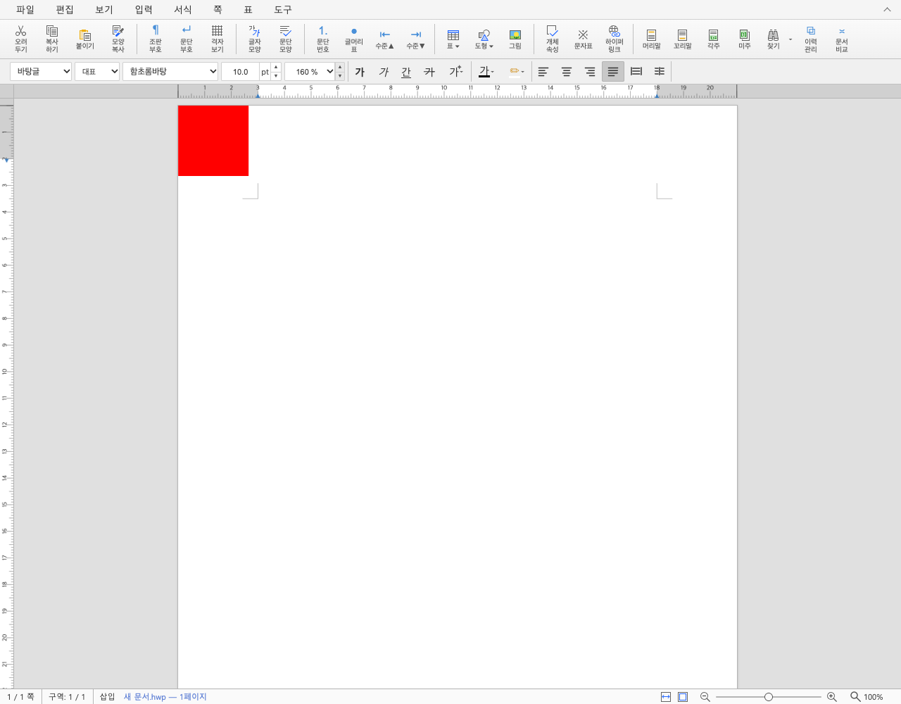
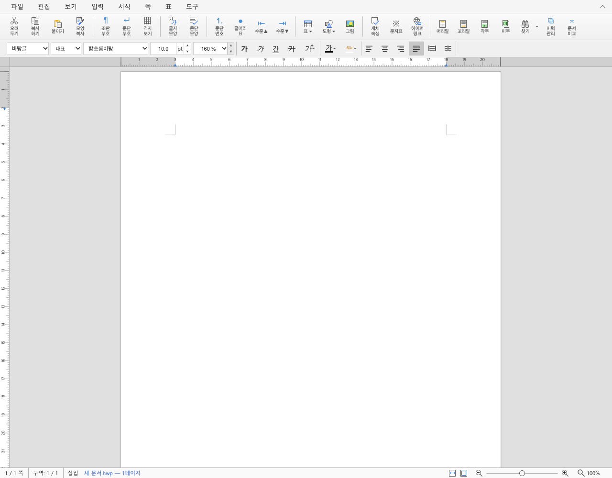

# PR #9043 리뷰 — 삭제한 그림의 HWPX 저장 자원 정리

## 최종 판정

**승인 — 통합 후보에서 HWPX 저장 자원 정리 범위의 로컬 검증 완료.**

[통합 PR #9054](https://github.com/edwardkim/rhwp/pull/9054)의 정확한 code head CI가 성공했다. 문서-only trailing head의 required checks·mergeability를 확인한 뒤 병합한다.

라우팅은 `collaborator_external_pr` 9.1.1이며 `intake_and_review`, `local_validation`, `multi_pr_update_branch`, `post_merge`와 review template을 적용했다.

## 접수와 처리 범위

- 원 PR: https://github.com/edwardkim/rhwp/pull/9043 / Bongseop-Kim / `devel`.
- 원 head: `37bb246273400443496207488f4dafa0ad11bc28`.
- 체리픽: `10c8daa334ba5f91e740fcb394cfb2add8efb202`.
- 기준: `5cbcc9b451cf286e1b7c680426c857dc802e50f3`; 검증 code head: `89701eb34af54502e94afa6319240596e98a1367`.
- reviewer `jangster77` 지정·API 확인 뒤 주 작업공간에서 fetch·누적 적용했다.
- 해결: #8941의 HWPX 저장 잔존. #6840은 공유 자원 정리의 선행 구현으로 참조한다.

## 구현 검토

`hwpx_document_for_export(&self)`는 저장 사본의 미참조 자원과 순번만 정리한다. live IR의 자원을 보존하므로 저장 직후 Undo나 내부 클립보드 붙여넣기가 원래 그림을 다시 사용할 수 있다. 불러온 원본부터 참조가 없던 자원은 load 시점의 storage id 집합으로 구분해 보존한다.

공유 참조 순회에는 DocInfo 그림 글머리표가 추가됐다. HWP의 그림 순번과 HWPX의 정규화 순번, storage id를 구분하며, 내장 글꼴의 storage id 보호는 유지한다. HWP5 저장의 미참조 바이트 정리까지 해결했다고 확대하지 않는다.

기존 `issue_536_native_save`는 참조 없는 unreadable 항목을 추가하던 입력을 본문 그림이 참조하는 unreadable 항목으로 바꿨다. content-loss 개수·resource id·빈 엔트리 기대값을 유지했으며, 원래 검사하려던 실제 저장 자원의 손실 보고를 계속 검출한다.

## 검증

- 원 신규 5개 검사와 관련 대조군, 메인터너 추가 2개 검사를 포함한 집중 28건 PASS.
- 추가 검사: HWP/HWPX 두 차례 저장·재열기 후 남은 그림의 자기 바이트 보존; 삭제 후 저장하더라도 내부 클립보드 그림 붙여넣기 가능.
- 추가 검사 도우미의 첫 문단 한정 방문을 전체 본문 방문으로 정정했다. 정상 paste API는 새 문단을 돌려준다. 이 중간 실패는 제품 결함으로 분류하지 않았다.
- 최종 전체 회귀 / lint / fresh WASM: 최소 글꼴 전체 13,455 PASS/0 FAIL/45 skip (nextest 실행 323.601초), fmt·Native/WASM32 Clippy·workspace build·all-target Clippy·manifest PASS. 사용자 지정 locked wrapper의 fresh WASM `--no-opt` 로컬 대체 빌드를 완료했다.
- baseline 제품 경로에서는 그림 삭제 후 본문 pic=0, BinData=1이 두 번째 저장에도 남았다. Node 및 실제 Studio는 같은 base WASM을 초기화했으며 source hash와 producer를 대조했다.
- 후보 저장 ZIP·원본 미참조 2개 payload·로드한 그림 글머리표 참조·두 차례 재저장: PASS. 삭제 후 첫 저장·재저장의 BinData는 각각 0개다. 처음부터 미참조였던 원본 2개 payload와 로드한 그림 글머리표의 파랑 payload는 두 번 저장해도 동일하다.

## 조판 원칙과 증적

이 변경은 저장 사본의 자원 소유·참조 계약이다. `live_positions`의 수집 순회는 값을 그대로 두며 `loaded_unreferenced_bin_data`는 조판에서 소비하지 않는다. 순번 정리는 export 사본에서만 수행한다. live IR과 남은 그림 바이트·재열기 참조의 실제 검증을 연결한다.

사진 삽입·삭제 장면은 실제 Studio raw screenshot으로 보존한다. 빈 페이지의 PDF 일치율로 자원 삭제를 판정하지 않는다. 본 검토에는 조판 전쪽 Visual Sweep·편람 gate를 일괄 적용하지 않았다. fresh WASM과 Native 공개 API에서 저장 내용·참조를 확인한다.

## 통합 PR의 실제 CI 결과

- 통합 code CI head: `0ae35de66d950bc58fa6c8320b0d20e944c691d4`. 검증 소스 `89701eb34a` 이후 Rust·test·script·Cargo는 동일하다.
- [CI 실행](https://github.com/edwardkim/rhwp/actions/runs/43432704579)의 Archive A~E 합계 **13,270 PASS / 0 FAIL / 45 skip**. 로컬 workspace 13,455건과 합산하지 않는다.
- exact head의 lint·Rust CodeQL/GHAS·Adapter·Proptest 및 최종 CI Impact Policy를 확인했다. 전체 check 결과는 29 SUCCESS / 7 SKIPPED / 1 NEUTRAL이며 미완료·실패 0개다.
- CI 정책은 `mode=selective;rfp=0;rust=1;fe=none;render=0;skia=0;ql=rs`다. 실제 영향에 맞춘 Rust 실행이며 모든 제품 영역의 Full 실행으로 표시하지 않는다.
- [CI 영수증](../assets/bongseop_20261113/ci9054-code-complete.json)에 exact SHA·run/attempt·job·실제 worker summary와 원 로그 hash를 기록했다. 최종 정책의 `workflow_run`은 기본 branch 실행이며 대상 candidate status와 구분한다.

## 통합·후속 처리 계획

같은 브랜치에서 #9043 → #9048 순서로 적용했고 텍스트 충돌이 없었다. 각 원 PR과 메인터너 검사 보강의 SHA를 구분한다. 최종 로컬 검증 후 개별 검토·증적·오늘할일을 통합 PR에 포함한다. 최신 code CI 성공 뒤 필요한 기록만 trailing commit으로 보완하고 최신 head CI·mergeability를 다시 확인한다.

## Merge 후 원 PR 코멘트 계획

통합 merge SHA·CI URL, 그림이 삭제된 본문과 저장 ZIP의 실제 개수·참조 바이트 결과를 한국어 존댓말로 설명한다. 같은 생성 입력의 raw Studio 증적을 merge SHA 고정 이미지로 표시한다. #8941을 완료 처리하고 원 PR을 통합 링크와 함께 종료하며 contributor fork branch는 보존한다. 정식 증적 공개 확인 후 게시하고 API 본문을 재조회한다.

## 정식 증적

[공통 검증·출처](../assets/bongseop_20261113/README.md) · [검증 code head와 실제 producer](../assets/bongseop_20261113/producer.json) · [전체 회귀 결과](../assets/bongseop_20261113/full-nextest-result.json)

저장된 파일의 그림 자원은 base 1→후보 0개이며 재저장도 0개다. 화면만으로 파일 내부의 잔존을 판정하지 않고 [독립 ZIP·참조 판독](../assets/bongseop_20261113/wasm-api-results.json)과 [실제 Studio 저장](../assets/bongseop_20261113/studio-results.json)을 함께 확인했다. 선행 [PR #6849 검토](pr_6849_review.md)와 실제 구현 `2fc163941bfe146b45bf99e43b92189b25e79f29`의 순번/storage id 계약을 유지한다.
