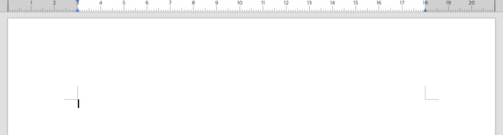
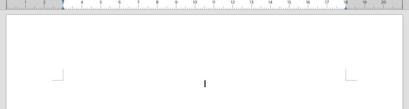
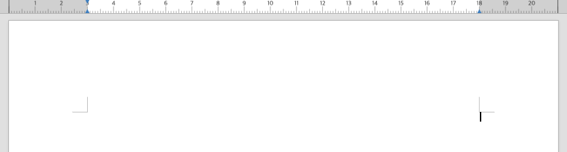

# PR #9048 리뷰 — 본문 빈 문단의 캐럿 정렬

## 최종 판정

**승인 — 통합 후보에서 본문 빈 문단 캐럿 정렬 범위의 로컬 검증 완료.**

[통합 PR #9054](https://github.com/edwardkim/rhwp/pull/9054)의 정확한 code head CI가 성공했다. 문서-only trailing head의 required checks·mergeability를 확인한 뒤 병합한다.

라우팅은 `collaborator_external_pr` 9.1.1이며 `intake_and_review`, `local_validation`, `multi_pr_update_branch`, `post_merge`와 review template을 적용했다.

## 접수와 처리 범위

- 원 PR: https://github.com/edwardkim/rhwp/pull/9048 / Bongseop-Kim / `devel`.
- 원 head: `af029fca6e39a8d2c971158575d90948c4015f80`.
- 체리픽: `970190226eef0157ad5e6836af0a9146885350e3`.
- 기준: `5cbcc9b451cf286e1b7c680426c857dc802e50f3`; 검증 code head: `89701eb34af54502e94afa6319240596e98a1367`.
- reviewer `jangster77` 지정·API 확인 뒤 주 작업공간에서 fetch·누적 적용했다.
- 해결 범위: #8944의 누름틀 없는 본문 빈 문단. #6766·#7285의 기존 누름틀 경로는 정상 대조군이다.

## 구현 검토

페이지 스캔에서 빈 문단을 찾지 못한 뒤의 `ParaLineHit::cursor_x` 폴백이, 레이아웃이 이미 만든 첫 본문 TextRun 원점을 소비한다. 가운데·오른쪽 좌표를 새로 계산하거나 문서별 위치를 더하지 않는다. 목록 분기와 레이아웃·paint·저장은 유지한다.

## 검증

- 원 두 캐럿 관계 검사 PASS. 기존 빈 누름틀 캐럿 검사도 PASS.
- 같은 통합 후보에서 저장·추출·글머리표 대조군을 포함한 집중 28건 PASS.
- baseline 실제 Studio에서 빈 문단 세 정렬은 모두 x=113.4. 가운데 첫 글자 앞뒤는 390.4..403.3, 오른쪽은 667.4..680.3이어서 빈 캐럿이 입력 전에 왼쪽에 있는 증상을 재현했다.
- 후보 fresh WASM 실제 Studio의 빈 캐럿 x는 왼쪽 113.4 / 가운데 396.9 / 오른쪽 680.3이다. 가운데·오른쪽 모두 빈 캐럿이 첫 글자 앞뒤 구간 안에 있고 실제 DOM 캐럿이 그 값을 소비했다. page error는 0건이다.
- 최종 최소 글꼴 전체 회귀·Rust lint/build: 최소 글꼴 전체 13,455 PASS/0 FAIL/45 skip (nextest 실행 323.601초), fmt·Native/WASM32 Clippy·workspace build·all-target Clippy·manifest PASS. 사용자 지정 locked wrapper의 fresh WASM `--no-opt` 로컬 대체 빌드를 완료했다.

## 조판 원칙과 증적

수정 값은 편집 캐럿 질의 결과이며 기존 TextRun 앵커를 사용한다. 레이아웃 계산·본문 paint·직렬화는 이 PR에서 변경하지 않는다. Native 관계 검사와 실제 Studio의 캐럿 DOM·글자 입력 결과를 대조한다. 캐럿이 인쇄되지 않으므로 빈 페이지 PDF 일치율로 판정하지 않는다.

같은 가운데·오른쪽 빈 문단의 수정 전후 raw Studio screenshot과 확대 screenshot을 보존한다. 실제 초기화 응답 JS/WASM, root pkg 및 Studio public 파일 hash를 구분한다. Vite가 변환한 JS 응답은 raw binding 파일과 구분해 기록한다.

## 통합 PR의 실제 CI 결과

- 통합 code CI head: `0ae35de66d950bc58fa6c8320b0d20e944c691d4`. 검증 소스 `89701eb34a` 이후 Rust·test·script·Cargo는 동일하다.
- [CI 실행](https://github.com/edwardkim/rhwp/actions/runs/43432704579)의 Archive A~E 합계 **13,270 PASS / 0 FAIL / 45 skip**. 로컬 workspace 13,455건과 합산하지 않는다.
- exact head의 lint·Rust CodeQL/GHAS·Adapter·Proptest 및 최종 CI Impact Policy를 확인했다. 전체 check 결과는 29 SUCCESS / 7 SKIPPED / 1 NEUTRAL이며 미완료·실패 0개다.
- CI 정책은 `mode=selective;rfp=0;rust=1;fe=none;render=0;skia=0;ql=rs`다. 실제 영향에 맞춘 Rust 실행이며 모든 제품 영역의 Full 실행으로 표시하지 않는다.
- [CI 영수증](../assets/bongseop_20261113/ci9054-code-complete.json)에 exact SHA·run/attempt·job·실제 worker summary와 원 로그 hash를 기록했다. 최종 정책의 `workflow_run`은 기본 branch 실행이며 대상 candidate status와 구분한다.

## 통합·후속 처리 계획

같은 브랜치에서 #9043 다음에 적용했다. code CI와 기록 trailing head CI가 성공하면 통합하고 #8944를 완료 처리한다. 원 fork head는 바꾸지 않고 통합 완료 후 원 PR을 종료한다. 소형 PR이므로 이 절에서 순서와 롤백 경계를 관리한다.

## Merge 후 원 PR 코멘트 계획

원 구현을 그대로 반영했음을 알리고 Native 검사 및 실제 fresh WASM Studio의 정렬·첫 글자 입력 결과를 한국어 존댓말로 설명한다. 같은 가운데·오른쪽 문단의 raw 이미지를 실제 merge SHA로 고정해 표시한다. CI·개별 검토·실제 결과를 링크하고 게시 뒤 API 본문을 재확인한다. contributor fork branch는 보존한다.

## 정식 증적

[공통 검증·출처](../assets/bongseop_20261113/README.md) · [검증 code head와 실제 producer](../assets/bongseop_20261113/producer.json) · [전체 회귀 결과](../assets/bongseop_20261113/full-nextest-result.json)

선행 [PR #7285 검토](pr_7285_review.md), 통합 `c01c9f4972c395efa45e38597f2cdfe7f88d7579`는 빈 ClickHere를 page scan 대상으로 추가했다. 이번 변경은 누름틀 없는 빈 본문의 마지막 폴백이다. 기존 ClickHere 검사와 본문 캐럿 두 검사를 함께 통과했다.
