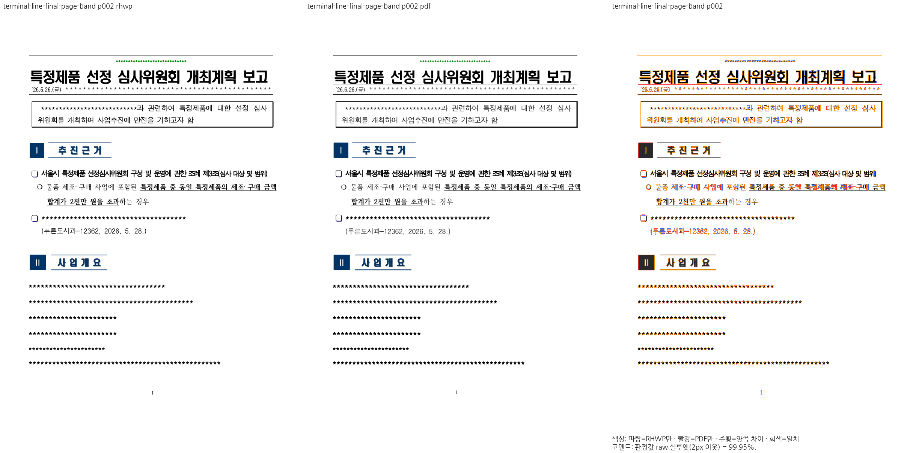
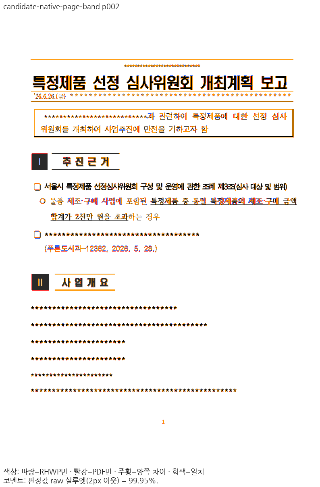

# PR #9065 리뷰 — 쪽 기준 띠 아래 빈 host와 합성 TAC 뒤 간격

## 최종 판정

**승인 — 원 PR 주장과 최종 통합 후보의 필수 로컬 검증 완료.** 원격 CI·push·병합은 아래 로컬 판정과 구분하며 exact-head CI 확인 후 진행한다.

## 접수와 적용

- 원 PR: [#9065](https://github.com/edwardkim/rhwp/pull/9065), 작성자 `planet6897`, head `c4fa5598ba272c405369571f637ee0028b1bc203`.
- 원 브랜치: `task/9055-page-band-empty-host-line`. reviewer `jangster77`을 API로 확인한 뒤 fetch·체리픽했다.
- 현재 고정 devel: `88170fd75f9d0ce156fe49d79aeabea9bb3a4bcc`. 이전 검증 base `dc3d0ff15e6e7cdb39138c72a5466994dea0e0d4`에서 충돌 없이 리베이스했으며, 기존 증거를 새 head의 실행으로 표시하지 않는다.
- 통합 순서: #8976 → #9064 → #9065 → #9067 → #9068, 원 15개 commit을 `-x`로 누적 적용했다. 충돌은 없었다.
- 통합 후보는 `review/integration-20261114-planet6897-open`이다. 원 fork 이력과 head는 수정하지 않았다.
- [원 SHA·적용 SHA](../assets/planet6897_integration_20261114/integration-provenance.json), [devel/PR·PR 간·누적 병합 시뮬레이션](../assets/planet6897_integration_20261114/merge-simulation.json)을 보존했다.
- #9068은 사용자의 명시적 추가 지시에 따라 최신 green CI head의 5개 커밋을 누적 적용했다. 초기 CI 오류 제외 분류를 현재 범위로 사용하지 않는다.

## 주장과 공통 소비 경로

쪽 기준 자리차지 표의 띠 아래 빈 host 줄과 원본 저장 사다리가 입증하는 합성 TAC 줄 뒤 간격을 보존한다.

`page_band_pushed_empty_host_line → paragraph_flow의 같은 띠 원장 → typeset 전진·layout 원점, stored_tac의 닫힘 간격`

문서 ID나 PDF 목표 수치로 맞추는 clamp를 추가하지 않았다. 유효한 저장 줄·HWP/HWPX 속성과 원본 제어 주소를 근거로 type/layout이 같은 흐름을 소비하는지 확인했다. 원 PR의 추가 10k 코퍼스 수치는 작성자의 선행 기록이며 이번 통합 head에서 실행한 전수 검사로 표시하지 않는다.

## 검증 입력·독립 Print

- 원문: [`samples/issue9055/36400525-page-band-empty-host-line.hwpx`](../../../samples/issue9055/36400525-page-band-empty-host-line.hwpx), SHA-256 `75aa3918f793c889be96a24e9dff4766fe85eaa0ed3413c7c7895ce24e84e3ee`.
- 독립 PDF: [`pdf/issue9055/36400525-page-band-empty-host-line-2020.pdf`](../../../pdf/issue9055/36400525-page-band-empty-host-line-2020.pdf), 4쪽, SHA-256 `9e4458071a21c7bd9e9d100672d6a5633fb2727402a5af523386bc3cd14b9495`.
- PDF Creator는 Hwp2020 0.0.0.0, Producer는 HancomPDF 1.3.0.550이다. 실제 데스크톱 한컴 2020 Print를 사용했다.
- 웹한글기안기/Cairo PDF로 판정하지 않았다. 유효한 기존 독립 Print를 재사용했으며 기준 PDF·점수·문턱을 바꾸지 않았다.
- canonical Visual Sweep, 96 DPI·compat2022·2px raw를 사용했다. 최소 글꼴에서 실행한 것은 회귀검사이며 Visual Sweep은 정상 설치 글꼴 환경이다.

## 시각 검증과 직접 판독

1쪽의 머리 표 아래 빈 줄·쪽 아래 표, 2·3쪽의 저장 사다리와 후속 문단 소속을 확인했다. 3쪽 별표의 미세한 래스터·위치 차이는 원 PR의 핵심 배치 결함과 구분하며 추가 보정하지 않았다.

- [전쪽 정밀값·입력/producer](../assets/planet6897_integration_20261114/claim-validation.json).
- [같은 입력/PDF의 devel 대비 페이지별 비교](../assets/planet6897_integration_20261114/base-candidate-comparison.json): 같은 PDF 쪽의 2%p 초과 하락은 없다. #9064의 base 3/Print 2쪽, #9067의 base 11/Print 10쪽은 알려진 쪽수 결함으로, 여분 쪽에 임의 PDF 점수를 만들지 않았다. 후보는 독립 PDF 전체 쪽수와 일치한다.
- 최종 코드 `5fa2645186`는 중첩 host·표 이어받기 뒤 간격·선행 공백 줄의 종료 글자 높이를 공통 경로에서 보정했다. 기존 [재사용 감사](../assets/planet6897_integration_20261114/claim-reuse-audit.json)는 이전 단계 기록이다. 현재 후보의 Native/fresh WASM 전체 재출력·보호 검증 결과로 최종 증적을 갱신했다. 과거 결과와 새 실행을 producer별로 구분한다.

- native: [전쪽 TSV](../assets/planet6897_integration_20261114/claims/page-band/native/silhouette.tsv) · 1쪽 [raw](../assets/planet6897_integration_20261114/claims/page-band/native/raw-001.png)/[Print PNG](../assets/planet6897_integration_20261114/claims/page-band/native/pdf-001.png)/[review](../assets/planet6897_integration_20261114/claims/page-band/native/review-001.png)/[overlay](../assets/planet6897_integration_20261114/claims/page-band/native/overlay-001.png) · 2쪽 [raw](../assets/planet6897_integration_20261114/claims/page-band/native/raw-002.png)/[Print PNG](../assets/planet6897_integration_20261114/claims/page-band/native/pdf-002.png)/[review](../assets/planet6897_integration_20261114/claims/page-band/native/review-002.png)/[overlay](../assets/planet6897_integration_20261114/claims/page-band/native/overlay-002.png) · 3쪽 [raw](../assets/planet6897_integration_20261114/claims/page-band/native/raw-003.png)/[Print PNG](../assets/planet6897_integration_20261114/claims/page-band/native/pdf-003.png)/[review](../assets/planet6897_integration_20261114/claims/page-band/native/review-003.png)/[overlay](../assets/planet6897_integration_20261114/claims/page-band/native/overlay-003.png)
- wasm: [전쪽 TSV](../assets/planet6897_integration_20261114/claims/page-band/wasm/silhouette.tsv) · 1쪽 [raw](../assets/planet6897_integration_20261114/claims/page-band/wasm/raw-001.png)/[Print PNG](../assets/planet6897_integration_20261114/claims/page-band/wasm/pdf-001.png)/[review](../assets/planet6897_integration_20261114/claims/page-band/wasm/review-001.png)/[overlay](../assets/planet6897_integration_20261114/claims/page-band/wasm/overlay-001.png) · 2쪽 [raw](../assets/planet6897_integration_20261114/claims/page-band/wasm/raw-002.png)/[Print PNG](../assets/planet6897_integration_20261114/claims/page-band/wasm/pdf-002.png)/[review](../assets/planet6897_integration_20261114/claims/page-band/wasm/review-002.png)/[overlay](../assets/planet6897_integration_20261114/claims/page-band/wasm/overlay-002.png) · 3쪽 [raw](../assets/planet6897_integration_20261114/claims/page-band/wasm/raw-003.png)/[Print PNG](../assets/planet6897_integration_20261114/claims/page-band/wasm/pdf-003.png)/[review](../assets/planet6897_integration_20261114/claims/page-band/wasm/review-003.png)/[overlay](../assets/planet6897_integration_20261114/claims/page-band/wasm/overlay-003.png)

## 필수 게이트·보호 검증

[최소 글꼴 전체 회귀](../assets/planet6897_integration_20261114/full-nextest-result.json)는 13,541통과·0실패·45skip이다. [Rust 검증](../assets/planet6897_integration_20261114/rust-validation.json)의 단계별 명령·exit code·요약·로그 SHA에서 fmt·manifest·unit tiers·집중 회귀·전체 회귀·Native Skia lib/PNG/PDF·Native/WASM/all-target Clippy·workspace build·관련 프런트엔드 검사를 확인했다.

[정본 보호 전쪽 검증](../assets/planet6897_integration_20261114/protected-validation.json)은 Native/fresh WASM 각각 18종·1,771쪽, 총3,542행이며 공식 두 자리 표시값 하락0쪽이다. Native 편람 HWPX383쪽 `--handbook-gate`도 통과했다. [상승 버전 수용 영수증](../assets/planet6897_integration_20261114/protected-baseline-update.json)과 정본 manifest는 실제 커밋한 최종 TSV를 가리키며 페이지별 최대값을 혼합하지 않았다.

회귀는 macOS 최소 글꼴 sandbox에서 실행했고 사용자 글꼴을 삭제하거나 비활성화하지 않았다. Visual Sweep은 정상 설치 글꼴 환경이다. Cargo 순차·jobs8·threads8·캡처 총8을 유지했다. fresh WASM은 Mac locked wrapper `--target web --out-dir pkg --no-opt`의 로컬 대체 빌드다. Docker 최적화 통과로 표시하지 않는다. 원 PR의 별도 대량 코퍼스 수치는 작성자의 기록으로 구분한다.

## 리베이스 기능 보존과 실제 소비

현재 base는 `88170fd75f9d0ce156fe49d79aeabea9bb3a4bcc`, 실제 검증한 구현은 `5fa2645186fc8bec4e53074aa6ff0af7ef67f0ca`다. 빌드 당시 parent와 미커밋 patch, 이후 같은 바이트를 커밋한 구현 SHA를 [producer](../assets/planet6897_integration_20261114/final-claim-producer.json)에서 구분한다. 리베이스는 충돌 없이 32개 커밋의 range-diff가 모두 같았다. 반영 #9007의 HWP/HWPX 무늬 대조 2종을 Native/fresh WASM으로 다시 출력해 각각 99.97%/99.99%를 확인했고, 무늬 6건·숨김 23건 집중 회귀도 통과했다. [현재 base 경로 감사](../assets/planet6897_integration_20261114/rebase-base-read-path-audit.json)는 이전 고정 base 결과의 재사용 범위와 실제 입력 바이트·XML 근거를 기록한다. base 쪽수 결함을 가상의 0% 결과로 만들지 않는다.

[실제 소비](../assets/planet6897_integration_20261114/actual-current-validation.json)는 기존 5개 쪽 경계의 화면/인쇄 × Canvas2D/CanvasKit compat/default 30건을 구분한다. 변경된 10만 정책은 반복 문서에서 새 6건을 캡처했고 CanvasKit 4건 모두 요청 backend로 실행됐다. 나머지 24건은 이전 직접 캡처의 적용 경로·현재 API 비교·같은 원본의 byte-identical raw/Print 증거로 재사용했다. 30건 전부를 새로 캡처했다고 쓰지 않는다. SVG는 새 2건의 PNG 해시를 재확인하고 변경 없는 8건을 재사용했다. 이전 5만 한도의 fallback 4건과 실패한 strict report는 이력으로 보존하며 현재 CanvasKit 통과에 합산하지 않는다.

[10만 정책](../assets/planet6897_integration_20261114/budget100k/validation.json)은 문서 전체 77,079작업·5쪽 완료와 실제 CanvasKit 인쇄 두 모드 raw100.00%를 확인한다. 128쪽·글꼴·payload·깊이 제한을 유지했고 합성 작업 예산 회귀 2건은 최소 글꼴 환경에서 통과했다. 독립 Print와 같은 기준·2px 허용을 유지한다.

## Merge 후 contributor PR comment 계획

통합 PR의 exact-head CI 성공·정상 병합을 확인한 뒤 원 PR에 한국어 존댓말로 감사와 통합 PR·merge SHA·CI를 남긴다. 위 원문·주장 페이지와 같은 raw/독립 Print PNG/review/overlay를 merge SHA 고정 raw URL의 **인라인 이미지**로 게시한다. 링크만으로 대신하지 않으며 게시 전에 응답 이미지 SHA를 검증하고 게시 후 API 본문을 재확인한다. 원 기여가 해결한 내용과 필요한 별도 보정을 구분한다. 유효한 데스크톱 Print의 실제 제품·버전과 전쪽 결과를 적고, 병합 전에는 원 PR·연결 이슈를 닫지 않는다. 원 fork branch는 보존한다.

## 대표 review·overlay

### page-band 2쪽

