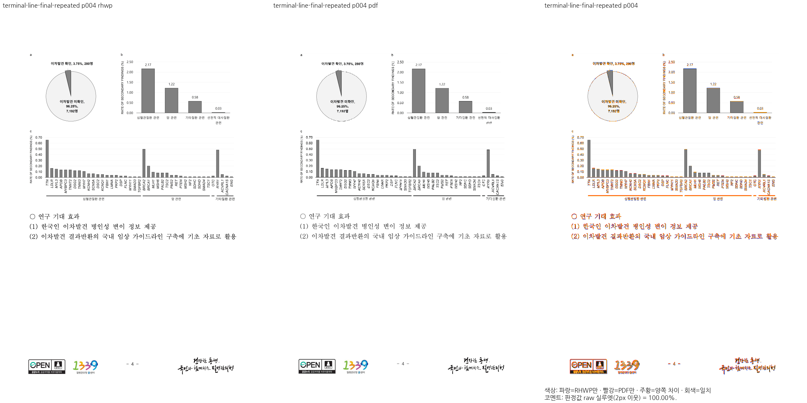
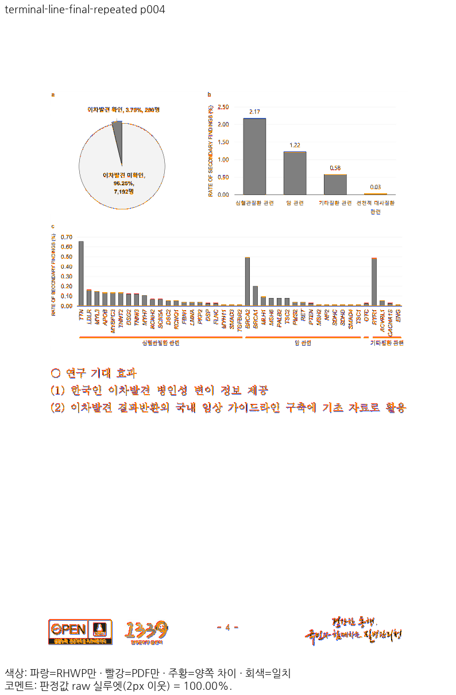
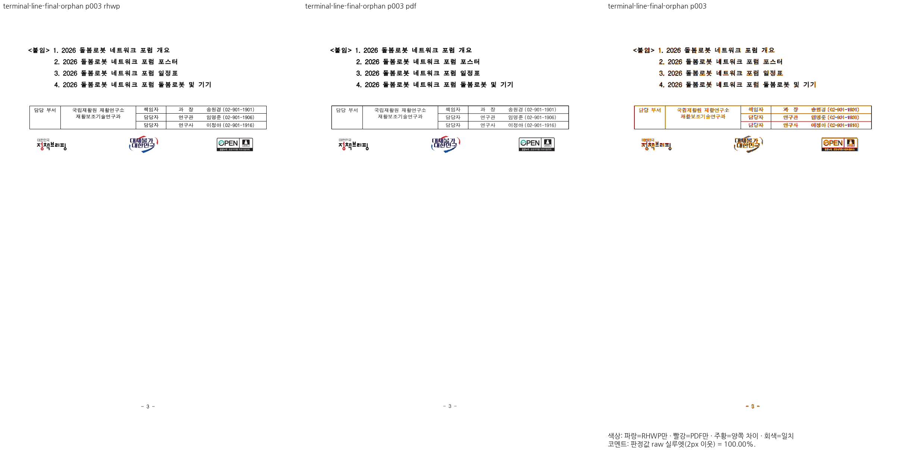
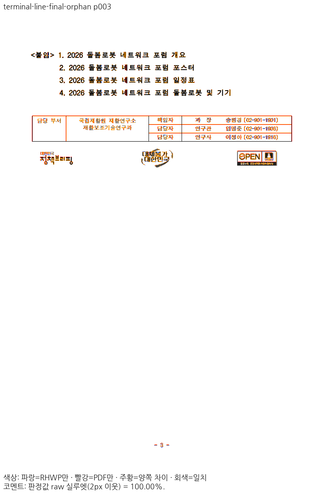
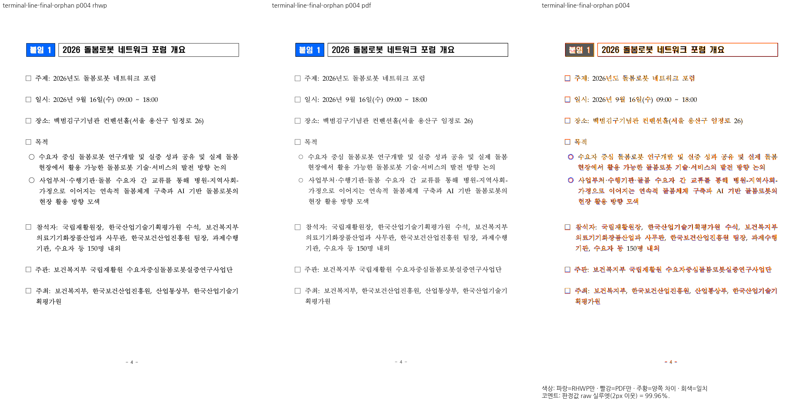
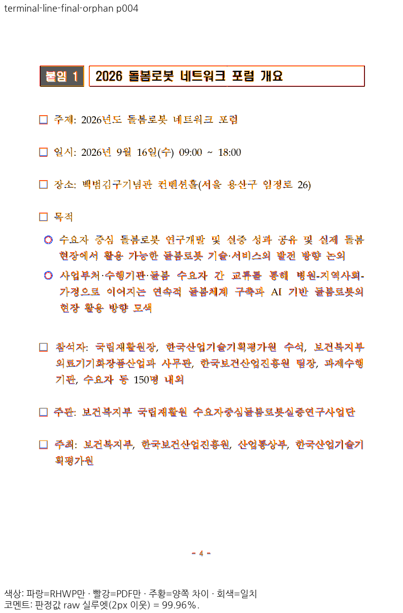

# PR #9068 리뷰 — 반복·짝 없는 숨김 끝 표지와 저장 줄 소유

## 최종 판정

**메인터너 보정 후 수용 가능 — 원 PR 주장과 최종 통합 후보의 필수 로컬 검증 완료.** 원격 CI·push·병합은 아래 로컬 판정과 구분하며 exact-head CI 확인 후 진행한다.

## 출처와 적용

- 작성자: `planet6897`.
- 원 PR: https://github.com/edwardkim/rhwp/pull/9068
- 원 head: `3da35b96822fb58ce4cc249d6ff4829185a17d06`.
- 통합 전: `d0bd67d60b44bd3c1db2048ab01cafa911675d0c`.
- 추가 직후: `b60aa5e4a7ac678fe51532f37c0bb861cff2c466`.
- 사용자의 추가 지시가 초기 CI 오류 제외 분류를 대체했다. 현재 원 head는 보안 코퍼스의 실제 U+200B 2개를 근거와 함께 처리해 CI가 통과했다.
- reviewer `jangster77` 지정 후 원본 head를 고정했다. contributor fork history를 rewrite하거나 push하지 않았다.
- [커밋별 대응·intake·CI](../assets/planet6897_integration_20261114/pr9068/intake-provenance.json).

## 원 PR 주장과 코드 검토

1. 한 문단에서 숨김 범위를 닫은 뒤 다시 저장된 끝 표지는 새 숨김 경계를 만들지 않는다. 시작한 적 없는 끝도 감쌀 범위가 없어 본문을 숨기지 않는다. 중복 활성 시작과 닫히지 않은 활성 범위는 계속 오류다.
2. 숨김 삭제로 이어진 문단 사슬은 원래 저장 문자 축과 줄 시작을 함께 대조하여 보이는 문단 끝을 지우지 않는다. 셀·캡션·각주 등 별도 소유자를 넘어 문단을 잇지 않는다.
3. 남은 내용을 전부 담은 마지막 셀 조각에는 줄간격까지 포함한 점유를 정렬 높이로 전달한다. 나눌 빈 공간이 없는데 줄간격 절반을 다시 가운데 정렬로 더하지 않는다.
4. 쪽 하단 빈 문단 흡수의 근거에는 실제 저장 줄만 사용한다. 합성 줄의 누적 vpos를 독립 쪽 경계로 인정하지 않는다.

판정 문턱·기준 PDF·텍스트 검출기를 완화하지 않았다. 이번 보정은 문서명·식별자·화면 좌표 예외가 아닌 저장 축과 조각 점유의 공통 계약이다.

## 입력·독립 기준·Native/fresh WASM 결과

두 PDF의 실제 Creator는 **한컴 2022 `12.0.0.4547`**, Producer는 `Hancom PDF 1.3.0.547`이다. 파일명에 2020이 있어도 실제 제품을 2020으로 표시하지 않는다. 데스크톱 Print 기준이며 웹한글기안기의 PDF는 판정 기준으로 사용하지 않는다.

| 사례 | 원본 | Print | Native/fresh WASM 쪽수 | Native / WASM 최저 raw |
| --- | --- | --- | ---: | ---: |
| 반복 끝 표지 | `samples/issue9026/press_release_repeated_hidden_end.hwpx` | `pdf/issue9026/press_release_repeated_hidden_end-print-2022.pdf` | 각각5/5 | 99.79582% / 99.79577% |
| 짝 없는 끝 표지 | `samples/issue9026/press_release_orphan_hidden_end.hwpx` | `pdf/issue9026/press_release_orphan_hidden_end-hwpx-2020.pdf` | 각각8/8 | 95.42298% / 95.42139% |

- 고정 base `dc3d0ff15e`의 실제 CLI는 두 입력 열기에 실패했다. 현재 후보의 열기 성공을 base의 시각 점수 상승으로 임의 환산하지 않았다.
- 반복 문서 4쪽: 그림과 「연구 기대 효과」 본문이 Print의 저장 줄 위치에 놓인다. raw 100.00%.
- 짝 없는 문서 3쪽: 「<붙임> 1.」 목록과 담당자 표·로고가 같은 쪽에 있고 4쪽은 「붙임 1」 제목 표로 시작한다. raw 3쪽100.00%, 4쪽99.96%.
- 새 fixture의 U+200B는 원본 XML 문단에서 2개를 직접 확인했다. 허용 목록 추가가 검출기 변경이나 새 문자를 숨기는 처리가 아님을 구분했다.
- 기존 통합 4문서 Native27쪽은 #9068 추가 전후 PNG SHA가 모두 같았다.
- [입력·PDF hash와 base 오류](../assets/planet6897_integration_20261114/pr9068/input-baseline-audit.json), [Native 측정 근거](../assets/planet6897_integration_20261114/pr9068/native-validation.json), [기존 27쪽 보존](../assets/planet6897_integration_20261114/pr9068/previous-claims-native-comparison.json).

- 최신 검증 base는 `88170fd75f9d0ce156fe49d79aeabea9bb3a4bcc`이며 원 15개 체리픽과 메인터너 보정은 [현재 출처](../assets/planet6897_integration_20261114/integration-provenance.json)에 기록했다. 위 추가 전후 SHA는 접수 이력이다.
- [최종 전체 정밀값·입력/PDF 해시](../assets/planet6897_integration_20261114/claim-validation.json), [Native/WASM producer](../assets/planet6897_integration_20261114/final-claim-producer.json), [직접 판독·동일 raw 재사용 근거](../assets/planet6897_integration_20261114/direct-reading-final.json).
- 반복 문서 전쪽 [Native TSV](../assets/planet6897_integration_20261114/claims/repeated/native/silhouette.tsv) / [WASM TSV](../assets/planet6897_integration_20261114/claims/repeated/wasm/silhouette.tsv), 짝 없는 문서 전쪽 [Native TSV](../assets/planet6897_integration_20261114/claims/orphan/native/silhouette.tsv) / [WASM TSV](../assets/planet6897_integration_20261114/claims/orphan/wasm/silhouette.tsv).
- #9044의 초기 쪽 나눔 손실 가설은 실제 원인으로 인정하지 않는다. 저장 문단 사슬과 합성 빈 문단 종료 예산의 실제 수정·독립 Print 결과를 기준으로 판단한다.
- #9028은 Center를 전역 Top 정렬로 바꾸지 않는다. 내용을 모두 담은 마지막 조각의 실제 점유를 공통 정렬 계산에 전달하며 정상 Center·미완료 조각 반례를 유지했다.

## 같은 주장 페이지의 증거

- 반복 문서4쪽: [raw](../assets/planet6897_integration_20261114/claims/repeated/native/raw-004.png) · [Print](../assets/planet6897_integration_20261114/claims/repeated/native/pdf-004.png) · [review](../assets/planet6897_integration_20261114/claims/repeated/native/review-004.png) · [overlay](../assets/planet6897_integration_20261114/claims/repeated/native/overlay-004.png).
- 짝 없는 문서3쪽: [raw](../assets/planet6897_integration_20261114/claims/orphan/native/raw-003.png) · [Print](../assets/planet6897_integration_20261114/claims/orphan/native/pdf-003.png) · [review](../assets/planet6897_integration_20261114/claims/orphan/native/review-003.png) · [overlay](../assets/planet6897_integration_20261114/claims/orphan/native/overlay-003.png).
- 짝 없는 문서4쪽: [raw](../assets/planet6897_integration_20261114/claims/orphan/native/raw-004.png) · [Print](../assets/planet6897_integration_20261114/claims/orphan/native/pdf-004.png) · [review](../assets/planet6897_integration_20261114/claims/orphan/native/review-004.png) · [overlay](../assets/planet6897_integration_20261114/claims/orphan/native/overlay-004.png).

fresh WASM에서도 반복4쪽, 짝 없는3·4쪽의 review와 standalone overlay를 직접 판독했다. 아래는 같은 페이지의 새 WASM 증거다.

- 반복4쪽: [review](../assets/planet6897_integration_20261114/claims/repeated/wasm/review-004.png) · [overlay](../assets/planet6897_integration_20261114/claims/repeated/wasm/overlay-004.png).
- 짝 없는3쪽: [review](../assets/planet6897_integration_20261114/claims/orphan/wasm/review-003.png) · [overlay](../assets/planet6897_integration_20261114/claims/orphan/wasm/overlay-003.png).
- 짝 없는4쪽: [review](../assets/planet6897_integration_20261114/claims/orphan/wasm/review-004.png) · [overlay](../assets/planet6897_integration_20261114/claims/orphan/wasm/overlay-004.png).

## 필수 게이트·보호 검증

[최소 글꼴 전체 회귀](../assets/planet6897_integration_20261114/full-nextest-result.json)는 13,541통과·0실패·45skip이다. [Rust 검증](../assets/planet6897_integration_20261114/rust-validation.json)의 단계별 명령·exit code·요약·로그 SHA에서 fmt·manifest·unit tiers·집중 회귀·전체 회귀·Native Skia lib/PNG/PDF·Native/WASM/all-target Clippy·workspace build·관련 프런트엔드 검사를 확인했다.

[정본 보호 전쪽 검증](../assets/planet6897_integration_20261114/protected-validation.json)은 Native/fresh WASM 각각 18종·1,771쪽, 총3,542행이며 공식 두 자리 표시값 하락0쪽이다. Native 편람 HWPX383쪽 `--handbook-gate`도 통과했다. [상승 버전 수용 영수증](../assets/planet6897_integration_20261114/protected-baseline-update.json)과 정본 manifest는 실제 커밋한 최종 TSV를 가리키며 페이지별 최대값을 혼합하지 않았다.

회귀는 macOS 최소 글꼴 sandbox에서 실행했고 사용자 글꼴을 삭제하거나 비활성화하지 않았다. Visual Sweep은 정상 설치 글꼴 환경이다. Cargo 순차·jobs8·threads8·캡처 총8을 유지했다. fresh WASM은 Mac locked wrapper `--target web --out-dir pkg --no-opt`의 로컬 대체 빌드다. Docker 최적화 통과로 표시하지 않는다. 원 PR의 별도 대량 코퍼스 수치는 작성자의 기록으로 구분한다.

## 리베이스 기능 보존과 실제 소비

현재 base는 `88170fd75f9d0ce156fe49d79aeabea9bb3a4bcc`, 실제 검증한 구현은 `5fa2645186fc8bec4e53074aa6ff0af7ef67f0ca`다. 빌드 당시 parent와 미커밋 patch, 이후 같은 바이트를 커밋한 구현 SHA를 [producer](../assets/planet6897_integration_20261114/final-claim-producer.json)에서 구분한다. 리베이스는 충돌 없이 32개 커밋의 range-diff가 모두 같았다. 반영 #9007의 HWP/HWPX 무늬 대조 2종을 Native/fresh WASM으로 다시 출력해 각각 99.97%/99.99%를 확인했고, 무늬 6건·숨김 23건 집중 회귀도 통과했다. [현재 base 경로 감사](../assets/planet6897_integration_20261114/rebase-base-read-path-audit.json)는 이전 고정 base 결과의 재사용 범위와 실제 입력 바이트·XML 근거를 기록한다. base 쪽수 결함을 가상의 0% 결과로 만들지 않는다.

[실제 소비](../assets/planet6897_integration_20261114/actual-current-validation.json)는 기존 5개 쪽 경계의 화면/인쇄 × Canvas2D/CanvasKit compat/default 30건을 구분한다. 변경된 10만 정책은 반복 문서에서 새 6건을 캡처했고 CanvasKit 4건 모두 요청 backend로 실행됐다. 나머지 24건은 이전 직접 캡처의 적용 경로·현재 API 비교·같은 원본의 byte-identical raw/Print 증거로 재사용했다. 30건 전부를 새로 캡처했다고 쓰지 않는다. SVG는 새 2건의 PNG 해시를 재확인하고 변경 없는 8건을 재사용했다. 이전 5만 한도의 fallback 4건과 실패한 strict report는 이력으로 보존하며 현재 CanvasKit 통과에 합산하지 않는다.

[10만 정책](../assets/planet6897_integration_20261114/budget100k/validation.json)은 문서 전체 77,079작업·5쪽 완료와 실제 CanvasKit 인쇄 두 모드 raw100.00%를 확인한다. 128쪽·글꼴·payload·깊이 제한을 유지했고 합성 작업 예산 회귀 2건은 최소 글꼴 환경에서 통과했다. 독립 Print와 같은 기준·2px 허용을 유지한다.

## Merge 후 contributor PR comment 계획

최종 통합 head의 검증·CI·정상 병합을 확인한 뒤 원 PR에 한국어 존댓말로 원 기여와 필요한 메인터너 보정을 구분해 설명한다. 위 주장 페이지의 raw·Print·review·overlay를 merge SHA에 고정한 인라인 이미지로 게시한다. 동일 쪽수·숨김 범위의 내용 보존·줄과 조각 소유를 확인한 이슈만 종료하며, 원 fork branch는 보존한다.

## 대표 review·overlay

### repeated 4쪽

### orphan 3쪽

### orphan 4쪽

