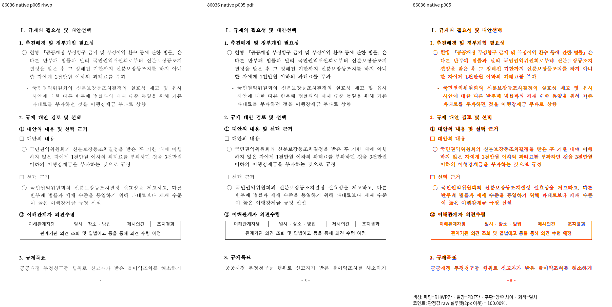
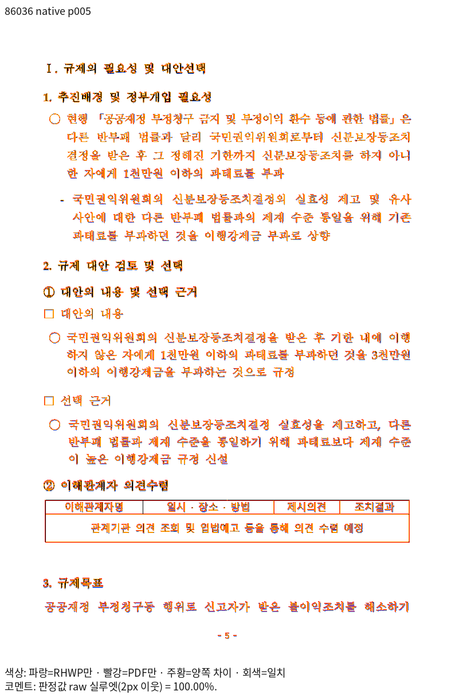
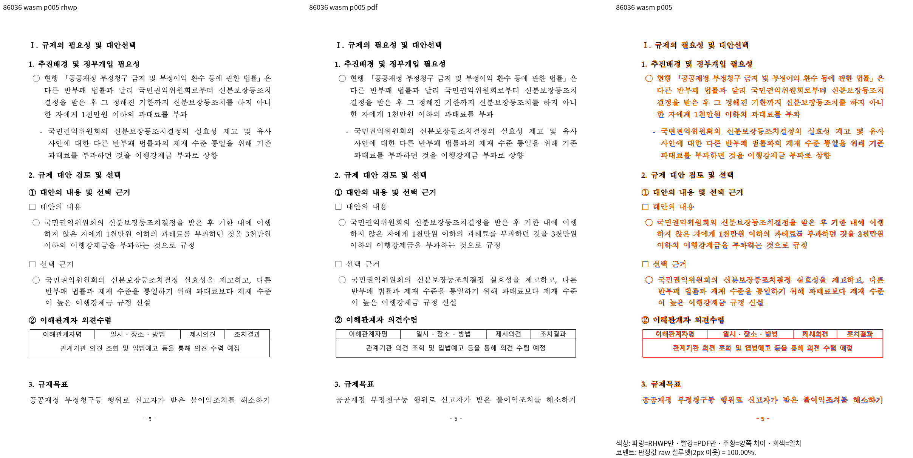
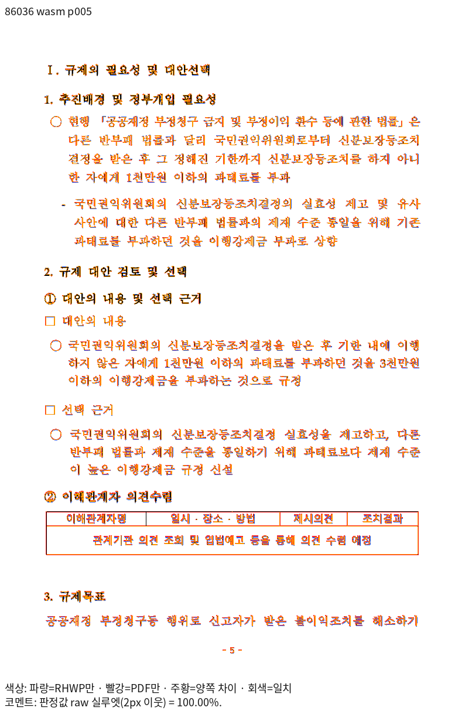
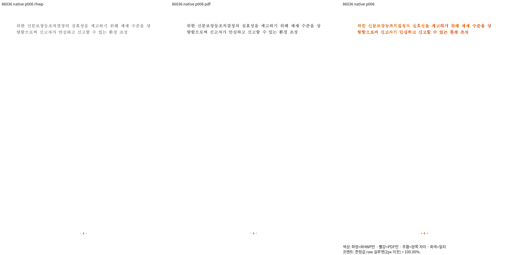
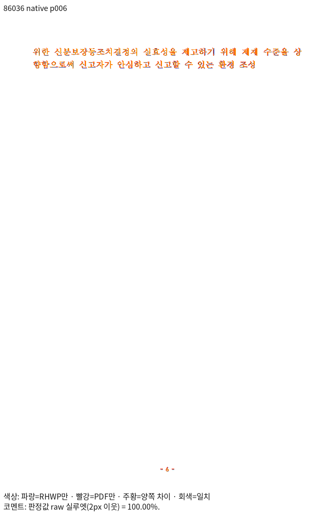
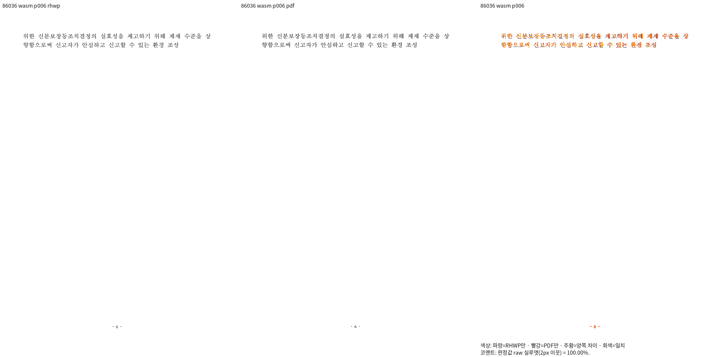
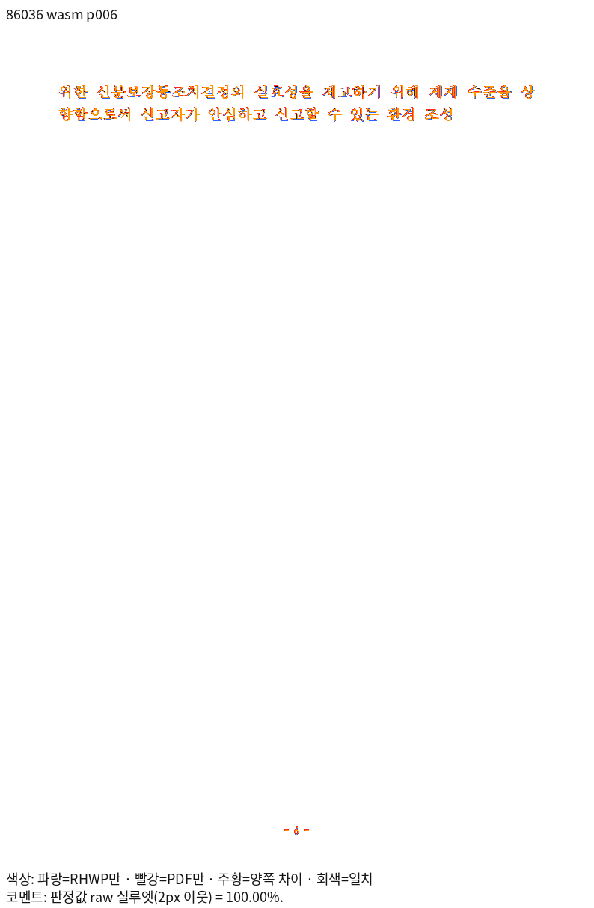

# PR #9075 리뷰 — 저장 줄의 쪽 재시작과 첫 표 조각 수용

## 최종 판정

**메인터너 보정 후 수용 가능 — #9060 해결 범위의 로컬 검증 완료.**
공개 86036의 첫 줄 분할 범위를 해결했다. Issue #9060의 ODA 문서 증상은 이 범위에 포함하지 않는다.
통합 code head의 필수 CI는 모두 성공했다. 이 문서-only trailing head의 실제 required check와 머지는 아직 남은 조건이다.

## 접수 정보

| 항목 | 값 |
| --- | --- |
| 원 PR | [PR #9075](https://github.com/edwardkim/rhwp/pull/9075), planet6897, devel 대상 |
| 관련 이슈 | [Issue #9060](https://github.com/edwardkim/rhwp/issues/9060), `Refs` |
| 원 head | `1309dbea65b7a95e25fa7d6abd3e10b5e65e5eb4` |
| 검토 base | `f8234f6f90cb25d9601c9d5d762e0a565aea19e4` |
| 통합 branch | `review/pr-9075-rowbreak-integration` |
| reviewer | jangster77 |
| 실제 입력 | `samples/issue9060/86036-rowbreak-first-line-fragment.hwpx` |
| 입력 SHA-256 | `f224d490226b3673554b484d6ce1e2b1c3bbaf0aac02340706edf5fc9d0a4025` |
| 독립 Print | `pdf/issue9060/86036-rowbreak-first-line-fragment-2020.pdf`, 14쪽 |
| PDF SHA-256 | `c9ba8e9d4b4e2cb32277d030161dedb59d9067eba0a4665b40f9c0b46cc47317` |

원 기여 2개는 `ddcc8768144cf105f452ac95274670717a59610b` →
`c5935bb132ac431f633660189156862398ef1464`,
`1309dbea65b7a95e25fa7d6abd3e10b5e65e5eb4` →
`377046ccd8a8115a182ab7711f6e2ce74144d69d`로 각각 체리픽했다.

## 원 PR의 주장과 실제 검사 범위

| 주장 | 확인할 최종 근거 |
| --- | --- |
| 독립 Print 14쪽과 동일한 쪽 구성 | 원본 전체 Native/fresh WASM TSV·실제 exporter의 전체 쪽수 영수증 |
| 5쪽 아래에 표 첫 줄 수용 | 같은 원본 5쪽 Native/fresh WASM review·overlay, 문단 41 표 조각의 실제 소유 글줄 1개 |
| 6쪽에 나머지 두 줄 배치 | 같은 원본 6쪽의 두 경로 review·overlay, 나머지 소유 글줄 2개 |
| 7쪽에 후속 본문 배치 | 두 경로 render tree의 문단 43 내용과 독립 Print 7쪽의 실제 내용 |
| 내용 누락·중복 없음 | 원본 셀 전체 텍스트와 두 조각을 합친 텍스트의 일치, 각 조각이 대응 Print 쪽에 정확히 한 번 존재 |
| 저장 재시작이 없는 표의 동작 유지 | 조건을 넓히지 않은 코드 경계와 기존 정상 대조군의 원본 출력 증거 |

이 검증은 공개 86036 입력에 해당한다. Issue #9060에 함께 기록된 ODA 문서의 별도 증상까지
해결했다고 판정하거나 이슈 전체를 닫지 않는다.

## 조판 원칙과 구현 소비 경계

내부 `RowBreak`는 HWP5 TABLE 하위 bit 값 2/HWPX `CELL`의 글줄 나눔을 뜻한다.
원 PR 본문의 ‘셀 단위 나눔’ 표현을 한컴 UI의 셀 전체 이월 정책과 혼동하지 않는다.

`src/renderer/typeset/table/block/prepare.rs`에서 같은
`advance_row_cut_for_physical_band` 결과를 먼저 확인한다. 첫 유닛이 실제 저장 줄의
쪽 재시작에서 멈추고, 일부 내용을 소비했으며, 전체 행을 소비하지 않은 경우에만 그 내용 높이와
칸 여백으로 `row_content_fits_page_rest`를 판정한다. 이후의 부분 배치가 같은 컷을 사용한다.
문서 ID·쪽 번호·절대 px 보정이나 출력 마스킹을 사용하지 않는다. 저장 정보는 원본 HWPX의
`0, 0, 2252` 줄 위치로 확인한다. 재시작 없는 임의 첫 줄 수용으로 조건을 넓히지 않는다.

관계형 검사는 표 조각과 앞뒤 본문의 소유·순서를 검사하며, 고정 쪽수 14는 독립 PDF의
전체 쪽수와 실제 대응 내용 보존을 함께 확인한다. 작은 합성 글꼴 검사는 실제 FontFace 공급·
프로필·glyph 소유 계약의 증거이며 실물 PDF 일치 증거를 대신하지 않는다.

## 메인터너 보정

- Native Print의 소수 원점과 윤곽 기하를 compat 세대와 무관하게 보존한다.
- 실제 glyph가 같은 family의 다른 프로그램에 있을 때 합성 기울임이 그 공급자를 찾도록 한다.
- 내부 서식 ID가 생략된 PUA 겹침은 원 제어 슬롯의 서식을 상속하고 명시적 0번은 유지한다.
- 원본 HFT en dash의 일반 전진·중심 배치와 미확인 굵게 공급자의 폭·원점을 구분한다. 독립 일반 1em을 굵게에 상속하지 않는다.
- Canvas Print 그림의 소수 목적 영역에서 부분 픽셀 덮임과 기존 테두리를 보존한다.
- 실제 주 FontFace의 확인된 일반 glyph는 Print에서 같은 프로그램의 기하를 소비한다.
  미확인 앞 후보·동반 프로그램·다른 unicode-range는 추정하지 않는다. 공통 빈 기호 제외와
  실제 CSS family 파서를 재사용한다. Screen·문맥 shaping·조판 전진은 변경하지 않는다.

위 보정은 원 PR을 검토하면서 실제 보호 대조에서 발견한 공통 소비 경계를 대상으로 한다.
원본 문서와 기준 PDF를 변경하거나 재인쇄하지 않았으며 비공개 글꼴을 배포하지 않는다.
공개 테스트 자원은 각 파일에 이미 동봉된 OFL/MIT 고지를 따른다.

## 출력 제품과 측정 조건

원 PR은 engine 2020 Print로 설명하지만 첨부 PDF의 Creator는
`Hwp 2022 12.0.0.4547`, Producer는 `Hancom PDF 1.3.0.547`이다.
저장 제품·파일명으로 실제 인쇄 제품 연도를 단정하지 않는다. 원 PDF를 그대로 사용하고
compat 2022·Print·96 DPI·색상 경계 보정 전 2px raw로 두 경로를 대조한다.
PDF 메타데이터와 작성자의 설명을 구분한 원문 기록을 연결한다.

## 완료한 로컬 검증

통합 [PR #9088](https://github.com/edwardkim/rhwp/pull/9088)의 code head는
`0a8afd62bc955c8125e4238c9afc4117eeb4e683`이며 제품 source는
`c95f9ade4e8acf9d901c01136ef2b9bacd60c497`다. 최종 증적 commit은
`135f04604cbddc8ce8aa3aae579ce92b2d74a7b4`다. 이후 제품·회귀 코드는 바꾸지 않았고,
검증한 생성 타입 선언의 순서와 문서·수용 출처만 반영했다.

| 검증 | 실제 결과 |
| --- | --- |
| 원 문서 Native/fresh WASM | 각각 전 14쪽 raw 100.00%, 실제 exporter 쪽수 14 |
| 전체 Rust·최소 공개 글꼴 | 13,583 PASS, 실패 0, 설정상 제외 45 |
| 원 주장·내용 보존 회귀 | 기본·Native 각각 4 PASS |
| Native 라이브러리 | 본체 3,853·보조 crate 182 PASS, 설정상 ignored 12 |
| Native 그림·직접 PDF | 2·36 PASS |
| Rust 필수 14단계 | suite·fmt·계층·전체·Native·Clippy·workspace 전부 exit 0 |
| 보안·변경 Native suite lint | 신규 원본 1개 실제 전달, 보안 20 PASS·Native lint exit 0 |
| fresh 최적화 WASM·Canvas browser | 빌드 exit 0, 23 PASS |
| Studio | Node 2,796 PASS, binding/embed 3 PASS, 타입·production build exit 0 |
| 특별 보호 전쪽 | 36개 데이터셋·3,542행, 상향 기준 대비 하락 0·누락 0·추가 상승 0 |
| 실제 필수 편람 Native gate | 전 383쪽 통과, 최저 99.96%; 130쪽 WMF 차이 포함 |
| 새 base 동일 환경 대조 | Native/fresh WASM 총 778행, 2%p 초과 하락 0 |
| 상향 출처 계약 | Python 21 PASS, 실제 383쪽 manifest와 같은 8f 기준 재대조 통과 |

실제 명령·로그 해시·터미널 요약은 [최종 검증 기록](../assets/issue_9060/verification-record.md),
프로그램·환경은 [공급 조건](../assets/issue_9060/final/main/conditions.md),
전체 보호값·조건·TSV는 [보호 대조](../assets/issue_9060/final/protected/README.md)와
[수용 계약](../assets/issue_9060/final/protected-validation.json)에 연결한다.
동일 최종 전쪽 결과의 상승 30행을 보호 하한으로 수용했고, 이번 최종 제품에서도 그 하한을 유지했다.
서로 다른 실행의 페이지별 최댓값을 조합하지 않았다.

새 굵게 반례 두 건은 수정 전 FAIL·수정 후 PASS이며 기존 일반 대조군 네 건도 유지했다.
CBTA 47쪽 Native는 98.61% → 99.18%로 개선하고 같은 Native base의 원점을 복구했다.
fresh WASM은 자체 base와 같은 98.54%·원점을 유지한다. 서로 다른 backend의 원점을 같다고
요구하지 않는다. 일반 중첩 표 17쪽은 양쪽 최저 98.59%로 보호값을 유지했다.
[실제 최종 47쪽 review·overlay와 분석](../assets/issue_9060/hft-bar-style-coverage-analysis.md)을
원 PR 86036의 증적과 구분한다.

현재 base f823에서도 원 입력은 두 경로 모두 15쪽이고 표 조각은 6·7쪽, 후속 제목은 8쪽이었다.
후보는 독립 Print처럼 14쪽과 5·6·7쪽의 내용 소속으로 복구했다.
[변경 전 같은 원본의 대응 TSV·review·overlay](../assets/issue_9060/final/main/README.md#같은-최신-base의-변경-전-출력)를
최종 통과 자료와 구분하며 PDF에 없는 base 15쪽의 점수를 만들지 않았다.

## 같은 원본·주장 페이지의 최종 증적

[Native 전 14쪽 TSV](../assets/issue_9060/final/main/native_silhouette.tsv) ·
[fresh WASM 전 14쪽 TSV](../assets/issue_9060/final/main/wasm_silhouette.tsv).
아래는 공개 86036 원본의 5·6쪽이며, 각 경로의 raw는 모두 100.00%다.

### 86036 5쪽

| 경로 | review | overlay |
| --- | --- | --- |
| native |  |  |
| wasm |  |  |

### 86036 6쪽

| 경로 | review | overlay |
| --- | --- | --- |
| native |  |  |
| wasm |  |  |

## 원격 CI와 남은 머지 조건

검증 시각: 2026-11-15T14:50:15.139070+09:00.

정확한 code head `0a8afd62bc955c8125e4238c9afc4117eeb4e683`에서 아래 workflow와 required `Build & Test`, GHAS `CodeQL`, trusted impact 상태가 모두 성공했다. 이때 GitHub mergeability는 `MERGEABLE`, merge state는 `CLEAN`이었다.

| workflow | 실제 결과 | 실행 |
| --- | --- | --- |
| Adapter inter-diff | success | [run 43680269627](https://github.com/edwardkim/rhwp/actions/runs/43680269627) |
| CI | success | [run 43680269628](https://github.com/edwardkim/rhwp/actions/runs/43680269628) |
| CodeQL | success | [run 43680269635](https://github.com/edwardkim/rhwp/actions/runs/43680269635) |
| Proptest roundtrip | success | [run 43680269699](https://github.com/edwardkim/rhwp/actions/runs/43680269699) |
| Render Diff | success | [run 43680269682](https://github.com/edwardkim/rhwp/actions/runs/43680269682) |

| CI 실제 실행 범위 | 결과 | 근거 |
| --- | --- | --- |
| Archive A | 3,796 PASS / 12 skipped | [실제 로그](https://github.com/edwardkim/rhwp/actions/runs/43680269628/job/132713005200) |
| Archive B | 3,225 PASS / 3 skipped | [실제 로그](https://github.com/edwardkim/rhwp/actions/runs/43680269628/job/132713599567) |
| Archive C | 2,930 PASS / 18 skipped | [실제 로그](https://github.com/edwardkim/rhwp/actions/runs/43680269628/job/132713435496) |
| Archive D | 1,294 PASS / 4 skipped | [실제 로그](https://github.com/edwardkim/rhwp/actions/runs/43680269628/job/132712480372) |
| Archive E | 2,144 PASS / 8 skipped | [실제 로그](https://github.com/edwardkim/rhwp/actions/runs/43680269628/job/132713497404) |
| Archive A~E 합계 | 13,389 PASS / 0 FAIL / 45 skipped | 정책이 선택한 CI 범위이며 로컬 전체 13,583 PASS와 구분 |
| Native Skia·Frontend·lint | success | [CI job 목록](https://github.com/edwardkim/rhwp/actions/runs/43680269628) |

code candidate 이후에는 이 리뷰와 오늘할일만 같은 통합 PR의 single-parent trailing commit으로 반영한다. source·test·workflow 변경을 섞지 않고 최신 devel과의 실제 merge tree에서 문서·링크·기록 보존을 확인한 뒤 push한다. trailing head의 required check·재사용 판정·mergeability를 확인한 후에만 머지한다. 아직 실행 전인 trailing head CI·머지를 완료로 기록하지 않는다.

CI workflow·실행 판정 정책은 수정하지 않았으므로 일반 trailing 경로를 적용한다.

## 병합 후 원 PR 후속 처리

통합 PR의 정확한 head CI, review·오늘할일 기록과 최신 head CI를 확인하고 머지한다.
증적이 devel에 실제 존재한 뒤 merge SHA로 고정한 같은 입력 5·6쪽 이미지·TSV·CI 결과를
원 PR에 한국어 존댓말 댓글로 게시하고 재조회한다. 통합이 완료된 원 PR #9075는 닫되,
미해결 ODA 범위가 있는 Issue #9060은 유지한다. devel 동기화와 해당 작업의 종료 정리를 완료한다.
