# PR #9098 검토

## 최종 판정

**승인 — 원 PR의 주장 범위와 통합 후보의 필수 로컬 검증을 확인했습니다.** 통합 PR의 정확한 최신 head CI·병합 확인은 별도 원격 조건이며, 원 PR의 contributor 브랜치를 다시 쓰지 않았습니다.

검토 갱신: 2026-11-16 22:31:31 KST.

## 접수와 출처

- [원 PR #9098](https://github.com/edwardkim/rhwp/pull/9098) · `planet6897` · 원 head `cb888d8497151b089c029d1b963ab2952d4e7c06` · [해결 이슈 #9087](https://github.com/edwardkim/rhwp/issues/9087). reviewer `jangster77`를 확인했습니다.
- 브랜치 `review/integration-20261116-planet6897`. 고정 초기 base `ae9277dda0ca17be279cba89c4deea74fb75dcae`, 최종 리베이스 base `27ba0333b358758ac71e976849a663e8a86fe6ff`, 로컬 검증 head `9bed2ea288a9db3b4a7e03c4a3e4abd8129b5b85`.
- #9078·#9080의 공유 커밋은 한 번만 적용했으며 고유8개 커밋을 누적했습니다. [체리픽 출처](../assets/planet6897_20261116/intake-provenance.json).
- 렌더 생산 source `0d587554b804183b5cc6d090f396acc47525c089`와 리베이스 후 동일한 일반 Native/WASM 소비 경로를 구분합니다. 새 #9136 dialog는 실제 E2E, #9132의 선택적 GPU 코드는 집중 회귀로 확인했습니다. [리베이스·실행 근거](../assets/planet6897_20261116/final/rebase-validation.json).

## 변경과 검토 범위

신명 순명조 HFT의 라틴·숫자·문장 부호를 독립 Type3 폭 표로 측정하며 기존 굵기 전진 경로로 연결합니다. 실제 메트릭 hit·공백·원본 프로그램이 그리지 않는 글자에 대한 비적용을 구분했습니다. 첨부 탐침 2종 각4쪽을 검증했으며 원 PR의 대규모 외부 코퍼스 수치를 새 통합 결과로 인용하지 않습니다.

조판 원칙은 원본 저장 속성→측정→글줄/행/표 높이→배치·paint의 같은 계약입니다. 문서명·페이지별 예외나 임의 px 이동, 실제 회귀를 숨기는 기대값 완화는 추가하지 않았습니다. [선행 분석](../assets/planet6897_20261116/intake-analysis.md).

## 검증 입력과 결과

기준은 원 PR 첨부 **데스크톱 한컴 2022 12.0.0.4547 Print → Hancom PDF**입니다. 저장 제품 연도와 출력 제품을 구분했으며 **웹한글기안기 PDF를 검증 기준으로 사용하지 않았습니다**. [원본·Print 출처와 해시](../assets/planet6897_20261116/claim-input-audit.json), [실제 사용 입력57개 커밋 감사](../assets/planet6897_20261116/final/committed-input-audit.json).

| 입력 | 독립 Print/후보 쪽수 | Native 전쪽 raw (%) | fresh WASM 전쪽 raw (%) |
| --- | ---: | --- | --- |
| `hft-sinmyeong_sunmyeongjo-probe.hwpx` | 4 / 4 | 100.00 / 100.00 / 99.66 / 97.42 | 100.00 / 100.00 / 99.66 / 97.39 |
| `hft-sinmyeong_sunmyeongjo-bold-probe.hwpx` | 4 / 4 | 100.00 / 100.00 / 99.66 / 97.60 | 100.00 / 100.00 / 99.66 / 97.51 |

canonical Visual Sweep·96DPI·compat2022·Print·2px의 색상 경계 보정 전 raw입니다. 원 글꼴을 공급하는 일반 Mac 환경에서 출력했습니다. [전체 원문 TSV·생산자](../assets/planet6897_20261116/claim-evidence-index.json), [base/후보36개 페이지 대조](../assets/planet6897_20261116/final/base-head-comparison.json). 2%p 초과 하락은0입니다. 서식·SQUEEZE의 base 추가2쪽은 독립 PDF에 없는 원 결함으로 기록했으며, base 전체가 통과했다고 하지 않습니다. 후보는 PDF의 전쪽을 검증했습니다.

- 최소 글꼴 전체 nextest: **13,634 PASS·0 FAIL·45 skip**, 실제 head `2e3e6698d198cf09189105746a2ed8e988ac4b0d`, 821.026초. 리베이스 전후 일반 조판·WASM 경로 동일성과 최신 head 집중30PASS·선택적 Native GPU5PASS를 분리했습니다.
- fmt·Native/WASM/workspace all-target Clippy·workspace build·suite 정책·Native Skia3종 PASS. Native Skia 실제 합계 **4,072 PASS**. [명령과 실제 SHA](../assets/planet6897_20261116/final/rust-validation.json).
- Studio unit **2,805 PASS·0 FAIL·2 skip**, TypeScript와 dialog viewport·autosave 복구 E2E PASS. [최종 프런트엔드 기록](../assets/planet6897_20261116/final/frontend-validation.json).
- 보호18문서 Native/fresh WASM 각각1,771쪽, 합계 **3,542행·하락0·상승0**. 편람 HWPX Native383쪽은 `--handbook-gate`로 실행했습니다. 수용 상승이 없어 정본 baseline은 바꾸지 않았습니다. [원문 TSV와 판정](../assets/planet6897_20261116/final/protected-validation.json).
- 실제 Studio7개 대표 쪽×screen/print×Canvas2D/CanvasKit compat/default **42상태**에서 실제 backend·프로필·자원 준비를 확인했습니다. 초기 nested 한양신명조 fallback4건은 CK 통과로 사용하지 않고, 설치된 전체 원형 글꼴 공급으로6상태를 보완했습니다. [신원·범위·원 제약](../assets/planet6897_20261116/final/actual/validation.json).
- CanvasKit은 software surface입니다. backend 간 report-only 픽셀 대조28건은 문턱을 넘으며 **픽셀 동일성 PASS가 아닙니다**. 실제 내용·소유·줄·개체 보존을 직접 확인했고, 독립 PDF 수용은 별도 Native/fresh WASM 전쪽 TSV로 판정했습니다. 자동 GPU readiness나 문서 전쪽 Studio 완성을 주장하지 않습니다.
- Mac locked wrapper `--target web --out-dir pkg --no-opt`의 로컬 fresh WASM입니다. Docker 최적화 결과가 아닙니다. root pkg·Studio public 해시와 실제 초기화 응답을 확인했으며 Vite JS URL 재작성/source map과 원본 바이트 해시를 구분했습니다.

## 메인터너 보완

한양중고딕 원본 `H2GTRM.TTF`의 설치 이름 HY중고딕/HYGothic-Medium을 원본 별칭으로 연결했습니다. 기존 TTF→TTC→OTF/CFF 선택을 일반 고딕 대체보다 먼저 사용하며, 설치되지 않은 전용 글꼴을 전제하지 않는 관계형 검사를 추가했습니다. 실제 Native 영수증의 이전 CFF→원본 TTF 변화와 canonical Native/WASM 양쪽의 실제 소비를 확인했습니다. 임시 기호 하나만의 글꼴은 제거했고 비공개 원본 바이너리를 Git에 넣지 않았습니다. [프로그램 선택 근거](../assets/planet6897_20261116/font-order/current-selection/README.md).

기존 결측 전진이 CJK 전각 기호를0.5em으로 재는 반례를 독립 Print에서 확인해 U+3001–303F 중 Unicode 폭2 문자의 결측 전진만1em으로 보완했습니다. 실제 메트릭·반각·결합 문자·U+303F는 유지했습니다. 수정 전2FAIL→후2PASS이며 3쪽 양 backend99.66%와 직접 판독 뒤 독립 원점±2px 검사를 추가했습니다. 독립 PDF의 ToUnicode·Type3 Widths/FontMatrix도 원본마다100문자씩 재파싱해 현재 표와 누락0·차이0을 확인했습니다. [Type3 감사](../assets/planet6897_20261116/final/source-type3-width-oracle-audit.json). 4쪽97%대의 잔여 글리프 차이를100%로 주장하지 않습니다.

## 시각 증적과 직접 판독

원 PR의 주장 쪽과 같은 원본·PDF·backend를 대응합니다. 대표 raw16개는 새 frozen source 재출력과 기존 정식 이미지가 바이트까지 같아 재사용했습니다. [신원 대조](../assets/planet6897_20261116/final/main-representative-reuse-audit.json), [직접 판독](../assets/planet6897_20261116/final/direct-reading.json). `pixel_match`·`visual_accuracy_proxy_percent`는 이 silhouette-only 실행의 판정값이 아니므로 미산출로 구분합니다. raw90% 미만·누락 쪽은0이며 수치만으로 글리프·간격을 완전 일치로 해석하지 않습니다.

### `hft-sinmyeong_sunmyeongjo-probe` 3쪽

| 경로 | raw | review | overlay |
| --- | --- | --- | --- |
| native | 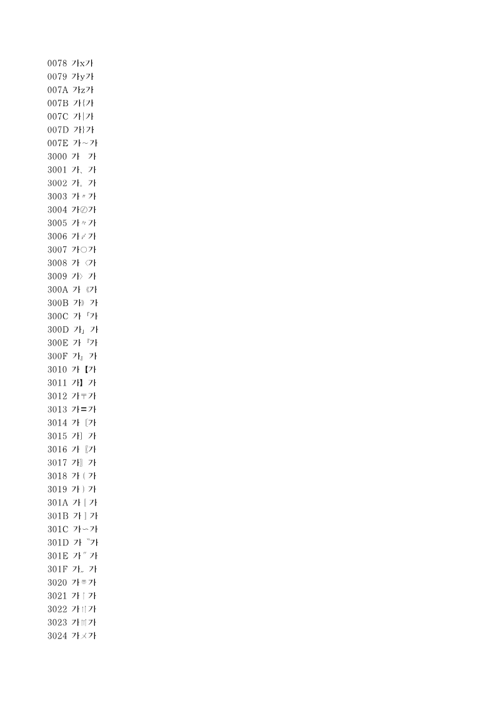 | 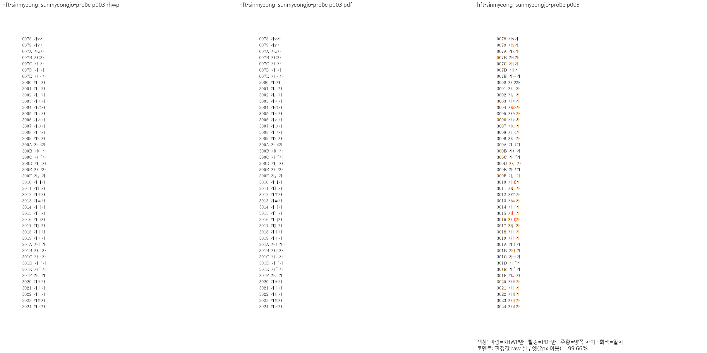 | 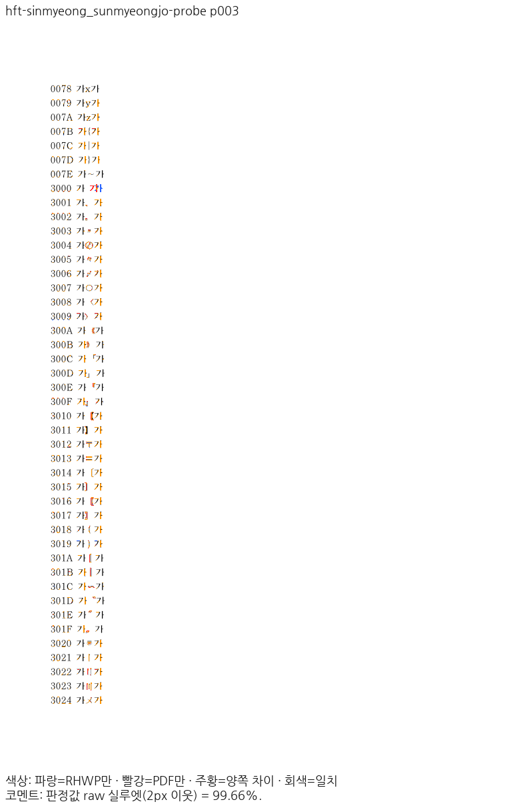 |
| wasm | 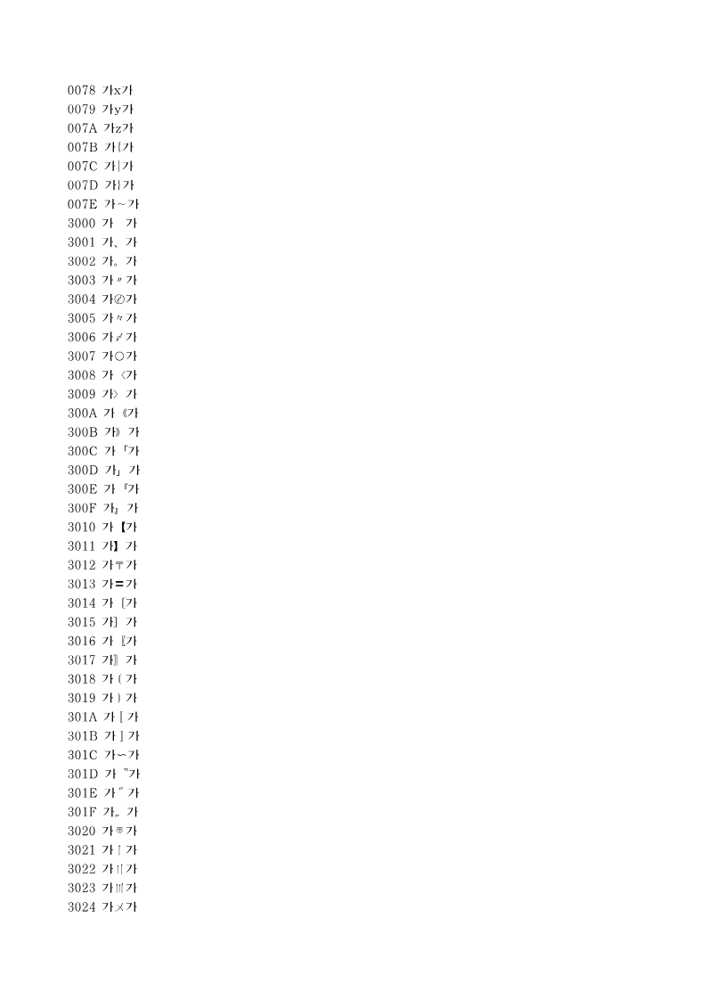 | 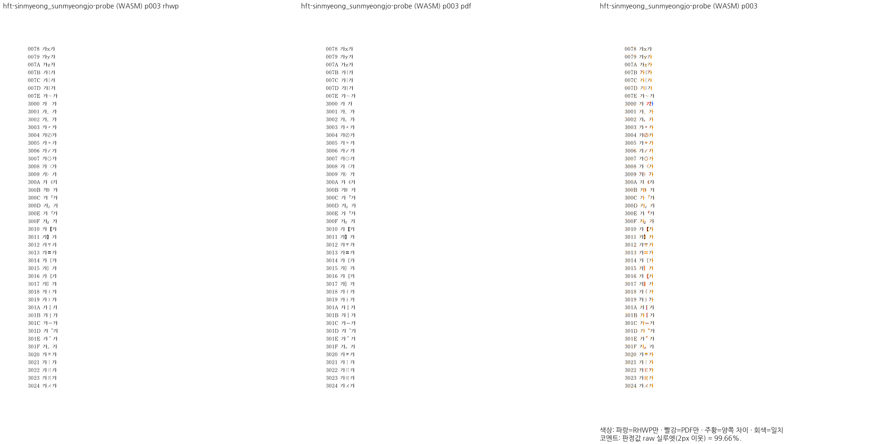 | 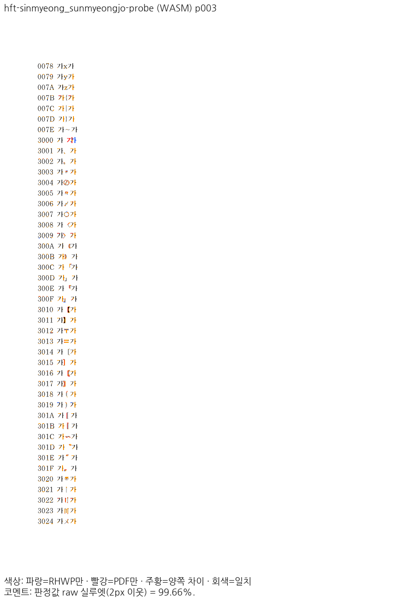 |

### `hft-sinmyeong_sunmyeongjo-bold-probe` 1쪽

| 경로 | raw | review | overlay |
| --- | --- | --- | --- |
| native | 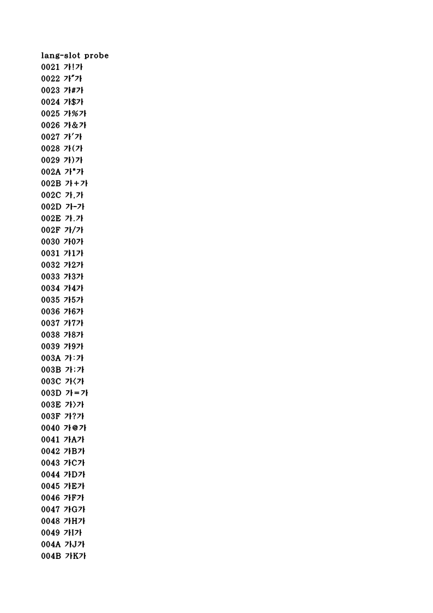 | 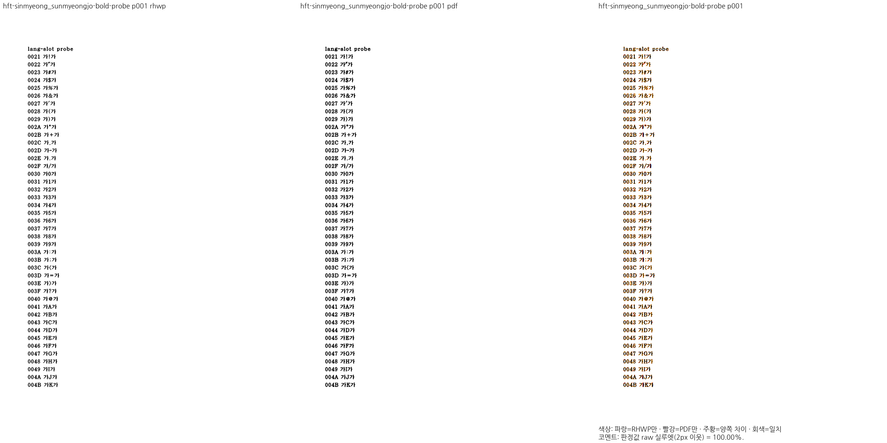 | 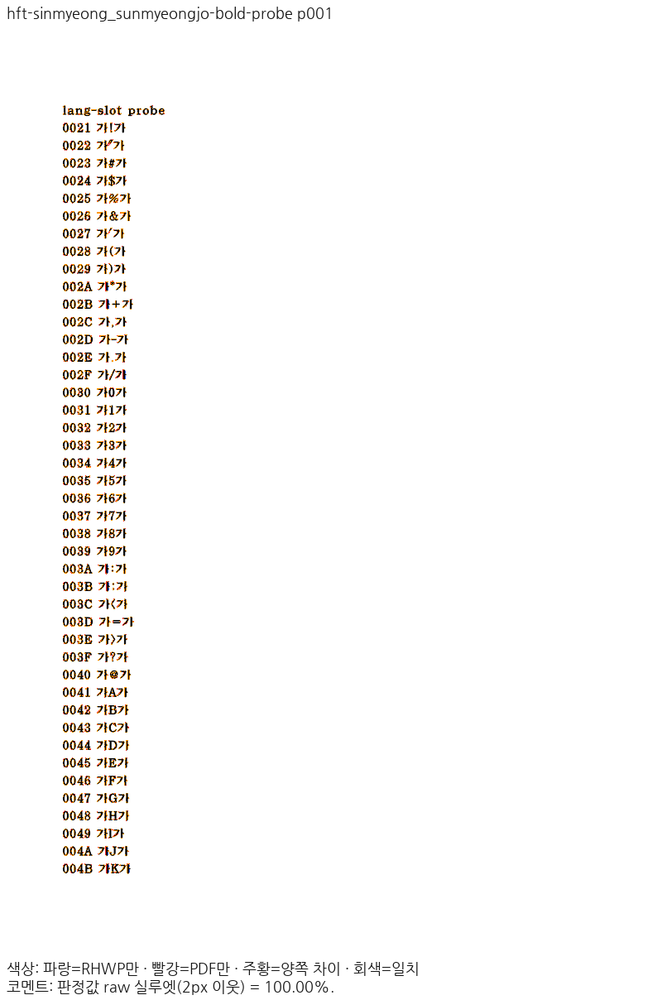 |
| wasm | 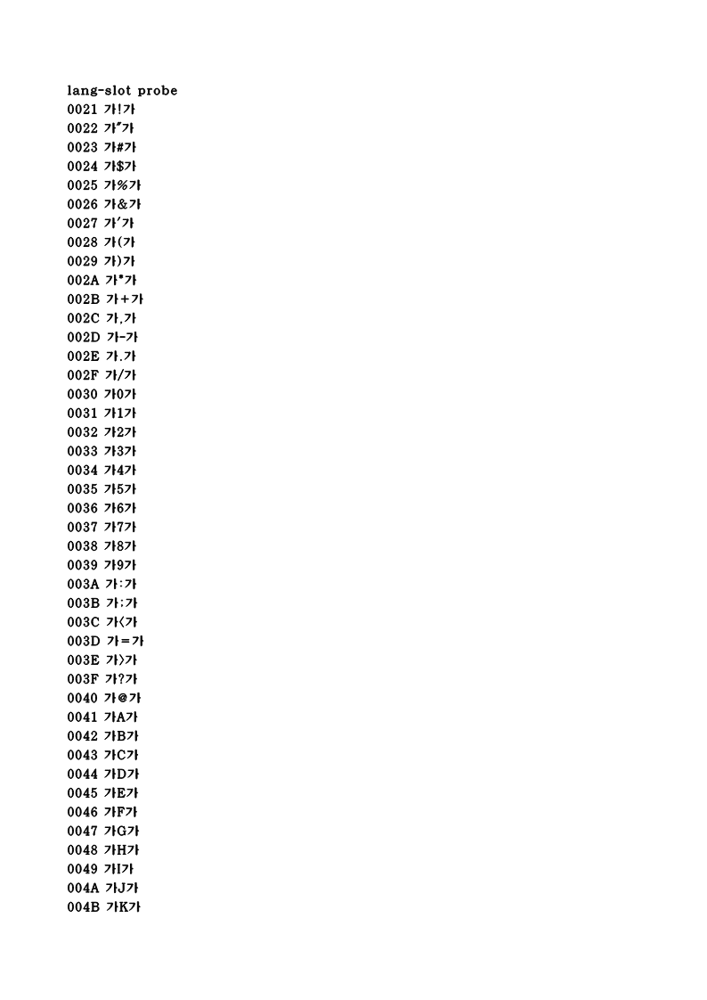 | 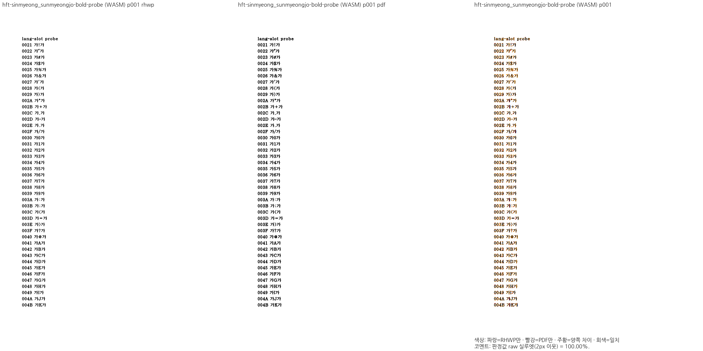 | 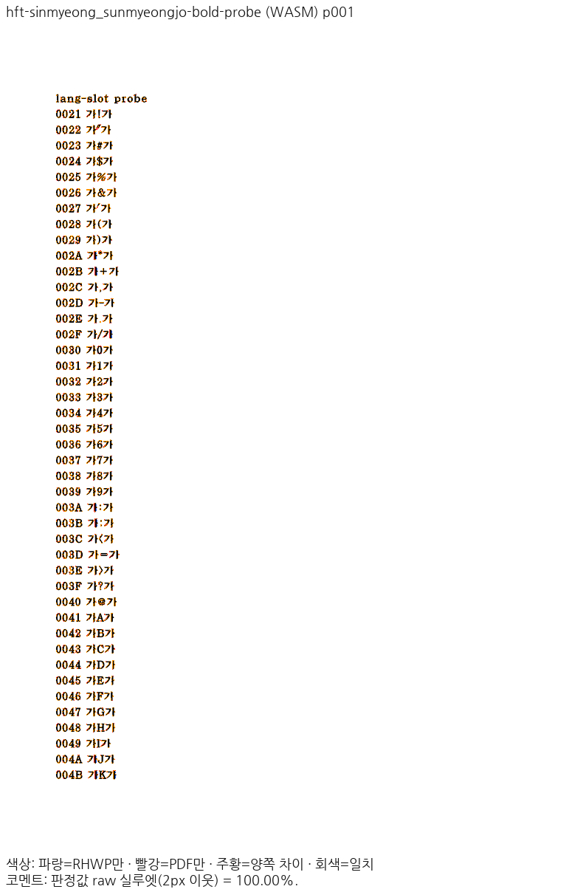 |

## Merge 후 contributor PR comment 계획

[Visual Sweep 정본](../../manual/verification/visual_sweep_guide.md#github-merge-comment)에 따라 통합 PR의 exact head CI·정상 merge와 asset의 devel 반영 뒤 게시합니다. 위 **해당 PR 주장 쪽** raw/review/overlay를 `https://raw.githubusercontent.com/edwardkim/rhwp/<merge-commit-sha>/mydocs/pr/assets/planet6897_20261116/claims/<input>/<backend>/<image>.png`로 고정해 Markdown 이미지로 표시합니다. 실제 입력·Print2022 제품/빌드·검증 수치·원 기여와 추가 보완 범위를 존댓말로 설명합니다. 게시 뒤 API와 이미지 해시를 재확인하며, 실제 해결한 원 이슈와 원 PR을 닫습니다. 통합 PR owner를 자동 reviewer로 지정하지 않습니다.

## 통합 PR의 code CI와 추가 필수 증적

[통합 PR #9140](https://github.com/edwardkim/rhwp/pull/9140)의 정확한 code head `c6996300203fec553a57b0c16b2e48329ebc083a`에서 [CI](https://github.com/edwardkim/rhwp/actions/runs/43877624194)·CodeQL·Render Diff·Adapter·Proptest·정책 검사가 모두 성공했습니다. 원격 기본 회귀는 **13,465 PASS·0 FAIL·45 skip**이며 위 macOS 로컬 실행과 구분합니다. [실제 job·SHA·결론](../assets/planet6897_20261116/final/code-ci.json).

필수 항목 재대조에서 최초 제출 기록에 빠졌던 공개 공통 4문서 검사를 보완해 Native/fresh WASM 8건 모두 공식 raw 100.00%·하락 0을 확인했습니다. [추가 원장](../assets/planet6897_20261116/final/supplemental/validation.json)에 제출 후 실행 사실과 직접 판독·입력 해시를 명시했습니다. 대표 SVG 2쪽×2경로도 보완했으며 전쪽 SVG 검증으로 확대 표현하지 않습니다. 제품·test·baseline 변경 없이 증적과 self-review·오늘할일만 문서 전용 trailing에 추가합니다. 최신 trailing head의 CI·merge 확인은 별도 원격 조건입니다.
