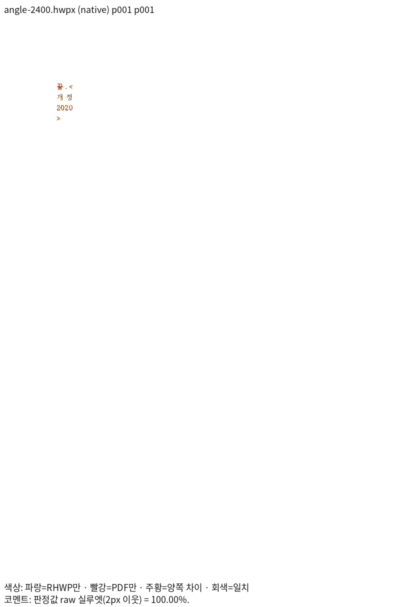
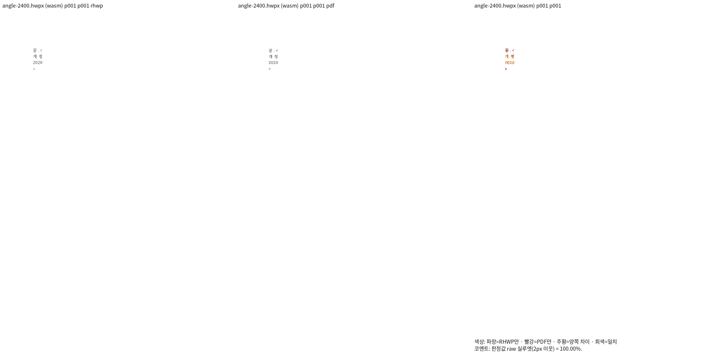

# PR #9102 리뷰 — 기여자 공통 보호 검사와 OS 글꼴 공급 기준

## 최종 판정

**승인 — 공개 글꼴로 실행 가능한 공통 네 문서의 Native/fresh WASM 검증과 검사·지침 검토 완료.**
검증한 code head는 `5e0d8b6bc07e81065f572d55bdad4a71c9fe61df`이며 해당 SHA의 CI·CodeQL·
Adapter·Proptest·정책 검사가 모두 성공했다. 이 문서 전용 trailing head는 최신 base 병합·링크·
실제 CI 재사용 판정과 mergeability를 따로 확인한 뒤 병합한다.

## 접수와 범위

| 항목 | 값 |
| --- | --- |
| PR·작성자·대상 | [PR #9102](https://github.com/edwardkim/rhwp/pull/9102) / jangster77 / devel |
| 관련 이슈 | [Issue #9101](https://github.com/edwardkim/rhwp/issues/9101), 이번 조사·검사·지침 범위로 종료 |
| code head | `5e0d8b6bc07e81065f572d55bdad4a71c9fe61df` |
| 리베이스 base | `d954632aab5b80aadbea39cece4f5a783634856b` |
| 기록 작성 시 최신 base | `7ee4fe0327`, PR #9092 제품 정보 창 및 후속 기록 |
| 역할·상태 | collaborator self PR, Open, reviewer 미지정, GitHub self-approve 없음 |

공통 CLI는 공개 글꼴로 재현되는 네 원본·기존 독립 Print PDF를 등록하고, 공식 Visual Sweep의
`--silhouette-only --resume`으로 Native/fresh WASM 전쪽 TSV를 산출한다. 입력/PDF SHA·전체
쪽수·96 DPI·인쇄 프로필·2px raw 조건·실행 신원을 확인하고, 90% 미달·정본의 두 자리 표시값
하락·누락·중복·비정상 수치·잘못된 조건·오래된 성공 보고서 재사용을 실패로 처리한다.
네 문서를 임의로 줄이거나 선택 쪽·마스크·글꼴 예외로 통과시키지 않는다.

기존 편람 전용 gate와 통합 담당자의 전체 정본 보호는 유지한다. 일반 기여자에게 비공개 OTF
설치나 특수 환경의 18개 원본 전체 재현을 제출 의무로 요구하지 않는다. Rust·Studio 렌더러,
글꼴 선택·자간 알고리즘, 기존 PDF·baseline·golden 및 CI 실행 정의는 변경하지 않았다.
신규 9건은 검사 정책의 계약이며 설치 글꼴에 의존하는 실물 배치·절대 px 회귀가 아니다.

## 시각 증거와 직접 판독

[공통 등록부](../../../scripts/data/contributor_visual_gate.json)에 기존 원본/PDF의 경로·SHA·
compat를 기록했다. 이미 저장소에 포함된 파일을 재사용하며 PDF를 재출력하지 않았다.
[측정 원장](../assets/issue_9101/common-evidence.json)은 엔진 source
`4e0b20d2922953ee7ab9a1716ac819b921fe484b`, 최종 driver·등록부·binary·package와 TSV/PNG 해시를 고정한다.

| 원본·전체 쪽수 | Native TSV·전쪽 최저 | fresh WASM TSV·전쪽 최저 |
| --- | --- | --- |
| re-03-latin-only-hancom.hwp · 1쪽 | [100.00%](../assets/issue_9101/common/native/latin.tsv) | [100.00%](../assets/issue_9101/common/wasm/latin.tsv) |
| angle-2400.hwpx · 1쪽 | [100.00%](../assets/issue_9101/common/native/angle-narrow.tsv) | [100.00%](../assets/issue_9101/common/wasm/angle-narrow.tsv) |
| pic-crop-01.hwp · 1쪽 | [100.00%](../assets/issue_9101/common/native/picture-crop.tsv) | [100.00%](../assets/issue_9101/common/wasm/picture-crop.tsv) |
| shape-group-02.hwp · 1쪽 | [100.00%](../assets/issue_9101/common/native/shape-group.tsv) | [100.00%](../assets/issue_9101/common/wasm/shape-group.tsv) |

공개 Ubuntu 글꼴·등록 웹폰트 환경의 8개 출력 모두 독립 PDF와 쪽수가 일치했다.
라틴 세 줄·끝 위치, 좁은 셀의 한글·숫자·괄호 간격, 두 그림 자르기 영역·테두리,
그룹 도형의 윤곽·채움·그림자를 직접 대조했다. 최종 측정 PNG 16개는 직접 판독본과 SHA가 같다.
100.00%는 2px raw 표시값이며 픽셀 완전 일치라는 의미로 쓰지 않는다.

| angle-2400.hwpx 1쪽 Native review | 같은 쪽 Native overlay |
| --- | --- |
|  |  |

| 같은 1쪽 fresh WASM review | WASM overlay |
| --- | --- |
|  |  |

## OS별 조사와 한계

[조사 결과와 전쪽 TSV 36개](../assets/issue_9101/os-stock-results.md)는 공개 497개 파일에
Windows Desktop 17개·한국어 추가 TTC 2개를 공급한 18개 원본, 경로당 1,771쪽의 실제 결과다.
Windows 기본 글꼴 전체나 Windows/macOS 직접 실행을 대표하지 않는다. 90% 미달·정본 대비
하락도 그대로 공개했으며 다른 글꼴 환경을 기존 특수 환경의 무회귀·렌더러 개선으로 표시하지 않았다.
일반 실행의 편람 조사와 KoPub를 준비하는 기존 편람 전용 gate도 구분한다. sample10의 기존
대용량 로컬 기준 PDF는 [원장](../assets/issue_9101/os-stock-evidence.json)에 경로·SHA·쪽수를 기록했다.

[공식 OS 공급 분류](../assets/issue_9101/document-font-requests.json)는 472개 선언 요청 중
123개를 Apple·Microsoft 공식 목록과 대응한다. 선언 목록을 실제 본문 사용 목록으로 취급하지 않는다.
Linux는 배포판·설치 구성별로 구분했다. 실제 글꼴 프로그램은 배포하지 않고 메타데이터만 기록했다.
Arial 공급 시 body-list/control-styles는 양쪽 100.00%와 실제 스타일을 확인했지만 공개 웹폰트만의
잘못된 굵기·폭을 공통 네 문서의 통과 증거로 대신하지 않았다. 조사 실패 원본의 조판 회귀를
새로 등록하거나 기존 보호 범위를 제거·완화하지 않았다.

## 검증과 리베이스 기능 보존

- 공식 공통 gate 최초·재개·최종 실행 각각 8/8 PASS, 최종 driver 계약 9 PASS.
- 전체 Python Visual Sweep 계약 267 PASS, Markdown 상대 링크 668 PASS.
  변경한 정본 문서 metadata·공백 검사 통과. 전체 metadata의 기존 5개 파일 20건은 base와
  내용이 같음을 확인했으며 이번 변경 파일의 오류로 합산하지 않았다.
- 충돌 없이 리베이스했고 CI frontend 분리의 소비 경로 Node 계약 104개도 PASS.
  엔진·sweep·export·registry source가 측정 source와 같아 binary/package·출력 증거를 재사용했다.
- 추가된 PR #9092는 제품 정보 창의 CSS·이벤트·E2E로 공통 gate·조판 엔진과 수정 경로가 겹치지 않는다.
  검증한 code head를 재작성하지 않고 최신 base 병합 tree에서 양쪽 코드·기록·링크를 확인한다.
- 정확한 code SHA의 [CI](https://github.com/edwardkim/rhwp/actions/runs/43733080663),
  [CodeQL](https://github.com/edwardkim/rhwp/actions/runs/43733080659),
  [Adapter](https://github.com/edwardkim/rhwp/actions/runs/43733080670),
  [Proptest](https://github.com/edwardkim/rhwp/actions/runs/43733080735),
  [정책 검사](https://github.com/edwardkim/rhwp/actions/runs/43733080610)가 모두 success다.
  CI lint의 Python 267건 실제 실행, Native Skia·기본 Rust archive A–E·frontend 성공도 확인했다.
  [code CI 영수증](../assets/issue_9101/code-ci.json)에 확인 시각·check별 URL을 보존한다.

조판 원칙의 줄 구성·높이·소유·분할·배치 생산/소비 로직은 변경하지 않아 비해당이다.
기존 공통 계산기·판정값을 소비하는지, 원본/PDF/전쪽 보존과 미달·하락의 실패 처리가 정확한지,
점수와 직접 판독을 구분하는지를 검토했다.

## 병합 후 처리 계획

trailing head의 required check·실제 fast-pass·mergeability 확인 후 정상 병합한다.
병합 SHA로 고정한 같은 1쪽의 Native/fresh WASM review·overlay와 전쪽 TSV·지침·code CI 링크를
PR 댓글에 게시하고 API 및 이미지 표시를 다시 확인한다. Issue #9101 자동 종료와 duration 자동
갱신 결과를 확인하며 병합 후 검증 CI를 새로 실행하지 않는다. review·오늘할일이 이 PR에 포함되므로
별도 기록 PR은 만들지 않는다. devel 동기화와 소유 임시 branch·output 전체·사용 종료된
target/pr-review/debug 정리를 마치고 실제 결과를 보고한다.
