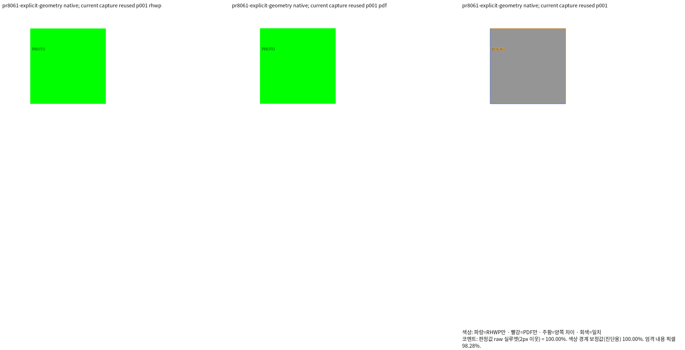
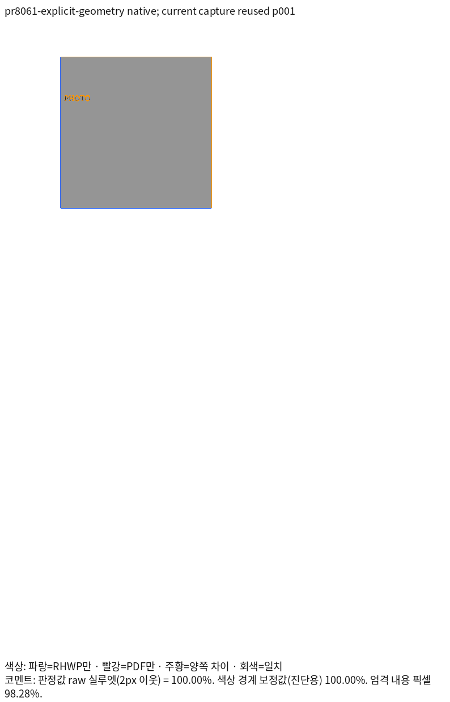

# 셀 그림의 쪽 순서와 표 소유 검증

원 PR [#8061](https://github.com/edwardkim/rhwp/pull/8061)의 같은 재현을 사용한다.
그림의 편집 주소와 그리기 계층을 구분하고, 하나의 그림에서 만든 bitmap·테두리의
내부 순서를 유지하는 메인터너 보정의 증거다. 다른 실물 HWP를 추가하지 않았다.
sample16·행정업무운영 편람의 삭제된 입력·검사·파생 참조를 복원하지 않았다.

## 입력과 독립 Print

[입력 8개](../../../../tests/fixtures/pr8061_cell_picture_layer/)와
[Print PDF 8개](../../../../pdf/pr8061_review/)는 같은 바이트의 쌍이다.
원 검사에서 내보낸 초기 HWPX에는 사각형의 원래 크기·꼭짓점과 그림 원본 크기가
없어 한컴에서 두 개체가 인쇄되지 않았다. 선언된 기하 정보만 명시한 별도 대조군을
사용했다. 초기 파일을 정상 출력으로 간주하거나 그 점수를 개선됐다고 바꾸지 않았다.
이후 속성 대조군은 표의 흐름 참여·그림 z-order·flowWithText·테두리를 구분한다.

기준 PDF는 MCP engine 2020, Hancom 11.0.0.9136의 Print 출력이다.
`pdf_print_method=0`, `hancom2020_pdf_driver_one_up`, 입력 전처리 없음으로 출력한
전체 1쪽이다. RHWP의 `compat=2022`는 이 검증에서 고정한 조판 모드이며 PDF를
한컴 2022로 출력했다는 뜻이 아니다. 입력·PDF SHA-256과 독립 PDF 이미지 CTM은
[expected.json](../../../../tests/fixtures/pr8061_cell_picture_layer/expected.json)에 있다.
기대 좌표를 RHWP 출력에서 추출하지 않았다.

| 조건 | Print의 그림 표시 | Native / fresh WASM raw | 전체 쪽수 |
| --- | --- | --- | --- |
| explicit-geometry: flowWithText=0, 그림 z=0, 쪽 도형 z=1 | 녹색 쪽 도형에 가려짐 | 100% / 100% | 1 / 1 / 1 |
| no-paper | 빨간 그림 표시 | 100% / 100% | 1 / 1 / 1 |
| picture-z2 | 그림이 쪽 도형 위 | 100% / 100% | 1 / 1 / 1 |
| picture-follow-cell | 그림이 표의 그리기 소유를 따름 | 100% / 100% | 1 / 1 / 1 |
| floating-page-order | 떠 있는 표에서도 쪽 도형에 가려짐 | 100% / 100% | 1 / 1 / 1 |
| floating-picture-z2 | 그림이 쪽 도형 위 | 100% / 100% | 1 / 1 / 1 |
| floating-follow-cell | 그림이 표의 그리기 소유를 따름 | 100% / 100% | 1 / 1 / 1 |
| bordered-page-picture | bitmap 뒤에 파란 테두리 표시 | 100% / 100% | 1 / 1 / 1 |

쪽수는 RHWP Native / fresh WASM / 독립 Print 순서다.
[Native TSV](native/)·[fresh WASM TSV](wasm/) 원문을 보존했다.
각 backend의 `base/`에는 같은 입력·PDF에 대한 고정 base
`238de6de41a208648f4ade6b494fe433a81c1fce`의 원문 TSV가 있다.
8조건·양쪽 16개 페이지 비교에서 0.1%p 초과 하락은 0쪽이다.

## 생산 코드와 실행

Native 257 SHA-256:
`d82a25fc1270fb80a0677f76cf6db2e82a8b1f7a9e5fbd5cac34f94f48eb36cc`.
표준 release와 실제 wasm-opt를 완료한 fresh WASM 074의 WASM SHA-256:
`66f613e0f25233c66f31da9cd2df922acccd2b10d94409be585fa9998e90483f`.
JS SHA-256은 `c54d7b15b99d43918960f1c0b5b0ba138f912a7998793fc9f28a94053620fc0c`다.

빌드 당시 주 작업 HEAD는 `3139fff0803c0c5928ec7f8462b3643d1c38a77c`, 검증 worktree
HEAD는 `61528013511c87c732524f91c6f224286a055337`이며 네 런타임 파일을 동일하게
덧씌워 검증했다. Git HEAD만으로 생산 코드를 표시하지 않는다.
[provenance.json](provenance.json)의 `source_overlay.overlaid_paths`가 실제 컴파일한
파일별 SHA-256이고, 각 캡처의 명령·producer·입력/PDF·TSV·PNG 해시도 함께 기록했다.
상세 실행 로그와 전체 font inventory는 ignored `output/pr-review/semanticist21-20261019/`에 둔다.

Native 빌드는 공용 `target/pr-review`, jobs 8, `release-test`,
`native-skia,pdf-jbig2,pdf-jpeg2000`으로 수행했다. fresh WASM은 같은 target과 jobs 8로
`scripts/wasm-pack-locked.sh --target web --release --out-dir pkg`를 완료했다.
TSV는 아래와 같은 형식으로 산출했다. 실제 절대 경로·글꼴 경로는 provenance에 있다.

```bash
venv/bin/python scripts/visual_sweep.py --silhouette-only \
  --file-target cell-picture \
  tests/fixtures/pr8061_cell_picture_layer/explicit-geometry.hwpx \
  pdf/pr8061_review/explicit-geometry-2020.pdf \
  --rhwp-bin <Native257> --compat 2022 --dpi 96 --page-workers 1 \
  --out output/pr-review/<review-id>/cell-picture-native
# fresh WASM도 같은 명령에 --wasm-pkg <fresh074-package>를 추가한다.
```

## 직접 판독과 회귀 검사

모든 8조건을 같은 원본 영역·배율의 [1~4조건](cases-1-4.png)·[5~8조건](cases-5-8.png)으로
대조했다. 칼럼은 Native / Print / fresh WASM / Native overlay / WASM overlay다.
대표 두 조건은 양쪽 정본 review와 standalone overlay도 직접 확인했다.
raw 100%는 RGB 동일을 뜻하지 않는다. 같은 불투명 면적의 빨강·녹색 가림 오류는
raw만으로 검출되지 않아 실제 색상과 그리기 순서를 별도로 확인했다. 작은 PHOTO 글자의
래스터 경계 차이와 떠 있는 그림의 약 1.12px 원점 차이는 남으며, 독립 좌표 ±2px 안이다.





[새 회귀](../../../../tests/cases/verified_cell_picture_layer_scope.rs)는 8개 관계·독립 좌표
검사와 Native 실제 PNG 색상 검사 1개다. 편집 주소, 그림 하나, PHOTO 보존,
원본 HWPUNIT의 셀 포함, 독립 Print CTM ±2px, 쪽 도형과의 가림 및 bitmap/테두리 순서를
함께 보호한다. 임시 NodeId나 렌더 결과를 기대 좌표로 쓰지 않는다.
원본 단위 관계는 부동소수점 연산의 약 1e-14px 오차를 정수 HWPUNIT에서 비교하며,
독립 Print의 ±2px 조건은 그대로 유지한다.

같은 입력의 SVG 순서 assertion에서 독립 쪽 그림 2조건과 테두리 1조건은 각각
수정 전 FAIL / 수정 후 PASS였다. 이는 순서 결함의 검출 증거이며 SVG 래스터를
시각 검증으로 사용한 것이 아니다. 잘못된 기존 검사는 삭제하고 새 이름으로 추가했다.

## RowBreak 대조군과 영향 범위

기존 정상 한컴 저장 RowBreak 2쪽은 Native/fresh WASM 모두 raw 100%다.
[관계·좌표 회귀](../../../../tests/cases/verified_rowbreak_successor_print_frame.rs)는
50/10행, 셀 120개의 보존·중복 없음, 표 조각 외곽과 뒤 문단의 소속·순서·독립 Print
좌표를 보호한다. [기대값](rowbreak-expected.json)과 [양쪽 TSV·대표 PNG](rowbreak/)를 따른다.
새 검사 10개 전체의 focused nextest 결과는 10 PASS·0 FAIL이다.

기존 114조건의 실제 render tree에서 셀 그림이 있는 6조건·94쪽을 추려 현재 Native와
fresh WASM으로 다시 출력했다. 위 9조건·10쪽을 합하면 새 런타임의 선행 검증은
15조건·104쪽/backend다. 모두 90% 이상이고 독립 PDF와 쪽수가 같다.
영향 6조건과 RowBreak 대조군의 [페이지별 base 비교](impact-comparison.tsv),
[입력·TSV 해시](impact-provenance.json), [TSV 원문](impact/)에서 192쪽 비교의
0.1%p 초과 하락 0쪽을 확인했다. 위 8조건을 합한 양쪽 전체 비교는 208개 페이지다.

전체 Rust·lint·Studio 및 최종 제출 범위의 검증은 이 선행 결과와 별개로 마무리해야 한다.
이전 런타임의 전체 PASS를 새 코드의 완료로 재사용하지 않으며 아직 PR을 제출하지 않았다.
