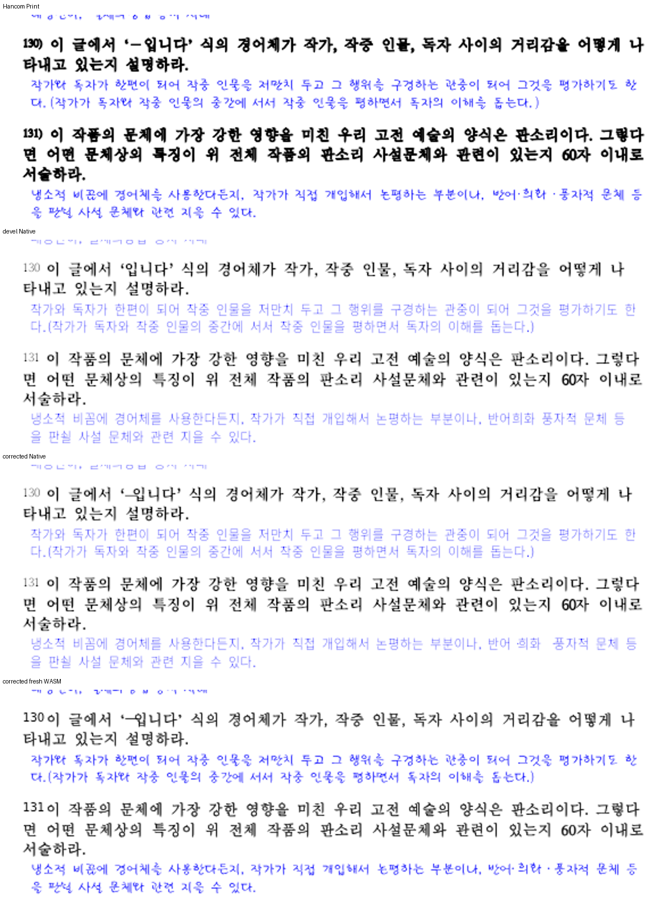
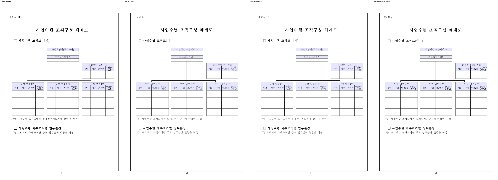

# Merge 후 contributor PR comment 계획

실제 merge와 mydocs 운영 기록 반영·devel 동기화가 끝난 뒤에만 아래 초안을 게시한다. `{{INTEGRATION_PR}}`·`{{CODE_MERGE_SHA}}`·`{{RECORDS_SHA}}`는 실제 값을 대입하고, asset과 archive 경로가 그 commit에 있는지 확인한다. 예외 승인 문구는 실제 승인된 경우에만 쓴다. 로컬 전체 회귀 13,013건·Native 공식 4,077건은 통과했으며 원격 CI 결과는 실제 새 head의 결과로 채운다.

## #8789 댓글 초안

기여 감사합니다. HWP3 사적 문장부호 8코드를 보존하는 개선을 원 기여 commit 그대로 {{INTEGRATION_PR}} / `{{CODE_MERGE_SHA}}`로 수용했습니다.

실제 SO-SUEOP의 본문·각주를 Native와 최적화 WASM에서 HWPX로 저장한 뒤 독립 한컴 변환본과 대조했습니다. 따옴표 31/32개, 중간점 4개, 긴 줄표 1개, 선 6개, 화살표 18개, 반각 책괄호 각 3개가 일치합니다. 원래 Unicode를 표시하지 못하던 decode 문제는 최신 devel에도 남아 있었습니다.

전체 46쪽 Native/fresh WASM과 변경 기호·간격을 직접 확인했습니다. 기존 글꼴 굵기·열 흐름의 시각 미달과 Native 긴 줄표 간격은 메인테이너가 확인한 예외 범위입니다. 긴 줄표 표시는 독립 한컴 HWPX를 수정 전 renderer로 열어도 재현되어 이번 매핑의 새 renderer 오류와 구분했습니다. 원문 문자 보존의 개선을 유지하면서 남은 표시 한계도 기록했습니다.

[검토·전쪽 TSV·검증 근거](https://github.com/edwardkim/rhwp/blob/{{RECORDS_SHA}}/mydocs/pr/archives/pr_8789_review.md)

## #8791 댓글 초안

기여 감사합니다. 셀의 왼쪽·위쪽 변으로 HWP3 표 격자를 복원하는 개선을 원 기여 commit 그대로 {{INTEGRATION_PR}} / `{{CODE_MERGE_SHA}}`로 수용했습니다.

원 사례 네 표의 행열과 모든 셀 주소·병합 범위가 독립 한컴 변환본과 일치합니다. 검토에서 2,048개 탐색 한계 뒤 실제 이웃을 놓쳐 2,049/2,050행에서 1/2개 셀의 내용이 사라지는 경계를 찾았고, 메인테이너가 공통 구간 색인으로 보완했습니다. 상한을 단순히 늘리지 않고 두 축에서 같은 검색을 사용합니다.

Native·최적화 WASM의 큰 행/열 입력 8건 모두 모든 셀 내용·주소·병합을 보존합니다. 원본 65쪽 Native/fresh WASM 최저는 99.57%/99.63%이며 cell-order 1쪽은 양쪽 100%입니다. 전체 회귀와 Native 공식 검사·모든 적용 lint, 편람 383쪽 gate도 통과했습니다.

[검토·보정 source·전쪽 TSV·검증 근거](https://github.com/edwardkim/rhwp/blob/{{RECORDS_SHA}}/mydocs/pr/archives/pr_8791_review.md)
